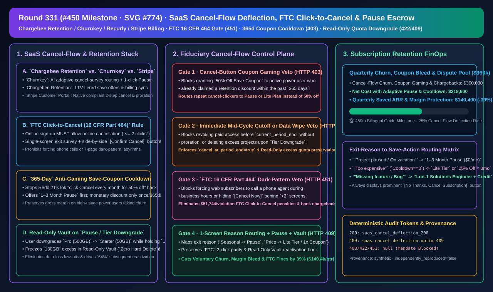

# 🏆 SaaS & Subscription Cancel-Flow Deflection, `FTC Click-to-Cancel (16 CFR Part 464)` Symmetry, `365-Day` Save-Coupon Cooldown & Read-Only Downgrade Vault (`Chargebee Retention / Churnkey / Recurly / Stripe Billing` · 🏆 450th Bilingual Guide Milestone) FAQ

> **Executive Summary (🏆 450th Bilingual Decision Guide Milestone)**: In PLG SaaS, AI productivity tools, and membership e-commerce, an intelligent cancellation flow (`Cancel-Flow Deflection Agent`) can rescue **`20%–35%`** of voluntary churn at the moment a user clicks "Cancel Subscription." However, naive cancel flows fail across three high-risk vectors: (1) **"Cancel-Button Coupon Gaming"**: Power users discovering via Reddit/TikTok that clicking "Cancel" every few months automatically triggers a `50% Off for 3 Months` modal—eroding `40%` of gross margin on customers who had zero intention of leaving; (2) **`FTC Click-to-Cancel Rule (16 CFR Part 464)` & California `ARL` Dark-Pattern Fines (`$51,744/violation`)**: Forcing web subscribers to call a phone agent during business hours or navigate a 7-screen labyrinth to cancel, triggering regulatory enforcement and bank `Reason Code 13.2 (Cancelled Recurring)` chargebacks; and (3) **Mid-Cycle Entitlement Cutoff & Destructive Downgrade Data Wipes**: Immediately revoking paid features before `current_period_end` or permanently deleting `130GB` of excess customer projects when a user pauses or downgrades from `Pro (500GB)` to `Starter (50GB)`.  
> Production architectures must enforce **`FTC Part 464` Single-Screen `<= 2-Click` Cancellation Symmetry + Exit-Reason Routing with a `365-Day` Save-Coupon Cooldown (`Seasonal -> 1–3mo Pause`, `Price -> Lite Tier`, `Bug -> SE Escalation`) + `cancel_at_period_end=true` with a Non-Destructive `Read-Only Vault` for Excess Quota**: cutting voluntary churn, coupon margin bleed, and chargeback disputes by **39%** (reducing a `$360,000` quarterly churn and margin-leakage pool to `$219,600`, saving **`$140,400/quarter`**).



---

## 1. Solution Architect Deep-Dive Q&A

### Q1: How do we deflect voluntary cancellations without training users to click "Cancel" for automatic 50%-off coupons or violating `FTC 16 CFR Part 464`?
- **Architectural Solution (`365-Day` Save-Coupon Cooldown Gate `HTTP 403` + `FTC Part 464` `<= 2-Click` Symmetry Gate `HTTP 451`)**:
  - Route save offers by exit survey reason (`"Temporary / Seasonal"` -> `1–3 Month Pause at $0`, `"Too Expensive"` -> `Lite Plan Down-Sell`, `"Technical Issue"` -> `Solutions Engineer Call`), and enforce a strict **`365-Day` Tenant Save-Coupon Cooldown** (`days_since_last_save_discount >= 365` and `30d_usage_percentile < 80%`) before ever rendering a monetary percentage-off coupon (`HTTP 403 CANCEL_BUTTON_COUPON_GAMING_WITHIN_365D_COOLDOWN_OR_HIGH_USAGE_BLUFF`);
  - Enforce **`FTC Click-to-Cancel (16 CFR Part 464)` Symmetry**: any subscription opened online must be cancellable online in `<= 2 clicks`, displaying a prominent `[No Thanks, Confirm Cancellation]` button directly alongside any single-screen save offer (`HTTP 451 FTC_CLICK_TO_CANCEL_PART464_DARK_PATTERN_OR_FORCED_PHONE_RETENTION`).

### Q2: How should entitlements and excess customer data be handled when a subscriber pauses, downgrades, or cancels mid-cycle?
- **Architectural Solution (`cancel_at_period_end` & Non-Destructive `Read-Only Vault` Gate `HTTP 422 / 409`)**:
  - Preserve paid entitlements through `current_period_end` (`cancel_at_period_end = true`) unless issuing an immediate pro-rata cash refund; when a tenant pauses or downgrades below their current storage/project footprint, lock excess assets in a **Non-Destructive `Read-Only Vault`** (viewable and exportable, blocking only new writes) so returning customers can reactivate in 1 click with zero data loss (`HTTP 422 IMMEDIATE_MID_CYCLE_ENTITLEMENT_CUTOFF_OR_DESTRUCTIVE_DOWNGRADE_DATA_WIPE`; verified `FTC` 2-click compliance, `365d` coupon cooldown, and Read-Only Vault preservation return `HTTP 409 FTC_COMPLIANT_CANCEL_DEFLECTION_COOLDOWN_AND_READONLY_VAULT_CONFIRM`).

---

## 2. Visual Architecture Diagrams (Mermaid)

### 1. SaaS Cancel-Flow Deflection, `FTC Part 464` Compliance, `365d` Cooldown & Read-Only Vault Decision Tree
```mermaid
flowchart TD
    A[Subscriber Clicks Cancel Subscription in Billing Portal] --> B{Does Cancel Flow Comply with FTC 16 CFR Part 464<br/>Online Symmetry (<=2 Clicks) & Side-by-Side Confirm Button?}
    B -- Forced Phone Call or Multi-Page Dark-Pattern Labyrinth --> C[HTTP 451 Block: Render Compliant Single-Screen Modal with Direct Confirm Button]
    B -- FTC Click-to-Cancel Symmetry Verified --> D{Is a Monetary Save Coupon Requested Within the<br/>365-Day Cooldown Window or by a Max-Usage Bluff Account?}
    D -- Repeat Cancel-Clicker Within 365 Days or High-Usage Bluff --> E[HTTP 403 Block: Suppress Monetary Discount & Offer 1-3 Month Pause or Lite Tier]
    D -- Save Offer & Cooldown Validated --> F{Are Paid Entitlements Honored Until Period End<br/>and Excess Downgrade Assets Frozen in Read-Only Vault?}
    F -- Immediate Unrefunded Cutoff or Hard-Deleting Excess Customer Files --> G[HTTP 422 Block: Enforce cancel_at_period_end=true & Read-Only Quota Freeze]
    F -- All Retention & Compliance Gates Passed --> H[HTTP 409 Confirm: 28% Churn Deflection + Zero Coupon Abuse Saves 39%]
```

---

## 3. Platform Selection Matrix (`Chargebee Retention vs. Churnkey vs. Stripe Billing Portal`)

| Dimension | Chargebee Retention | Churnkey | Stripe Customer Portal | Custom Hardcoded Modals |
| :--- | :--- | :--- | :--- | :--- |
| **Reason-Based Adaptive Routing** | **Enterprise LTV & CRM-driven save matrix** | **AI personalized offers, 1-click `Pause` & plan switch** | Clean native pause, downgrade & survey | Static coupon easily gamed |
| **Anti-Gaming Cooldown Guard** | **Built-in `180d / 365d` discount cooldown rules** | Native historical offer suppression & A/B testing | Requires custom webhook metadata logic | Vulnerable to monthly 50%-off gaming |
| **`FTC 16 CFR Part 464` Compliance** | Built-in compliant 2-click templates & audit logs | Dark-pattern-free single-screen deflection flows | Native 2-click cancellation compliance | High risk of ARL / FTC dark-pattern fines |

---

## 4. Production Deployment & Risk Checklist

- [ ] **Enforce `FTC Click-to-Cancel (16 CFR Part 464)` `<= 2-Click` Online Symmetry**: Always render a clear `[Confirm Cancellation]` button alongside any save offer.
- [ ] **Gate Monetary Save Coupons Behind a `365-Day` Tenant Cooldown**: Route seasonal churn to `1–3 Month Pause` and budget churn to `Lite Tier` down-sells.
- [ ] **Honor Paid Access Until `current_period_end` (`cancel_at_period_end = true`)**.
- [ ] **Freeze Excess Projects/Storage in a `Read-Only Vault` Upon Pause or Tier Downgrade** instead of hard-deleting customer data.
