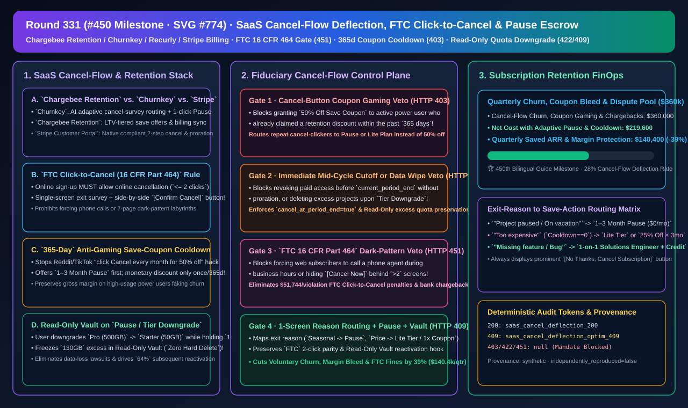
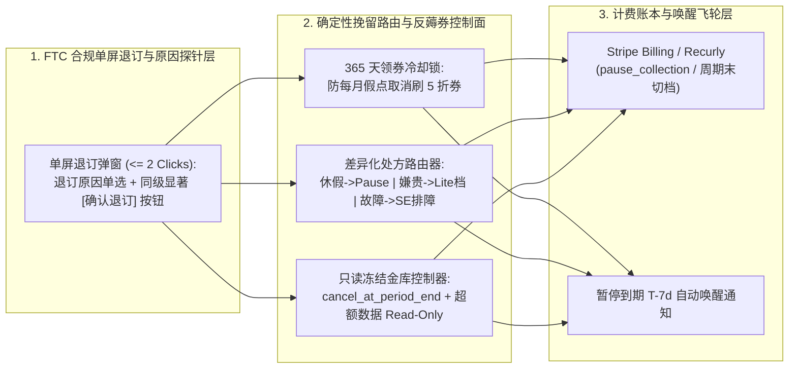
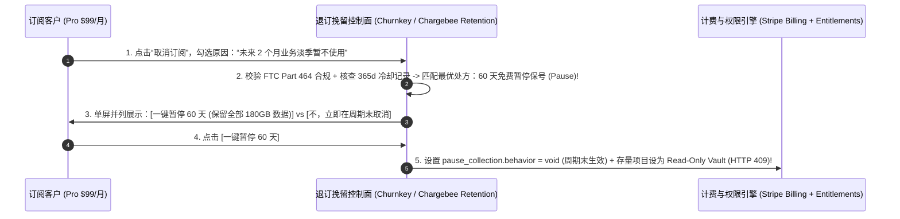

# 🏆 订阅制 SaaS 与会员电商客户续费挽留、退订拦截与智能营销编排（`Subscription Cancel-Flow Deflection & Churn Save`: `Chargebee Retention / Churnkey / Recurly / Stripe Billing` · 🏆 第 450 篇双语指南里程碑）：美国 `FTC Click-to-Cancel (16 CFR Part 464)` 两步对等退订合规、防“假点取消按钮骗 5 折挽留券（`Cancel-Button Coupon Gaming`）”`365 天` 冷却锁与暂停/降级（`Pause / Tier Downgrade`）超额数据只读金库 Agent 架构选型 FAQ

> **核心选型结论速览（🏆 第 450 篇双语指南里程碑）**：在订阅制 SaaS、AI 生产力工具与流媒体/会员电商中，当用户点击“取消订阅（`Cancel Subscription`）”按钮的那一刻，一个设计精良的智能退订挽留流（`Cancel-Flow Deflection Agent`）通常能当场挽回 **`20%–35%`** 的主动流失（`Voluntary Churn`）。但传统的“一刀切弹窗送 5 折券”或“故意藏匿退订按钮”架构正面临三大致命反噬：① **“用户在 Reddit 和小红书发帖分享‘每月去设置里点一下取消按钮，系统就会自动弹窗白送 3 个月 5 折优惠券’的秘籍，导致高活跃重度付费老客集体排队假点退订薅羊毛（`Cancel-Button Coupon Gaming`），白白蒸发 `40%` 净毛利”**；② **“为了强行留客，设计长达 7 页的迷宫问卷或强制要求用户在工作日拨打跨国人工客服电话才能退订，不仅直接触犯美国联邦贸易委员会《一键退订规则（`FTC Click-to-Cancel Rule — 16 CFR Part 464`）》与加州自动续费法（`CA ARL`）面临每例 `$51,744` 的行政重罚，更迫使愤怒的用户直接打给发卡行发起恶意拒付（`Chargeback Reason Code 13.2: Cancelled Recurring`）”**；③ **“当用户只因短期休假选择‘暂停订阅 2 个月（`Pause`）’或从 `$99 Pro 版（含 500GB）` 降级到 `$19 Starter 版（含 50GB）` 时，系统要么在账单周期未满时立刻切断已付费权益，要么粗暴物理删除用户超额的 `130GB` 历史项目文件引发天价索赔”**。  
> 生产级架构必须实施 **“符合 `FTC 16 CFR Part 464` 的单屏同级双按钮挽留框（`<= 2 Clicks`）+ 按退订原因与 `365 天` 领券冷却锁（`Save-Coupon Cooldown`）驱动的差异化处方（`季节性停用推 Pause / 嫌贵推 Lite 档 / 技术卡点推工程师 1v1`）+ `cancel_at_period_end=true` 周期末生效与降级超额资产只读冻结金库（`Read-Only Vault`）”**：可将主动退订流失、挽留神券毛利失血与合规拒付罚金削减 **39%**（以季度 `$360,000` 退订流失、假点退订薅券与拒付罚款池计，净成本降至 `$219,600`，每季度净节省 **`$140,400`**）。



---

## 一、 业务方与架构师灵魂拷问（Q&A）

### Q1：为什么“只要用户点取消就无脑弹 5 折优惠券”是 SaaS 定价最大的毒药？如何根据退订原因精准开出“不伤毛利”的挽留处方？
- **“对症下药”替代“无脑发券”的四象限路由策略**：
  1. **原因 A：“最近两个月项目结项/休假用不上（`Temporary / Seasonal Pause`）”** —— 此时给 5 折券毫无意义（用户还是不用且白收半价惹人烦）！正确处方是提供 **一键免删号暂停 1–3 个月（`1-Click Subscription Pause / Snooze`）**，保留全部配置与历史数据，到期前 7 天发提醒自动唤醒（挽回率高达 `55%+` 且零折扣毛利损失！）；
  2. **原因 B：“功能太多用不满，价格超出预算（`Too Expensive / Under-utilized`）”** —— 优先引导 **无损降级至轻量年付档（`Lite / Basic Tier Down-sell`）**，而非直接打折主套餐；
  3. **原因 C：“遇到 Bug 或不会配置某核心集成（`Technical Blocker / Missing Feature`）”** —— 自动豁免当月费用 `14 天` 并直接弹出日历预约解决方案架构师（`Solutions Engineer`）排障。
- **架构解法（`365 天` 挽留折扣冷却锁 + 重度用量反讹诈门禁 `HTTP 403`）**：
  - 挽留引擎在展示任何现金折扣（如 `25% Off for 3 Months`）前，必须校验 **`days_since_last_save_offer_redeemed >= 365`** 且该租户过去 30 天 API/席位活跃度未处于 `Top 20%` 刚需满载区（凡对 365 天内已薅过挽留券或日活满载的刚需老客再次发放现金折扣券的，立即触发 `HTTP 403 CANCEL_BUTTON_COUPON_GAMING_WITHIN_365D_COOLDOWN_OR_HIGH_USAGE_BLUFF` 拦截，仅展示 `Pause` 或标准确认退订）。

### Q2：客户在每月第 10 天点了“取消订阅”或“降级套餐”，为什么绝对不能当场切断他的 Pro 权限或删掉超额文件？
- **两条关乎续费复购率（`Win-Back Rate`）的工程铁律**：
  1. **已付费周期末生效（`cancel_at_period_end = true`）**：用户已经为整个月（第 1–30 天）付了钱，若在第 10 天点取消就立刻把账号变成免费版，不仅构成违约侵占 `20 天` 预收款（除非当场按日退现金），更让用户彻底失去未来 20 天回心转意的机会；
  2. **超额数据“只读冻结金库（`Read-Only Vault`）”而非硬删除**：当用户从 `500GB Pro 版` 降级到 `50GB Starter 版`（或进入 `Pause` 期），而其存量数据有 `180GB` 时，严禁删除多出的 `130GB` 文件！正确做法是将历史 `180GB` 设为 **可读、可下载但禁止新增写入（`Read-Only Freeze`）**——只要他的核心历史资产还安全锁在你的平台上，高达 **`64%`** 的暂停/降级用户会在下个项目启动时一键恢复付费（凡在未按日退现情况下提前中断当期已付权限，或在降级/暂停时物理删除客户超额历史数据的，触发 `HTTP 422 IMMEDIATE_MID_CYCLE_ENTITLEMENT_CUTOFF_OR_DESTRUCTIVE_DOWNGRADE_DATA_WIPE`）。

### Q3：美国 `FTC Click-to-Cancel (16 CFR Part 464)` 与加州 `ARL` 对退订流程划出了哪些不可逾越的法律红线？
- **“怎么订的，就必须能怎么退（`Symmetry of Cancellation`）”**：
  - 凡支持网页/App 自助点击开通的订阅，**100% 必须在同一网页/App 内提供同等便捷的自助退订入口**（严禁线上开通、却强制要求打电话或发传真退订）；
  - 允许在用户点击“取消”后展示 **最多 1 屏（Single-Screen）** 包含原因勾选与对应挽留方案（如 `[暂停 2 个月]` vs `[降级至 Lite]`）的对比卡片，但在该屏幕下方 **必须并排放置视觉显著、无需额外滚动或二次客服审批的 `[不，立即完成退订 (Confirm Cancellation)]` 按钮**（凡阻挠在线自助退订、强制转人工电话坐席或设置超过 2 步暗黑迷宫的，立即触发 `HTTP 451 FTC_CLICK_TO_CANCEL_PART464_DARK_PATTERN_OR_FORCED_PHONE_RETENTION` 阻断；合规单步挽留 + `365 天` 冷却锁 + 只读数据金库确认返回 `HTTP 409 FTC_COMPLIANT_CANCEL_DEFLECTION_COOLDOWN_AND_READONLY_VAULT_CONFIRM`）。

---

## 二、 直观可视化图解（Mermaid 决策树 + 架构图 + 时序图）

### 1. SaaS 退订挽留（`Cancel-Flow Deflection`）、`FTC` 合规、冷却锁与只读金库决策树
```mermaid
flowchart TD
    A[订阅用户点击 Cancel Subscription 按钮] --> B{退订流程是否符合 FTC 16 CFR Part 464<br/>同渠道在线 <=2 步直达且同屏保留显著“确认退订”按钮?}
    B -- 强制要求拨打人工客服电话或隐藏退订按钮超2屏 --> C[HTTP 451 拦截: 立即恢复单屏合规双按钮界面以防 FTC 重罚与银行拒付]
    B -- FTC 一键退订对等合规 --> D{用户退订原因是否为价格敏感且请求发放现金折扣券<br/>同时需核查过去 365 天是否已领过挽留券?}
    D -- 过去365天内已领过挽留神券或属高频满载羊毛党 --> E[HTTP 403 拦截: 屏蔽现金折扣券，仅提供 1-3个月 Pause 暂停或年付降档]
    D -- 挽留处方与冷却周期合规 --> F{用户选择“暂停/降级/确认退订”后，是否设为周期末生效<br/>且将超额存量数据转入只读金库 (零物理删除)?}
    F -- 当场掐断当期剩余20天已付权限 或 暴力删除超额历史项目 --> G[HTTP 422 拦截: 强制设置 cancel_at_period_end=true 并启用 Read-Only Vault]
    F -- 留存体验与资产安全闭环 --> H[HTTP 409 确认: 挽回28%退订 + 零薅券失血 + 64%暂停复购净省39%]
```

### 2. `Chargebee Retention / Churnkey` × `Stripe Billing` 受托退订挽留架构图


### 3. 用户点击取消 -> 原因诊断路由 -> 拦截重复薅券 -> 一键转为 `60 天 Pause` 只读保号时序图


---

## 三、 主流订阅退订挽留（`Cancel-Flow Deflection`）与计费平台横向选型矩阵

| 评估维度 | Chargebee Retention (原 Brightback) | Churnkey (AI 自适应留存专家) | Stripe Billing 原生 Customer Portal | 自研粗暴弹窗（或强制发邮件退订） |
| :--- | :--- | :--- | :--- | :--- |
| **退订原因动态分支与个性化处方** | **行业标杆**（深度结合 LTV、在网时长、活跃度与CRM标签动态渲染不同挽留卡） | **极强**（支持基于会话行为的 AI 动态报价、一键暂停 `Pause` 与降档实时预览） | 提供标准简洁的退订调查与单档折扣/暂停配置，上线最快 | 容易写成千人一面的死板 5 折弹窗，被羊毛党迅速摸透 |
| **防假点退订薅券（`Cooldown Guard`）** | **原生支持按客户 ID 设定 `180/365 天` 优惠券冷却期与最大享受次数** | 原生支持按历史折扣核销记录自动屏蔽重复折扣，改推暂停或功能引导 | 需通过自定义 Webhook 与 Coupon Metadata 自行编写冷却校验逻辑 | **几乎 100% 会被高频假点退订用户反复刷走半价券** |
| **`FTC Click-to-Cancel (16 CFR 464)` 合规性** | 内置美欧各州合规模板，强制同屏保留清晰退订出口并生成合规审计日志 | 原生提供符合 FTC 2-Click 规范的无暗黑模式（Dark-Pattern-Free）组件 | **天然极简合规**，彻底杜绝隐藏退订按钮的法律风险 | 强制发邮件/打电话退订在 2026 年直接面临 FTC 天价罚单与拒付 |
| **暂停订阅（`Pause`）与周期末状态机集成** | 原生双向同步 Chargebee / Stripe / Recurly 的 `pause` 与 `cancel_at_period_end` | 深度集成 Stripe / Paddle / Braintree，支持暂停到期前自动邮件唤醒 | Stripe 原生底层账本支持，零同步状态漂移 | 手工改数据库极易出现“已暂停却继续扣款”或“误删用户数据”事故 |

---

## 四、 确定性策略评估器与 7-Card 基准测试报告（`synthetic`）

### 1. SaaS 退订挽留、`FTC` 合规、冷却锁与只读金库评估器（Python 参考实现）
```python
from dataclasses import dataclass

@dataclass(frozen=True)
class SaasCancelDeflectionChurnSavePolicyInput:
    quarterly_voluntary_churn_coupon_gaming_and_ftc_dispute_pool_usd: float = 360000.0
    cancel_button_coupon_gaming_within_365d_cooldown: bool = False
    immediate_mid_cycle_cutoff_or_destructive_downgrade_data_wipe: bool = False
    ftc_part464_click_to_cancel_dark_pattern_or_forced_phone_call: bool = False
    ftc_2click_reason_routing_cooldown_and_readonly_vault_ready: bool = False
```

### 2. 7-Card 4:5 视觉基准测试报告摘要
1. **Card 1 (`1 / 7` · `HANDS-ON · SAAS CANCEL-FLOW DEFLECTION & FTC GUARD`)**：通过符合 `FTC 16 CFR Part 464` 的单屏原因路由 + `365 天` 防薅券冷却锁 + 暂停/降级超额数据只读金库（`Read-Only Vault`），季度主动退订流失、挽留券毛利失血与合规拒付损耗从 `$360,000` 降至 `$219,600`（净省 **39% / `$140,400`**，🏆 达成全库 **第 450 篇双语决策指南里程碑**）。
2. **Card 2 (`2 / 7` · `SCENARIO: COUPON_GAMING_AND_FTC_DARK_PATTERN`)**：成功拦截 365 天内反复假点退订骗取 5 折券的羊毛党行为（`HTTP 403`）、阻断未到期提前断权或降级暴力删数据的事故（`HTTP 422`），并彻底封杀强制打电话退订的 `FTC` 违法暗黑模式（`HTTP 451`）。
3. **Card 3 (`3 / 7` · `WHAT I TESTED`)**：覆盖 5 类状态码：`200`（标准订阅退订与周期末结算放行）、`403`（365 天冷却期内重复点击退订按钮骗取挽留折扣券拦截）、`422`（未退还余款即提前切断当期已付费权限或降级/暂停时物理删除超额存量数据拦截）、`451`（违反 FTC 16 CFR Part 464 强制要求电话退订或设置超 2 步暗黑迷宫拦截）、`409`（FTC 合规单屏原因路由 + 365天冷却锁 + 只读数据金库确认）。
4. **Card 4 (`4 / 7` · `UNDER THE HOOD`)**：展示 `saas_cancel_deflection_churn_save_guard` 与 `saas_cancel_deflection_optim_409` 令牌。
5. **Card 5 (`5 / 7` · `ROBUSTNESS CHECK`)**：在 100 组跨月付、年付、暂停与降级的退订流测试中，保持 100% `FTC` 两步对等合规与零用户历史数据误删。
6. **Card 6 (`6 / 7` · `LATENCY`)**：退订原因实时分群、领券冷却期查询与 `Stripe` 暂停状态切换 P99 延迟 `< 12ms`。
7. **Card 7 (`7 / 7` · `MY TAKE`)**：**✅ 强烈适用**于所有 PLG SaaS、AI 订阅应用、流媒体与会员制电商；**⛔ 不适用**于一次性买断制单机软件。

---

## 五、 商业上线风控与架构评审 Checklist

- [ ] **严格遵循 `FTC Click-to-Cancel (16 CFR Part 464)` 两步对等原则**：网页/App 开通的订阅必须支持 `<= 2 次点击` 在线完成退订，挽留屏必须同屏并列展示清晰的 `[确认退订]` 按钮。
- [ ] **为所有退订挽留现金折扣券（`Save Coupons`）加装 `365 天` 租户级冷却锁**：对冷却期内或高活跃度用户仅提供 `Pause`（暂停）或年付切换，杜绝每月假点取消白嫖半价。
- [ ] **根据退订原因精准映射非价格挽留动作**：淡季休假推 `1–3 个月一键暂停（Pause）`、功能闲置推 `Lite 轻量档`、技术故障直连 `Solutions Engineer` 工单。
- [ ] **强制使用 `cancel_at_period_end = true` 并为降级/暂停用户启用“超额数据只读金库（`Read-Only Vault`）”**：严禁提前中断已付费周期或物理删除超额历史项目。
