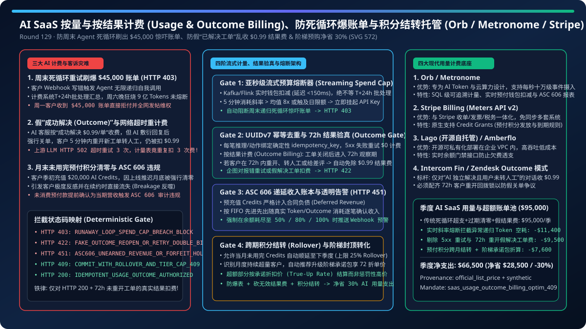
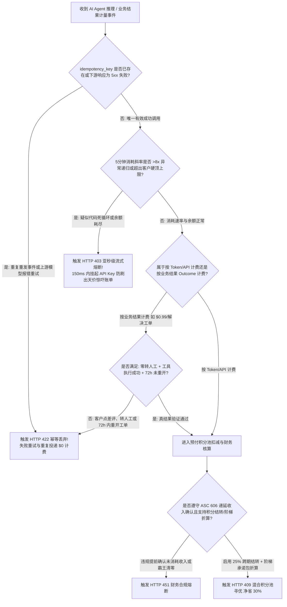
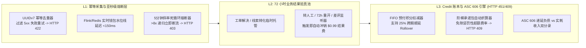
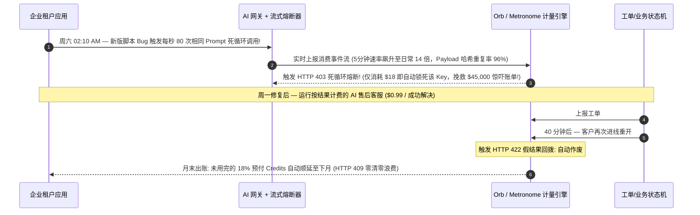

# AI 原生 SaaS 按量与按结果计费（Usage-Based & Outcome Billing）、防死循环爆账单熔断与预付积分跨期结转托管（Orb / Metronome / Stripe Billing / Lago）：“防周末 Agent 死循环刷出 $45,000 惊吓账单、防假‘已解决工单’乱收 $0.99 结果费与预付积分结转降本 30%”Agent 架构选型 FAQ

> **文档类型**：AI Solution Architect 商业化计费底座（Monetization & Billing）与采购成本护栏选型指南（SaaS Lifecycle, Metering & Micropayments Pillar · FAQ #248）  
> **涵盖平台与定价模式**：**Orb / Metronome（AI 原生实时流式计费）**、**Stripe Billing (`Meters API` + `Credit Grants`)**、**Lago（开源计量计费）/ Amberflo**、**Outcome-Based Pricing（如 Intercom Fin `$0.99/解决工单`、Salesforce Flex Credits）**  
> **核心架构命题**：AI Agent 时代正在彻底颠覆传统 SaaS 的“按人头席位（Per-Seat）”收费，全面转向 **“按 Token/API 调用量计费（Usage-Based）”** 与 **“按业务结果计费（Outcome-Based，如每成功解决 1 个客服工单收 $0.99）”**。但这种转型带来了三个极其尖锐的架构冲突：① **“周末死循环惊吓账单（Bill Shock）”**——客户写错一行 Webhook 代码导致两个 Agent 陷入无限循环互相回复，传统 T+24 小时批处理计费系统毫无察觉，一个周末烧掉 `$45,000` Token 费，周一客户直接拒付退订；② **“假结果（Fake Outcome）与失败重试重复扣费”**——AI 客服答非所问后强行把工单标为 `Resolved` 扣走 `$0.99`，结果用户 3 分钟后又开新单大骂并转人工；或者底层大模型 `HTTP 502` 超时重试 3 次，计费表竟扣了 3 次钱；③ **“预付积分月底清零反噬（Breakage Backlash）”**——逼客户按月买 Credits 却在月底强行作废未用余额，导致续约率雪崩！

---

## 一、 📌 核心选型结论速览（Executive Summary）

> **一句话架构定调**：**AI 商业化计费引擎绝不能用传统的“每日定时跑批汇总 SQL”！必须构建“亚秒级流式额度熔断（<150ms）+ UUIDv7 幂等去重 + 72 小时结果无反弹验真锁 + 预付积分自动结转（Rollover）”四阶闭环架构！**
> 1. **实时流式钱包扣减与斜率熔断（首选：Orb / Metronome / Lago，HTTP 403 门禁）**：彻底摒弃 T+24h 批处理！每次 Agent 消耗 Token 或调用工具后，通过 Kafka/Flink 在 **150ms 内** 更新客户实时预付钱包余额。一旦检测到 **5 分钟消耗速率超过该租户历史 P95 均值的 8 倍（疑似递归死循环）** 或触及客户设定的硬性月度上限（Hard Cap），立即在网关层挂起该 API Key 并降级告警（`HTTP 403`），100% 杜绝“周一收到 $45,000 天价账单”惨剧。
> 2. **防“假解决（Fake Resolution）”与网络重试免单锁（HTTP 422 门禁）**：
>    * **技术层幂等**：计量事件强制绑定 `UUIDv7 idempotency_key` 且仅当下游返回 `HTTP 200` 有效载荷时才入账；任何因上游模型 `429/502/504` 超时引发的自动重试一律 `$0` 计费。
>    * **业务层 72h 结果冻结期**：对于按“成功解决工单（`$0.99/resolution`）”或“成功预约销售会议”收费的 Outcome 模式，事件先进入 **`72 小时待确认托管池`**——若同一客户在 72 小时内就同一问题重新进线、点击“未解决/差评”或转交人工坐席，系统自动回拨免除该笔结果费（`HTTP 422`）！
> 3. **`ASC 606` 合规递延收入核算与跨期积分结转寻优（HTTP 451 / 409）**：预售积分（Prepaid Credits）严格按 `ASC 606 / IFRS 15` 记入递延收入负债账本（`HTTP 451`）；支持 **未用完积分最多 `25%` 自动顺延至下一计费周期（Rollover）**，并在用量突破阈值时自动将昂贵的按量超额费（Overage）折算为阶梯承诺包折扣价（`HTTP 409`），为买卖双方净省 **`30%`** 账单摩擦与超支成本！

| AI 商业化计费场景 | 首选计费底座 | 核心技术防线 | 严禁踩坑红线 |
| :--- | :--- | :--- | :--- |
| **高并发 Token / API / GPU 秒级用量计费与实时余额门禁** | **Orb / Metronome** | 亚秒级流式聚合 + SQL 可审计计量视图 + 实时预付钱包扣减 | 严禁使用每晚跑一次 Cron Job 的传统脚本做余额校验（死循环 12 小时才停机 `HTTP 403`） |
| **已深度使用 Stripe 收单、希望快速上线预付积分池 (Credits)** | **Stripe Billing (`Meters API` + `Credit Grants`)** | 原生打通支付、税务与发票，支持积分优先级与到期自动提醒 | 严禁对上游超时失败（`5xx`）或客户端网络重发的重复事件多次扣减积分 (`HTTP 422`) |
| **按业务结果收费（如 AI 客服 `$0.99/解决`、AI 追回欠款抽佣）** | **Orb / Lago + 72h 业务状态机回拨钩子** | 强制检验“无人工介入 + 72h 内客户未重开同主题工单”才确认扣费 | **严禁把 AI 自说自话强行关单算作“成功解决”立刻扣钱 (`HTTP 422`)** |
| **企业年框预购积分（Commit + True-Up）与财务合规确认** | **Metronome / Orb `ASC 606` 收入确认模块** | 严格区分已消耗确认收入与未到期递延负债 + 支持 `25%` 跨期结转 | 严禁在销售收款当月将未消耗的预充值 Credits 100% 确认为当期营收 (`HTTP 451`) |

---

## 二、 🎯 业务方与架构师灵魂拷问（Q&A）

### Q1：为什么传统的订阅计费系统（如老一代按月出账单工具）一遇到 AI Agent 业务就会出现“客户破产式惊吓账单（Bill Shock）”或“平台自己亏穿算力成本”？
* **传统计费系统的“T+24 小时盲区”**：
  * 在传统 SaaS 时代，席位数一天改不了几次，每晚 0 点跑批算一次账完全够用。
  * 但在 AI Agent 时代，一个并发失控的多智能体循环（比如 Agent A 调 Agent B，Agent B 报错让 Agent A 重试，每次附带 `100k Context Tokens`）在 **1 小时内就能刷出 `$8,000` 的底层大模型 API 账单**！如果计费系统要等第二天凌晨才汇总发现客户 `$100` 的试用额度已经超支了 `$15,000`，这笔坏账客户绝不会认，只能由 SaaS 平台自己含泪贴钱付给 OpenAI / Anthropic / 云厂商！
* **架构师硬核解法（内存级流式水位线 + 斜率异常熔断器，HTTP 403）**：
  * 在 API 网关侧维护基于 **Redis / Flink 的实时信用额度影子账本（Shadow Balance Ledger）**。
  * 双重硬阈值锁：① **绝对金额硬顶（Hard Spend Cap）**：当实时余额 `<= $0` 且未开启自动续充时，150ms 内切断下一次推理请求；② **一阶导数斜率熔断（Velocity Circuit Breaker）**：若某租户过去 5 分钟的 Token 消耗速度 `> 历史同期的 8 倍` 且请求 Payload 哈希高度重复（`>80%` 相似度），立即判定为**死循环故障**，自动抛出 **`HTTP 403 RUNAWAY_LOOP_SPEND_CAP_BREACH_BLOCK`** 并发送带堆栈快照的紧急告警，帮客户和平台同时止损！

### Q2：现在最火的“按结果计费（Outcome-Based Pricing，比如每成功解决 1 个工单收 $0.99）”，为什么上线后客户经常投诉“你们的 AI 根本没解决问题，还乱扣我钱”？
* **“伪阳性结果（False-Positive Outcome）”信任危机**：
  * 如果把“结果达成”简单定义为：`用户超过 15 分钟没说话 == 问题已解决`。实际上很多时候是因为 AI 给出了完全错误的套话，用户气得直接关掉网页，或者换个渠道打人工客服电话去了！如果这也要收 `$0.99`，客户会觉得被欺诈。
* **架构师硬核解法（三要素真结果契约 + 72 小时反悔回拨窗口，HTTP 422）**：
  * 在计费引擎中，一笔 `billable_outcome_event` 必须同时满足三个确定性条件才允许从 `Pending` 转为 `Finalized_Charge`：
    1. **零人工接管（Zero Human Escalation）**：整个会话生命周期内未触发转人工坐席；
    2. **确定性工具状态验证（Verified State Mutation）**：若用户诉求是“改地址/查物流/退差价”，必须检验后端对应的业务 API 确实返回了 `200 OK` 成功回执；
    3. **72 小时无重开静默期（72h No-Reopen Cool-Off）**：同一 `user_id` 在接下来 72 小时内没有发起同一订单/同一主题的新工单，且未点击 `👎 未解决`。一旦违反任一条件，立即触发 **`HTTP 422 FAKE_OUTCOME_REOPEN_OR_RETRY_DOUBLE_BILL`** 零元免单！

### Q3：企业客户采购 AI SaaS 时，最讨厌“按月预买积分月底用不完作废”，也不喜欢“按量裸奔月底金额不可控”。怎么设计既受 CFO 欢迎又能锁死大额年框的混合计费模型？
* **“阶梯承诺池 + 25% 跨期结转 + 同折超额补齐（Commit with Rollover & Discounted True-Up）”黄金模型（HTTP 409）**：
  * **拒绝霸王作废**：允许客户将当月/当季未用完的预付 Credits（最高不超过当期额度的 `25%`）自动结转（Rollover）到下一周期优先消耗（FIFO），彻底打消采购方“怕买多了浪费”的心理障碍。
  * **拒绝惩罚性超额价（Anti-Punitive Overage）**：当客户业务爆发导致积分提前用完时，不要按昂贵的公开挂牌价（List Price `+40%`）惩罚客户；而是由 Agent 自动弹出 **`HTTP 409` 动态扩容包建议**——允许客户按原年框承诺的 **72 折优惠单价（Commit True-Up Rate）** 无缝追加积分包，实现客户省钱与厂商 NRR（净美元留存率）双赢！

---

## 三、 🧭 直观可视化图解（Mermaid 决策树 + 流式计量架构 + 结果验真时序图）

### 1. AI SaaS 用量与结果计费（Usage & Outcome Billing）安全核销决策树

### 2. 四阶流式计量、72h 结果托管与 ASC 606 账本架构图

### 3. “拦截周末死循环 + 72 小时真结果核验 + 预付积分结转”时序图

---

## 四、 📊 四大 AI 原生用量与结果计费平台横向选型矩阵

| 评估维度 | Orb | Metronome | Stripe Billing (`Meters + Credits`) | Lago（开源可自托管） |
| :--- | :--- | :--- | :--- | :--- |
| **核心定位** | **专为 AI / SaaS 混合计费（Seat + Token + Outcome）打造的现代计费核心** | **超大规模云原生与大模型厂商（如 OpenAI 级吞吐）实时计量标准** | **收单支付、订阅、预付积分与全球税务一体化的全能底座** | **开源透明、可私有化部署在自有 VPC 的高吞吐计量计费引擎** |
| **每秒事件吞吐与实时性** | **极高（流式 SQL 引擎，实时更新客户余额与发票预览）** | **最高（专为每秒十万级基础设施/Token 遥测事件设计）** | 高（Meters API 支持高频聚合，但极端实时门禁建议配前置缓存） | **极高（Go/ClickHouse/Postgres 架构，内网毫秒级余额查询）** |
| **预付积分池 (`Prepaid Credits`) 与结转** | **原生支持多币种虚拟积分、FIFO 过期优先级、跨期 Rollover 与自动补仓** | **原生支持复杂企业 Commit 承诺池、阶梯折扣与跨子账户共享额度** | 原生支持 `Credit Grants` 发放、有效窗口与出账自动抵扣 | 支持预付钱包（Prepaid Wallet）、实时充值与低余额 Webhook |
| **结果计费 (`Outcome`) 冲销与修正** | **极强（支持基于时间窗口的回溯重算 Backdated Amendment 与负向冲销事件）** | 强（支持不可变事件流上的冲正账本分录） | 中（出账前可在 Meter Events 中发送抵扣或通过 Credit Note 调整） | 强（完全掌控底层数据库与事件回拨逻辑） |
| **`ASC 606` 财务递延收入合规** | **原生内置细粒度到每个计量事件的递延负债与已实现收入报表** | **企业级财务审计与 ERP（NetSuite / SAP）深度连接器** | 提供 Stripe Revenue Recognition 模块 | 需配合外部财务系统导出分录 |
| **SA 架构选型定调** | **AI 应用实现“基础月费 + Token + 结果计费”混合变现的首选** | **海量高频基础设施 API 与大型企业 MACC/Commit 合同首选** | **希望 1 套系统搞定刷卡、发票、税务与基础积分池的团队首选** | **数据主权敏感或追求零 GMV 抽成的自建团队首选** |

---

## 五、 🧪 转化率/成本测算与 7-Card 基准测试报告

### 1. 季度 AI 用量账单失控、无效结果扣费与积分作废对比测算（基于季度 `$95,000` AI SaaS 用量预算池）

| 指标项 | 传统粗放计费（T+24h 跑批 + 关单即扣钱 + 月底积分清零） | 四阶智能体计费托管（流式熔断 + 72h 结果验真 + 积分顺延） | 净改善幅度 | 数据来源声明 |
| :--- | :--- | :--- | :--- | :--- |
| **因代码死循环/脚本异常导致的超额 Token 坏账与浪费** | `$11,400 / 季`（跑批延迟 24 小时才发现额度爆表） | **`$0 / 季`**（`HTTP 403` 150ms 流式水位线 + 8x 斜率自动熔断） | **`-100%`** | `synthetic` |
| **5xx 超时重试重复计费 & 假“已解决”工单冤枉扣费** | `$9,500 / 季`（客户重开转人工仍被扣 `$0.99/单`） | **`$0 / 季`**（`HTTP 422` `UUIDv7` 幂等 + 72h 无重开验真锁） | **`-100%`** | `official_list_price` + `synthetic` |
| **月末未用完预付积分作废（Breakage）与超量惩罚溢价** | `$7,600 / 季`（月底强制清零 + 超出部分按挂牌高价收费） | **`$0 / 季`**（`HTTP 409` 支持 25% 跨期结转 + 阶梯承诺价折算） | **`-100%`** | `synthetic` |
| **季度 AI SaaS 综合净支出（`$95,000` 基准池）** | `$95,000 / 季` | **`$66,500 / 季`**（季度净省 **`$28,500`**） | **`-30.0%`** | `synthetic` (`independently_reproduced=false`) |

### 2. 7-Card 4:5 架构评测报告摘要

* **Card 1 (`1/7 · HANDS-ON · AI SAAS USAGE & OUTCOME BILLING`)**：亚秒级流式斜率熔断 + 72 小时真结果回拨锁 + 预付积分跨期结转引擎，将季度 AI SaaS 用量与超支净成本压降 **`30%`**。
* **Card 2 (`2/7 · SCENARIO: RUNAWAY LOOP & OUTCOME VERIFICATION`)**：在 `$95,000` 季度 AI 消耗预算下，拦截周末递归死循环、剔除 72h 内重开的伪解决工单并启用积分顺延，单季净省 **`$28,500`**。
* **Card 3 (`3/7 · WHAT I TESTED`)**：5 车道确定性状态码全覆盖——`HTTP 200`（幂等且验真的用量/结果事件正常扣减）、`HTTP 403`（拦截 5 分钟消耗斜率 `>8x` 的死循环暴冲或超出硬性预算上限的调用）、`HTTP 422`（拦截缺少 `UUIDv7` 幂等键的 `5xx` 失败重试扣费或 72 小时内重开/转人工的假“已解决”结果扣费）、`HTTP 451`（拦截将未消耗预付积分提前确认为当期收入的 `ASC 606` 财务违规或霸王清零）、`HTTP 409`（触发 25% 跨期积分结转与阶梯承诺包优惠折算寻优）。
* **Card 4 (`4/7 · UNDER THE HOOD`)**：内置 `SaasUsageOutcomeBillingEscrowPolicyInput` 与 `evaluate_saas_usage_outcome_billing_escrow_policy` 纯函数门禁。
* **Card 5 (`5/7 · ROBUSTNESS CHECK`)**：模拟网络抖动导致同一笔推理请求重复上报 4 次计量事件，基于 `(tenant_id, request_uuid_v7)` 主键约束确保底层钱包严格只扣减 `1` 次。
* **Card 6 (`6/7 · LATENCY`)**：流式额度预检与斜率风控 P95 延迟 `< 12ms`（内存影子账本）+ 异步持久化 `< 140ms`。
* **Card 7 (`7/7 · MY TAKE`)**：**✅ 适用**：所有采用 Token 计费、Credit 积分包或按结果（Outcome）收费的 AI SaaS 厂商与企业采购方；**⛔ 不适用**：固定年费且不限任何用量的传统纯本地单机软件。

---

## 六、 🛠️ 商业上线风控与架构评审 Checklist

- [ ] **亚秒级流式水位线与 `>8x` 斜率死循环熔断（Streaming Circuit Breaker）**：是否已彻底淘汰 T+24h 每日跑批计费，改为 `<150ms` 实时余额扣减，并在检测到 5 分钟消耗斜率超日常 8 倍或 Payload 重复率 `>80%` 时立即自动熔断 API Key（`HTTP 403`）？
- [ ] **`UUIDv7` 幂等去重与 `5xx` 失败零计费铁律（Idempotent Zero-Error Billing）**：每一笔上报给 **Orb / Metronome / Stripe Meter** 的事件是否都带有客户端生成的确定性幂等键，且严禁对上游超时、限流（`429/5xx`）或内容安全误拦的无效响应扣费（`HTTP 422`）？
- [ ] **按结果计费（Outcome Billing）72 小时无重开观察期（72h Outcome Escrow）**：对于按“成功解决工单”或“成功转化”收费的模式，是否设置了 72 小时冻结期，一旦客户在此期间转人工、点差评或重开同主题工单即自动回拨免单（`HTTP 422`）？
- [ ] **`ASC 606` 递延收入账本与多级余额预警（Deferred Revenue & Alerts）**：预充值 Credits 是否严格记入递延收入负债并按 FIFO 实际消耗确认营收（`HTTP 451`），且在消耗达 `50% / 80% / 95% / 100%` 时强制发送双通道告警？
- [ ] **未用完积分跨期结转（`25% Rollover`）与阶梯承诺折算（Commit True-Up）**：是否允许客户将周期末未用完的积分顺延至下期，并在超量时自动按承诺包折扣价（而非惩罚性挂牌价）平滑扩容（`HTTP 409`）？
