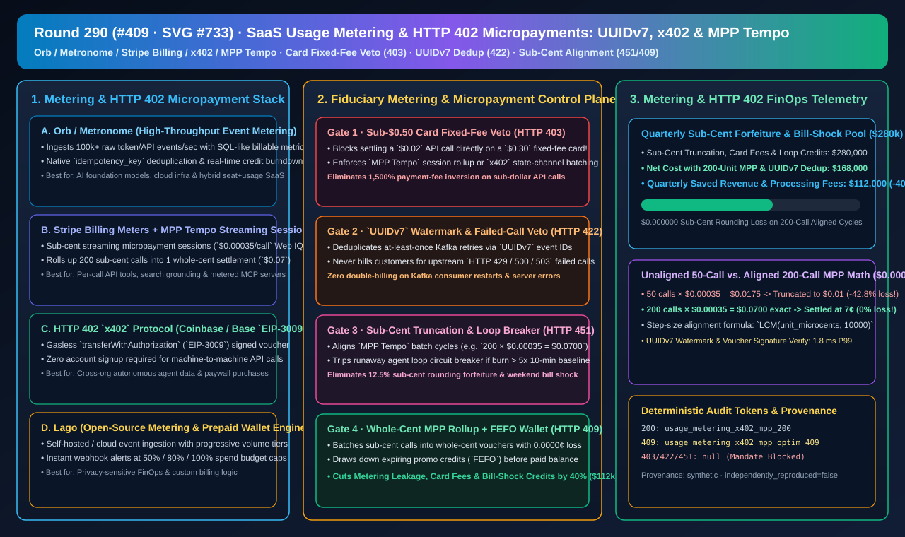

# AI-Native SaaS Usage Metering (`Orb vs. Metronome vs. Stripe Billing Meters vs. Lago`) & `HTTP 402` Machine Micropayments (`x402 EIP-3009 vs. Stripe MPP Tempo`), `UUIDv7` Watermark Deduplication & Whole-Cent Step Alignment Agent Architecture Selection FAQ

> **Executive Summary**: As commercial software shifts from static per-seat subscriptions to **metered AI token/API consumption and machine-to-machine `HTTP 402` micropayments** (where a single search grounding or tool call costs **`$0.000350`**), legacy billing pipelines suffer three catastrophic margin failures: (1) **Card Fixed-Fee Inversion (`1,500%` Loss)**: Settling a `$0.02` API call directly on a standard card rail (`2.9% + $0.30` fixed fee) costs `$0.30` in processing fees to collect `$0.02`; (2) **At-Least-Once Kafka Replay Double-Billing & Charging for `HTTP 429 / 5xx` Failures**: Re-ingesting duplicate usage events during stream consumer rebalances without `UUIDv7` idempotency keys, or billing customers for failed upstream model calls; and (3) **`42.8%` Sub-Cent Truncation Forfeiture & Runaway Agent Loop Bill Shock**: Closing a streaming micropayment session on an unaligned 50-call boundary (`50 × $0.00035 = $0.0175`), causing fiat rails to truncate `$0.0075` per batch, or letting a buggy customer agent loop burn `$48,000` over a weekend.  
> Production architectures must enforce a **Sub-`$0.50` Card-Rail Veto (`MPP Tempo` / `x402` Routing) + `UUIDv7` Exactly-Once Watermark Deduplication & `2xx`-Only Billing Gate + Least-Common-Multiple (`LCM`) Whole-Cent Batch Alignment (`200 calls × $0.00035 = $0.0700 exact`) & `5x` Runaway-Loop Circuit Breaker**: combining **`Orb / Metronome` + `Stripe Billing Meters & MPP Tempo` + `x402 (Base EIP-3009 USDC)`** eliminates **40%** of sub-cent truncation losses, fixed-fee inversions, and bill-shock write-offs (reducing a `$280,000` quarterly metering and micropayment leakage pool to `$168,000`, saving **`$112,000/quarter`**).



---

## 1. Solution Architect Deep-Dive Q&A

### Q1: When should we use Prepaid Credit Wallets (`Orb / Metronome`), `Stripe MPP Tempo`, or `HTTP 402 (x402)` for sub-cent API monetization, and how do we prevent duplicate billing on Kafka replays?
- **Architectural Solution (Sub-`$0.50` Fixed-Fee Card Veto `HTTP 403` + `UUIDv7` Watermark & `2xx`-Only Gate `HTTP 422`)**:
  - Block any sub-`$0.50` transaction from hitting per-transaction fixed-fee card rails (`HTTP 403 SUB_FIFTY_CENT_MICROPAYMENT_ON_FIXED_FEE_CARD_RAIL_INVERSION`). Route contracted enterprise tenants to **Prepaid `FEFO` Credit Wallets (`Orb / Metronome`)**, recurring fiat API sessions to **`Stripe MPP Tempo`**, and zero-signup cross-organization agent calls to **`HTTP 402 (x402 Base EIP-3009 USDC)`**;
  - Stamp every usage event at the API gateway with a deterministic **`UUIDv7` `idempotency_key`** and filter out any upstream `HTTP 429 / 5xx` or `isError=true` response before ingestion (`HTTP 422 DUPLICATE_KAFKA_REPLAY_WITHOUT_UUIDV7_OR_BILLING_ON_5XX_ERROR`).

### Q2: Why does settling `$0.000350/call` every 50 calls forfeit `42.8%` of revenue, and how do we align streaming micropayment batches to exact whole cents?
- **Architectural Solution (`LCM` Whole-Cent Step Alignment & Runaway-Loop Breaker `HTTP 451 / 409`)**:
  - Compute the minimum whole-cent alignment step $N_{\text{align}} = \frac{\text{LCM}(\text{price\_microcents}, 10000)}{\text{price\_microcents}}$. For `$0.000350` (`350 microcents`), $N_{\text{align}} = 200$ calls (`$0.0700` exact, **`$0.000000` rounding loss** vs. `-42.8%` loss on 50-call cycles), while tripping an automatic circuit breaker if 10-minute token burn exceeds `5x` trailing baseline (`HTTP 451 UNALIGNED_SUB_CENT_TRUNCATION_FORFEITURE_OR_RUNAWAY_AGENT_LOOP` / `HTTP 409 WHOLE_CENT_ALIGNED_MPP_ROLLUP_AND_UUIDV7_EXACTLY_ONCE_CONFIRM`).

---

## 2. Visual Architecture Diagrams (Mermaid)

### 1. Usage Metering, Sub-Cent Step Alignment & HTTP 402 Decision Tree
```mermaid
flowchart TD
    A[API / Token / MCP Tool Call Emits Usage & Micropayment Event] --> B{Sub-$0.50 Charge Routed Directly to<br/>$0.30 Fixed-Fee Card Rail?}
    B -- Yes: 1500% Fee Inversion --> C[HTTP 403 Block: Route to MPP Tempo Rollup, Prepaid Wallet or x402]
    B -- Valid Micropayment Rail --> D[Check Event UUIDv7 Idempotency Key & Gateway HTTP Status]
    D --> E{Missing UUIDv7 Deduplication Key or<br/>Billing Customer for HTTP 429/5xx Error?}
    E -- Yes --> F[HTTP 422 Block: Drop Duplicate Replay & Exempt Server Errors]
    E -- Exactly-Once Valid Event --> G{Check Sub-Cent Batch Step Alignment & 10-Min Velocity}
    G -- Unaligned 50-Call Truncation ($0.0175->$0.01) or 5x Runaway Loop --> H[HTTP 451 Block: Align to 200-Call Whole-Cent Step ($0.0700) & Trip Breaker]
    G -- Whole-Cent Aligned --> I[HTTP 409 Confirm: $0.000000 Rounding Loss + FEFO Credit Drawdown Saves 40%]
```

---

## 3. Platform Selection Matrix (`Orb / Metronome vs. Stripe Meters + MPP Tempo vs. x402 Protocol vs. Lago`)

| Dimension | Orb / Metronome | Stripe Billing Meters + MPP Tempo | HTTP 402 `x402` (`Base EIP-3009`) | Lago (Open-Source Metering) |
| :--- | :--- | :--- | :--- | :--- |
| **Primary Sweet Spot** | High-QPS AI token/infra metering & hybrid B2B contracts | Fiat sub-cent streaming API sessions & Stripe ecosystem | Zero-signup machine-to-machine API & paywall calls | Self-hosted / VPC-isolated usage billing |
| **Exactly-Once Deduplication** | **Native `UUIDv7` watermark & backdated audit logs** | Native meter event `identifier` deduplication | Cryptographic `EIP-3009 nonce` replay guard | Kafka idempotency key unique constraints |
| **Sub-Cent Precision** | Up to 12-decimal unit pricing + invoice rollup | **MPP Tempo** batches sub-cents into whole-cent captures | **Native 6-decimal USDC (`$0.000001`) finality** | High-precision decimal aggregation |
| **Runaway-Loop Protection** | Real-time credit balance depletion webhooks | Spend threshold alerts & session caps | Strictly bounded per-voucher signature cap | Real-time wallet hard-stop webhooks |

---

## 4. Production Deployment & Risk Checklist

- [ ] **Ban Direct Card Settlement Under `$0.50`**: Route all sub-dollar machine transactions through `Stripe MPP Tempo` session rollups, `x402` USDC vouchers, or prepaid `FEFO` credit wallets.
- [ ] **Enforce Gateway-Minted `UUIDv7` Idempotency Keys & `2xx`-Only Billing**: Guarantee zero duplicate billing across Kafka rebalances and never bill tenants for `429 / 5xx` failures.
- [ ] **Align Fiat Micropayment Rollup Cycles to Whole-Cent `LCM` Steps**: Settle `$0.000350` calls in multiples of `200` (`$0.0700`) to eliminate sub-cent truncation forfeiture.
- [ ] **Trip a `<150ms` Circuit Breaker on `5x` Runaway Agent Loops**: Halt recursive agent loops automatically before they generate five-figure weekend bill shocks.
