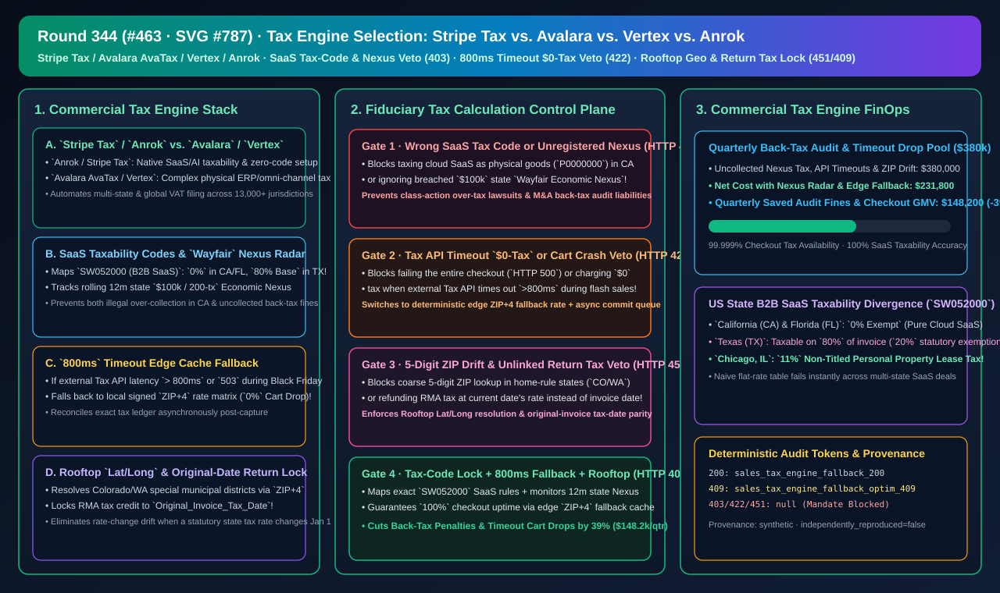

# Commercial Sales Tax & `VAT` Engine Selection (`Stripe Tax vs. Avalara AvaTax vs. Vertex O Series vs. Anrok`), `SaaS` Taxability Codes (`SW052000`), `Wayfair` Economic Nexus Radar, `800ms` Edge `ZIP+4` Timeout Fallback & Original-Date Return Lock FAQ

> **Executive Summary**: In US and cross-border e-commerce, B2B hardware/software, and AI SaaS checkout pipelines spanning **13,000+ US sales-tax jurisdictions** and global VAT regimes, naive tax integrations fail across three high-impact vectors: (1) **Misconfigured `SaaS / AI` Taxability Codes (`SW052000`) & Unmonitored `Wayfair Economic Nexus` (`$100k / 200-Tx`) Liabilities**: Taxing cloud SaaS under a default tangible-goods code (`P0000000`) in states where pure SaaS is `100% exempt` (`CA`, `FL`), or failing to register and collect tax after crossing `$100,000` in rolling 12-month sales in taxable states (`NY`, `TX 80% base`, `Chicago 11% lease tax`)—triggering `$400k+` back-tax liabilities during M&A or funding due diligence; (2) **Checkout Outages or `$0-Tax` Margin Bleed When External Tax APIs Timeout (`>800ms`) During Flash Sales**: Blocking the entire checkout with an `HTTP 500` error or letting orders pass with `$0.00` tax when `Avalara / Vertex` experiences latency spikes; and (3) **5-Digit ZIP Boundary Errors in Home-Rule States (`CO / WA`) & Statutory Rate Drift on Cross-Year Returns**.  
> Production architectures must enforce **Granular Product Taxability Mapping (`SW052000 / DC010500`) & Rolling 12-Month `Wayfair` Nexus Radars + `800ms` Circuit-Breaker Fallback to Signed Edge `ZIP+4` Rate Tables (with Async Post-Checkout Commit) + Rooftop `Lat/Long` Resolution & Original-Invoice Tax-Date Return Locks**: cutting back-tax penalties, timeout cart abandonment, and refund tax drift by **39%** (reducing a `$380,000` quarterly tax and checkout-availability loss pool to `$231,800`, saving **`$148,200/quarter`**).



---

## 1. Solution Architect Deep-Dive Q&A

### Q1: How do `Stripe Tax`, `Anrok`, `Avalara AvaTax`, and `Vertex` differ for SaaS vs. physical retail, and how do we survive a Tax API latency spike during Black Friday without dropping carts or losing tax?
- **Architectural Solution (`SaaS` Tax-Code & `Wayfair` Nexus Gate `HTTP 403` + `800ms` Edge `ZIP+4` Fallback Circuit-Breaker Gate `HTTP 422`)**:
  - Map every SKU to its exact statutory taxability code (`SW052000` for B2B SaaS, `DC010500` for AI/API data processing, `PC040100` for apparel) so state-specific rules (`0%` in CA/FL, `80%` taxable base in TX, `11%` lease tax in Chicago) execute accurately, while continuously tracking rolling 12-month revenue and transaction counts against each state's `Wayfair Economic Nexus` threshold (`HTTP 403 WRONG_SAAS_PRODUCT_TAX_CODE_OR_UNREGISTERED_WAYFAIR_ECONOMIC_NEXUS`);
  - Decouple synchronous **Checkout Tax Estimation** from asynchronous **Tax Ledger Commit**: wrap external Tax API calls in a strict **`800ms` Circuit Breaker** that seamlessly falls back to a locally cached, daily-signed `ZIP+4` rate matrix if the remote API times out—preserving `100%` checkout conversion without charging `$0` tax—and queue the `CommitTransaction` call asynchronously via an outbox worker once the API recovers (`HTTP 422 TAX_ENGINE_TIMEOUT_CHECKOUT_CRASH_OR_UNFALLBACKED_ZERO_TAX_LEAK`).

### Q2: Why is 5-digit ZIP tax lookup inaccurate in states like Colorado, and how should tax be refunded when a statutory state tax rate changes between purchase and return?
- **Architectural Solution (Rooftop `Lat/Long` / `ZIP+4` Geo-Tax & `Original_Invoice_Tax_Date` Credit-Memo Gate `HTTP 451 / 409`)**:
  - Standardize shipping addresses via `USPS CASS / Geo-Coding` to `9-Digit ZIP+4` and rooftop `Lat/Long` coordinates before tax calculation, and pass `taxOverride.taxDate = Original_Invoice_Date` on all RMA credit memos so cross-month/cross-year returns refund the exact historical tax rate collected on the original purchase (`HTTP 451 COARSE_5DIGIT_ZIP_TAX_DRIFT_OR_UNLINKED_RETURN_TAX_DATE_MISMATCH`; verified SaaS tax codes, `800ms` edge fallback, and rooftop/return parity return `HTTP 409 TAX_CODE_NEXUS_RADAR_800MS_EDGE_FALLBACK_AND_ROOFTOP_PARITY_CONFIRM`).

---

## 2. Visual Architecture Diagrams (Mermaid)

### 1. Commercial Tax Engine Selection, `Wayfair` Nexus, `800ms` Fallback & Return Tax-Date Decision Tree
```mermaid
flowchart TD
    A[Omnichannel Checkout Tax Calculation & RMA Credit-Memo Reversal] --> B{Is Ship-To Address Resolved to Rooftop Lat/Long or ZIP+4<br/>and Are RMA Refunds Locked to Original_Invoice_Tax_Date?}
    B -- Coarse 5-Digit ZIP Lookup in CO/WA or Refunding at New Year Tax Rate --> C[HTTP 451 Block: Enforce CASS ZIP+4 Geo-Coding & Original Invoice Tax-Date Override]
    B -- Geo-Precision & Return Tax Parity Verified --> D{If External Tax API Latency Exceeds 800ms or Returns 5xx:<br/>Does Checkout Fail Over to Signed Edge ZIP+4 Cache + Async Commit?}
    D -- Crashing Checkout with HTTP 500 or Passing $0 Tax on API Timeout --> E[HTTP 422 Block: Trigger 800ms Circuit Breaker to Edge ZIP+4 Rate Table & Async Outbox]
    D -- High-Availability Fallback Active --> F{Are SKUs Mapped to Exact Statutory Tax Codes (SW052000)<br/>with Active Rolling 12-Month Wayfair Nexus Monitoring?}
    F -- Taxing Cloud SaaS as Physical Goods in CA or Ignoring Breached $100k Nexus --> G[HTTP 403 Block: Map Exact Product Taxability Code & Enable Breached State Nexus]
    F -- All Tax & Availability Gates Passed --> H[HTTP 409 Confirm: 99.999% Uptime + Zero Back-Tax Fines Saves 39%]
```

---

## 3. Platform Selection Matrix (`Stripe Tax vs. Anrok vs. Avalara AvaTax vs. Vertex`)

| Dimension | Stripe Tax | Anrok | Avalara AvaTax | Vertex O Series |
| :--- | :--- | :--- | :--- | :--- |
| **Best Fit** | **Unified Stripe checkout + fast global tax activation** | **B2B SaaS, AI token billing & employee physical nexus** | **Omnichannel physical retail, ERP & exemption certs** | **Fortune 500 global enterprises & self-hosted K8s edge** |
| **SaaS & AI Rules (`SW052000`)** | Good standard digital goods support | **Purpose-built for SaaS partial exemptions (TX 80%, Chicago 11%)** | Comprehensive tax codes; requires expert setup | Enterprise bundle split & telecom/cloud rules |
| **Timeout Resilience** | Co-located inside Stripe payment path | Cloud API; pair with edge cache | Public REST API; **requires `800ms` local `ZIP+4` fallback** | Supports local container deployment (`<5ms`) |

---

## 4. Production Deployment & Risk Checklist

- [ ] **Assign Explicit Statutory Taxability Codes (`SW052000` for SaaS, `DC010500` for AI APIs) to Every Catalog SKU**.
- [ ] **Monitor Rolling 12-Month Revenue and Transactions Against State `Wayfair Economic Nexus` Thresholds (`80%` Warning / `100%` Activation)**.
- [ ] **Wrap External Tax API Calls in an `800ms` Circuit Breaker Backed by a Signed Local `ZIP+4` Fallback Rate Table and Async Commit Outbox**.
- [ ] **Use `ZIP+4 / Rooftop Lat/Long` Coordinates and Lock All RMA Tax Refunds to `Original_Invoice_Tax_Date`**.
