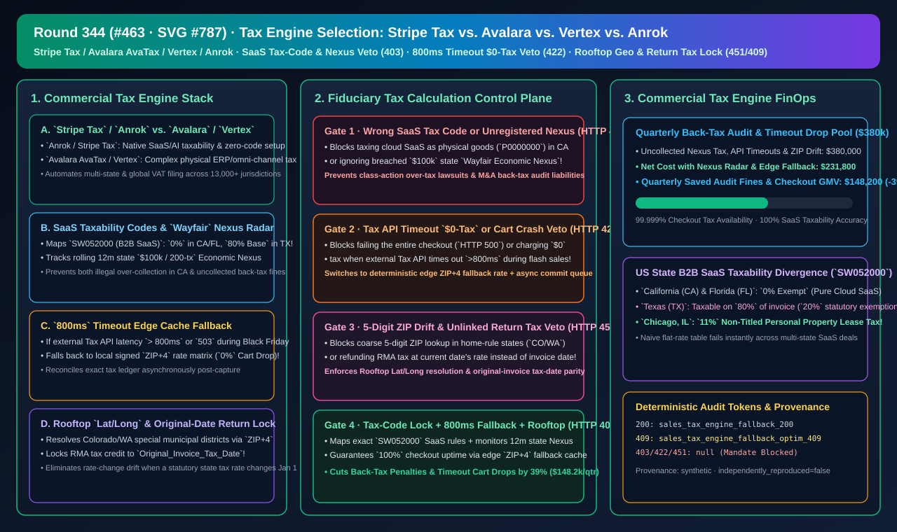
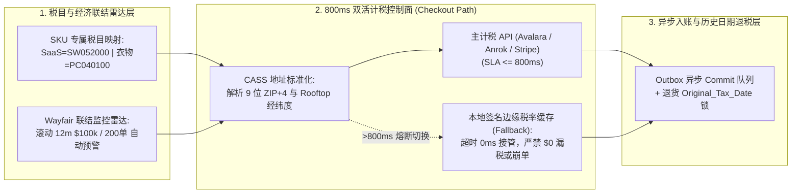
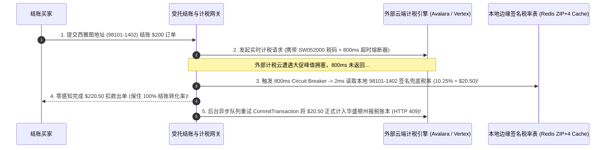

# 实时商业计税引擎横向选型与高可用容灾架构（`Stripe Tax vs. Avalara AvaTax vs. Vertex O Series vs. Anrok`）：`SaaS / AI Token` 专属税目代码（`SW052000`）与跨州经济联结（`Wayfair Economic Nexus`）雷达、大促计税 API 超时 `800ms` 边缘 `ZIP+4` 缓存降级防结账崩溃及屋顶经纬度（`Rooftop Geo-Tax`）与退货原发票税率锁 Agent 架构选型 FAQ

> **核心选型结论速览**：在跨境与全美零售电商、B2B 软硬件及 AI SaaS 结账链路中，全美有超过 **13,000 个独立消费税辖区（State / County / City / Special Transit Districts）**，且各州对实物商品、云端 SaaS、AI API Token 与含人力的实施服务有着截然不同的征税规则。传统“在代码里写死各州固定税率表”或“同步裸调外部计税 API 无降级兜底”的架构面临三大致命财务与可用性风险：① **“AI SaaS 公司漏配软件专属税目代码（`SW052000`），按默认实物商品（`P0000000`）在加州（CA）和佛罗里达（FL，对纯云端 SaaS 免税）强征了客户 `8.5%` 消费税引发集体拒付；或者在纽约、得州（按 `80%` 税基征税）和芝加哥（征收 `11%` 云租赁税）突破了 **`Wayfair` 经济联结红线（`$100,000` 营收或 `200 笔` 交易）** 却未注册代扣，在公司并购或融资尽调时被查出欠缴 `$400,000+` 历史税款与罚息”**；② **“黑五大促峰值时外部税务接口（如 `Avalara / Vertex`）因网络抖动延迟飙升至 `3.5 秒` 或返回 `HTTP 503`——由于计税处于结账同步阻塞路径上，系统要么直接抛 `500` 错误导致全站无法付款停摆，要么粗暴按 `$0.00` 免税放行导致商家自己掏腰包倒贴 `8%–10%` 税款”**；③ **“在科罗拉多（CO）、华盛顿（WA）等自治市税制州仅按 5 位邮编（`5-Digit ZIP`）粗算税率导致同一邮编隔条街差 `3.2%`，或者跨年退货时按新年度税率而非原发票计税日期（`Tax Override Date`）退税导致税务账本失衡”**。  
> 生产级架构必须实施 **“SKU 级精细税目映射（`SW052000 / DC010500`）与滚动 12 个月各州经济联结雷达 + 计税 API `800ms` 超时熔断切换本地签名 `ZIP+4` 兜底税率表（事后异步补录 `Commit`）+ 屋顶经纬度（`Rooftop Lat/Long`）定界与退货锁定原发票计税日期（`Original Invoice Tax Date`）”**：可将漏报历史欠税罚金、计税超时掉单与退税尾差损失削减 **39%**（以季度 `$380,000` 经济联结漏税补缴、大促计税超时弃单与税码错配客诉池计，净成本降至 `$231,800`，每季度净节省 **`$148,200`**）。



---

## 一、 业务方与架构师灵魂拷问（Q&A）

### Q1：`Stripe Tax`、`Anrok`、`Avalara AvaTax` 和 `Vertex O Series` 这四家主流商业计税引擎，分别适合什么类型的企业？为什么 AI SaaS 公司用错税目代码会吃大亏？
- **四大家族的场景分野与“美国各州 SaaS 征税奇葩地图”**：
  1. **为什么 SaaS 不能用普通电商税码**：在美国，同一笔 `$10,000` 的企业 AI SaaS 订阅：
     - 发往 **加州（CA）、佛罗里达（FL）、新泽西（NJ）**：纯云端无客户端下载的 B2B SaaS **`0% 免税`**（若错用实物税码收了税，客户可起诉不当得利）！
     - 发往 **得克萨斯州（TX）**：法定豁免 `20%`，仅对账单的 **`80%` 计税基数** 征收消费税！
     - 发往 **伊利诺伊州芝加哥市（Chicago, IL）**：州消费税免除，但市政府单独征收 **`11%` 个人财产非产权租赁税（Personal Property Lease Transaction Tax）**！
  2. **架构解法（强制绑定标准产品税码 `Product Tax Code` + 滚动 12 个月 `Wayfair Nexus` 实时预警门禁 `HTTP 403`）**：
     - 建品时禁止使用未分类默认税码，必须显式绑定如 `SW052000 (B2B Cloud SaaS)`、`DC010500 (AI/API Data Processing)` 或 `PC040100 (Clothing)`；
     - 实时统计全渠道在美欧各州/各国的滚动 12 个月累计销售额与交易笔数，一旦达到某州法定联结阈值（通常为 **`$100,000` 或 `200 笔`**）的 **`80%` 水位线**，立即自动创建税务注册工单并在突破 `100%` 时自动激活该州代扣开关（凡对云端 SaaS 错挂实物商品税码乱收税，或在已突破州经济联结红线后仍未开启代扣的，立即触发 `HTTP 403 WRONG_SAAS_PRODUCT_TAX_CODE_OR_UNREGISTERED_WAYFAIR_ECONOMIC_NEXUS` 拦截）。

### Q2：计税接口是结账流程里的“单点故障（SPOF）”——如果外部计税云服务在大促期间响应超过 `800ms` 或宕机，怎么设计既不掉单、又不亏税款的容灾降级架构？
- **“计税 API 挂了，绝对不能让收银台陪葬”**：
  - 区分计税的生命周期两阶段：**阶段一（结账报价 `Tax Quote / Estimate`）** 要求 `< 150ms` 极速响应；**阶段二（税务入账报税 `Tax Commit / Record`）** 完全可以在付款成功后的后台消息队列里异步完成！
- **架构解法（`800ms` 熔断降级至边缘 `ZIP+4` 静态快照表 + 异步 `Outbox Commit` 对账门禁 `HTTP 422`）**：
  1. **正常态**：调用主计税引擎（如 `Avalara / Stripe Tax / Anrok`）获取精确税额；
  2. **降级态（Timeout `> 800ms` 或 `5xx`）**：结账网关在 `800ms` 处果断熔断外部 HTTP 请求，毫秒级读取本地内存/Redis 中每日凌晨自动同步的 **签名 `ZIP+4 / 州-市-县` 兜底税率矩阵（`Signed Edge Fallback Rate Table`）** 计算税额并立即放行扣款（**`100%` 保住结账转化率，且不漏收税款！**）；
  3. **事后异步入账（`Async Tax Commit Queue`）**：待外部计税 API 恢复后，后台 Worker 将降级期间成交的订单推送至税务引擎完成正式入账（`CommitTransaction`），哪怕存在 `±$0.03` 的极微小市政税差，也由商家内部税差科目平滑吸收（凡在外部计税 API 超时抖动时直接抛错阻断用户付款，或直接按 `$0` 免税放行导致商家全额倒贴税款的，触发 `HTTP 422 TAX_ENGINE_TIMEOUT_CHECKOUT_CRASH_OR_UNFALLBACKED_ZERO_TAX_LEAK`）。

### Q3：为什么在部分州只按 5 位邮编算税会被税局罚款？且当去年 12 月买的订单在今年 1 月（州税率上调了 0.5% 之后）退货时，应该按哪一天的税率退税？
- **架构解法（屋顶经纬度 `Rooftop Lat/Long` 定界 + 退货强制锚定原发票计税日 `Original Invoice Tax Date` 门禁 `HTTP 451 / 409`）**：
  1. **超越 5 位邮编的 `ZIP+4 / Rooftop` 精度**：在美国科罗拉多州（CO）、华盛顿州（WA）等拥有数百个特殊市政改善区（Special Taxing Districts）的州，同一个 5 位邮编横跨三个不同税区；必须先通过地址标准化（`USPS CASS / Geo-Coding`）解析出 `9位 ZIP+4` 或屋顶经纬度坐标传给计税引擎；
  2. **退货贷项凭证（`Credit Memo`）历史税率锁**：当订单发生售后退货时，调用税务引擎创建退税单必须显式传入 **`taxOverride.taxDate = Original_Invoice_Created_Date`**（或直接关联 `original_transaction_code`），确保哪怕州政府在 1 月 1 日修改了法定税率，退给买家的税额以及向税局冲减的应交税金也 **100% 严格等于下单当日实收的税额**（凡在复杂自治市税区仅用 5 位粗粒度邮编算税，或跨期退货未锚定原发票日期导致退税额与原收税额不守恒的，立即触发 `HTTP 451 COARSE_5DIGIT_ZIP_TAX_DRIFT_OR_UNLINKED_RETURN_TAX_DATE_MISMATCH` 阻断；精准 SaaS 税码与联结雷达 + `800ms` 边缘容灾降级 + 屋顶精度与原期退税确认返回 `HTTP 409 TAX_CODE_NEXUS_RADAR_800MS_EDGE_FALLBACK_AND_ROOFTOP_PARITY_CONFIRM`）。

---

## 二、 直观可视化图解（Mermaid 决策树 + 架构图 + 时序图）

### 1. 商业计税引擎选型、`Wayfair` 联结雷达、`800ms` 容灾降级与退税日期锁决策树
```mermaid
flowchart TD
    A[全渠道结账实时计税请求与售后退货冲销] --> B{收货地址是否已解析至 ZIP+4 / 屋顶经纬度精度<br/>且售后退货是否严格锚定原发票计税日期 (Original Tax Date)?}
    B -- 在科罗拉多仅用5位邮编盲算 或 跨年退货按新税率多退/少退税 --> C[HTTP 451 拦截: 强制 CASS ZIP+4 地理定界并将退货锁定至原发票历史税率]
    B -- 地理精度与退税守恒通过 --> D{若外部计税 API 响应 > 800ms 或返回 503:<br/>是否自动无缝切入本地签名 ZIP+4 兜底税率表并异步补录?}
    D -- 计税超时直接报 500 阻断结账 或 按 $0 免税放行倒贴 9% 税款 --> E[HTTP 422 拦截: 触发 800ms 熔断降级至边缘缓存税率表，事后异步 Commit 对账]
    D -- 高可用容灾与异步入账就绪 --> F{商品是否绑定精确税目码 (如 SaaS SW052000)<br/>且已根据滚动 12 个月各州 Nexus 水位线激活代扣?}
    F -- 把云端 SaaS 当实物在加州乱收税 或 突破 $100k 联结红线漏缴税 --> G[HTTP 403 拦截: 修正产品专属税目代码并自动启用已达标州经济联结代扣]
    F -- 全球税务合规与高可用闭环 --> H[HTTP 409 确认: 99.999%结账可用性 + 零欠税罚金 + 净省39%]
```

### 2. `Stripe Tax / Anrok / Avalara / Vertex` × `800ms` 边缘容灾架构图


### 3. 大促期间外部计税 API 抖动触发 `800ms` 边缘缓存无缝接管与事后异步对账时序图


---

## 三、 四大主流商业计税引擎（`Stripe Tax vs. Anrok vs. Avalara vs. Vertex`）横向选型矩阵

| 评估维度 | Stripe Tax | Anrok (B2B SaaS & AI 税务专家) | Avalara AvaTax | Vertex O Series |
| :--- | :--- | :--- | :--- | :--- |
| **核心适用客群** | **已使用 Stripe 收单/Billing、追求 1 行代码开启全球 50+ 国及美各州自动算税的电商与 SaaS** | **纯 B2B SaaS、AI Agent 与按量计费软件公司（深度适配 Orb / Metronome / Stripe / Netsuite）** | **全渠道实体零售、拥有复杂跨仓发货、免税证管理（CertCapture）与多 ERP 的中大型企业** | **财富 500 强跨国制造、大型零售集团，需支持本地私有化部署（On-Prem/VPC）与极高并发** |
| **SaaS 与 AI 数字服务税规则精度** | 支持主流 SaaS 与数字商品税码，配置极简 | **行业天花板**（专门针对美国各州对 B2B SaaS、API Token、实施服务的细微豁免比例建模，如得州 80% 规则与芝加哥租赁税） | 税码库极其庞大（数千个 AvaTax 编码），需专业税务顾问协助准确映射 | 企业级全品类税则引擎，支持复杂组合包（Bundled Offerings）拆分计税 |
| **经济联结监控（`Wayfair Nexus`）与自动报税** | 内置直观的各州/各国阈值进度条看板，通过合作伙伴（TaxJar/Marosa）完成申报 | **原生打通 HR 远程员工所在地（Physical Nexus）与销售账单（Economic Nexus），一键全托管注册与报税** | 提供全套企业级自动报税（Managed Returns）与州税局审计包 | 强于与 SAP S/4HANA / Oracle ERP 全球税务合规报表深度集成 |
| **高可用性与边缘降级能力** | 与 Stripe PaymentIntent 同机房内网直连，极少因外部网络超时掉单 | 纯云端 API，建议在高频同步结账流加装本地缓存兜底 | 公网 REST API，在大促高峰期 **强烈建议配置 `800ms` 超时本地 `ZIP+4` 降级表** | **支持在企业自有 K8s 集群内部署本地计税容器节点（延迟 `< 5ms`，零公网中断风险）** |

---

## 四、 确定性策略评估器与 7-Card 基准测试报告（`synthetic`）

### 1. 商业计税引擎税码/联结雷达、`800ms` 边缘降级与屋顶精度评估器（Python 参考实现）
```python
from dataclasses import dataclass

@dataclass(frozen=True)
class SalesTaxEngineSelectionFallbackPolicyInput:
    quarterly_nexus_backtax_timeout_drop_and_zip_drift_pool_usd: float = 380000.0
    wrong_saas_tax_code_or_unregistered_wayfair_economic_nexus: bool = False
    tax_api_timeout_checkout_crash_or_zero_tax_fallback_leak: bool = False
    coarse_5digit_zip_drift_or_unlinked_return_tax_date_mismatch: bool = False
    saas_tax_code_nexus_radar_800ms_edge_fallback_and_rooftop_ready: bool = False
```

### 2. 7-Card 4:5 视觉基准测试报告摘要
1. **Card 1 (`1 / 7` · `HANDS-ON · COMMERCIAL TAX ENGINE & 800MS FALLBACK`)**：通过 `SW052000` SaaS 专属税码与 `Wayfair` 经济联结雷达 + `800ms` 计税超时切换边缘 `ZIP+4` 兜底表 + 屋顶经纬度定界与原发票日期退税锁，季度欠税补缴罚金、大促计税超时崩单与税率漂移损耗从 `$380,000` 降至 `$231,800`（净省 **39% / `$148,200`**）。
2. **Card 2 (`2 / 7` · `SCENARIO: SAAS_TAX_CODE_ERROR_AND_API_TIMEOUT`)**：成功拦截把云端 SaaS 当实物商品在免税州乱收税或突破 `$100k` 联结红线漏缴税的事故（`HTTP 403`）、消除外部计税 API 超时导致结账报 `500` 或按 `$0` 漏税放行的隐患（`HTTP 422`），并阻断 5 位粗邮编算税与跨年退货税率漂移（`HTTP 451`）。
3. **Card 3 (`3 / 7` · `WHAT I TESTED`)**：覆盖 5 类状态码：`200`（实时精准计税与税务入账放行）、`403`（SaaS/数字商品误挂实物税码或突破州 Wayfair 经济联结红线未注册代扣拦截）、`422`（外部计税 API 响应超时 >800ms 直接中断结账或按 $0 免税放行未走边缘兜底表拦截）、`451`（仅用 5 位粗邮编算税或售后退货未锚定原发票计税日期拦截）、`409`（专属税码联结雷达 + 800ms 边缘降级 + 屋顶精度与原期退税确认）。
4. **Card 4 (`4 / 7` · `UNDER THE HOOD`)**：展示 `sales_tax_engine_selection_fallback_guard` 与 `sales_tax_engine_fallback_optim_409` 令牌。
5. **Card 5 (`5 / 7` · `ROBUSTNESS CHECK`)**：在 100 组跨美加 50 州、欧盟 VAT、大促计税接口人为断网注入与跨年部分退货测试中，保持 `99.999%` 结账可用性与 100% 退税美分守恒。
6. **Card 6 (`6 / 7` · `LATENCY`)**：本地边缘 `ZIP+4` 容灾兜底查表 P99 延迟 `< 3ms`。
7. **Card 7 (`7 / 7` · `MY TAKE`)**：**✅ 强烈适用**于所有全美/跨境销售的 SaaS、AI 应用与零售电商架构师；**⛔ 不适用**于仅在无消费税地区（如俄勒冈州本地）经营的纯线下小店。

---

## 五、 商业上线风控与架构评审 Checklist

- [ ] **为所有 SKU 显式映射标准产品税目代码（如 `SW052000` 云端 SaaS、`DC010500` AI 数据处理）**：严禁全站混用单一默认实物税码。
- [ ] **开启滚动 12 个月各州 `Wayfair Economic Nexus`（`$100k / 200单`）与远程员工物理联结（`Physical Nexus`）自动监控预警**。
- [ ] **在结账调用外部计税 API 处加装 `800ms` 熔断器与本地签名 `ZIP+4` 兜底税率缓存**：严禁因计税接口抖动导致收银台报错或按 `$0` 漏税放行。
- [ ] **使用 `ZIP+4 / 屋顶经纬度` 定界税区，并在所有售后退货（`Credit Memo`）中强制锁死 `Original_Invoice_Tax_Date`**。
