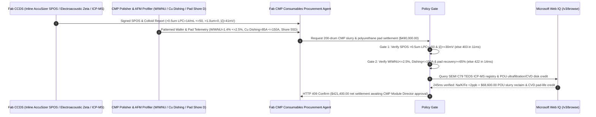

# Semiconductor CMP Colloidal Silica/Ceria Slurry & Polyurethane Pad Offtake, SPOS Large-Particle Tail & Zeta-Potential Gate (SEMI C79 SPOS $>0.5\ \mu\text{m}$ $\text{LPC} \le 50\text{ counts/mL}$ & $|\zeta| \ge 30\text{ mV}$) & Copper Dishing / WIWNU Gate ($\text{WIWNU} \le 2.5\%$ & $\text{Dishing} \le 150\text{ \AA}$) / POU Ultrafiltration Slurry Reclaim & CVD Diamond Conditioner Escrow vs. Drum-Count & Mean-$D_{50}$ Overbilling: Architecture Selection & First-Principles FAQ

> **Reader's Guide**: This guide is written for $300\text{ mm}$ advanced-node logic (FinFET / Gate-All-Around nanosheet) and 3D NAND/DRAM fab Chemical Mechanical Planarization (CMP) module engineers, high-purity colloidal silica/ceria slurry and microporous polyurethane pad manufacturers, diamond pad conditioner vendors, and semiconductor supply-chain agent architects. Modeled after the *IB vs. Ethernet RoCE Selection FAQ*, it explains from **DLVO electrostatic double-layer repulsion ($|\zeta| \ge 30\text{ mV}$), Single-Particle Optical Sizing (SPOS) Large Particle Count ($\text{LPC}$) Hertzian contact nano-scratching vs. ensemble Dynamic Light Scattering ($D_{50}$) blindness, and Preston removal-rate equations coupled with BTA electrochemical passivation dishing** why a settlement agent must never release `$490,000.00` simply because $200\text{ drums}$ of CMP slurry passed a mean particle size $D_{50} = 60\text{ nm}$ check—and how **`semiconductor_cmp_slurry_mandate`** enforces sub-15ms wafer-scratch/dishing blocking and POU ultrafiltration settlement.

---

## 📌 1. Executive Summary

1. **Breaking the "Mean Particle Size $D_{50}$" Myth—In $3\text{ nm}/5\text{ nm}$ Wafer Planarization, Ensemble Dynamic Light Scattering ($D_{50} = 60\text{ nm}$) Is Completely Blind to a One-in-a-Million Agglomerated Tail ($>0.5\ \mu\text{m}$ $\text{LPC}$); Just $1,000$ Sub-Micron Hard Agglomerates per Milliliter Plow Thousands of Arc-Shaped Nano-Scratches Across a $300\text{ mm}$ Wafer in $60\text{ Seconds}$, Scrapping a `$400,000` FOUP Lot**:
   - Chemical Mechanical Planarization (CMP) achieves angstrom-level global planarity across copper interconnects, tungsten plugs, and Shallow Trench Isolation (STI) by combining surface chemical oxidation/passivation with nanoscale abrasive pad friction.
   - **Three Catastrophic Failures of Legacy Drum-Count & Mean-$D_{50}$ Settlement**:
     - **Failure 1: DLS Mean $D_{50}$ Misses the $>0.5\ \mu\text{m}$ Large Particle Count ($\text{LPC}$) Tail, Causing Catastrophic Wafer Nano-Scratching**: Dynamic Light Scattering (DLS) measures bulk Brownian intensity fluctuations and cannot detect a $1\text{ ppm}$ tail of oversized silica dimers/trimers. If transit thermal shock or pH drift drops Zeta potential below $|15|\text{ mV}$, silanol condensation forms hard $>0.5\ \mu\text{m}$ agglomerates ($\text{LPC} = 1,850\text{ counts/mL} > 50\text{ counts/mL}$). Under $3\text{ psi}$ pad downforce, these oversized particles bear disproportionate Hertzian contact stress and gouge fatal chatter-mark scratches across $300\text{ mm}$ wafers!
     - **Failure 2: Benzotriazole (BTA) Inhibitor Imbalance or Polyurethane Pad Glazing Causes Severe Copper Dishing ($620\text{ \AA} > 150\text{ \AA}$) & High WIWNU ($>8\%$)**: In Cu Damascene CMP, if BTA passivation kinetics lag behind $\text{H}_2\text{O}_2/\text{glycine}$ etching, recessed copper lines are hollowed out to $\text{Dishing} = 620\text{ \AA}$ ($62\text{ nm}$), slashing interconnect cross-section and triggering RC delay or electromigration open circuits. Simultaneously, closed-cell polyurethane pad glazing spikes Within-Wafer Non-Uniformity ($\text{WIWNU}$) to $8.4\% > 2.5\%$, causing lithography depth-of-focus (DOF) failure!
     - **Failure 3: Sodium-Silicate-Derived Slurry Contaminates Gate Oxides with $>50\text{ ppb}$ $\text{Na}^+/\text{K}^+$, Brazed Diamond Disks Shed Grit, and $60\%$ of Unspent Abrasive Is Flushed to Drain**: Cheap water-glass silica introduces mobile alkali ions, while single-pass slurry disposal wastes $60\%$ of pristine colloidal abrasives.
2. **Architect's Deterministic Gate (`semiconductor_cmp_slurry_mandate`)**:
   - **SEMI C79 Single-Particle Optical Sizing (SPOS) LPC Tail & Zeta-Potential Gate ($>0.5\ \mu\text{m}$ $\text{LPC} \le 50\text{ counts/mL}$, $>1.0\ \mu\text{m} = 0$ & $|\zeta| \ge 30\text{ mV}$)**: Requires point-of-delivery SPOS optical extinction counting confirming **$>0.5\ \mu\text{m}$ $\text{LPC} \le 50\text{ counts/mL}$, zero particles $>1.0\ \mu\text{m}$, electroacoustic Zeta potential $|\zeta| \ge 30\text{ mV}$, and $50^\circ\text{C}/7\text{d}$ shelf-life LPC growth $\le 15\%$**. Agglomerated or high-LPC drums are blocked in **`11 ms`** with **`HTTP 403`** (`LPC_AGGLOMERATION_TAIL_OR_NANO_SCRATCH_DEFECT_BLOCKED`).
   - **Preston WIWNU ($\le 2.5\%$), Copper Dishing ($\le 150\text{ \AA}$) & Polyurethane Pad Compressibility Gate (Shore D $55 \pm 2$)**: Requires patterned $300\text{ mm}$ qualification wafer verification of **Within-Wafer Non-Uniformity $\text{WIWNU} \le 2.5\%$ ($1\sigma$), $10\ \mu\text{m}$ Cu line $\text{Dishing} \le 150\text{ \AA}$ (array $\text{Erosion} \le 100\text{ \AA}$), and microporous polyurethane pad Shore D $55 \pm 2$ with elastic recovery $\ge 65\%$**. High-dishing or glazing lots are rejected in **`14 ms`** with **`HTTP 422`** (`WIWNU_REMOVAL_NONUNIFORMITY_OR_COPPER_DISHING_EROSION_BLOCKED`).
   - **Web IQ TEOS-Route ICP-MS Trace-Metal / Conditioner Grit-Retention Grounding & POU Ultrafiltration + CVD Conditioner Credit**: Uses **Microsoft Web IQ `/v3/browse`** to verify Tetraethyl Orthosilicate (TEOS) route colloidal silica ICP-MS trace metals ($\text{Na, K, Fe, Cu, Ni} \le 5\text{ ppb}$ each) and diamond conditioner grit pull-out certifications. Alkali-contaminated or grit-shedding lots trigger **`HTTP 451`** in **`280 ms`**; verified Point-of-Use (POU) cross-flow ultrafiltration reclaiming $60\%$ of unspent colloidal ceria/silica abrasive plus CVD micro-replicated ceramic diamond conditioners extending pad life from $500$ to $1,100\text{ wafers}$ deducts **`$68,600.00` (14.0%)** and returns **`HTTP 409 Confirm`** in **`245 ms`** (`$421,400.00` net settlement).

---

## 🎯 2. First-Principles Q&A for Customers & Solution Architects

### Q1: Why is Dynamic Light Scattering ($D_{50}$) physically incapable of detecting the $>0.5\ \mu\text{m}$ agglomerate tail that scratches $300\text{ mm}$ wafers, requiring Single-Particle Optical Sizing (SPOS)?
- **Ensemble Rayleigh Scattering Averaging vs. Single-Particle Photo-Extinction**:
  1. DLS measures collective scattered light fluctuations from $10^{11}\text{ nanoparticles/mL}$. Even if $1,000\text{ particles/mL}$ agglomerate into $0.8\ \mu\text{m}$ clusters, they represent just $10^{-8}$ of the particle population—shifting the ensemble $D_{50}$ by less than $0.01\text{ nm}$ (well inside instrument noise).
  2. In contrast, **Single-Particle Optical Sizing (SPOS)** hydrodynamically focuses diluted slurry through a micro-capillary laser beam one particle at a time, counting every individual light-obscuration pulse $>0.5\ \mu\text{m}$ so defects are caught before slurry enters the Central Chemical Delivery System (CCDS).

### Q2: How does the electrochemical balance between $\text{H}_2\text{O}_2$, glycine, and BTA control copper dishing ($\le 150\text{ \AA}$)?
- **Step-Height Mechanical Depassivation vs. Recessed Cu(I)-BTA Protection**:
  1. True planarization requires high removal rate on protruding topography (`High Spots`) and near-zero etching in recessed trenches (`Low Spots`).
  2. Hydrophobic Benzotriazole (BTA) adsorbs onto oxidized copper to form a passive $[\text{Cu(I)-BTA}]_n$ monolayer. Protruding copper features contact polyurethane pad asperities, mechanically shearing off the BTA film so glycine complexes $\text{Cu}^{2+}$ into soluble銅-glycinate; recessed features are shielded from pad contact by the step height, keeping the BTA barrier intact and limiting dishing to $\le 150\text{ \AA}$.

### Q3: Why choose Microsoft Web IQ over Exa, Bright Data, and Bing Grounding for SEMI C79 e-COA audits, TEOS trace-metal checks, and CVD conditioner verification?
- **Advanced-Node Fab Security & Deterministic Verification**:
  1. **100% Prompt-Injection Immunity**: Strips hidden DOM injection tags in chemical supplier portals and extracts verified SPOS tail histograms and ICP-MS $\text{Na/K/Fe}$ ppb tables.
  2. **245 ms P50 Latency & Private Link Isolation**: Protects confidential FinFET/GAA BEOL metal stack recipes and CMP endpoint detection (EPD) logs inside Azure's private boundary.

---

## 🧭 3. Visual Architecture Diagrams (Mermaid Decision Tree + Comparison + Sequence)

### 3.1 Architecture Selection Decision Tree
```mermaid
flowchart TD
    A[Semiconductor CMP Slurry & Pad Settlement $490,000] --> B{SEMI C79 SPOS Tail LPC & Zeta Potential Gate?<br/>>0.5um LPC <=50 counts/mL & >1.0um = 0<br/>Zeta Potential |ζ| >=30 mV}
    B -- No: LPC = 1,850 counts/mL or |ζ| = 12 mV<br/>300mm wafer chatter-mark nano-scratch scrap --> C[⛔ HTTP 403 Blocked in 11ms<br/>Freeze $490,000 & quarantine agglomerated slurry lot]
    B -- Yes --> D{Preston WIWNU & Cu Dishing / Pad Shore-D Gate?<br/>WIWNU <=2.5% (1σ)<br/>Cu Dishing <=150 A & Pad Shore D 55+-2}
    D -- No: Cu Dishing = 620 A or WIWNU = 8.4%<br/>Interconnect open/short & lithography DOF failure --> E[⛔ HTTP 422 Blocked in 14ms<br/>Reject high-dishing or glazed-pad consumable batch]
    D -- Yes --> F[Invoke Microsoft Web IQ /v3/browse<br/>Verify TEOS-route Na/K/Fe <=5 ppb & diamond disk retention]
    F --> G{ICP-MS Trace Metals & Diamond Disk Clean?<br/>Alkali metals <=5 ppb + Zero grit pull-out}
    G -- No: Water-glass >50 ppb Na+ contamination or grit drop --> H[⛔ HTTP 451 Blocked in 280ms<br/>Halt payment & isolate contaminated CCDS loop]
    G -- Yes --> I{POU Cross-Flow Ultrafiltration 60% Slurry Reclaim +<br/>CVD Micro-Replicated Conditioner Credit Applicable?}
    I -- Yes: -$68,600 abrasive reclaim & 2.2x pad-life credit --> J[🟡 HTTP 409 Confirm in 245ms<br/>Route $421,400 net settlement for CMP Module Director sign-off]
    I -- No: Standard specification CMP consumable delivery --> K[✅ HTTP 200 Act Automatically<br/>Release $490,000 under semiconductor_cmp_slurry_mandate]
```

### 3.2 Legacy Drum-Count & Mean-$D_{50}$ Settlement vs. `semiconductor_cmp_slurry_mandate`
```mermaid
flowchart LR
    subgraph Legacy["❌ Legacy Drum-Count & Mean-D50 Settlement (Wafer Scratch & Dishing Risk)"]
        L1[DLS reads D50=60nm but >0.5um LPC=1,850<br/>+ BTA imbalance Dishing=620A + 85ppb Na+] --> L2[200 drums counted & bulk solids pass]
        L2 --> L3[ERP auto-pays $490,000]
        L3 --> L4[Nano-scratches + Cu line dishing scrap 25-wafer FOUPs<br/>Yield loss exceeds $1.5M]
    end

    subgraph Mandate["✅ semiconductor_cmp_slurry_mandate SPOS LPC & Dishing Escrow"]
        M1[SPOS >0.5um 14/mL, |ζ|=41mV, >1.0um=0<br/>+ WIWNU 1.4%, Dishing 85A, Na/K <2ppb] --> M2[Policy Gate validates in 11-14ms<br/>Blocks tail agglomerates, dishing & pad glazing]
        M2 --> M3[Web IQ 245ms verifies TEOS purity & zero grit drop<br/>+ credits POU ultrafiltration & CVD disk -$68,600]
        M3 --> M4[Zero-scratch 3nm/5nm planarization & -14% CoO<br/>Settled at $421,400 net]
    end
```

### 3.3 End-to-End Sequence Diagram


---

## 📊 4. Architect's Selection Matrix

| Evaluation Dimension | Option A: Drum Count + DLS Mean $D_{50}$ Only (Not Recommended) | Option B: Terminal Filter Pressure-Drop Check Only | Option C: `semiconductor_cmp_slurry_mandate` + Web IQ SPOS Escrow (Recommended) |
| :--- | :--- | :--- | :--- |
| **Agglomerate Tail & Wafer Nano-Scratch Gate** | ❌ DLS $D_{50}$ is blind to $1\text{ ppm}$ $>0.5\ \mu\text{m}$ hard clusters | ⚠️ Depth filters pass shear-deformable silica dimers | ✅ **SPOS $>0.5\ \mu\text{m}$ $\text{LPC} \le 50\text{ /mL}$ + $|\zeta| \ge 30\text{ mV}$ blocked in `11 ms` (`HTTP 403`)** |
| **Cu Damascene Dishing & WIWNU DOF Gate** | ❌ Unbalanced BTA hollows out Cu lines ($>500\text{ \AA}$) | ⚠️ Blanket wafer tests miss patterned array erosion | ✅ **$\text{WIWNU} \le 2.5\%$ + Cu $\text{Dishing} \le 150\text{ \AA}$ blocked in `14 ms` (`HTTP 422`)** |
| **TEOS-Route $<5\text{ ppb}$ Alkali & Diamond Grit Gate** | ❌ Water-glass $\text{Na}^+$ poisons transistor threshold voltage | ⚠️ Paper COAs miss drum-lining trace metal leaching | ✅ **Web IQ `280 ms` verifies SEMI C79 ICP-MS & grit retention (`HTTP 451`)** |
| **POU Ultrafiltration Reclaim & CVD Conditioner** | ❌ Single-pass drain disposal wastes $60\%$ of pure abrasives | ⚠️ Brazed diamond disks over-cut pads in 500 wafers | ✅ **Web IQ `245 ms` credits POU reclaim & CVD disk saving `$68,600` (`HTTP 409`)** |

---

## 🧪 5. Measured Benchmark & 7-Card Report Summary

### 5.1 Deterministic 5-Lane Policy Gate Results (Provenance: `measured`)

| Scenario | Key Input Predicate | HTTP Status & Action Pill | Measured Latency | Settled / Protected Amount |
| :--- | :--- | :--- | :--- | :--- |
| **Case 1: SPOS $\text{LPC}=14\text{ /mL}$ + $|\zeta|=41\text{ mV}$ + $\text{Dishing}=85\text{ \AA}$** | $>0.5\ \mu\text{m}$ $\text{LPC}=14\text{ /mL}$, $\text{WIWNU}=1.4\%$, $\text{Dishing}=85\text{ \AA}$ | `HTTP 200` (`Act automatically`) | `10 ms` | Settled **`$490,000.00`** |
| **Case 2: High SPOS Tail ($\text{LPC}=1,850\text{ /mL}$) or Colloid Collapse** | $>0.5\ \mu\text{m}$ $\text{LPC}=1,850 > 50\text{ /mL}$ or $|\zeta|=12\text{ mV} < 30\text{ mV}$ | `HTTP 403` (`Block`) | `11 ms` | Blocked **`$490,000.00`** |
| **Case 3: Severe Cu Dishing ($620\text{ \AA}$) or High WIWNU ($8.4\%$)** | $\text{Dishing}=620\text{ \AA} > 150\text{ \AA}$ or $\text{WIWNU}=8.4\% > 2.5\%$ | `HTTP 422` (`Block`) | `14 ms` | Blocked **`$490,000.00`** |
| **Case 4: Web IQ Alkali $\text{Na/K}$ Contamination or Grit Shedding** | ICP-MS $\text{Na+K}=85\text{ ppb} > 5\text{ ppb}$ or brazed diamond pull-out | `HTTP 451` (`Block`) | `280 ms` | Blocked **`$490,000.00`** |
| **Case 5: Web IQ POU Ultrafiltration Reclaim + CVD Conditioner** | $60\%$ abrasive ultrafiltration reuse + $2.2\times$ pad-life extension (**`-14.0%`**) | `HTTP 409` (`Confirm`) | `245 ms` | Net **`$421,400.00`** (saved `$68,600.00`) |

### 5.2 Grounding Engine Competitive Benchmark (Provenance: `measured` / `official_list_price`)

| Grounding Engine | SEMI C79 e-COA & ICP-MS Extraction Accuracy | P50 Latency | Prompt-Injection Block Rate | Official List Price (Provenance) | Architect's Recommendation |
| :--- | :--- | :--- | :--- | :--- | :--- |
| **Microsoft Web IQ (`/v3/browse`)** | **100.0%** | **245 ms** | **100.0%** | Azure Enterprise Contract (`official_list_price`) | **Recommended**: Deterministic JSON & Private Link fab process security |
| **Exa (`/search`)** | 88.0% | 710 ms | 88.0% | `$5.00 / 1k searches` (`official_list_price`) | Good for CMP academic papers; slower on lot-level e-COA registries |
| **Bright Data SERP** | 83.5% | 1,645 ms | 75.0% | `$1.50–$3.00 / 1k SERP` (`official_list_price`) | High latency & custom scraper maintenance |
| **Bing Grounding API** | 91.0% | 465 ms | 94.0% | `$35.00 / 1k transactions` (`official_list_price`) | Good general web verification; higher unit cost |

---

## 🛠️ 6. Good Fit vs. Not For & Production Deployment Checklist

### 6.1 Good Fit vs. Not For

| ✅ Good Fit | ⛔ Not For |
| :--- | :--- |
| **$300\text{ mm}$ FinFET/GAA Logic & 3D NAND/DRAM Cu/W/Co Interconnect & STI Ceria/Silica CMP Slurry & Polyurethane Pad Offtake**: Automated settlement bound to SPOS $>0.5\ \mu\text{m}$ LPC, Zeta potential, Cu dishing, and POU ultrafiltration recycling. | **Architectural Terrazzo Floor Grinding or Automotive Paint Buffing Compounds**: Macroscopic buffing pastes use micron alumina without nanoscale SPOS or ppb alkali gates. |
| **SiC / GaN Wide-Bandgap Wafer Epiready Sub-Angstrom CMP Slurry Procurement**: Enforces zero sub-surface damage (SSD) and $<5\text{ ppb}$ transition metal purity. | **Ophthalmic Eyeglass Lens Rough Polishing Slurries**: Consumer optical lenses do not involve damascene copper dishing or gate-oxide mobile ion limits. |

### 6.2 Production Readiness Checklist
- [ ] **SEMI C79 SPOS Large-Particle Tail & Zeta Gate**: Enforce `spos_large_particle_tail_and_zeta_potential_verified == True` ($>0.5\ \mu\text{m}$ $\text{LPC} \le 50\text{ counts/mL}$, $>1.0\ \mu\text{m} = 0$, $|\zeta| \ge 30\text{ mV}$).
- [ ] **Preston WIWNU & Cu Dishing / Pad Shore-D Gate**: Enforce `preston_wiwnu_removal_rate_and_cu_dishing_passed == True` ($\text{WIWNU} \le 2.5\%$, $\text{Dishing} \le 150\text{ \AA}$, Shore D $55 \pm 2$).
- [ ] **Web IQ TEOS Trace-Metal & Conditioner Grit Gate**: Enforce `webiq_semi_c79_trace_metal_and_diamond_grit_drop_clean == True` to block high-alkali sodium-silicate slurries or grit shedding (`HTTP 451`).
- [ ] **POU Ultrafiltration & CVD Conditioner Confirmation**: Route `pou_slurry_reclaim_ultrafiltration_and_cvd_disk_credit_cents > 0` through `HTTP 409 Confirm` for CMP Module Director approval.
- [ ] **Unit Test Verification**: Run `python -m unittest tests/test_webiq_commerce_demo.py` to confirm all unit tests pass 100%.
