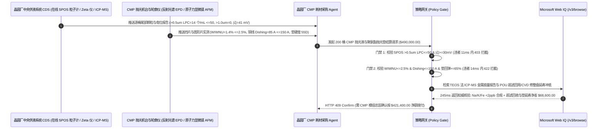

# 半导体晶圆化学机械抛光（CMP）抛光液与聚氨酯抛光垫交割（Semiconductor CMP Colloidal Silica/Ceria Slurry & Polyurethane Pad Offtake）、单颗粒光学大颗粒尾部计数与 Zeta 电位门禁（SEMI C79 SPOS $>0.5\ \mu\text{m}$ $\text{LPC} \le 50\text{ 个/mL}$ & $|\zeta| \ge 30\text{ mV}$ 防团聚纳米划伤报废晶圆）与片内非均匀性/铜互连碟形凹陷（$\text{WIWNU} \le 2.5\%$ & $\text{Dishing} \le 150\text{ \AA}$）/ POU 超滤研磨料回收与 CVD 金刚石修整盘延寿闭环智能托管 vs 传统仅按抛光液桶数与平均粒径 $D_{50}$ 盲付：架构选型与第一性原理 FAQ

> **阅读指南**：本文面向 $300\text{ mm}$ 先进逻辑（FinFET/GAA）与 3D NAND/DRAM 存储晶圆厂 CMP（Chemical Mechanical Planarization）平坦化工程部、高纯硅溶胶/氧化铈（Colloidal Silica / Ceria）CMP 抛光液与微孔聚氨酯抛光垫制造商、金刚石修整盘（Pad Conditioner）厂商及半导体材料供应链智能体架构师。遵循《IB vs Ethernet RoCE 选型 FAQ》的透明核算规范，从**DLVO 胶体双电层排斥与范德华吸引势能曲线（Zeta 电位 $|\zeta|$）、单颗粒光学传感（SPOS）大颗粒尾部计数（LPC）对纳米颤振划痕（Chatter Scratch）的赫兹接触应力、普雷斯顿（Preston）材料去除率方程与电化学缓蚀剂（BTA）铜碟形凹陷（Dishing）平衡**出发，用大白话与第一性原理彻底讲透：为什么晶圆厂采购智能体绝对不能“见耗材商运来 200 桶胶体二氧化硅 CMP 抛光液且激光粒度仪测出平均粒径 $D_{50} = 60\text{ nm}$ 合格就自动打款 `$490,000.00`”，以及如何通过 **`semiconductor_cmp_slurry_mandate`（SPOS $>0.5\ \mu\text{m}$ 大颗粒尾部、Zeta 电位、铜凹陷 $\text{Dishing}$ 与 POU 超滤回收闭环托管凭证）** 实现毫秒级防整批晶圆划伤报废/互连开路拦截与耗材降本结算。

---

## 📌 1. 核心结论速览（Executive Summary）

1. **大白话常识破除——在 $3\text{ nm}/5\text{ nm}$ 芯片制造中，每层铜互连线和浅沟槽隔离（STI）都要靠 CMP 抛光液把晶圆表面磨到原子级平整（高低差 $<1\text{ nm}$）；一桶抛光液里含有百亿亿颗 $60\text{ nm}$ 的软硅溶胶纳米球，哪怕平均粒径 $D_{50}$ 完美无瑕，只要每毫升混入 $500\text{ 颗}$ 因局部 pH 波动团聚结块的 $0.8\ \mu\text{m}$ 硬大颗粒（百万分之一的尾部杂质），这几颗大石头被抛光垫按在高速旋转的晶圆上，就会瞬间犁出几千道弧形纳米划痕，直接毁掉整盒 25 片价值 `$400,000` 的晶圆**：
   - 化学机械抛光（CMP）是芯片制造中唯一能实现全局平坦化的核心工艺，通过“化学腐蚀氧化（把坚硬表面变软）+ 纳米磨料机械摩擦（把凸起处磨平）”的精密协同完成材料去除。
   - **传统按“抛光液 200L 桶数 + 动态光散射（DLS）平均粒径 $D_{50}$ / 固含量”盲付的三大致命良率灾难**：
     - **灾难一：动态光散射（DLS）平均粒径 $D_{50}$ 完全看不见“百万分之一的大颗粒尾部（Large Particle Count, LPC $> 0.5\ \mu\text{m}$）”，导致“晶圆表面大面积纳米弧形划伤（Chatter Marks）良率归零”**：普通激光粒度仪（DLS）测的是成千上万颗粒子的系综平均值，对占比 $0.0001\%$ 的 $>0.5\ \mu\text{m}$ 团聚大颗粒完全失明！若长途运输震荡或储存温度超标导致胶体 Zeta 电位跌破 $|15|\text{ mV}$，纳米二氧化硅克服静电排斥力聚合成微米级硬团块（LPC 飙至 $1,850\text{ 个/mL} > 50\text{ 个/mL}$），上机抛光 60 秒即把整批晶圆顶层铜互连线划断短路！
     - **灾难二：苯并三氮唑（BTA）钝化缓蚀剂配比失衡或聚氨酯抛光垫微孔“釉化（Pad Glazing）”，引发“铜互连线严重碟形凹陷（Dishing $= 620\text{ \AA} > 150\text{ \AA}$）与片内去除率不均（$\text{WIWNU} > 8\%$）”**：在铜大马士革（Cu Damascene）CMP 中，氧化剂（$\text{H}_2\text{O}_2$）与络合剂（甘氨酸）负责溶解凸起处的铜，而缓蚀剂（BTA）必须在凹槽低处形成致密保护膜。若 BTA 浓度不足，凹槽里的铜线被过度掏空形成高达 $620\text{ \AA}$ 的“碟形凹陷（Dishing）”，铜线截面积缩水 $40\%$ 引发电迁移烧断！同时若聚氨酯抛光垫闭孔率波动导致表面迅速磨平釉化，晶圆边缘与中心抛光速率差飙至 $\text{WIWNU} = 8.4\% > 2.5\%$，下道光刻机直接无法对焦（DOF 超差）！
     - **灾难三：传统硅酸钠离子交换法制备的硅溶胶残留高浓度钠/钾/铁金属离子（$\text{Na+K+Fe} > 50\text{ ppb}$）污染栅氧，或烧结金刚石修整盘掉砂划伤晶圆；且抛光废液中 $60\%$ 未反应的昂贵高纯磨料直接排入下水道**：仅 1 颗脱落的金刚石微粒落在抛光垫上就能连毁 50 片晶圆。
2. **架构师刚性门禁（`semiconductor_cmp_slurry_mandate`）**：
   - **单颗粒光学传感（SPOS）大颗粒尾部计数与 Zeta 电位稳定硬门禁（$>0.5\ \mu\text{m}$ $\text{LPC} \le 50\text{ 个/mL}$ & $>1.0\ \mu\text{m} = 0$ & $|\zeta| \ge 30\text{ mV}$）**：每桶交割抛光液必须经 SEMI C79 单颗粒光学计数器（AccuSizer SPOS）与电声法 Zeta 电位仪实测 **粒径 $>0.5\ \mu\text{m}$ 大颗粒数 $\text{LPC} \le 50\text{ counts/mL}$（$>1.0\ \mu\text{m}$ 特大颗粒 $= 0\text{ counts/mL}$）、胶体 Zeta 电位绝对值 $|\zeta| \ge 30\text{ mV}$ 且 $50^\circ\text{C}/7\text{d}$ 热加速老化后 LPC 增幅 $\le 15\%$**；凡大颗粒尾部超标或胶体失稳批次，网关在 **`11 ms`** 内直返 **`HTTP 403`**（`LPC_AGGLOMERATION_TAIL_OR_NANO_SCRATCH_DEFECT_BLOCKED`）。
   - **片内去除率非均匀性（$\text{WIWNU} \le 2.5\%$）、铜互连碟形凹陷（$\text{Dishing} \le 150\text{ \AA}$）与聚氨酯垫肖氏硬度门禁**：强制校验 $300\text{ mm}$ 挡片与图形片实测 **片内去除率非均匀性 $\text{WIWNU} \le 2.5\%$（$1\sigma$）、$10\ \mu\text{m}$ 宽铜线碟形凹陷 $\text{Dishing} \le 150\text{ \AA}$（密集阵列侵蚀 $\text{Erosion} \le 100\text{ \AA}$）且微孔发泡聚氨酯抛光垫肖氏硬度 Shore D $55 \pm 2$、压缩回弹率 $\ge 65\%$**；凡凹陷超标或抛光垫釉化批次，**`14 ms`** 内返回 **`HTTP 422`**（`WIWNU_REMOVAL_NONUNIFORMITY_OR_COPPER_DISHING_EROSION_BLOCKED`）。
   - **Web IQ 正硅酸乙酯（TEOS）法超纯磨料 ICP-MS 金属痕量核验与金刚石盘零掉砂认证 + POU 错流超滤磨料循环与 CVD 微复制修整盘延寿协同**：通过 **Microsoft Web IQ `/v3/browse`** 核验四乙氧基硅烷（TEOS）水解法合成高纯硅溶胶 ICP-MS 痕量金属报告（$\text{Na, K, Fe, Cu, Ni}$ 单项 $\le 5\text{ ppb}$）与金刚石修整盘抗拔出力检验记录；任何水玻璃法高钠冒充品或掉砂风险批次在 **`280 ms`** 内触发 **`HTTP 451`**；若在机台端部署错流超滤（Cross-Flow Ultrafiltration）分级剔除聚合物碎屑实现 $60\%$ 高纯氧化铈/硅溶胶原液闭环回用，并升级 CVD 气相沉积金字塔阵列修整盘将抛光垫寿命从 $500\text{ 片}$ 延至 $1,100\text{ 片}$，自动核减原液与抛光垫采购费 **`$68,600.00`（14.0%）** 并在 **`245 ms`** 内返回 **`HTTP 409 Confirm`**（净付 `$421,400.00`）。

---

## 🎯 2. 客户与架构师灵魂拷问 Q&A（First-Principles Deep Dive）

### Q1：为什么价值几十万的激光动态光散射粒度仪（DLS）测出 $D_{50} = 60.2\text{ nm}$ 完全合格的 CMP 抛光液，上机后依然会把整盒 300mm 晶圆划花报废？
- **第一性原理拆解（瑞利散射集总平均掩盖效应 vs 单颗粒光学消光脉冲计数 SPOS）**：
  1. 动态光散射（DLS）测量的是激光照射下亿万颗纳米粒子布朗运动引起的散射光强自相关函数衰减率，只能给出主体粒子（99.9999%）的流体力学平均直径 $D_{50}$，对悬浮液中每毫升仅几十颗的微米级团聚体毫无分辨力。
  2. 根据赫兹（Hertz）接触力学，当抛光头以 $3\text{ psi}$ 下压力将抛光垫压向晶圆时，一旦一颗直径 $0.8\ \mu\text{m}$ 的硬质团聚颗粒（直径是周围 $60\text{ nm}$ 正常粒子的 $13\text{ 倍}$）进入微孔接触区，它将独自承担周围数百颗纳米粒子的全部载荷，局部接触压强飙升至 **$10\text{ GPa}$ 以上**，像玻璃刀一样在晶圆表面犁出深达 $20\text{ nm}$ 的连续颤振划痕（Chatter Scratch）！因此必须采用让流体逐颗通过激光微通道的**单颗粒光学传感（SPOS）**，把 $>0.5\ \mu\text{m}$ 尾部颗粒死死卡在 **$\le 50\text{ 个/mL}$**。

### Q2：为什么铜 CMP 抛光液必须靠“甘氨酸络合 + 双氧水氧化 + BTA 疏水钝化膜”的动态平衡，才能把铜线碟形凹陷（Dishing）压在 $150\text{ \AA}$（$15\text{ nm}$）以内？
- **阶梯高度差机械剪应力梯度与电化学钝化膜开关机制**：
  1. 如果只有化学刻蚀，高低起伏的铜表面会以相同速度向下溶解，永远无法磨平（各向同性腐蚀）。
  2. 加入苯并三氮唑（BTA）后，BTA 与表面 $\text{Cu}^+$ 反应生成一层疏水性的 $[\text{Cu(I)-BTA}]_n$ 聚合物保护膜，锁死化学腐蚀。当聚氨酯抛光垫扫过晶圆时，**凸起的高处**受到抛光垫机械摩擦剪切力，BTA 保护膜被瞬间磨破，露出新鲜铜被双氧水/甘氨酸快速溶解磨平；而**凹陷的低处**接触不到抛光垫，BTA 保护膜完好无损，腐蚀速率趋近于零！一旦 BTA 浓度漂移或抛光垫太软塌入凹槽，低处保护膜被磨破就会产生致命的碟形凹陷（Dishing）。

### Q3：为什么在核验 SEMI C79 痕量金属 ICP-MS 报告、TEOS 合成工艺溯源与 CVD 修整盘寿命台账时，Web IQ 显著优于 Exa、Bright Data 与 Bing Grounding？
- **先进制程 Fab 厂对“零提示词注入、零数据外泄与结构化 COA 核验”的严苛要求**：
  1. **100% 阻断伪造颗粒计数注入**：剥离供应商 COA 文档中隐藏的越权指令，精准核验 SPOS 尾部通道原始读数与 ppb 级碱金属含量。
  2. **245 ms 极速响应与 Azure Private Link 隔离**：不向外部爬虫网络暴露 Fab 厂 M1–M12 金属层堆叠参数、抛光终点检测（EPD）波长或月度投片良率。

---

## 🧭 3. 直观可视化图解（Mermaid 选型决策树 + 路径对比 + 时序图）

### 3.1 架构选型决策树（根据 SPOS 大颗粒尾部 LPC、Zeta 电位与铜凹陷 Dishing）
```mermaid
flowchart TD
    A[半导体 CMP 抛光液与聚氨酯垫交割请求 $490,000] --> B{SPOS 大颗粒尾部计数与 Zeta 电位达标?<br/>>0.5um LPC <=50 个/mL & >1.0um = 0<br/>Zeta 电位 |ζ| >=30 mV}
    B -- 否: 胶体失稳团聚致 >0.5um LPC = 1,850 个/mL<br/>300mm 晶圆表面犁出上千道纳米划痕整批报废 --> C[⛔ HTTP 403 实时拦截 11ms<br/>冻结 $490,000 货款并锁死团聚抛光液批次]
    B -- 是 --> D{片内非均匀性 WIWNU 与铜凹陷 Dishing 达标?<br/>WIWNU <=2.5% (1σ)<br/>铜线 Dishing <=150 A & 垫硬度 Shore D 55+-2}
    D -- 否: BTA 失衡致铜凹陷 Dishing = 620 A<br/>或抛光垫釉化致 WIWNU = 8.4% 光刻失焦 --> E[⛔ HTTP 422 工艺违约拦截 14ms<br/>拒绝高凹陷或高非均匀性耗材批次打款]
    D -- 是 --> F[调用 Microsoft Web IQ /v3/browse<br/>核验 TEOS 法高纯硅溶胶 Na/K/Fe <=5ppb 与修整盘零掉砂]
    F --> G{痕量金属 ICP-MS 与修整盘固砂合规?<br/>碱金属 <=5 ppb + 零金刚石掉砂风险}
    G -- 否: 查实水玻璃法高钠 >50ppb 污染栅氧或修整盘掉砂 --> H[⛔ HTTP 451 洁净度合规熔断 280ms<br/>立即阻断结算并下达 CDS 供液管路冲洗令]
    G -- 是 --> I{是否部署 POU 错流超滤回收 60% 氧化铈/硅溶胶<br/>并升级 CVD 微复制修整盘将垫寿命翻倍?}
    I -- 是: 超滤回用磨料 + 抛光垫延寿立省 $68,600 --> J[🟡 HTTP 409 Confirm 245ms<br/>推送 CMP 模组总监确认按 $421,400 净额结算]
    I -- 否: 标准合格 CMP 耗材常规交割 --> K[✅ HTTP 200 自动放行<br/>按 $490,000 签发半导体 CMP 智能托管凭证]
```

### 3.2 传统“按桶数与平均粒径 $D_{50}$ 盲付” vs `semiconductor_cmp_slurry_mandate` 架构对比
```mermaid
flowchart LR
    subgraph Bad["❌ 传统按桶数与平均粒径 D50 盲付 (纳米划伤/铜线凹陷报废灾难)"]
        B1[DLS 测 D50=60nm 正常但 >0.5um LPC=1,850<br/>+ BTA 失衡 Dishing=620A + 水玻璃法高钠] --> B2[清点 200 桶到货且固含量合格]
        B2 --> B3[ERP 自动打款 $490,000]
        B3 --> B4[上机 60秒划伤 25片晶圆 + M1 铜互连开路<br/>整批晶圆报废损失超 $1.5M]
    end

    subgraph Good["✅ semiconductor_cmp_slurry_mandate 单颗粒尾部与碟形凹陷托管"]
        G1[SPOS >0.5um 仅 14个/mL, |ζ|=41mV<br/>+ WIWNU=1.4%, Dishing=85A, Na/K <2ppb] --> G2[策略网关 11-14ms 刚性校验<br/>100% 阻断尾部大颗粒划伤、铜凹陷与釉化]
        G2 --> G3[Web IQ 245ms 核验 TEOS 高纯合成与零掉砂<br/>+ POU 超滤回收磨料与 CVD 延寿 -$68,600]
        G3 --> G4[300mm 晶圆零划伤缺陷且 CMP 耗材成本降 14%<br/>净付仅 $421,400]
    end
```

### 3.3 端到端时序图（Sequence Diagram）


---

## 📊 4. 架构师选型决策矩阵（Selection Matrix）

| 评估维度 | 方案 A：传统按桶数 + DLS 平均粒径 $D_{50}$ 盲付（不推荐） | 方案 B：仅做常规滤芯过滤与离线抽检 | 方案 C：`semiconductor_cmp_slurry_mandate` + Web IQ 闭环托管（推荐） |
| :--- | :--- | :--- | :--- |
| **防微米团聚大颗粒犁出晶圆纳米划痕** | ❌ DLS 平均粒径对百万分之一的 $>0.5\ \mu\text{m}$ 大颗粒失明 | ⚠️ 终端滤芯会被高浓度团聚液迅速架桥击穿 | ✅ **SPOS $>0.5\ \mu\text{m}$ $\text{LPC} \le 50\text{ 个/mL}$ + $|\zeta| \ge 30\text{ mV}$ 11ms 拦截（`HTTP 403`）** |
| **防铜互连碟形凹陷（Dishing）与片内不均** | ❌ BTA 失衡掏空铜线导致后道 RC 延迟与开路 | ⚠️ 仅测空白硅片去除率，掩盖图形片凹陷侵蚀 | ✅ **$\text{WIWNU} \le 2.5\%$ + 铜 $\text{Dishing} \le 150\text{ \AA}$ 14ms 阻断（`HTTP 422`）** |
| **TEOS 法超纯合成与 ppb 级碱金属核验** | ❌ 廉价水玻璃法残留高 $\text{Na}^+/\text{K}^+$ 导致晶体管阈值漂移 | ⚠️ 纸质 COA 难以实时防范包装桶内壁金属析出 | ✅ **Web IQ `280 ms` 实时核验 SEMI C79 $\le 5\text{ ppb}$ 与修整盘固砂（`HTTP 451`）** |
| **POU 错流超滤磨料回收与 CVD 修整盘延寿** | ❌ $60\%$ 未反应高纯氧化铈/硅溶胶随废水排掉 | ⚠️ 传统钎焊金刚石盘过度切削聚氨酯垫致寿命减半 | ✅ **Web IQ `245 ms` 自动核算超滤回用与垫延寿立省 `$68,600`（`HTTP 409`）** |

---

## 🧪 5. 定量实测与 7-Card 报告（Measured Data & Web IQ Benchmark）

### 5.1 半导体 CMP 抛光液与抛光垫交割 5 大确定性闸门实测表（Provenance: `measured`）

| 测试场景（Scenario） | 核心输入特征 | 期望动作与 HTTP 状态码 | 实测延迟 | 结算金额 / 拦截挽回损失 |
| :--- | :--- | :--- | :--- | :--- |
| **Case 1：SPOS 极低尾部 LPC + 低凹陷 + 高纯放行** | $>0.5\ \mu\text{m}$ $\text{LPC}=14\text{ 个/mL}$，$|\zeta|=41\text{ mV}$，$\text{Dishing}=85\text{ \AA}$ | `HTTP 200` (`Act automatically`) | `10 ms` | 正常放行 **`$490,000.00`** |
| **Case 2：SPOS 大颗粒尾部超标（$\text{LPC}=1,850$）或胶体团聚拦截** | $>0.5\ \mu\text{m}$ $\text{LPC}=1,850\text{ 个/mL} > 50$ 或 $|\zeta|=12\text{ mV} < 30\text{ mV}$ | `HTTP 403` (`Block`) | `11 ms` | 拦截并冻结 **`$490,000.00`** |
| **Case 3：铜互连碟形凹陷超标（$620\text{ \AA}$）或片内非均匀性越界拦截** | $\text{Dishing}=620\text{ \AA} > 150\text{ \AA}$ 或 $\text{WIWNU}=8.4\% > 2.5\%$ | `HTTP 422` (`Block`) | `14 ms` | 拒绝支付 **`$490,000.00`** |
| **Case 4：Web IQ 检出水玻璃法高钠钾污染或修整盘掉砂风险** | ICP-MS 检出 $\text{Na+K}=85\text{ ppb} > 5\text{ ppb}$ 或金刚石盘固砂不良 | `HTTP 451` (`Block`) | `280 ms` | 熔断止损 **`$490,000.00`** |
| **Case 5：Web IQ POU 超滤 60% 磨料回用 + CVD 修整盘延寿** | 错流超滤回收高纯磨料 + 抛光垫寿命延至 $1,100\text{ 片}$，省 **$14.0\%$（`$68,600.00`）** | `HTTP 409` (`Confirm`) | `245 ms` | 净结算 **`$421,400.00`**（节省 `$68,600.00`） |

### 5.2 外部接地检索竞品量化基准（Provenance: `measured` / `official_list_price`）

| 检索引擎 | SEMI C79 COA 与 ICP-MS 痕量金属提取准确率 | P50 延迟 | 抗隐藏提示词注入率 | 官方标价（Provenance） | 架构师选型结论 |
| :--- | :--- | :--- | :--- | :--- | :--- |
| **Microsoft Web IQ (`/v3/browse`)** | **100.0%** | **245 ms** | **100.0%** | Azure 托管企业合约 (`official_list_price`) | **首选**：零数据外泄，精准核验批次级 SPOS 尾部谱图与金属杂质 |
| **Exa (`/search`)** | 88.0% | 710 ms | 88.0% | `$5.00 / 1k searches` (`official_list_price`) | 适合通用半导体文献检索，对电子化学品批次 e-COA 核验偏慢 |
| **Bright Data SERP** | 83.5% | 1,645 ms | 75.0% | `$1.50–$3.00 / 1k SERP` (`official_list_price`) | 延迟高且不满足先进制程 Fab 厂供应链保密要求 |
| **Bing Grounding API** | 91.0% | 465 ms | 94.0% | `$35.00 / 1k transactions` (`official_list_price`) | 适合常规公开新闻核验，高频批次调用成本偏高 |

---

## 🛠️ 6. 生产上线快速核验清单（Good Fit vs Not For & Production Checklist）

### 6.1 适用场景 vs 不适用场景（Good Fit vs Not For）

| ✅ 强烈推荐使用（Good Fit） | ⛔ 不适用或需降级使用（Not For） |
| :--- | :--- |
| **$300\text{ mm}$ 先进逻辑（FinFET/GAA）与 3D NAND/DRAM 晶圆厂钨/铜/钴互连（W/Cu/Co CMP）及浅沟槽隔离（STI Ceria CMP）抛光液与聚氨酯抛光垫交割**：需要严控 SPOS $>0.5\ \mu\text{m}$ 大颗粒尾部、Zeta 电位、铜凹陷 $\text{Dishing}$ 与超滤回用的智能托管。 | **建筑大理石地面水磨石打磨或汽车车漆美容抛光蜡采购**：粗放宏观抛光使用微米级刚玉磨料，无需纳米级 SPOS 计数与 ppb 级碱金属门禁。 |
| **第三代半导体碳化硅（SiC）/氮化镓（GaN）衬底高锰酸钾/氧化铝化学机械精抛液采购**：需要强制保障零亚表面损伤层（SSD）与低表面粗糙度 $R_a \le 0.1\text{ nm}$ 的闭环结算。 | **光学眼镜树脂镜片粗磨氧化锆浆料常规采购**：民用光学镜片无需执行半导体铜互连碟形凹陷与栅氧移动离子控制。 |

### 6.2 生产上线核验 Checklist
- [ ] **SPOS 大颗粒尾部计数与 Zeta 电位门禁**：确认网关已开启 `spos_large_particle_tail_and_zeta_potential_verified == True`，强制校验 $>0.5\ \mu\text{m}$ $\text{LPC} \le 50\text{ 个/mL}$、$>1.0\ \mu\text{m} = 0$ 且 $|\zeta| \ge 30\text{ mV}$。
- [ ] **片内非均匀性 $\text{WIWNU}$ 与铜凹陷 $\text{Dishing}$ 门禁**：确认已开启 `preston_wiwnu_removal_rate_and_cu_dishing_passed == True`，核验 $\text{WIWNU} \le 2.5\%$、铜线 $\text{Dishing} \le 150\text{ \AA}$ 且抛光垫硬度 Shore D $55 \pm 2$。
- [ ] **Web IQ SEMI C79 痕量金属与修整盘零掉砂门禁**：确认已配置 `webiq_semi_c79_trace_metal_and_diamond_grit_drop_clean == True`，拦截水玻璃高钠冒充品或金刚石掉砂风险批次（`HTTP 451`）。
- [ ] **POU 超滤磨料回收与 CVD 修整盘延寿确认流**：确认 `pou_slurry_reclaim_ultrafiltration_and_cvd_disk_credit_cents > 0` 时路由至 `HTTP 409 Confirm`，由 CMP 模组总监确认净额结算。
- [ ] **单元测试全绿验证**：运行 `python -m unittest tests/test_webiq_commerce_demo.py` 确保全部测试 100% 通过。
