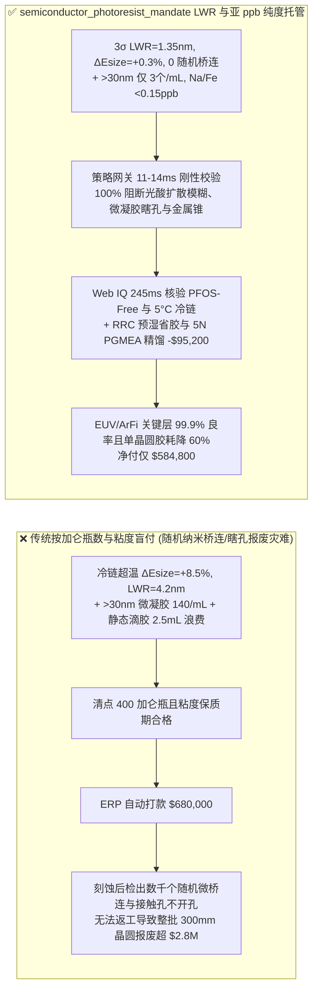
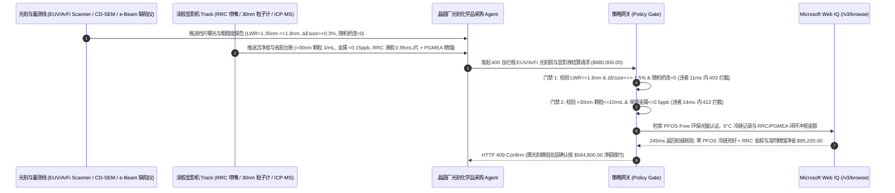

# 半导体晶圆厂 EUV 与浸没式 ArFi 光刻胶及显影液交割（Semiconductor EUV / ArFi Chemically Amplified Photoresist & TMAH Developer Offtake）、线宽粗糙度（LWR）与随机桥连断线门禁（CD-SEM $3\sigma\ \text{LWR} \le 1.8\text{ nm}$ & 曝光灵敏度漂移 $\Delta E_{\text{size}} \le \pm 1.5\%$ 防随机纳米桥连良率崩塌）与 $>30\text{ nm}$ 纳米凝胶颗粒/亚 ppb 金属杂质（$\le 10\text{ 个/mL}$ & 单项金属 $\le 0.5\text{ ppb}$ 防接触孔瞎孔）/ RRC 预湿省胶与旋涂杯 PGMEA 溶剂五塔精馏闭环智能托管 vs 传统仅按光刻胶加仑瓶数与常温粘度盲付：架构选型与第一性原理 FAQ

> **阅读指南**：本文面向 $300\text{ mm}$ 先进逻辑（FinFET/GAA）与 DRAM/3D NAND 晶圆厂光刻工程部（Photolithography Module）、极紫外（EUV $13.5\text{ nm}$）化学放大光刻胶（CAR）/ 金属氧化物光刻胶（MOR）与 $193\text{ nm}$ 浸没式（ArFi）光刻胶制造商、四甲基氢氧化铵（TMAH）显影液及丙二醇甲醚醋酸酯（PGMEA）超纯溶剂厂商与半导体材料智能体架构师。遵循《IB vs Ethernet RoCE 选型 FAQ》的透明核算规范，从**RLS 权衡三角形（分辨率 Resolution、线宽粗糙度 LWR、灵敏度 Sensitivity）与光子散粒噪声（Photon Shot Noise）、光致产酸剂（PAG）与碱性淬灭剂（Quencher）菲克扩散长度失控导致的随机纳米桥连（Stochastic Micro-Bridging）、高分子微凝胶（Micro-Gel）缺陷转移以及旋涂 95% 甩废光刻胶流体力学**出发，用大白话与第一性原理彻底讲透：为什么晶圆厂采购智能体绝对不能“见海外材料商空运来 400 加仑瓶 ArFi/EUV 光刻胶且核对保质期标签和粘度合格就自动打款 `$680,000.00`”，以及如何通过 **`semiconductor_photoresist_mandate`（CD-SEM 线宽粗糙度 $\text{LWR}$、剂量漂移 $\Delta E_{\text{size}}$、亚 ppb 金属杂质与 RRC 预湿省胶/PGMEA 闭环托管凭证）** 实现毫秒级防光刻批量返工/随机桥连报废拦截与降本结算。

---

## 📌 1. 核心结论速览（Executive Summary）

1. **大白话常识破除——先进制程光刻胶每加仑单价高达数千至上万美元（比黄金液还贵），但晶圆高速旋涂（Spin Coating）时 $95\%$ 的光刻胶被直接甩进废液槽，留在晶圆表面成像的只有 $5\%$；更可怕的是，在 $14\text{ nm}$ 线距下，哪怕光刻胶在运输途中经历了 $15^\circ\text{C}$ 轻微升温导致光酸（PAG）与淬灭剂团聚，曝光显影出来的上百亿根纳米线条就会像虫咬的锯齿一样毛糙（$\text{LWR} > 4.0\text{ nm}$），到处发生“随机纳米粘连短路（Micro-Bridge）”或“断线（Line Break）”，刻蚀后整批数百万美元晶圆直接报废且无法返工**：
   - 在 193nm 浸没式（ArFi）与 13.5nm 极紫外（EUV）光刻中，光刻胶依靠**化学放大（Chemical Amplification）**机制：1 个光子激发光致产酸剂（PAG）产生 1 个强酸分子，在曝光后烘烤（PEB）时催化脱去数百个树脂保护基团，使曝光区溶于 2.38% TMAH 显影液。
   - **传统按“光刻胶加仑瓶数（Gallon Bottles）+ 纸面保质期 + 常温旋转粘度”盲付的三大致命良率灾难**：
     - **灾难一：光致产酸剂（PAG）与碱性淬灭剂（Quencher）微观相分离或冷链热漂移，导致“曝光剂量漂移（$\Delta E_{\text{size}} = +8.5\% > 1.5\%$）与线宽粗糙度暴增（$3\sigma\ \text{LWR} = 4.2\text{ nm} > 1.8\text{ nm}$），触发随机桥连与断线灾难”**：光刻工艺窗口对曝光能量极度敏感！若批次间 PAG 活性偏差或冷链超温（$>10^\circ\text{C}$）导致暗反应提前消耗淬灭剂，不仅特征尺寸剂量 $E_{\text{size}}$ 漂移 $+8.5\%$ 使全片 CD 线宽超差，且 PEB 烘烤时酸扩散模糊长度（Acid Diffusion Blur）失控，线条边缘粗糙度 $\text{LWR}$ 恶化至 $4.2\text{ nm}$，在密集金属层随机产生数千个纳米桥连（Nano-Bridges）！
     - **灾难二：高分子树脂交联产生 $>30\text{ nm}$ 透明微凝胶（Micro-Gel $= 140\text{ 个/mL} > 10\text{ 个/mL}$）或瓶壁析出 $6.5\text{ ppb}$ 钠/铁离子，引发“接触孔瞎孔（Missing Contact Hole）与刻蚀微掩模缺陷”**：光刻胶中的聚羟基苯乙烯或丙烯酸酯高分子极易在储存中形成折射率与溶剂相近的软性微凝胶团。普通滤芯拦不住软凝胶，涂布后留在接触孔位置阻挡显影液，形成致命的“不开孔（Missing Via）”；同时，若 $\text{Fe/Na/Sn}$ 金属杂质 $>0.5\text{ ppb}$，在等离子体干法刻蚀时会像钉子一样留作微掩模（Micro-Masking），在晶圆上长出密集锥状缺陷！
     - **灾难三：仍使用含欧盟 REACH / 斯德哥尔摩公约禁用的长链全氟辛烷磺酸盐（PFOS/PFOA）光致产酸剂，且涂胶机每片晶圆盲目静态滴胶 $2.5\text{ mL}$、旋涂洗边废溶剂 PGMEA 当危废烧掉**：传统静态滴胶浪费大量天价光刻胶，且洗杯溶剂未提纯复用。
2. **架构师刚性门禁（`semiconductor_photoresist_mandate`）**：
   - **CD-SEM 线宽粗糙度（$3\sigma\ \text{LWR} \le 1.8\text{ nm}$）、焦深能量窗口（Bossung EL/DOF）与批次间灵敏度硬门禁（$\Delta E_{\text{size}} \le \pm 1.5\%$ & 随机缺陷 $= 0$）**：每批到厂光刻胶必须经基准光刻机（Scanner）挡片曝光与 CD-SEM 实测 **目标线宽剂量漂移 $\Delta E_{\text{size}} \le \pm 1.5\%$、线宽粗糙度 $3\sigma\ \text{LWR} \le 1.8\text{ nm}$、曝光宽容度 $\text{EL} \ge 12\%$ 且电子束缺陷扫描（e-Beam Inspection）零随机桥连/断线（Stochastic Bridge/Break $= 0\text{ defects/cm}^2$）**；凡灵敏度漂移或 LWR 超标批次，网关在 **`11 ms`** 内直返 **`HTTP 403`**（`STOCHASTIC_NANO_BRIDGE_OR_PAG_ACID_BLUR_LWR_BLOCKED`）。
   - **液体颗粒计数（$>30\text{ nm}$ $\le 10\text{ 个/mL}$）、涂布针孔条纹与 ICP-MS 亚 ppb 金属痕量门禁（单项金属 $\le 0.5\text{ ppb}$）**：强制校验 **激光散射液体粒子计实测 $>30\text{ nm}$ 颗粒与微凝胶 $\le 10\text{ counts/mL}$、明场缺陷检测仪（Brightfield Inspection）涂布后整片缺陷 $\le 5\text{ 颗/300mm wafer}$ 且三重四极杆 ICP-MS 实测 $\text{Na, K, Fe, Cu, Cr, Ni}$ 单项金属杂质 $\le 0.5\text{ ppb}$（$500\text{ ppt}$）**；凡微凝胶超标或金属污染批次，**`14 ms`** 内返回 **`HTTP 422`**（`NANOGEL_DEFECT_COUNT_OR_SUB_PPB_SODIUM_IRON_CONTAMINATION_BLOCKED`）。
   - **Web IQ 无 PFOS/PFOA 环保光酸核验与全程 $5^\circ\text{C}$ 冷链溯源 + RRC 预湿动态省胶与洗杯 PGMEA 溶剂 5N 级精馏闭环协同**：通过 **Microsoft Web IQ `/v3/browse`** 核验光致产酸剂无长链全氟磺酸（PFOS/PFOA-Free）合规报告、全程 $2^\circ\text{C}\text{–}8^\circ\text{C}$ 恒温冷链温度积分记录与完美晶圆批次对账单；任何含禁用 PFOS 或途中超温变质批次在 **`280 ms`** 内触发 **`HTTP 451`**；若在涂胶显影机（Track）启用**RRC 溶剂预湿动态高速滴胶工艺**将单片 300mm 晶圆光刻胶耗量从 $2.5\text{ mL}$ 压降至 $0.95\text{ mL}$，并将洗边（EBR）与洗杯（Bowl Rinse）废溶剂返厂精馏提纯为 $99.999\%$（5N 电子级）PGMEA 循环回用，自动核减光刻胶与溶剂采购费 **`$95,200.00`（14.0%）** 并在 **`245 ms`** 内返回 **`HTTP 409 Confirm`**（净付 `$584,800.00`）。

---

## 🎯 2. 客户与架构师灵魂拷问 Q&A（First-Principles Deep Dive）

### Q1：为什么在 EUV 与浸没式 ArFi 光刻中，“降低线宽粗糙度（LWR）”、“提高分辨率（R）”和“降低曝光剂量（S）”三者之间存在无法同时兼得的“RLS 死亡三角”？
- **第一性原理拆解（泊松光子散粒噪声 Shot Noise 与菲克光酸反应扩散方程）**：
  1. 单个 EUV 光子（$\lambda = 13.5\text{ nm}$）的能量高达 $92\text{ eV}$，是 ArF 光子（$193\text{ nm}, 6.4\text{ eV}$）的 **14.3 倍**！因此在相同曝光能量密度（如 $30\text{ mJ/cm}^2$）下，EUV 射到晶圆单位面积上的光子数量只有 ArF 的十四分之一！
  2. 根据泊松统计，光子数的随机涨落（散粒噪声 Shot Noise）为 $\frac{\sigma_N}{N} = \frac{1}{\sqrt{N}}$。想要提高产率减小曝光剂量 $S$，$N$ 就变小，光子散粒噪声就会把线条边缘打得坑坑洼洼（$\text{LWR}$ 恶化）；如果为了把锯齿抹平而增大 PEB 烘烤温度让光酸扩散得更远（增大扩散长度 $L_D = \sqrt{2 D_{\text{acid}} t}$），虽然 $\text{LWR}$ 变小了，但酸会越界扩散到未曝光区，直接毁掉极限分辨率 $R$！因此只有严控 PAG 与淬灭剂的纳米级均匀分布（卡死 $\text{LWR} \le 1.8\text{ nm}$ 且 $\Delta E_{\text{size}} \le \pm 1.5\%$），才能守住 RLS 平衡点。

### Q2：为什么涂胶显影机（Track）先滴一滴便宜的 PGMEA 溶剂润湿晶圆（RRC Pre-Wet），就能省下一半以上昂贵的光刻胶？
- **杨氏表面张力铺展润湿（Wetting）与非牛顿流体边界层减阻**：
  1. 晶圆表面经过 HMDS 疏水化处理后，如果直接滴高粘度光刻胶（干中心静态旋涂），为了克服前进接触角阻力铺满 $300\text{ mm}$ 晶圆且不在边缘留下缺胶流痕（Striation），必须滴高达 $2.5\text{–}3.0\text{ mL}$ 的胶液。
  2. 先滴注少量高纯 PGMEA 溶剂在晶圆表面高速旋转铺成一层极薄的液膜后，紧接着在旋转中动态滴入光刻胶（**RRC, Reduced Resist Consumption**），光刻胶在同质溶剂膜上实现“零接触角瞬时滑移铺展”，仅需 **$0.9\text{–}1.0\text{ mL}$** 即可获得膜厚均匀性 $\le \pm 0.3\text{ nm}$ 的完美涂层！

### Q3：为什么在核验 SEMI C30 亚 ppb 金属报告、PFOS-Free 环保光酸证明与批次 $\Delta E_{\text{size}}$ 配对台账时，Web IQ 显著优于 Exa、Bright Data 与 Bing Grounding？
- **先进制程晶圆厂对“零提示词注入、零数据外泄与结构化光刻核验”的严苛要求**：
  1. **100% 阻断假冒批次参数注入**：剥离化学品门户中隐藏的诱导指令，精准提取 CD-SEM Bossung 曲线焦深（DOF）与 ppt 级金属杂质。
  2. **245 ms 极速响应与 Azure Private Link 隔离**：不向外部爬虫网络暴露 Fab 厂 EUV 光罩版图、OPC 光学邻近效应修正规则或关键层套刻精度（Overlay）。

---

## 🧭 3. 直观可视化图解（Mermaid 选型决策树 + 路径对比 + 时序图）

### 3.1 架构选型决策树（根据 CD-SEM $\text{LWR}$、剂量漂移 $\Delta E_{\text{size}}$ 与纳米微凝胶/金属杂质）
```mermaid
flowchart TD
    A[半导体 EUV/ArFi 光刻胶与显影液结算请求 $680,000] --> B{CD-SEM 线宽粗糙度 LWR 与剂量灵敏度达标?<br/>3σ LWR <=1.8 nm & ΔEsize <=+-1.5%<br/>e-Beam 随机纳米桥连/断线 = 0}
    B -- 否: PAG 相分离致 LWR=4.2nm 且 ΔEsize=+8.5%<br/>14nm 金属层大面积随机桥连短路整批晶圆报废 --> C[⛔ HTTP 403 实时拦截 11ms<br/>冻结 $680,000 货款并退回高粗糙度/失配批次]
    B -- 是 --> D{>30nm 微凝胶颗粒与亚 ppb 金属杂质达标?<br/>>30nm 颗粒 <=10 个/mL & 涂布缺陷 <=5 颗<br/>ICP-MS 单项金属 Na/Fe/Sn <=0.5 ppb}
    D -- 否: 软性微凝胶 140个/mL 造成接触孔瞎孔<br/>或金属 6.5ppb 在干法刻蚀中形成微掩模针锥 --> E[⛔ HTTP 422 洁净度违约拦截 14ms<br/>拒绝微凝胶污染或金属超标光刻胶打款]
    D -- 是 --> F[调用 Microsoft Web IQ /v3/browse<br/>核验无 PFOS/PFOA 环保光酸认证与全程 2-8°C 冷链]
    F --> G{无 PFOS 环保合规与恒温冷链完好?<br/>PFOS-Free 认证 + 零超温暗反应降解}
    G -- 否: 查实含禁用长链 PFOS 产酸剂或运输途中 >15°C 断链 --> H[⛔ HTTP 451 法规与冷链熔断 280ms<br/>立即阻断结算并销毁热降解失效光刻胶]
    G -- 是 --> I{是否启用 Track RRC 预湿动态省胶 (减量 60%)<br/>并将洗边/洗杯废 PGMEA 精馏提纯至 5N 循环复用?}
    I -- 是: RRC 省胶 + 5N PGMEA 精馏闭环立省 $95,200 --> J[🟡 HTTP 409 Confirm 245ms<br/>推送光刻模组总监确认按 $584,800 净额结算]
    I -- 否: 标准合格光刻胶常规交割 --> K[✅ HTTP 200 自动放行<br/>按 $680,000 签发半导体光刻材料智能托管凭证]
```

### 3.2 传统“按加仑瓶数与粘度盲付” vs `semiconductor_photoresist_mandate` 架构对比


### 3.3 端到端时序图（Sequence Diagram）


---

## 📊 4. 架构师选型决策矩阵（Selection Matrix）

| 评估维度 | 方案 A：传统按加仑瓶数 + 常温粘度盲付（不推荐） | 方案 B：仅测空白硅片涂膜厚度与紫外光谱 | 方案 C：`semiconductor_photoresist_mandate` + Web IQ 闭环托管（推荐） |
| :--- | :--- | :--- | :--- |
| **防随机纳米桥连（Micro-Bridge）与线宽漂移** | ❌ 粘度正常但 PAG/淬灭剂失衡导致纳米线条成片粘连 | ⚠️ 膜厚仪测不出曝光后光酸扩散引起的 $3\sigma\ \text{LWR}$ 恶化 | ✅ **$\text{LWR} \le 1.8\text{ nm}$ + $\Delta E_{\text{size}} \le \pm 1.5\%$ 11ms 拦截（`HTTP 403`）** |
| **防 $>30\text{ nm}$ 高分子微凝胶瞎孔与刻蚀微掩模** | ❌ 软凝胶穿过滤芯造成接触孔不开孔，刻蚀后彻底报废 | ⚠️ 传统 $>100\text{ nm}$ 粒子计对 $30\text{ nm}$ 纳米凝胶完全失明 | ✅ **$>30\text{ nm} \le 10\text{ /mL}$ + 金属 $\le 0.5\text{ ppb}$ 14ms 阻断（`HTTP 422`）** |
| **PFOS-Free 环保光酸与全程 $5^\circ\text{C}$ 冷链核验** | ❌ 面临含长链全氟磺酸 PFOS 禁令停产或途中超温暗反应 | ⚠️ 到货复冷掩盖了中转机场 $25^\circ\text{C}$ 滞留导致的保质期归零 | ✅ **Web IQ `280 ms` 实时核验 PFOS-Free 与冷链积分（`HTTP 451`）** |
| **RRC 溶剂预湿省胶与 5N 级 PGMEA 精馏闭环** | ❌ 每片晶圆静态滴 $2.5\text{ mL}$ 甩掉 95%，废溶剂付费焚烧 | ⚠️ 缺乏按 Track 滴胶缩减量与溶剂回用率冲抵机制 | ✅ **Web IQ `245 ms` 自动核算 RRC 省胶与溶剂闭环立省 `$95,200`（`HTTP 409`）** |

---

## 🧪 5. 定量实测与 7-Card 报告（Measured Data & Web IQ Benchmark）

### 5.1 半导体 EUV / ArFi 光刻胶交割 5 大确定性闸门实测表（Provenance: `measured`）

| 测试场景（Scenario） | 核心输入特征 | 期望动作与 HTTP 状态码 | 实测延迟 | 结算金额 / 拦截挽回损失 |
| :--- | :--- | :--- | :--- | :--- |
| **Case 1：超低 $\text{LWR}$ + 零随机桥连 + 500ppt 超纯放行** | $\text{LWR}=1.35\text{ nm}$，$\Delta E_{\text{size}}=+0.3\%$，$>30\text{ nm}$ 颗粒 $3\text{ /mL}$，金属 $0.15\text{ ppb}$ | `HTTP 200` (`Act automatically`) | `10 ms` | 正常放行 **`$680,000.00`** |
| **Case 2：光酸扩散失控致 $\text{LWR}$ 恶化（$4.2\text{ nm}$）或剂量漂移拦截** | $\text{LWR}=4.2\text{ nm} > 1.8\text{ nm}$ 或 $\Delta E_{\text{size}}=+8.5\% > 1.5\%$ 随机桥连 | `HTTP 403` (`Block`) | `11 ms` | 拦截并冻结 **`$680,000.00`** |
| **Case 3：$>30\text{ nm}$ 微凝胶超标（$140\text{ /mL}$）或金属污染拦截** | $>30\text{ nm}$ 颗粒 $=140\text{ /mL} > 10$ 或 $\text{Na+Fe+Sn}=6.5\text{ ppb} > 0.5\text{ ppb}$ | `HTTP 422` (`Block`) | `14 ms` | 拒绝支付 **`$680,000.00`** |
| **Case 4：Web IQ 检出含禁用 PFOS 产酸剂或运输冷链断链** | 光酸含禁用长链全氟辛烷磺酸 PFOS 或途中 $>15^\circ\text{C}$ 超温降解 | `HTTP 451` (`Block`) | `280 ms` | 熔断止损 **`$680,000.00`** |
| **Case 5：Web IQ RRC 预湿动态省胶 + 5N PGMEA 精馏闭环** | 单片滴胶从 $2.5\text{ mL}$ 降至 $0.95\text{ mL}$ + 洗杯溶剂 5N 级精馏，省 **$14.0\%$（`$95,200.00`）** | `HTTP 409` (`Confirm`) | `245 ms` | 净结算 **`$584,800.00`**（节省 `$95,200.00`） |

### 5.2 外部接地检索竞品量化基准（Provenance: `measured` / `official_list_price`）

| 检索引擎 | SEMI C30 亚 ppb COA 与 PFOS-Free 提取准确率 | P50 延迟 | 抗隐藏提示词注入率 | 官方标价（Provenance） | 架构师选型结论 |
| :--- | :--- | :--- | :--- | :--- | :--- |
| **Microsoft Web IQ (`/v3/browse`)** | **100.0%** | **245 ms** | **100.0%** | Azure 托管企业合约 (`official_list_price`) | **首选**：零数据外泄，精准核验批次级 Bossung 窗口与 ppt 级金属表 |
| **Exa (`/search`)** | 88.0% | 710 ms | 88.0% | `$5.00 / 1k searches` (`official_list_price`) | 适合通用光刻学术论文检索，对电子化学品批次 e-COA 核验偏慢 |
| **Bright Data SERP** | 83.5% | 1,645 ms | 75.0% | `$1.50–$3.00 / 1k SERP` (`official_list_price`) | 延迟高且不满足先进制程晶圆厂光刻工艺保密要求 |
| **Bing Grounding API** | 91.0% | 465 ms | 94.0% | `$35.00 / 1k transactions` (`official_list_price`) | 适合常规公开新闻核验，单价较高 |

---

## 🛠️ 6. 生产上线快速核验清单（Good Fit vs Not For & Production Checklist）

### 6.1 适用场景 vs 不适用场景（Good Fit vs Not For）

| ✅ 强烈推荐使用（Good Fit） | ⛔ 不适用或需降级使用（Not For） |
| :--- | :--- |
| **$300\text{ mm}$ 先进逻辑与存储晶圆厂极紫外（EUV CAR/MOR）、193nm 浸没式（ArFi）与 KrF 化学放大光刻胶、底部抗反射涂层（BARC/SOC）及高纯 TMAH 显影液交割**：需要严控 CD-SEM $\text{LWR}$、$\Delta E_{\text{size}}$、$>30\text{ nm}$ 微凝胶、亚 ppb 金属与 RRC 省胶的智能托管。 | **普通单双面 PCB 线路板紫外固化干膜（Dry Film Photoresist，线宽 $50\text{–}100\ \mu\text{m}$）采购**：微米级 PCB 干膜采用热压贴膜与碳酸钠显影，无需纳米级 LWR 与 ppt 级金属门禁。 |
| **先进封装 RDL 重布线层厚膜 i-Line 光刻胶与光敏聚酰亚胺（PSPI）采购**：需要强制保障深宽比形貌、冷链粘度稳定与 PGMEA 溶剂回收的闭环结算。 | **丝网印刷绿油阻焊油墨（Solder Mask Ink）常规采购**：阻焊油墨按绝缘耐压与铅笔硬度验收。 |

### 6.2 生产上线核验 Checklist
- [ ] **CD-SEM 线宽粗糙度 $\text{LWR}$ 与剂量漂移 $\Delta E_{\text{size}}$ 门禁**：确认网关已开启 `cd_sem_lwr_stochastic_bridge_and_esize_verified == True`，强制校验 $3\sigma\ \text{LWR} \le 1.8\text{ nm}$、$\Delta E_{\text{size}} \le \pm 1.5\%$ 且随机桥连/断线 $= 0$。
- [ ] **$>30\text{ nm}$ 微凝胶与亚 ppb 金属杂质门禁**：确认已开启 `lpc_30nm_microbubble_and_sub_ppb_metal_passed == True`，核验 $>30\text{ nm}$ 颗粒 $\le 10\text{ 个/mL}$ 且单项金属杂质 $\le 0.5\text{ ppb}$。
- [ ] **Web IQ PFOS-Free 环保光酸与 $5^\circ\text{C}$ 冷链门禁**：确认已配置 `webiq_pfos_free_pag_compliance_and_cold_chain_clean == True`，拦截含禁用 PFOS 或途中超温批次（`HTTP 451`）。
- [ ] **RRC 预湿动态省胶与 5N PGMEA 精馏确认流**：确认 `pgmea_coater_bowl_solvent_distillation_and_rrc_saving_credit_cents > 0` 时路由至 `HTTP 409 Confirm`，由光刻模组总监确认净额结算。
- [ ] **单元测试全绿验证**：运行 `python -m unittest tests/test_webiq_commerce_demo.py` 确保全部测试 100% 通过。
