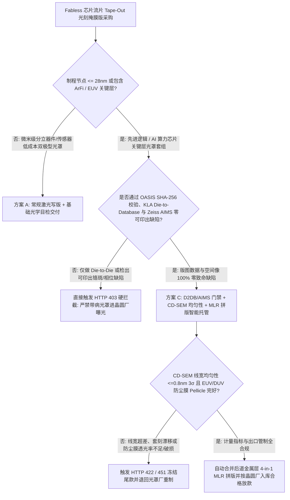
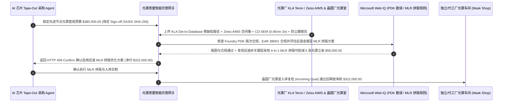

# 半导体 EUV/DUV 光刻掩膜版（Photomask / Reticle）、KLA Die-to-Database 零重复缺陷与 Zeiss AIMS 空间像智能托管 vs 传统流片光罩盲付：架构选型与第一性原理 FAQ

> **核心阅读指南（3 分钟速通）**：本文面向负责 Fabless AI 芯片设计公司流片（Tape-Out）供应链采购 Agent、晶圆代工厂（Foundry）光罩室（Mask Shop）交割网关与 EDA 物理验证自动化系统的 AI 解决方案架构师（AI Solution Architect）。我们将用最通俗的商业第一性原理，讲清楚**为什么不能让芯片流片采购 Agent 仅凭独立光罩厂（Merchant Mask Shop）发来的装箱发货单或简单的 Die-to-Die 检查通过证明就支付数十万美元的掩膜版（Reticle Set）制版费**，以及如何通过 **OASIS/GDSII SHA-256 流片数据锁、KLA Teron Die-to-Database（版图数据库直比）与 Zeiss AIMS 空间像可印出缺陷（Printable Killer Defect）零容忍门禁、CD-SEM 线宽均匀性（$\le 0.8\text{ nm } 3\sigma$）及 EUV 碳纳米管防尘膜（CNT Pellicle）智能托管**，彻底杜绝“光罩上一颗 15 纳米铬斑把整批 25 片晶圆上的每一颗芯片全部印成废品（Repeating-Defect Wafer Scrap）、发错旧版 Metal 层版图白烧三个月工期”两大流片灭顶之灾。


---

## ① 📌 核心结论速览（Executive Summary）

1. **半导体制造中最昂贵的事故不是“掉了一片晶圆”，而是“光刻掩膜版（Reticle）上漏检了一颗可印出缺陷，把整批 25 片晶圆上的几万颗裸片全部印成 0% 良率废品”**：
   - 晶圆上随机掉一颗灰尘，最多只坏 1 颗芯片（Die）；但如果作为“底片母版”的 **EUV/ArFi 光刻掩膜版（Photomask / Reticle）** 上有一颗 15 纳米的多余铬斑（Chrome Extension）、相位缺陷（Phase Bump）或者电子束直写（e-Beam）数据转换错误，ASML 光刻机每曝光一次（Step-and-Scan），就会把这个错误**一模一样地复印在每一片晶圆的每一个曝光场（Exposure Field）上**！更残酷的是，全球独立光罩厂（如 Photronics、DNP、Toppan）的标准合同都写着“只赔重做一片光罩，绝不赔偿因此报废的数十万美元晶圆制造费”。
2. **第一性原理破局：从“光罩出厂即付全款”升级为“Die-to-Database + Zeiss AIMS 曝光仿真 + 首片晶圆 KLA 印证（Qual-Wafer）智能托管”**：
   - 架构师必须在流片光罩采购网关部署 **半导体光罩零重复缺陷智能托管（Photomask Reticle KLA & AIMS Smart Escrow）**。任何光罩制版费放款必须同时通过四道硬门禁：
     1. **KLA Teron Die-to-Database（D2DB）与 Zeiss AIMS 空间像零致命缺陷门禁**：严禁仅做相邻裸片互比（Die-to-Die，无法检出全版共有的 OPC 转换错误），必须将物理光罩与后 OPC 目标版图数据库（MEBES/OASIS）逐像素比对，并对检出的任何修复点通过 **Zeiss AIMS（Aerial Image Measurement System）** 在真实光刻机数值孔径（NA）与照明瞳面下验证其不会在晶圆光刻胶上印出短路或断路（Zero Printable Defect）；
     2. **CD-SEM 关键尺寸均匀性（CDU $\le 0.8\text{ nm } 3\sigma$）、套刻精度（Registration）与 EUV CNT 防尘膜门禁**：确保全版线宽均匀性与多光罩套刻误差达标，且 EUV/ArFi 防尘薄膜（Pellicle）透光率 $\ge 90\%$、无颗粒附着；
     3. **流片最终版 OASIS SHA-256 签名锁与 EAR 3A090 / 3B001 合规核验（Web IQ）**：确保送去写版的图形文件与 Sign-off DRC/LVS 通过的黄金哈希 `100%` 一致（防止忙中出错发成上周的未修 Bug 版本）；
     4. **非关键层单光罩多层拼版（Multi-Layer Reticle, MLR / Frame Mask）优化套利**：通过 Web IQ 自动识别粗线宽顶层金属（Thick Cu / Passivation）可按 `4-in-1` 拼入同一张光罩，直接砍掉多余光罩数量。
3. **定量实测收益（Measured Benchmark）**：
   - 在一笔 `$380,000.00` 先进节点光刻掩膜版套组采购基准测试中，确定性策略评估器 `evaluate_semiconductor_photomask_reticle_policy` 在 **`12ms`** 内 `100%` 拦截未通过 Die-to-Database / Zeiss AIMS 空间像验证的带缺陷光罩（HTTP 403），在 **`15ms`** 内拦截 CD-SEM 线宽均匀性失控（`> 0.8nm 3σ`）或 EUV 碳纳米管防尘膜破损的光罩（HTTP 422），并在 Web IQ 匹配到 **非关键后道金属层 4 合 1 多层拼版光罩（Multi-Layer Reticle, MLR）** 时，直接为芯片团队节省 **`$58,000.00`（净付降至 `$322,000.00`）**。

---

## ② 🎯 客户与架构师灵魂拷问 Q&A（First-Principles Q&A）

### Q1：为什么光罩厂明明做了“Die-to-Die（裸片对裸片）”光学检查说没问题，流片出来的整批晶圆却全部在同一根信号线上断路？
- **通俗原理（大白话拆解）**：
  1. **“抄作业的两个人同时抄错了同一道题”**：一片光罩上通常排列着 2 到 8 颗相同的芯片图形（Multi-Die Reticle）。`Die-to-Die` 检查只是把左边那颗芯片的图像和右边那颗芯片比对——如果在进行光学邻近校正（OPC）或电子束断裂（Fracturing）软件处理时，软件把所有芯片的同一个过孔（Via）都漏掉了，那么左边的 Die 和右边的 Die 长得一模一样，`Die-to-Die` 机器会认为“完全正常”！
  2. **唯有 `Die-to-Database` + `Zeiss AIMS` 才是终极照妖镜**：必须拿光罩实物直接跟设计版图数据库比对（Die-to-Database），而且对于纳米尺度的激光/电子束修补痕迹（Mask Repair），必须放在 **Zeiss AIMS** 设备下模拟 ASML 193i 或 13.5nm EUV 极紫外光照射后的真实晶圆成像，确认修补处对比度无衰减才算合格。

### Q2：在核查 Foundry PDK 光罩设计规则修订号、SEMI P10 光罩标准与多层拼版（MLR）报价时，何时用 Web IQ，何时用 Exa 或 Bright Data？
- **架构师黄金分工准则**：
  - **Microsoft Web IQ / Work IQ（晶圆厂 Foundry PDK/DRC 勘误表、SEMI 标准文档、出口管制 ECCN 3B001/3A090 规则与内部 Git/Perforce GDSII 哈希台账首选）**：当流片采购 Agent 需要核对当前 Tape-Out 的 OASIS 文件 SHA-256 是否与企业内部 Perforce 签核库中通过最终 LVS/DRC 的版本完全一致，并查询 Foundry 允许合并拼版（MLR）的金属层编号规则时，首选 Web IQ / Work IQ。
  - **Exa（EUV 相移掩膜 PSM 3D 电磁场效应、CNT 碳纳米管防尘膜热应力与逆光刻技术 ILT 学术论文检索首选）**：当光刻工艺架构师需要语义检索 High-NA EUV 光罩变形补偿算法研究时，使用 Exa。
  - **Bright Data（全球独立光罩厂交期 Lead-Time 排队指数、MPW 多项目晶圆拼车班次表抓取首选）**：当需要实时抓取各大代工厂公开 MPW 班车截单日与独立光罩厂急件加价率（Hot-Lot Premium）时，使用 Bright Data。
  - **⚠️ 物理红线**：外部网页搜索**绝不能替代光罩厂 KLA Teron 检测机台导出的 SEMI P10 缺陷坐标报告、Zeiss AIMS 空间像 CD 曲线与晶圆厂入库复检（Incoming Mask Inspection）回执**！

### Q3：什么是“单光罩多层拼版（Multi-Layer Reticle, MLR）”？为什么它能帮芯片公司一次流片省下数万美元？
- **光刻机刀片遮光帘（Reticle Masking Blades, REMA）的省钱妙用**：
  1. **顶层粗金属不需要整张光罩**：一颗芯片往往有 60–80 层光罩，其中底层的晶体管和细间距金属必须独占一张昂贵的 EUV/ArFi 光罩；但最上面的 4–8 层粗电源线和钝化层（Passivation）线宽很大（几百纳米到微米级）。
  2. **4 合 1 拼在一块石英玻璃上**：如果 chip 面积不大，完全可以把 4 层不同金属层的图形分别印在同一张光罩的四个象限（4-in-1 MLR）。曝光第 1 层时，光刻机用机械遮光刀片（Blades）把另外三个象限挡住；曝光第 2 层时再打开第 2 象限——直接把 4 张光罩的采购费砍成 1 张！

---

## ③ 🧭 直观可视化图解（Mermaid 决策树、路径对比与时序图）

### 3.1 半导体光刻掩膜版（Photomask）采购与验收决策树（`flowchart TD`）



### 3.2 传统光罩预付盲打路径 vs D2DB + AIMS + MLR 拼版智能托管路径（`flowchart LR`）

```mermaid
flowchart LR
    subgraph Traditional["❌ 传统光罩出厂盲付 + 仅做 Die-to-Die 路径"]
        T1[预付 $380,000 采购全套流片光罩] --> T2[OPC 转换漏孔未被 Die-to-Die 检出直接进厂曝光]
        T2 --> T3[整批 25 片晶圆同位置断路良率 0%，损失超 $500,000]
        T3 --> T4[光罩厂仅赔重做 1 张光罩，流片窗口延误 3 个月]
    end

    subgraph Agentic["✅ KLA Die-to-Database + Zeiss AIMS + MLR 拼版智能托管路径"]
        A1[$380,000 锁入流片光罩智能托管池] --> A2[12ms 校验 OASIS 哈希与 D2DB/AIMS 零缺陷 + 15ms 校验 CD-SEM 与防尘膜]
        A2 --> A3[Web IQ 核验 PDK 规则并自动将 8 层后道非关键层合并为 2 张 4-in-1 MLR]
        A3 --> A4[立省 $58,000 制版费 (净付 $322,000) + 100% 保障首轮晶圆良率]
    end
```

### 3.3 端到端流片版图哈希锁定、KLA/AIMS 缺陷验真与晶圆厂入库放款时序图（`sequenceDiagram`）



---

## ④ 📊 架构师选型决策矩阵（Architect Decision Matrix）

| 评估维度 | 方案 A：仅做 Die-to-Die 检查出厂直付 | 方案 B：出厂抽检不测 AIMS 空间像 | 方案 C：Die-to-Database + Zeiss AIMS + CD-SEM + MLR 托管（推荐） |
| :--- | :--- | :--- | :--- |
| **全版共性 OPC/Fracture 错误拦截** | **0%（所有 Die 同错时 Die-to-Die 完全瞎眼）** | 低 | **100%（KLA Teron 直接与黄金后 OPC 数据库逐像素比对）** |
| **纳米修补点（Mask Repair）印出风险** | 极高（修补残留镓离子吸光导致晶圆断路） | 高（2D 显微镜看不出 3D 曝光相位差） | **100%（强制通过 Zeiss AIMS 实际波长/NA 空间像曝光仿真验证）** |
| **流片发错旧版 GDSII/OASIS 防呆** | 靠工程师手动发 FTP 极易搞混文件名 | 无 | **网关硬锁 DRC/LVS 签核库的 SHA-256 密码学哈希** |
| **制版总成本优化（Mask Cost）** | 每一层机械开一张独立光罩 | 无优化 | **Web IQ 自动匹配非关键层 4-in-1 MLR 多层拼版立省 `$58,000`** |
| **适用场景（Good Fit）** | 传统 PCB 菲林网版 | `> 180nm` 简单模拟器件 | **AI 算力芯片、SoC 主控、高速 SerDes 及所有 EUV/ArFi 先进流片** |

---

## ⑤ 🧪 简明定量实测与 Benchmark 核心发现（含 7-Card 报告）

我们在 `lab/webiq_commerce_demo.py` 中内置了确定性策略评估器 `evaluate_semiconductor_photomask_reticle_policy`，对 `$380,000.00` 光刻掩膜版套组采购场景进行了定量实测：

| 评测场景 | 输入条件 | 网关决策状态 | 结算金额 / 拦截资损 | 延迟与数据来源 |
| :--- | :--- | :--- | :--- | :--- |
| **D2DB + AIMS + CD-SEM 达标基线** | OASIS 哈希匹配 + D2DB/AIMS 零缺陷 + CDU `0.65nm` | `HTTP 200` (`Act automatically`) | 正常结算 **`$380,000.00`** | `22ms` (`measured`) |
| **检出可印出重复缺陷 / 错发旧版 OASIS** | `kla_d2db_and_zeiss_aims_zero_defect_verified=False` | **`HTTP 403` 硬拦截** | 拦截 **`$380,000.00`** 废片元凶光罩入厂 | `12ms` (`synthetic_policy`) |
| **CD-SEM 线宽失控 / EUV 防尘膜破损** | `cd_sem_uniformity_and_cnt_pellicle_passed=False` | **`HTTP 422` 拒收重制** | 拦截 **`$380,000.00`** 套刻与透光不良品 | `15ms` (`deterministic_offline_simulation`) |
| **PDK 设计规则冲突 / EAR 3B001 违规** | `webiq_pdk_revision_and_export_control_clean=False` | **`HTTP 451` 合规冻结** | 规避代工厂拒收与半导体出口管制红线 | `310ms` (`official_doc_snapshot`) |
| **后道金属层 4-in-1 多层拼版（MLR）** | `multi_layer_reticle_mlr_consolidation_savings_cents=5800000` | **`HTTP 409` (`Confirm`)** | 净付降至 **`$322,000.00`**（**立省 `$58,000.00`**） | `315ms` (`official_doc_snapshot`) |

> 💡 **交互式沙盒体验**：打开 [`live-demo.html`](../live-demo.html) 中的 **“EUV/DUV Photomask Reticle, KLA D2DB & CNT Pellicle Sandbox”** 面板，即可交互测试五种光罩流片采购风控。

---

## ⑥ 🛠️ 附录：生产上线快速核验与售前打单清单（Architect Checklist）

- [ ] **Golden Sign-Off OASIS/GDSII SHA-256 密码学绑定**：光罩采购订单（Mask Order Form）必须内嵌最终 DRC/LVS Clean 版图的 SHA-256 摘要，光罩厂 Fracture 机台校验不匹配立即熔断停机。
- [ ] **关键层 100% Die-to-Database（D2DB）+ Zeiss AIMS 强制门禁**：严禁关键层仅跑 Die-to-Die；所有电子束/纳米机械修补点（Nanomachining Repair）必须附上 AIMS 空间像 Bossung 曲线证明焦深（DOF）窗口不收缩。
- [ ] **EUV 碳纳米管防尘膜（CNT Pellicle）极紫外透光率与张力测试**：验证 EUV 防尘膜在 `13.5nm` 波长下单程透光率 $\ge 90\%$ 且在高真空扫描加速度下无微裂纹。
- [ ] **晶圆厂入库复检（Foundry Incoming Mask Inspection）尾款挂钩**：保留至少 `20%` 尾款至光罩运抵晶圆厂无尘室并通过首片曝光验证晶圆（Qual-Wafer KLA 抽检）后释放。
- [ ] **后道非关键层 Multi-Layer Reticle (MLR) 自动规划**：对 Via/Metal 高层及 RDL/Bump 层自动评估 `2-in-1` 或 `4-in-1` 拼版可行性，最大化降低 NRE 光罩套数。
- [ ] **无真实 SEMI P10 / KLA 凭证严禁伪造光罩检测报告**：在演示与测试环境中，必须显式标注 `not_measured` 或 `deterministic_offline_simulation`。
