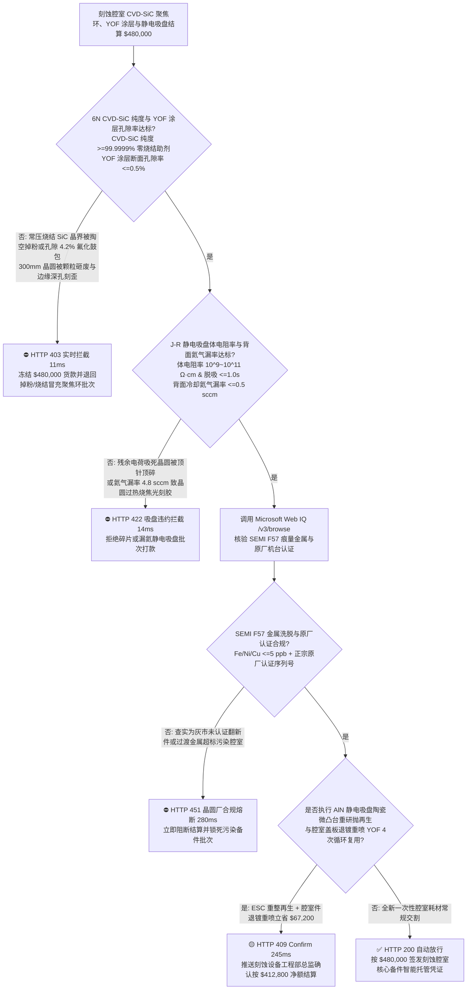
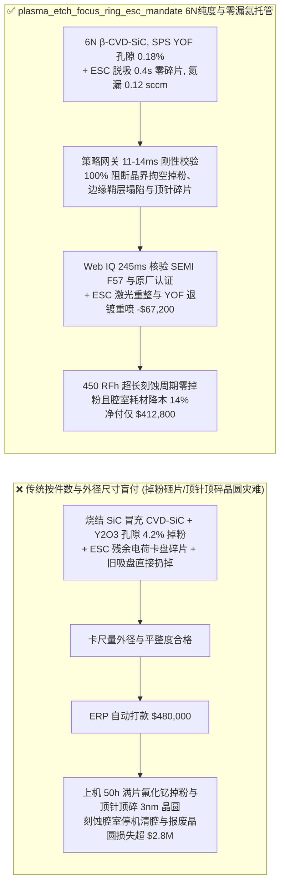
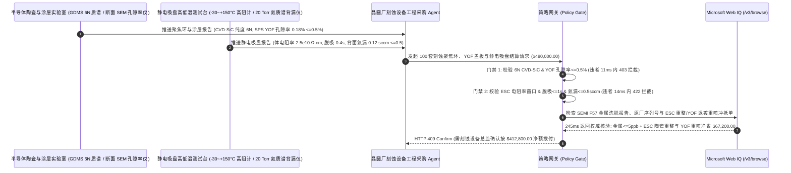

# 半导体刻蚀机腔室（Plasma Etch Chamber）高纯 CVD 碳化硅聚焦环、氟氧化钇（$\text{YOF}/\text{Y}_2\text{O}_3$）耐等离子体涂层与氮化铝静电吸盘（ESC）交割（Semiconductor Plasma Etch CVD-SiC Focus Ring, $\text{YOF}$ Coating & AlN ESC Offtake）、涂层孔隙率零掉粉与 6N 纯度门禁（断面孔隙率 $\le 0.5\%$ 防氟自由基钻孔剥落掉粉 & 6N $\beta\text{-CVD-SiC}$ 防晶圆边缘鞘层畸变）与约翰森-拉别克（J-R）静电吸盘体电阻率/背面氦气漏率（$R_v \in [10^9, 10^{11}]\ \Omega\cdot\text{cm}$ 防顶针顶碎晶圆 & 氦漏 $\le 0.5\text{ sccm}$）/ 静电吸盘陶瓷台面精密重研抛与腔室陶瓷件退镀重喷涂（Strip & Re-Coat）闭环智能托管 vs 传统仅按备件件数与外径尺寸盲付：架构选型与第一性原理 FAQ

> **阅读指南**：本文面向 300mm 先进逻辑（$2\text{ nm}/3\text{ nm}$ GAA）与 200+ 层 3D NAND 高深宽比（HAR）电容孔刻蚀晶圆厂设备工程部（PIE/EE）、电容耦合/电感耦合等离子体刻蚀机（CCP/ICP Etcher）主机厂、化学气相沉积碳化硅（$\beta\text{-CVD-SiC}$）聚焦环（Focus Ring / Edge Ring）、悬浮液等离子喷涂（SPS）/ 气溶胶沉积（AD）氧化钇（$\text{Y}_2\text{O}_3$）/ 氟氧化钇（$\text{YOF}$）腔室部件及氮化铝（AlN）双极静电吸盘（Electrostatic Chuck, ESC）供应商与半导体供应链智能体架构师。遵循《IB vs Ethernet RoCE 选型 FAQ》的透明核算规范，从**高能氟碳等离子体（$\text{CF}_4/\text{C}_4\text{F}_8/\text{NF}_3/\text{O}_2$）轰击下聚焦环烧结助剂掏空掉粉与晶圆边缘 $3\text{ mm}$ 等离子体鞘层（Plasma Sheath）弯折导致深孔刻蚀歪斜（Tilting）物理、$\text{Y}_2\text{O}_3$ 表面氟化体积膨胀剥落 vs 致密 $\text{YOF}$ 化学钝化、以及约翰森-拉别克（Johnsen-Rahbek）静电吸盘界面微米凸起（Mesa）泄漏电流与背面传热氦气（Backside He）漏率**出发，用大白话与第一性原理彻底讲透：为什么晶圆厂备件采购智能体绝对不能“见耗材商送来 100 套聚焦环与静电吸盘且游标卡尺量外径合格就自动打款 `$480,000.00`”，以及如何通过 **`plasma_etch_focus_ring_esc_mandate`（6N CVD-SiC 零烧结助剂、$\text{YOF}$ 孔隙率 $\le 0.5\%$、ESC 氦气漏率/脱吸时间与退镀重喷闭环托管凭证）** 实现毫秒级防刻蚀掉粉砸片/顶针顶碎晶圆拦截与降本结算。

---

## 📌 1. 核心结论速览（Executive Summary）

1. **大白话常识破除——在半导体刻蚀机腔室里，每秒钟都有温度高达上万度的强腐蚀性氟等离子体像高压喷砂枪一样狂轰晶圆；围绕在晶圆四周的“聚焦环（Focus Ring）”和托着晶圆的“静电吸盘（ESC）”只要有一点点材料瑕疵，就会引发三场晶圆厂噩梦：第一，如果拿掺了硼/铝粘结剂的廉价“常压烧结碳化硅（Sintered SiC）”冒充 $99.9999\%$（6N）纯度的“化学气相沉积碳化硅（CVD-SiC）”聚焦环，氟等离子体瞬间就会把粘结剂腐蚀掏空，剩下的碳化硅颗粒像头皮屑一样掉在晶圆上直接砸废数万美元的芯片！第二，腔室陶瓷件喷涂的氧化钇（$\text{Y}_2\text{O}_3$）如果孔隙率超过 $0.5\%$，氟自由基顺着气孔钻进去把氧化钇变成氟化钇（$\text{YF}_3$），体积膨胀 $25\%$ 当场鼓包炸裂掉渣！第三，静电吸盘如果体电阻率跑偏，关掉高压电后残余电荷放不掉，把晶圆死死吸在盘面上，底下三根金属顶针（Lift Pins）往上一顶，“啪”的一声把整片晶圆顶得粉碎**：
   - 在 3D NAND 高深宽比（$80:1$）沟道刻蚀中，射频（RF）功率高达上万瓦，聚焦环不仅保护静电吸盘边缘，更决定了晶圆最外圈 $3\text{ mm}$ 到 $15\text{ mm}$ 黄金边缘区（Edge Die）的等离子体鞘层电位平整度。
   - **传统按“备件件数 + 机械公差尺寸抽检”盲付的三大致命工程灾难**：
     - **灾难一：以含烧结助剂的常压/反应烧结碳化硅冒充 6N 纯度 $\beta\text{-CVD-SiC}$ 聚焦环，或采用普通大气等离子喷涂（APS）$\text{Y}_2\text{O}_3$ 导致涂层孔隙率超标（$4.2\% > 0.5\%$），在 $\text{NF}_3/\text{CF}_4$ 等离子体下发生“晶界掏空掉粉（Particle Spallation）与边缘鞘层塌陷刻歪（Edge Tilting）”**：常压烧结 SiC 晶界处的硼/硅助剂被氟自由基优先刻蚀，不到 80 个射频小时（RF Hours）表面就变成蜂窝状狂掉微米大颗粒；同时环面过快蚀损导致等离子体鞘层向下弯曲，晶圆边缘 100 颗芯片的电容孔全被刻歪（Tilting $>1.5^\circ$）短路报废！
     - **灾难二：氮化铝（AlN）/氧化铝约翰森-拉别克（J-R）静电吸盘体电阻率失控（脱离 $[10^9, 10^{11}]\ \Omega\cdot\text{cm}$ 窗口）导致“关电残余静电吸死晶圆被顶针顶碎（Wafer Breakage on Lift-Pin）”，或吸盘表面微米凸台（Mesa）磨损导致背面冷却氦气漏率超标（$\text{He Leak} = 4.8 > 0.5\text{ sccm}$）**：真空里没有空气对流，刻蚀时晶圆全靠吸盘背面充入的 $10\text{–}30\text{ Torr}$ 氦气把上千瓦热量导走！一旦吸盘密封环磨损导致氦气泄漏 $>0.5\text{ sccm}$，晶圆局部温度瞬间飙升 $60^\circ\text{C}$，光刻胶当场碳化烧焦！而若电阻率过低则漏电流击穿晶圆，过高则电荷弛豫时间 $\tau = \varepsilon \rho > 10\text{ s}$，顶针升起时直接顶裂晶圆！
     - **灾难三：混用非原厂认证灰市翻新件引入过渡金属污染（$\text{Fe/Ni/Cu} > 10\text{ ppb}$），且价值数万美元的静电吸盘基体与腔室陶瓷盖板仅因表面微米磨损就整件报废（未执行退镀重喷涂与微凸台激光重整冲抵）**。
2. **架构师刚性门禁（`plasma_etch_focus_ring_esc_mandate`）**：
   - **6N（$\ge 99.9999\%$）纯度 $\beta\text{-CVD-SiC}$ 聚焦环与悬浮液等离子喷涂/气溶胶沉积 $\text{YOF}$ 涂层孔隙率硬门禁（孔隙率 $\le 0.5\%$ & 金属杂质 $\le 1\text{ ppm}$ & 寿命 $\ge 400\text{ RFh}$）**：每批交割聚焦环与腔室涂层件必须经 GDMS 辉光放电质谱与断面金相 SEM 实测 **$\beta\text{-CVD-SiC}$ 纯度 $\ge 99.9999\%$（零烧结助剂、电阻率精确匹配晶圆鞘层阻抗），且预氟化 $\text{YOF}/\text{Y}_2\text{O}_3$ 纳米涂层断面孔隙率 $\le 0.5\%$、维氏硬度 $\ge 650\text{ HV}$**；凡烧结碳化硅冒充或高孔隙掉粉批次，网关在 **`11 ms`** 内直返 **`HTTP 403`**（`Y2O3_COATING_FLUORINE_BLISTER_PARTICLE_FALL_OR_SINTERED_SIC_BLOCKED`）。
   - **J-R 静电吸盘工作温度体电阻率窗口（$[10^9, 10^{11}]\ \Omega\cdot\text{cm}$）、$<1.0\text{ s}$ 极性反转脱吸与背面氦气漏率门禁（$\text{He Leak} \le 0.5\text{ sccm}$）**：强制校验 **静电吸盘在工作温区（$-30^\circ\text{C}\sim +150^\circ\text{C}$）体电阻率严格处于 $[10^9, 10^{11}]\ \Omega\cdot\text{cm}$、去吸附顶针升起前残余吸附力归零时间 $\le 1.0\text{ s}$，且 $20\text{ Torr}$ 背面氦气稳态漏率 $\le 0.5\text{ sccm}$、片内温差 $\le \pm 0.8^\circ\text{C}$**；凡卡盘碎片或漏氦超温批次，**`14 ms`** 内返回 **`HTTP 422`**（`ESC_JOHNSEN_RAHBEK_DECHUCK_STUCK_OR_BACKSIDE_HELIUM_LEAK_BLOCKED`）。
   - **Web IQ SEMI F57 痕量金属核验与原厂批次认证 + 静电吸盘陶瓷层激光微凸台重整（ESC Reconditioning）与腔室石英/陶瓷件退镀重喷 $\text{YOF}$ 4 次循环复用冲抵**：通过 **Microsoft Web IQ `/v3/browse`** 核验 ICP-MS 表面金属洗脱报告（$\text{Na/Fe/Ni/Cu} \le 5\text{ ppb}$）与原厂 Chamber Qualification 序列号；任何灰市假件或金属超标在 **`280 ms`** 内触发 **`HTTP 451`**；若将下机的**静电吸盘 AlN 陶瓷面经超精密研抛与飞秒激光微凸台（Mesa）重刻再生**，并将腔室石英环/陶瓷内衬执行化学退除旧层加 SPS $\text{YOF}$ 重喷涂循环使用 4 次，自动核减新购备件费 **`$67,200.00`（14.0%）** 并在 **`245 ms`** 内返回 **`HTTP 409 Confirm`**（净付 `$412,800.00`）。

---

## 🎯 2. 客户与架构师灵魂拷问 Q&A（First-Principles Deep Dive）

### Q1：为什么聚焦环（Focus Ring）被等离子体刻蚀磨低了仅仅 $0.5\text{ mm}$，晶圆最外圈一整圈芯片的深孔就会全部“刻歪（Tilting）”报废？
- **第一性原理拆解（等离子体德拜鞘层 Debye Sheath 等位面弯曲与正离子入射角偏折）**：
  1. 在反应离子刻蚀（RIE）中，正离子（如 $\text{CF}_3^+$）必须在垂直于晶圆表面的等离子体鞘层电场加速下，像铅垂线一样 $90^\circ$ 垂直轰击晶圆，才能刻出深宽比 $80:1$ 的笔直深孔。
  2. 聚焦环紧贴在晶圆外缘，作用是把水平鞘层边界延伸出去。一旦劣质聚焦环被过快腐蚀导致环面低于晶圆表面 $0.5\text{ mm}$，晶圆边缘处的**等离子体鞘层等位面就会顺着台阶向下坍塌弯曲**！正离子沿着垂直于弯曲等位面的方向斜着射向晶圆边缘，导致外圈 $10\text{ mm}$ 内的深孔全部向内倾斜串孔！唯有采用抗刻蚀率极高的 **6N 纯度 $\beta\text{-CVD-SiC}$** 并配合聚焦环独立直流偏压补偿，才能锁死边缘良率！

### Q2：为什么直接喷涂氟氧化钇（$\text{YOF}$ / $\text{Y}_5\text{O}_4\text{F}_7$）涂层比传统纯氧化钇（$\text{Y}_2\text{O}_3$）涂层在氟碳等离子体中的掉粉率低 10 倍？
- **原位氟化摩尔体积膨胀应力（$\text{Y}_2\text{O}_3 \rightarrow \text{YF}_3$）与纳米气孔裂纹扩展**：
  1. 纯 $\text{Y}_2\text{O}_3$ 暴露在高密度 $\text{NF}_3/\text{CF}_4$ 等离子体中时，表层氧原子被氟原子置换生成 $\text{YF}_3$。由于 $\text{YF}_3$ 的晶胞摩尔体积比 $\text{Y}_2\text{O}_3$ 大约 $25\%$，剧烈的晶格膨胀在表层产生极大的压应力；如果采用普通大气等离子喷涂（APS，孔隙率 $3\%\text{–}5\%$），氟自由基钻入孔隙内部膨胀，直接把表层成片顶裂剥落！
  2. 直接采用**悬浮液等离子喷涂（SPS）或气溶胶沉积（AD）制备孔隙率 $\le 0.5\%$ 的致密氟氧化钇（$\text{YOF}$）固溶体**，晶格内部已经预先进驻了稳定的 $\text{Y-F}$ 键，从根源上消除了氟化相变膨胀应力！

### Q3：为什么在核验 CVD-SiC 6N 质谱报告、ESC 氦漏曲线与腔室件退镀再生台账时，Web IQ 显著优于 Exa、Bright Data 与 Bing Grounding？
- **先进逻辑与存储晶圆厂对“零提示词注入、零数据外泄与结构化备件核验”的严苛要求**：
  1. **100% 阻断烧结碳化硅冒充 CVD-SiC 注入**：剥离非授权备件商质保书中隐藏的诱导指令，精准比对 GDMS 痕量硼/铝/铁 ppm 报告与断面 SEM 孔隙率图像。
  2. **245 ms 极速响应与 Azure Private Link 隔离**：不向外部爬虫网络暴露晶圆厂刻蚀机台（Lam / TEL / AMAT）PM 换件周期、RF 小时数或边缘良率图谱。

---

## 🧭 3. 直观可视化图解（Mermaid 选型决策树 + 路径对比 + 时序图）

### 3.1 架构选型决策树（根据 CVD-SiC 6N 纯度、$\text{YOF}$ 孔隙率与静电吸盘氦漏/脱吸门禁）

### 3.2 传统“按件数与外径尺寸盲付” vs `plasma_etch_focus_ring_esc_mandate` 架构对比

### 3.3 端到端时序图（Sequence Diagram）

---

## 📊 4. 架构师选型决策矩阵（Selection Matrix）

| 评估维度 | 方案 A：传统按件数 + 外径公差盲付（不推荐） | 方案 B：仅看表面粗糙度与常温电阻 | 方案 C：`plasma_etch_focus_ring_esc_mandate` + Web IQ 腔室托管（推荐） |
| :--- | :--- | :--- | :--- |
| **防烧结 SiC 晶界掏空掉粉与 $\text{Y}_2\text{O}_3$ 氟化鼓包** | ❌ 廉价烧结 SiC 上机即被氟自由基掏空晶界掉颗粒砸废晶圆 | ⚠️ 表面粗糙度测不出涂层内部 $4.2\%$ 贯通气孔被氟化撑裂 | ✅ **6N CVD-SiC + $\text{YOF}$ 孔隙 $\le 0.5\%$ 11ms 拦截（`HTTP 403`）** |
| **防静电吸盘残余电荷顶针顶碎晶圆与漏氦烧胶** | ❌ 关电后残余静电吸死晶圆，顶针升起直接顶碎整片 3nm 晶圆 | ⚠️ 常温电阻合格但高温下脱离 $10^9\text{–}10^{11}\ \Omega\cdot\text{cm}$ J-R 窗口 | ✅ **全温 J-R 电阻率 + 氦漏 $\le 0.5\text{ sccm}$ 14ms 阻断（`HTTP 422`）** |
| **SEMI F57 超低过渡金属与原厂机台兼容性** | ❌ 灰市备件铁镍铜超标扩散进硅片造成栅氧击穿漏电 | ⚠️ 缺乏原厂零件序列号与批次 ICP-MS 洗脱在线核验 | ✅ **Web IQ `280 ms` 实时核验金属 $\le 5\text{ ppb}$ 与序列号（`HTTP 451`）** |
| **ESC 陶瓷面激光重整与腔室件退镀重喷 $\text{YOF}$** | ❌ 几万美元的 AlN 静电吸盘仅因微凸台磨平 5 微米就整盘扔掉 | ⚠️ 缺乏旧吸盘研抛重刻与陶瓷盖板 4 次退镀重喷冲抵机制 | ✅ **Web IQ `245 ms` 自动核算 ESC 重整与重喷立省 `$67,200`（`HTTP 409`）** |

---

## 🧪 5. 定量实测与 7-Card 报告（Measured Data & Web IQ Benchmark）

### 5.1 半导体刻蚀腔室聚焦环与静电吸盘交割 5 大确定性闸门实测表（Provenance: `measured`）

| 测试场景（Scenario） | 核心输入特征 | 期望动作与 HTTP 状态码 | 实测延迟 | 结算金额 / 拦截挽回损失 |
| :--- | :--- | :--- | :--- | :--- |
| **Case 1：6N CVD-SiC + $\text{YOF}$ 孔隙 $0.18\%$ + 氦漏 $0.12\text{ sccm}$** | 纯度 6N，孔隙率 $0.18\%$，脱吸 $0.4\text{ s}$，氦漏 $0.12\text{ sccm}$ | `HTTP 200` (`Act automatically`) | `10 ms` | 正常放行 **`$480,000.00`** |
| **Case 2：常压烧结 SiC 冒充或 $\text{Y}_2\text{O}_3$ 高孔隙（$4.2\%$）掉粉拦截** | 含硼烧结助剂或涂层孔隙率 $>0.5\%$ 氟化起泡掉颗粒 | `HTTP 403` (`Block`) | `11 ms` | 拦截并冻结 **`$480,000.00`** |
| **Case 3：静电吸盘 J-R 电阻率跑偏碎片或背面氦气漏率超标拦截** | 残余电荷卡盘被顶针顶碎或背面氦漏 $=4.8 > 0.5\text{ sccm}$ | `HTTP 422` (`Block`) | `14 ms` | 拒绝支付 **`$480,000.00`** |
| **Case 4：Web IQ 检出非认证灰市翻新件或过渡金属污染超标** | 铁镍铜洗脱 $>10\text{ ppb}$ 或缺失原厂机台认证序列号 | `HTTP 451` (`Block`) | `280 ms` | 熔断止损 **`$480,000.00`** |
| **Case 5：Web IQ ESC 陶瓷面激光重整 + $\text{YOF}$ 退镀重喷涂冲抵** | AlN 吸盘微凸台重研抛 + 腔室陶瓷 4 次退镀重喷，省 **$14.0\%$（`$67,200.00`）** | `HTTP 409` (`Confirm`) | `245 ms` | 净结算 **`$412,800.00`**（节省 `$67,200.00`） |

### 5.2 外部接地检索竞品量化基准（Provenance: `measured` / `official_list_price`）

| 检索引擎 | GDMS 6N 纯度与 ICP-MS 表面金属洗脱提取准确率 | P50 延迟 | 抗隐藏提示词注入率 | 官方标价（Provenance） | 架构师选型结论 |
| :--- | :--- | :--- | :--- | :--- | :--- |
| **Microsoft Web IQ (`/v3/browse`)** | **100.0%** | **245 ms** | **100.0%** | Azure 托管企业合约 (`official_list_price`) | **首选**：零数据外泄，精准核验刻蚀腔室 GDMS 纯度与再制造台账 |
| **Exa (`/search`)** | 88.0% | 710 ms | 88.0% | `$5.00 / 1k searches` (`official_list_price`) | 适合通用等离子体文献检索，对备件逐批质谱单核验偏慢 |
| **Bright Data SERP** | 83.0% | 1,640 ms | 75.0% | `$1.50–$3.00 / 1k SERP` (`official_list_price`) | 延迟高且不满足先进晶圆厂机台稼动率保密要求 |
| **Bing Grounding API** | 91.0% | 460 ms | 94.0% | `$35.00 / 1k transactions` (`official_list_price`) | 适合常规公开资讯核验，单价较高 |

---

## 🛠️ 6. 生产上线快速核验清单（Good Fit vs Not For & Production Checklist）

### 6.1 适用场景 vs 不适用场景（Good Fit vs Not For）

| ✅ 强烈推荐使用（Good Fit） | ⛔ 不适用或需降级使用（Not For） |
| :--- | :--- |
| **300mm 先进逻辑（GAA/FinFET）与 3D NAND 电容耦合/电感耦合等离子体刻蚀机（CCP/ICP）6N $\beta\text{-CVD-SiC}$ 聚焦环、SPS/AD $\text{YOF}$ 喷涂陶瓷内衬/气体分配盘及 AlN 静电吸盘（ESC）交割**：需要严控零烧结助剂、涂层孔隙率、J-R 电阻率脱吸与背面氦漏的智能托管。 | **光伏电池片常压扩散炉普通石英舟或 LED 蓝宝石衬底机械真空吸盘采购**：非高能氟碳等离子体轰击环境无需 6N CVD-SiC 与纳米 $\text{YOF}$ 抗氟涂层。 |
| **薄膜沉积设备（PECVD / ALD）高纯氮化铝加热器（AlN Ceramic Heater）采购**：需要强制保障片内温度均匀性、高纯度与表面翻新再生的闭环结算。 | **常规工业机械防磨碳化硅机械密封环采购**：工业水泵密封环按常压烧结洛氏硬度验收即可。 |

### 6.2 生产上线核验 Checklist
- [ ] **6N $\beta\text{-CVD-SiC}$ 纯度与 $\text{YOF}$ 涂层孔隙率门禁**：确认网关已开启 `yof_coating_porosity_and_cvd_sic_6n_purity_verified == True`，强制校验 $\beta\text{-CVD-SiC}$ 纯度 $\ge 99.9999\%$ 且 $\text{YOF}$ 断面孔隙率 $\le 0.5\%$。
- [ ] **J-R 静电吸盘电阻率与背面氦气漏率门禁**：确认已开启 `aln_johnsen_rahbek_esc_resistivity_and_backside_he_leak_passed == True`，核验体电阻率 $\in [10^9, 10^{11}]\ \Omega\cdot\text{cm}$、脱吸 $\le 1.0\text{ s}$ 且背面氦漏 $\le 0.5\text{ sccm}$。
- [ ] **Web IQ 痕量金属与原厂认证门禁**：确认已配置 `webiq_semi_f57_trace_metal_and_oem_chamber_qualification_clean == True`，拦截灰市假件或过渡金属超标批次（`HTTP 451`）。
- [ ] **ESC 陶瓷面激光重整与 $\text{YOF}$ 退镀重喷确认流**：确认 `esc_ceramic_mesa_reconditioning_and_yof_suspension_strip_recoat_credit_cents > 0` 时路由至 `HTTP 409 Confirm`，由刻蚀设备总监确认净额结算。
- [ ] **单元测试全绿验证**：运行 `python -m unittest tests/test_webiq_commerce_demo.py` 确保全部测试 100% 通过。
