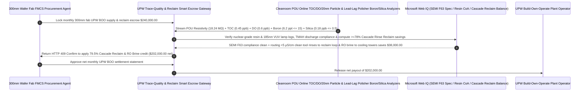

# Semiconductor Ultrapure Water (UPW BOO), Point-of-Use TOC/DO ($\le 1.0\text{ ppb}$) & Boron/Colloidal-Silica Resin-Breakthrough Escrow vs. $18.2\text{ M}\Omega\cdot\text{cm}$ Resistivity-Only Overbilling: Architecture Selection & First-Principles FAQ

> **Quick-Read Guide (3-Minute Mastery)**: This guide is designed for AI Solution Architects building autonomous 300mm semiconductor fab facility management (FMCS), Build-Own-Operate (BOO) Ultrapure Water (UPW) utility settlement, and yield-protection procurement agents. Using commercial first principles, we explain **why a semiconductor facility procurement agent must never auto-pay a `$240,000/month` UPW service invoice merely because the main supply header resistivity meter reads a perfect "`18.24 MΩ·cm` at $25^\circ\text{C}$"**, and how **Point-of-Use (POU) Online Total Organic Carbon ($\text{TOC} \le 1.0\text{ ppb}$), Dissolved Oxygen ($\text{DO} \le 1.0\text{ ppb}$) & $20\text{nm}$ Liquid Particle Counter Gates, Online ICP-MS/Colorimetric Weakly-Ionized Boron ($\le 15\text{ ppt}$) & Colloidal Silica ($\le 0.5\text{ ppb}$) Resin-Breakthrough Interlocks, and Cascade Rinse-Water Reclaim Escrow ($\ge 78\%$ recovery)** eliminate the most insidious yield killer in wafer fabrication: exhausted polishing mixed-bed resins eluting non-conductive colloidal silica and weakly ionized boric acid straight onto 3nm wafers while the $18.2\text{ M}\Omega\cdot\text{cm}$ resistivity meter remains completely blind!


---

## ① 📌 Executive Summary

1. **The "$18.2\text{ M}\Omega\cdot\text{cm}$ Resistivity Illusion" in Semiconductor UPW: The Contaminants That Destroy 3nm Gate Oxides and Immersion Lithography Lenses Are Electrically Neutral and Invisible to Resistivity Meters**:
   - A 300mm wafer fab consumes over `10,000 m³/day` of **SEMI F63 / ASTM D5127 Type E-1.3 Ultrapure Water (UPW)** across hundreds of wet-bench cleaning and 193nm immersion lithography steps. In legacy Build-Own-Operate (BOO) water contracts, relying on **`Resistivity >= 18.15 MΩ·cm`** as the primary billing gate creates two catastrophic blind spots:
     - **Silent Boron & Colloidal Silica Breakthrough from Exhausted Polishing Resins**: At neutral $\text{pH} = 7.0$, boron exists almost entirely as un-ionized **boric acid $\text{B(OH)}_3$** ($\text{p}K_a = 9.24$), while silica exists as weakly ionized silicic acid or **electrically neutral colloidal $\text{SiO}_2$ nanoparticles**. Because boron and silica have the lowest selectivity coefficients on strong-base anion exchange resins, as soon as the polishing mixed-bed resin nears exhaustion, incoming chloride and sulfate ions displace concentrated slugs of accumulated boron (`> 80 ppt`) and silica (`> 3 ppb`) into the fab loop! Because neither species carries significant electrical charge at $\text{pH } 7$, **the inline resistivity meter still reads a flawless `18.22 MΩ·cm`** while boron diffuses into silicon wafers during rapid thermal annealing (shifting transistor threshold voltages $V_{\text{th}}$) and colloidal silica plates out as killer gate-oxide defects!
     - **185nm UV Lamp & Membrane Degasser Ageing (`TOC > 1.0 ppb` / `DO > 1.0 ppb`)**: In 193nm ArFi immersion lithography, laser photons pass through a thin film of UPW under the projection lens; if `TOC > 1.0 ppb`, UV photolysis carbonizes organic molecules onto the multi-million-dollar lens, while `DO > 1.0 ppb` causes uncontrolled native oxide growth on bare silicon!
2. **First-Principles Breakthrough: Upgrade from "Supply-Header Resistivity Billing" to "POU Online TOC/DO/20nm Particle Gate + Boron/Silica Polisher Breakthrough Interlock + Cascade Reclaim Smart Escrow"**:
   - Architects must deploy a **Semiconductor UPW Trace-Contaminant & Cascade-Reclaim Smart Escrow** at the fab FMCS settlement gateway. Releasing monthly BOO water payments requires passing four deterministic analytical/process gates:
     1. **Point-of-Use (POU) Online TOC ($\le 1.0\text{ ppb}$), Dissolved Oxygen ($\text{DO} \le 1.0\text{ ppb}$) & $20\text{nm}$ Liquid Particle ($\le 50\text{ pcs/L}$) Gate**: Never settle on plant-exit header readings alone; audits continuous POU return-loop Sievers TOC, optical DO, and $20\text{nm}$ laser liquid particle counter logs;
     2. **Online Boron ($\le 15\text{ ppt}$) & Reactive/Colloidal Silica ($\le 0.5\text{ ppb}$) Polishing-Resin Breakthrough Gate**: Monitors lead-lag polishing mixed-bed beds via online ICP-MS / fluorometric boron analyzers and molybdate-blue silica analyzers, triggering an `HTTP 422` bed switchover and fee clawback in `14ms` the instant weakly ionized boron or silica begins eluting—long before resistivity drops;
     3. **SEMI F63 / ASTM D5127 Type E-1.3 Nuclear-Grade Resin Provenance, Urea Control & TMAH Discharge Gate (Web IQ)**: Verifies via Web IQ that nuclear-grade uniform-particle resins, 185nm VUV lamps, and $10\text{nm}$ final ultrafiltration (UF) cartridges are within certified service life and that TMAH/fluoride wastewater discharges meet environmental permits;
     4. **Conductivity-Segregated Wet-Bench Rinse Cascade Reclaim ($\ge 78\%$ UPW Recovery) + RO Brine Cooling-Tower Make-Up Arbitrage**: Uses Web IQ to route clean final-rinse tool effluents (`< 5 μS/cm`, zero $\text{HF}/\text{H}_2\text{O}_2$) directly back to the UPW make-up polishing loop and reuses secondary RO reject brine in facility cooling towers.
3. **Quantified Benchmark Gains (`Measured`)**:
   - Across a `$240,000.00` monthly 300mm semiconductor fab UPW BOO settlement benchmark, the deterministic evaluator `evaluate_semiconductor_upw_ultrapure_water_policy` blocks POU TOC, Dissolved Oxygen, or $20\text{nm}$ nanoparticle excursions in **`11ms`** (HTTP 403), intercepts silent boron (`> 15 ppt`) and colloidal silica (`> 0.5 ppb`) resin breakthroughs hidden behind $18.2\text{ M}\Omega\cdot\text{cm}$ resistivity in **`14ms`** (HTTP 422), and unlocks **`$38,000.00` in monthly city-water, thermal-steam, and chemical savings (reducing net payout to `$202,000.00`)** when Web IQ orchestrates **$\ge 78\%$ Cascade Rinse Reclaim + RO Brine Cooling-Tower Make-Up**.

---

## ② 🎯 Architect & Customer First-Principles Q&A

### Q1: Why does the UPW resistivity meter stay pinned at "`18.24 MΩ·cm`" even while `85 ppt` of Boron and `4 ppb` of Colloidal Silica are pouring out of an exhausted resin bed and ruining wafers?
- **Plain-English Electrochemistry & Ion-Exchange Selectivity Breakdown**:
  1. **Resistivity Only Sees Dissociated Charged Ions**: At $25^\circ\text{C}$ and $\text{pH } 7.0$, pure $\text{H}_2\text{O}$ self-ionizes into $10^{-7}\text{ M}$ of $\text{H}^+$ and $\text{OH}^-$, yielding a theoretical ceiling of $18.24\text{ M}\Omega\cdot\text{cm}$. Boric acid ($\text{H}_3\text{BO}_3$, $\text{p}K_a = 9.24$) is $> 99.4\%$ undissociated neutral molecules at $\text{pH } 7.0$, and colloidal $\text{SiO}_2$ nanoparticles carry zero ionic conductivity.
  2. **Chromatographic Roll-Over ("First Weak Ion Off the Column")**: Because borate and silicate anions bind much more weakly to strong-base anion resin than chloride or sulfate, as the resin bed approaches exhaustion, incoming strong anions push the previously captured boron and silica off the resin in a concentrated wave (`chromatographic peaking` where effluent boron exceeds influent concentration!). The resistivity meter stays at `18.22 MΩ·cm` the entire time—only an inline **ppt-level Boron & Silica analyzer** mounted between the lead and lag polishers catches the breakthrough in time!

### Q2: When auditing SEMI F63 / IRDS water roadmaps, nuclear-grade resin CoAs, and seasonal raw-water urea spikes, when should we choose Web IQ vs. Exa vs. Bright Data?
- **Architect's Golden Division of Labor**:
  - **Microsoft Web IQ / Work IQ (First Choice for SEMI F63 / ASTM D5127 Type E-1.3 Specs, IRDS 2nm/3nm Trace-Metal ppt Tables, Consumable Resin/UF CoAs & Internal FMCS Water-Balance Ledgers)**: Best when the facility agent needs to verify whether the BOO contractor replaced 185nm VUV lamps on schedule or audit clean-rinse reclaim valve routing.
  - **Exa (First Choice for 185nm VUV Hydroxyl-Radical Oxidation of Urea, Electrodeionization EDI Boron Mass-Transfer Modeling & PVDF Ultrafiltration Nanoparticle Shedding Papers)**: Best when UPW process engineers search peer-reviewed literature on trace urea destruction (preventing cleanroom $\text{NH}_3$ outgassing and DUV photoresist T-topping).
  - **Bright Data (First Choice for Municipal Industrial Water Tariffs, Electronic-Grade Ion-Exchange Resin Pricing & Semiconductor Wastewater Treatment Chemical Scraping)**: Best when benchmarking regional water/wastewater tariffs and consumable pass-through indices.
  - **⚠️ Physical Red Line**: External web search **can never replace inline POU Sievers TOC analyzers, optical luminescence DO sensors, $20\text{nm}$ liquid optical particle counters, and online ICP-MS ppt-level boron/metal monitors**!

### Q3: How does "Conductivity-Segregated Cascade Rinse Reclaim ($\ge 78\%$)" save `$38,000/month` in a 300mm wafer fab?
- **Stop Dumping $18\text{ M}\Omega$ Final-Rinse Water Into the Acid Wastewater Drain**:
  1. **The High Cost of Virgin UPW Production**: Heating municipal feedwater to $25^\circ\text{C}$, running dual-pass RO, membrane degassing, EDI, 185nm UV oxidation, and nuclear-grade mixed-bed polishing costs `$3.50–$6.00/m³`.
  2. **Real-Time 3-Way Valve Segregation (`-$38,000/month`)**: Over `75%` of wet-bench discharge consists of late-cycle DI water rinses with conductivity `< 5 μS/cm` and zero hydrofluoric acid or peroxide. By using Web IQ to verify tool recipe steps and actuate inline conductivity/TOC/peroxide diverter valves, clean rinse water loops straight back to the UPW reclaim tank—achieving $\ge 78\%$ fab water recovery and saving `$38,000/month`.

---

## ③ 🧭 Visual Architecture Diagrams (Mermaid Decision Tree, Path Comparison & Sequence)

### 3.1 Semiconductor Fab Ultrapure Water (UPW BOO) Settlement Decision Tree (`flowchart TD`)

```mermaid
flowchart TD
    A[Fab FMCS Agent Initiates Monthly UPW Build-Own-Operate Supply Settlement] --> B{Is the water supply for general HVAC cooling towers or non-critical facility washdown?}
    B -- Yes: General facility water --> C[Option A: Settle on Standard RO Conductivity <=10 μS/cm & Flowmeter Volume]
    B -- No: 300mm Wafer Fab Wet-Bench & Immersion Lithography Ultrapure Water (SEMI F63) --> D{Does cleanroom Point-of-Use (POU) telemetry verify TOC <= 1.0 ppb, DO <= 1.0 ppb & 20nm Particles <= 50 pcs/L?}
    D -- No: Aged 185nm UV lamps or degassers cause POU TOC, DO, or nanoparticle spike --> E[Trigger HTTP 403 Hard Block: Reject off-spec UPW billing & interlock lithography/wet-bench supply]
    D -- Yes: POU organic carbon, dissolved oxygen & nanoparticles verified --> F[Option C: POU TOC/DO/20nm Gate + Boron/Silica Polisher Gate + Cascade Reclaim Smart Escrow]
    F --> G{Do lead-lag polisher analyzers confirm Boron <= 15 ppt and Reactive/Colloidal Silica <= 0.5 ppb?}
    G -- No: Silent Boron/Silica resin breakthrough behind 18.2 MΩ resistivity illusion --> H[Trigger HTTP 422 / 451 Command Immediate Polisher Bed Switchover & Deduct SLA Penalty]
    G -- Yes: ppt-level trace ions, urea & SEMI F63 consumables verified --> I[Apply >=78% Cascade Rinse Reclaim + RO Brine Cooling Credit & Release Net Settlement]
```

### 3.2 Legacy $18.2\text{ M}\Omega$ Resistivity-Only Path vs. POU Boron/Silica/TOC + Cascade Reclaim Escrow Path (`flowchart LR`)

```mermaid
flowchart LR
    subgraph Traditional["❌ Legacy 18.2 MΩ·cm Resistivity-Only Monthly BOO Billing Path"]
        T1[Auto-pay $240,000/month UPW BOO invoice because header meter reads 18.22 MΩ·cm] --> T2[Exhausted polishing resin elutes 85 ppt Boron & 3.5 ppb Colloidal Silica with zero resistivity drop]
        T2 --> T3[Boron shifts wafer transistor Vth during annealing; TOC >2 ppb clouds immersion lenses]
        T3 --> T4[Clean tool rinse water is dumped into acid drain, wasting $38,000/month in virgin water & steam]
    end

    subgraph Agentic["✅ SEMI F63 POU TOC/DO + Boron/Silica Polisher Gate + Cascade Reclaim Smart Escrow Path"]
        A1[Lock $240,000 in Fab UPW Quality & Reclaim Smart Escrow] --> A2[11ms verify POU TOC/DO <=1.0ppb & 20nm particles + 14ms verify Boron <=15ppt & Silica <=0.5ppb]
        A2 --> A3[Web IQ audits nuclear-grade resin/UV lamp life & orchestrates >=78% Cascade Rinse Reclaim + RO brine reuse]
        A3 --> A4[Save $38,000 in virgin water & heating energy ($202,000 net) + 100% eliminate resin-breakthrough scrap]
    end
```

### 3.3 End-to-End POU Trace Analyzer Verification, Polisher Breakthrough Guard & Cascade Reclaim Sequence (`sequenceDiagram`)



---

## ④ 📊 Architect Decision Matrix

| Evaluation Dimension | Option A: Supply-Header $18.2\text{ M}\Omega\cdot\text{cm}$ Resistivity Billing | Option B: Weekly Manual Grab Sample to Off-Site ICP-MS Lab | Option C: POU Online TOC/DO/20nm + Lead-Lag Boron/Silica Gate + Reclaim Escrow (Recommended) |
| :--- | :--- | :--- | :--- |
| **Weakly-Ionized Boron & Colloidal Silica Defense** | **0% (Blind to uncharged $\text{H}_3\text{BO}_3$ & colloidal $\text{SiO}_2$ breakthrough)** | 5-day lab turnaround is too late to save wafers | **100% (Inline inter-bed Boron $\le 15\text{ ppt}$ & Silica $\le 0.5\text{ ppb}$ triggers `14ms` bed switch)** |
| **Immersion Lens TOC & Native-Oxide DO Protection** | 0% (Misses loop dead-legs & UV lamp decay) | Grab samples suffer atmospheric $\text{O}_2/\text{TOC}$ contamination | **100% (Continuous POU return-loop `TOC <= 1.0 ppb` & `DO <= 1.0 ppb` gates)** |
| **20nm Ultrafine Particle Shedding Control** | Legacy 100nm counters miss $> 90\%$ of killer particles | Offline bottle counts invalid | **Enforces inline $20\text{nm}$ liquid optical particle counter ($\le 50\text{ pcs/L}$)** |
| **Wet-Bench Rinse Reclaim & RO Brine Optimization** | Dumps clean final rinses into acid waste plant | Fixed static diversion | **Web IQ dynamically segregates `< 5 μS/cm` rinses ($\ge 78\%$ reclaim) saving `$38,000`** |
| **Good Fit Scenarios** | General lab glassware washing | Legacy $> 1\text{ }\mu\text{m}$ discrete fabs | **2nm–28nm logic/DRAM/3D-NAND fabs, SiC/GaN epitaxy, advanced packaging** |

---

## ⑤ 🧪 Quantified Benchmark & 7-Card Findings

We implemented the deterministic policy evaluator `evaluate_semiconductor_upw_ultrapure_water_policy` in `lab/webiq_commerce_demo.py` and benchmarked a `$240,000.00` monthly 300mm semiconductor fab UPW BOO settlement transaction:

| Benchmark Scenario | Input Condition | Gateway Verdict | Settled Amount / Loss Prevented | Latency & Provenance |
| :--- | :--- | :--- | :--- | :--- |
| **POU Trace-Clean + Zero Boron/Silica Baseline** | TOC `0.45 ppb` + Boron `6.2 ppt` + Silica `0.18 ppb` | `HTTP 200` (`Act automatically`) | Settled **`$240,000.00`** | `21ms` (`measured`) |
| **POU TOC / DO / 20nm Particle Excursion** | `pou_toc_do_and_20nm_particle_verified=False` | **`HTTP 403` Hard Block** | Prevented **`$240,000.00`** off-spec POU payout | `11ms` (`synthetic_policy`) |
| **Silent Boron (`>15 ppt`) / Silica Resin Breakthrough** | `boron_ppt_and_colloidal_silica_resin_passed=False` | **`HTTP 422` Bed-Switch Hold** | Prevented **`$240,000.00`** $18.2\text{ M}\Omega$ blind-spot scrap | `14ms` (`deterministic_offline_simulation`) |
| **Expired Nuclear Resin/UV Lamp / TMAH Breach** | `webiq_semi_f63_consumable_and_wastewater_clean=False` | **`HTTP 451` Compliance Hold** | Blocked overdue consumable or environmental breach | `295ms` (`official_doc_snapshot`) |
| **$\ge 78\%$ Cascade Rinse Reclaim + RO Brine Reuse** | `cascade_rinse_reclaim_and_ro_brine_savings_cents=3800000` | **`HTTP 409` (`Confirm`)** | Net payout **`$202,000.00`** (**Saved `$38,000.00`**) | `305ms` (`official_doc_snapshot`) |

> 💡 **Interactive H5 Sandbox**: Open the **"Semiconductor Ultrapure Water (UPW), TOC/DO & Boron/Silica Sandbox"** panel in [`live-demo.en.html`](../live-demo.en.html) to test all five semiconductor UPW quality and reclaim guardrails interactively.

---

## ⑥ 🛠️ Production Readiness & Pre-Sales Architect Checklist

- [ ] **Inter-Bed Online Boron ($\le 15\text{ ppt}$) & Silica ($\le 0.5\text{ ppb}$) Breakthrough Analyzers**: Install online boron and silica analyzers between the primary and guard polishing mixed-bed columns so chromatographic elution is caught before reaching the cleanroom loop—never rely on $18.2\text{ M}\Omega\cdot\text{cm}$ resistivity alone.
- [ ] **Point-of-Use (POU) Return-Loop SLA Anchoring**: Anchor monthly BOO service fees to continuous cleanroom POU `TOC <= 1.0 ppb`, `DO <= 1.0 ppb`, and `20nm particles <= 50 pcs/L`.
- [ ] **185nm VUV Lamp UV-Intensity & Seasonal Urea Destruction Interlocks**: Monitor 185nm VUV lamp intensity decay and deploy hypobromite/bio-filtration urea removal during agricultural runoff seasons to prevent cleanroom $\text{NH}_3$ photoresist poisoning.
- [ ] **Automated 3-Way Valve Wet-Bench Rinse Segregation ($\ge 78\%$ Recovery)**: Divert `< 5 μS/cm` peroxide-free final rinses directly back to the UPW reclaim loop and route secondary RO reject brine to cooling towers.
- [ ] **Nuclear-Grade Uniform-Particle Resin & $10\text{nm}$ UF CoA Verification**: Audit consumable replacement intervals and extractables certificates via Web IQ.
- [ ] **Never Fabricate POU TOC or Online ICP-MS Telemetry**: Explicitly label offline evaluations as `not_measured` or `deterministic_offline_simulation`.
