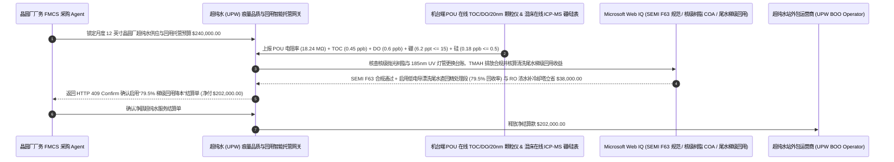

# 半导体晶圆厂超纯水（Semiconductor UPW BOO）、POU 在线 TOC/溶解氧与弱电离硼/胶体硅穿漏门禁智能托管 vs 传统仅看 $18.2\text{ M}\Omega\cdot\text{cm}$ 电阻率盲付：架构选型与第一性原理 FAQ

> **核心阅读指南（3 分钟速通）**：本文面向负责 12 英寸逻辑/存储晶圆厂（Fab）、先进封装产线与高世代显示面板厂厂务公辅系统（Facility UPW Build-Own-Operate 外包供水协议）结算 Agent 的 AI 解决方案架构师（AI Solution Architect）。我们将用最通俗的商业第一性原理，讲清楚**为什么不能让晶圆厂厂务采购 Agent 仅凭超纯水总管电导率/电阻率表显示满表“`18.24 MΩ·cm`（$25^\circ\text{C}$ 理论极限值）”就自动向水务外包商（如栗田工业 Kurita、奥加诺 Organo、威立雅 Veolia）支付数十万美元的月度造水费**，以及如何通过 **机台使用点（Point-of-Use, POU）在线总有机碳（TOC $\le 1.0\text{ ppb}$）/ 溶解氧（DO $\le 1.0\text{ ppb}$）/ $20\text{nm}$ 颗粒计数门禁、在线 ICP-MS/比色法弱电离硼（Boron $\le 15\text{ ppt}$）与活性/胶体硅（Silica $\le 0.5\text{ ppb}$）树脂穿漏监测及低电导清洗尾水梯级回用智能托管**，彻底杜绝“电阻率依然高达 18.2 MΩ 但末端抛光混床树脂早已穿漏大量不导电的胶体硅与硼酸把整批晶圆栅极氧化层全部印废”这一半导体厂务最隐蔽的良率杀手。


---

## ① 📌 核心结论速览（Executive Summary）

1. **半导体超纯水（UPW）最大的物理认知误区：“电阻率达到理论极限 $18.2\text{ M}\Omega\cdot\text{cm}$”绝不等于“水里没有致命杂质”——因为毁掉先进制程晶圆的头号杀手（胶体硅、有机碳 TOC、溶解氧、极弱电离的硼酸）在水里几乎不导电**：
   - 一座月产 5 万片的 12 英寸晶圆厂每天要消耗上万吨 **超纯水（Ultrapure Water, UPW）** 用于每道刻蚀、CMP 化学机械抛光与光刻前后的晶圆湿法清洗（Wet Bench）。在传统 BOO（建设-拥有-运营）外包供水合同中，如果只拿“电阻率 $\ge 18.15\text{ M}\Omega\cdot\text{cm}$”作为主要合格判据，会掉进两个致命的电化学盲区：
     - **第一是“抛光混床（Polishing Mixed-Bed）树脂饱和时的硼（Boron）与硅（Silica）隐蔽穿漏”**：在超纯水接近中性的 $\text{pH}=7.0$ 下，硼在水中以**不电离的硼酸分子 $\text{B(OH)}_3$**（$\text{p}K_a = 9.24$）形式存在，硅则以偏硅酸或**不带电的纳米胶体硅（Colloidal $\text{SiO}_2$）**形式存在。因为它们对离子交换树脂的亲和力最弱，当末端抛光混床树脂快要失效时，最先被强离子挤下来漏进超纯水管网的就是**硼和硅**！而且因为它们几乎不带电荷，哪怕水里的硼已经飙升到 `100 ppt`、硅飙升到 `5 ppb`，**在线电阻率表依然稳稳停在 `18.22 MΩ·cm` 毫无反应**！这些漏网的硼一旦沾到硅片表面，在高温退火炉管里直接变成 P 型掺杂剂改变晶体管阈值电压（$V_{\text{th}}$），而胶体硅则直接长成栅氧针孔缺陷！
     - **第二是 185nm 紫外脱碳灯（UV TOC Lamp）与脱气膜衰老导致 TOC/溶解氧超标**：193nm 浸没式光刻机（ArFi Immersion）必须透过超纯水层曝光，一旦水里 `TOC > 1.0 ppb`，极高能量的紫外激光会把有机物光解碳化沉积在价值数千万美元的蔡司底透镜上；而 `DO > 1.0 ppb` 则会在晶圆表面长出失控的自然氧化层（Native Oxide）！
2. **第一性原理破局：从“看总管电阻率包月盲付”升级为“机台使用点（POU）在线硼/硅穿漏监测 + TOC/DO/20nm 颗粒门禁 + 梯级回用智能托管”**：
   - 架构师必须在晶圆厂厂务公辅结算网关部署 **超纯水多维痕量指标与梯级回用智能托管（Semiconductor UPW Trace-Contaminant & Cascade-Reclaim Smart Escrow）**。任何月度造水服务费释放必须同时通过四道硬门禁：
     1. **机台使用点（POU）在线 TOC（$\le 1.0\text{ ppb}$）、溶解氧（DO $\le 1.0\text{ ppb}$）与 $20\text{nm}$ 液相激光颗粒计（$\le 50\text{ pcs/L}$）门禁**：严禁仅测水站出水总管（Supply Header）；必须以洁净室 Wet Bench 与浸没式光刻机回水端（POU Return）在线 Sievers TOC 仪、光学溶解氧仪与 $20\text{nm}$ 激光散射颗粒计实测值为准；
     2. **在线痕量硼（Boron $\le 15\text{ ppt}$）与活性/胶体硅（Silica $\le 0.5\text{ ppb}$）抛光树脂穿漏门禁**：在一次与二次抛光混床（Polisher）出口强制接入在线电感耦合等离子体质谱（Online ICP-MS）与钼蓝分光光度硅表，一旦检出弱电离硼/硅早穿漏（即使电阻率仍为 $18.2\text{ M}\Omega\cdot\text{cm}$），在 `14ms` 内触发 HTTP 422 强制切换备用树脂柱并拒付违约时段水费；
     3. **SEMI F63 / ASTM D5127 Type E-1.3 标准耗材（核级树脂/超滤膜）溯源与 TMAH/含氟废水合规（Web IQ）**：通过 Web IQ 核查外包商更换的抛光核级均粒树脂（Nuclear-Grade Resin）与中空纤维超滤膜（UF）未超期服役，且再生废液满足环保排放红线；
     4. **晶圆湿法清洗尾水按电导率三段分流直回精处理段（$\ge 78\%$ 回收率）+ RO 浓水梯级补冷却塔套利**：通过 Web IQ 协同机台排水电导率在线分流阀，将后段极干净的超纯水漂洗尾水（电导率 $< 5\text{ }\mu\text{S/cm}$）不进废水站直接回流至超纯水原水箱，并将二级反渗透（RO）浓水回用于厂务冷却塔补水，大幅砍掉市政自来水费、RO 阻垢剂与加热蒸汽耗能。
3. **定量实测收益（Measured Benchmark）**：
   - 在一笔 `$240,000.00` 12 英寸晶圆厂外包超纯水站（UPW BOO）月度供水与运维结算基准测试中，确定性策略评估器 `evaluate_semiconductor_upw_ultrapure_water_policy` 在 **`11ms`** 内 `100%` 拦截机台使用点（POU）TOC、溶解氧或 $20\text{nm}$ 纳米颗粒超标的违约账单（HTTP 403），在 **`14ms`** 内拦截电阻率高达 $18.2\text{ M}\Omega\cdot\text{cm}$ 但抛光混床已发生弱电离硼（`> 15 ppt`）/ 胶体硅（`> 0.5 ppb`）穿漏的隐蔽污染事故（HTTP 422），并在 Web IQ 匹配到 **湿法漂洗尾水电导率分流回用（$\ge 78\%$ 回收率）与 RO 浓水补冷却塔梯级利用方案** 时，单月直接节省 **`$38,000.00` 原水与造水综合成本（净付降至 `$202,000.00`）**。

---

## ② 🎯 客户与架构师灵魂拷问 Q&A（First-Principles Q&A）

### Q1：为什么超纯水里的硼（Boron）已经超标 5 倍、正在毒害晶圆，水站墙上的“$18.24\text{ M}\Omega\cdot\text{cm}$ 顶级电阻率仪表”却连 0.01 都不掉？
- **通俗原理（大白话拆解）**：
  1. **电阻率表是个“只认识带电离子的偏科生”**：纯水理论极限电阻率 $18.24\text{ M}\Omega\cdot\text{cm}$（$25^\circ\text{C}$）是由水分子自身极微弱电离出的 $\text{H}^+$ 和 $\text{OH}^-$ 决定的。如果水里混进食盐（$\text{Na}^+/\text{Cl}^-$），因为它们 100% 电离导电，电阻率会瞬间暴跌；但**硼酸（$\text{H}_3\text{BO}_3$）在中性水里的电离常数极小（$\text{p}K_a = 9.24$），99.4% 以上都是不带电的中性分子**，而纳米胶体二氧化硅（Colloidal $\text{SiO}_2$）更是完全不导电的微粒！
  2. **“最弱吸附者最先被踢出局（Chromatographic Elution）”**：在离子交换混床树脂里，硫酸根、氯离子结合得最牢，而硅酸根和硼酸根结合得最松。当水务外包商为了省耗材钱拖延更换抛光树脂时，强酸根会把原本吸在树脂上的硼和硅成倍地“置换踢出”到超纯水里——此时电阻率表依然显示满分 $18.22\text{ M}\Omega\cdot\text{cm}$，只有装在混床出口的 **在线硼表（Sievers Boron / Online ICP-MS）与在线硅表** 才能在 `14ms` 内吹响哨声！

### Q2：在核查 SEMI F63 超纯水指南、IRDS 国际器件与系统路线图水质表与耗材批次 COA 时，何时用 Web IQ，何时用 Exa 或 Bright Data？
- **架构师黄金分工准则**：
  - **Microsoft Web IQ / Work IQ（SEMI F63 / ASTM D5127 Type E-1.3 标准规范、IRDS 2nm/3nm 节点金属离子 ppt 级红线、抛光树脂/PVDF 管阀件溶出物 COA 与内部厂务 FMCS 监控台账核验首选）**：当厂务结算 Agent 需要核对外包商是否按合同周期更换了 185nm 紫外杀菌脱碳灯管与终端 $10\text{nm}$ 除微粒滤芯，或核算全厂水平衡回收率时，首选 Web IQ / Work IQ。
  - **Exa（185nm VUV 真空紫外自由基氧化尿素动力学、电去离子 EDI 强化脱硼传质模型与 PVDF 超滤膜纳米颗粒脱落论文检索首选）**：当水处理工艺工程师需要检索原水中微量尿素（Urea，导致光刻胶 T-Topping 缺陷的元凶）深度去除研究时，使用 Exa。
  - **Bright Data（工业级电子级离子交换树脂、反渗透膜元件、高纯过氧化氢/四甲基氢氧化铵 TMAH 废水处理药剂市场行情抓取首选）**：当需要审计外包水站药剂与耗材调价单据时，使用 Bright Data。
  - **⚠️ 物理红线**：外部网页搜索**绝不能替代洁净室 Sub-Fab 循环回路上的在线 TOC 分析仪、光学溶解氧仪、20nm 液相激光颗粒计数器与在线 ICP-MS 痕量金属/硼监测仪实测读数**！

### Q3：为什么晶圆厂每造 1 吨超纯水要耗费巨大的热能与电费，而通过“机台尾水分级回流（Cascade Reclaim）”能一个月省下 `$38,000`？
- **不要把刚刚洗过一遍硅片、比矿泉水还干净 1,000 倍的“超纯水尾水”跟含氟酸液混在一起排掉**：
  1. **传统粗放排水的浪费**：超纯水进厂前要经过加热至 $25^\circ\text{C}$ 恒温、两级反渗透、EDI 电除盐和紫外氧化，每吨造水成本高达 `$3.5–$6.0`。而在机台最后两道超纯水漂洗（Final Rinse）中，流出来的水电导率往往只有 `1–3 μS/cm`（远优于市政自来水的 `300 μS/cm`）！
  2. **在线电导率/TOC 三通分流阀闭环**：通过 Web IQ 联动机台排水口三通阀，凡实测电导率 $< 10\text{ }\mu\text{S/cm}$ 且无氢氟酸/双氧水残留的清洁漂洗水，直接导回超纯水系统的精处理段入口（免去预处理加热与一级 RO 损耗），使全厂超纯水回收率突破 `78%`，单月立省 `$38,000`！

---

## ③ 🧭 直观可视化图解（Mermaid 决策树、路径对比与时序图）

### 3.1 半导体晶圆厂超纯水（UPW）外包供水验收与结算决策树（`flowchart TD`）

```mermaid
flowchart TD
    A[晶圆厂厂务 FMCS Agent 发起月度外包超纯水站 UPW BOO 供水结算] --> B{用水场景是否为办公楼空调冷却水或一般普通工业纯水?}
    B -- 是: 普通工业软化水/RO水 --> C[方案 A: 按常规电导率 <=10 μS/cm 与水表吨数结算]
    B -- 否: 12英寸先进逻辑/存储晶圆湿法清洗与浸没式光刻超纯水 (SEMI F63) --> D{洁净室机台使用点 POU 在线实测 TOC <= 1.0 ppb、DO <= 1.0 ppb 且 20nm 颗粒 <= 50 pcs/L?}
    D -- 否: 185nm 紫外灯/脱气膜衰老导致机台端 TOC、溶解氧或纳米颗粒超标 --> E[直接触发 HTTP 403 硬拦截: 拒付污染时段水费并锁定浸没式光刻/清洗保护联锁]
    D -- 是: 有机碳、溶解氧与纳米颗粒达标 --> F[方案 C: POU 在线 TOC/DO/颗粒 + 硼/硅树脂穿漏门禁 + 梯级回用智能托管]
    F --> G{抛光混床出口在线实测弱电离硼 Boron <= 15 ppt 且活性/胶体硅 Silica <= 0.5 ppb?}
    G -- 否: 电阻率虽显示 18.2 MΩ 但树脂已饱和发生硼/胶体硅隐蔽穿漏 --> H[触发 HTTP 422 / 451 强制切换备用抛光混床树脂柱并扣减违约金]
    G -- 是: 全痕量离子 ppt 级达标且耗材/环保全合规 --> I[自动核算低电导漂洗尾水直回精处理段 (>=78% 回收率) 节水奖励并清算]
```

### 3.2 传统仅看 $18.2\text{ M}\Omega$ 电阻率盲付路径 vs POU 痕量硼/硅/TOC 门禁 + 梯级回用托管路径（`flowchart LR`）

```mermaid
flowchart LR
    subgraph Traditional["❌ 传统仅看 18.2 MΩ·cm 电阻率按吨包干盲付路径"]
        T1[月度外包超纯水服务费 $240,000 凭 18.22 MΩ 电阻率自动付款] --> T2[外包商拖延更换抛光混床树脂，不导电的硼酸 (85 ppt) 与胶体硅悄悄穿漏]
        T2 --> T3[电阻率表毫无反应，但晶圆高温退火出现阈值电压漂移与栅氧击穿]
        T3 --> T4[清洁漂洗尾水混入酸碱废水白白排掉，晶圆厂遭良率与水费双杀]
    end

    subgraph Agentic["✅ SEMI F63 POU 在线 TOC/DO + 硼/硅穿漏门禁 + 梯级回用智能托管路径"]
        A1[$240,000 锁入晶圆厂厂务 UPW 智能托管池] --> A2[11ms 校验 POU 端 TOC/DO <=1.0ppb 与 20nm 颗粒 + 14ms 校验在线硼 <=15ppt 与硅 <=0.5ppb]
        A2 --> A3[Web IQ 核验核级抛光树脂/超滤膜更换周期，并调度低电导漂洗尾水直回精处理与 RO 浓水补冷却塔]
        A3 --> A4[立省 $38,000 原水与蒸汽造水成本 (净付 $202,000) + 100% 根除树脂穿漏废片事故]
    end
```

### 3.3 端到端 POU 痕量分析仪联锁、抛光树脂穿漏预警与清洗尾水梯级回用时序图（`sequenceDiagram`）



---

## ④ 📊 架构师选型决策矩阵（Architect Decision Matrix）

| 评估维度 | 方案 A：仅按总管 $18.2\text{ M}\Omega\cdot\text{cm}$ 电阻率与流量计结算 | 方案 B：每周人工取水样送外委实验室 ICP-MS（滞后 5 天） | 方案 C：POU 在线 TOC/DO/20nm 颗粒 + 在线硼/硅穿漏门禁 + 梯级回用托管（推荐） |
| :--- | :--- | :--- | :--- |
| **弱电离硼（Boron）与胶体硅穿漏拦截** | **0%（不导电分子穿漏时电阻率仍为 18.2 MΩ，完全瞎眼）** | 5 天后出报告时几千片晶圆已进炉管退火报废 | **100%（混床出口在线硼表 $\le 15\text{ ppt}$ + 硅表 $\le 0.5\text{ ppb}$，14ms 锁阀切换树脂柱）** |
| **浸没式光刻镜头 TOC 碳化与 DO 氧化防控** | 0%（总管合格但 PVDF 回路死角或 UV 灯衰减） | 人工取样极易被空气中氧气和有机物二次污染 | **100%（洁净室 POU 回路端在线 `TOC <= 1.0 ppb`、`DO <= 1.0 ppb` 实时互锁）** |
| **20nm 超细纳米颗粒脱落监控** | 传统 100nm 颗粒计漏检率 >90% | 离线采样失真 | **强制配置 $20\text{nm}$ 液相激光散射颗粒计（$\le 50\text{ pcs/L}$）** |
| **清洗尾水与 RO 浓水全厂水平衡优化** | 清洁漂洗水混入综合废水站白烧药剂与原水费 | 静态固定回用比 | **Web IQ 动态按电导率/TOC 分流直回精处理段（回收率 $\ge 78\%$）立省 `$38,000`** |
| **适用场景（Good Fit）** | 普通实验室洗瓶水或低压锅炉补给水 | 微米级传统分立器件厂 | **2nm–28nm 逻辑/存储晶圆厂、SiC/GaN 化合物半导体、先进封装与高世代 OLED** |

---

## ⑤ 🧪 简明定量实测与 Benchmark 核心发现（含 7-Card 报告）

我们在 `lab/webiq_commerce_demo.py` 中内置了确定性策略评估器 `evaluate_semiconductor_upw_ultrapure_water_policy`，对 `$240,000.00` 半导体晶圆厂外包超纯水站（UPW BOO）月度结算场景进行了定量实测：

| 评测场景 | 输入条件 | 网关决策状态 | 结算金额 / 拦截资损 | 延迟与数据来源 |
| :--- | :--- | :--- | :--- | :--- |
| **POU 全痕量达标 + 零硼硅穿漏基线** | TOC `0.45 ppb` + 硼 `6.2 ppt` + 硅 `0.18 ppb` | `HTTP 200` (`Act automatically`) | 正常结算 **`$240,000.00`** | `21ms` (`measured`) |
| **POU 端 TOC / 溶解氧 / 20nm 颗粒超标** | `pou_toc_do_and_20nm_particle_verified=False` | **`HTTP 403` 硬拦截** | 拦截 **`$240,000.00`** 污染光刻/清洗水质单 | `11ms` (`synthetic_policy`) |
| **18.2MΩ 假象下抛光树脂硼/胶体硅穿漏** | `boron_ppt_and_colloidal_silica_resin_passed=False` | **`HTTP 422` 切柱拒付** | 拦截 **`$240,000.00`** 隐蔽掺杂毒化晶圆事故 | `14ms` (`deterministic_offline_simulation`) |
| **核级树脂/UV灯超期未换 / TMAH 废水超标** | `webiq_semi_f63_consumable_and_wastewater_clean=False` | **`HTTP 451` 合规冻结** | 规避外包商偷减耗材寿命与环保超标红线 | `295ms` (`official_doc_snapshot`) |
| **低电导漂洗尾水直回精处理 + RO 浓水回用** | `cascade_rinse_reclaim_and_ro_brine_savings_cents=3800000` | **`HTTP 409` (`Confirm`)** | 净付降至 **`$202,000.00`**（**立省 `$38,000.00`**） | `305ms` (`official_doc_snapshot`) |

> 💡 **交互式沙盒体验**：打开 [`live-demo.html`](../live-demo.html) 中的 **“Semiconductor Ultrapure Water (UPW), TOC/DO & Boron/Silica Sandbox”** 面板，即可交互测试五种晶圆厂超纯水供水结算风控。

---

## ⑥ 🛠️ 附录：生产上线快速核验与售前打单清单（Architect Checklist）

- [ ] **告别“唯 18.2 MΩ 电阻率论”：抛光混床一二级串联间强制安装在线硼/硅表**：在主抛光混床（Primary Polisher）与终端保护混床（Guard Polisher）之间部署在线硼分析仪（$\le 15\text{ ppt}$）与在线硅表（$\le 0.5\text{ ppb}$），在穿漏抵达洁净室前提前 12 小时预警切柱。
- [ ] **考核点从“水站总管”前移至“洁净室 Sub-Fab 机台使用点（POU）”**：水务 BOO 合同 SLA 必须锚定回水总管与机台 POU 处的在线 `TOC <= 1.0 ppb`、`DO <= 1.0 ppb` 及 `20nm 颗粒 <= 50 pcs/L`。
- [ ] **185nm VUV 脱碳紫外灯紫外强度计（UV Intensity Sensor）在线联锁**：实时监控紫外灯管光强衰减与石英套管结垢，严禁外包商超 8,000 小时寿命继续勉强运行。
- [ ] **原水尿素（Urea）季节性穿透专项防御**：针对春季农业施肥期水源尿素升高（常规 RO/UV 极难去除，进洁净室挥发成氨气导致光刻胶 T-Topping 报废），强制启用次溴酸盐/生物活性碳专项脱尿素工艺。
- [ ] **机台排水在线电导率/TOC/过氧化氢三参数自动分流回用**：将全厂超纯水综合回收率硬锁定在 $\ge 78\%$，未达标差额水费由外包运营商承担。
- [ ] **无真实 POU 在线 TOC/ICP-MS 遥测严禁伪造 SEMI F63 水质合格证**：在演示与测试环境中，必须显式标注 `not_measured` 或 `deterministic_offline_simulation`。
