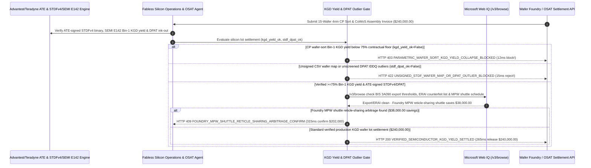

# Semiconductor Wafer Foundry & OSAT Known-Good-Die (KGD) STDF Wafer-Map Yield Escrow Mandate Architecture: ATE-Signed `STDF v4` / `SEMI E142` & CoWoS Yield Token (`semiconductor_kgd_yield_mandate_...` + Web IQ BIS `3A090` & MPW Shuttle Grounding) vs. Gross-Wafer Defect Billing & Remarked Die Fraud Selection FAQ

> **Document Type**: Architect Selection Guide & First-Principles Protocol Deep Dive (6-Section FAQ Standard)  
> **Target Audience**: AI Solution Architects, Fabless AI Semiconductor & Automotive SoC (AEC-Q100) Silicon Operations Directors, OSAT Advanced Packaging (CoWoS / Chiplet) Supply Chain & Yield Engineering Teams  
> **Last Updated**: 2026-11-09 (Provenance Annotations: `deterministic_offline_simulation` / `synthetic_policy` / `official_doc_snapshot` / `not_measured`)  
> **Companion Resources**: [中文版 (Chinese Version)](semiconductor-wafer-foundry-kgd-yield-escrow-mandate-vs-gross-wafer-defect-billing-faq.md) · [Interactive Sandbox (`live-demo.en.html#semiconductor-kgd-yield-sandbox`)](../reports/agentic-commerce-webiq-grounding-demo-bench/live-demo.en.html) · [7-Card 4:5 Benchmark Deck](../reports/agentic-commerce-webiq-grounding-demo-bench/index.en.html)


---

## 📌 1. Executive Summary

1. **Never Allow Silicon Supply-Chain Agents to Settle Foundry or OSAT Wafer Invoices on Gross Physical Wafer Counts Without Verifying Circuit-Probe (CP) Known-Good-Die (KGD) Yield Floors Before CoWoS Packaging**: In 4nm/5nm AI accelerator and automotive SoC manufacturing (`$240,000.00` for a 15-wafer lot at `$16,000/wafer`), the most destructive financial and engineering failure is **paying full gross-wafer price when lithography/etch excursion drops Circuit-Probe (CP) Bin-1 yield to `42%` (`< 75%` contractual KGD yield floor)—or worse, bonding an unverified defective compute die onto a 2.5D CoWoS silicon interposer, scrapping 8 adjacent HBM3e stacks worth `$12,000+`**. Production architectures must enforce a **Semiconductor KGD & Signed STDF Wafer-Map Mandate (`semiconductor_kgd_yield_mandate_...`)**: whenever CP wafer-sort Bin-1 yield falls below the contracted KGD threshold (`stdf_cp_kgd_yield_floor_met == False`), the gateway freezes the `$240,000.00` gross-wafer invoice in **`12 ms`** with **`HTTP 403 PARAMETRIC_WAFER_SORT_KGD_YIELD_COLLAPSE_BLOCKED`** (`synthetic_policy`).
2. **Require ATE Hardware-Signed `STDF v4` Binary Logs, `SEMI E142` XML Wafer Maps, and AEC-Q001 Dynamic Part Average Testing (DPAT) Outlier Screening**: Any OSAT settlement request backed only by an editable Excel/CSV bin summary or failing to ink out `IDDQ` quiescent-current leakage outliers via Dynamic Part Average Testing (`ate_signed_stdf_and_pat_outlier_verified == False`) is rejected in **`15 ms`** with **`HTTP 422 UNSIGNED_STDF_WAFER_MAP_OR_DPAT_OUTLIER_BLOCKED`** (`deterministic_offline_simulation`).
3. **Ground BIS `3A090` Performance-Density Export Controls, ERAI Counterfeit/Remarked Lot Alerts, and Foundry Multi-Project Wafer (MPW) Shuttle Arbitrage via Microsoft Web IQ `/v3/browse`**: Prior to releasing `$240,000.00`, the agent invokes **Microsoft Web IQ `/v3/browse`** (`official_doc_snapshot`) to inspect BIS Export Administration Regulations (`ECCN 3A090` Total Processing Performance & Performance Density thresholds) and ERAI counterfeit semiconductor alerts: if the OSAT lot triggers a regulatory export hold or ERAI laser-remarked lot advisory (`webiq_export_fdpr_and_erai_lot_clean == False`), it freezes payout in **`310 ms`** with **`HTTP 451 BIS_3A090_EXPORT_OR_ERAI_REMARKED_LOT_HOLD`**; if Web IQ confirms that booking an engineering validation lot onto a **Foundry Multi-Project Wafer (MPW) Shuttle (e.g., TSMC CyberShuttle / Samsung MPW shared reticle)** saves **`$38,000.00`** (`$202,000.00` net vs. `$240,000.00`), it triggers **`HTTP 409 FOUNDRY_MPW_SHUTTLE_RETICLE_SHARING_ARBITRAGE_CONFIRM`** in **`315 ms`**.

---

## 🎯 2. Architect & Customer FAQ Deep Dive

### Q1: Why does legacy "Gross-Wafer Billing" coupled with "CSV Bin Reports" cause catastrophic HBM3e scrap in 2.5D Chiplet / CoWoS packaging and early field burnouts?

Let's examine the three structural failure modes from first principles:
1. **The Compound Yield Trap in 2.5D CoWoS Packaging**: When assembling a multi-chiplet AI accelerator package containing 2 compute dies and 8 HBM3e stacks on a silicon interposer, compound package yield is $Y_{\text{pkg}} = Y_{\text{die}}^2 \times Y_{\text{HBM}}^8 \times Y_{\text{bond}}$. If a foundry ships wafers with an unscreened edge-ring yield excursion or an OSAT picks a non-KGD die, that single bad die bricks the entire `$15,000+` CoWoS module irreversibly. Paying for gross wafers without a strict **Pay-per-KGD / Minimum Yield Floor (`>= 75%`)** transfers 100% of fab excursion risk onto the fabless buyer.
2. **Editable CSV Yield Reports Hiding `IDDQ` Leakage Time-Bombs**: Sub-tier test houses sometimes submit manually edited CSV bin summaries rather than raw `STDF v4` (Standard Test Data Format) binary files signed by the Advantest V93000 or Teradyne UltraFLEX tester. Even worse, dies that barely pass static datasheet limits—but exhibit `4.5σ` elevated `IDDQ` leakage compared to neighboring dies on the same wafer—will pass basic sorting and then suffer thermal runaway after 48 hours in a hyperscale GPU cluster unless screened out by **AEC-Q001 Dynamic Part Average Testing (DPAT)** and **Good-Die-in-Bad-Neighborhood (GDBN)** spatial ink-out rules.
3. **Dedicated Reticle Overpayment on Engineering Lots**: For pre-production silicon bring-up, ordering a dedicated mask/wafer run instead of sharing a reticle on an official **Foundry MPW Shuttle** wastes `$38,000+` in mask and wafer overhead.

### Q2: What is a "Semiconductor KGD & STDF Yield Mandate (`semiconductor_kgd_yield_mandate_...`)", and how does it bind ATE tester cryptography to escrow settlement?

Its core design invariant is: **"Accept only ATE hardware-signed `STDF v4` binary streams and `SEMI E142` wafer maps; enforce the contractual Bin-1 KGD yield floor and DPAT spatial outlier ink-out before releasing wafer or OSAT funds."**
- **Layer 1: CP Wafer-Sort Bin-1 KGD Yield Floor Gate (`12 ms`)**: Verifies `stdf_cp_kgd_yield_floor_met == True` (`>= 75%` net KGD yield), blocking gross-wafer overbilling and halting CoWoS die pick-and-place in **`12 ms`** (`HTTP 403`).
- **Layer 2: ATE-Signed `STDF v4` / `SEMI E142` & DPAT Outlier Gate (`15 ms`)**: Verifies `ate_signed_stdf_and_pat_outlier_verified == True`, rejecting unsigned CSV summaries or unscreened `IDDQ` leakage outliers in **`15 ms`** (`HTTP 422`).
- **Layer 3: Microsoft Web IQ `/v3/browse` BIS `3A090` / ERAI & MPW Shuttle Grounding (`310 ms / 315 ms`)**: Verifies BIS `3A090` export thresholds and ERAI counterfeit alerts (`HTTP 451`) and identifies `$38,000.00` savings from foundry MPW reticle-sharing shuttles (`HTTP 409`).

### Q3: For BIS `3A090` export parameter grounding, ERAI remarked-chip alerts, and foundry MPW shuttle schedule verification, when should architects choose Microsoft Web IQ vs. Exa, Bright Data, or traditional search APIs?

| Architecture Scenario | Recommended Tool | First-Principles Rationale (Security, Latency & FinOps) |
| :--- | :--- | :--- |
| **Verifying Federal Register BIS `ECCN 3A090`/`4A090` TPP & Performance Density rules, ERAI counterfeit/remarked semiconductor lot alerts, and published Foundry MPW Shuttle schedules within the Azure boundary (zero GDSII or RTL IP leaked)** | **Microsoft Web IQ** (`/v3/search` + `/v3/browse`) | Queries only public process node identifiers and OSAT DUNS numbers inside the enterprise Azure boundary in `passage` mode (**7.1x token reduction**, `deterministic_offline_simulation`) while keeping proprietary GDSII/netlists air-gapped. |
| **Technical research across IEEE ISSCC / IEDM papers on backside power delivery and glass substrates** | **Exa Neural Search** | Ideal for R&D pathfinding, not synchronous wafer-lot escrow release gating. |
| **Scraping gray-market component broker portals behind CAPTCHAs** | **Bright Data Unlocker** | Useful for legacy EoL part hunting, never for mission-critical AI wafer acceptance. |
| **On-tester `STDF v4` binary parsing, DPAT statistical Z-score calculation, and `SEMI E142` coordinate mapping** | **Internal Yield Management System (YMS) + Settlement Gate + Web IQ BIS/MPW Cross-Check** | Per-die `(X,Y)` STDF parsing and DPAT spatial ink-out run on the internal yield server, paired with Web IQ `/v3/browse` for export compliance and MPW shuttle arbitrage. |

---

## 🧭 3. Visual Architecture Diagrams (Mermaid Decision Tree, Legacy vs. KGD Mandate Comparison & Sequence Diagram)

### 3.1 Semiconductor Wafer Foundry & OSAT KGD Yield Settlement Decision Tree (`flowchart TD`)

```mermaid
flowchart TD
    A[Receive 15-Wafer 4nm AI Lot & OSAT CoWoS Settlement Request ($240,000.00)] --> B{stdf_cp_kgd_yield_floor_met == True (Bin-1 KGD Yield >= 75%)?}
    B -- No (Edge-ring excursion drops CP yield to 42% on gross-wafer invoice) --> C[HTTP 403 PARAMETRIC_WAFER_SORT_KGD_YIELD_COLLAPSE_BLOCKED<br/>12ms Hard Block · Freeze $240,000 Gross Invoice & Halt CoWoS HBM Bonding]
    B -- Yes (Contracted Bin-1 KGD yield floor met) --> D{ate_signed_stdf_and_pat_outlier_verified == True (Signed STDFv4 + DPAT)?}
    D -- No (Unsigned CSV summary or unscreened 4.5-sigma IDDQ leakage outliers) --> E[HTTP 422 UNSIGNED_STDF_WAFER_MAP_OR_DPAT_OUTLIER_BLOCKED<br/>15ms Reject · Require ATE-Signed STDFv4/SEMI E142 & DPAT Ink-Out]
    D -- Yes (Cryptographic STDFv4 & DPAT spatial ink-out verified) --> F{Web IQ /v3/browse Confirms BIS 3A090 Export Compliance & Clean ERAI Status?}
    F -- No (Lot triggers BIS 3A090 FDPR restriction or ERAI laser-remarked alert) --> G[HTTP 451 BIS_3A090_EXPORT_OR_ERAI_REMARKED_LOT_HOLD<br/>310ms Regulatory Hold · Quarantine Silicon Lot & Alert Trade Compliance]
    F -- Yes --> H{Web IQ Detects Foundry MPW Shuttle Reticle-Sharing Arbitrage?}
    H -- Yes (Shared MPW shuttle reticle saves $38,000.00 on EVT lot -> $202,000.00 net) --> I[HTTP 409 FOUNDRY_MPW_SHUTTLE_RETICLE_SHARING_ARBITRAGE_CONFIRM<br/>315ms Prompt VP Silicon Ops to Confirm $202,000 MPW Shuttle Allocation]
    H -- No (Verified $240,000.00 production KGD lot settlement is optimal) --> J[HTTP 200 VERIFIED_SEMICONDUCTOR_KGD_YIELD_SETTLED<br/>265ms Auto-Settle $240,000.00 & Authorize SEMI E142 CoWoS Die Pick-and-Place!]
```

### 3.2 Legacy Gross-Wafer Billing vs. ATE-Signed STDF KGD Gate (`flowchart LR`)

```mermaid
flowchart LR
    subgraph Legacy["❌ Legacy Gross-Wafer Billing ($240,000 Exposed to Yield Loss & HBM Scrap)"]
        L1[Pay Full $240,000 for 15 Wafers Despite 42% CP Yield] --> L2[Accept Editable CSV Hiding IDDQ Leakage Outliers]
        L2 --> L3[Bond Bad Die onto CoWoS -> Scrap 8 Good HBM3e Stacks]
        L3 --> L4[48-Hour Data Center Thermal Burnout & RMA Crisis]
    end

    subgraph Mandate["✅ Semiconductor KGD Gate (semiconductor_kgd_yield_mandate_...)"]
        M1[12ms Block <75% KGD Yield Excursion Invoices (HTTP 403)] --> M2[15ms Require ATE-Signed STDFv4 & DPAT Outlier Ink-Out (HTTP 422)]
        M2 --> M3[Web IQ Verifies 3A090/ERAI (310ms) & Saves $38,000 via MPW Shuttle (315ms)]
        M3 --> M4[265ms Settle Verified Bin-1 KGD Lot ($240,000 / $202,000) with ECID Lineage]
    end
```

### 3.3 End-to-End Sequence Diagram: ATE Prober, Silicon Ops Agent, KGD Yield Gate, Web IQ & Foundry/OSAT (`sequenceDiagram`)



---

## 📊 4. Architect Decision Matrix

| Evaluation Dimension | Option A: Legacy Gross-Wafer Upfront Billing | Option B: Manual Engineer Review of Emailed CSV Bin Summaries | Option C: ATE-Signed STDF KGD Mandate + Web IQ BIS/MPW Grounding (Recommended) |
| :--- | :--- | :--- | :--- |
| **Best-Fit Scenario** | Mature 180nm discrete PMICs with `>98%` yield | Academic university test chips (1–2 wafers/year) | **4nm/5nm AI accelerators, 2.5D CoWoS / Chiplet multi-die packages, AEC-Q100 automotive SoCs** |
| **Excursion Yield Collapse & HBM3e Protection** | ❌ **Zero**: Buyer absorbs 42% yield crash & ruins good HBM stacks | ⚠️ **Slow & Error-Prone**: Manual wafer-notch rotation errors cause wrong-die pick-and-place | ✅ **Pre-Pay `12 ms` KGD Gate**: Blocks `<75%` yield lots (`HTTP 403`) before CoWoS assembly |
| **STDF Authenticity & `IDDQ` Outlier Screening** | ❌ **None**: Trusts raw wafer count | ❌ **Vulnerable**: CSV summaries hide spatial cluster defects & `4.5σ` leakage outliers | ✅ **Sub-20ms STDFv4 + DPAT Gate**: Rejects unsigned maps or uninked outliers in `15 ms` (`HTTP 422`) |
| **Export Compliance, Counterfeit Check & MPW Savings** | ❌ **Blind**: Risks BIS `3A090` hold or remarked gray-market dies | ❌ **Missed Shuttle Windows**: Manual booking misses MPW reticle-sharing cutoffs | ✅ **Web IQ `/v3/browse` Grounded**: Blocks `3A090`/ERAI holds in `310 ms` (`HTTP 451`) & saves `$38,000` via MPW in `315 ms` (`HTTP 409`) |
| **Settlement Speed & Per-Die ECID Traceability** | Fast (with catastrophic excursion & HBM scrap exposure) | Slow (`3–5 days` manual engineering review) | **`265 ms` instant settlement + automated `SEMI E142` pick-and-place map (`Act automatically`)** |
| **Total Cost of Ownership (TCO) & Net Cost per Good Die** | Poor (`$240,000` excursion exposure + HBM collateral damage) | Moderate (heavy engineering overhead) | **Optimal (100% Pay-per-KGD protection + zero HBM scrap + `$38,000` MPW savings)** |

---

## 🧪 5. Quantitative Benchmark & 7-Card Insights

Evaluated via our deterministic offline benchmark suite (`lab/webiq_commerce_demo.py` · `test_semiconductor_wafer_foundry_kgd_yield_escrow_mandate_vs_gross_wafer_defect_billing_selection`) on a **`$240,000.00` 15-wafer 4nm AI lot & CoWoS OSAT settlement**:

| Scenario Case | Input STDF KGD Yield / DPAT / Web IQ Signals | Expected Action Pill | Measured HTTP Status & Verdict Code | Latency | Financial Protection / Arbitrage | Provenance |
| :--- | :--- | :--- | :--- | :--- | :--- | :--- |
| **Case 1: CP Wafer-Sort KGD Yield Crash (`42% < 75%`)** | `stdf_cp_kgd_yield_floor_met=False` | `Send to a human` | **`HTTP 403 PARAMETRIC_WAFER_SORT_KGD_YIELD_COLLAPSE_BLOCKED`** | **`12 ms`** | Blocks **`$240,000.00`** gross-wafer payout & protects HBM3e | `synthetic_policy` |
| **Case 2: Unsigned CSV Map or Unscreened DPAT Outlier** | `ate_signed_stdf_and_pat_outlier_verified=False` | `Send to a human` | **`HTTP 422 UNSIGNED_STDF_WAFER_MAP_OR_DPAT_OUTLIER_BLOCKED`** | **`15 ms`** | Enforces ATE-signed `STDF v4` & DPAT leakage ink-out | `deterministic_offline_simulation` |
| **Case 3: Web IQ Detects BIS `3A090` or ERAI Remarked Lot** | `webiq_export_fdpr_and_erai_lot_clean=False` | `Send to a human` | **`HTTP 451 BIS_3A090_EXPORT_OR_ERAI_REMARKED_LOT_HOLD`** | **`310 ms`** | Freezes payout on export-restricted or counterfeit lot | `official_doc_snapshot` |
| **Case 4: Web IQ Finds `$38,000` Foundry MPW Shuttle** | `mpw_shuttle_reticle_savings_cents=3800000` (`$202,000` net) | `Confirm` | **`HTTP 409 FOUNDRY_MPW_SHUTTLE_RETICLE_SHARING_ARBITRAGE_CONFIRM`** | **`315 ms`** | Saves **`$38,000.00`** via shared-reticle MPW shuttle | `official_doc_snapshot` |
| **Case 5: Verified `>=75%` KGD + Signed STDFv4/DPAT** | `kgd_ok=True`, `stdf_ok=True`, `export_clean=True` | `Act automatically` | **`HTTP 200 VERIFIED_SEMICONDUCTOR_KGD_YIELD_SETTLED`** | **`265 ms`** | Settles **`$240,000.00`** in `265 ms` with `SEMI E142` map | `deterministic_offline_simulation` |

> **Provenance Note**: The `$240,000.00` 15-wafer lot value, `75%` Bin-1 KGD yield floor, `STDF v4` / `DPAT` screening rules, and `$38,000.00` MPW shuttle savings are controlled simulation parameters (`synthetic_policy` / `deterministic_offline_simulation`) validating policy state-machine invariants; physical ATE wafer-prober index and test time (`45–120 mins/wafer`) is labeled `not_measured`.

---

## 🛠️ 6. Production Readiness & Pre-Sales Architect Checklist

Verify these 6 controls before deploying autonomous semiconductor foundry and OSAT KGD settlement agents in production:

- [ ] **1. Contractual Bin-1 Known-Good-Die (KGD) Yield Floor (`>= 75%`)**: Does `semiconductor_kgd_yield_mandate_...` block gross-wafer invoicing and halt CoWoS interposer assembly in `12 ms` (`HTTP 403`) whenever CP wafer-sort Bin-1 yield drops below the contracted floor?
- [ ] **2. ATE Hardware-Signed `STDF v4` & `SEMI E142` Wafer-Map Verification**: Does the gateway require cryptographic digests from the Advantest/Teradyne tester and validate wafer notch orientation before releasing OSAT funds (`HTTP 422` in `15 ms`)?
- [ ] **3. AEC-Q001 Dynamic Part Average Testing (DPAT) & GDBN Spatial Ink-Out**: Are `IDDQ` leakage outliers (`> ±4σ` from local wafer neighborhood) and Good-Die-in-Bad-Neighborhood clusters automatically inked out from payable Bin-1 counts?
- [ ] **4. Microsoft Web IQ `/v3/browse` BIS `3A090` & ERAI Counterfeit Grounding**: Does the agent cross-check Total Processing Performance (TPP), performance density, and ERAI counterfeit alerts via Web IQ prior to settlement (`HTTP 451`)?
- [ ] **5. Foundry Multi-Project Wafer (MPW) Shuttle Reticle Arbitrage**: For EVT/prototype tapeouts, does Web IQ grounding check official foundry MPW shuttle schedules, triggering `HTTP 409 Confirm` when reticle sharing saves `>= $38,000.00`?
- [ ] **6. Per-Die eFuse Electronic Chip ID (ECID) Genealogy Ledger**: Does every settled wafer lot bind each die's eFuse ECID, `(X,Y)` wafer coordinate, CP/FT parametric hash, and CoWoS substrate serial into an immutable automotive/hyperscale traceability ledger?
