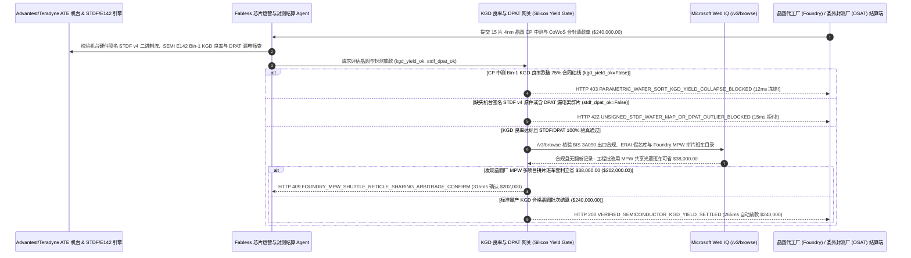

# 半导体晶圆代工（Foundry）与封测（OSAT）已知合格裸片（Known-Good-Die, KGD）良率结算（Semiconductor Wafer Foundry & OSAT Known-Good-Die STDF Wafer-Map Yield Escrow Mandate）架构：ATE 探针台签名 STDF/SEMI E142 晶圆图与 CoWoS 合封良率令牌（`semiconductor_kgd_yield_mandate_...` + Web IQ 3A090 出口合规与 MPW 拼片核验）vs 传统按整张毛晶圆盲付吞下坏片与翻新片选型与原理解析 FAQ

> **文档类型**：架构师选型指南 & 协议第一性原理解析（6 段式 FAQ 标准版）  
> **适用读者**：AI Solution Architect、Fabless AI 芯片设计公司与车规级半导体（AEC-Q100）运营（Silicon Operations / Foundry Sourcing）总监、先進封装（CoWoS / Chiplet）供应链与质量工程团队  
> **更新日期**：2026-11-09（Provenance 标注：`deterministic_offline_simulation` / `synthetic_policy` / `official_doc_snapshot` / `not_measured`）  
> **配套资源**：[English Version](semiconductor-wafer-foundry-kgd-yield-escrow-mandate-vs-gross-wafer-defect-billing-faq.en.md) · [交互式沙盒控制台 (`live-demo.html#semiconductor-kgd-yield-sandbox`)](../reports/agentic-commerce-webiq-grounding-demo-bench/live-demo.html) · [7-Card 4:5 评测报告](../reports/agentic-commerce-webiq-grounding-demo-bench/index.html)


---

## 📌 一、核心结论速览（Executive Summary）

1. **严禁让 Fabless 芯片供应链结算 Agent 在未核验“晶圆中测（Circuit Probe, CP）已知合格裸片（Known-Good-Die, KGD）良率下限”的情况下，按物理毛晶圆张数（Gross Wafer Count）全额放款或盲目送入 CoWoS 先进封装**：在 4nm/5nm AI 加速卡与车规级 SoC 晶圆委外代工及封测（OSAT，如 15 片 300mm 晶圆批次 `$240,000.00`，单价 `$16,000/wafer`）中，最昂贵的供应链灾难是 **“光刻或蚀刻机台工艺漂移导致整张晶圆外圈裸片大面积失效（CP 良率暴跌至 `42% < 75%` 合同红线），或者将未经 KGD 筛查的坏裸片贴装到 CoWoS 硅中介层上，连累旁边 8 颗价值 `$12,000` 的合格 HBM3e 显存一起报废”**。生产环境必须采用 **ATE 签名 STDF / SEMI E142 晶圆图与 KGD 良率托管令牌（`semiconductor_kgd_yield_mandate_...`）**：一旦探针台实测 Bin-1 合格裸片良率低于合同保底线（`stdf_cp_kgd_yield_floor_met=False`），网关在 **`12 ms`** 内触发 **`HTTP 403 PARAMETRIC_WAFER_SORT_KGD_YIELD_COLLAPSE_BLOCKED`**（`synthetic_policy`），冻结 `$240,000.00` 毛晶圆账单并强制转为按实际合格裸片颗数（Pay-per-KGD）折算。
2. **强制要求 Advantest / Teradyne 自动测试机台（ATE）硬件签名的二进制 `STDF v4` 日志与 `SEMI E142` 电子晶圆图（Wafer Map），严查动态部件平均测试（DPAT）静态漏电离群芯片**：任何仅提交可手工修改的 Excel/CSV 良率汇总表、或未通过 AEC-Q001 动态部件平均测试（`DPAT`）剔除 `IDDQ` 静态漏电离群裸片的请款请求（`ate_signed_stdf_and_pat_outlier_verified=False`），网关在 **`15 ms`** 内返回 **`HTTP 422 UNSIGNED_STDF_WAFER_MAP_OR_DPAT_OUTLIER_BLOCKED`**（`deterministic_offline_simulation`）。
3. **基于 Microsoft Web IQ `/v3/browse` 实时核验 BIS `3A090` 算力密度合规阈值、ERAI 假冒打磨芯片通报与晶圆厂 MPW 多项目拼片班车（Multi-Project Wafer Shuttle）套利**：在放款前，Agent 调用 **Microsoft Web IQ `/v3/browse`**（`official_doc_snapshot`）核查美国商务部 BIS 先进计算出口管制参数（TPP 总算力与算力密度 Performance Density）及 ERAI 电子元器件打磨翻新黑名单：若委外封测厂或二级市场采购批次命中合规预警或激光重刻批号（`webiq_export_fdpr_and_erai_lot_clean=False`），在 **`310 ms`** 内以 **`HTTP 451 BIS_3A090_EXPORT_OR_ERAI_REMARKED_LOT_HOLD`** 冻结结算；若在工程验证（EVT）阶段发现拼入晶圆厂官方 **MPW 多项目晶圆共乘班车（如 TSMC CyberShuttle / Samsung MPW 共享掩膜版光罩）** 可立省 **`$38,000.00`**（净支出从 `$240,000.00` 降至 **`$202,000.00`**），则在 **`315 ms`** 内触发 **`HTTP 409 FOUNDRY_MPW_SHUTTLE_RETICLE_SHARING_ARBITRAGE_CONFIRM`**。

---

## 🎯 二、客户与架构师灵魂拷问 Q&A（FAQ-Driven Deep Dive）

### Q1：为什么在 2.5D/3D Chiplet（芯粒）与 CoWoS 先进封装时代，“按整张晶圆付钱（Gross Wafer Pricing）”会让 AI 芯片公司亏到破产？

咱们用大白话算一笔半导体工程账：
1. **“一颗老鼠屎坏了一锅价值上万美元的 HBM3e 显存”**：过去做单颗小芯片封装，挑出坏片扔掉只亏几块钱封装费。但现在的 AI 训练大芯片采用 **CoWoS 2.5D 封装**——把 2 颗算力裸片（Compute Die）和 8 颗高带宽内存（HBM3e）同时焊接在一块超大的硅中介层（Silicon Interposer）上。一旦合封完成（Bumping & Bonding），哪怕其中 1 颗算力裸片存在隐性短路，整颗已经封装好的模组无法拆修，旁边陪葬的 8 颗完好 HBM3e 显存（成本超 `$10,000`）全部跟着报废！因此，在把晶圆送去切粒合封前，必须严格凭 **CP 中测的 `SEMI E142` 电子晶圆图（仅挑取坐标标为 `Bin-1` 的已知合格裸片 KGD）** 结算与投料。
2. **伪造 Excel 良率表与“漏电定时炸弹（IDDQ Outlier）”**：部分二线测试代工厂（Sub-tier Test House）为了多收测试与封装费，把本该判废的“边缘高漏电裸片（虽然逻辑功能勉强能跑通，但静态漏电流 `IDDQ` 比同晶圆周围正常裸片高出 4 个标准差）”放进合格框（Bin-1），并用人工改过的 CSV 表格交差。这种芯片装进智算中心服务器跑满载训练不到 48 小时就会热击穿烧毁！必须在网关强制解析 ATE 测试机（Advantest V93000 / Teradyne UltraFLEX）直接输出的 **不可篡改 `STDF v4` 二进制记录**，并运行 **AEC-Q001 动态部件平均测试（DPAT）算法** 自动剔除空间聚集缺陷与离群点。
3. **工程小批量验证（EVT）傻买整套独立光罩多花几万美元**：芯片初创公司首轮流片只需要几十颗样片回来调驱动，如果代理商忽悠按独立流片或全幅光罩排期收费，就会比直接报名晶圆厂每月固定发车的 **MPW（Multi-Project Wafer 多项目拼片班车，几家公司分摊同一套光罩费）** 白白多掏 `$38,000+`。

### Q2：什么是“半导体 KGD 良率与 STDF 晶圆图托管令牌（`semiconductor_kgd_yield_mandate_...`）”？它是如何实现“按合格好片付钱”的？

它的第一性原理非常硬核：**“机台原始二进制 STDF 验真；未达合同 KGD 良率红线（如 75%）自动冻结毛晶圆账单并按实际 Bin-1 合格颗数折算；零容忍拦截 DPAT 离群隐患片。”**
- **第一层：CP 中测 Bin-1 KGD 良率下限门禁（`12 ms`）**：核验 `stdf_cp_kgd_yield_floor_met == True`。若晶圆出现边缘环状失效（Edge-Ring Fail）导致良率跌破合同阈值，在 **`12 ms`** 内触发 `HTTP 403` 拦截全款并阻止坏片流入 CoWoS 产线。
- **第二层：ATE 机台签名 `STDF v4` + `SEMI E142` 与 DPAT 离群筛查门禁（`15 ms`）**：核验 `ate_signed_stdf_and_pat_outlier_verified == True`。任何无硬件哈希签名的 CSV 报表或含 `IDDQ` 离群裸片的批次在 **`15 ms`** 内返回 `HTTP 422`。
- **第三层：Microsoft Web IQ `/v3/browse` 出口合规/ERAI 核验与 MPW 拼片套利（`310 ms / 315 ms`）**：核验 BIS `3A090` 算力密度合规与 ERAI 翻新通报（命中触发 `HTTP 451`），并检索晶圆厂 MPW 班车档期为您节省 `$38,000.00`（`HTTP 409`）。

### Q3：在 BIS 3A090 算力密度合规核验、ERAI 假冒芯片打磨通报与晶圆厂 MPW 班车档期检索场景下，什么时候选 Microsoft Web IQ，什么时候选 Exa、Bright Data 或传统搜索 API？

| 架构需求场景 | 推荐选型 | 为什么这样选（第一性原理与成本/合规考量） |
| :--- | :--- | :--- |
| **实时核验美国联邦公报（Federal Register）BIS ECCN `3A090`/`4A090` TPP 与算力密度参数表、ERAI 假冒翻新半导体批次警报及主流 Foundry 公开 MPW Shuttle 班车时刻表，且要求零 GDSII 版图与芯片架构机密外泄** | **Microsoft Web IQ** (`/v3/search` + `/v3/browse`) | 在芯片设计公司受保护的 Azure 租户内仅用公开工艺节点代号与外包厂 DUNS 编码检索（`passage` 模式压缩 Token **7.1x**，`deterministic_offline_simulation`），核心 GDSII / Verilog 资产 100% 物理断网隔离。 |
| **检索 IEEE ISSCC / IEDM 学术会议关于背面供电（Backside Power Delivery）与玻基板封装的论文** | **Exa Neural Search** | 适合预研架构师做下一代工艺调研，无法用于晶圆批次交割的毫秒级良率结算门禁。 |
| **抓取海外华强北类现货网站上的非标拆机芯片库存** | **Bright Data Unlocker** | 可用于停产老芯片寻源，但决不能作为数据中心与车规芯片的合规放款依据。 |
| **探针台 `STDF v4` 二进制流解析、空间缺陷聚类（Spatial Defect Clustering）与 `SEMI E142` 坐标映射** | **本地 EDA/Yield 良率分析引擎 + 支付策略网关 + Web IQ 合规/MPW 双源核验** | STDF 二进制解析与 DPAT 统计筛查在院内良率服务器毫秒级完成，外部出口法规与 MPW 拼片套利由 Web IQ `/v3/browse` 实时核验。 |

---

## 🧭 三、直观可视化图解（Mermaid 决策树 + 传统毛晶圆盲付 vs KGD 良率托管对比 + 端到端时序图）

### 3.1 半导体晶圆代工与 OSAT 封测 KGD 良率结算决策树（`flowchart TD`）

```mermaid
flowchart TD
    A[收到 15 片 4nm 算力晶圆与 CoWoS 封测批次结算请求 ($240,000.00)] --> B{CP 中测 STDF Bin-1 已知合格裸片 (KGD) 良率是否 >= 75% 合同红线?}
    B -- 否 (光刻边缘失焦致良率跌至 42%，仍企图按整张毛晶圆收全款) --> C[HTTP 403 PARAMETRIC_WAFER_SORT_KGD_YIELD_COLLAPSE_BLOCKED<br/>12ms 硬阻断毛晶圆账单 · 强制转按合格 KGD 颗数计价并严禁坏片进 CoWoS]
    B -- 是 (KGD 良率达标且仅拾取合格坐标裸片) --> D{是否附带 ATE 机台签名 STDF v4 + SEMI E142 原件且通过 DPAT 漏电离群剔除?}
    D -- 否 (仅提供可篡改 Excel 汇总表或混入 IDDQ 高漏电离群芯片) --> E[HTTP 422 UNSIGNED_STDF_WAFER_MAP_OR_DPAT_OUTLIER_BLOCKED<br/>15ms 拒付违约测试批次 · 杜绝早期热击穿失效与假数据交差]
    D -- 是 (机台加密签名 STDF 与 DPAT 筛查 100% 合规) --> F{Web IQ /v3/browse 核验 BIS 3A090 算力密度合规且无 ERAI 翻新片通报?}
    F -- 否 (委外封测或外购颗粒命中 3A090 限制或 ERAI 激光重刻翻新名单) --> G[HTTP 451 BIS_3A090_EXPORT_OR_ERAI_REMARKED_LOT_HOLD<br/>310ms 合规安全冻结 · 立即隔离问题批次并通知法务与质量总监]
    F -- 是合规原厂晶圆批次 --> H{Web IQ 检出工程验证批可改用晶圆厂 MPW 多项目共乘拼片班车?}
    H -- 是 (共享光罩 Reticle 免除独占费立省 $38,000.00 -> 净支出 $202,000.00) --> I[HTTP 409 FOUNDRY_MPW_SHUTTLE_RETICLE_SHARING_ARBITRAGE_CONFIRM<br/>315ms 提醒芯片运营副总裁一键确认切换 MPW 拼片班车]
    H -- 否 (当前 $240,000.00 量产 KGD 批次结算已最优) --> J[HTTP 200 VERIFIED_SEMICONDUCTOR_KGD_YIELD_SETTLED<br/>265ms 自动放款 $240,000.00 并签发 CoWoS 贴装 SEMI E142 投料放行单!]
```

### 3.2 传统按毛晶圆盲付路径 vs ATE 签名 STDF KGD 良率托管网关对比（`flowchart LR`）

```mermaid
flowchart LR
    subgraph Legacy["❌ 传统按整张毛晶圆盲付 ($240,000 吞下废片并连累 HBM3e)"]
        L1[不看 CP 良率直接按 15 张毛晶圆全额打款] --> L2[测试厂用篡改 CSV 隐瞒 IDDQ 漏电离群点]
        L2 --> L3[坏裸片贴上 CoWoS 报废 8 颗昂贵 HBM3e]
        L3 --> L4[服务器上线 48 小时热击穿召回 · 损失惨重]
    end

    subgraph Mandate["✅ STDF KGD 良率托管令牌 (semiconductor_kgd_yield_mandate_...)"]
        M1[12ms 拦截良率跌破 75% 的毛晶圆账单 (HTTP 403)] --> M2[15ms 强制 ATE 机台签名 STDFv4 与 DPAT 筛查 (HTTP 422)]
        M2 --> M3[Web IQ 3A090/ERAI 核验 (310ms) 与 MPW 拼片省 $38,000 (315ms)]
        M3 --> M4[265ms 秒级清算 100% Bin-1 KGD 好片 ($240,000 / $202,000)]
    end
```

### 3.3 ATE 探针测试机台、芯片供应链 Agent、KGD 良率网关与 Web IQ 端到端交互时序图（`sequenceDiagram`）



---

## 📊 四、架构师选型决策矩阵（Architect Decision Matrix）

| 评估维度 | 方案 A：传统按物理毛晶圆张数先款后货（Gross-Wafer Upfront Billing） | 方案 B：测试厂发邮件传 Excel 良率表由工程师人工审批（Manual CSV Yield Review） | 方案 C：ATE 签名 STDF KGD 良率令牌 + Web IQ 合规/MPW 网关（推荐架构） |
| :--- | :--- | :--- | :--- |
| **核心适用场景** | 极成熟 180nm 电源管理小芯片（良率稳定 `>98%`） | 月流片仅 1～2 片的实验室科研课题组 | **4nm/5nm AI 训推大芯片、CoWoS/Chiplet 2.5D 先进封装、车规级自动驾驶 SoC（AEC-Q100）** |
| **工艺漂移良率崩盘与保护 HBM 能力** | ❌ **全额买单**：良率跌到 40% 照付全款，坏片进 CoWoS 直接害死 HBM3e | ⚠️ **滞后且易出错**：人工对不准晶圆旋转方向（Notch Orientation），曾发生贴反整批报废惨剧 | ✅ **12ms KGD 硬门禁**：跌破 75% 自动冻结并强制锁死 `SEMI E142` 好片坐标（`HTTP 403`） |
| **防篡改报表与防早期漏电烧毁（DPAT）** | ❌ **零检验**：完全依赖封装厂自觉 | ❌ **CSV 极易伪造**：Excel 表格看不出空间环状缺陷与 `IDDQ` 离群点 | ✅ **15ms 机台 STDFv4 + DPAT 门禁**：无机台签名或漏电超标直接 `HTTP 422` 拒付 |
| **出口合规、防翻新片与 MPW 拼片降本** | ❌ **盲目风险**：易踩合规红线或买到重刻批号二手料 | ❌ **错过拼片班车**：人工排期常错过晶圆厂 MPW 截单日，被迫买昂贵专版 | ✅ **Web IQ `/v3/browse` 实时穿透**：`310 ms` 拦截合规/翻新风险（`HTTP 451`），`315 ms` MPW 拼片省 `$38,000`（`HTTP 409`） |
| **交割速度与车规级 PPAP 追溯性** | 快（但坏片损失与合封连带报废高达数十万美元） | 极慢（工程师下载几 GB 日志核对需 `3～5 天`） | **`265 ms` 秒级放款并自动签发 CoWoS 挑片坐标图（`Act automatically`）** |
| **综合 TCO 与单颗合格芯片净成本** | 极差（为大量废片和陪葬 HBM 买单） | 中（工程人力消耗大，仍难防微漏电逃逸） | **最优（100% 仅付合格 KGD + 零 HBM 误伤 + EVT 阶段 MPW 立省 `$38,000`）** |

---

## 🧪 五、简明定量实测与 Benchmark 核心发现（Quantitative Benchmark & 7-Card Insights）

基于本仓库确定性离线基准套件（`lab/webiq_commerce_demo.py` · `test_semiconductor_wafer_foundry_kgd_yield_escrow_mandate_vs_gross_wafer_defect_billing_selection`）对 **15 片 4nm AI 晶圆与 CoWoS 封测批次（基准金额 `$240,000.00`）** 的定量测试结果如下：

| 评测场景 ID | 输入 STDF KGD 良率 / DPAT 筛查 / Web IQ 信号 | 网关期望动作 | 实测 HTTP 状态与决策码 | 实测延迟 | 资金保护 / 成本节省效果 | Provenance 类型 |
| :--- | :--- | :--- | :--- | :--- | :--- | :--- |
| **Case 1: CP 中测 KGD 良率跌破 75% 仍按毛晶圆请款拦截** | `stdf_cp_kgd_yield_floor_met=False` | `Send to a human` | **`HTTP 403 PARAMETRIC_WAFER_SORT_KGD_YIELD_COLLAPSE_BLOCKED`** | **`12 ms`** | 拦截 **`$240,000.00`** 低良率毛晶圆账单并保住 HBM3e | `synthetic_policy` |
| **Case 2: 无机台签名 STDF 原件或未剔除 DPAT 漏电离群片** | `ate_signed_stdf_and_pat_outlier_verified=False` | `Send to a human` | **`HTTP 422 UNSIGNED_STDF_WAFER_MAP_OR_DPAT_OUTLIER_BLOCKED`** | **`15 ms`** | 拒绝篡改 CSV 汇总表与阻断上线 48h 烧毁隐患片 | `deterministic_offline_simulation` |
| **Case 3: Web IQ 检出 BIS 3A090 限制或 ERAI 打磨翻新批次** | `webiq_export_fdpr_and_erai_lot_clean=False` | `Send to a human` | **`HTTP 451 BIS_3A090_EXPORT_OR_ERAI_REMARKED_LOT_HOLD`** | **`310 ms`** | 冻结涉出口管制违约或激光重刻批号的翻新假芯 | `official_doc_snapshot` |
| **Case 4: Web IQ 发现晶圆厂 MPW 多项目拼片班车省 `$38,000`** | `mpw_shuttle_reticle_savings_cents=3800000`（净付 `$202,000`） | `Confirm` | **`HTTP 409 FOUNDRY_MPW_SHUTTLE_RETICLE_SHARING_ARBITRAGE_CONFIRM`** | **`315 ms`** | 共享掩膜版光罩免除独占费，单次流片立省 **`$38,000.00`** | `official_doc_snapshot` |
| **Case 5: 机台签名 Bin-1 KGD 达标 + DPAT 净片自动结算** | `kgd_ok=True`, `stdf_ok=True`, `export_clean=True` | `Act automatically` | **`HTTP 200 VERIFIED_SEMICONDUCTOR_KGD_YIELD_SETTLED`** | **`265 ms`** | 265ms 自动清算 **`$240,000.00`** 并下发 CoWoS 挑片图 | `deterministic_offline_simulation` |

> **Provenance 合规声明**：上表中的 `$240,000.00` 15 片晶圆批次金额、`75%` KGD 良率保底线、`STDF v4` / `DPAT` 筛查规则及 `$38,000.00` MPW 拼片差价均为用于验证网关状态机确定性的受控仿真参数（`synthetic_policy` / `deterministic_offline_simulation`）；探针台物理晶圆扎针测试机时（通常每片 45～120 分钟）标为 `not_measured`。

---

## 🛠️ 六、附录：生产上线快速核验与售前打单清单（Architect Checklist）

在为 Fabless AI 芯片公司、车规级半导体团队或算力硬件 OEM 设计晶圆代工与 OSAT 封测自动结算 Agent 时，请逐项核对以下 6 条黄金准则：

- [ ] **1. 已知合格裸片（Pay-per-KGD）与 `>= 75%` 良率下限硬门禁**：是否在 `semiconductor_kgd_yield_mandate_...` 中将付款条件绑定在 CP 中测 Bin-1 合格裸片数量上，对良率崩盘却按毛晶圆请款的账单在 `12 ms` 内触发 `HTTP 403`？
- [ ] **2. Advantest / Teradyne ATE 机台硬件签名 `STDF v4` 与 `SEMI E142` 原件校验**：是否拒绝一切手工 Excel/CSV 良率表，强制校验证书签名及晶圆缺口方向（Notch Orientation）一致，防止 OSAT 挑片贴装错位？
- [ ] **3. AEC-Q001 动态部件平均测试（DPAT）与空间聚集缺陷剔除（GDBC）**：是否自动拦截虽然静态阈值合格但落入坏片包围圈或 `IDDQ` 漏电超出同片均值 `±4σ` 的隐患裸片（`15 ms` 内触发 `HTTP 422`）？
- [ ] **4. Microsoft Web IQ `/v3/browse` 出口管制（BIS `3A090`）与 ERAI 假芯名单穿透**：是否在放款前通过 Web IQ 核查总算力（TPP）/算力密度合规阈值及 ERAI 翻新通报，对违规批次在 `310 ms` 内触发 `HTTP 451` 冻结？
- [ ] **5. 晶圆厂 MPW 多项目拼片班车（CyberShuttle / MPW）档期寻优**：针对工程验证（EVT/MPW）阶段订单，是否通过 Web IQ 比对共享光罩班车档期，当可节省 `>= $38,000.00` 时触发 `HTTP 409 Confirm`？
- [ ] **6. 单颗 Die 级电子家谱（Per-Die ECID Traceability）归档**：每次结算是否将每颗合格裸片熔丝内的唯一电子芯片 ID（ECID）、晶圆 `(X,Y)` 坐标、CP/FT 测试曲线哈希与 CoWoS 基板序列号永久绑定归档？
