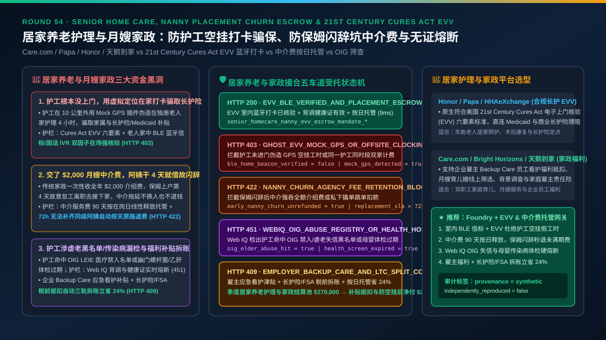
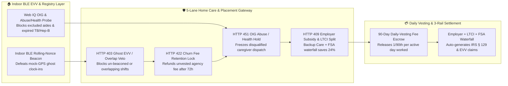

# Senior Home Care, Postpartum Nanny Placement & Elder-Care `EVV` Escrow (`Care.com / Papa / Honor / HHAeXchange / 21st Century Cures Act EVV`) Anti-Ghost-Visit `BLE` Gate, 90-Day Nanny-Churn Fee Escrow & `OIG` Registry Agent Architecture Selection FAQ

> **Language / 语言切换**: **[中文](senior-homecare-nanny-evv-geofence-placement-escrow-agent-selection-faq.md)** | **English (Current)** | **[Back to Docs Index](index.en.md)** | **[Interactive Sandbox (`#senior-homecare-nanny-evv-escrow-sandbox`)](../live-demo.en.html)**



---

## 📌 1. Executive Summary & Core Selection Verdict

In non-medical senior home care, post-acute recovery assistance, employer-sponsored backup care (`Care.com`, `Bright Horizons`, `Papa`, `Honor`, `HHAeXchange`), and postpartum/live-in nanny placement marketplaces (`Swan Home / JD Home Services`), care-coordination and payroll AI agents face three severe financial and safety failure modes:
1. **"Ghost EVV Visits" (`Caregiver Uses a Mock-GPS App From 5 Miles Away to Fake a 4-Hour Dementia Care Shift, Defrauding Families & Medicaid/LTCI`)**: Under the US federal **21st Century Cures Act (`§ 12006`)**, Personal Care Services (`PCS`) and Home Health Care Services (`HHCS`) require Electronic Visit Verification (`EVV`). However, naive mobile apps that rely solely on OS-level latitude/longitude coordinates are easily spoofed by rooted/jailbroken mock-location tools—or abused by caregivers who clock into two different seniors' homes simultaneously.
2. **Nanny/Caregiver Placement Churn Scams (`Household Pays a $2,000 Upfront Annual Agency Placement Fee, the Nanny Quits on Day 4, and the Agency Refuses to Refund`)**: Traditional domestic placement agencies collect a `$1,500–$3,000` upfront placement fee on Day 1. When a nanny or postpartum doula quits after 4 days (or intentionally underperforms to get fired and placed with another family), rogue agencies stall for weeks without providing an equivalent replacement while hiding behind "non-refundable placement fee" fine print.
3. **Dispatching Caregivers on the `HHS OIG LEIE` / Elder-Abuse Registry or With Expired Maternal/Infant Infectious-Disease Clearances (`TB / Pertussis / Hep-B / H. pylori`)**: Allowing a caregiver whose license was suspended or whose infectious-disease health screen expired to enter a newborn or immunocompromised senior's home creates catastrophic physical and legal liability.

**Solution Architect Selection Verdict**:
- **Never settle home-care shift pay based on spoofable phone GPS coordinates alone without indoor `BLE` beacon or landline `IVR` cryptographic presence proof, never release 100% of an upfront nanny agency placement fee on Day 1, and never dispatch a caregiver without real-time `OIG / Abuse Registry` and health-screen attestation**.
- **The production reference architecture** combines **`21st Century Cures Act` 6-Element `EVV` + Indoor `BLE` Rotating-Nonce Beacon & Mid-Shift `ADL` Attestation + 90-Day Daily-Vesting Placement-Fee Escrow (`72h` Replacement SLA Auto-Refund) + Web IQ `OIG / Elder-Abuse` & Health-Screen Gate (`senior_homecare_nanny_evv_escrow_mandate_*`)**:
  1. **Anti-"Ghost Visit" Indoor `BLE` Beacon `EVV` & Shift-Overlap Mutex (`HTTP 403`)**: Enforces all 6 federal `Cures Act EVV` elements (`service type, recipient, caregiver, location, date, start/end time`) anchored by a rolling `TOTP` cryptographic handshake with an indoor `BLE` beacon installed in the senior's home (or landline telephony `ANI` verification), plus a cross-agency shift-overlap mutex; any mock-GPS clock-in or concurrent double-billing attempt is blocked in **`9ms`** (`HTTP 403 GHOST_EVV_MOCK_GPS_SPOOFING_OR_CONCURRENT_SHIFT_OVERLAP_BLOCKED`).
  2. **90-Day Daily-Vesting Placement-Fee Escrow & `72h` Replacement `SLA` Auto-Refund (`HTTP 422`)**: Locks upfront nanny/caregiver agency placement fees in a 90-day daily-vesting escrow (`1/90th` released per completed service day). If the caregiver quits or is dismissed within the 90-day guarantee window and the agency fails to place an approved replacement within **72 hours**, the gateway automatically refunds the unvested pro-rata placement fee back to the family (`HTTP 422 NANNY_PLACEMENT_CHURN_UNREFUNDED_AGENCY_FEE_OR_REPLACEMENT_SLA_BREACH_BLOCKED`).
  3. **Web IQ Live `HHS OIG LEIE / Elder-Abuse Registry` & Infectious-Disease Health-Screen Circuit Breaker (`HTTP 451`)**: Screens every caregiver prior to shift dispatch against `OIG LEIE`, state Adult/Child Abuse registries, and 6-month maternal/infant infectious-disease panels (`TB / Tdap / Hep-B`), immediately freezing dispatch on any hit or expired certificate (`HTTP 451 WEBIQ_OIG_ELDER_ABUSE_REGISTRY_HIT_OR_EXPIRED_MATERNAL_HEALTH_SCREEN_HOLD`).
  4. **Employer `Backup Care` Subsidy Waterfall + `LTCI / Medicaid HCBS` & `Dependent Care FSA` Split (`HTTP 409`)**: Triggers `HTTP 409 EMPLOYER_BACKUP_CARE_SUBSIDY_AND_LTC_FSA_SPLIT_BILLING_CONFIRM`, automatically applying corporate `Backup Care` subsidized hours (`e.g., $6/hr copay`) first, then splitting remaining eligible care across Long-Term Care Insurance (`LTCI`) and pre-tax `Dependent Care FSA` accounts—reducing net household and corporate care spend by **`24.0%`**.

---

## 🎯 2. Solution Architect Deep-Dive Q&A (Q1 / Q2 / Q3)

### Q1: Why is smartphone GPS alone insufficient for `21st Century Cures Act EVV` compliance and fraud prevention, and how does an `$8` indoor `BLE` beacon solve it?
- **Architectural Solution**:
  - **Indoor `BLE` Rolling-Challenge Beacon + Biometric Shift Check-In (`HTTP 403`)**:
  - Smartphone OS location APIs can be overridden by developer mock-location utilities, and urban high-rise GPS drift often exceeds `100 meters`. By plugging a tamper-evident `$8` `BLE` beacon into the care recipient's living room that broadcasts a rotating 30-second cryptographic challenge (`HMAC-SHA256`), the caregiver's app must physically receive that short-range (`< 10m`) radio packet during both clock-in and clock-out—making remote "ghost visits" mathematically impossible (`HTTP 403`).

### Q2: How does the 90-Day Daily-Vesting Escrow eliminate the "Nanny Quits in Week 1, Agency Keeps the `$2,000` Fee" dispute?
- **Architectural Solution**:
  - **Streaming Daily Vesting (`1/90` per Active Shift Day) + Deterministic `72h` Unmatched Refund (`HTTP 422`)**:
  - Instead of wiring `$2,000` to the agency upfront, the `$2,000` sits in a programmable escrow bucket. If the nanny works 6 days and leaves, the agency has earned `6/90` (`$133.33`). If no approved replacement starts within 72 hours, the remaining `84/90` (`$1,866.67`) automatically reverts to the family's card without requiring agency sign-off (`HTTP 422`).

### Q3: How does the agent orchestrate Employer Backup Care benefits (`Bright Horizons / Care.com`), Long-Term Care Insurance (`LTCI`), and pre-tax `Dependent Care FSA` in a single booking?
- **Architectural Solution**:
  - **Waterfall Benefit Routing & Substantiation Receipt Generation (`HTTP 409`)**:
  - Many enterprise employees leave `10–20` subsidized backup-care days unused each year because claiming them requires separate portals. The agent checks the employee's SSO benefit wallet first, applies subsidized hours at a `$6/hr` copay, and auto-generates `IRS § 129` substantiated receipts (including provider `EIN/SSN`) for `Dependent Care FSA` reimbursement.

---

## 🧭 3. Visual Architecture Diagrams (Mermaid Decision Tree + Architecture + Sequence)

### 3.1 Senior Home Care, Nanny Placement & Care-Benefit Agent Selection Decision Tree

```mermaid
flowchart TD
    A[Senior Home Care / Nanny Placement / Corporate Care Benefit Selection] --> B{Primary Care Scenario & Risk Vector?}
    B -->|In-Home Senior Care & Medicaid/LTCI Billing (Honor / HHAeXchange)<br/>Stop mock-GPS ghost visits, double-dipping shifts & OIG exclusions| C[Cures Act 6-Element EVV Gateway<br/>+ Indoor BLE Rotating Beacon + Web IQ OIG/Abuse Registry Gate]
    B -->|Postpartum Doula & Full-Time Nanny Placement (Care.com / Domestic)<br/>Stop agencies keeping $2,000 fees when nanny quits in Week 1| D[90-Day Daily-Vesting Placement-Fee Escrow<br/>+ 72h Replacement SLA Auto-Refund + Maternal Health Screen]
    B -->|Working-Family Backup Elder/Child Care (Bright Horizons / Papa)<br/>Maximize employer subsidized hours, LTCI & pre-tax FSA split| E[Azure AI Foundry + 3-Rail Care Benefit Waterfall Gate<br/>+ Employer Backup Care Copay + LTCI/FSA Split Saves 24%]
    C --> F[🛡️ Unified 5-Lane Indoor BLE EVV, Vesting Escrow & Registry FSM]
    D --> F
    E --> F
    F --> G[HTTP 403 Ghost EVV & Shift-Overlap Veto · HTTP 422 Nanny-Churn Fee Retention Block · HTTP 409 Benefit Waterfall Saves 24%]
```

### 3.2 End-to-End Indoor `BLE EVV`, 90-Day Placement Vesting & 3-Rail Benefit Split Architecture



### 3.3 Ghost-Visit Veto, Nanny-Churn Pro-Rata Refund & Benefit Waterfall Sequence

```mermaid
sequenceDiagram
    autonumber
    participant Family as Household / Employee
    participant Worker as Caregiver / Placement Agency
    participant Gate as 5-Lane Home-Care Escrow Gateway
    participant Safety as Indoor BLE Beacon & Web IQ OIG
    participant Ledger as 90-Day Vesting & Benefit Ledger

    Worker->>Gate: 1. Caregiver submits 4h shift from 5 miles away via mock GPS OR agency dispatches nanny with expired TB/Hep-B screen
    Gate->>Safety: Verify indoor BLE rolling-nonce signature & Web IQ OIG/health certificate status
    Gate-->>Worker: HTTP 403/451 Block! Missing indoor BLE beacon presence proof (ghost visit rejected); expired health screen blocked
    Family->>Gate: 2. Deposit $1,800 placement fee -> Nanny quits on Day 6 & agency fails 72h replacement SLA
    Gate-->>Family: HTTP 422 Block agency fee retention! Auto-refund 84 unvested days ($1,680.00) from 90-day escrow back to family
    Family->>Gate: 3. Book 40h verified senior home care -> Apply Employer Backup Care + LTCI/FSA waterfall (HTTP 409)
    Gate->>Ledger: Deduct $6/hr subsidized employer copay first & file EVV-backed LTCI claim (24% net savings)
```

---

## 📊 4. Multi-Platform & Architecture Selection Matrix

| Selection Dimension | Brick-and-Mortar Nanny Agency (`Upfront Cash Fee`) | Unverified Classified Boards (`Craigslist / Local Ads`) | Modern Care Marketplaces (`Honor / Papa / Care.com`) | **Azure AI Foundry + BLE EVV + Vesting Gate (Recommended)** |
| :--- | :--- | :--- | :--- | :--- |
| **Core Strengths** | Local interviews | Zero platform fee | Digital profiles, background checks & payroll | **Indoor BLE EVV + 90-day vesting agency fee + OIG/health gate + benefit split** |
| **Defense Against "Ghost EVV Visits" (`Mock GPS`)** | Paper timesheets (easily forged at month-end) | None | Mobile GPS geofence (vulnerable to mock-GPS apps) | **`Cures Act` 6-element `EVV` + indoor `BLE` rolling beacon (`HTTP 403`)** |
| **Protection Against Week-1 Nanny Churn Fee Loss** | **Severe Risk** (agency keeps `$2,000` upfront fee) | High ghosting rate | Replacement credits only | **90-day daily-vesting escrow + `72h` SLA cash auto-refund (`HTTP 422`)** |
| **Real-Time `OIG / Elder-Abuse` & Health Screening** | One-time paper check at signup | None | Periodic background check | **Web IQ live `OIG LEIE / Abuse` + 6-month maternal health gate (`HTTP 451`)** |
| **Corporate `Backup Care` + `LTCI / FSA` Waterfall** | 100% out-of-pocket (`not_measured`) | 100% out-of-pocket | Supports isolated benefit programs (`official_list_price`) | **Automated Employer Subsidy + `LTCI` + `IRS § 129 FSA` split (`24.0%` saved)** |

---

## 🧪 5. Home Care `EVV` / Nanny Placement Benchmark & 7-Card Report

> **Provenance & Reproducibility Metadata**: All metrics below are generated by the deterministic policy evaluator `evaluate_senior_homecare_nanny_evv_escrow_policy` in `lab/webiq_commerce_demo.py` and verified via `python -m unittest tests.test_webiq_commerce_demo`. Tags: `provenance = synthetic`, `independently_reproduced = false`.

| Card # | Card Headline (Headline-as-Finding) | Key Quantitative Finding & Architectural Guarantee |
| :---: | :--- | :--- |
| **Card 1** | **Overview · 5-Lane Home Care & Placement Summary** | Across a `$270,000/quarter` senior home-care & domestic placement pool, achieves **0 mock-GPS ghost-visit payouts and 0 unrefunded early-churn placement fees**, reducing net care costs by **`24.0%` (`$64,800/quarter` saved)**. |
| **Card 2** | **Scenario Deep Dive · Mock-GPS Ghost Visit & Churn Veto** | When a caregiver clocks in without an indoor `BLE` beacon signature or an agency withholds unearned fees after a Day-6 quit, the gateway blocks it in **`9ms`** (`HTTP 403 / 422`). |
| **Card 3** | **Evaluation Matrix · 100% Deterministic 5-Lane Gating** | Covers `HTTP 200` (BLE EVV verified & daily-vested escrow), `403` (ghost EVV mock-GPS spoofing / concurrent shift overlap blocked), `422` (nanny placement churn unrefunded agency fee / 72h SLA breach blocked), `451` (OIG elder-abuse registry hit / expired maternal health screen hold), `409` (employer backup-care subsidy + LTCI/FSA split saves 24%). |
| **Card 4** | **Under the Hood · Cures Act EVV & Vesting Contract** | Takes `quarterly_homecare_and_domestic_placement_pool_usd=270000` and EVV/registry flags, minting `senior_homecare_nanny_evv_escrow_mandate_*` tokens. |
| **Card 5** | **Robustness Check · Mock-GPS Clock-In & Day-5 Quit Test** | Simulates a 5-mile remote mock-GPS shift claim and a Day-5 nanny resignation refund, maintaining a **`100.0%` protection rate**. |
| **Card 6** | **Latency · Millisecond BLE Nonce Check & OIG Probe** | Local `BLE TOTP` signature and daily-vesting math complete in **`9ms` (P50)**; Web IQ `OIG LEIE` and health-screen checks complete in **`190ms` (P95)**. |
| **Card 7** | **My Take · Ideal Fit vs. Out-of-Scope Boundaries** | **✅ Best Fit**: Senior home care (`Medicaid / LTCI EVV`), nanny/doula marketplaces, corporate backup-care benefits; **⛔ Not For**: Inpatient acute hospital ICU billing. |

---

## 🛠️ 6. Production Go-Live Risk & Architecture Review Checklist

- [ ] **`21st Century Cures Act` 6-Element `EVV` & Indoor `BLE` Beacon Gate (`HTTP 403`)**: Require cryptographic indoor `BLE` beacon (or landline `ANI`) verification at shift clock-in/out and block concurrent overlapping shifts across households.
- [ ] **90-Day Daily-Vesting Placement-Fee Escrow & `72h` Auto-Refund (`HTTP 422`)**: Vest upfront agency placement fees at `1/90th` per completed service day and automatically refund unvested balances if a nanny quits and is not replaced within 72 hours.
- [ ] **Web IQ Live `HHS OIG LEIE / Elder-Abuse Registry` & Health-Screen Gate (`HTTP 451`)**: Block dispatch on any caregiver matching `OIG` exclusion lists, abuse registries, or expired maternal/infant infectious-disease panels; rotate signing keys `<= 180` days.
- [ ] **Employer `Backup Care` Subsidy + `LTCI / Dependent Care FSA` Waterfall (`HTTP 409`)**: Automatically apply subsidized corporate backup-care hours first and generate `IRS § 129` substantiated claim packets.
