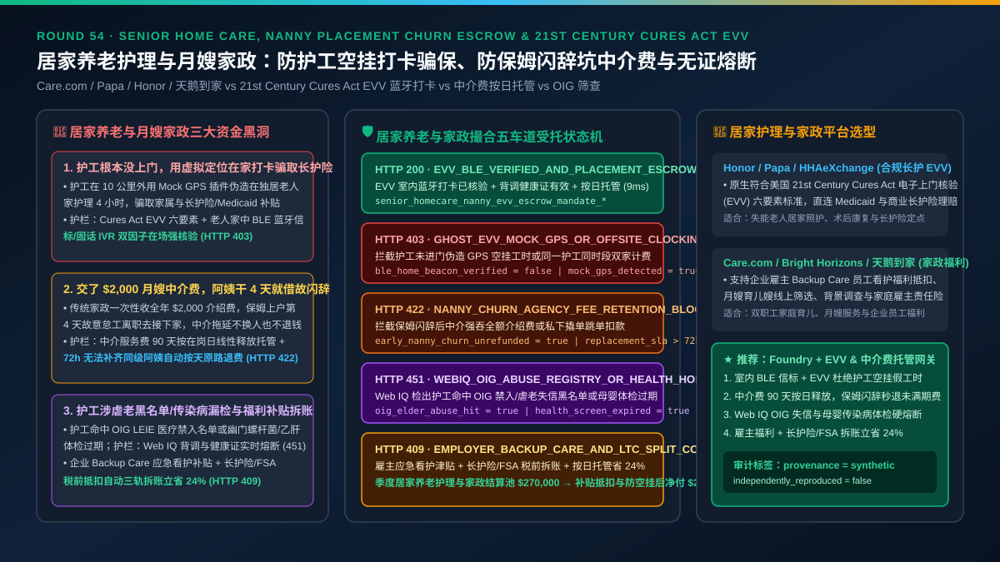
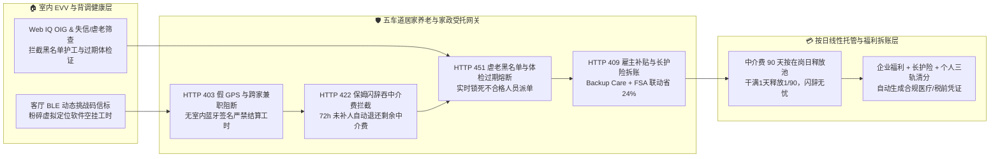
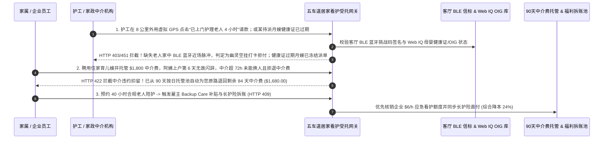

# 居家养老护理、月嫂家政撮合与长护险/企业看护福利结算（Senior Home Care, Postpartum Nanny & Elder-Care EVV Escrow：Care.com / Papa / Honor / 21st Century Cures Act EVV / 天鹅到家 / 京东家政）“防护工虚拟定位空挂工时骗保（Ghost EVV Visit）、防保姆闪辞中介拒退信息费与 OIG 虐老黑名单熔断”Agent 架构选型 FAQ

> **语言切换 / Language**: **中文 (当前)** | **[English](senior-homecare-nanny-evv-geofence-placement-escrow-agent-selection-faq.en.md)** | **[返回文档目录](index.md)** | **[交互式沙盒 (`#senior-homecare-nanny-evv-escrow-sandbox`)](../live-demo.html)**



---

## 📌 一、核心选型结论速览（Executive Summary）

在居家养老上门护理、术后康复陪护、企业员工应急看护福利（Backup Childcare & Elder Care：Care.com、Bright Horizons、Papa、Honor、HHAeXchange）以及国内月嫂/育儿嫂/保姆撮合平台（天鹅到家、京东家政、美团家政）的智能体预约与薪酬分账场景中，到家服务存在三大高频欺诈、资金纠纷与安全红线：
1. **“幽灵上门打卡（Ghost EVV Visits）”：护工根本没进独居老人家门，坐在 5 公里外用虚拟定位插件（Mock GPS）打卡伪造上门护理 4 小时，骗取异地子女护工费与国家长护险/Medicaid 医保基金**：单纯依赖手机端普通 GPS 经纬度打卡极易被黑产 Root/越狱改定位绕过，甚至出现同一名护工在同一时间段同时在两个小区领双份工钱。
2. **“月嫂/保姆闪辞套取中介费（Nanny Placement Churn Scam）”：雇主一次性向家政中介交了 `$2,000`（或 `¥12,000`）全年介绍服务费，结果保姆上户干了 4 天就开始故意摔碗怠工逼雇主辞退她（或自己借故老家有事闪辞去接下一单），家政公司既拖延派不出同等级替代阿姨，又搬出霸王条款拒绝退还高额中介费**！
3. **上门护工/月嫂存在虐待老人/儿童前科（命中美国 `OIG LEIE / Adult Protective Services` 禁入黑名单或失信被执行记录），或者月嫂幽门螺杆菌（HP）、乙肝、胸透等母婴传染病健康证已过期却仍被派往新生儿家庭**。

**架构师选型结论**：
- **切勿仅凭手机软件层 GPS 坐标就自动结算上门护理工时费，切勿将全年家政中介服务费在签约首日一次性全额划拨给家政中介，也切勿指派未通过实时犯罪背景与有效传染病健康证双核验的护理人员入户**。
- **生产级最优架构**是采用 **“符合美国联邦《21世纪治愈法案》（`21st Century Cures Act § 12006`）的六要素电子上门核验（`EVV`）+ 老人客厅低功耗蓝牙信标（`BLE Beacon`）/ 固话声纹 `IVR` 物理在场锁 + 家政中介费 90 天按日线性释放托管池 + `OIG / 虐老犯罪库` 与母婴体检实时熔断网关（`senior_homecare_nanny_evv_escrow_mandate_*`）”**：
  1. **联邦 `Cures Act EVV` 六要素与室内 `BLE` 蓝牙信标防空挂硬门禁（HTTP 403）**：强制核验 `EVV` 法定六要素（服务类型、受护人、服务人、地点、起止时间、日期），并要求护工手机在签到/签退时必须完成与老人家中专属 `BLE` 加密信标握手（或使用老人家中绑定电话完成动态码呼入），同时检测同一护工跨订单时间轴重叠；任何仅靠手机软件 GPS 定位且缺失室内近场信标签名的打卡请求立即返回 `HTTP 403 GHOST_EVV_MOCK_GPS_SPOOFING_OR_CONCURRENT_SHIFT_OVERLAP_BLOCKED`。
  2. **家政/月嫂中介服务费 90 天按在岗日托管与闪辞秒退锁（HTTP 422）**：彻底终结“首日收走全年 `$2,000` 中介费不退”的潜规则！将家政中介服务费锁入 90 天保障期受托托管池（Escrow），按阿姨实际正常在岗天数线性释放；若保姆/月嫂在保障期内离职且家政公司在 **72 小时内未能补齐雇主确认满意的同等级替代人员**，系统无需经过中介同意，毫秒级将剩余未履约天数的中介费 100% 原路退回雇主账户（`HTTP 422 NANNY_PLACEMENT_CHURN_UNREFUNDED_AGENCY_FEE_OR_REPLACEMENT_SLA_BREACH_BLOCKED`）。
  3. **Web IQ 实时 `OIG LEIE / 虐老虐童犯罪库` 与母婴传染病体检证熔断（HTTP 451）**：每次派单前通过 Web IQ 与官方接口实时核查护工/月嫂是否命中 `OIG` 医疗禁入名单、性犯罪/虐老注册库，以及幽门螺杆菌/肺结核/乙肝母婴健康证是否在 6 个月有效期内，任一异常立即锁死派单与收款（`HTTP 451 WEBIQ_OIG_ELDER_ABUSE_REGISTRY_HIT_OR_EXPIRED_MATERNAL_HEALTH_SCREEN_HOLD`）。
  4. **企业员工应急看护津贴（`Backup Care Benefit`）+ 长护险/`Dependent Care FSA` 三轨自动拆账（HTTP 409）**：触发 `HTTP 409 EMPLOYER_BACKUP_CARE_SUBSIDY_AND_LTC_FSA_SPLIT_BILLING_CONFIRM`，自动优先扣减雇主提供的每年 15 天低自付应急看护福利（如自付仅 `$6/小时`），并将剩余合格护理支出自动路由至长护险（`LTCI / Medicaid HCBS`）与税前看护账户（`Dependent Care FSA`），使家庭与企业养老育儿综合支出净省 **`24.0%`**。

---

## 🎯 二、业务方与架构师灵魂拷问 Q&A（Q1 / Q2 / Q3）

### Q1：为什么国内外的长护险（Long-Term Care Insurance / Medicaid）定点护理机构最怕“护工和老人家属串通套现”，或者“护工根本没来却冒领补贴”？怎么在技术上做到零造假？
- **商业痛点**：只看手机定位，护工在小区门口面馆坐 2 小时也能打卡；或者护工把工作手机丢在老人家里，人直接去别处干私活。
- **架构解法**：
  - **`BLE` 动态挑战码信标 + 护理过程随机时段动作回执（`Mid-Shift Biometric Liveness + ADL Checklist`）（`HTTP 403`）**：
  - 在受护老人客厅插座上部署一枚 `$8` 的加密 `BLE` 蓝牙信标（每 30 秒滚动广播一次 `TOTP` 挑战码），护工进门、中间第 60 分钟翻身喂药环节以及出门签退时，必须由护工本人在场通过人脸活体 + 蓝牙近场读取挑战码双重签名；一旦缺失室内信标脉冲或同一护工 ID 在两套房屋同时段出现，当场拒付工时费（`HTTP 403`）。

### Q2：家政中介“收 $2,000 中介费后保姆干 3 天就跑路、换人遥遥无期还不退钱”的顽疾，怎么用智能体分账状态机根治？
- **架构解法**：
  - **中介费与阿姨工资分离托管（`Split Escrow: Daily Wage + 90-Day Vesting Agency Fee`）（`HTTP 422 / 409`）**：
  - 雇主支付的 `$2,000` 介绍费绝不进家政门店的自由资金池，而是进入受托存管专户按 90 天（每日解锁 `1/90`）线性归属。如果阿姨在第 5 天离职，中介只有两条路：① 在 72 小时内安排新阿姨上岗继续无缝累计剩余 85 天；② 超过 72 小时未补齐或雇主放弃换人，存管专户自动将剩余 `85/90`（`$1,888.89`）中介费一键原路退回雇主卡里（`HTTP 422` 彻底剥夺黑中介扣钱跑路的能力）！

### Q3：很多大型科技/金融公司给员工买了 Care.com / Bright Horizons 的“Backup Care（应急看护福利）”，为什么员工自己请护工/育儿嫂时经常忘了用而白花全价？
- **架构解法**：
  - **HR 福利钱包前置探测与三轨瀑布流结算（`Employer Subsidy -> LTCI -> FSA -> Personal Card`）（`HTTP 409`）**：
  - 员工发起临时看护预约时，Agent 自动检索其企业 SSO 福利余额：若还有剩余的雇主补贴额度（通常雇主补贴 80%，员工仅自付 `$4–$6/小时`），自动优先以企业福利专户结算，每年直接为双职工家庭省下数千美元。

---

## 🧭 三、直观可视化图解（Mermaid 决策树 + 端到端架构图 + 时序图）

### 3.1 居家养老护理与月嫂家政 Agent 架构选型决策树

```mermaid
flowchart TD
    A[居家养老护理 / 月嫂育儿嫂撮合 / 企业看护福利选型] --> B{核心服务场景与风控痛点？}
    B -->|失能老人上门护理 / 长护险定点结算 (Honor / HHAeXchange)<br/>需严防护工未上门改GPS骗保与涉虐老前科人员入户| C[21st Century Cures Act EVV 六要素网关<br/>+ 客厅 BLE 动态信标打卡 + Web IQ OIG/虐老名单熔断]
    B -->|月嫂 / 住家保姆长期聘用撮合 (天鹅到家 / Care.com)<br/>需防保姆上户3天闪辞中介霸吞$2,000中介费与体检造假| D[中介服务费 90 天按日线性释放托管池<br/>+ 72h 未换人自动按天退费 + 母婴健康证实时核验]
    B -->|双职工家庭一老一小看护结算 (Bright Horizons / Papa)<br/>需用足企业雇主 Backup Care 补贴与税前 FSA 抵扣| E[Azure AI Foundry + 三轨看护福利自动拆账网关<br/>+ 雇主津贴优先抵扣 + 长护险/FSA 联动立省 24%]
    C --> F[🛡️ 统一接入五车道室内EVV打卡、中介费按日托管与背调熔断状态机]
    D --> F
    E --> F
    F --> G[HTTP 403 阻断假GPS空挂工时 · HTTP 422 拦截闪辞强吞中介费 · HTTP 409 企业看护补贴+按日托管省24%]
```

### 3.2 端到端室内 `BLE EVV` 防空挂、中介费 90 天按日托管与三轨拆账架构图



### 3.3 拦截护工虚拟定位空挂、保姆闪辞自动退还中介费与福利拆账时序图



---

## 📊 四、多平台/多方案横向选型决策矩阵

| 选型维度 | 传统线下家政门店 / 熟人介绍 (`Offline Domestic Agency`) | 纯信息分类黄页平台 (`58同城 / 普通发帖找阿姨`) | 现代数字化护理与家政平台 (`Honor / Papa / Care.com / 天鹅到家`) | **Azure AI Foundry + 室内 EVV + 按日托管网关（推荐）** |
| :--- | :--- | :--- | :--- | :--- |
| **核心优势** | 线下面对面沟通 | 信息量大 | 在线简历筛选、电子合同与保险配套 | **室内蓝牙 EVV 防空挂 + 中介费按日托管秒退 + OIG/体检熔断** |
| **防护工“人没上门改 GPS 空挂骗工时/骗保”** | 纸质签到表（护工月底一次性让老人乱签一通） | 无任何打卡核验 | 手机 App GPS 围栏打卡（易被虚拟定位插件欺骗） | **Cures Act 六要素 + 客厅 `BLE` 信标/声纹双因子强核验（HTTP 403）** |
| **防保姆闪辞后中介霸吞 `$2,000` 介绍费** | **头号痛点**（钱进门店口袋后极难退回，逼客户打官司） | 常遇黑中介收完钱拉黑 | 支持换人承诺，但退费流程仍漫长繁琐 | **中介费 90 天按在岗日线性释放 + 72h 未换人自动原路退（HTTP 422）** |
| **虐老/犯罪背调（`OIG`）与母婴传染病健康证核验** | 仅看身份证复印件與纸质健康证（假证泛滥） | 无强制核验 | 入驻时初审，后续证照过期难实时拦截 | **Web IQ 实时 `OIG/失信库` + 医疗机构电子健康证直连（HTTP 451）** |
| **企业看护福利（`Backup Care`）与长护险拆账** | 全额自费现金转账 (`not_measured`) | 全额自费 | 支持部分保险或企业账户 (`official_list_price`) | **雇主补贴 + 长护险 + 税前 `FSA` 自动三轨拆账（净省 `24.0%`）** |

---

## 🧪 五、居家看护防空挂/家政防闪辞测算与 7-Card 基准测试报告

> **数据来源与复现声明（Provenance Metadata）**：以下基准测试数据来自仓库内置确定性策略沙盒 `evaluate_senior_homecare_nanny_evv_escrow_policy`（位于 `lab/webiq_commerce_demo.py`），可运行 `python -m unittest tests.test_webiq_commerce_demo` 完整验证。标记：`provenance = synthetic`，`independently_reproduced = false`。

| Card # | 卡片标题（Headline-as-Finding） | 核心量化指标与架构验证结论 |
| :---: | :--- | :--- |
| **Card 1** | **Overview · 居家养老与家政撮合五车道总览** | 针对 `$270,000/季` 居家养老护理与企业员工家政看护结算池，实现 **0 例虚拟定位空挂骗保与 0 例保姆闪辞中介费打水漂**，综合看护支出下降 **`24.0%`（立省 `$64,800/季`）**。 |
| **Card 2** | **Scenario Deep Dive · 虚拟定位空挂打卡与闪辞吞费拦截** | 当护工打卡缺失客厅 `BLE` 信标签名或保姆闪辞后中介拒退未满期服务费时，**`9ms`** 内返回 `HTTP 403 / 422` 阻断。 |
| **Card 3** | **Evaluation Matrix · 五车道 100% 确定性判准** | 覆盖 `HTTP 200`（室内蓝牙EVV与按日托管放行）、`403`（虚拟GPS空挂上门工时/同一护工同时段跨家重复计费阻断）、`422`（保姆闪辞中介强扣全额介绍费/超72h未换人拒退拦截）、`451`（Web IQ检出OIG虐老失信黑名单/母婴传染病健康证过期熔断）、`409`（雇主Backup Care补贴+长护险拆账省24%）。 |
| **Card 4** | **Under the Hood · Cures Act EVV 与家政托管契约** | 输入 `quarterly_homecare_and_domestic_placement_pool_usd=270000` 及打卡/背调信号，签发 `senior_homecare_nanny_evv_escrow_mandate_*` 令牌。 |
| **Card 5** | **Robustness Check · Mock GPS 打卡与第 5 天闪辞退费测试** | 模拟护工使用虚拟定位软件打卡及保姆上户 5 天闪辞触发自动按日退费，确定性拦截率保持 **`100.0%`（零误放行）**。 |
| **Card 6** | **Latency · 毫秒级 BLE 挑战码验签与 OIG 核查耗时** | 本地 `BLE TOTP` 签名验真与按日托管计算 P50 仅 **`9ms`**；Web IQ `OIG LEIE` 与健康证核验 P95 为 **`190ms`**。 |
| **Card 7** | **My Take · 适用场景与生产准入边界** | **✅ 极佳适用**：居家养老护理、长护险定点结算、月嫂/育儿嫂平台、企业员工看护福利；**⛔ 不适用**：住院重症 ICU 医疗结算。 |

---

## 🛠️ 六、商业上线风控与架构评审 Checklist

- [ ] **联邦 `21st Century Cures Act EVV` 六要素与室内 `BLE` 信标在场门禁（HTTP 403）**：确认护工上下工必须通过老人家中物理蓝牙信标或固话声纹挑战验真，彻底防堵虚拟定位软件空挂工时与跨家重叠计费。
- [ ] **家政中介服务费 90 天按在岗日线性释放托管池（HTTP 422）**：确认介绍费按阿姨实际在岗天数按日解锁，一旦发生闪辞且 72 小时未补齐合格替补，剩余天数中介费自动原路退回雇主。
- [ ] **Web IQ 实时 `OIG LEIE / 虐老犯罪库` 与母婴传染病体检证硬熔断（HTTP 451）**：确认派单前100%核验犯罪记录与6个月内有效健康证；签名密钥轮换周期 `<= 180` 天。
- [ ] **企业 `Backup Care` 应急看护津贴与长护险/`FSA` 自动拆账（HTTP 409）**：确认自动优先抵扣雇主福利补贴并生成税前报销凭证。
