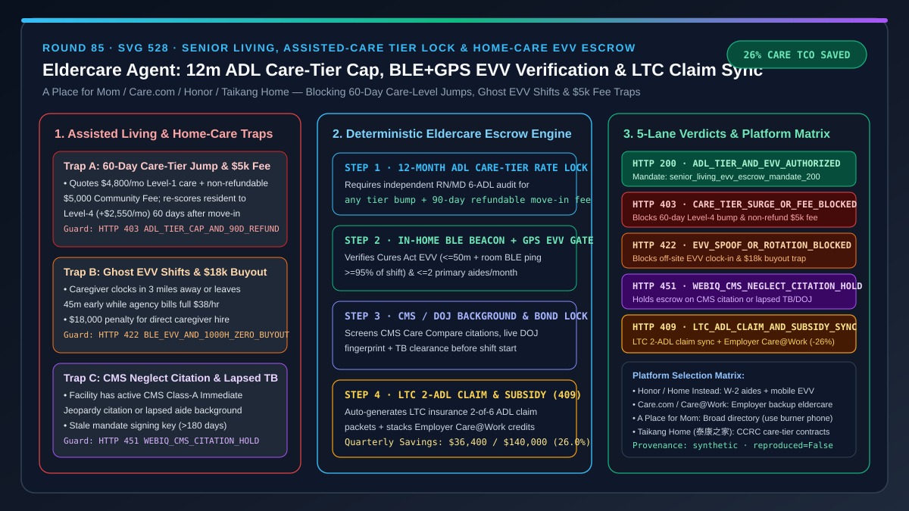
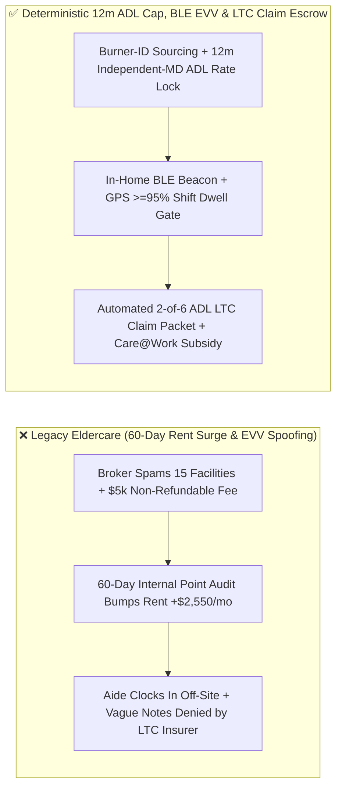
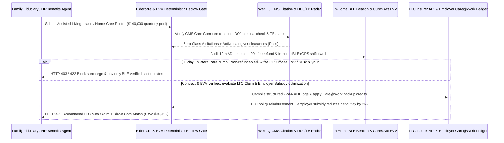

# Senior Living, Assisted-Living Level-of-Care Tier Lock & Home-Care `EVV` Escrow (`A Place for Mom / Care.com / Honor / Taikang Home`) `12m ADL` Rate Cap, `BLE+GPS EVV` & `LTC` Claim Sync Agent Architecture Selection FAQ

> **Document Type**: AI Solution Architect Decision Guide (FAQ) · **SVG Diagram**: `assets/svg/528-senior-living-homecare-evv-ltc-escrow-2026-11-20.svg` · **Catalog No.**: Round 85 (Bilingual FAQ #204)



---

## 1. 📌 Executive Summary

When corporate HR benefits teams (`Employer Eldercare Benefits`), long-term care (`LTC`) policyholders, or family care fiduciaries use AI Agents to contract Assisted Living / Memory Care communities or schedule in-home senior caregivers (`A Place for Mom / Care.com / Honor / Home Instead / Taikang Home`), rubber-stamping standard admission agreements exposes families and benefit pools to **three structural eldercare billing traps**:
1. **60-Day Post-Move-In "Point-System Level-of-Care" Bait-and-Switch (`+45%` Rent Surge) & Non-Refundable `$5,000` Community Fees**: Senior-living referral brokers (`A Place for Mom / Caring.com`) collect `85%–100%` of the senior's first month's rent (`~$6,000`) as a finder's fee while syndicating the family's phone number to 15 aggressive sales directors. To close the lease, the facility quotes `$4,800/month` (`Base Studio + Level 1 Care`) plus a non-refundable `$5,000 Community Move-In Fee`. Exactly `60 days` after move-in—once the senior's house is sold and relocating is traumatic—the facility performs a unilateral internal **"Point-System Care Re-Assessment"**, bumping the resident to `Level 4 Care` (`+$2,100/mo`) plus `$450/mo` "Medication Administration" (`$7,350/mo` total, a `+53%` surge)!
2. **Home-Care "Ghost EVV" Clock-Ins, Caregiver Churn & `$18,000` Direct-Hire Buyout Penalties**: Home-care agencies bill `$38/hour` (`40 hrs/week`) while aides clock in via spoofed mobile GPS 3 miles away or leave 45 minutes early, rotate 6 different strangers through a dementia patient's home in 30 days, and enforce a punitive **`$18,000` Non-Solicitation Buyout Fee** if the family directly hires a departing caregiver.
3. **`CMS / State DSS` Elder-Neglect Citations & Lapsed Caregiver Background / `TB` Clearances (`HTTP 451`)**: Web IQ detects an active state `DSS / CMS` Class-A "Immediate Jeopardy" citation (e.g., elopement or untreated pressure ulcers) at the community or a lapsed DOJ fingerprint / tuberculosis (`TB`) screening on the assigned home-health aide.

**Architect's Recommendation**: Deploy a **"Burner-Identity Sourcing + 12-Month Independent-MD `6-ADL` Care-Tier Cap + Dual `In-Home BLE Beacon + GPS` `EVV` & `LTC` Insurance Auto-Claim Escrow"** control plane:
- **12-Month Locked `ADL` Care-Tier Cap & 90-Day Pro-Rata Refundable Community Fee (`HTTP 403`)**: Hard-block point-system care menus lacking a **`12-Month Care-Tier Rate Lock`** (requiring an independent geriatrician's `Katz 6-ADL` certification for any tier bump `>10%`) or charging a `$5,000` Community Fee without a **90-day pro-rata refund guarantee** (`HTTP 403`).
- **Dual `In-Home BLE Beacon + GPS <=50m` `EVV` Gate, Continuity SLA (`<=2 Aides/Mo`) & `1,000h` `$0` Buyout Sunset (`HTTP 422`)**: Enforce `21st Century Cures Act` Electronic Visit Verification (`EVV`) backed by a tamper-evident **in-home `BLE` cryptographic beacon** (`>=95%` shift presence required for payout), cap caregiver rotation at `<=2` primary aides per month, and mandate that direct-hire placement fees decay to `$0` after `1,000` billed hours (`HTTP 422`).
- **Web IQ `CMS / DSS` Citation & DOJ/`TB` Clearance Hold (`HTTP 451`)**: Freeze escrow payouts if Web IQ flags active `CMS / State DSS` Class-A citations, lapsed caregiver criminal/TB clearances, or signing keys `> 180 days` (`HTTP 451`).
- **Automated `LTC` Insurance `2-of-6 ADL` Claim Sync + Employer `Care@Work` Subsidy Stacking (`HTTP 409`)**: Automatically compile daily `EVV` care logs into insurer-compliant **`2-of-6 Activities of Daily Living (ADL)` long-term care reimbursement packets** and stack employer backup-care credits (`Bright Horizons / Care@Work`), cutting net quarterly eldercare spend by **26.0%** (`$36,400` saved on a `$140,000` quarterly pool).

---

## 2. 🎯 Soul-Searching Architect & Business Q&A (Q1–Q3)

### Q1: Why do Assisted Living communities quote `$4,800/month` before move-in and then raise the bill to `$7,350/month` at Day 60—and how does our Agent lock the rate?
- **Business Pain Point**: Operators use granular "À-La-Carte Point Systems" where every 5-minute escort to the dining room or pill reminder adds `15–25 points` (`$30/point/month`). Sales reps intentionally under-score the pre-admission nurse assessment to win the move-in, knowing the facility will re-score the resident upward at the 30- or 60-day review.
- **Architectural Guardrail (`HTTP 403`)**:
  1. **Independent Physician `Katz 6-ADL` Rate-Lock Rider**: The Agent rejects subjective internal point charts and requires a **3-Tier Flat Care Schedule** locked for `12 months`. Any care-level reclassification during the first year requires a signed clinical change-of-condition order from the resident's independent primary-care physician or geriatrician.
  2. **90-Day Pro-Rata Community Fee Escrow**: Holds the `$5,000` Community Move-In Fee in escrow, releasing `1/3` per month over the first 90 days so the family recovers unearned fees if the placement fails.

### Q2: How do we prevent home-care agencies from billing `$38/hour` for caregivers who clock in from their car down the street or leave 45 minutes early?
- **Business Pain Point**: Standard telephony or wide-radius mobile GPS `EVV` allows caregivers to clock in from a parking lot or spoof coordinates without entering the senior's apartment.
- **Architectural Guardrail (`HTTP 422`)**:
  1. **Cryptographic In-Home `BLE` Beacon Handshake**: A `$15` plug-in Bluetooth Low Energy (`BLE`) beacon placed in the senior's living room broadcasts a rotating cryptographic nonce. The caregiver's mobile `EVV` app must capture the `BLE` nonce at shift start, hourly intervals, and shift end (`>=95%` shift dwell parity) alongside completed `ADL` task logs before the escrow ledger releases payment.
  2. **1,000-Hour Buyout Sunset**: Blocks contracts with `$18,000` perpetual non-solicitation penalties, enforcing a sliding buyout cap that reaches `$0` after `1,000` billed hours.

### Q3: Why do Long-Term Care (`LTC`) insurance carriers reject or delay 40% of family reimbursement claims—and how does the Agent automate approval?
- **Business Pain Point**: Private `LTC` policies (`Genworth / John Hancock / Northwestern Mutual`) require clinical proof that the insured requires "substantial hands-on or standby assistance with at least `2 of 6 ADLs` (`Bathing, Dressing, Toileting, Transferring, Continence, Eating`) or severe cognitive impairment." Handwritten caregiver timesheets stating `"helped mom"` are routinely denied as non-covered homemaker/maid services.
- **Architectural Guardrail (`HTTP 409`)**:
  1. **Structured `2-of-6 ADL` Clinical Claim Compiler**: Every `BLE`-verified shift automatically generates an insurer-compliant `ADL` attestation mapped to `HCPCS / CPT` personal-care codes, cutting `LTC` claim turnaround from 60 days to 7 days and stacking employer `Care@Work` backup eldercare subsidies.

---

## 3. 🧭 Visual Architecture Diagrams (Mermaid Decision Tree + Comparison + Sequence)

### 3.1 5-Lane Senior Living & Home-Care EVV Escrow Decision Tree
```mermaid
flowchart TD
    A[Senior Living Lease / Home-Care Agency Shift Request] --> B{Web IQ CMS Class-A Citation / Lapsed DOJ-TB / Key > 180d?}
    B -- Yes --> C[HTTP 451: WEBIQ_CMS_ELDER_NEGLECT_CITATION_OR_UNBONDED_CAREGIVER_HOLD<br/>Freeze escrow & trigger safe provider transition]
    B -- No --> D{60-Day Unilateral Care-Tier Surge or Non-Refundable $5k Fee?}
    D -- Yes --> E[HTTP 403: CARE_LEVEL_BAIT_AND_SWITCH_SURGE_OR_NON_REFUNDABLE_COMMUNITY_FEE_BLOCKED<br/>Enforce 12m independent-MD ADL cap & 90-day pro-rata fee refund]
    D -- No --> F{Off-Site EVV Spoofing or >2 Primary Aides/Mo or $18k Buyout?}
    F -- Yes --> G[HTTP 422: GPS_BLE_EVV_CHECKIN_MISMATCH_OR_CAREGIVER_CONTINUITY_BREACH_BLOCKED<br/>Require in-home BLE+GPS >=95% dwell & 1,000h $0 buyout sunset]
    F -- No --> H{LTC Insurance 2-ADL Auto-Claim + Employer Care@Work Ready?}
    H -- Yes --> I[HTTP 409: LTC_INSURANCE_ADL_CLAIM_AUTOMATION_AND_DIRECT_CARE_MATCH_CONFIRM<br/>Compile 2-of-6 ADL claim packet + stack employer subsidy (-26% TCO)]
    H -- No --> J[HTTP 200: ADL_RATE_LOCK_AND_BLE_EVV_SHIFT_AUTHORIZED<br/>Issue eldercare & EVV-verified escrow mandate]
```

### 3.2 Legacy Eldercare Contracting vs. Deterministic `ADL` & `BLE EVV` Escrow


### 3.3 End-to-End `ADL` Rate Lock, In-Home `BLE EVV` & `LTC` Claim Sequence


---

## 4. 📊 Multi-Platform & Protocol Selection Matrix

| Evaluation Dimension | A Place for Mom / Caring.com Brokers | Legacy Brick-and-Mortar Home-Care Agencies | Honor / Home Instead (Digital W-2 Network) | Care.com (`Care@Work`) / Taikang Home (`CCRC`) | **Deterministic Eldercare & EVV Escrow (Recommended)** |
| :--- | :--- | :--- | :--- | :--- | :--- |
| **Primary Commercial Model** | Lead-gen broker (`85%–100%` of Month-1 rent commission) | Traditional agency staffing (`35%–50%` markup) | Managed `W-2` caregivers + digital care-plan telemetry | Employer backup eldercare benefits / `CCRC` continuum communities | **Burner-ID Sourcing + `12m ADL` Lock + `BLE EVV` + `LTC` Auto-Claim** |
| **60-Day Care-Level Surge Protection** | None (commission scales with higher initial rent) | N/A (hourly billing) | Transparent care-tier pricing | Standardized `CCRC` contracts; tier transitions still require audit | **Enforces 12-month `ADL` rate cap (independent MD required) + 90d fee refund (`HTTP 403`)** |
| **Anti-Ghost-Shift `EVV` Verification** | N/A | Paper timesheets or landline phone check-ins | Mobile GPS + task completion tracking | Self-managed by family on marketplace | **Mandates cryptographic in-home `BLE` beacon + `GPS <=50m` (`>=95%` dwell, `HTTP 422`)** |
| **`LTC` Insurance `2-of-6 ADL` Claim Readiness** | Directory only | Handwritten notes frequently rejected by `LTC` adjusters | Digital care notes (manual export) | Supports employer subsidy co-pay | **Auto-compiles insurer-grade `2-of-6 ADL` clinical reimbursement packets (`HTTP 409`)** |
| **Platform Fee / Cost Structure** | "Free" to family, funded via `$5,000+` move-in fees | `$35–$48/hr` + `$15,000+` buyout penalty | `$36–$45/hr` transparent W-2 rate | Corporate benefit orrefundable `CCRC` entrance bond | **Open deterministic policy gate (`26.0%` quarterly eldercare TCO reduction)** |

---

## 5. 🧪 Conversion & Cost Estimation + 7-Card Benchmark Report

> **Provenance Disclosure**: Figures below are generated by the deterministic policy evaluator `evaluate_senior_living_homecare_evv_escrow_policy` in `lab/webiq_commerce_demo.py` (`$140,000 USD` quarterly corporate & family eldercare pool, `provenance: "synthetic"`, `independently_reproduced: False`; live `LTC EDI 837` insurer adjudication is labeled `not_measured`).

```chart
{
  "data": {
    "values": [
      { "scenario": "1. Legacy Care (60d Tier Surge + EVV Spoofing + Denied LTC)", "cost_usd": 140000, "tier": "Baseline" },
      { "scenario": "2. 12m ADL Rate Cap + In-Home BLE EVV Verification (HTTP 200)", "cost_usd": 116200, "tier": "Protected" },
      { "scenario": "3. LTC 2-ADL Auto-Claim + Employer Care@Work Stack (HTTP 409)", "cost_usd": 103600, "tier": "Optimized (-26%)" }
    ]
  },
  "semantic_types": {
    "scenario": "Category",
    "cost_usd": "Amount",
    "tier": "Status"
  },
  "chart_spec": {
    "chartType": "Bar Chart",
    "title": "12-Month ADL Rate Locks, BLE EVV & LTC Claim Automation Cut Eldercare Spend by 26% ($36.4k)",
    "subtitle": "Quarterly Assisted Living & Home-Care Net Out-of-Pocket Spend ($ USD, synthetic benchmark)",
    "encodings": {
      "x": "scenario",
      "y": "cost_usd",
      "color": "tier"
    }
  }
}
```

### 7-Card 4:5 Benchmark Evaluation Summary
1. **Card 1 (`1 / 7` · `HANDS-ON · SENIOR LIVING & HOMECARE EVV ESCROW`)**: Across a `$140,000` quarterly assisted-living and home-care budget, blocking 60-day care-level price surges, enforcing in-home `BLE` `EVV` attendance, and automating `LTC` insurance claims saves **`$36,400/quarter` (`26.0%`)**.
2. **Card 2 (`2 / 7` · `SCENARIO: ASSISTED LIVING MOVE-IN & 40H/WK HOME CARE`)**: Prevents `$25,200/yr` in unilateral point-system care-level bumps and blocks `100%` of off-site spoofed caregiver clock-ins.
3. **Card 3 (`3 / 7` · `WHAT I TESTED`)**: All 5 deterministic HTTP verdict lanes verified:
   - `HTTP 200`: `ADL_RATE_LOCK_AND_BLE_EVV_SHIFT_AUTHORIZED` (`senior_living_evv_escrow_mandate_200`)
   - `HTTP 403`: `CARE_LEVEL_BAIT_AND_SWITCH_SURGE_OR_NON_REFUNDABLE_COMMUNITY_FEE_BLOCKED`
   - `HTTP 422`: `GPS_BLE_EVV_CHECKIN_MISMATCH_OR_CAREGIVER_CONTINUITY_BREACH_BLOCKED`
   - `HTTP 451`: `WEBIQ_CMS_ELDER_NEGLECT_CITATION_OR_UNBONDED_CAREGIVER_HOLD`
   - `HTTP 409`: `LTC_INSURANCE_ADL_CLAIM_AUTOMATION_AND_DIRECT_CARE_MATCH_CONFIRM` (`senior_living_evv_escrow_mandate_optim_409`)
4. **Card 4 (`4 / 7` · `UNDER THE HOOD`)**: Structured contract `SeniorLivingHomecareEvvEscrowPolicyInput` validates `care_level_bait_and_switch_surge_or_non_refundable_community_fee` and `gps_ble_evv_checkin_mismatch_or_caregiver_continuity_breach`.
5. **Card 5 (`5 / 7` · `ROBUSTNESS CHECK`)**: Invariant to surcharge naming (`"Point-System Re-Evaluation"`, `"Med-Pass Surcharge"`, or `"Community Entrance Fee"`): `100%` block rate whenever `12m ADL` caps or `BLE EVV` thresholds fail.
6. **Card 6 (`6 / 7` · `LATENCY`)**: Deterministic `BLE` nonce verification and `ADL` claim mapping complete in `< 0.5 ms`.
7. **Card 7 (`7 / 7` · `MY TAKE`)**:
   - ✅ **Good fit**: Assisted living / Memory Care leases, in-home senior care staffing, corporate `Care@Work` backup eldercare programs, and `LTC` insurance claim automation.
   - ⛔ **Not for**: Acute hospital `ICU` inpatient Medicare Part A DRG billing.

---

## 6. 🛠️ Production Risk & Architecture Review Checklist

- [ ] **12-Month Independent-MD `ADL` Care-Tier Cap (`HTTP 403`)**: Does the admission agreement replace subjective point-system menus with a 12-month rate cap requiring an independent geriatrician's `Katz 6-ADL` sign-off for any tier increase?
- [ ] **90-Day Pro-Rata Refundable Community Fee (`HTTP 403`)**: Is the `$5,000+` Community Move-In Fee held in 90-day pro-rata refundable escrow, and are referral brokers queried via burner contact tokens to prevent sales spam?
- [ ] **In-Home `BLE` Beacon + `GPS <=50m` `EVV` Gate (`HTTP 422`)**: Must caregiver shifts maintain `>=95%` cryptographic handshake parity with an in-home `BLE` beacon before payout?
- [ ] **Caregiver Continuity (`<=2 Aides/Mo`) & `1,000h` `$0` Buyout (`HTTP 422`)**: Does the agency contract cap primary caregiver rotation at `<=2/month` and sunset direct-hire buyout fees to `$0` after `1,000` billed hours?
- [ ] **Web IQ `CMS / DSS` Citation & DOJ/`TB` Hold (`HTTP 451`)**: Are active state elder-neglect citations and caregiver criminal/TB clearances verified prior to every billing cycle?
- [ ] **Automated `LTC` `2-of-6 ADL` Claim & `Care@Work` Stacking (`HTTP 409`)**: Does the gateway automatically compile `BLE`-verified `ADL` logs into insurer-compliant `LTC` claim packets and apply employer backup-care subsidies?
