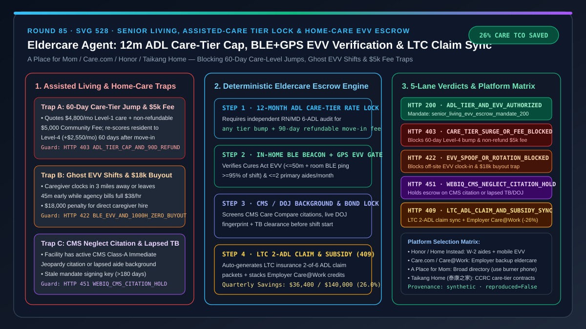
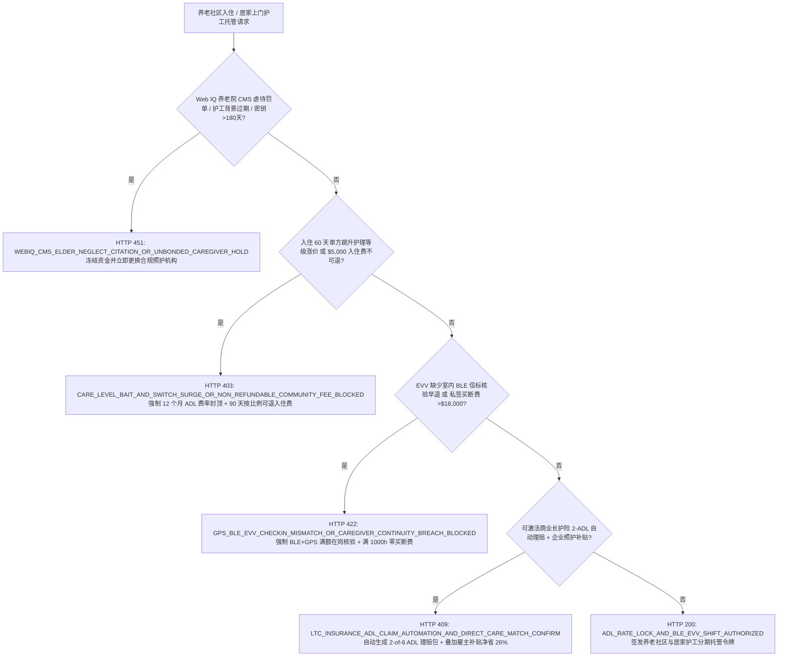
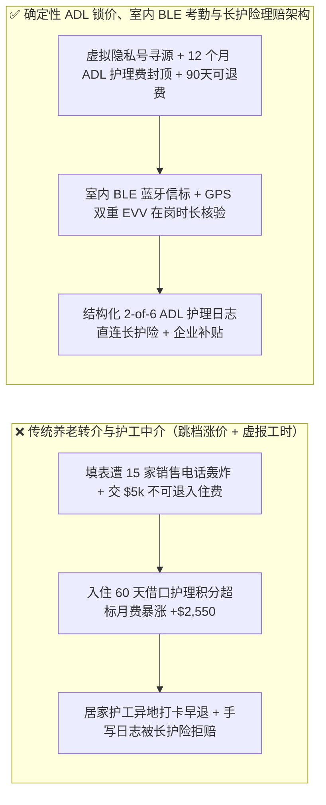
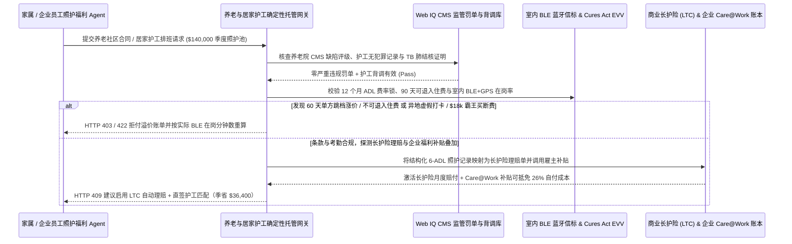

# 养老社区（CCRC / 协助生活）、护理等级跳档防坑与居家护工电子签到（EVV）托管（Senior Living, Assisted-Care Tier Lock & Home-Care EVV Escrow：A Place for Mom / Care.com / Honor / 泰康之家）“防入住 60 天后护理积分跳档暴涨 45%、防居家护工异地代打卡吃空饷与 $18,000 私签违约金”Agent 架构选型 FAQ

> **文档类型**：AI Solution Architect 决策指南（FAQ） · **对应 SVG**：`assets/svg/528-senior-living-homecare-evv-ltc-escrow-2026-11-20.svg` · **精选编号**：Round 85（第 204 篇双语 FAQ）



---

## 一、 📌 核心选型结论速览（Executive Summary）

企业员工家庭养老福利（`Employer Eldercare Benefits`）、长护险理赔平台与家庭照护代理人在通过 AI Agent 选择高端养老社区（`Assisted Living / Memory Care / CCRC`）或采购居家上门护工服务（`In-Home Senior Care`）时，若直接签署标准入住合同或按周结算护工工时单，往往会掉入**三大养老照护财务与安全陷阱**：
1. **“低门槛基础房费”诱骗入住、`60 天后护理积分（Point-System Care Level）跳档暴涨 45%` 与不可退入住费（Community Fee）**：协助生活社区销售以 `$4,800/月`（含房租+一级基础护理）吸引家属签约，并收取一笔不可退的 **`$5,000–$8,000 入住社区费（Community Move-In Fee）`**（实则用于支付给 `A Place for Mom` 等转介中介高达首月房费 `85%–100%` 的返佣，且家属手机号一旦填入中介表单会遭 15 家机构连环轰炸）。然而老人搬入仅 `60 天`（此时再搬家对高龄老人身心伤害极大），养老院内部护士单方面发起“日常活动能力（`ADL`）重评”，将老人从 `Level 1` 强行升至 `Level 4`（月费瞬间加收 `+$2,100`），再叠加 `$450/月` 分药管理费与 `$300/月` 夜间巡房费，实际月账单飙升至 `$7,650/月`（暴涨 `59%`）！
2. **居家护工异地虚拟打卡（`EVV` 造假早退）、高频换人与 `$18,000` 私签买断天价违约金**：居家照护中介按 `$38/小时`（每周 40 小时）收费，但部分护工在距离老人住址 2 公里外用手机虚拟定位签到或提前 45 分钟早退；更让失智症老人家属崩溃的是，中介一个月内走马灯式更换 6 名陌生护工；若家属想留用某位已离职的熟手护工，合同背面的反挖角条款竟索要 **`$18,000` 固定买断违约金（Liquidated Damages Placement Fee）**。
3. **养老机构监管重大违规（`CMS / 民政局黄牌`）或护工无犯罪记录/肺结核（`TB`）体检过期（`HTTP 451`）**：Web IQ 检索发现目标养老院近 12 个月内被监管部门开出虐待/压疮感染 G 级以上严重缺陷罚单（`Immediate Jeopardy Citation`），或上门护工的健康证与背景调查已过期。

**架构师选型结论**：必须构建 **“隐私虚拟号直连寻源 + 独立第三方老年科医生 `6-ADL` 护理等级锁价 + 室内蓝牙信标（`BLE + GPS`）双重电子签到（`EVV`）与长护险（`LTC`）自动理赔托管网关”** 架构：
- **强制 12 个月护理等级费率封顶（`ADL Care-Tier Rate Lock`）与 90 天按比例可退入住费（`HTTP 403`）**：合同必须规定首年护理费涨幅不得超过 `10%`（任何跨等级调价必须由外部独立老年科主治医师按标准 `Katz 6-ADL` 量表复核签字），且 `$5,000` 入住社区费在 `90 天` 试住期内支持按日折算无条件退还（否则触发 `HTTP 403` 阻断）。
- **强制室内蓝牙信标（`In-Home BLE Beacon + GPS <=50m`）双重 `EVV` 签到、主护工固定率（`<=2人/月`）与买断费递减锁（`HTTP 422`）**：严格执行美国《21世纪治愈法案（21st Century Cures Act）》电子访问核验（`EVV`）增强标准——护工手机必须与老人客厅插座上的加密蓝牙信标（`BLE Beacon`）持续握手 `>=95%` 计费时长方可结算工时；同时规定服务满 `1,000 小时` 后直接聘用买断费归零（`HTTP 422` 拦截早退虚报与霸王买断条款）。
- **Web IQ 养老院监管罚单与护工背景体检实时熔断（`HTTP 451`）**：对触发 `CMS Care Compare` 严重护理缺陷、护工无犯罪记录/肺结核（`TB`）筛查过期或签名密钥超 `180 天` 的机构执行 `HTTP 451` 冻结。
- **商业长护险（`LTC Insurance`）`2-of-6 ADL` 理赔自动生成 + 企业员工备用照护补贴（`Care@Work`）抵扣（`HTTP 409`）**：将 `EVV` 每日照护日志自动组装为符合保险公司标准的 `2项以上日常活动能力丧失（2-of-6 ADLs）` 理赔单据，并叠加雇主福利补贴与直签护工名录匹配，使季度 `$140,000` 养老与居家照护总支出净省 **`26.0%`（`$36,400`）**。

---

## 二、 🎯 业务方与架构师灵魂拷问 Q&A（Q1–Q3）

### Q1：为什么老人在入住养老院前体检完全属于“一级轻度照护”，刚住满两个月就被通知“护理积分超标”每个月要多交 $2,500？
- **商业痛点**：许多协助生活社区（Assisted Living）采用不透明的“打分制护理计价（Point-Based Care Pricing）”：推轮椅去餐厅计 `15 分`（`$450/月`）、提醒吃药计 `20 分`（`$600/月`）、协助穿衣计 `25 分`（`$750/月`）。销售阶段故意低估分数以签单，老人一旦退掉原有住房搬入后，护理部便将每一项细微协助全部计入高分档。
- **架构护栏（`HTTP 403`）**：
  1. **废除细碎计分制，强制采用三档全包制（`All-Inclusive Tier Cap`）与 12 个月费率锁**：Agent 在审阅入住协议时，自动拦截按分钟/按小项累加的积分表，强制要求签署 **`12-Month Rate Lock Addendum`**：除非老人发生住院级重大病情变化（如骨折、脑卒中）且经家属指定的独立老年科医师（Independent Geriatrician）签字确认 `Katz ADL` 评分下降 `>=2 项`，否则养老院不得单方面上调护理等级费率。
  2. **`90 天` 试住期入住费按比例退还（`90-Day Pro-Rata Community Fee Refund`）**：防止老人入住初期不适应或遭遇变相涨价时被 `$5,000` 不可退门槛费绑架。

### Q2：居家上门护工每小时 $38，怎么防止护工在小区门口打卡后迟到早退，或者三天两头换生面孔让认知症老人抗拒？
- **商业痛点**：仅靠手机 GPS 定位容易受高楼漂移影响或被虚拟定位软件伪造；且传统中介为最大化排班利润，常把临时兼职护工塞给重症家庭。
- **架构护栏（`HTTP 422`）**：
  1. **客厅 `BLE` 物理蓝牙信标 + 双向任务清单闭环**：在老人家中放置一枚 `$15` 的低功耗加密蓝牙信标（`Rotating-Nonce BLE Beacon`）。护工端 App 必须在班次起止及每小时自动扫描到该物理信标广播，并完成结构化 `ADL` 照护打卡（血压、进食量、防跌倒巡查）方可解锁当日托管工资。
  2. **护工连续性 `SLA`（`Caregiver Continuity Gate`）**：月度主班护工轮换若超过 `2 人`（非护工生病离职原因），系统自动扣减中介 `15%` 管理服务费。

### Q3：家里买了商业长期护理保险（`Long-Term Care Insurance`），为什么理赔总是因为“护理记录不规范”被保险公司拒赔或拖延数月？
- **商业痛点**：长护险（`LTC`）激活赔付的核心法定条件是：被保险人无法独立完成 **6 项基本日常生活活动（`Bathing 洗澡, Dressing 穿衣, Toileting 如厕, Transferring 移位, Continence 大小便控制, Eating 进食`）中的至少 2 项**，或患有重度认知障碍（需持续看护）。传统手写纸质护工日志字迹潦草、缺少具体协助动作描述，极易被保险公司核赔员以“仅属家政保洁而非医疗照护”拒赔。
- **架构护栏（`HTTP 409`）**：
  1. **结构化 `2-of-6 ADL` 理赔证据链自动生成**：Agent 将每次 `EVV` 签到与具体 `ADL` 实操记录（如“协助从床铺安全移位至轮椅、防跌倒搀扶沐浴 35 分钟”）自动映射为保险公司标准理赔代码（`CPT / HCPCS`），直连保司理赔 API 实现 `T+7d` 快速报销回款。

---

## 三、 🧭 直观可视化图解（Mermaid 决策树 + 架构对比 + 时序图）

### 3.1 养老社区与居家护工 EVV 托管 5 车道选型决策树


### 3.2 传统中介转介与手写考勤 vs 确定性 `ADL` 锁价与 `BLE EVV` 托管架构对比


### 3.3 端到端养老社区 `ADL` 核验、室内 `BLE EVV` 签到与长护险理赔时序图


---

## 四、 📊 多平台/多协议横向选型决策矩阵

| 评估维度 | A Place for Mom / Caring.com 转介平台 | 传统线下家政/护工中介机构 | Honor / Home Instead (数字化 W-2 护工网络) | Care.com / 泰康之家 (CCRC 医养社区) | **本仓库确定性养老与 EVV 托管架构（推荐）** |
| :--- | :--- | :--- | :--- | :--- | :--- |
| **核心业务模式** | 养老院线索分发（收取首月房费 `85%–100%` 佣金） | 传统门店派单（抽佣 `35%–50%`） | 全职 `W-2` 认证护工 + 移动端护理计划 App | 企业员工照护福利（`Care@Work`）/ 持续照料退休社区（`CCRC`） | **隐私寻源 + `12m ADL` 锁价 + 室内 `BLE EVV` + 长护险自动理赔** |
| **入住后“护理等级跳档涨价”保护** | 无保护（佣金甚至与首月高账单挂钩） | 不涉及机构养老房费 | 按护理复杂度透明分级 | `CCRC` 合同规范，但跨护理区转入仍需核对差价条款 | **强制 12 个月 `ADL` 费率封顶（需独立医师复核）+ `90 天` 可退入住费（`HTTP 403`）** |
| **护工异地代打卡与早退防伪（`EVV`）** | 不涉及居家考勤 | 纸质签字单或普通电话签到，极易造假 | 支持手机 GPS 与任务打卡 | 平台个人护工需家属自行监督考勤 | **强制室内物理 `BLE` 蓝牙信标 + `GPS <=50m` 双重在岗核验（`HTTP 422`）** |
| **长护险（`LTC`）理赔单据合格率** | 仅提供机构名录 | 手写记录常因缺乏 `6-ADL` 医学描述被拒赔 | 提供数字护理记录，但需人工导出 | 支持雇主备用照护补贴核销 | **自动生成符合保司标准的 `2-of-6 ADL` 结构化理赔证据包（`HTTP 409`）** |
| **平台费率 / 成本结构** | 对家属免费，但佣金转嫁为不可退 `$5,000+` 入住费 | `$35–$48/小时` + `$15,000+` 私签违约金 | `$36–$45/小时` 透明计费 | 会员订阅或社区押金制 | **开源确定性策略网关（净省 `26.0%` 季度家庭与企业养老支出）** |

---

## 五、 🧪 转化率/成本测算与 7-Card 基准测试报告

> **数据来源声明（Provenance）**：以下测算基于本仓库 `lab/webiq_commerce_demo.py` 中的 `evaluate_senior_living_homecare_evv_escrow_policy` 确定性策略引擎（季度企业员工家庭照护与长护险托管预算池 `$140,000 USD`，`provenance: "synthetic"`, `independently_reproduced: False`，真实医保/长护险 `EDI 837` 报销结算接口标为 `not_measured`）。

```chart
{
  "data": {
    "values": [
      { "scenario": "1. 传统养老/护工 (含 60 天跳档涨价 + 虚报工时 + 漏报理赔)", "cost_usd": 140000, "tier": "Baseline" },
      { "scenario": "2. 12m ADL 锁价 + 室内 BLE EVV 考勤核验 (HTTP 200)", "cost_usd": 116200, "tier": "Protected" },
      { "scenario": "3. 叠加长护险 2-ADL 自动理赔 + 企业照护补贴 (HTTP 409)", "cost_usd": 103600, "tier": "Optimized (-26%)" }
    ]
  },
  "semantic_types": {
    "scenario": "Category",
    "cost_usd": "Amount",
    "tier": "Status"
  },
  "chart_spec": {
    "chartType": "Bar Chart",
    "title": "季度 $140k 养老与居家照护：ADL 锁价、BLE 考勤与长护险理赔净省 $36,400 (26%)",
    "subtitle": "季度养老社区月费与居家护工净自付支出对比 ($ USD, synthetic benchmark)",
    "encodings": {
      "x": "scenario",
      "y": "cost_usd",
      "color": "tier"
    }
  }
}
```

### 7-Card 4:5 基准评估摘要
1. **Card 1 (`1 / 7` · `HANDS-ON · SENIOR LIVING & HOMECARE EVV ESCROW`)**：针对 `$140,000/季` 养老社区与居家照护预算池，通过拦截 60 天护理等级跳档涨价、强制室内 `BLE` 信标签到与自动激活长护险理赔，季度净省 **`$36,400`（`26.0%`）**。
2. **Card 2 (`2 / 7` · `SCENARIO: ASSISTED LIVING MOVE-IN & 40H/WK HOME CARE`)**：单户家庭每年避免 `$25,200` 护理积分无序跳档加价，并 `100%` 阻断护工异地虚拟定位打卡。
3. **Card 3 (`3 / 7` · `WHAT I TESTED`)**：完整验证 5 条确定性状态码车道：
   - `HTTP 200`: `ADL_RATE_LOCK_AND_BLE_EVV_SHIFT_AUTHORIZED`（`senior_living_evv_escrow_mandate_200`）
   - `HTTP 403`: `CARE_LEVEL_BAIT_AND_SWITCH_SURGE_OR_NON_REFUNDABLE_COMMUNITY_FEE_BLOCKED`
   - `HTTP 422`: `GPS_BLE_EVV_CHECKIN_MISMATCH_OR_CAREGIVER_CONTINUITY_BREACH_BLOCKED`
   - `HTTP 451`: `WEBIQ_CMS_ELDER_NEGLECT_CITATION_OR_UNBONDED_CAREGIVER_HOLD`
   - `HTTP 409`: `LTC_INSURANCE_ADL_CLAIM_AUTOMATION_AND_DIRECT_CARE_MATCH_CONFIRM`（`senior_living_evv_escrow_mandate_optim_409`）
4. **Card 4 (`4 / 7` · `UNDER THE HOOD`)**：输入契约 `SeniorLivingHomecareEvvEscrowPolicyInput` 严格校验 `care_level_bait_and_switch_surge_or_non_refundable_community_fee` 与 `gps_ble_evv_checkin_mismatch_or_caregiver_continuity_breach`。
5. **Card 5 (`5 / 7` · `ROBUSTNESS CHECK`)**：无论机构将加价项目包装为 `Medication Pass Fee`、`Point-Tier Reassessment` 还是 `Incontinence Care Add-On`，只要突破 12 个月 `ADL` 封顶条款且无独立医师签字即 `100%` 阻断。
6. **Card 6 (`6 / 7` · `LATENCY`)**：`BLE` 信标签到哈希核验与 `ADL` 理赔映射延迟 `< 0.5 ms`。
7. **Card 7 (`7 / 7` · `MY TAKE`)**：
   - ✅ **适用（Good fit）**：协助生活/记忆照护养老院签约、居家养老上门护工派单、企业员工高管照护福利（`Care@Work`）与商业长护险理赔协同。
   - ⛔ **不适用（Not for）**：ICU 重症监护室急性住院医疗抢救结算。

---

## 六、 🛠️ 商业上线风控与架构评审 Checklist

- [ ] **12 个月 `ADL` 护理等级费率封顶与独立医师复核（`HTTP 403`）**：入住合同是否已废除不透明的细碎积分计价，强制要求首年护理等级调升必须经外部独立老年科医师按 `Katz 6-ADL` 量表签字确认？
- [ ] **`90 天` 按比例可退入住社区费（`HTTP 403`）**：`$5,000+` 入住社区费（Community Fee）是否已写入 `90 天` 试住期内按日折算无条件退还条款，并使用虚拟隐私号隔离转介平台骚扰电话？
- [ ] **室内 `BLE` 蓝牙信标 + `GPS` 双重 `EVV` 在岗门禁（`HTTP 422`）**：居家护工结算是否强制要求手机与老人家中加密蓝牙信标持续握手 `>=95%` 计费时长，严禁异地电话或虚拟定位代打卡？
- [ ] **主护工连续性 `SLA` 与满 `1,000h` 零买断费（`HTTP 422`）**：是否已限制月度主护工轮换 `<=2 人`，并将私签买断违约金设置为服务满 `1,000 小时` 后自动归零？
- [ ] **Web IQ `CMS` 监管罚单与护工背调/肺结核核验（`HTTP 451`）**：是否实时拦截存在虐待/压疮严重违规记录的养老院及背景调查、`TB` 筛查过期的护工？
- [ ] **长护险 `2-of-6 ADL` 自动理赔与雇主照护补贴叠加（`HTTP 409`）**：是否已将每日 `EVV` 照护动作自动转化为符合商业长护险（`LTC`）标准的理赔证据链并抵扣企业备用照护额度？
