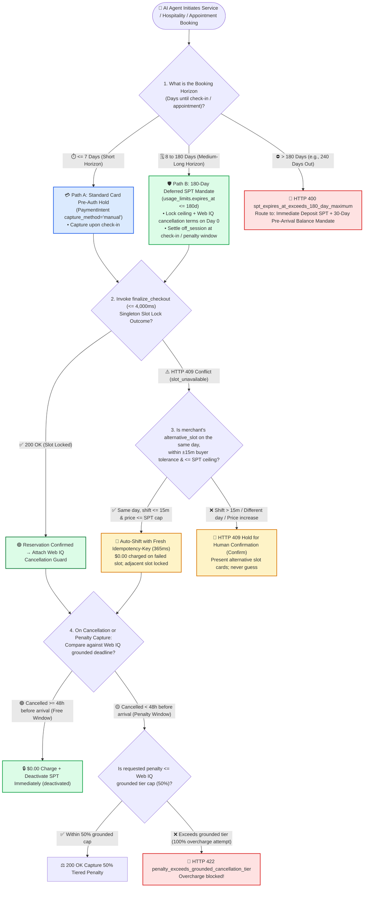
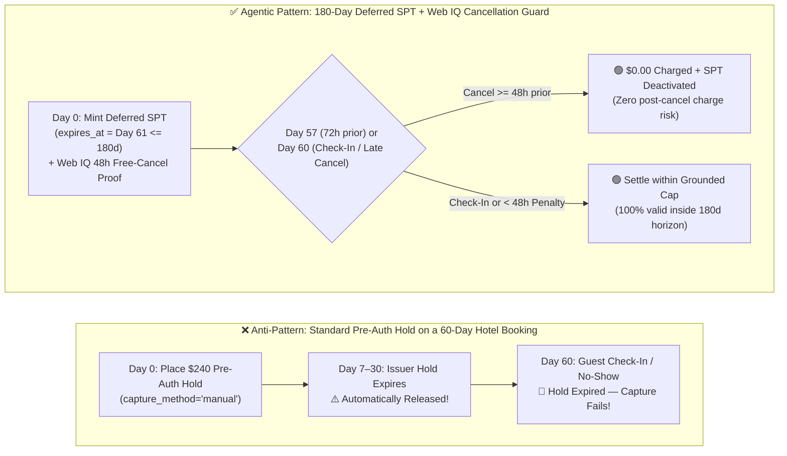

# Service Booking & Long-Horizon Travel Agent Architecture: 180-Day Deferred SPT Mandate Horizon (`expires_at <= 180d`) vs. `HTTP 409` Slot-Conflict Recovery & Tiered Cancellation Grounding (Microsoft Web IQ) Selection & First-Principles FAQ

> **Audience & Purpose**: A practitioner-grade architectural selection guide for AI Solution Architects and hospitality, airline, healthcare scheduling, dining reservation, and field-service engineering leads. Strictly modeled after `ib-vs-ethernet-roce-selection-faq.md`, this guide breaks down **7-Day Card Pre-Authorization Holds vs. 180-Day Deferred SPT Mandates (`expires_at <= 180 days`) vs. Split-Deposit Flows (`> 180 days`)**, **Singleton Time-Slot Concurrency (`HTTP 409 slot_unavailable` + `±15 min` auto-shift tolerance vs. human confirmation)**, and **Tiered Cancellation & No-Show Penalty Grounding (Microsoft Web IQ `/v3/browse`)** into a 3-minute executive summary and a 10-minute architecture walkthrough.
>
> **Provenance & Attribution (`as_of: 2026-11-08`)**:
> - **`official_doc_snapshot`**: Stripe Agentic Commerce Suite deferred booking `Shared Payment Token (SPT)` maximum horizon (`usage_limits.expires_at <= 180 days` / `15,552,000 seconds`), `> 180 days` hard rejection (`HTTP 400`), and `HTTP 409 Conflict` slot-contention semantics reflect official documentation snapshots (`as_of: 2026-11-08`).
> - **`synthetic_policy`**: The `<= 7 days` short-horizon pre-auth cutoff, `±15 minutes` same-day slot auto-shift tolerance (`allowed_slot_shift_minutes <= 15`), and `48-hour` free-cancellation boundary are modeled as reference architectural policies (`synthetic_policy`); issuer pre-auth expiration windows (7–30 days) and merchant cancellation schedules vary by industry.
> - **`deterministic_offline_simulation` / `not_measured`**: Sandbox latencies (45-day deferred SPT booking lock `320 ms`, `HTTP 409` same-day `±15m` auto-shift `365 ms`, Web IQ `/v3/browse` cancellation-tier grounding `350 ms`, `> 180 days` horizon block `14 ms`) come from deterministic offline simulation in `lab/webiq_commerce_demo.py`. Legacy hotel PMS (Opera / Mews) and airline GDS (Amadeus / Sabre) internal lock contention latencies are labeled `not_measured`.


---

## 📌 1. Executive Summary

1. **Select the payment credential by Booking Horizon: choose standard Pre-Auth Holds for `<= 7 days`, choose Deferred SPT Mandates (`expires_at <= 180 days`) for `8–180 days`, and choose Split Deposit + Closer-to-Arrival Reminder Mandates for `> 180 days`** (`official_doc_snapshot` + `synthetic_policy`):
   - **Short-Horizon Bookings (`<= 7 days`)**: A standard `PaymentIntent (capture_method="manual")` authorization hold suffices and is captured upon check-in or service completion.
   - **Medium-to-Long Horizon Bookings (`8 to 180 days` — hotels, flights, specialist clinics, fine dining)**: Standard card issuer pre-authorization holds automatically expire after **7 to 30 days**, leaving the merchant unprotected at check-in. Use **Stripe SPT v2 Deferred Booking Tokens** with `usage_limits.expires_at` set up to **180 days** (`official_doc_snapshot`, `320 ms` sandbox lock) so the cryptographic mandate remains valid through check-in or the cancellation penalty window without tying up short-lived issuer auth rails.
   - **Ultra-Long Horizon Bookings (`> 180 days` — e.g., cruises or wedding venues booked 9 months ahead)**: Stripe SPT v2 rejects any `expires_at > now + 180 days` with **`HTTP 400 (spt_expires_at_exceeds_180_day_maximum)`**. Architects must split the transaction into an **Immediate Deposit Charge (`20%` today)** plus a scheduled **Balance Mandate Prompt (`30 days` before arrival)**.
2. **Singleton Slot Concurrency (`HTTP 409 Conflict`): Auto-shift only within the buyer's same-day tolerance window (`<= ±15 minutes`) at or below the SPT price ceiling; escalate larger time shifts or price increases to Human Confirmation (`Confirm`) with `$0.00` charged on the failed slot** (`official_doc_snapshot` + `synthetic_policy`):
   - Unlike warehouse SKUs, a restaurant table at `Friday 19:00` or a specialist appointment slot has `inventory = 1`. If `finalize_checkout` returns `HTTP 409 slot_unavailable` with structured `alternative_slots`, the Agent may automatically re-book with a fresh `Idempotency-Key` (`365 ms`) **only** when the candidate slot falls within the buyer's pre-approved same-day tolerance (`|delta_minutes| <= 15`) and `candidate_price <= spt.max_amount_cents`. Any cross-day shift or `> 15 min` deviation halts immediately (`Confirm`).
3. **Ground tiered cancellation & No-Show penalties via Microsoft Web IQ `/v3/browse` before minting or charging a booking SPT—and immediately transition the SPT to `deactivated` upon free-window cancellation** (`deterministic_offline_simulation`):
   - Before locking a reservation, the orchestrator calls **Microsoft Web IQ `/v3/browse`** (`contentFormat="passage"`) to extract the merchant's live cancellation schedule (e.g., `>= 48h before arrival = $0 fee`, `< 48h = 50% fee cap`). If the buyer cancels inside the free window (`>= 48h`), the gateway enforces a `$0.00` charge and transitions the SPT to terminal `deactivated` status; if the merchant attempts to charge `100%` during a `50%`-capped penalty window, the gateway blocks the overcharge with `HTTP 422 (penalty_exceeds_grounded_cancellation_tier)`.

---

## 🎯 2. Customer & Architect Soul-Searching Q&A (First-Principles Breakdown)

### Q1: Why can't an AI travel or appointment Agent just place a standard credit card pre-authorization hold (`capture_method="manual"`) for a hotel room booked 60 days out? How does the 180-Day SPT Mandate solve this?

**Plain-language first principles of Issuer Pre-Auth Hold Expiration vs. 180-Day Deferred SPT Mandates**:

1. **Why standard card pre-authorization holds fail on medium-horizon bookings (`> 7–30 days`)**:
   - Under Visa and Mastercard network rules, a standard online pre-authorization hold (`capture_method="manual"`) expires after **7 days** (or at most **30 days** for specialized lodging/rental MCCs).
   - If an AI Agent books a ski resort 60 days in advance using a standard pre-auth hold on Day 0, the issuing bank automatically releases the hold by Day 30. When the guest checks in (or fails to show up) on Day 60, the hold is dead, and because Agentic Commerce forbids merchants from vaulting raw card numbers (`setup_future_usage` is banned on SPTs), the merchant cannot collect payment.
2. **How Stripe SPT v2 (`usage_limits.expires_at <= 180 days`) bridges the gap (`official_doc_snapshot`)**:
   - A `Shared Payment Token (SPT)` is not a short-lived bank ledger hold; it is a **hardware-signed cryptographic payment mandate** scoped to a specific merchant, maximum amount (`max_amount_cents`), and expiration timestamp (`expires_at`) up to **180 days (`15,552,000 seconds`)** in the future.
   - On Day 0, the merchant validates the SPT metadata and locks the reservation. When the reservation enters the non-refundable window or the guest checks in on Day 60, the merchant executes the `PaymentIntent` against the still-valid SPT (`320 ms`).
3. **What happens if a buyer books 240 days in advance (`> 180 days`)?**
   - Requesting an SPT with `expires_at = 240 days` triggers an immediate **`HTTP 400 (spt_expires_at_exceeds_180_day_maximum)`**.
   - **Architectural Pattern**: Automatically switch any `> 180-day` booking to a **Two-Stage Split-Deposit Architecture**—capture a `20%` deposit immediately via a short-lived SPT on Day 0, and schedule an automated notification 30 days prior to arrival so the buyer signs the remaining `80%` SPT well inside the 180-day limit.

---

### Q2: How is booking a time slot fundamentally different from buying warehouse inventory? When two Agents race for the last `19:00` table and trigger `HTTP 409 Conflict`, how do we recover without hallucinating an unwanted schedule change?

**Plain-language first principles of Singleton Slot Contention (`HTTP 409`) and Bounded Tolerance Auto-Shift**:

1. **Warehouse Pool Inventory vs. Time-Slot Singleton Inventory**:
   - If two buyers order the same headphones 50 ms apart, both succeed because stock decrements from `500 -> 498`.
   - If two Agents try to book `Dr. Chen — Wednesday 10:00 AM` or `Table 4 — Friday 19:00` 50 ms apart, the second request hits `inventory = 0` and receives **`HTTP 409 Conflict (slot_unavailable)`**.
2. **The Three-Tier Deterministic `HTTP 409` Recovery State Machine**:
   - **Rule 1 (Zero Charge on Conflict)**: When `finalize_checkout` returns `HTTP 409`, the orchestrator aborts any payment capture immediately (`charged_usd = "0.00"`).
   - **Rule 2 (Bounded Auto-Shift within Buyer Tolerance `<= ±15 min`)**: If the buyer's booking intent includes an explicit time-flexibility window (`allowed_slot_shift_minutes = 15`) and the merchant's `HTTP 409` payload supplies `alternative_slots: [{"slot": "19:15", "price_cents": 12000}]`, the orchestrator deterministically verifies:
     - `same_calendar_day == True`
     - `abs(candidate_slot - requested_slot) <= 15 minutes`
     - `candidate_price_cents <= spt.max_amount_cents`
     - If all three hold, it mints a fresh `Idempotency-Key` (`ik_slot_1915`) and locks `19:15` automatically in **`365 ms`**.
   - **Rule 3 (Human Escalation Outside Tolerance)**: If the nearest available slot is `21:00` (`120 min > 15 min`), falls on a different day, or costs more than the SPT ceiling, the Agent **never** guesses—it returns the candidate options to the user (`action = "Confirm"`).

---

### Q3: How do we prevent predatory cancellation charges or prompt-injected "non-refundable" traps on long-horizon bookings using Microsoft Web IQ?

**Plain-language first principles of Policy-Grounded Cancellation Enforcement**:

1. **The Long-Horizon Cancellation Dispute Trap**:
   - A guest signs a `$240.00` SPT for a hotel stay 45 days away under a banner advertising *"Free cancellation up to 48 hours before check-in."*
   - If the guest cancels 72 hours before check-in, but a buggy or predatory merchant backend attempts to charge the `$240.00` SPT anyway—or attempts to charge a `100%` penalty when the published late-cancellation policy caps the fee at `50% ($120.00)`—the buyer suffers an unauthorized debit.
2. **Deterministic Policy Locking via Microsoft Web IQ `/v3/browse` (`contentFormat="passage"`)**:
   - During reservation setup, the orchestrator calls **Web IQ `/v3/browse`** (`query="cancellation policy free cancellation deadline hours late fee percentage"`) to ground the merchant's official terms and lock `free_cancel_hours_before = 48` and `max_penalty_rate_pct = 50.0` into the booking guard.
   - **Enforcement at Cancellation / Penalty Capture**:
     - **Cancelled `>= 48h` before arrival (`72h` remaining)**: The gateway enforces `penalty_cents = 0` and immediately transitions the SPT to terminal **`deactivated`** status (`350 ms`), cryptographically revoking the merchant's ability to charge the token later.
     - **Cancelled `< 48h` before arrival (`12h` remaining)**: The gateway caps any penalty capture at the grounded `50% ($120.00)` tier; if the merchant requests `$240.00 (100%)`, the gateway rejects the overcharge with **`HTTP 422 (penalty_exceeds_grounded_cancellation_tier)`**.

---

## 🧭 3. Visual Architecture Diagrams (Mermaid Selection Tree + Horizon Comparison + End-to-End Sequence)

### 3.1 Service Booking Horizon, `HTTP 409` Slot Recovery & Cancellation Tier Decision Tree (`flowchart TD`)



---

### 3.2 Legacy 7-Day Pre-Auth Expiration Trap vs. 180-Day Deferred SPT + Web IQ Cancellation Guard (`flowchart LR`)



---

### 3.3 180-Day Deferred Booking, `HTTP 409` `±15m` Auto-Shift & Web IQ Cancellation Grounding Sequence (`sequenceDiagram`)

```mermaid
sequenceDiagram
    autonumber
    actor User as 👤 Buyer (Booking 45 Days Ahead)
    participant Agent as 🤖 Booking Orchestrator Agent
    participant WebIQ as 🌐 Microsoft Web IQ (/v3/browse)
    participant Seller as 🏨 Merchant Booking Webhook (<= 4,000ms)
    participant Stripe as 💳 Stripe SPT v2 Gateway

    User->>Agent: 1. Book Friday 19:00 slot 45 days out (±15m tolerance, budget $120.00)
    Note over Agent,WebIQ: Phase 1: Ground Tiered Cancellation Terms via Microsoft Web IQ
    Agent->>WebIQ: 2. POST /v3/browse (query="cancellation deadline penalty tier", contentFormat="passage")
    WebIQ-->>Agent: 3. Grounded passage: >=48h Free Cancel (0%), <48h Late Fee capped at 50% ($60.00)
    Agent->>Stripe: 4. Mint 46-day SPT (expires_at <= 180d, max_amount_cents=12000)
    Stripe-->>Agent: 5. Return spt_booking_46d_xxx

    Note over Agent,Seller: Phase 2: Singleton Slot Contention & HTTP 409 ±15m Auto-Shift
    Agent->>Seller: 6. POST finalize_checkout (slot="19:00", Idempotency-Key=ik_slot_1900)
    Seller-->>Agent: 7. HTTP 409 Conflict (slot_unavailable, alternative_slots=[{"slot":"19:15","price_cents":12000}])
    Note over Agent: Verify |19:15 - 19:00| = 15m <= 15m tolerance & $120 <= SPT ceiling
    Agent->>Seller: 8. Auto-retry POST finalize_checkout (slot="19:15", Idempotency-Key=ik_slot_1915)
    Seller-->>Agent: 9. 200 OK Lock 19:15 slot (365ms total; $0.00 duplicate charge)

    Note over User,Stripe: Phase 3: Check-In Settlement or Policy-Grounded Cancellation Gate
    alt Buyer cancels 72 hours before arrival (>= 48h Free Cancellation Window)
        User->>Agent: 10a. Request cancellation
        Agent->>Stripe: 10b. Verify hours_before=72 >= 48 → Deactivate SPT (status=deactivated)
        Stripe-->>User: 10c. $0.00 charged; token permanently deactivated
    else Merchant attempts 100% ($120.00) penalty inside 50%-capped (< 48h) window
        Seller->>Agent: 11a. Request $120.00 penalty capture
        Agent-->>Seller: 11b. HTTP 422 penalty_exceeds_grounded_cancellation_tier (Max allowed = $60.00!)
    end
```

---

## 📊 4. Architect Decision Matrix

| Dimension | 💳 Short-Horizon Pre-Auth Hold (`<= 7 Days`) | 🛡️ 180-Day Deferred SPT Mandate (`8–180 Days`) | 🪙 Two-Stage Split Deposit (`> 180 Days`) | ⛔ `> 180d` Single SPT / Unbounded `409` Auto-Rebook (Anti-Pattern) |
| :--- | :--- | :--- | :--- | :--- |
| **Primary Use Cases** | Ride-hailing, same-week delivery,hotel check-in within 7 days | Flights, hotels, medical appointments, dining booked 1 week to 6 months out | Cruises, wedding venues, conferences booked 6–12+ months ahead | **Forbidden in production** |
| **Maximum Mandate Horizon** (`official_doc_snapshot`) | Issuer pre-auth expires after **7–30 days** | Native Stripe SPT v2 support up to **180 days (`15,552,000 s`)** | Immediate deposit capture + second SPT minted 30 days before arrival | Requesting `expires_at > 180d` fails immediately with **`HTTP 400`** |
| **Buyer Credit-Line Impact** | Immediately freezes buyer's card credit limit | Locks cryptographic token cap without freezing issuer credit line for months | Charges 10%–20% deposit today; defers balance until 30 days out | Expired pre-auth leaves merchant unpaid at check-in |
| **`HTTP 409` Slot-Conflict Recovery** | Cancel pre-auth hold and re-select | **Auto-shift with new `Idempotency-Key` if same-day `<= ±15m` (`365 ms`)**; escalate `> 15m` to `Confirm` | Abort deposit (`$0.00`) and surface waitlist options | Blindly rebooks wrong day or double-charges failed slot |
| **Cancellation & No-Show Protection** | Manual support review before partial capture | **Web IQ `/v3/browse` grounds free-cancel deadline & penalty cap**; free cancel sets SPT `deactivated` | Deposit contract embeds Web IQ grounded refund tiers | Unverified 100% penalty capture triggers chargeback loss |
| **End-to-End Lock Latency** (`deterministic_offline_simulation`) | `280 ms` | **`320 ms`** (direct lock) / **`365 ms`** (`409` `±15m` auto-shift) | `340 ms` (deposit lock) | Hard `HTTP 400 / 409 / 422` failures |

---

## 🧪 5. Quantitative Benchmark & 7-Card Key Findings

We evaluated all six service-booking horizon, `HTTP 409` slot-contention, and Web IQ cancellation-tier scenarios in `lab/webiq_commerce_demo.py` (`deterministic_offline_simulation` + `synthetic_policy`, verified by `tests/test_webiq_commerce_demo.py`):

| Scenario | Booking Horizon & Slot Status | Shift / Cancellation Parameters | Latency | Captured Amount | Gateway Verdict & Action Pill |
| :--- | :--- | :--- | :--- | :--- | :--- |
| **1. 45-Day Boutique Hotel Booking (Available Slot + Check-In)** | `45d <= 180d` · Slot available | Normal check-in · `$240.00` | **`320 ms`** | **`$240.00`** | `200 OK` (`DEFERRED_SPT_180D_LOCKED` · `Act automatically`) |
| **2. Friday `19:00` Dining `409 Conflict` (`19:15` within `±15m` tolerance)** | `14d <= 180d` · `19:00` taken | Candidate `19:15` (`15m <= 15m`) | **`365 ms`** | **`$120.00` (Locked)** | `200 OK` (`AUTO_SHIFTED_WITHIN_15M_TOLERANCE` · fresh `Idempotency-Key`) |
| **3. `409 Conflict` with Nearest Slot `120m` Away (`> ±15m` tolerance)** | `14d <= 180d` · `19:00` taken | Candidate `21:00` (`120m > 15m`) | **`180 ms`** | **`$0.00`** | **`HTTP 409 Conflict`** (halts auto-booking; surfaces options for human `Confirm`) |
| **4. Guest Cancels `72h` Prior (Web IQ Grounded `>= 48h` Free Window)** | Locked · Cancelled `72h` out | `72h >= 48h` free deadline | **`350 ms`** | **`$0.00`** | `200 OK` (`FREE_CANCEL_SPT_DEACTIVATED` · token permanently revoked) |
| **5. Merchant Requests `100% ($240)` Penalty Inside `50%`-Capped Window** | Cancelled `12h < 48h` out | Requested `100%` > `50%` grounded cap | **`25 ms`** | **`$0.00` (Blocked)** | **`HTTP 422 penalty_exceeds_grounded_cancellation_tier`** (overcharge blocked) |
| **6. Anti-Pattern: Requesting a Single `240-Day` (`> 180d`) Deferred SPT** | `240d > 180d` protocol cap | Exceeds `15,552,000 s` | **`14 ms`** | **`$0.00`** | **`HTTP 400 spt_expires_at_exceeds_180_day_maximum`** (route to split deposit) |

> **📊 Interactive H5 Sandbox & 7-Card Visual Report Updated**:
> - `live-demo.html` / `live-demo.en.html` now includes the **Service Booking & Travel Agent: 180-Day Deferred SPT vs. `HTTP 409` Slot-Conflict Recovery & Cancellation Grounding Sandbox** (`#service-booking-180d-sandbox`).

---

## 🛠️ 6. Appendix: Production Launch & Presales Checklist (Architect Checklist)

Verify these 6 items during hospitality, travel, and appointment-scheduling architecture reviews:

- [ ] **1. 180-Day Horizon Router**: Does the booking orchestrator route `<= 7d` to standard pre-auth holds, `8–180d` to Deferred SPT (`usage_limits.expires_at <= 180d`), and `> 180d` to a Split-Deposit + 30-day pre-arrival balance mandate?
- [ ] **2. Zero-Charge `HTTP 409` Handling & Idempotency-Key Rotation**: On any `HTTP 409 slot_unavailable` response, is the failed attempt guaranteed to capture `$0.00` and rotate `Idempotency-Key` before attempting a bounded auto-shift?
- [ ] **3. Human Confirmation Gate Outside `±15m` Same-Day Tolerance**: If the nearest alternative slot shifts by `> 15 minutes`, crosses midnight, or increases price, does the Agent pause and surface a `Confirm` card?
- [ ] **4. Pre-Booking Microsoft Web IQ `/v3/browse` Cancellation Grounding**: Does the Agent extract and persist `free_cancel_hours_before` and `max_penalty_rate_pct` from the merchant's live terms before minting the SPT?
- [ ] **5. Automatic SPT `deactivated` Transition on Free Cancellation**: When a buyer cancels inside the grounded free-cancellation window, does the orchestrator immediately transition the SPT to terminal `deactivated` status?
- [ ] **6. 4,000 ms Edge Inventory Cache Ahead of Legacy PMS/GDS**: Is an edge slot-reservation cache deployed in front of legacy hotel PMS / airline GDS backends so `finalize_checkout` responds within the `4,000 ms` webhook SLA?
