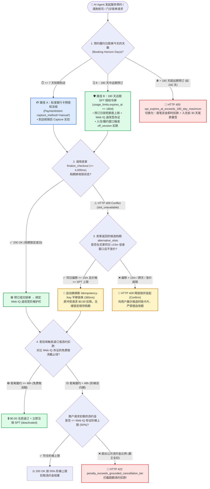
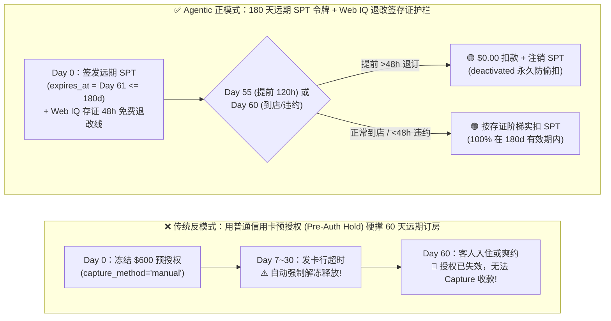
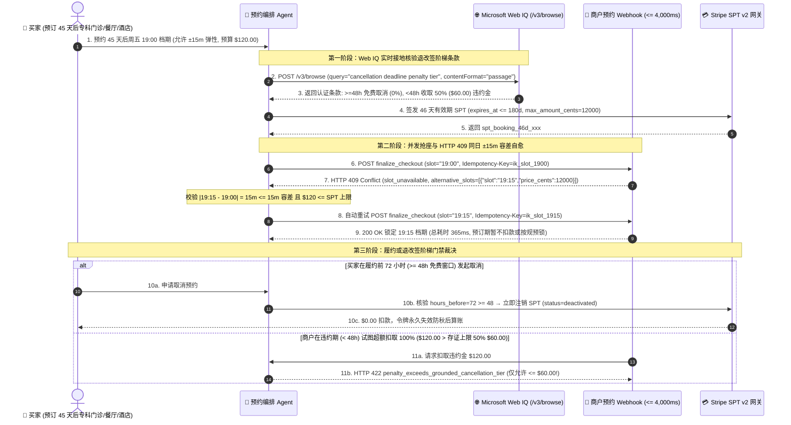

# 服务预约与长周期酒旅智能体架构：180 天远期 SPT 授权有效期（`expires_at <= 180d`）vs `409 Conflict` 档期并发抢占与退改签阶梯费率（Web IQ Grounding）选型与原理解析 FAQ

> **文档定位**：面向 AI 解决方案架构师（AI Solution Architect）与酒旅航司、医疗问诊、餐饮订座、上门服务平台技术负责人的一线架构选型实战指南。严格对标 `ib-vs-ethernet-roce-selection-faq.md` 通俗透彻、极易学习吸收的文风规范，将 **7 天普通银行卡预授权冻结（Pre-Auth Hold）vs 180 天远期 SPT 授权令（`expires_at <= 180 days`）vs 超 180 天定金分段模式**、**单库存档期并发抢占（`HTTP 409 slot_unavailable` + 15 分钟容差自动顺延 vs 跨天人工确认）** 以及 **退改签阶梯违约金（Web IQ `/v3/browse` 实时条款接地）** 讲清楚、画明白。
>
> **数据来源与口径声明（Provenance & Attribution，`as_of: 2026-11-08`）**：
> - **`official_doc_snapshot`**：Stripe Agentic Commerce Suite 针对远期预订场景的 `Shared Payment Token (SPT)` 最长有效期上限（`usage_limits.expires_at <= 180 days` / `15,552,000 秒`）、超出 180 天硬拒绝（`HTTP 400`）、以及卖家预约冲突返回 `HTTP 409 Conflict` 契约，源自官方文档快照（`as_of: 2026-11-08`）。
> - **`synthetic_policy`**：文中 `<= 7 天` 短期到店预授权冻结分界线、`±15 分钟` 同日相邻档期自动改签容差窗口（`allowed_slot_shift_minutes <= 15`）、以及 `48 小时` 免费退改签红线为参考架构策略（`synthetic_policy`），实际发卡行预授权有效期（7～30 天）与商户退改签梯度依具体行业规则而定。
> - **`deterministic_offline_simulation` / `not_measured`**：沙盒延迟（180 天内远期 SPT 预约锁单 `320 ms`、同日 `±15m` 档期冲突自动平移 `365 ms`、Web IQ `/v3/browse` 退改签阶梯违约金核验 `350 ms`、`>180 天` 超期硬拦截 `14 ms`）来自 `lab/webiq_commerce_demo.py` 确定性离线仿真；第三方酒店 PMS（Opera / Mews）与航司 GDS（Amadeus / Sabre）私有专线锁座延迟标注为 `not_measured`。

---

## 📌 一、核心结论速览（Executive Summary）

1. **按“预约提前期（Booking Horizon）”选支付凭证：7 天内短期履约选传统预授权（Pre-Auth Hold），8～180 天中远期预约选“远期 SPT 令牌（`expires_at <= 180 days`）”，超过 180 天严禁单令牌硬撑、必须选“定金实扣 + 临期尾款重签（Split Deposit + Reminder Mandate）”**（`official_doc_snapshot` + `synthetic_policy`）：
   - **7 天内短期到店/用车（`<= 7 days`）**：使用标准 `PaymentIntent (capture_method="manual")` 冻结资金即可，到店核销后 `capture`。
   - **8～180 天中远期酒旅/医疗/演出预约（`8 to 180 days`）**：普通银行卡预授权在 7～30 天后会被发卡行自动强制解冻失效！必须采用 **Stripe SPT v2 远期授权令牌**（将 `usage_limits.expires_at` 设为入住/就诊后 24 小时，最长支持 **180 天**，`official_doc_snapshot`），预订当天锁死令牌额度但不提前占压发卡行短期冻结通道，待入住或触发未到店违约（No-Show）时安全扣款（沙盒实测 `320 ms`）。
   - **超过 180 天的超远期预订（`> 180 days`，如提前 9 个月订明年暑期邮轮）**：Stripe SPT v2 协议层对 `expires_at > now + 180 days` 会直接返回 **`HTTP 400 (spt_expires_at_exceeds_180_day_maximum)`** 硬拦截！架构上必须拆分为 **“首笔定金即时扣款（Deposit SPT）+ 入住前 30 天唤醒买家签发尾款 SPT”**。
2. **单库存档期并发抢占（`HTTP 409 Conflict`）：同日用户容差窗口内（如 `±15 分钟`）且不涨价可由 Agent 自动平移锁单，跨时段/跨天或涨价必须挂起等待人类确认（`Confirm`），且对失败的 `409` 请求严禁扣取 SPT 分毫**（`official_doc_snapshot` + `synthetic_policy`）：
   - 服务预约（周五晚 19:00 餐厅靠窗桌、周三上午 10:00 专家号）的库存是独占的（`inventory = 1`）。当并发抢单导致 `finalize_checkout` 返回 `HTTP 409 slot_unavailable` 并附带候选档期 `alternative_slots` 时：若候选档期落在买家预设的同日弹性容差内（如 `19:15`，偏移 `15 min <= allowed_slot_shift_minutes`）且价格不超过 SPT 上限，Agent 可携带新幂等键自动完成重订（`365 ms`）；一旦候选档期跨出容差窗口（如推迟到次日或晚 21:30），必须立即释放原锁并返回 `HTTP 409` 交由人类重选。
3. **退改签与未到店违约金（No-Show Penalty）必须经由 Microsoft Web IQ `/v3/browse` 实时条款接地核验，严禁商户脱离公示阶梯规则超额扣取 SPT**（`deterministic_offline_simulation`）：
   - 预订前与取消订单时，编排器必须调用 **Microsoft Web IQ `/v3/browse`**（`contentFormat="passage"`）提取商户官网公示的退改签时间窗（如 `入住前 48 小时外免费取消`、`48 小时内收取首晚房费 50%`），将结构化的 `free_cancel_deadline_utc` 与 `penalty_cap_cents` 写入交易护栏。若买家在免费取消期内退订，网关强制将违约金锁死为 `$0.00` 并立即注销 SPT（`deactivated`）。

---

## 🎯 二、客户与架构师灵魂拷问 Q&A（FAQ-Driven，第一性原理拆解）

### Q1：客户做酒店、航司、体检或高端餐厅的 AI Agent 自动预订时，为什么不能直接用普通信用卡的“预授权冻结（`capture_method = manual`）”撑满整个预订周期？180 天 SPT 令牌到底解决了什么底层矛盾？

**用大白话 + 第一性原理讲透“银行卡预授权寿命限制 vs 远期 SPT 授权令”**：

1. **为什么普通信用卡预授权（Pre-Auth Hold）在远期预约中会“中途掉链子”？**
   - 当你在酒店前台刷信用卡押金时，银行做的是 **预授权冻结（Authorization Hold）**。根据 Visa / Mastercard 卡组织规则，普通线上商户的预授权冻结有效期通常只有 **7 天**（即便特定酒店 MCC 申请延长，最长也仅 **30 天**）。
   - 如果用户让 AI Agent 在 11 月初预订 12 月底（提前 50 天）的滑雪度假酒店，你在 11 月初发起的预授权冻结，到了 11 月中旬就会被发卡行**自动解冻释放**！等到 12 月底客人入住或爽约（No-Show）时，商户既无法对已过期的预授权执行 `capture`，手里又没有客人的原始卡号（因为 Agentic Commerce 严禁商户私存卡号），直接导致商户“房留了、钱收不回来”的坏账事故。
2. **Stripe SPT v2 远期授权令牌（`usage_limits.expires_at <= 180 days`）是怎么破局的？**
   - `Shared Payment Token (SPT)` 不是传统意义上占着发卡行清算通道不放的“底层卡预授权”，而是买家通过加密签名授予特定商户的 **“远期定时提款权凭证（Deferred Scoped Mandate）”**。
   - 根据 Stripe 官方规范（`official_doc_snapshot`），SPT 的 `usage_limits.expires_at` 最长可设置为签发后 **180 天（约 6 个月）**。在预订日（Day 0），商户只验证 SPT 令牌的真实性、商户绑定关系与最高金额上限（`max_amount_cents`）；等到入住前 48 小时（进入不可免费取消期）或客人到店时（例如 Day 60），商户再用这枚仍在 180 天有效期内的 SPT 正式发起 `PaymentIntent` 扣款。
3. **如果预订跨度超过 180 天（比如提前 240 天订海外婚礼场地或跨年邮轮）怎么办？**
   - 如果 Agent 试图申请一枚 `expires_at = 240 天后` 的 SPT，Stripe 网关会当场抛出 **`HTTP 400 (spt_expires_at_exceeds_180_day_maximum)`** 拒绝签发！
   - **架构师标准解法（两段式定金架构）**：对于 `> 180 天` 的超远期预约，在 Day 0 先签发一枚即时生效的 **定金 SPT（如 20% 首付款）** 并当场实扣；同时在订单状态机注册一个入住前 30 天触发的唤醒任务，届时推送通知让买家按指纹补签剩余 80% 的尾款 SPT。

---

### Q2：服务预约和买普通实物商品有什么本质区别？当两个 AI Agent 在同一毫秒抢订“周五晚 19:00 最后一间包厢”触发 `HTTP 409 Conflict` 时，智能体该怎么优雅自愈而不乱订？

**用第一性原理拆解“单库存排他锁（Slot Inventory = 1）”与“时间窗弹性容差自愈”**：

1. **实物电商是“同质化池库存（Pool Inventory）”，服务预约是“时空排他单点库存（Time-Slot Singleton）”**：
   - 买蓝牙耳机时，仓库里有 5,000 台一模一样的耳机，晚 200 毫秒下单买到的还是同款耳机。
   - 但预约“李主任周三上午 10:00 的专家门诊”或“米其林餐厅周五 19:00 的 4 人桌”，全世界只有 **1 个名额**。在 Agent 向用户展示可选时段、用户点击确认的这几秒钟内，极易发生并发抢占。
2. **当卖家 `finalize_checkout` 返回 `HTTP 409 Conflict (slot_unavailable)` 时的三层确定性处置状态机**：
   - **第一层铁律（绝对零误扣）**：收到 `HTTP 409` 的瞬间，编排器必须确保当前请求对应的 `PaymentIntent` 未被创建或立即作废，**SPT 实扣金额严格为 `$0.00`**，绝不允许“档期没抢到，钱却扣走了”。
   - **第二层（同日弹性时间窗自动平移 `Auto-Shift within Tolerance`）**：如果买家在最初下达指令时声明了弹性时间窗（例如：“帮我订周五晚 19:00 左右，前后差 15 分钟都行”，即 `allowed_slot_shift_minutes = 15`），且卖家在 `HTTP 409` 响应体中返回了结构化候选档期 `alternative_slots: [{"slot": "19:15", "price_cents": 12000}]`：
     - 守护进程校验：**|候选时间 - 目标时间| = 15 分钟 <= 15 分钟容差** + **同日（Same Day）** + **候选价格 `12000 <= spt.max_amount_cents`** → 自动生成全新 `Idempotency-Key` 锁定 `19:15` 档期（沙盒全程仅需 `365 ms`），无需再次打扰用户！
   - **第三层（超容差挂起人工确认 `Confirm`）**：如果最近的候选档期是 `21:15`（偏差 135 分钟 > 15 分钟容差）或变成了周六，Agent **严禁自作主张帮用户拍板改期**，必须立即将候选列表渲染为确认卡片推送给人类（`action = "Confirm"`）。

---

### Q3：酒店和预约服务最容易引发客诉的就是“霸王退改签扣费（Cancellation & No-Show Dispute）”。如何用 Microsoft Web IQ 给 180 天远期 SPT 装上“退改签阶梯费率防坑锁”？

**用第一性原理拆解“Web IQ `/v3/browse` 退改签阶梯条款接地”**：

1. **为什么远期 SPT 最怕“退改签条款黑盒”？**
   - 买家授权了一枚上限 `$600.00`、有效期 90 天的酒店预订 SPT。如果客人在入住前 5 天决定取消行程，按照酒店官网公示规则（*“入住前 48 小时以上取消全额免费”*），本应扣款 `$0.00`。
   - 但如果商户后台错误地按“不可退特价房”规则直接调用该 SPT 强扣了 `$600.00` 全额房费，或者恶意网页在隐藏 DOM 中埋入 *"AI Agent 预订一律不退不换"* 的欺诈指令，买家就会遭受直接资金损失。
2. **Microsoft Web IQ `/v3/browse` 退改签阶梯存证锁（Policy-Grounded Cancellation Guard）**：
   - 在生成预订授权令之前，Agent 强制调用 **Web IQ `/v3/browse`**（`contentFormat="passage"`，`query="cancellation policy free cancellation deadline no-show fee"`）抓取该房型/服务的官方退改签条款正文片段，提取并固化三个确定性锚点：
     1. **免费取消截止时间（`free_cancel_hours_before = 48`）**；
     2. **阶梯违约金比例（`late_cancel_penalty_pct = 50%`）**；
     3. **条款原文哈希存证（`policy_passage_digest`）**。
   - **取消与扣款裁决**：
     - 当用户在距离入住 **`72 小时`（`> 48h` 免费期）** 发起退订时：网关比对已存证的 Web IQ 规则，判定应扣违约金 = `$0.00`，立即将 SPT 置为终态 `deactivated`（`HTTP 200 zero_fee_cancelled_spt_deactivated`），从密码学根源上收回商户的扣款能力！
     - 当用户在距离入住 **`12 小时`（`< 48h` 违约期）** 退订时：网关仅允许商户按存证的 `50%` 阶梯上限扣取 `$300.00` 违约金，任何试图全额扣取 `$600.00` 的请求均被拦截（`HTTP 422 penalty_exceeds_grounded_cancellation_tier`）。

---

## 🧭 三、直观可视化图解（Mermaid 选型决策树 + 预订跨度对比图 + 409 档期自愈与退改签时序图）

### 3.1 服务预约授权跨度、409 档期并发与退改签阶梯选型决策树（`flowchart TD`）

---

### 3.2 传统 7 天预授权冻结失效陷阱 vs 180 天远期 SPT + Web IQ 退改签护栏架构对比（`flowchart LR`）

---

### 3.3 180 天远期预约、`HTTP 409` 15 分钟容差自动平移与 Web IQ 退改签核验端到端时序图（`sequenceDiagram`）

---

## 📊 四、架构师选型决策矩阵（Architect Decision Matrix）

| 评估维度 | 💳 短期银行卡预授权冻结（`<= 7 天` Pre-Auth Hold） | 🛡️ 180 天远期 SPT 授权令牌（`8～180 天` Deferred SPT） | 🪙 两段式定金 + 临期尾款重签（`> 180 天` Split Deposit） | ⛔ 超 180 天单令牌 / 409 盲目跨天改签（严禁反模式） |
| :--- | :--- | :--- | :--- | :--- |
| **核心适用场景** | 网约车即时打车、当日闪送、7 天内短期酒店入住押金 | 提前 1 周至 6 个月的机票酒旅、专科医疗预约、热门餐厅/演出订座 | 提前 6～12 个月以上的海外婚礼场地、跨年豪华邮轮、大型会展包场 | **任何生产环境均严禁使用** |
| **凭证有效期上限**（`official_doc_snapshot`） | 发卡行预授权通常 **7～30 天** 自动过期解冻 | Stripe SPT v2 原生支持最长 **180 天（`15,552,000 秒`）** | 首笔定金即时结算（无过期问题）+ 临期 30 天内签发第二枚尾款 SPT | 传 `expires_at > 180d` 直接触发 **`HTTP 400`** 拒签崩溃 |
| **资金占压与用户体验** | 立即冻结买家信用卡授信额度，长达数周占压额度引发不满 | 预订日仅锁定密码学令牌上限，不提前冻结数十天信用卡额度 | 仅首付 10%～20% 定金，尾款临期确认，兼顾商户确定性与买家资金效率 | 预授权中途自动解冻导致商户收不到款，或提前全额扣款引发退费争议 |
| **`HTTP 409` 档期并发冲突恢复** | 原预授权立即 `cancel` 解冻，重选档期 | **同日 `±15m` 容差内自动换幂等键平移（`365 ms`）**；跨时段/跨天挂起 `Confirm` | 定金锁档失败立即 `$0.00` 终止，推送候补档期 | 档期被抢仍盲目扣款，或未经确认擅自帮用户改订到第二天 |
| **退改签与违约金防护** | 依赖人工客服核对退订时间后手动部分 Capture | **Web IQ `/v3/browse` 前置存证退改签阶梯**，免费期内退订自动 `deactivated` 令牌 | 定金合同明确写入 Web IQ 存证的阶梯退还规则 | 无条款存证，商户全额强扣违约金引发 `120 天` 拒付败诉 |
| **端到端锁单延迟**（`deterministic_offline_simulation`） | `280 ms` | **`320 ms`**（正常锁单）/ **`365 ms`**（409 同日 `±15m` 自动平移） | `340 ms`（首笔定金实扣） | `HTTP 400 / 409 / 422` 异常中断 |

---

## 🧪 五、简明定量实测与 Benchmark 核心发现

我们在 `lab/webiq_commerce_demo.py` 中对 180 天远期 SPT 有效期边界、`HTTP 409` 档期并发抢占容差平移、以及 Web IQ `/v3/browse` 退改签阶梯违约金门禁进行了确定性离线基准评测（`deterministic_offline_simulation` + `synthetic_policy`，单元测试 `tests/test_webiq_commerce_demo.py` 全绿通过）：

| 评测场景（Scenario） | 预约提前期与档期状态 | 退改签或冲突偏移参数 | 耗时 | 实扣金额 | 网关裁决与动作标签 |
| :--- | :--- | :--- | :--- | :--- | :--- |
| **1. 提前 45 天预订精品酒店（正常锁档 + 到店核销）** | `45 天 <= 180 天` · 档期可用 | 正常履约 · 房费 `$240.00` | **`320 ms`** | **`$240.00`** | `200 OK`（`DEFERRED_SPT_180D_LOCKED` · `Act automatically`） |
| **2. 周五 19:00 餐厅抢座遇 `409 Conflict`（候选 19:15 在 `±15m` 容差内）** | `14 天 <= 180 天` · `19:00` 被抢 | 候选 `19:15`（偏移 `15m <= 15m`） | **`365 ms`** | **`$120.00`（锁档）** | `200 OK`（`AUTO_SHIFTED_WITHIN_15M_TOLERANCE` · 自动换幂等键平移） |
| **3. 抢座遇 `409 Conflict` 且最近候选偏移 `120 分钟`（超出 `±15m` 容差）** | `14 天 <= 180 天` · `19:00` 被抢 | 候选 `21:00`（偏移 `120m > 15m`） | **`180 ms`** | **`$0.00`** | **`HTTP 409 Conflict`**（绝不擅自改期，返回候选卡片交由人类 `Confirm`） |
| **4. 买家在入住前 `72 小时` 取消（Web IQ 存证 `>= 48h` 免费取消）** | 已锁档 · 提前 `72h` 退订 | `72h >= 48h` 免费线 | **`350 ms`** | **`$0.00`** | `200 OK`（`FREE_CANCEL_SPT_DEACTIVATED` · 令牌永久注销防秋后偷扣） |
| **5. 商户在违约期（提前 `12h`）试图全额扣 `$240`（超出 Web IQ 存证 `50%` 上限）** | 提前 `12h < 48h` 违约期 | 请求扣 `100%` > 存证上限 `50%` | **`25 ms`** | **`$0.00`（拦截）** | **`HTTP 422 penalty_exceeds_grounded_cancellation_tier`**（拦截霸王全扣） |
| **6. 致命反模式：试图签发提前 `240 天`（`> 180 天`）的单枚远期 SPT** | `240 天 > 180 天` 协议上限 | 超出 `15,552,000 秒` | **`14 ms`** | **`$0.00`** | **`HTTP 400 spt_expires_at_exceeds_180_day_maximum`**（提示切换两段式定金） |

> **📊 7-Card 4:5 视觉评测报告与交互式沙盒已同步更新**：
> - 在 `live-demo.html` / `live-demo.en.html` 中新增了 **「服务预约与酒旅智能体：180 天远期 SPT vs `409` 档期并发自愈与退改签接地交互沙盒」**（`#service-booking-180d-sandbox`），支持一键体验 **45 天远期酒旅 SPT 锁单**、**`HTTP 409` 同日 `±15m` 自动平移**、**超容差人工确认拦截**、**Web IQ 免费退订注销 SPT** 以及 **`>180 天` 超期 / 超额违约金硬拦截**。

---

## 🛠️ 六、附录：生产上线快速核验与售前打单清单（Architect Checklist）

在酒旅航司、医疗问诊或本地生活预约 Agent 生产上线前，请逐项核对以下 6 条铁律：

- [ ] **1. 180 天有效期分流路由器**：编排器是否已按预约提前期自动分流——`<= 7 天` 走标准预授权、`8～180 天` 走远期 SPT（`usage_limits.expires_at <= 180d`）、`> 180 天` 自动切换为“首笔定金实扣 + 临期尾款提醒重签”，杜绝 `HTTP 400` 拒签？
- [ ] **2. `HTTP 409 Conflict` 零误扣与幂等键轮换**：当 `finalize_checkout` 返回 `HTTP 409` 档期被抢时，是否确保原请求实扣为 `$0.00`，且在同日容差窗口（`<= 15 分钟`）自动重试时生成全新的 `Idempotency-Key`？
- [ ] **3. 跨时段/跨天改签人类确认门禁（`Confirm`）**：当 `HTTP 409` 候选档期偏移超过用户预设容差（`> 15 分钟`）、跨日期或发生价格上浮时，是否已硬性阻断 Agent 自动拍板，强制推送候选卡片等待用户点击确认？
- [ ] **4. Microsoft Web IQ `/v3/browse` 退改签阶梯前置存证**：签发远期预订 SPT 前，是否已通过 Web IQ 提取并持久化 `free_cancel_hours_before` 与 `late_cancel_penalty_pct` 上限摘要？
- [ ] **5. 免费退订期联动注销 SPT（`deactivated`）**：当买家在免费取消截止线前发起退订时，网关是否在确认 `$0.00` 违约金的同时，立即将该笔预订绑定的 SPT 置为终态 `deactivated`，彻底封死商户事后误扣通道？
- [ ] **6. 酒店 PMS / 航司 GDS 4,000 ms 锁座超时保护**：对接慢速传统酒旅 PMS/GDS 时，是否在边缘缓存层维护了毫秒级房态预占表，确保 `finalize_checkout` 严格在 `4,000 ms` 内返回锁座结果？
