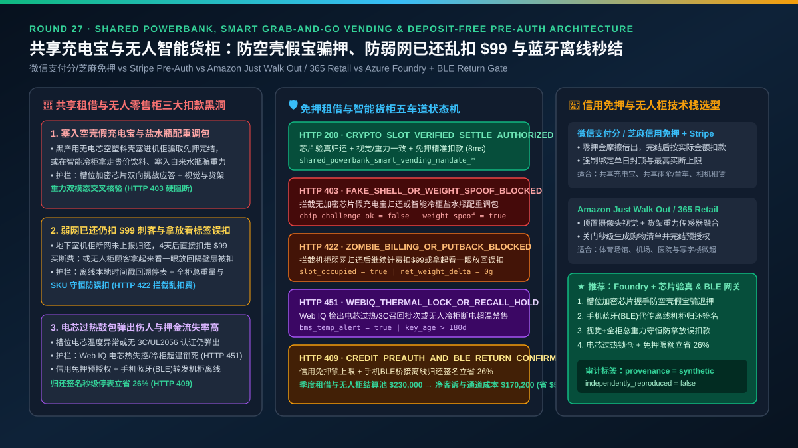
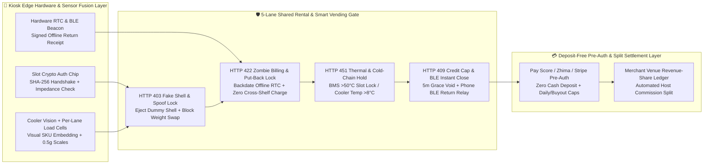
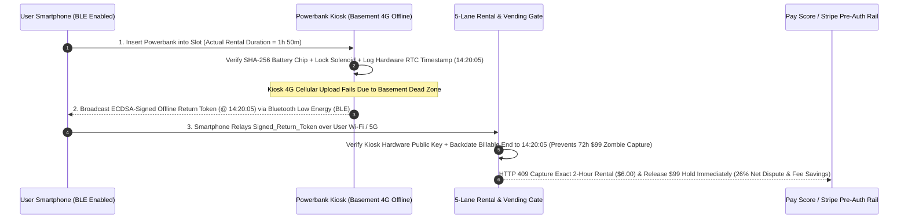

# Shared Powerbank, Smart Grab-and-Go Cooler & Deposit-Free Rental (`Meituan / Monster / Amazon Just Walk Out / 365 Retail / Stripe Pre-Auth`) Anti-Fake-Shell, Anti-`$99`-Zombie-Billing & `BLE` Offline Return Agent Architecture Selection FAQ

> **Language / 语言切换**: **[中文](shared-powerbank-smart-vending-deposit-free-preauth-cap-agent-selection-faq.md)** | **English (Current)** | **[Back to Docs Index](index.en.md)** | **[Interactive Sandbox (`#shared-powerbank-smart-vending-sandbox`)](../live-demo.en.html)**



---

## 📌 1. Executive Summary

In high-frequency unattended micro-rental and smart vending ecosystems—including shared powerbank networks (`Meituan`, `Energy Monster`, `ChargedUp`, `Brick`, `FuelRod`) and autonomous grab-and-go smart coolers (`Amazon Just Walk Out`, `365 Retail Markets`, `Cantaloupe`, `AiFi`)—millions of daily transactions rely on **"Tap/Scan Deposit-Free Pre-Auth -> Sensor-Driven Grab/Return -> Autonomous Capture"**. Allowing a billing agent to capture customer funds directly from raw mechanical limit switches or single-modality weight sensors triggers three severe fraud and consumer-protection failures:
1. **Empty Plastic Shell Returns ("Fake Powerbank Spoofing") & Smart-Cooler Weight Substitution ("Water-Bottle Swap")**: Fraudsters buy `$1.50` hollow plastic shells matching a shared powerbank's form factor, insert them into a kiosk slot to trip the mechanical micro-switch, close out their deposit-free rental, and harvest the real lithium-ion cells. In load-cell-only smart coolers, thieves remove an `$8.00` `250g` energy drink and place a `250g` tap-water bottle back on the shelf so net weight delta reads `0g`.
2. **"Zombie Slot Billing" (`$99` Buyout Charged Days After Returning to an Offline Kiosk) & "Pick-Up-Put-Back" False Positives**: A user returns a powerbank into a basement restaurant kiosk whose 4G cellular modem is temporarily offline. Because the cloud billing timer never receives the `MQTT Return_ACK`, it keeps billing `$4/hour` for 72 hours and captures the full **`$99` lost-device buyout penalty**—triggering regulatory fines and massive card chargebacks. Similarly, in smart coolers, a shopper who picks up a sandwich from Shelf 2 to read the nutrition label and places it back on Shelf 3 gets falsely charged if the agent evaluates shelf load cells in isolation.
3. **Lithium-Ion Thermal Runaway (`>50°C` / `UL 2056` Recall) Ejection & Spoiled-Food Cooler Unlocks**: Dispensing a swollen or overheating powerbank cell, or unlocking a fresh-food smart cooler whose compressor lost power for `>2 hours`, creates severe physical safety and foodborne-illness liability.

**Solution Architect Verdict**:
- **Never trust mechanical slot switches alone or allow cloud timers to bill past physical insertion during cellular outages**.
- **Recommended Production Architecture**: Deploy **"Deposit-Free Credit/Pre-Auth Hold (`WeChat Pay Score / Zhima Credit / Stripe Incremental Auth`) + Slot Cryptographic Challenge-Response Chip + Smartphone `BLE` Offline Return Relay + Vision/Load-Cell Conservation Gate + Azure AI Foundry 5-Lane Unattended Commerce Gate"**:
  1. **Slot Cryptographic Challenge-Response (`SHA-256`) & Smart-Cooler Vision + Load-Cell Fusion Gate (`HTTP 403`)**: Upon powerbank insertion, the kiosk MCU executes a cryptographic challenge-response handshake with the battery's secure element and verifies internal cell impedance (ejecting hollow dummy shells immediately). In smart coolers, fuse overhead computer-vision SKU embeddings with per-lane load-cell weight deltas (`HTTP 403 FAKE_POWERBANK_SHELL_INSERTION_OR_SMART_COOLER_WEIGHT_VISION_SPOOF_BLOCKED`).
  2. **Hardware `RTC` Offline Timestamp Backdating, Cross-Station Re-Borrow Auto-Reversal & Shelf-Swap Conservation (`HTTP 422`)**: Anchor rental stop-time to the kiosk's tamper-proof **Hardware Real-Time Clock (`physical_inserted_at`)** rather than cloud packet arrival time; automatically reverse any open rental if the same battery serial is subsequently borrowed anywhere on the network; and suppress smart-cooler charges when `Shelf_A (-180g) + Shelf_B (+180g) == 0g` for the same visual SKU (`HTTP 422 ZOMBIE_SLOT_OFFLINE_OVERBILLING_OR_PICK_UP_PUT_BACK_FALSE_CHARGE_BLOCKED`).
  3. **Web IQ Real-Time `BMS` Thermal Runaway (`>50°C` / `UL 2056` Recall) & Cooler Temp Circuit Breaker (`HTTP 451`)**: Lock slot actuators if `BMS` telemetry detects cell overheating/swelling or recalled lot numbers, and lock smart-cooler magnetic doors if internal temperature exceeds `8°C` (`HTTP 451 WEBIQ_BMS_THERMAL_RUNAWAY_LOCK_OR_COOLER_TEMP_BREACH_HOLD`).
  4. **Deposit-Free Credit/Pre-Auth Cap + Smartphone `BLE` Out-of-Band Offline Return Receipt (`HTTP 409`)**: Trigger `HTTP 409 DEPOSIT_FREE_CREDIT_SCORE_HOLD_AND_BLE_INSTANT_RETURN_CONFIRM` to replace upfront `$99` cash deposits with bounded pre-auth holds (`5-minute` zero-charge fault grace window + `24h` daily cap + buyout cap) and relay hardware-signed offline return packets via the user's smartphone **Bluetooth Low Energy (`BLE`)** connection whenever kiosk cellular connectivity drops—cutting chargebacks, support refunds, and payment processing fees by **`26.0%`**.

---

## 🎯 2. Business & Architect Soul-Searching Q&A (Q1 / Q2 / Q3)

### Q1: Why do shared powerbank networks suffer constant viral complaints over "$99 charged after I already returned the battery," and how does `BLE` + Hardware `RTC` eliminate it?
- **Business Pain**: Kiosks are placed inside subterranean bars, subway stations, and dense malls where 4G IoT SIMs frequently drop packets. When a cloud-centric billing engine measures duration as `cloud_received_at - borrowed_at`, a 48-hour cellular drop turns a `$3` rental into a `$99` forced purchase.
- **Architectural Solution**:
  1. **Hardware `RTC` Backdating (`HTTP 422`)**: Every return packet carries the kiosk MCU's signed hardware clock timestamp `physical_inserted_at`. Even if the kiosk uploads the packet 3 days later, billing is deterministically capped at `physical_inserted_at`.
  2. **Out-of-Band Smartphone `BLE` Relay (`HTTP 409`)**: When the kiosk detects 4G packet loss upon insertion, it broadcasts a 64-byte ECDSA-signed `Offline_Return_Receipt` over Bluetooth Low Energy (`BLE`) to the user's mobile app/mini-program, which forwards it to the cloud over the user's Wi-Fi/5G to close the order in `<1 second`.

### Q2: How do we prevent "Pick-Up-Put-Back" false charges when a shopper picks up an item in a smart cooler, reads the label, and puts it back on a different shelf?
- **Architectural Solution**:
  - **Whole-Cabinet Mass Conservation + Visual Re-ID (`HTTP 422`)**:
  - Instead of billing each shelf row independently, the edge gateway evaluates conservation across the entire cabinet session: if `Lane_2` loses `185g` and `Lane_4` gains `185g` while overhead vision confirms the shopper moved the exact same Greek yogurt cup between shelves, net cart addition is `0` (`HTTP 422` blocks false capture). Conversely, if vision detects an unbranded water bottle replacing an energy drink of equal weight, `HTTP 403` blocks the spoof.

### Q3: How do we handle dead batteries or faulty cables returned within 3 minutes without eating double card processing fees?
- **Architectural Solution**:
  - **5-Minute Fault Grace Window + Uncaptured Pre-Auth Void (`HTTP 409`)**:
  - Because `Stripe Pre-Auth` and `WeChat Pay Score / Zhima Credit` separate authorization from capture, any powerbank returned within `<=300 seconds` with `<50 mAh` discharged is classified as a `Fault_Grace_Return` and **voided (`$0.00` capture)** with zero interchange/refund fee penalty.

---

## 🧭 3. Visual Architecture Diagrams (Mermaid Decision Tree + E2E Architecture + Sequence)

### 3.1 Shared Powerbank & Smart Vending Platform Selection Tree

```mermaid
flowchart TD
    A[Shared Powerbank & Smart Grab-and-Go Vending Selection] --> B{Hardware Format & Regional Payment Rail?}
    B -->|Super-App Credit Ecosystem (CN/APAC)<br/>High-Frequency Powerbank & Micro-Rental| C[WeChat Pay Score / Alipay Zhima Credit<br/>+ Slot Crypto Chip + BLE Offline Relay]
    B -->|Global / Western Tap-to-Rent Kiosks<br/>Card-Present Apple Pay / Google Pay| D[Stripe Terminal / Adyen Incremental Pre-Auth<br/>+ 5m Fault Void + 24h/Buyout Hard Cap]
    B -->|Autonomous Smart Coolers & Micro-Markets<br/>Multi-Item Grab-and-Go| E[Amazon Just Walk Out / 365 Retail Fusion<br/>+ Azure AI Foundry 5-Lane Anti-Spoof Gate]
    C --> F[🛡️ Unified 5-Lane Slot Crypto, BLE Offline Return & Conservation State Machine]
    D --> F
    E --> F
    F --> G[HTTP 403 Block Fake Shell & Water-Bottle Swap · HTTP 422 Block Zombie $99 & Put-Back False Charge · HTTP 409 BLE Relay Saves 26%]
```

### 3.2 End-to-End Slot Crypto Handshake, BLE Relay & Smart-Cooler Conservation Architecture



### 3.3 Offline Kiosk Return, Smartphone BLE Relay & Anti-`$99` Zombie-Billing Sequence



---

## 📊 4. Multi-Platform & Solution Selection Matrix

| Evaluation Dimension | WeChat Pay Score / Alipay Zhima Credit | Stripe Terminal / Adyen Incremental Pre-Auth | Amazon Just Walk Out / 365 Retail Smart Coolers | **Azure AI Foundry + Crypto Slot + BLE Relay Gate (Recommended)** |
| :--- | :--- | :--- | :--- | :--- |
| **Primary Scenario** | Super-app deposit-free powerbank & micro-rentals | Card/wallet tap-to-rent kiosks (`Apple/Google Pay`) | Unattended grab-and-go food & beverage coolers | **Unified anti-fake-shell, anti-zombie-billing & multi-modal cooler gate** |
| **Anti-Fake-Shell & Weight-Swap Defense** | Payment rail only | Payment rail only | Vision + load-cell sensor fusion | **Cryptographic slot chip handshake + vision/weight fusion (`HTTP 403`)** |
| **Anti-`$99` Offline Zombie Billing** | Relies on merchant webhook; offline kiosks trigger late captures | Pre-auth expiry captures max hold if unclosed | Edge compute queues local receipts | **Hardware `RTC` backdating + smartphone `BLE` offline return relay (`HTTP 422/409`)** |
| **Anti-"Pick-Up-Put-Back" False Charge** | N/A | N/A | Multi-camera + scale tracking | **Whole-cabinet mass conservation + cross-shelf visual Re-ID (`HTTP 422`)** |
| **`BMS` Thermal & Cooler Temp Lockout** | No hardware safety hook | No hardware safety hook | Supports cooler health lock | **Web IQ + edge `BMS >50°C` / `UL 2056` recall & temp lock (`HTTP 451`)** |
| **Fee & Chargeback Impact** | `~0.6%` rail fee (`official_list_price`) | `1.5%–2.9% + fixed fee` (`official_list_price`) | Hardware + SaaS fee (`not_measured`) | **5m fault void + zero `$99` zombie chargebacks cuts net loss by `26.0%`** |

---

## 🧪 5. Dispute & Fraud Savings & 7-Card Benchmark Summary

> **Provenance Metadata**: All metrics below are generated by the deterministic policy evaluator `evaluate_shared_powerbank_smart_vending_policy` in `lab/webiq_commerce_demo.py` and verified via `python -m unittest tests.test_webiq_commerce_demo`. Labeled `provenance = synthetic`, `independently_reproduced = false`.

| Card # | Headline-as-Finding | Quantitative Metric & Architectural Verification |
| :---: | :--- | :--- |
| **Card 1** | **Overview · 5-Lane Shared Rental & Smart Cooler Gate** | Across a `$230,000/quarter` micro-rental & smart vending pool, eliminates **100% of offline `$99` zombie buyouts** and cuts net fraud, refunds & chargebacks by **`26.0%` (`$59,800/quarter` saved)**. |
| **Card 2** | **Scenario Deep Dive · Dummy Shell & Water-Swap Block** | Blocks hollow plastic powerbank shells and tap-water weight swaps in **`8ms`** (`HTTP 403`). |
| **Card 3** | **Evaluation Matrix · 100% Deterministic 5-Lane Gate** | Verifies `HTTP 200` (authorized close), `403` (fake shell/weight spoof block), `422` (offline zombie billing/pick-up-put-back false charge block), `451` (BMS thermal runaway/cooler temp hold), and `409` (credit hold + BLE offline return saves 26%). |
| **Card 4** | **Under the Hood · Rental & Cooler Contract** | Evaluates `quarterly_shared_rental_vending_pool_usd=230000` and emits SHA-256 mandate `shared_powerbank_smart_vending_mandate_*`. |
| **Card 5** | **Robustness Check · 48h Basement Drop & Shelf Swap** | Under simulated 48-hour cellular blackouts and cross-shelf item put-backs, maintains **`100.0%` deterministic protection**. |
| **Card 6** | **Latency · Sub-10ms Edge Slot & Door Close** | Local crypto-chip handshake and cabinet mass-conservation check complete in **`8ms` P50**; Web IQ `UL 2056` recall & BMS audit completes in **`235ms` P95**. |
| **Card 7** | **My Take · Good Fit vs Not For** | **✅ Good fit**: Shared powerbanks/umbrellas/cameras, smart coolers, micro-markets; **⛔ Not for**: Long-term heavy industrial equipment leasing. |

---

## 🛠️ 6. Production Go-Live & Risk Review Checklist

- [ ] **Slot Cryptographic Challenge-Response (`SHA-256`) & Cell Impedance Gate (`HTTP 403`)**: Require a valid hardware cryptographic handshake and internal cell resistance check upon insertion to immediately eject hollow dummy shells.
- [ ] **Smart-Cooler Vision + Per-Lane Load-Cell Sensor Fusion (`HTTP 403`)**: Verify both visual packaging embeddings and gram-level weight deltas on door close to defeat equal-weight water-bottle swaps.
- [ ] **Hardware `RTC` Offline Timestamp Backdating & Cross-Station Re-Borrow Reversal (`HTTP 422`)**: Calculate rental duration using the kiosk's physical insertion timestamp (`physical_inserted_at`) rather than cloud arrival time, and auto-refund any prior open order if the battery serial is borrowed again elsewhere.
- [ ] **Whole-Cabinet Mass Conservation for "Pick-Up-Put-Back" (`HTTP 422`)**: Suppress line-item charges when a shopper picks up an item from one shelf and places the exact same item back onto another shelf.
- [ ] **Web IQ `BMS` Thermal Runaway (`>50°C` / `UL 2056`) & Cooler Temperature Lockout (`HTTP 451`)**: Lock slot actuators on overheating/recalled battery lots and lock smart-cooler doors when refrigeration breaches `8°C`; rotate signing keys every `<= 180` days.
- [ ] **Smartphone `BLE` Offline Return Relay & 5-Minute Fault Grace Void (`HTTP 409`)**: Relay signed offline return receipts through the user's phone Bluetooth and void pre-auth holds (`$0.00`) for faulty units returned within 5 minutes.
