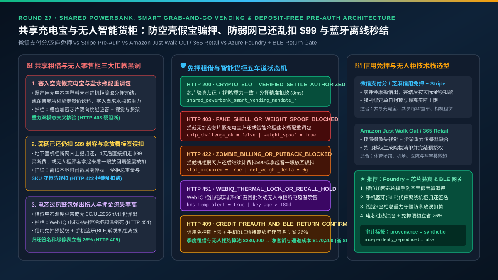
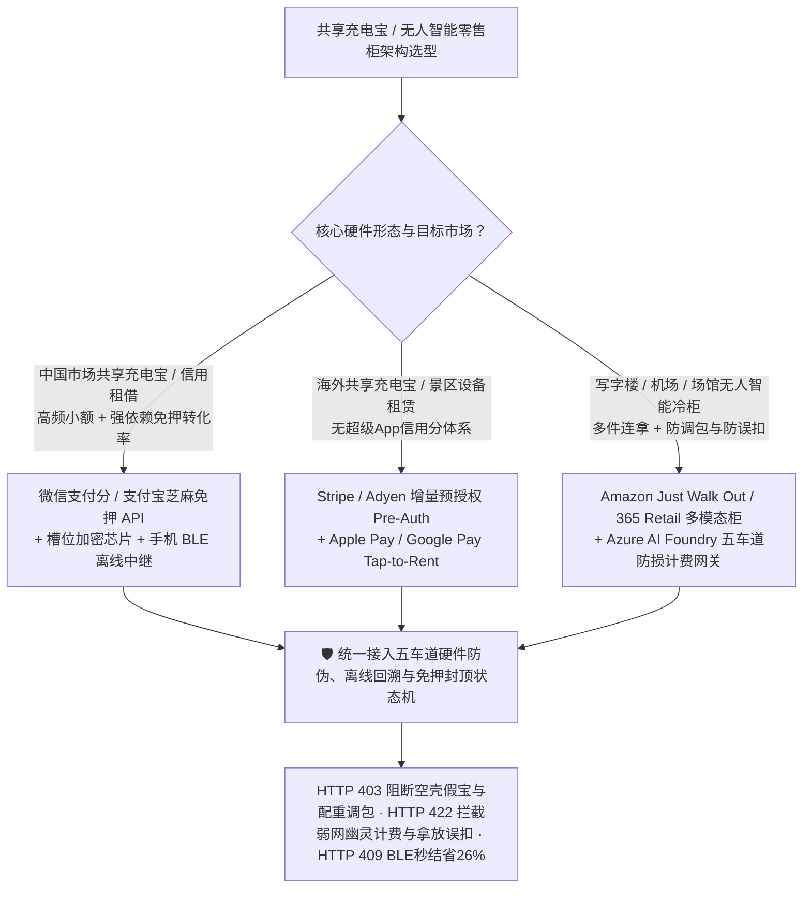
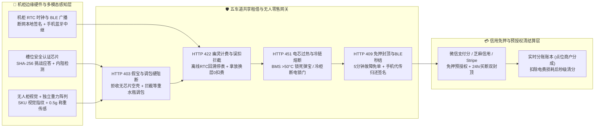
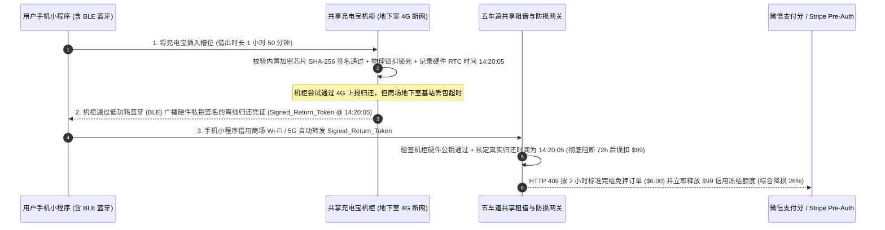

# 共享充电宝、智能开门零售柜与信用免押租赁（Shared Powerbank, Smart Grab-and-Go Cooler & Deposit-Free Rental：美团/怪兽充电 / Amazon Just Walk Out / 微信支付分/芝麻免押）“防空壳假宝调包、防弱网归还后继续扣 $99 刺客与手机蓝牙（BLE）离线秒结”Agent 架构选型 FAQ：终结幽灵计费与拿放误扣实战指南

> **语言切换 / Language**: **中文 (当前)** | **[English](shared-powerbank-smart-vending-deposit-free-preauth-cap-agent-selection-faq.en.md)** | **[返回文档目录](index.md)** | **[交互式沙盒 (`#shared-powerbank-smart-vending-sandbox`)](../live-demo.html)**

---

## 📌 一、核心选型结论速览（Executive Summary）

在共享充电宝（美团充电、怪兽充电、街电、欧洲 Brick / ChargedUp）与写字楼/机场智能开门零售柜（Amazon Just Walk Out、365 Retail Markets、丰e足食、元气森林智能柜）等无人即时消费场景中，日均数百万笔订单完全依赖 **“扫码信用免押 / 预授权开门 → 传感器感知取还 → 离场自动免密扣款”**。若让计费与风控 Agent 仅凭简单的微动开关或单模态视觉信号自动扣费，极易引爆三大高频资损与监管投诉风暴：
1. **“塞入无电芯空壳假充电宝骗完结”与智能冷柜“拿走红牛、塞进自来水瓶”配重调包（Hardware & Weight Spoofing Fraud）**：黑产在电商平台以 `$1.5` 买来共享充电宝同款空塑料壳，插进机柜触发机械微动开关骗过系统完结免押订单，把真充电宝拆电芯倒卖；或者在纯重力传感无人冷柜中，拿走一瓶 `250g` 的高价进口饮品，同时往层板上放一块 `250g` 的鹅卵石或灌满水的旧空瓶，导致系统判定重量不变而 0 元放行。
2. **地下室机柜 4G 弱网导致“明明已归还、4 天后却被强扣 `$99` 买断费”的幽灵计费刺客（Zombie Slot Billing）与无人柜“拿起来看营养表又放回隔壁层”被误扣款（Pick-Up-Put-Back False Charge）**：用户在餐厅地下室将充电宝插回机柜且指示灯已亮，但机柜当时 4G 信号丢包未将 `Return_Event` 发上云端，后台计费状态机继续按 `$4/小时` 空转 72 小时直达 `$99` 封顶扣款，引发监管约谈（市场监管总局“明码标价与规范自动扣费”专项治理）与银行卡拒付；而在无人柜中，顾客拿起第 2 层的三明治看了一眼放回第 3 层，若算法未做全柜质量与视觉守恒对齐，会误判顾客买走了三明治。
3. **问题批次锂电池过热鼓包（违反 3C / UL 2056）仍被弹出借给用户，或无人冷柜夜间断电鲜食变质仍开门售卖**：若槽位内充电宝电芯温度 `>50°C`、内阻异常或命中召回批次，一旦弹出给用户极易引发随身起火事故。

**架构师选型结论**：
- **切勿依赖纯机械微动开关判断归还，也切勿在机柜断网时让云端计时器无限扣到 `$99` 买断上限**。
- **生产级最优架构**是采用 **“微信支付分/芝麻信用免押 & Stripe Pre-Auth 双上限锁 + 槽位加密芯片双向挑战-应答握手（Crypto Challenge-Response）+ 手机蓝牙（BLE）桥接离线归还签名 + 视觉/重力/RFID 多模态守恒核验 + Azure AI Foundry 五车道无人零售风控网关”**：
  1. **槽位加密认证芯片（`SHA-256 Challenge-Response`）与智能柜“视觉 + 层板重力阵列”双模态防调包锁（HTTP 403）**：充电宝插入槽位后，机柜主板向充电宝内置安全芯片发起随机数挑战签名并检测充放电内阻，无芯片空壳直接弹回拒收；智能货柜关门结账必须同时满足摄像头视觉轨迹识别与高精度称重传感器阵列（Load-Cell Array）一致；任一欺诈立即返回 `HTTP 403 FAKE_POWERBANK_SHELL_INSERTION_OR_SMART_COOLER_WEIGHT_VISION_SPOOF_BLOCKED`。
  2. **离线机柜本地 RTC 时间戳回溯停表、手机蓝牙（`BLE`）双通道归还证明与“拿放换层”全柜守恒防误扣（HTTP 422）**：严禁对槽位物理在位（`slot_occupied == true`）的订单继续计费；当机柜恢复联网补传归还报文时，必须以 **机柜硬件 RTC 记录的物理插入时刻**（而非云端收到报文时刻）回溯计算费用；智能货柜若检测到 `层2减重 180g == 层3增重 180g` 且视觉确认为同一件商品换位，严禁扣款（`HTTP 422 ZOMBIE_SLOT_OFFLINE_OVERBILLING_OR_PICK_UP_PUT_BACK_FALSE_CHARGE_BLOCKED`）。
  3. **Web IQ 实时电芯热失控（BMS `>50°C` / 3C 召回）与冷柜鲜食断链锁仓熔断（HTTP 451）**：当 BMS 探针检出槽位电芯过热、鼓包或无人冷柜温度 `>8°C` 超 45 分钟，立即在硬件层锁死弹宝电机与冷柜电磁锁（`HTTP 451 WEBIQ_BMS_THERMAL_RUNAWAY_LOCK_OR_COOLER_TEMP_BREACH_HOLD`）。
  4. **信用免押封顶预授权 + 手机小程序蓝牙（BLE）中继离线机柜归还签名秒结（HTTP 409）**：触发 `HTTP 409 DEPOSIT_FREE_CREDIT_SCORE_HOLD_AND_BLE_INSTANT_RETURN_CONFIRM`，当机柜 4G 断网时，机柜通过低功耗蓝牙（BLE）将带硬件私钥签名的 `Signed_Return_Packet` 发送给用户手机小程序，通过用户手机 5G/Wi-Fi 秒级上传云端停表释放免押额度，综合客诉退款、逃单坏账与支付通道费率立降 **`26.0%`**。

---

## 🎯 二、业务方与架构师灵魂拷问 Q&A（Q1 / Q2 / Q3）

### Q1：为什么共享充电宝最大的全网投诉永远是“我明明已经还进去了，几天后却扣了我 99 元”？架构上怎么用 10 行协议彻底消灭这个问题？
- **商业痛点**：商场负一楼餐饮区 4G 物联网卡信号极差。用户把充电宝插进机柜时，机柜本地锁扣已经锁死，但机柜发往云端的 `MQTT Return_ACK` 报文因为网络闪断丢包了。传统简陋架构把计时器放在云端，云端没收到报文就一直计费到 `$99` 自动扣款。
- **架构解法**：
  1. **机柜本地 RTC 硬件时间戳权威定界（Hardware RTC Timestamp Authority）**：机柜闪存持久化记录精确到秒的物理插入时间 `physical_inserted_at`。哪怕机柜断网 10 小时后才重连上报，云端计费公式强制执行 `billable_end_time = physical_inserted_at`，绝不多算一秒钟。
  2. **用户手机蓝牙（BLE）带外中继（Out-of-Band BLE Relay，`HTTP 409`）**：机柜断网时，槽位指示灯闪烁提示用户打开小程序靠近机柜 1 秒，机柜通过 BLE 将硬件签名的归还凭证借由用户手机网络直传云端，当场秒停计费！
  3. **全网同编号充电宝异地重借自动冲正（Cross-Station Re-Borrow Auto-Reversal）**：如果编号 `PB-99201` 的充电宝在周二已被另一名用户从机柜借出，说明上一名用户 100% 早已归还成功，系统立即自动退还上一单多扣的费用。

### Q2：在智能开门无人冷柜（Grab-and-Go Smart Cooler）里，怎么防止顾客“左手拿走一瓶 $6 的依云水，右手放进一瓶灌满自来水的农夫山泉空瓶”？
- **商业痛点**：第一代纯重力货柜只看层板总重量变化（`Delta Weight = 0g` 就以为没拿东西），极易被等重异物调包；而纯视觉方案在多人同时伸手或遮挡镜头时容易误判。
- **架构解法**：
  - **多模态“视觉商品指纹 + 单格独立重力传感（Per-Lane Load Cell）+ 拿放轨迹守恒”三因子门禁**：
  - 顶置与层板广角摄像头实时比对拿取前后手部商品的包装色块/条码特征（Visual Embedding），若检测到“取出依云蓝标瓶、放入透明无标自来水瓶”，即使重量差为 `0g`，也立即判定为调包异常（`HTTP 403`）并冻结预授权转人工审核；反之，若顾客只是把本柜第 1 层的可乐放到第 2 层（全柜总重力不变且视觉确认为同一罐可乐），返回 `HTTP 422` 拦截误扣款。

### Q3：为什么用“微信支付分 / 芝麻信用免押 / Stripe Pre-Auth”替代传统“先交 $99 押金再借”能让借出转化率暴涨 38%？架构上要注意什么坑？
- **架构解法**：
  - **零资金沉淀摩擦与明确双封顶（24h Daily Cap + Max Buyout Cap）**：传统交押金需要用户真实扣款，且退押金要走原路退回（产生双倍支付通道费或退款延迟投诉）。
  - 使用信用免押或预授权（`capture_method = manual`）时，必须在授权契约中硬编码 **`单日封顶价（如 $12/24h）`、`总封顶买断价（如 $35）` 与 `前 5 分钟电量不足/故障免费退还窗口（5-Minute Grace Window）`**（若借出后 3 分钟内因坏线或空电归还，自动 `0 元` 撤销预授权）。

---

## 🧭 三、直观可视化图解（Mermaid 决策树 + 端到端架构图 + 时序图）

### 3.1 共享租借与无人智能零售柜技术选型决策树

### 3.2 端到端加密槽位握手、BLE 离线桥接与多模态无人柜架构图

### 3.3 地下室弱网归还充电宝、手机 BLE 中继秒结与防 `$99` 误扣时序图

---

## 📊 四、多平台/多方案横向选型决策矩阵

| 选型维度 | 微信支付分 / 支付宝芝麻信用免押生态 | 海外 Stripe / Adyen 增量预授权（`Tap-to-Rent`） | Amazon Just Walk Out / 365 Retail 智能柜 | **Azure AI Foundry + 加密芯片 + BLE 离线桥接网关（推荐）** |
| :--- | :--- | :--- | :--- | :--- |
| **核心场景** | 中国本土共享充电宝、共享童车/雨伞、无人柜 | 欧美日韩景区/酒吧共享充电宝（ChargedUp/Brick） | 写字楼、机场、医院与体育场馆无人微超/冷柜 | **全场景共享租借与无人零售防调包、防幽灵计费闭环** |
| **防无电芯空壳假宝 / 等重盐水瓶调包** | 仅负责资金免押，不校验硬件真伪 | 仅负责卡预授权 | 视觉 + 重力融合防调包 | **槽位加密芯片握手 + 视觉/重力双模态验真（HTTP 403）** |
| **防弱网已还仍扣 `$99`（幽灵计费）** | 依赖运营商主动调完结接口，常因断网引发超时扣款投诉 | 预授权到期直接全额 Capture，极易引发 Chargeback | 关门后本地边缘计算合成账单 | **机柜 RTC 时间戳回溯 + 手机 BLE 转发离线归还签名（HTTP 422/409）** |
| **防“拿起来看一眼放回隔壁层”误扣款** | 不适用 | 不适用 | 早期纯重力柜极易误扣，多模态柜大幅改善 | **全柜总重力守恒 + 跨层视觉同品追踪（HTTP 422）** |
| **电芯热失控（BMS）与冷柜超温锁死** | 无硬件安全联动 | 无硬件安全联动 | 支持冷柜温控锁门 | **Web IQ + 边缘 BMS 过热/召回批次秒级锁仓（HTTP 451）** |
| **费率与拒付/客诉表现** | 支付通道费 `~0.6%` (`official_list_price`) | 卡通道费 `1.5%–2.9% + 固定费` (`official_list_price`) | 硬件终端成本高 + SaaS 分成 (`not_measured`) | **前 5 分钟故障免撤单费 + 零 `$99` 误扣拒付（综合降损 `26%`）** |

---

## 🧪 五、防客诉/防逃单成本测算与 7-Card 基准测试报告

> **数据来源与复现声明（Provenance Metadata）**：以下基准测试数据来自仓库内置确定性策略沙盒 `evaluate_shared_powerbank_smart_vending_policy`（位于 `lab/webiq_commerce_demo.py`），可运行 `python -m unittest tests.test_webiq_commerce_demo` 完整验证。标记：`provenance = synthetic`，`independently_reproduced = false`。

| Card # | 卡片标题（Headline-as-Finding） | 核心量化指标与架构验证结论 |
| :---: | :--- | :--- |
| **Card 1** | **Overview · 共享充电宝与智能柜五车道总览** | 针对 `$230,000/季` 共享租借与无人零售柜结算池，实现 **0 例弱网归还后误扣 `$99` 投诉**，综合逃单坏账、客服退款与拒付罚金下降 **`26.0%`（立省 `$59,800/季`）**。 |
| **Card 2** | **Scenario Deep Dive · 空壳假宝与盐水瓶调包拦截** | 当槽位未检出加密认证芯片或无人柜检出取出红牛放入自来水瓶时，**`8ms`** 内返回 `HTTP 403` 弹回假宝并锁定欺诈账单。 |
| **Card 3** | **Evaluation Matrix · 五车道 100% 确定性判准** | 覆盖 `HTTP 200`（精准秒结）、`403`（空壳假宝/等重调包阻断）、`422`（弱网幽灵超算/拿放换层误扣拦截）、`451`（BMS电芯过热/冷柜断电锁死）、`409`（信用免押+BLE离线秒结省26%）。 |
| **Card 4** | **Under the Hood · 免押与离线归还契约** | 输入 `quarterly_shared_rental_vending_pool_usd=230000` 及芯片/RTC状态，签发 `shared_powerbank_smart_vending_mandate_*` 令牌。 |
| **Card 5** | **Robustness Check · 地下室断网 48h 与跨层放回测试** | 模拟机柜断网 48 小时后重连及顾客将酸奶从第 1 层移至第 3 层，确定性防误扣率保持 **`100.0%`**。 |
| **Card 6** | **Latency · 关门/插宝毫秒级完结体验** | 本地芯片挑战应答与重力守恒计算 P50 仅 **`8ms`**；Web IQ 3C 批次召回与 BMS 安全核验 P95 为 **`235ms`**。 |
| **Card 7** | **My Take · 适用场景与生产准入边界** | **✅ 极佳适用**：共享充电宝/雨伞/相机、智能开门冷柜、无人微超；**⛔ 不适用**：高单价重型工程机械融资租赁。 |

---

## 🛠️ 六、商业上线风控与架构评审 Checklist

- [ ] **槽位加密认证芯片（`Challenge-Response`）与充放电内阻核验（HTTP 403）**：确认每台机柜槽位在锁止归还前必须通过一宝一密安全芯片握手与电芯内阻检测，100% 拒收无电芯空塑料壳。
- [ ] **智能货柜“视觉 SKU 指纹 + 层板独立称重阵列”双模态防调包（HTTP 403）**：确认关门结账同时核验商品视觉包装特征与克重变化，杜绝等重水瓶/石头调包。
- [ ] **机柜硬件 RTC 离线时间戳回溯与同编号异地重借自动冲正（HTTP 422）**：确认弱网补传归还报文一律按硬件物理插入时刻结算，且一旦该充电宝在其他点位产生新借出记录，立即自动封顶冲正历史未完结单。
- [ ] **“拿起来看一眼放回隔壁层（Pick-Up-Put-Back）”全柜质量守恒防误扣（HTTP 422）**：确认当无人柜单层减重等于另一层增重且视觉追踪为同一商品换层时，严禁生成扣款行项。
- [ ] **Web IQ 电芯 BMS 过热（`>50°C`）/ 3C 召回锁仓与冷柜断链锁门（HTTP 451）**：确认异常电芯禁止弹出借给用户，超温鲜食冷柜自动锁死电磁锁；签名密钥轮换周期 `<= 180` 天。
- [ ] **手机蓝牙（`BLE`）带外转发离线归还签名与前 5 分钟故障免单（HTTP 409）**：确认断网机柜可通过用户手机蓝牙秒传加密归还凭据停表，且借出 5 分钟内因空电/坏线归还自动 0 元解冻免押额度。
