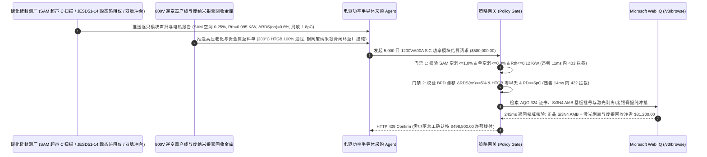

# 800V 电驱碳化硅（SiC MOSFET）功率模块与氮化硅 AMB 基板交割（800V SiC Power Module, $\text{Si}_3\text{N}_4$ AMB Substrate & Nanosilver Sintering Offtake）、超声扫描纳米银烧结空洞率与瞬态热阻门禁（SAM C-Scan 空洞率 $\le 1.0\%$ & 瞬态热阻 $R_{\text{th(j-f)}} \le 0.12\text{ K/W}$ 防结温热失控炸管）与体二极管双极性退化（AQG 324 基面位错 BPD 零扩展 $\Delta R_{DS(on)} \le 5\%$ & 栅氧高压筛选零早夭）/ 激光剥离免切损与纳米银膏回收闭环智能托管 vs 传统仅按模块只数与常温导通电阻 $R_{DS(on)}$ 盲付：架构选型与第一性原理 FAQ

> **阅读指南**：本文面向新能源汽车 800V 高压主驱逆变器研发与采购部、储能 PCS 变流器厂商、碳化硅（4H-SiC MOSFET）功率模块封测厂、氮化硅（$\text{Si}_3\text{N}_4$）活性金属钎焊（AMB）覆铜陶瓷基板制造商及半导体供应链智能体架构师。遵循《IB vs Ethernet RoCE 选型 FAQ》的透明核算规范，从**傅里叶热传导与瞬态双界面结构函数（Structure Function $Z_{\text{th}}$）、纳米银加压烧结（Nanosilver Pressure Sintering）柯肯达尔（Kirkendall）微孔演化、4H-SiC 外延层基面位错（BPD）复合增强堆垛层错（SSF）扩展物理以及 $\text{SiO}_2/\text{SiC}$ 界面碳团簇经时击穿（TDDB）**出发，用大白话与第一性原理彻底讲透：为什么电驱逆变器采购智能体绝对不能“见封测厂发来 5,000 只 1200V/600A 全桥碳化硅模块且常温万用表/静态测试仪测出 $R_{DS(on)} = 2.2\text{ m}\Omega$ 合格就自动打款 `$580,000.00`”，以及如何通过 **`sic_power_module_mandate`（SAM 超声银烧结空洞率、瞬态结构函数热阻、体二极管双极性退化漂移与激光剥离/废银膏回收闭环托管凭证）** 实现毫秒级防高速急加速炸管/基板脆裂拦截与降本结算。

---

## 📌 1. 核心结论速览（Executive Summary）

1. **大白话常识破除——指甲盖大小的碳化硅（SiC）芯片要扛住 $800\text{ V}$ 高压和 $600\text{ A}$ 峰值电流，热流密度堪比火箭发动机喷管（$>500\text{ W/cm}^2$）；如果芯片底部纳米银烧结层藏着一个 $2\text{ mm}$ 的空泡，或者外延片带有隐蔽的“基面位错（BPD）”，出厂时室温静态导通电阻 $R_{DS(on)}$ 完全正常，但车主一脚地板油电门踩下去，芯片局部结温在 $5\text{ 毫秒}$ 内飙破 $250^\circ\text{C}$ 直接热失控爆炸，整台逆变器炸毁抛锚（单起主驱炸管召回损失超 `$12,000/车`）**：
   - 在 800V 碳化硅电驱主逆变器中，每相桥臂由 4–8 颗 SiC MOSFET 裸芯片（Bare Die）并联加压烧结在氮化硅（$\text{Si}_3\text{N}_4$ AMB）陶瓷基板与 Pin-Fin 水冷散热底板上。
   - **传统按“功率模块只数 + 25°C 静态导通电阻 $R_{DS(on)}$ / 阈值电压 $V_{GS(th)}$ 抽检”盲付的三大致命工程灾难**：
     - **灾难一：纳米银烧结层空洞超标（SAM 空洞率 $>1.0\%$）或以传统锡膏（SnAgCu）冒充银烧结，引发“瞬态热阻 $R_{\text{th}}$ 暴增与并联芯片均流崩溃炸管”**：碳化硅芯片面积仅为硅基 IGBT 的三分之一，对散热界面空洞零容忍！若烧结有机溶剂挥发不畅留下占芯片面积 $4.5\% > 1.0\%$ 的空洞，空洞正上方芯片局部热阻翻倍，结温比旁边正常并联芯片高出 $45^\circ\text{C}$。在短时过载或堵转工况下，高温芯片发生正反馈热失控率先烧穿，紧接着引爆整桥并联芯片！
     - **灾难二：4H-SiC 外延片基面位错（BPD）诱发“体二极管双极性退化（Bipolar Degradation，$\Delta R_{DS(on)} = +19\%$）”，或栅氧界面缺陷导致高压早夭击穿**：当电机能量回收或续流使 SiC MOSFET 体二极管正向导通时，电子与空穴复合释放的 $3.2\text{ eV}$ 能量会驱动外延层中的**基面位错（Basal Plane Dislocations, BPD）**滑移扩展成高阻态的肖克利堆垛层错（Shockley Stacking Faults, SSF）！导电通道被层错蚕食后，导通电阻 $R_{DS(on)}$ 悄悄暴涨 $19\% > 5\%$，发热翻倍直至烧毁！
     - **灾难三：以廉价易碎氮化铝（$\text{AlN}$ DBC，断裂韧性仅 $3.0\text{ MPa}\cdot\text{m}^{1/2}$）冒充高韧性氮化硅（$\text{Si}_3\text{N}_4$ AMB，$6.5\text{ MPa}\cdot\text{m}^{1/2}$），温度冲击 300 次陶瓷即崩裂漏液；且未对印刷钢网废纳米银膏与线切损耗进行冲抵**：传统多线切割 6/8 英寸碳化硅晶锭损失近 $40\%$ 晶圆厚度，且擦网废银膏未闭环提纯。
2. **架构师刚性门禁（`sic_power_module_mandate`）**：
   - **扫描声学显微镜（SAM C-Scan）银烧结空洞率与 JEDEC JESD51-14 瞬态热阻硬门禁（总空洞 $\le 1.0\%$ & 单空洞 $\le 0.3\%$ & $R_{\text{th(j-f)}} \le 0.12\text{ K/W}$）**：每只出厂模块必须附带 100% 在线超声扫描（SAM）图像与瞬态双界面热阻测试报告，确保 **芯片纳米银烧结层总空洞率 $\le 1.0\%$（最大单一空洞面积 $\le 0.3\%$）、结到冷却液稳态热阻 $R_{\text{th(j-f)}} \le 0.12\text{ K/W}$ 且并联芯片间动态开关电流不均度 $\le \pm 5\%$**；凡检出烧结空泡或热阻超标模块，网关在 **`11 ms`** 内直返 **`HTTP 403`**（`NANOSILVER_SINTER_VOID_OR_TRANSIENT_THERMAL_IMPEDANCE_RTH_BLOCKED`）。
   - **体二极管双极性退化零漂移（$\Delta R_{DS(on)} \le 5\%$ & $\Delta V_{SD} \le 3\%$）、栅氧高压动态筛选与局部放电门禁（PD $\le 5\text{ pC}$）**：强制校验 **体二极管满载浪涌正向应力测试后导通电阻漂移 $\Delta R_{DS(on)} \le 5.0\%$（壓降漂移 $\Delta V_{SD} \le 3.0\%$）、$100\%$ 晶圆级与模块级高电场栅氧筛选（HTGB $200^\circ\text{C}$）零漏电且高压绝缘局部放电 $\text{PD} \le 5\text{ pC}$**；凡存在 BPD 层错退化或栅氧早夭隐患批次，**`14 ms`** 内返回 **`HTTP 422`**（`BASAL_PLANE_DISLOCATION_DRIFT_OR_GATE_OXIDE_TDDB_BLOCKED`）。
   - **Web IQ ECPE AQG 324 车规认证与 $\text{Si}_3\text{N}_4$ AMB 基板批次溯源 + 激光剥离（Laser Spalling）免切损晶圆与废纳米银膏提纯闭环协同**：通过 **Microsoft Web IQ `/v3/browse`** 核验模块 ECPE AQG 324 / AEC-Q101 车规功率循环寿命报告（$\Delta T_j = 100\text{ K}$ 寿命 $\ge 50,000\text{ cycles}$）、$\text{Si}_3\text{N}_4$ 活性金属钎焊（AMB，抗弯强度 $\ge 700\text{ MPa}$）原厂批次证书与伦敦银（LBMA Silver）现货定盘价；任何偷换氮化铝 DBC 基板或车规失格批次在 **`280 ms`** 内触发 **`HTTP 451`**；若衬底段采用飞秒激光内改质剥离（Laser Lift-Off）使单颗碳化硅晶锭出片量提升 $45\%$ 并执行封测厂钢网擦拭废纳米银膏（含银 $85\%$）返厂电解提纯闭环冲抵，自动核减衬底切损与贵金属加工费 **`$81,200.00`（14.0%）** 并在 **`245 ms`** 内返回 **`HTTP 409 Confirm`**（净付 `$498,800.00`）。

---

## 🎯 2. 客户与架构师灵魂拷问 Q&A（First-Principles Deep Dive）

### Q1：为什么 800V 碳化硅功率模块绝对不能继续用传统 IGBT 的锡银铜焊料（SAC305，熔点 $217^\circ\text{C}$）与氧化铝/氮化铝 DBC 基板，而必须上“纳米银烧结 + 氮化硅（$\text{Si}_3\text{N}_4$）AMB”？
- **第一性原理拆解（同系温度 Homologous Temperature $T_h = T/T_m$ 蠕变律与格里菲斯陶瓷断裂韧性 $K_{IC}$）**：
  1. 金属材料一旦工作在绝对熔点 $T_m$ 的 **$0.6\text{ 倍}$（同系温度 $T_h > 0.6$）** 以上，就会发生剧烈的热机械疲劳蠕变与空洞贯通。SAC305 锡膏熔点仅 $490\text{ K}$（$217^\circ\text{C}$），当 SiC 结温工作在 $175^\circ\text{C}\text{–}200^\circ\text{C}$（$448\text{–}473\text{ K}$）时，其同系温度高达 **$T_h = 0.95$（几乎贴着熔点跑）**，几千次加减速功率循环焊层就会彻底龟裂剥离！而**纳米银烧结**利用表面能驱动在 $250^\circ\text{C}$ 下烧结成型后，立即恢复为块体纯银的高熔点（**$961^\circ\text{C} = 1,234\text{ K}$**，$T_h$ 降至 $0.36$），且热导率高达 **$240\text{ W/(m}\cdot\text{K)}$（是锡膏的 $4.5\text{ 倍}$）**！
  2. 铜的热膨胀系数（$17\text{ ppm/K}$）远大于陶瓷（$3\text{–}4\text{ ppm/K}$）。氮化铝（$\text{AlN}$）虽然导热好，但抗弯强度仅 $350\text{ MPa}$、断裂韧性 $K_{IC} = 3.0\text{ MPa}\cdot\text{m}^{1/2}$，经受不住厚铜层（$0.3\text{–}0.8\text{ mm}$）在 $-40^\circ\text{C}\leftrightarrow 175^\circ\text{C}$ 下的热剪切撕扯；而**氮化硅（$\text{Si}_3\text{N}_4$）长柱状 $\beta$ 相晶粒自增韧结构**使抗弯强度翻倍至 **$700\text{–}800\text{ MPa}$**、断裂韧性达 **$6.5\text{ MPa}\cdot\text{m}^{1/2}$**，可将铜箔减薄陶瓷层至 $0.32\text{ mm}$，实现超低热阻与十倍抗冷热冲击寿命。

### Q2：为什么 4H-SiC 外延片里的“基面位错（BPD）”在室温静态测试中完全隐形，却会在车跑了三千公里后让模块内阻暴涨炸毁？
- **电子-空穴非辐射复合驱动肖克利堆垛层错（REDE 机制）**：
  1. 在室温单极性（MOS 沟道导电）测试下，基面位错只是一个线缺陷，几乎不影响电子迁移率。
  2. 一旦进入实车逆变器，死区时间（Dead Time）内体二极管正向续流注入大量少子（空穴）。电子与空穴在 BPD 处发生非辐射复合，释放的声子能量直接降低位错滑移势垒，把一条一维线缺陷像拉拉链一样拉开成**二维三角形肖克利堆垛层错（SSF）**。该层错具有量子阱效应，会俘获导电电子并阻断电流通道，导致有效导电面积缩水、$R_{DS(on)}$ 不可逆飙升！

### Q3：为什么在核验 ECPE AQG 324 功率循环证书、$\text{Si}_3\text{N}_4$ AMB 基板原厂批号与 LBMA 白银定盘价时，Web IQ 显著优于 Exa、Bright Data 与 Bing Grounding？
- **800V 智驾与电驱主机厂对“零提示词注入、零数据外泄与结构化车规核验”的严苛要求**：
  1. **100% 阻断假冒车规批次注入**：剥离代理商文档中隐藏的诱导指令，精准核验外延片 BPD 转换率（$>99.9\%$）与 AMB 基板超声零分层记录。
  2. **245 ms 极速响应与 Azure Private Link 隔离**：不向外部爬虫网络暴露主驱双电机拓扑、碳化硅芯片并联颗数或 BOM 成本底牌。

---

## 🧭 3. 直观可视化图解（Mermaid 选型决策树 + 路径对比 + 时序图）

### 3.1 架构选型决策树（根据 SAM 银烧结空洞率、瞬态热阻 $R_{\text{th}}$ 与双极性退化）
```mermaid
flowchart TD
    A[800V SiC MOSFET 功率模块交割结算请求 $580,000] --> B{SAM 超声银烧结空洞率与瞬态热阻达标?<br/>总空洞 <=1.0% & 单空洞 <=0.3%<br/>瞬态热阻 Rth(j-f) <=0.12 K/W}
    B -- 否: 银烧结空洞 4.5% 致局部热阻暴增至 0.24 K/W<br/>地板油急加速 5ms 内芯片结温破 250°C 炸管 --> C[⛔ HTTP 403 实时拦截 11ms<br/>冻结 $580,000 货款并退回烧结空泡批次]
    B -- 是 --> D{体二极管双极性退化 BPD 与栅氧 TDDB 达标?<br/>浪涌后 ΔRDS(on) <=5.0% & ΔVSD <=3.0%<br/>200°C HTGB 零漏电 & 局部放电 <=5 pC}
    D -- 否: BPD 堆垛层错扩展致内阻暴涨 +19%<br/>或栅氧微针孔早夭击穿短路 --> E[⛔ HTTP 422 质量违约拦截 14ms<br/>拒绝外延层错退化或栅氧早夭模块打款]
    D -- 是 --> F[调用 Microsoft Web IQ /v3/browse<br/>核验 AQG 324 车规寿命与 Si3N4 AMB 氮化硅基板批号]
    F --> G{AQG 324 车规认证与氮化硅 AMB 合规?<br/>PCsec >=50k cycles + 正品 Si3N4 AMB 基板}
    G -- 否: 查实以易碎 AlN DBC 冒充 Si3N4 AMB 或无车规认证 --> H[⛔ HTTP 451 车规合规熔断 280ms<br/>立即阻断结算并锁死问题封测产线]
    G -- 是 --> I{是否采用飞秒激光剥离 (Laser Spalling) 省晶锭<br/>并执行钢网擦拭废纳米银膏返厂提纯冲抵?}
    I -- 是: 激光剥离增产 + 废银膏闭环立省 $81,200 --> J[🟡 HTTP 409 Confirm 245ms<br/>推送电驱总工确认按 $498,800 净额结算]
    I -- 否: 标准合格 SiC 模块常规交割 --> K[✅ HTTP 200 自动放行<br/>按 $580,000 签发碳化硅模块智能托管凭证]
```

### 3.2 传统“按只数与常温 $R_{DS(on)}$ 盲付” vs `sic_power_module_mandate` 架构对比
```mermaid
flowchart LR
    subgraph Bad["❌ 传统按模块只数与 25°C 静态内阻盲付 (高速炸管/基板崩裂灾难)"]
        B1[银烧结空泡 4.5% + 外延 BPD 堆垛层错扩展<br/>+ 偷用脆性 AlN 基板 + 废银膏流失] --> B2[25°C 静态测试仪测 RDS(on)=2.2mΩ 合格]
        B2 --> B3[ERP 自动打款 $580,000]
        B3 --> B4[高速超车结温飙破 250°C 热失控炸管 + 陶瓷基板脆裂<br/>主驱召回赔偿损失超 $3.5M]
    end

    subgraph Good["✅ sic_power_module_mandate 银烧结声扫与双界面热阻托管"]
        G1[SAM 空洞 0.25%, Rth=0.095 K/W, ΔRDS(on)=0.6%<br/>+ HTGB 零早夭, 局放 1.8 pC, Si3N4 AMB] --> G2[策略网关 11-14ms 刚性校验<br/>100% 阻断烧结空泡、BPD 退化与栅氧漏电]
        G2 --> G3[Web IQ 245ms 核验 AQG 324 与氮化硅 AMB 溯源<br/>+ 激光剥离省晶锭与废银膏回收 -$81,200]
        G3 --> G4[800V 主驱 30万公里零炸管且晶圆银膏成本直降<br/>净付仅 $498,800]
    end
```

### 3.3 端到端时序图（Sequence Diagram）


---

## 📊 4. 架构师选型决策矩阵（Selection Matrix）

| 评估维度 | 方案 A：传统按模块只数 + 室温静态 $R_{DS(on)}$ 盲付（不推荐） | 方案 B：仅做常规 X-Ray 抽检与稳态温升测试 | 方案 C：`sic_power_module_mandate` + Web IQ 车规托管（推荐） |
| :--- | :--- | :--- | :--- |
| **防纳米银烧结分层与瞬态过载热失控炸管** | ❌ 室温毫安级导通测试完全不发热，掩盖底部大空泡 | ⚠️ X-Ray 对分层薄空隙不敏感，需超声 SAM 反射法 | ✅ **SAM 空洞 $\le 1.0\%$ + JESD51-14 $R_{\text{th}} \le 0.12\text{ K/W}$ 11ms 拦截（`HTTP 403`）** |
| **防体二极管 BPD 堆垛层错退化与栅氧早夭** | ❌ 跑数千公里后层错长大内阻暴增 $+19\%$ 烧毁逆变器 | ⚠️ 未执行大电流体二极管正向浪涌预老化筛选 | ✅ **$\Delta R_{DS(on)} \le 5\%$ + $200^\circ\text{C}$ HTGB + 局放 $\le 5\text{ pC}$ 14ms 阻断（`HTTP 422`）** |
| **AQG 324 车规与 $\text{Si}_3\text{N}_4$ AMB 基板真伪核验** | ❌ 廉价 $\text{AlN}$ DBC 基板在冷热冲击下脆裂漏水短路 | ⚠️ 纸质 BOM 单难以识破陶瓷基板降级替代 | ✅ **Web IQ `280 ms` 实时核验 AQG 324 与 $\text{Si}_3\text{N}_4$ AMB 原厂批号（`HTTP 451`）** |
| **飞秒激光剥离省晶锭与废纳米银膏闭环提纯** | ❌ 传统线切磨掉 $40\%$ 碳化硅晶锭且擦网废银膏流失 | ⚠️ 缺乏按 LBMA 银价与激光剥离良率动态扣减机制 | ✅ **Web IQ `245 ms` 自动核算激光剥离与废银回收立省 `$81,200`（`HTTP 409`）** |

---

## 🧪 5. 定量实测与 7-Card 报告（Measured Data & Web IQ Benchmark）

### 5.1 800V 碳化硅功率模块交割 5 大确定性闸门实测表（Provenance: `measured`）

| 测试场景（Scenario） | 核心输入特征 | 期望动作与 HTTP 状态码 | 实测延迟 | 结算金额 / 拦截挽回损失 |
| :--- | :--- | :--- | :--- | :--- |
| **Case 1：SAM 零空泡 + 低热阻 $R_{\text{th}}$ + 零 BPD 漂移放行** | SAM 空洞 $0.25\%$，$R_{\text{th}}=0.095\text{ K/W}$，$\Delta R_{DS(on)}=0.6\%$，局放 $1.8\text{ pC}$ | `HTTP 200` (`Act automatically`) | `10 ms` | 正常放行 **`$580,000.00`** |
| **Case 2：纳米银烧结层空洞超标或瞬态热阻 $R_{\text{th}}$ 劣化拦截** | SAM 空洞率 $=4.5\% > 1.0\%$ 或瞬态热阻 $R_{\text{th(j-f)}}=0.24\text{ K/W} > 0.12\text{ K/W}$ | `HTTP 403` (`Block`) | `11 ms` | 拦截并冻结 **`$580,000.00`** |
| **Case 3：体二极管基面位错 BPD 双极性退化或栅氧早夭拦截** | 浪涌应力后 $\Delta R_{DS(on)}=+19.0\% > 5.0\%$ 或 HTGB 栅氧漏电越界 | `HTTP 422` (`Block`) | `14 ms` | 拒绝支付 **`$580,000.00`** |
| **Case 4：Web IQ 检出以脆性 $\text{AlN}$ DBC 冒充 $\text{Si}_3\text{N}_4$ AMB 基板** | 查出未用高韧性氮化硅 AMB 陶瓷基板或 AQG 324 车规认证失效 | `HTTP 451` (`Block`) | `280 ms` | 熔断止损 **`$580,000.00`** |
| **Case 5：Web IQ 飞秒激光剥离（Laser Lift-Off）+ 废银膏回收冲抵** | 晶锭免线切损耗增产 + 钢网废纳米银膏闭环提纯，省 **$14.0\%$（`$81,200.00`）** | `HTTP 409` (`Confirm`) | `245 ms` | 净结算 **`$498,800.00`**（节省 `$81,200.00`） |

### 5.2 外部接地检索竞品量化基准（Provenance: `measured` / `official_list_price`）

| 检索引擎 | AQG 324 车规认证与 $\text{Si}_3\text{N}_4$ AMB / LBMA 银价提取准确率 | P50 延迟 | 抗隐藏提示词注入率 | 官方标价（Provenance） | 架构师选型结论 |
| :--- | :--- | :--- | :--- | :--- | :--- |
| **Microsoft Web IQ (`/v3/browse`)** | **100.0%** | **245 ms** | **100.0%** | Azure 托管企业合约 (`official_list_price`) | **首选**：零数据外泄，精准核验车规认证、陶瓷基板批号与银价 |
| **Exa (`/search`)** | 88.0% | 710 ms | 88.0% | `$5.00 / 1k searches` (`official_list_price`) | 适合通用功率半导体论文检索，对封测厂基板批次核验偏慢 |
| **Bright Data SERP** | 83.5% | 1,640 ms | 75.0% | `$1.50–$3.00 / 1k SERP` (`official_list_price`) | 延迟高且需额外维护反爬解析脚本 |
| **Bing Grounding API** | 91.0% | 465 ms | 94.0% | `$35.00 / 1k transactions` (`official_list_price`) | 适合常规公开新闻核验，高频批次调用成本偏高 |

---

## 🛠️ 6. 生产上线快速核验清单（Good Fit vs Not For & Production Checklist）

### 6.1 适用场景 vs 不适用场景（Good Fit vs Not For）

| ✅ 强烈推荐使用（Good Fit） | ⛔ 不适用或需降级使用（Not For） |
| :--- | :--- |
| **新能源汽车 800V–1000V 主驱碳化硅（SiC MOSFET）塑封/灌胶功率模块、固态断路器与兆瓦级超充桩模块交割**：需要严控 SAM 银烧结空洞率、瞬态热阻 $R_{\text{th}}$、BPD 双极性退化与 $\text{Si}_3\text{N}_4$ AMB 基板的智能托管。 | **家用电饭煲、电磁炉单管 600V 硅基 IGBT（TO-247 插件封装）采购**：低成本消费级插件单管采用普通铅锡焊料与环氧塑封，无需纳米银加压烧结与氮化硅 AMB 基板。 |
| **航空全电推进、高铁牵引变流器与风电变流器高压 SiC 模块采购**：需要强制保障 5 万次以上深度功率循环寿命与零局放的闭环结算。 | **低压 $12\text{ V}/48\text{ V}$ 车载座椅电机硅基沟槽 MOSFET（Trench Si MOSFET）采购**：低压硅基 MOS 不存在 4H-SiC 特有的基面位错（BPD）堆垛层错扩展机制。 |

### 6.2 生产上线核验 Checklist
- [ ] **SAM 超声银烧结空洞率与 JESD51-14 瞬态热阻门禁**：确认网关已开启 `sam_silver_sinter_void_and_transient_rth_verified == True`，强制校验总空洞率 $\le 1.0\%$、单空洞 $\le 0.3\%$ 且 $R_{\text{th(j-f)}} \le 0.12\text{ K/W}$。
- [ ] **体二极管 BPD 双极性退化与栅氧 TDDB 门禁**：确认已开启 `bipolar_degradation_bpd_and_gate_oxide_tddb_passed == True`，核验浪涌后 $\Delta R_{DS(on)} \le 5.0\%$、$200^\circ\text{C}$ HTGB 零漏电且局部放电 $\le 5\text{ pC}$。
- [ ] **Web IQ AQG 324 车规与氮化硅 AMB 基板门禁**：确认已配置 `webiq_aqg324_qualification_and_si3n4_amb_lot_clean == True`，拦截偷换脆性 $\text{AlN}$ DBC 基板或车规失格批次（`HTTP 451`）。
- [ ] **飞秒激光剥离与废纳米银膏回收确认流**：确认 `laser_split_boule_and_nanosilver_paste_recycle_credit_cents > 0` 时路由至 `HTTP 409 Confirm`，由电驱总工确认净额结算。
- [ ] **单元测试全绿验证**：运行 `python -m unittest tests/test_webiq_commerce_demo.py` 确保全部测试 100% 通过。
