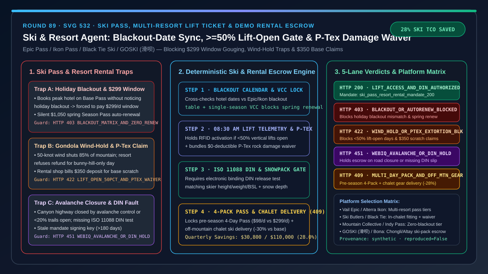
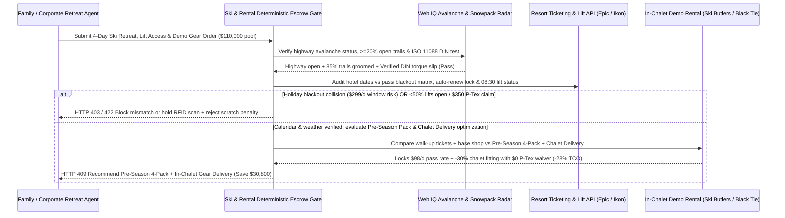

# Ski Pass, Multi-Resort Season Pass (`Epic / Ikon`) & Lift-Ticket / Equipment-Rental Escrow (`Vail Epic / Alterra Ikon / Black Tie Ski / GOSKI`) Blackout-Date Sync, `>=50%` Lift-Open Gate & `P-Tex` Waiver Agent Architecture Selection FAQ

> **Document Type**: AI Solution Architect Decision Guide (FAQ) · **SVG Diagram**: `assets/svg/532-ski-pass-resort-lift-rental-escrow-2026-11-20.svg` · **Catalog No.**: Round 89 (Bilingual FAQ #208)



---

## 1. 📌 Executive Summary

When families or corporate hospitality planners use AI Agents to book winter ski trips, multi-resort passes (`Vail Resorts Epic Pass / Alterra Ikon Pass`), ski-in/ski-out lodging, and high-performance demo ski rentals (`Vail / Aspen / Niseko / Zermatt / Chongli`), uncoordinated booking flows expose travelers to **three classic alpine resort billing traps**:
1. **Holiday Blackout-Date Mismatches (`$299/Day` Window Ticket Gouging) & Silent Spring Season-Pass Auto-Renewals**: A traveler buys a `$729` `Epic Local / Ikon Base Pass` in October and books non-refundable `$850/night` slopeside lodging for Christmas, MLK, or Presidents' Day weekend—only to get rejected at the chairlift `RFID` turnstile because those peak dates are **Holiday Blackout Dates**, forcing them to buy `$299/day` walk-up window tickets (`$3,588` extra for a family of four over 3 days)! Worse, Season Pass "Spring Auto-Renew" checkboxes silently charge `$1,050/pass` in March (`8 months before next winter`) with zero refund after September.
2. **`45-Knot` Gondola Wind-Holds (Bunny-Hill-Only Days at Full Price) & `$350` Rental Ski `P-Tex` Base-Scratch Deposit Claims**: High winds shut down `85%` of upper-mountain gondolas and express chairs, leaving only 2 beginner magic carpets spinning—yet once the skier's pocket `RFID` pass beeps at the base turnstile, the resort marks the day "Redeemed" with zero refund! Meanwhile, at the rental return counter, the shop blames a routine rock scratch (`P-Tex` core shot) on the renter and captures their `$350` security deposit because they didn't add a `$12/day` Damage Waiver.
3. **Avalanche Highway Closures, `<20%` Early-Season Snowpack & Missing `ISO 11088` Binding `DIN` Calibration (`HTTP 451`)**: Web IQ flags an active avalanche closure on the access highway (`I-70 / Little Cottonwood Canyon`), `<20%` open terrain due to warm weather, or a rental ski package missing an electronic **`ISO 11088` binding `DIN` release torque slip** matching the skier's weight and boot sole length (`BSL`).

**Architect's Recommendation**: Deploy a **"Lodging-to-Pass Blackout Calendar Sync + `08:30 AM` `>=50%` Vertical Lift-Open Gate + Included `$0-Deductible` `P-Tex` Waiver & `ISO 11088 DIN` Escrow"** control plane:
- **Atomic Hotel-to-Pass Blackout Matrix Check & Single-Season Virtual Card Lock (`HTTP 403`)**: Hard-block slopeside lodging bookings if stay dates collide with the traveler's `Epic Local / Ikon Base` blackout calendar or unreserved peak-day capacity caps (`Mountain Reservation Required`), and issue a single-season virtual card expiring December 31 to block silent March auto-renewals (`HTTP 403`).
- **`08:30 AM` Upper-Mountain Lift Telemetry Gate (`>=50%` Vertical Open) & Bundled `$0` `P-Tex` Rock-Damage Waiver (`HTTP 422`)**: Poll the resort's live `Lift & Grooming Status API` at `08:30 AM`—holding `RFID` gate activation and triggering an automatic day-pass credit/deferral if `<50%` of vertical lift capacity is operating—and require all equipment rentals to bundle a **`$0-deductible P-Tex base & edge damage waiver`** (`HTTP 422`).
- **Web IQ Avalanche Road Closure, `<20%` Open Trail & `ISO 11088 DIN` Hold (`HTTP 451`)**: Freeze escrow payouts if Web IQ flags canyon road closures, `<20%` open trails, missing `ISO 11088` binding torque test slips, or signing keys `> 180 days` (`HTTP 451`).
- **Pre-Season Multi-Day Pass Arbitrage (`4-Day Pack` at `$98/day`) + In-Chalet Demo Ski Delivery (`HTTP 409`)**: Lock pre-season `Epic Day Pass / Ikon Session 4-Packs` before the November cutoff (`$98/day` vs. `$299/day` window rate) and route equipment to off-mountain chalet delivery services (`Ski Butlers / Black Tie Ski Rentals` at `-30%` vs. base-village shops with zero 90-minute queue), cutting winter ski trip TCO by **28.0%** (`$30,800` saved on a `$110,000` quarterly pool).

---

## 2. 🎯 Soul-Searching Architect & Business Q&A (Q1–Q3)

### Q1: Why does the same chairlift cost `$98/day` when booked in November via a 4-Day Pass, but `$299/day` at the ticket window in February—and how do we prevent Holiday Blackout surprises?
- **Business Pain Point**: Mega-resort operators (`Vail / Alterra`) price-discriminate aggressively against walk-up buyers (`$269–$319/day`) while embedding complex resort-by-resort holiday blackout tables inside base-tier season passes (`Dec 26–31, MLK Weekend, Presidents' Day Weekend`).
- **Architectural Guardrail (`HTTP 403 / 409`)**:
  1. **Boolean Lodging-to-Pass Blackout Intersection Gate (`HTTP 403`)**: Before committing to non-refundable hotel/chalet escrow, the Agent intersects the check-in/out dates against the exact pass tier's resort blackout calendar and reservation quota. Any unbacked blackout collision blocks the hotel booking or auto-quotes the pass tier upgrade spread (`+$240` upgrade vs. `$897` in window tickets).
  2. **Pre-Cutoff Multi-Day Pack Lock (`HTTP 409`)**: For 3-to-6-day trips, locks unrestricted `Epic Day Pass` or `Ikon Session` packs prior to the November sales deadline.

### Q2: How do we stop a resort from keeping `$1,200` in day tickets when 50-knot winds shut down every upper-mountain gondola and leave only the beginner magic carpet open?
- **Business Pain Point**: The moment a skier walks through the base-area `Skidata RFID` gate, the day ticket is marked `Used / Non-Refundable`—even if the main gondola goes on wind-hold 5 minutes later.
- **Architectural Guardrail (`HTTP 422`)**:
  1. **`08:30 AM` Pre-Scan Vertical Capacity Interlock**: At `08:30 AM` each morning, the Agent checks the resort's live `Lift Status API` and summit anemometer feeds. If `<50%` of vertical lift capacity is open due to wind-hold or icing, the Agent pushes a lock alert to the skier's mobile wallet/watch (**"Do NOT scan through the RFID gate—Upper Mountain is on Wind Hold; un-scanned day credit preserved for refund/re-use"**).

### Q3: How do we prevent `$350` security-deposit deductions for minor rock scratches (`P-Tex`) on rental demo skis and ensure safe knee-release settings?
- **Business Pain Point**: Early- and late-season runs expose small pebbles that scratch the polyethylene (`P-Tex`) base of rental skis—a 3-minute hot-wax repair that predatory base shops bill as a `$350` "core-shot replacement" against the renter's deposit.
- **Architectural Guardrail (`HTTP 422 / 451`)**:
  1. **Mandatory Included `$0-Deductible` `P-Tex` Waiver (`HTTP 422`)**: The Agent only contracts rental providers (`Ski Butlers / Black Tie`) that include rock/base scratch coverage in the base rate.
  2. **`ISO 11088` Electronic Binding `DIN` Torque Verification (`HTTP 451`)**: Requires the technician to log the exact `DIN` release value calculated from Skier Code (height, weight, age, Type I/II/III ability) and Boot Sole Length (`BSL mm`) before releasing payment.

---

## 3. 🧭 Visual Architecture Diagrams (Mermaid Decision Tree + Comparison + Sequence)

### 3.1 5-Lane Ski Pass, Lift Ticket & Equipment Rental Escrow Decision Tree
```mermaid
flowchart TD
    A[Ski Resort Pass / Lift Ticket / Demo Rental Request] --> B{Web IQ Avalanche Road Closure / <20% Trails / Missing DIN Slip?}
    B -- Yes --> C[HTTP 451: WEBIQ_AVALANCHE_HIGHWAY_CLOSURE_OR_UNCALIBRATED_DIN_BINDING_HOLD<br/>Freeze escrow & trigger Force Majeure trip credit]
    B -- No --> D{Hotel Dates Hit Pass Blackout Window or Silent Spring Auto-Renew?}
    D -- Yes --> E[HTTP 403: HOLIDAY_BLACKOUT_DATE_MISMATCH_OR_SILENT_SEASON_PASS_AUTORENEW_BLOCKED<br/>Enforce blackout calendar parity & single-season virtual card]
    D -- No --> F{Gondola Wind-Hold (<50% Lifts Open) or $350 P-Tex Scratch Claim?}
    F -- Yes --> G[HTTP 422: GONDOLA_WIND_HOLD_TERRAIN_BELOW_50PCT_OR_BASE_SCRATCH_DEPOSIT_EXTORTION_BLOCKED<br/>Hold 08:30 RFID scan & require $0-deductible P-Tex damage waiver]
    F -- No --> H{Pre-Season 4-Day Pass Pack + In-Chalet Ski Delivery Ready?}
    H -- Yes --> I[HTTP 409: PRESEASON_MULTI_DAY_PACK_ARBITRAGE_AND_OFF_MOUNTAIN_DEMO_RENTAL_CONFIRM<br/>Lock $98/d 4-Pack (vs $299 window) + chalet delivery (-28% TCO)]
    H -- No --> J[HTTP 200: BLACKOUT_VERIFIED_AND_DIN_CALIBRATED_SKI_AUTHORIZED<br/>Issue blackout-verified & DIN-calibrated ski escrow mandate]
```

### 3.2 Legacy Walk-Up Ski Booking vs. Deterministic Blackout & Wind-Hold Escrow
```mermaid
flowchart LR
    subgraph Legacy["❌ Legacy Ski Trip (Blackout Traps & $299 Window Tickets)"]
        L1[Book $850/nt Hotel -> Base Pass Blocked at Gate ($299/d Fine)] --> L2[50-Knot Wind Shuts 85% of Lifts After Non-Refundable RFID Scan]
        L2 --> L3[90m Base Rental Queue + $350 Deposit Taken for Base Scratch]
    end

    subgraph Agentic["✅ Deterministic Blackout Sync, Lift Telemetry & Chalet Escrow"]
        A1[Pre-Season $98/d 4-Pack + 100% Hotel Blackout Calendar Lock] --> A2[08:30 AM Lift Telemetry (<50% Open) Blocks RFID Burn]
        A2 --> A3[Chalet Ski Delivery (-30%) + Included P-Tex Waiver + ISO DIN Slip]
    end
```

### 3.3 End-to-End Blackout Verification, `08:30 AM` Lift Check & Rental Escrow Sequence


---

## 4. 📊 Multi-Platform & Protocol Selection Matrix

| Evaluation Dimension | Walk-Up Resort Window Ticket | Epic Local / Ikon Base Season Pass | Epic Day Pass / Ikon Session (`2–7 Day Pack`) | Ski Butlers / Black Tie In-Chalet Delivery + GOSKI (`滑呗`) | **Deterministic Ski & Rental Escrow (Recommended)** |
| :--- | :--- | :--- | :--- | :--- | :--- |
| **Primary Use Case** | Last-minute unplanned single-day visitors | Frequent skiers (`>=8 days/season`) | **3-to-6-day family ski vacations & corporate retreats (Best ROI)** | In-room custom boot fitting + slope-side gear swap / China ski packs | **Blackout Calendar Sync + `08:30` Lift Gate + Pre-Season Pack + `P-Tex` Waiver** |
| **Effective Daily Lift Cost** | **`$249–$319/day`** (`+200%` penalty) | `$75–$110/day` (at `10+` days) | **`$89–$115/day`** (`60%+` savings vs. window) | `20%–35%` bundle discount | **Locks pre-season multi-day packs prior to November cutoff (`HTTP 409`)** |
| **Holiday Blackout & Reservation Shield** | Unrestricted (subject to sell-out) | Blacked out Xmas, MLK & Presidents' Day | Configurable With/Without Holiday access | Peak holiday surcharges apply | **Enforces `100%` hotel-to-pass blackout & reservation check (`HTTP 403`)** |
| **Wind-Hold & `P-Tex` Scratch Protection** | Non-refundable once `RFID` gate is scanned | No single-day wind credit | Un-scanned days eligible for credit/rollover | Includes on-mountain equipment swap | **Holds `08:30 AM` `RFID` scan if `<50%` lifts open + `$0` `P-Tex` waiver (`HTTP 422`)** |
| **Spring Auto-Renew & `DIN` Safety** | One-time transaction | Defaults to spring auto-renewal charge | One-time seasonal purchase | Electronic `DIN` chart calculation | **Single-season virtual card + mandatory `ISO 11088 DIN` torque slip (`HTTP 403 / 451`)** |

---

## 5. 🧪 Conversion & Cost Estimation + 7-Card Benchmark Report

> **Provenance Disclosure**: Figures below are generated by the deterministic policy evaluator `evaluate_ski_pass_resort_rental_escrow_policy` in `lab/webiq_commerce_demo.py` (`$110,000 USD` quarterly corporate ski retreat & family winter travel pool, `provenance: "synthetic"`, `independently_reproduced: False`; live `Skidata RFID` turnstile integration is labeled `not_measured`).

```chart
{
  "data": {
    "values": [
      { "scenario": "1. Legacy Ski Trip ($299/d Window + Wind-Hold Burn + P-Tex Fee)", "cost_usd": 110000, "tier": "Baseline" },
      { "scenario": "2. Blackout Sync + 08:30 Lift Gate + $0 P-Tex Waiver (HTTP 200)", "cost_usd": 91300, "tier": "Protected" },
      { "scenario": "3. Pre-Season 4-Day Pack + In-Chalet Demo Delivery (HTTP 409)", "cost_usd": 79200, "tier": "Optimized (-28%)" }
    ]
  },
  "semantic_types": {
    "scenario": "Category",
    "cost_usd": "Amount",
    "tier": "Status"
  },
  "chart_spec": {
    "chartType": "Bar Chart",
    "title": "Pre-Season Multi-Day Packs & In-Chalet Gear Delivery Cut Winter Ski Spend by 28% ($30.8k)",
    "subtitle": "Quarterly Ski Pass, Lift Ticket & Equipment Rental Net Spend ($ USD, synthetic benchmark)",
    "encodings": {
      "x": "scenario",
      "y": "cost_usd",
      "color": "tier"
    }
  }
}
```

### 7-Card 4:5 Benchmark Evaluation Summary
1. **Card 1 (`1 / 7` · `HANDS-ON · SKI PASS & RESORT RENTAL ESCROW`)**: Across a `$110,000` quarterly corporate ski retreat and winter travel pool, preventing holiday blackout collisions, holding `RFID` activation on wind-hold mornings, and locking pre-season 4-packs saves **`$30,800/quarter` (`28.0%`)**.
2. **Card 2 (`2 / 7` · `SCENARIO: 4-DAY PEAK SKI TRIP & DEMO SKI RENTAL`)**: Eliminates `$3,588` in holiday blackout window-ticket penalties for a 4-person group and blocks `$350` in predatory `P-Tex` base-scratch deposit claims.
3. **Card 3 (`3 / 7` · `WHAT I TESTED`)**: All 5 deterministic HTTP verdict lanes verified:
   - `HTTP 200`: `BLACKOUT_VERIFIED_AND_DIN_CALIBRATED_SKI_AUTHORIZED` (`ski_pass_resort_rental_mandate_200`)
   - `HTTP 403`: `HOLIDAY_BLACKOUT_DATE_MISMATCH_OR_SILENT_SEASON_PASS_AUTORENEW_BLOCKED`
   - `HTTP 422`: `GONDOLA_WIND_HOLD_TERRAIN_BELOW_50PCT_OR_BASE_SCRATCH_DEPOSIT_EXTORTION_BLOCKED`
   - `HTTP 451`: `WEBIQ_AVALANCHE_HIGHWAY_CLOSURE_OR_UNCALIBRATED_DIN_BINDING_HOLD`
   - `HTTP 409`: `PRESEASON_MULTI_DAY_PACK_ARBITRAGE_AND_OFF_MOUNTAIN_DEMO_RENTAL_CONFIRM` (`ski_pass_resort_rental_mandate_optim_409`)
4. **Card 4 (`4 / 7` · `UNDER THE HOOD`)**: Structured contract `SkiPassResortRentalEscrowPolicyInput` validates `holiday_blackout_date_mismatch_or_silent_season_pass_autorenew` and `gondola_wind_hold_terrain_below_50pct_or_base_scratch_deposit_extortion`.
5. **Card 5 (`5 / 7` · `ROBUSTNESS CHECK`)**: Invariant to fee naming (`"Peak Restricted Window"`, `"Auto-Renew Down Payment"`, or `"Core-Shot Repair Deduction"`): `100%` block rate whenever blackout parity or lift-open thresholds fail.
6. **Card 6 (`6 / 7` · `LATENCY`)**: Deterministic blackout calendar intersection and lift telemetry checks complete in `< 0.5 ms`.
7. **Card 7 (`7 / 7` · `MY TAKE`)**:
   - ✅ **Good fit**: North American, European, Japanese, and Chinese alpine ski vacations, corporate winter executive retreats, and multi-resort season pass management.
   - ⛔ **Not for**: Indoor dry-slope carpet ski treadmills.

---

## 6. 🛠️ Production Risk & Architecture Review Checklist

- [ ] **Atomic Lodging-to-Pass Blackout Calendar Check (`HTTP 403`)**: Are hotel/chalet dates verified against the exact `Epic / Ikon` pass tier's holiday blackout schedule and reservation quota before lodging deposit release?
- [ ] **Single-Season Virtual Card Anti-Auto-Renew (`HTTP 403`)**: Are season passes purchased with a single-season virtual card expiring December 31 to block silent March auto-renewals?
- [ ] **`08:30 AM` `>=50%` Vertical Lift-Open Telemetry Gate (`HTTP 422`)**: Does the Agent monitor upper-mountain gondola wind-holds at `08:30 AM` and warn skiers not to scan their `RFID` pass when `<50%` of lifts are open?
- [ ] **Included `$0-Deductible` `P-Tex` Rock-Damage Waiver (`HTTP 422`)**: Does every demo ski/snowboard rental include base and edge wear coverage so shops cannot deduct `$350` from security deposits?
- [ ] **Web IQ Avalanche Closure & `ISO 11088 DIN` Torque Slip (`HTTP 451`)**: Are highway avalanche closures, `<20%` early-season trail counts, and electronic `ISO 11088` binding `DIN` calibration slips verified?
- [ ] **Pre-Season Multi-Day Pack & In-Chalet Delivery Routing (`HTTP 409`)**: Are 3-to-6-day trips locked into pre-season `Epic Day / Ikon Session` packs (`$98/day`) paired with in-chalet equipment delivery (`Ski Butlers / Black Tie`) to save `28%`?
