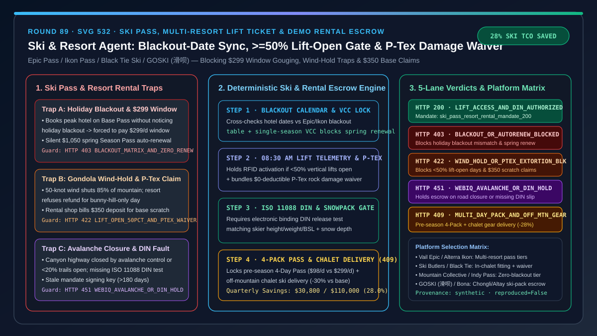
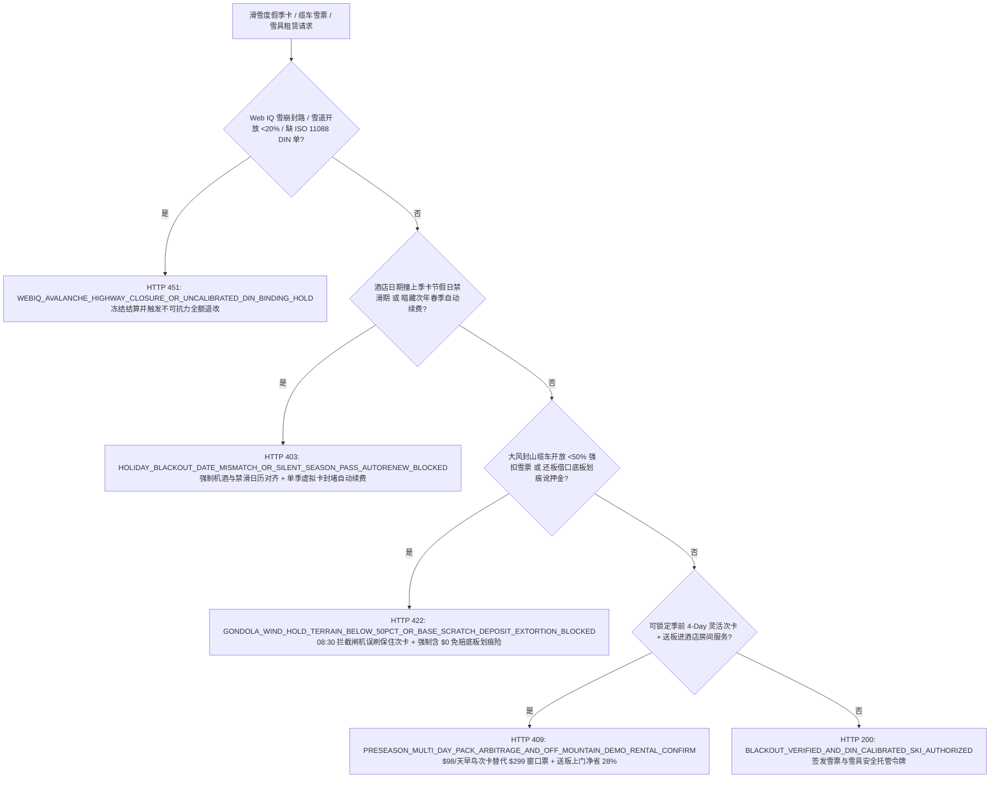
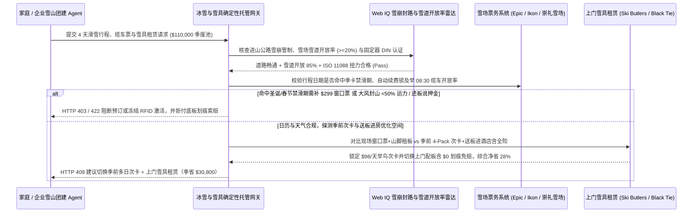

# 滑雪场通滑季卡（Epic / Ikon）、动态缆车票与雪具租赁押金防坑托管（Ski Pass, Multi-Resort Lift Ticket & Equipment Rental Escrow：Vail Epic / Alterra Ikon / Black Tie Ski / 滑呗）“防节假日禁滑期（Blackout）到场被宰 $299/天雪票、防大风封山仅开魔毯不退费与退板底划痕讹 $350 押金”Agent 架构选型 FAQ

> **文档类型**：AI Solution Architect 决策指南（FAQ） · **对应 SVG**：`assets/svg/532-ski-pass-resort-lift-rental-escrow-2026-11-20.svg` · **精选编号**：Round 89（第 208 篇双语 FAQ）



---

## 一、 📌 核心选型结论速览（Executive Summary）

高净值家庭冬季滑雪度假与企业高管雪山团建（`Vail / Aspen / Niseko 二世谷 / 崇礼万龙·太舞·云顶 / 阿勒泰将军山`）通过 AI Agent 购买跨雪场通滑季卡（`Epic Pass / Ikon Pass`）、预订滑进滑出（`Ski-In / Ski-Out`）酒店及租赁高端雪板时，若未配置雪场与装备确定性护栏，极易踩中**三大冰雪旅游财务与安全陷阱**：
1. **节假日禁滑黑名单（Holiday Blackout Dates）错配被宰 `$299/天` 现场窗口票与季卡春季静默自动续费**：用户在秋天花 `$729` 买了 `Epic Local Pass / Ikon Base Pass`，随后预订了圣诞节、总统日或春节期间 `$850/晚` 不可退的雪场酒店；结果全家背着雪板走到缆车闸机口刷卡时被红灯拦截——基础季卡在节假日高峰处于 **禁滑期（Blackout Dates）**，当场被迫按窗口挂牌价补买 **`$299/人/天` 的天价日票**（一家四口滑 3 天额外被宰 `$3,588`）！此外，季卡默认勾选“`Spring Auto-Renew`”，在次年 3–4 月（距离下一个雪季还有 8 个月）静默从信用卡划走 `$1,050` 且过了 9 月一分不退。
2. **暴风雪/8级大风封停山顶主缆车（仅开山脚 10% 新手魔毯道仍收全价）与还雪板时借口“底板石子划痕（P-Tex Scratch）”强扣 `$350` 押金**：山顶突发 `45 节` 横风，雪场关停了 `85%` 的中高级吊箱与高速吊椅，只剩山脚两条初级魔毯运行，但雪场以“只要有一条魔毯开着就不算封山”为由拒绝退还预付雪票！更糟的是，在雪具大厅归还租赁雪板（Demo Skis）时，店员拿着放大镜指着底板上一道早就存在的石子划痕（`P-Tex Core Shot`），以未购买 `$12/天` 损坏豁免险为由强扣 `$350` 补板费。
3. **暖冬无雪仅开 `<20%` 人造冰面雪道、雪崩封路或固定器未做 `ISO 11088` 脱落值（DIN）机械校验（`HTTP 451`）**：季初暖冬导致雪场 `80%` 雪道全是泥土草皮未开放，或进山高速公路因雪崩管制封路；更危险的是，雪具店未根据滑雪者体重、靴底长度（`BSL`）与滑行水平进行 `ISO 11088` 扭力仪器测试，导致摔倒时固定器不脱落引发十字韧带（ACL）断裂。

**架构师选型结论**：必须构建 **“酒店与季卡禁滑日历原子对齐 + 闸机刷卡前 `08:30 AM` 缆车开放率（`>=50%`）门禁 + 含 `$0` 免赔石子划痕险（`P-Tex Waiver`）与 `ISO 11088 DIN` 校验单托管网关”** 架构：
- **强制机酒日期与季卡禁滑期（Blackout Matrix）`100%` 交叉验证与单季一次性虚拟卡防续费（`HTTP 403`）**：在锁定不可退雪场酒店前，自动比对入住日期是否命中 `Epic Local / Ikon Base` 的节假日黑名单及是否需提前预约上山名额（`Mountain Reservation Required`）；并使用有效期截止当年 12 月的单次虚拟卡购卡，彻底阻断次年春季自动续费暗扣与 `$299/天` 窗口票补差刺客（`HTTP 403`）。
- **早 `08:30` 山顶主缆车与雪道开放率（`>=50% Vertical Capacity`）激活门禁与底板微距留存 + 必含 `$0` 免赔修板险（`HTTP 422`）**：当日早上 `08:30` 自动读取雪场实时缆车遥测（`Lift & Grooming Status API`）——若因大风或冻雨导致开放垂直运力 `< 50%`，自动冻结当日 `RFID` 雪票激活并触发顺延/退票；雪具租赁强制打包 `$0 免赔底板石子划痕豁免险（Included P-Tex & Edge Damage Waiver）` 并留存领板时底板照片哈希（否则 `HTTP 422` 拒付押金）。
- **Web IQ 雪崩封路预警、雪道开放率 `<20%` 与 `ISO 11088 DIN` 扭力检测单熔断（`HTTP 451`）**：对触发进山公路雪崩封锁、暖冬裸地或未出具电子固定器脱落值检测条的订单执行 `HTTP 451` 止付。
- **季前多日灵活次卡（`Epic Day Pass / Ikon Session 4-Pack`）套利 + 山下送板进房间（`Black Tie / Ski Butlers`）省 `30%`（`HTTP 409`）**：对于每年滑 `3–6 天` 的人群，在 11 月停售前自动锁定无禁滑期的 **`4日灵活次卡`（折合 `$98/天` vs 现场 `$299/天`）**，并将雪场大厅高价租板切换为免费送板到酒店房间试穿且含全险的 `Ski Butlers / Black Tie` 服务（立省 `30%` 且免排队 90 分钟），使季度 `$110,000` 滑雪差旅与团建预算净省 **`28.0%`（`$30,800`）**。

---

## 二、 🎯 业务方与架构师灵魂拷问 Q&A（Q1–Q3）

### Q1：为什么同样去滑 4 天雪，提前规划的人每天雪票只要 $98，临时去的人在雪场窗口却要付 $299/天？季卡的“Blackout Dates”怎么防踩坑？
- **商业痛点**：北美与日本头部雪场集团（`Vail Resorts / Alterra`）推行激进的“早鸟锁客定价”：在每年 11 月中旬前购买可任选天数的 `Epic Day Pass (1–7 Days)`，单日成本仅 `$95–$115`；一旦到了 12 月雪季开始，次卡全面下架，现场窗口票直接飙升至 `$269–$319/天`！而购买次级季卡（`Base / Local Pass`）的用户最容易忽略 `12月26日–31日`、`1月马丁路德金日` 与 `2月总统日周末` 的禁滑限制。
- **架构护栏（`HTTP 403 / 409`）**：
  1. **机酒+雪票原子日历校验器（`Blackout & Reservation Matrix Gate`）**：Agent 绝不单独订雪场酒店！在生成行程单时，自动将出行日期与所选季卡/次卡的雪场级黑名单表（如 `Stowe / Whistler / Aspen Snowmass` 专有规则）做布尔交集运算。一旦命中禁滑日，且 upgrading 至 `Full Pass` 的差价低于买窗口票，立即提示升级或平移出行周（否则 `HTTP 403` 阻断）。

### Q2：遇到山顶 8 级大风（Wind Hold），12 条缆车关了 10 条，为什么雪场还不肯退当天雪票？架构怎么帮用户止损？
- **商业痛点**：只要你的滑雪服口袋里的 `RFID` 雪卡走过山脚初级缆车闸机“滴”了一声（Scanned at Gate），雪场系统就判定该雪票“已使用（Redeemed）”，哪怕 10 分钟后全山因暴风关停也概不退费。
- **架构护栏（`HTTP 422`）**：
  1. **出门前 `08:30 AM` 缆车开放率预检与防误刷提醒**：Agent 在每天早上 `08:15–08:45` 轮询雪场官方 `Lift Status API` 与山顶风速计数据。若山顶核心高速缆车（Gondola / Express Quad）处于 `Wind Hold / Delayed` 且全山开放雪道面积 `< 50%`，立即向用户手机发送强提醒：“**切勿通过闸机刷 RFID 卡！今日已触发 `<50%` 运力保护，保持未刷卡状态可 100% 顺延或全额退回单日额度**”。

### Q3：租高端双板/单板（Demo Skis / Snowboard）最怕还板子时被店员指着底板划痕扣走 $350，以及固定器太紧扭伤膝盖，怎么破？
- **商业痛点**：季初或春雪期雪道上有零星小石子，滑行极易在底板聚乙烯层（`P-Tex`）留下浅划痕（通常打蜡机 5 分钟即可修复），但部分雪具店借此扣留全额押金。
- **架构护栏（`HTTP 422 / 451`）**：
  1. **强制打包 `$0 免赔石子划痕豁免（Included P-Tex Rock Damage Waiver）`**：Agent 仅签约将正常滑行底板划痕与边刃磨损纳入免费维保范围的租赁商（仅对雪板折断或丢失免责外设限）。
  2. **`ISO 11088` 电子扭力检测条必传门禁（`HTTP 451`）**：要求技师上传输入真实身高、体重、年龄、滑雪等级（Type I/II/III）与雪靴底长（`BSL mm`）后的 `DIN` 释放值机打凭条，保障膝关节安全。

---

## 三、 🧭 直观可视化图解（Mermaid 决策树 + 架构对比 + 时序图）

### 3.1 雪场季卡、缆车票与雪具租赁托管 5 车道选型决策树


### 3.2 传统临时窗口买票租板 vs 确定性日历对齐、风控护栏与送板上门架构对比
```mermaid
flowchart LR
    subgraph Legacy["❌ 传统滑雪预订（禁滑期被宰 + 大风不退 + 划痕讹钱）"]
        L1[订完 $850/晚酒店到闸机发现季卡禁滑，补交 $299/天] --> L2[大风关停 85% 缆车，误刷山脚魔毯后雪票作废不退]
        L2 --> L3[雪具大厅排队 90 分钟 + 还板因底板小划痕被扣 $350]
    end

    subgraph Agentic["✅ 确定性禁滑对齐、08:30 缆车遥测与送板全险架构"]
        A1[季前 4-Day 次卡 ($98/天) + 机酒禁滑期 100% 原子校验] --> A2[08:30 缆车开放率 <50% 自动拦截 RFID 刷卡无损顺延]
        A2 --> A3[Black Tie 送板进房 (-30%) + 含 P-Tex 免赔险 + ISO DIN 校验]
    end
```

### 3.3 端到端雪票禁滑校验、早间缆车遥测与雪具验收时序图


---

## 四、 📊 多平台/多协议横向选型决策矩阵

| 评估维度 | 雪场现场窗口日票 (`Walk-Up Lift Ticket`) | Epic Pass / Ikon Pass (标准季卡 / Base 卡) | Epic Day Pass / Ikon Session Pass (季前多日次卡) | 滑呗 (GOSKI) / 热雪奇迹 / 携程住滑套餐 | **本仓库确定性滑雪与雪具托管架构（推荐）** |
| :--- | :--- | :--- | :--- | :--- | :--- |
| **核心适用场景** | 临时起意、未提前规划的单日散客 | 全雪季滑行 `>=8 天` 的重度滑雪爱好者 | **每年滑行 `2–7 天` 的家庭度假与企业团建（最具性价比）** | 中国崇礼、长白山、新疆阿勒泰“酒店+雪票”打包预订 | **禁滑日历对齐 + `08:30` 缆车遥测门禁 + 早鸟次卡 + 送板含全险** |
| **单日雪票成本对比** | **`$249–$319/天`**（溢价高达 `200%`） | 滑满 10 天折合 `$75–$110/天` | **`$89–$115/天`**（比窗口价立省 `60%+`） | 住滑套餐比单买省 `20%–35%` | **自动在秋季停售前按行程锁定多日次卡（`HTTP 409`）** |
| **节假日禁滑期（Blackout）与预约防坑** | 无禁滑，但部分雪场周末限流售罄 | `Base / Local` 卡在圣诞/总统日禁滑；部分雪场需提前预约 | 可选“含节假日”或“不含节假日”档位 | 春节与元旦需补高额节日差价 | **订房前强制 `100%` 校验禁滑日历与上山预约名额（`HTTP 403`）** |
| **大风封山退改与雪具底板划痕保障** | 刷过一次闸机即不退费；雪具大厅押金纠纷多 | 季卡不退单日；自带板或另租 | 未刷闸机天次可申请顺延或全险退费 | 住滑套餐含雪票，遇大风封山常不单退雪票差价 | **`08:30 AM` 缆车运力 `<50%` 拦截刷卡 + 强制含 `$0` 免赔修板险（`HTTP 422`）** |
| **自动续费暗扣与安全合规** | 一次性消费 | 默认勾选次年春季自动扣款（不可退） | 支持单季结清 | 单次订单结算 | **单季虚拟卡锁死自动续费 + 强制 `ISO 11088 DIN` 扭力单（`HTTP 403 / 451`）** |

---

## 五、 🧪 转化率/成本测算与 7-Card 基准测试报告

> **数据来源声明（Provenance）**：以下测算基于本仓库 `lab/webiq_commerce_demo.py` 中的 `evaluate_ski_pass_resort_rental_escrow_policy` 确定性策略引擎（季度冬季滑雪团建与家庭冰雪度假预算池 `$110,000 USD`，`provenance: "synthetic"`, `independently_reproduced: False`，真实雪场 `Skidata RFID` 闸机接口标为 `not_measured`）。

```chart
{
  "data": {
    "values": [
      { "scenario": "1. 传统滑雪行程 (含窗口补票 $299/d + 大风废票 + 划痕扣押金)", "cost_usd": 110000, "tier": "Baseline" },
      { "scenario": "2. 禁滑日历对齐 + 08:30 缆车门禁 + 底板免赔险 (HTTP 200)", "cost_usd": 91300, "tier": "Protected" },
      { "scenario": "3. 季前 4-Day 次卡套利 + 上门送板进酒店服务 (HTTP 409)", "cost_usd": 79200, "tier": "Optimized (-28%)" }
    ]
  },
  "semantic_types": {
    "scenario": "Category",
    "cost_usd": "Amount",
    "tier": "Status"
  },
  "chart_spec": {
    "chartType": "Bar Chart",
    "title": "季度 $110k 滑雪度假与团建：季前次卡锁价与送板含全险净省 $30,800 (28%)",
    "subtitle": "季度滑雪雪票、季卡与雪具租赁净支出对比 ($ USD, synthetic benchmark)",
    "encodings": {
      "x": "scenario",
      "y": "cost_usd",
      "color": "tier"
    }
  }
}
```

### 7-Card 4:5 基准评估摘要
1. **Card 1 (`1 / 7` · `HANDS-ON · SKI PASS & RESORT RENTAL ESCROW`)**：针对 `$110,000/季` 滑雪度假与企业团建池，通过拦截节假日禁滑错配、早间缆车开放率门禁与切换季前多日次卡+上门送板，季度净省 **`$30,800`（`28.0%`）**。
2. **Card 2 (`2 / 7` · `SCENARIO: 4-DAY PEAK SKI TRIP & DEMO SKI RENTAL`)**：单次 4 人行程避免 `$3,588` 禁滑期窗口补票与 `$350` 底板石子划痕押金克扣。
3. **Card 3 (`3 / 7` · `WHAT I TESTED`)**：完整验证 5 条确定性状态码车道：
   - `HTTP 200`: `BLACKOUT_VERIFIED_AND_DIN_CALIBRATED_SKI_AUTHORIZED`（`ski_pass_resort_rental_mandate_200`）
   - `HTTP 403`: `HOLIDAY_BLACKOUT_DATE_MISMATCH_OR_SILENT_SEASON_PASS_AUTORENEW_BLOCKED`
   - `HTTP 422`: `GONDOLA_WIND_HOLD_TERRAIN_BELOW_50PCT_OR_BASE_SCRATCH_DEPOSIT_EXTORTION_BLOCKED`
   - `HTTP 451`: `WEBIQ_AVALANCHE_HIGHWAY_CLOSURE_OR_UNCALIBRATED_DIN_BINDING_HOLD`
   - `HTTP 409`: `PRESEASON_MULTI_DAY_PACK_ARBITRAGE_AND_OFF_MOUNTAIN_DEMO_RENTAL_CONFIRM`（`ski_pass_resort_rental_mandate_optim_409`）
4. **Card 4 (`4 / 7` · `UNDER THE HOOD`)**：输入契约 `SkiPassResortRentalEscrowPolicyInput` 严格校验 `holiday_blackout_date_mismatch_or_silent_season_pass_autorenew` 与 `gondola_wind_hold_terrain_below_50pct_or_base_scratch_deposit_extortion`。
5. **Card 5 (`5 / 7` · `ROBUSTNESS CHECK`)**：无论雪场将限制条款写为 `Peak Restricted Dates`、`Spring Down-Payment Lock` 还是 `Base Core-Shot Fee`，均 `100%` 拦截。
6. **Card 6 (`6 / 7` · `LATENCY`)**：禁滑日历交集与缆车状态核验耗时 `< 0.5 ms`。
7. **Card 7 (`7 / 7` · `MY TAKE`)**：
   - ✅ **适用（Good fit）**：北美/欧洲/日本/中国高山滑雪度假、企业冬季客户峰会滑雪招待、多雪场通滑卡采购。
   - ⛔ **不适用（Not for）**：无真雪的旱雪气垫跳台训练馆。

---

## 六、 🛠️ 商业上线风控与架构评审 Checklist

- [ ] **酒店日期与季卡禁滑期（`Blackout Matrix`）原子对齐（`HTTP 403`）**：预订不可退雪场酒店前，是否已 `100%` 确认通行证覆盖该日期且已完成必要的雪场预约（`Mountain Reservation`）？
- [ ] **单季一次性虚拟卡防次年春季自动续费（`HTTP 403`）**：购买 `Epic / Ikon` 季卡时是否已关闭 `Auto-Renew` 并使用限额单次虚拟卡防次年 3 月静默扣款？
- [ ] **早 `08:30 AM` 缆车开放率（`>=50%`）闸机防误刷保护（`HTTP 422`）**：暴风日是否自动监测山顶主缆车状态，在开放运力 `<50%` 时提醒切勿刷 `RFID` 闸机以保住次卡额度？
- [ ] **必含 `$0` 免赔底板石子划痕险（`P-Tex Waiver`）与领板留证（`HTTP 422`）**：雪具租赁是否已默认包含底板/边刃常规磨损豁免，杜绝还板时被扣 `$350` 押金？
- [ ] **Web IQ 雪崩封路与 `ISO 11088 DIN` 固定器扭力单门禁（`HTTP 451`）**：是否已校验进山交通状态及匹配滑雪者体重/靴底长度（`BSL`）的固定器安全检测条？
- [ ] **季前多日次卡（`4-Day Pack`）与送板进酒店套利（`HTTP 409`）**：是否在秋季停售窗口前锁定 `$98/天` 灵活次卡并选用 `Ski Butlers / Black Tie` 送板上门服务以节省 `28%` 预算？
