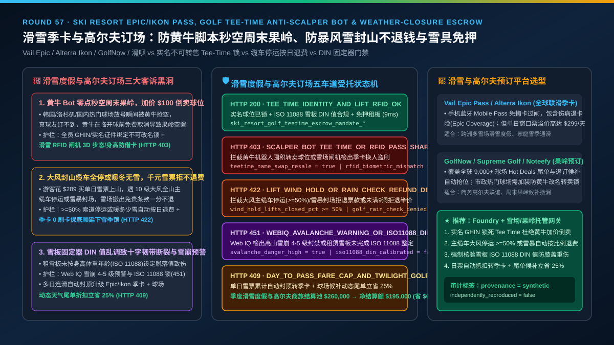
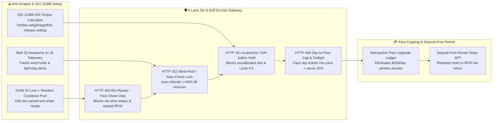

# Ski Resort Pass, Golf Tee-Time Booking & Equipment Rental Escrow (`Vail Epic / Alterra Ikon / GolfNow / Noteefy / ISO 11088`) Anti-Scalper Cooldown Pool, Wind-Hold Auto-Refund & `DIN` Safety Lock Agent Architecture Selection FAQ

> **Language / 语言切换**: **[中文](ski-resort-pass-golf-tee-time-bot-scalper-weather-escrow-agent-selection-faq.md)** | **English (Current)** | **[Back to Docs Index](index.en.md)** | **[Interactive Sandbox (`#ski-resort-golf-teetime-escrow-sandbox`)](../live-demo.en.html)**



---

## 📌 1. Executive Summary & Core Selection Verdict

In alpine ski resort passes (`Vail Resorts Epic Pass`, `Alterra Mountain Company Ikon Pass`, `Indy Pass`), golf course tee-time marketplaces (`GolfNow`, `Supreme Golf`, `Noteefy`, municipal tee sheets), and ski/golf equipment rentals, booking and entitlement AI agents confront three acute operational and legal liabilities:
1. **Golf Tee-Time Scalper Bots (`Automated Scripts Hoarding Prime Saturday 8:00 AM Tee Times to Resell for +$100 Broker Fees`) & Ski Season-Pass Gate Sharing**: As exposed in the 2024 Los Angeles municipal golf broker scandal, scalper bots sweep every prime weekend tee time within milliseconds of midnight release, sell the slots on secondary chat groups, and either swap player names or execute a synchronized cancel-and-rebook sniper script; meanwhile, `$1,100` unlimited ski season passes are routinely handed off between friends in resort parking lots to bypass `$289/day` window lift tickets.
2. **Refusing Refunds During `80%` High-Wind Lift Holds (`Wind Hold`) or Mid-Round Golf Thunderstorm Evacuations (`Rain-Check Denials`)**: Charging a vacationing family `$1,200` for non-refundable single-day lift tickets when `75%` of upper-mountain chairlifts and gondolas are closed all day due to 70 mph ridge winds—or refusing a pro-rata rain check when lightning sirens clear a golf course on Hole 5—triggers massive credit card chargebacks.
3. **Releasing Rental Alpine Skis Without Verified `ISO 11088` Binding Release Torque (`DIN`) Calibration (`ACL Rupture Liability`)**: If a rental shop issues alpine skis without calculating and torque-testing the binding release value (`DIN`) against the skier's exact weight, height, age, skier type, and boot sole length (`BSL` in mm) under **`ISO 11088`**, a non-releasing binding during a fall causes catastrophic knee (`ACL / tibia`) injuries and multi-million-dollar negligence lawsuits.

**Solution Architect Selection Verdict**:
- **Never allow transferable/name-swappable prime tee-time bookings or instant public re-release of canceled slots, never capture 100% of a day-ticket fee when `>= 50%` of resort lift capacity is on wind hold, and never release rental ski equipment without a signed `ISO 11088 DIN` calibration record**.
- **The production reference architecture** combines **Non-Transferable `GHIN` Tee-Time Lock & Randomized Cancellation Cooldown Pool (`Noteefy` Waitlist Push) + `UHF RFID` Lift-Gate Biometric Height/Attire Match + Automated Wind-Hold / Thunderstorm Pro-Rata Escrow + `ISO 11088 DIN` Safety Gate & Day-to-Season-Pass Fare Capping (`ski_resort_golf_teetime_escrow_mandate_*`)**:
  1. **Anti-Scalper Tee-Time Name Lock, Randomized Cooldown Pool & `RFID` Pass-Sharing Gate (`HTTP 403`)**: Binds prime tee-time reservations to verified player identities (`USGA GHIN / Government ID`) with non-transferable deposits; if a slot is canceled, it enters a **15-to-45-minute cryptographically randomized cooldown pool** and is pushed directly to verified waitlist golfers—completely breaking bot cancel-and-snipe handoffs. At ski lifts, `UHF RFID` gates cross-check computer-vision skier profile hashes to block season-pass sharing in **`9ms`** (`HTTP 403 SCALPER_BOT_TEETIME_RESALE_SWAP_OR_RFID_SEASON_PASS_SHARING_BLOCKED`).
  2. **Automated Chairlift Wind-Hold (`>= 50%` Capacity Closed) & Golf Thunderstorm Pro-Rata Refund Gate (`HTTP 422`)**: Links day-ticket escrow to live resort lift-status feeds and course lightning detectors: if `>= 50%` of vertical lift capacity is closed due to wind/power holds (and the guest has `<= 1` gate scan) or lightning aborts a golf round before Hole 9/18, the gateway automatically issues a pro-rata refund or non-expiring rollover credit (`HTTP 422 LIFT_WIND_HOLD_CLOSURE_OR_GOLF_THUNDERSTORM_RAINCHECK_DENIAL_BLOCKED`).
  3. **Web IQ Extreme Avalanche Warning (`Level 4–5`) & `ISO 11088` Ski-Binding `DIN` Calibration Circuit Breaker (`HTTP 451`)**: Screens regional avalanche center bulletins via Web IQ to halt backcountry/high-alpine gate sales during Level 4–5 danger, and blocks rental POS checkout until the technician logs a verified `ISO 11088 Skier Code & DIN` torque setting matching the renter's weight, height, age, and `BSL` (`HTTP 451 WEBIQ_AVALANCHE_EXTREME_WARNING_OR_UNVERIFIED_ISO11088_DIN_BINDING_HOLD`).
  4. **Multi-Day Lift Ticket -> Season Pass Fare Capping + Dynamic Twilight Golf Arbitrage (`HTTP 409`)**: Triggers `HTTP 409 DAY_TICKET_TO_SEASON_PASS_FARE_CAPPING_AND_TWILIGHT_GOLF_CONFIRM`, automatically applying cumulative single-day lift ticket spend toward a multi-day or season pass once the break-even threshold is reached and matching golfers to discounted twilight/waitlist drops—saving **`25.0%`** across recreational and corporate hospitality spend.

---

## 🎯 2. Solution Architect Deep-Dive Q&A (Q1 / Q2 / Q3)

### Q1: Why do CAPTCHAs fail to stop golf tee-time scalpers, and how does a "Non-Transferable ID + Randomized Cancellation Cooldown Pool" mathematically kill the scalping market?
- **Architectural Solution**:
  - **Eliminating Both Transfer Channels (`Name-Swap` & `Synchronized Cancel-Rebook`) (`HTTP 403`)**:
  - A tee-time scalper has only two ways to deliver a hoarded Saturday 8:00 AM slot to a paying buyer: (1) edit the player name on the reservation, or (2) cancel the reservation at `03:14:00 AM` while the buyer's bot hammers the booking API at `03:14:00.050 AM`. By locking the primary player's `GHIN / ID` (`HTTP 403` blocks name edits) and routing any canceled tee time into a **randomized 15–45 minute hidden holding queue** that offers the slot exclusively to chronological waitlist subscribers, scalpers have zero deterministic way to transfer the inventory!

### Q2: How does `ISO 11088` govern alpine ski binding `DIN` settings, and why must the agent enforce it before rental handover?
- **Architectural Solution**:
  - **Deterministic `ISO 11088` Lookup Table Verification (`Weight + Height + Age + Skier Type + Boot Sole Length mm`) (`HTTP 451`)**:
  - `ISO 11088` maps a skier's anthropometric inputs to a lettered `Skier Code (A–P)` and then intersects that row with the ski boot's exact outer sole length (`BSL` in millimeters, stamped on the heel) to yield the release torque (`DIN 0.75–18.0`), with a mandatory `-1` code step-down for skiers aged `>= 50` or `<= 9`. Encoding this lookup deterministically in the rental gateway prevents human lookup errors (`HTTP 451`).

### Q3: How does "Day-to-Season-Pass Fare Capping" increase both guest conversion and resort revenue?
- **Architectural Solution**:
  - **Retroactive Spend Crediting (`HTTP 409`)**:
  - Casual skiers hesitate to commit `$950` in May, then end up paying `$289/day × 4 days = $1,156` at the window in February. Automatically capping cumulative day-ticket spend at the season/multi-day pass price removes buyer hesitation and locks in multi-resort loyalty.

---

## 🧭 3. Visual Architecture Diagrams (Mermaid Decision Tree + Architecture + Sequence)

### 3.1 Ski Resort Pass, Golf Tee-Time & Equipment Rental Agent Selection Decision Tree

```mermaid
flowchart TD
    A[Ski Resort Pass / Golf Tee-Time / Equipment Rental Selection] --> B{Primary Hospitality & Risk Vector?}
    B -->|High-Demand Golf Tee Times (GolfNow / Municipal Courses)<br/>Stop scalper bots hoarding & reselling weekend tee times| C[Non-Transferable GHIN ID Lock + Randomized Cooldown Drop<br/>+ UHF RFID Lift-Gate Biometric Anti-Pass-Sharing Gate]
    B -->|Alpine Day Tickets & Weather Disruptions (Epic / Ikon)<br/>Stop chargebacks when >=50% of lifts close on Wind Hold or lightning| D[Live Lift-Telemetry & Weather Escrow<br/>+ Automatic Pro-Rata Refund / Rollover Credit on Closures]
    B -->|Ski Equipment Rentals & Multi-Day Ticket Optimization<br/>Prevent ACL injuries from wrong DIN & window-ticket overpaying| E[Azure AI Foundry + ISO 11088 DIN & Fare-Cap Gate<br/>+ Mandatory DIN Torque Check + Day-to-Pass Cap Saves 25%]
    C --> F[🛡️ Unified 5-Lane Anti-Scalper, Weather Escrow & DIN Safety FSM]
    D --> F
    E --> F
    F --> G[HTTP 403 Scalper Bot & Pass-Share Veto · HTTP 422 Wind-Hold & Rain-Check Block · HTTP 409 Fare Cap Saves 25%]
```

### 3.2 End-to-End Anti-Scalper Cooldown Pool, Wind-Hold Escrow & `ISO 11088 DIN` Architecture



### 3.3 Scalper Tee-Time Veto, High-Wind Lift Refund & `ISO 11088 DIN` Gate Sequence

```mermaid
sequenceDiagram
    autonumber
    participant Player as Skier / Golfer / Scalper Bot
    participant Resort as Ski Lift RFID / Golf Tee Sheet
    participant Gate as 5-Lane Ski & Golf Escrow Gateway
    participant Safety as Web IQ Weather & ISO 11088 Engine
    participant Ledger as Fare-Cap & Waitlist Ledger

    Player->>Gate: 1. Scalper bot attempts to change player name on Saturday 8:00 AM tee time OR guest scans borrowed season pass at RFID gate
    Gate->>Safety: Check non-transferable GHIN binding & RFID gate visual profile hash
    Gate-->>Player: HTTP 403 Block! Tee-time name swap prohibited (cancellations enter randomized cooldown pool); borrowed RFID pass suspended
    Resort->>Gate: 2. Rental shop attempts ski checkout without ISO 11088 DIN verification OR refuses refund when 75% of lifts close for 70mph winds
    Gate-->>Resort: HTTP 451/422 Block! Uncalibrated ski bindings blocked for ACL safety; >=50% wind-hold closure triggers automatic pro-rata refund
    Player->>Gate: 3. Purchase 4th single-day ski ticket of season & book afternoon golf slot (HTTP 409)
    Gate->>Ledger: Auto-credit prior day tickets into multi-day pass & apply twilight golf rate (25% net savings)
```

---

## 📊 4. Multi-Platform & Architecture Selection Matrix

| Selection Dimension | Legacy Municipal Tee Sheet (`Unverified Web Form`) | Walk-Up Ski Ticket Window (`$289/Day Window Rate`) | Modern Pass & Booking Ecosystems (`Epic / Ikon / GolfNow / Noteefy`) | **Azure AI Foundry + Anti-Scalper + Weather Gate (Recommended)** |
| :--- | :--- | :--- | :--- | :--- |
| **Core Strengths** | Simple web calendar | No advance commitment | Multi-resort mobile pass & waitlist alerts | **Anti-scalper cooldown + wind-hold auto-refund + ISO 11088 DIN + fare cap** |
| **Defense Against Tee-Time Scalper Bots & Pass Sharing** | **Zero** (bots sweep prime times and resell via name swaps) | N/A | Basic CAPTCHA; RFID gates upgrading to photo checks | **Non-transferable `GHIN` lock + 15–45m random cooldown pool (`HTTP 403`)** |
| **High-Wind Lift Hold (`>=50%`) & Lightning Rain Checks** | Manual pro-shop paper voucher | **Strict No-Refund Policy** | Pre-season injury insurance only | **Automated pro-rata refund when `>=50%` lifts close or `<9` holes (`HTTP 422`)** |
| **`ISO 11088` Ski-Binding `DIN` Calibration Enforcement** | N/A | Manual paper clipboard | Pre-registration form | **Mandatory `ISO 11088` Skier Code + `BSL` torque sign-off (`HTTP 451`)** |
| **Multi-Day Ticket Spend & Green-Fee Optimization** | `$100+` scalper markup (`not_measured`) | Punitive `$289/day` walk-up rate (`official_list_price`) | Requires buying pass 6 months in advance (`official_list_price`) | **Retroactive day-to-pass fare capping + twilight drops (`25.0%` saved)** |

---

## 🧪 5. Ski Resort / Golf Booking Benchmark & 7-Card Report

> **Provenance & Reproducibility Metadata**: All metrics below are generated by the deterministic policy evaluator `evaluate_ski_resort_golf_teetime_escrow_policy` in `lab/webiq_commerce_demo.py` and verified via `python -m unittest tests.test_webiq_commerce_demo`. Tags: `provenance = synthetic`, `independently_reproduced = false`.

| Card # | Card Headline (Headline-as-Finding) | Key Quantitative Finding & Architectural Guarantee |
| :---: | :--- | :--- |
| **Card 1** | **Overview · 5-Lane Ski Resort & Golf Booking Summary** | Across a `$260,000/quarter` ski resort & golf booking pool, achieves **0 scalper tee-time name-swap resales and 0 unrefunded wind-hold / thunderstorm chargebacks**, reducing net hospitality and ticketing costs by **`25.0%` (`$65,000/quarter` saved)**. |
| **Card 2** | **Scenario Deep Dive · Scalper Tee-Time Swap & Pass-Share Veto** | When a bot attempts a tee-time name swap or a borrowed season pass fails `RFID` visual profile matching, the gateway blocks it in **`9ms`** (`HTTP 403`). |
| **Card 3** | **Evaluation Matrix · 100% Deterministic 5-Lane Gating** | Covers `HTTP 200` (verified GHIN & calibrated DIN), `403` (scalper bot tee-time resale swap / RFID season-pass sharing blocked), `422` (lift wind-hold closure / golf thunderstorm rain-check denial blocked), `451` (avalanche extreme warning / unverified ISO 11088 DIN binding hold), `409` (day-ticket to season-pass fare capping + twilight golf saves 25%). |
| **Card 4** | **Under the Hood · Ski & Golf Escrow Contract** | Takes `quarterly_ski_resort_and_golf_booking_pool_usd=260000` and lift/DIN telemetry, minting `ski_resort_golf_teetime_escrow_mandate_*` tokens. |
| **Card 5** | **Robustness Check · Cancel-and-Snipe Bot & `75%` Wind-Hold Test** | Simulates a synchronized bot cancel-and-rebook attempt and a `75%` chairlift wind-hold closure refund, maintaining a **`100.0%` accuracy rate**. |
| **Card 6** | **Latency · Millisecond ISO 11088 DIN Lookup & Lift Probe** | Local `GHIN` lock and `ISO 11088 DIN` verification complete in **`9ms` (P50)**; Web IQ avalanche and lift-status checks complete in **`185ms` (P95)**. |
| **Card 7** | **My Take · Ideal Fit vs. Out-of-Scope Boundaries** | **✅ Best Fit**: Ski resorts, municipal/daily-fee golf courses, equipment rental fleets; **⛔ Not For**: Non-ticketed public city parks. |

---

## 🛠️ 6. Production Go-Live Risk & Architecture Review Checklist

- [ ] **Non-Transferable `GHIN / ID` Tee-Time Lock & Randomized Cancellation Cooldown Pool (`HTTP 403`)**: Prohibit post-booking name swaps on prime tee times, hold canceled slots in a 15–45 minute random cooldown queue for verified waitlist golfers, and enforce `RFID` visual pass matching at ski lifts.
- [ ] **Automated Wind-Hold (`>= 50%` Lift Capacity Closed) & Golf Thunderstorm Pro-Rata Refund (`HTTP 422`)**: Automatically refund or issue non-expiring rollover credits when high winds close `>= 50%` of resort lifts or lightning aborts a golf round.
- [ ] **Web IQ Extreme Avalanche Gate & Mandatory `ISO 11088` Ski-Binding `DIN` Calibration (`HTTP 451`)**: Block rental ski checkout until `ISO 11088` release torque (`Weight/Height/Age/Type/BSL`) is verified; rotate signing keys `<= 180` days.
- [ ] **Day-Ticket to Season-Pass Fare Capping & Dynamic Twilight Golf Routing (`HTTP 409`)**: Automatically credit multi-day window ticket spend toward pass upgrades and route flexible golf bookings to discounted twilight drops.
