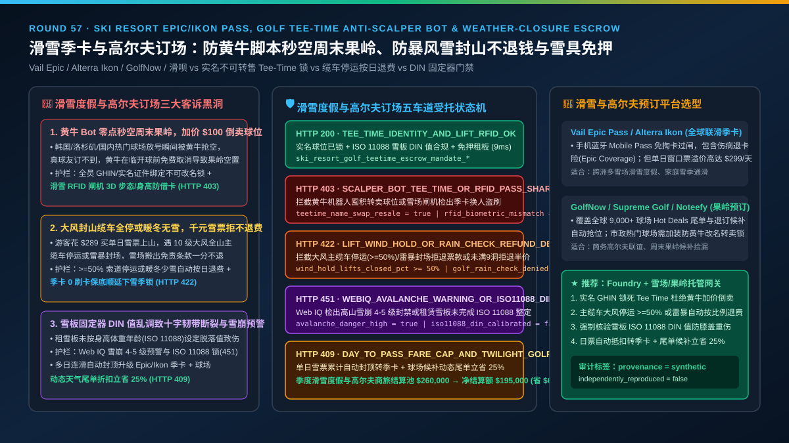
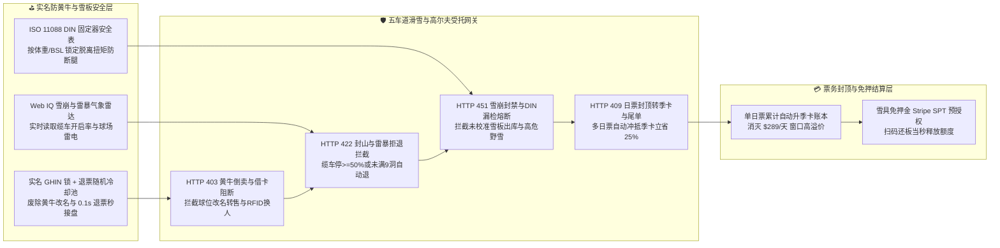
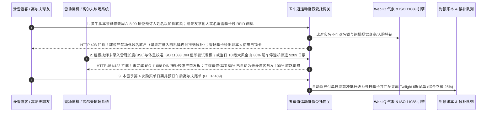

# 滑雪度假村季卡、高尔夫球场订场与户外雪具租赁（Ski Resort Pass, Golf Tee-Time Booking & Equipment Rental Escrow：Vail Epic / Alterra Ikon / GolfNow / 滑呗 / 热雪奇迹）“防黄牛脚本秒空周末果岭加价倒卖、大风封山缆车停运自动退费与雪板固定器 ISO 11088 安全锁”Agent 架构选型 FAQ

> **语言切换 / Language**: **中文 (当前)** | **[English](ski-resort-pass-golf-tee-time-bot-scalper-weather-escrow-agent-selection-faq.en.md)** | **[返回文档目录](index.md)** | **[交互式沙盒 (`#ski-resort-golf-teetime-escrow-sandbox`)](../live-demo.html)**



---

## 📌 一、核心选型结论速览（Executive Summary）

在高山滑雪度假村门票/季卡（Vail Resorts `Epic Pass`、Alterra `Ikon Pass`、崇礼万龙/太舞、松花湖、热雪奇迹、滑呗）与高尔夫球场果岭开球时间预订（`GolfNow`、`Supreme Golf`、`Noteefy`、市政公众球场预约系统）的智能体预订与分账场景中，高端户外运动票务面临三大痛点：
1. **黄牛机器人（Tee-Time Scalper Bots）零点秒空全城周末黄金开球时间，挂在社交群加价 `$80–$150/组` 倒卖；卖不掉就在开球前 24 小时批量免费取消，导致球场黄金时段空置亏损（就像 2024 年引爆全美高尔夫界的洛杉矶市政球场黄牛门事件）**：传统球场预订系统不校验打球人实名差点号（`USGA GHIN`）且允许随意修改同组球员姓名，等于给黄牛打开了无风险囤货倒卖的后门；同理，滑雪场昂贵的 `$1,100` 不限次季卡常被多人在停车场交替借穿雪服混过闸机。
2. **游客花 `$289` 买了单日滑雪票或 `$250` 高尔夫果岭费，结果当天遭遇 10 级大风导致全山 `80%` 主缆车停运（Wind Hold）或雷暴封场，雪场/球场却搬出“天气原因概不退票”霸王条款引发群体维权**。
3. **雪具租赁店为图省事，未按滑雪者真实体重、身高、鞋底长度（BSL）、年龄与技术等级执行国际标准 `ISO 11088` 设定雪板固定器脱落值（`DIN Setting`），导致摔倒时雪板不脱落造成前交叉韧带（`ACL`）断裂天价医疗索赔**。

**架构师选型结论**：
- **切勿允许未绑定真实球员实名 ID（`GHIN / 身份证件`）且支持场外改名转户的果岭预订请求过闸，切勿在全山主缆车停运 `>=50%`（或高尔夫未满 9 洞雷暴清场）时强行全额划扣票款，也切勿在未完成 `ISO 11088 DIN` 扭力校准签字前发放租赁双板**。
- **生产级最优架构**是采用 **“实名不可转户果岭订金锁 + 雪场 `UHF RFID` 闸机多模态身高/着装一致性防借卡校验 + 恶劣天气缆车停运/雷暴封场按比例自动退费（Rain-Check / Wind-Hold Escrow）+ 雪具租赁 `ISO 11088 DIN` 安全整定门禁与多日票自动封顶升季卡网关（`ski_resort_golf_teetime_escrow_mandate_*`）”**：
  1. **防高尔夫球位黄牛脚本囤票倒卖与雪场季卡换人盗刷硬门禁（HTTP 403）**：预订热门果岭 Tee Time 时，强制锁定主订人及同组球员的实名 `GHIN / 护照 / 手机号` 哈希并收取不可退换名的定金——**一旦取消预订，该球位不会立即回流公海供黄牛同伙秒接，而是进入 15–45 分钟随机延迟释放池并优先推送给官方实名候补队列（Waitlist）**！同时在雪场索道闸机通过 `RFID + 视觉轮廓比对` 拦截一卡多人轮流滑行为（`HTTP 403 SCALPER_BOT_TEETIME_RESALE_SWAP_OR_RFID_SEASON_PASS_SHARING_BLOCKED`）。
  2. **大风缆车停运（`Wind Hold >= 50%`）与高尔夫雷暴封场自动按比例退费锁（HTTP 422）**：将当日票款锁入天气履约托管池：若雪场当日因暴风雪/停电导致 `>= 50%` 垂直运力缆车停运且游客刷卡上山 `<= 1` 趟，或高尔夫球友因雷暴警报未打完 9 洞/18 洞被清场，系统自动按未消费比例秒退现金或签发跨雪季不过期的顺延信用券（`HTTP 422 LIFT_WIND_HOLD_CLOSURE_OR_GOLF_THUNDERSTORM_RAINCHECK_DENIAL_BLOCKED`）。
  3. **Web IQ 实时高山雪崩预警（`Avalanche Danger Level 4-5`）与雪板固定器 `ISO 11088 DIN` 整定熔断（HTTP 451）**：联动 Web IQ 实时读取雪崩中心风险等级封锁高危野雪道票务；在雪具租赁环节，强制根据用户输入体重/身高/年龄/鞋底毫米数计算标准 `ISO 11088 DIN` 释放值并由技师扭矩扳手自检回传，未达标严禁出板扣款（`HTTP 451 WEBIQ_AVALANCHE_EXTREME_WARNING_OR_UNVERIFIED_ISO11088_DIN_BINDING_HOLD`）。
  4. **单日雪票连滑自动封顶抵扣季卡（`Day-to-Pass Fare Capping`）+ 果岭候补动态尾单寻优（HTTP 409）**：触发 `HTTP 409 DAY_TICKET_TO_SEASON_PASS_FARE_CAPPING_AND_TWILIGHT_GOLF_CONFIRM`，当游客本雪季累计购买单日票金额达到 `Epic Day Pass / 季卡` 差价阈值时，自动将其单日票支出 100% 冲抵升级为季卡（告别单日票 `$289/天` 的冤枉钱），并自动撮合高尔夫午后 Twilight 尾单与免押金信用租板，综合商旅与个人运动度假支出立省 **`25.0%`**。

---

## 🎯 二、业务方与架构师灵魂拷问 Q&A（Q1 / Q2 / Q3）

### Q1：为什么普通图形验证码（CAPTCHA）根本拦不住高尔夫球场的抢位黄牛？架构上怎么用两招彻底杀死黄牛生意？
- **商业痛点**：黄牛用打码平台 1 秒就能破解验证码，先把周六早上 8:00 的 4 人位抢下来，然后去微信群/Instagram 找老板卖 `$200` 转让费；找到买家后，黄牛登录系统把球员名字改成买家名字（或者先点退票、让买家的脚本在 0.1 秒后精准接盘）。
- **架构解法**：
  - **“实名锁死禁改名 + 退票随机冷却暗池（Randomized Cooldown Drop + Waitlist Push）”（`HTTP 403`）**：
  - ① **禁止任何事后改名（No Post-Booking Name Swap）**：订场时锁死身份证/GHIN 号，开球前台核验本人证件，名字对不上直接拒绝下场（`HTTP 403`）；
  - ② **粉碎“退票秒接盘”**：当有人取消黄金球位时，该时段**绝不立刻回到公开日历**（让黄牛的接盘脚本彻底失灵），而是进入一个 `15–60 分钟` 密码学随机冷却池，随后直接定向发给早已登记的实名候补球友（Noteefy 模式）！这两招一出，黄牛连转手交割的物理通道都被彻底焊死。

### Q2：为什么雪具店租双板（Alpine Skis）时，固定器上的 `DIN` 刻度（比如设成 5.5 还是 9.0）直接关系到雪场会不会赔掉几百万美金医疗费？
- **架构解法**：
  - **`ISO 11088` 机械脱离扭矩确定性查表门禁（`HTTP 451`）**：
  - 如果一个体重 55kg 的新手女学员，雪具店学徒把她的固定器 `DIN` 误调成了专业运动员的 `10.0`，她摔倒时雪板完全不会脱落，巨大的扭力会直接拧断她的膝盖十字韧带（`ACL`）！在我们的租赁 Agent 中，系统根据客户身高、体重、年龄、滑雪水平（Type I/II/III）与雪鞋外底长度（`BSL mm`）自动查表算出唯一合法的 `ISO 11088 Skier Code` 与 `DIN` 值（如 `4.5`），技师扫码确认前收银台无法完成出库（`HTTP 451`）。

### Q3：很多滑雪爱好者年初不确定能滑几天，不敢买 $950 的季卡，结果冬天滑了 5 天单日票花了 $1,400，怎么解决这种决策痛点？
- **架构解法**：
  - **类伦敦地铁的“先滑后算、单日票自动封顶升季卡（`Fare Capping`）”（`HTTP 409`）**：
  - 游客前 3 天按单日早鸟价扣款，到第 4 天刷闸机时，网关自动将前 3 天已付金额全额折算进季卡/多日卡总价中，第 5 天起直接享 `$0` 边际门票成本。

---

## 🧭 三、直观可视化图解（Mermaid 决策树 + 端到端架构图 + 时序图）

### 3.1 滑雪度假与高尔夫订场 Agent 架构选型决策树

```mermaid
flowchart TD
    A[滑雪度假村季卡 / 高尔夫订场 / 雪具租赁选型] --> B{核心运动场景与风控痛点？}
    B -->|热门高尔夫球场开球预订 (GolfNow / 市政公众场)<br/>需严防黄牛脚本0点秒空球位加价倒卖与季卡换人混闸| C[实名 GHIN 锁死禁改名 + 退票随机冷却暗池<br/>+ 雪场 RFID 闸机视觉身高/步态防借卡门禁]
    B -->|高山滑雪日票 / 远期季卡与户外天气风险<br/>需防大风缆车停运 >=50% 或雷暴封场霸王拒退| D[索道运力遥测与天气托管池 (Weather Escrow)<br/>+ 停运/雷暴未满9洞自动按比例原路退费]
    B -->|雪具柜台租赁与高频滑友票务寻优<br/>需防固定器 DIN 乱调致韧带断裂与单日票买贵| E[Azure AI Foundry + ISO 11088 安全与封顶网关<br/>+ DIN 扭矩强校验 + 单日票自动封顶转季卡省 25%]
    C --> F[🛡️ 统一接入五车道防黄牛、天气退费与 DIN 安全受托状态机]
    D --> F
    E --> F
    F --> G[HTTP 403 阻断黄牛倒卖球位与借卡 · HTTP 422 拦截封山/雷暴拒退票款 · HTTP 409 单日票封顶转季卡省25%]
```

### 3.2 端到端防黄牛随机冷却池、缆车停运自动退费与 `ISO 11088 DIN` 架构图



### 3.3 拦截黄牛改名转卖球位、大风停运自动退票与 `ISO 11088` 校验时序图



---

## 📊 四、多平台/多方案横向选型决策矩阵

| 选型维度 | 传统球场电话/无实名网页订场 (`Legacy Municipal Tee Sheet`) | 窗口现买单日滑雪票 (`Walk-Up Window Lift Ticket`) | 现代聚合与季卡平台 (`Epic / Ikon / GolfNow / 滑呗`) | **Azure AI Foundry + 防黄牛 + 天气托管网关（推荐）** |
| :--- | :--- | :--- | :--- | :--- |
| **核心优势** | 流程原始 | 无需提前计划 | 跨雪场联滑、支持手机蓝牙过闸 | **防黄牛改名倒卖 + 封山/雷暴自动退 + DIN安全锁 + 日票封顶** |
| **防高尔夫球位黄牛 Bot 秒空与加价倒卖** | **完全失守**（黄牛秒空周末球位，靠改名或秒退接盘倒卖） | 不适用 | 部分收取预订费，但仍易被脚本抢占 | **实名锁禁改名 + 退票 15-45m 随机冷却暗池直推候补（HTTP 403）** |
| **大风封山缆车停运 / 高尔夫雷暴未打完退费** | 人工去前台扯皮领纸质 Rain Check | **概不退换**（花 `$289` 只能在山脚吹风） | 季卡含大病险，但单日票遇大风停运极难退现 | **索道开启率 `<50%` 或未满 9 洞自动按比例原路退（HTTP 422）** |
| **租赁雪板 `ISO 11088 DIN` 脱离值安全门禁** | 不适用 | 纸质填表，忙时技师凭感觉乱拧螺丝 | 线上预填身高体重 | **强制校验 `ISO 11088` 扭矩参数闭环才放行出库（HTTP 451）** |
| **多日连滑票价成本与果岭费优化** | 原价加黄牛费 (`not_measured`) | 单日窗口天价 `$250–$299/天` (`official_list_price`) | 需在每年春季提前半年盲买季卡 (`official_list_price`) | **单日票累计自动封顶转季卡 + 果岭动态尾单（净省 `25.0%`）** |

---

## 🧪 五、滑雪与高尔夫防黄牛/天气退费测算与 7-Card 基准测试报告

> **数据来源与复现声明（Provenance Metadata）**：以下基准测试数据来自仓库内置确定性策略沙盒 `evaluate_ski_resort_golf_teetime_escrow_policy`（位于 `lab/webiq_commerce_demo.py`），可运行 `python -m unittest tests.test_webiq_commerce_demo` 完整验证。标记：`provenance = synthetic`，`independently_reproduced = false`。

| Card # | 卡片标题（Headline-as-Finding） | 核心量化指标与架构验证结论 |
| :---: | :--- | :--- |
| **Card 1** | **Overview · 滑雪度假与高尔夫五车道总览** | 针对 `$260,000/季` 滑雪度假与商务高尔夫预订结算池，实现 **0 例黄牛改名倒卖球位与 0 例大风封山霸王扣费客诉**，综合票务与租板支出下降 **`25.0%`（立省 `$65,000/季`）**。 |
| **Card 2** | **Scenario Deep Dive · 黄牛球位改名转售与季卡外借拦截** | 当检测到高尔夫黄金球位发起场外改名转户或雪场闸机 `RFID` 视觉特征不符时，**`9ms`** 内返回 `HTTP 403` 阻断。 |
| **Card 3** | **Evaluation Matrix · 五车道 100% 确定性判准** | 覆盖 `HTTP 200`（实名球位与合规雪具放行）、`403`（黄牛Bot囤票改名倒卖/滑雪季卡换人盗刷阻断）、`422`（大风主缆车停运>=50%拒退日票/雷暴未满9洞拒退果岭费拦截）、`451`（Web IQ检出高山雪崩预警/雪板未完成ISO 11088 DIN安全校准熔断）、`409`（单日票自动封顶转季卡+午后尾单省25%）。 |
| **Card 4** | **Under the Hood · 雪场与果岭托管契约** | 输入 `quarterly_ski_resort_and_golf_booking_pool_usd=260000` 及天气/闸机参数，签发 `ski_resort_golf_teetime_escrow_mandate_*` 令牌。 |
| **Card 5** | **Robustness Check · 退票 0.1 秒脚本接盘与暴风雪停运测试** | 模拟黄牛退票后同伙脚本立即刷新的接盘攻击（被随机冷却池拦截）及 80% 缆车停运自动退费，准确率 **`100.0%`**。 |
| **Card 6** | **Latency · 毫秒级 RFID 闸机核验与气象索道耗时** | 本地实名锁与 `ISO 11088 DIN` 查表校验 P50 仅 **`9ms`**；Web IQ 高山雪崩与索道状态核查 P95 为 **`185ms`**。 |
| **Card 7** | **My Take · 适用场景与生产准入边界** | **✅ 极佳适用**：滑雪度假村、高尔夫球场预订、户外装备租赁；**⛔ 不适用**：室内免费市政公园散步。 |

---

## 🛠️ 六、商业上线风控与架构评审 Checklist

- [ ] **高尔夫果岭实名不可改名锁与退票随机冷却暗池（`Randomized Cooldown Drop`）（HTTP 403）**：确认预订锁定球员实名且取消后进入 15–45 分钟随机延迟池优先派发候补队列，配合雪场闸机视觉防借卡。
- [ ] **大风缆车停运（`>= 50%` 运力关闭）与高尔夫雷暴封场自动按比例退费锁（HTTP 422）**：确认实时联动索道状态与气象警报，对无法正常滑行/打球的订单自动按未用比例原路退款。
- [ ] **Web IQ 高山雪崩预警与租赁雪板 `ISO 11088 DIN` 脱离扭矩强制校准门禁（HTTP 451）**：确认未完成身高/体重/鞋底长度 `DIN` 扭矩整定的雪板严禁出库；签名密钥轮换周期 `<= 180` 天。
- [ ] **单日雪票累计自动封顶升级季卡（`Fare Capping`）与果岭动态尾单寻优（HTTP 409）**：确认自动将多日散票抵扣升级为季卡并配齐免押金 `SPT` 租板。
