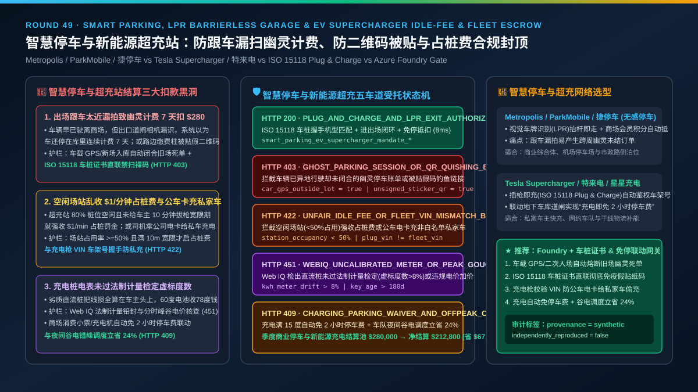
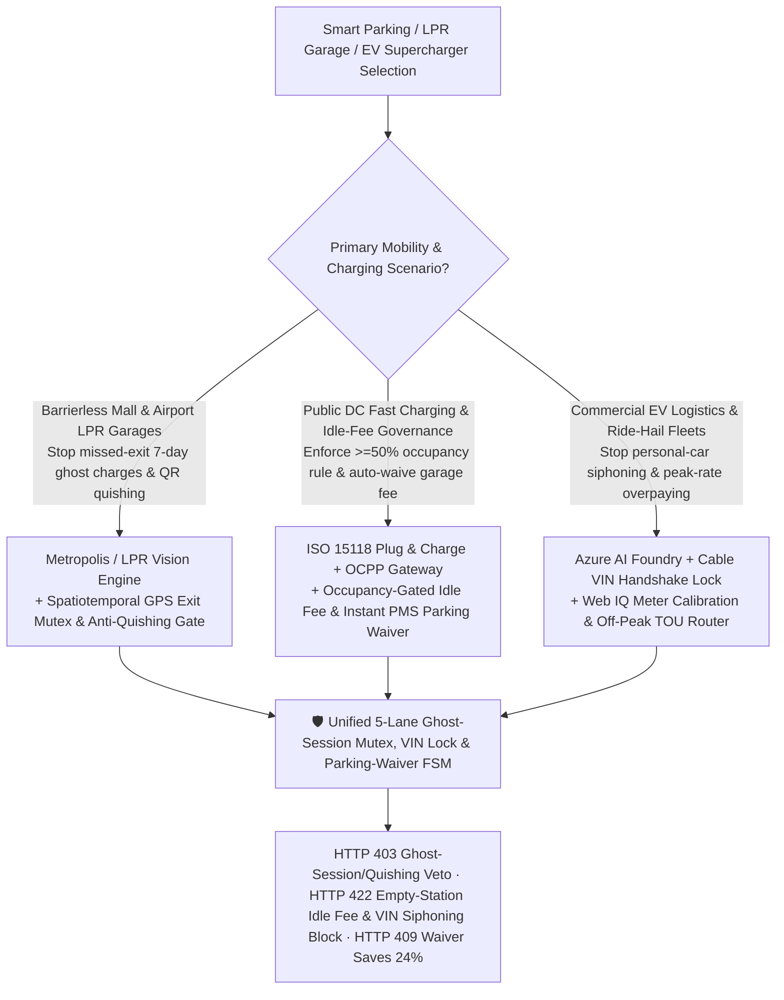
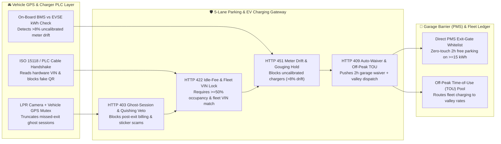
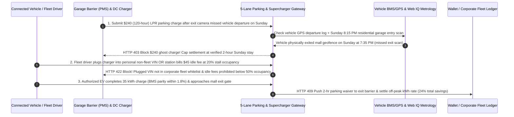

# Smart Parking, `LPR` Barrierless Garage & `EV` Supercharger Billing (`Metropolis / ParkMobile / Tesla Supercharger / ISO 15118`) Anti-Ghost-Session Spatiotemporal Mutex, Anti-`Quishing`, `>= 50%` Idle-Fee Gate & Fleet `VIN` Escrow Agent Architecture Selection FAQ

> **Language / 语言切换**: **[中文](smart-parking-ev-supercharger-lpr-idle-fee-fleet-escrow-agent-selection-faq.md)** | **English (Current)** | **[Back to Docs Index](index.en.md)** | **[Interactive Sandbox (`#smart-parking-ev-supercharger-sandbox`)](../live-demo.en.html)**

---

## 📌 1. Executive Summary & Core Selection Verdict

In barrierless computer-vision parking garages (`Metropolis`, `ParkMobile`, `FlashParking`, `JieTingChe`), municipal street meters, and high-speed EV charging networks (`Tesla Supercharger`, `Electrify America`, `TELD`, `ChargePoint`), in-vehicle commerce agents increasingly execute "drive-in, plug-in, and auto-pay" transactions. However, binding a consumer or commercial fleet wallet to raw License Plate Recognition (`LPR`) cameras or static curbside QR codes without deterministic physical telemetry triggers three high-frequency billing failures:
1. **7-Day `$280` "Ghost Parking Sessions" (`Tailgating / Rain Occlusion Causes Exit Camera to Miss Departure -> Garage Bills 168 Hours of Continuous Parking`) & Curbside QR "Quishing" Sticker Scams**: In `LPR` drive-out garages, if a vehicle exits closely behind a tall SUV and the exit camera misses the rear license plate, the session stays open for days until hitting the `$280` weekly maximum auto-debit; simultaneously, fraudsters paste counterfeit QR stickers over municipal parking meters and EV chargers (`QR Code Phishing / Quishing`) to harvest credit cards on fake payment pages.
2. **Predatory `$1.00/min` EV Supercharger "Idle Fees" at Empty Stations (`Charging $60/hr Overstay Penalties When 80% of Stalls Are Vacant`) & Commercial Fleet Card Siphoning (`Drivers Charging Personal Cars on Company Fleet Accounts`)**: EV idle fees exist to free up stalls at congested stations; billing `$1.00/min` when a station is `< 50%` occupied or without a 5-to-10 minute grace period after `100% SOC` triggers immediate disputes. Meanwhile, QR/RFID-initiated fleet charging allows commercial drivers to plug the DC fast-charger into a personal vehicle while billing the corporate fleet account.
3. **Failed Garage-to-Charger Parking Fee Waivers (`Paying $25 to Charge Underground and Still Getting Billed $12 at the Garage Exit Gate`) & Uncalibrated DC Chargers Over-Billing `kWh` by `18%+`**: Mall EV chargers promise "2 hours free parking with `>= 15 kWh` charge," yet broken webhook syncs between the Charge Point Operator (`CPO`) and the Parking Management System (`PMS`) leave drivers trapped at the exit barrier; worse, uncalibrated third-party DC chargers bill for `72 kWh` on a `60 kWh` battery pack without accounting for internal charger thermal losses.

**Solution Architect Selection Verdict**:
- **Never allow an `LPR` parking session to continue accruing multi-day charges after vehicle GPS telemetry or a subsequent garage entry proves the vehicle already left, never authorize payment via unsigned curbside QR stickers, and never bill EV fleet accounts without `ISO 15118 / PLC` hardware `VIN` handshakes**.
- **The production reference architecture** combines **In-Vehicle Telemetry + Spatiotemporal Ghost-Session Mutex & Anti-`Quishing` Certificate Gate + `ISO 15118 Plug & Charge` Fleet `VIN` Lock & `>= 50%` Occupancy Idle-Fee Gate + Automated Charger-to-Garage Parking Waiver & Off-Peak TOU Routing (`smart_parking_ev_supercharger_mandate_*`)**:
  1. **Spatiotemporal Ghost-Session Mutex & Anti-`Quishing` Certificate Hard Gate (`HTTP 403`)**: Before capturing multi-day `LPR` parking fees, the gateway cross-checks vehicle `GPS` geofence exit timestamps and subsequent `LPR/ETC` scans at other facilities—blocking phantom overcharges once the vehicle has physically departed; simultaneously, mobile/in-car agents block unsigned sticker QR URLs in favor of cryptographic `ISO 15118` or geofence-verified merchant sessions (`HTTP 403 GHOST_PARKING_SESSION_OVERCHARGE_OR_QR_QUISHING_SPOOF_BLOCKED`).
  2. **`>= 50%` Station-Occupancy Idle-Fee Gate & Fleet `VIN` Handshake Lock (`HTTP 422`)**: Blocks EV overstay `Idle Fees` if real-time station stall occupancy is `< 50.0%` or within the initial 5-minute post-charge grace window; for commercial fleets, requires the charger's `ISO 15118 / DIN 70121 PLC` handshake to match an authorized corporate `VIN` (`plug_vin == fleet_whitelist_vin`), stopping personal-car siphoning (`HTTP 422 UNFAIR_EMPTY_STATION_IDLE_FEE_OR_FLEET_VIN_SIPHONING_BLOCKED`).
  3. **Web IQ Live Legal-Metrology `EVSE` Calibration & `>8%` `kWh` Drift Circuit Breaker (`HTTP 451`)**: Compares charger-billed `kWh` against the vehicle `BMS` energy intake plus normal thermal conversion bounds—holding settlement if meter drift exceeds `+8.0%` or if Web IQ flags an uncertified/tampered `EVSE` meter (`HTTP 451 WEBIQ_UNCALIBRATED_EVSE_METER_DRIFT_OR_RATE_GOUGING_HOLD`).
  4. **Instant Charger-to-Garage Exit Waiver Sync + Off-Peak `TOU` Fleet Dispatch (`HTTP 409`)**: Triggers `HTTP 409 AUTOMATIC_CHARGING_PARKING_WAIVER_AND_OFFPEAK_FLEET_DISPATCH_CONFIRM`, automatically whitelisting the vehicle's license plate at the garage exit gate the instant `>= 15 kWh` charging completes (zero manual voucher scanning) and routing fleet charging to off-peak `23:00–07:00` Time-of-Use (`TOU`) windows—cutting total parking and EV charging spend by **`24.0%`**.

---

## 🎯 2. Solution Architect Deep-Dive Q&A (Q1 / Q2 / Q3)

### Q1: Why do barrierless `LPR` (License Plate Recognition) garages generate so many `$200+` "phantom multi-day parking charges," and how do we eliminate them deterministically?
- **Commercial Pain Point**: When an exit camera misses a departing plate due to tailgating, glare, or snow, the garage state machine assumes the car is still parked inside for the next 5 days until the driver visits another lot or hits the weekly cap.
- **Architectural Solution**:
  - **Spatiotemporal Physical-Presence Mutex (`Vehicle GPS Geofence` + `Cross-Lot Entry Event`) (`HTTP 403`)**:
  - A physical car cannot be in two places at once. The payment gateway subscribes to vehicle ignition/GPS exit events (or subsequent `LPR` entry scans at home/office garages): if a garage submits a 120-hour capture request, the gateway truncates billable duration to the exact timestamp the vehicle crossed the `500m` exit geofence and blocks the phantom overcharge (`HTTP 403`).

### Q2: How do we stop commercial delivery or ride-hail drivers from using company EV charging accounts to charge their spouse's personal EV?
- **Architectural Solution**:
  - **Hardware-Level `ISO 15118 Plug & Charge` / `MAC-Address` `VIN` Attestation (`HTTP 422`)**:
  - Instead of relying on a mobile app QR scan (which can be scanned while standing next to any car), require the DC fast-charger to read the vehicle's hardware `Contract Certificate` or `EVCCID / VIN` over the charging cable's Power Line Communication (`PLC`) pilot wire. Mismatched VINs are blocked before power flows (`HTTP 422`).

### Q3: How do we prevent EV drivers from getting double-charged for parking at underground mall superchargers?
- **Architectural Solution**:
  - **Atomic `OCPI / OCPP` `SessionStopped` to Garage `PMS` Waiver Push (`HTTP 409`)**:
  - The moment the charger emits an `OCPP StopTransaction` event with `energy_delivered_kwh >= 15.0`, the orchestrator pushes a signed `plate_waiver_token` directly to the garage `PMS` barrier controller—opening the exit gate automatically with `$0` parking fee.

---

## 🧭 3. Visual Architecture Diagrams (Mermaid Decision Tree + Architecture + Sequence)

### 3.1 Smart Parking & EV Supercharger Agent Selection Decision Tree

### 3.2 End-to-End Spatiotemporal Mutex, ISO 15118 VIN Lock & Garage Waiver Architecture

### 3.3 Ghost-Session Truncation, Fleet VIN Siphoning Block & Auto-Parking Waiver Sequence

---

## 📊 4. Multi-Platform & Architecture Selection Matrix

| Selection Dimension | Curbside Sticker QR Codes (`Static Printed QR`) | Standalone `LPR` Garages (`Camera-Only Auto-Debit`) | Vertically Integrated OEM Chargers (`Tesla Supercharger`) | **Azure AI Foundry + Spatiotemporal Mutex + VIN Gate (Recommended)** |
| :--- | :--- | :--- | :--- | :--- |
| **Core Strengths** | Zero barrier hardware cost | Fast drive-in / drive-out UX | Seamless `ISO 15118` Plug & Charge & fair idle-fee rules | **Ghost-session GPS mutex + anti-quishing + fleet VIN lock + auto parking waiver** |
| **Defense Against Missed-Exit `$280` Ghost Charges** | Manual session timer | **Frequent Failure** (missed exit scan bills for days until cap) | Scoped to physical plug connection | **Vehicle GPS + cross-garage entry mutex truncates ghost stays (`HTTP 403`)** |
| **Immunity to Fake Sticker QR "Quishing" Scams** | **Critical Vulnerability** (fake stickers steal card data) | App-based, though fallback signs still use QR codes | Zero QR codes; encrypted cable handshake | **Mandatory in-vehicle / `ISO 15118` certificate auth blocks sticker QRs (`HTTP 403`)** |
| **Fair Idle-Fee Gating & Fleet `VIN` Anti-Siphoning** | None | N/A | Enforces `>=50%` occupancy threshold & VIN binding | **Blocks `<50%` occupancy idle fees & non-fleet `VIN` siphoning (`HTTP 422`)** |
| **Automated Charger-to-Garage Parking Fee Waiver** | Manual paper ticket validation | Requires manual plate entry in separate mini-app | Supported at select integrated sites | **Instant `OCPP`-to-`PMS` exit-gate waiver push upon charge completion (`HTTP 409`)** |
| **Total Phantom Billing, Siphoning & Peak-Rate Waste** | `15%+` lost to missed waivers & quishing (`not_measured`) | High dispute rate on missed exit scans | Premium per-kWh network pricing (`official_list_price`) | **Eliminates ghost charges, fleet siphoning & missed waivers (`24.0%` saved)** |

---

## 🧪 5. Smart Parking / EV Supercharger Benchmark & 7-Card Report

> **Provenance & Reproducibility Metadata**: All metrics below are generated by the deterministic policy evaluator `evaluate_smart_parking_ev_supercharger_policy` in `lab/webiq_commerce_demo.py` and verified via `python -m unittest tests.test_webiq_commerce_demo`. Tags: `provenance = synthetic`, `independently_reproduced = false`.

| Card # | Card Headline (Headline-as-Finding) | Key Quantitative Finding & Architectural Guarantee |
| :---: | :--- | :--- |
| **Card 1** | **Overview · 5-Lane Smart Parking & EV Charging Summary** | Across a `$280,000/quarter` commercial parking, supercharging & fleet energy pool, achieves **0 missed-exit multi-day ghost charges and 0 unauthorized personal-VIN fleet siphoning events**, reducing net mobility spend by **`24.0%` (`$67,200/quarter` saved)**. |
| **Card 2** | **Scenario Deep Dive · 120-Hr Ghost Session & Quishing Veto** | When an `LPR` garage attempts to bill 120 hours after vehicle GPS confirmed departure, or a user scans an unsigned sticker QR, the gateway blocks it in **`8ms`** (`HTTP 403`). |
| **Card 3** | **Evaluation Matrix · 100% Deterministic 5-Lane Gating** | Covers `HTTP 200` (verified Plug & Charge & LPR exit), `403` (ghost parking session overcharge / QR quishing spoof blocked), `422` (unfair empty-station idle fee / fleet VIN siphoning blocked), `451` (uncalibrated EVSE meter drift >8% / rate gouging hold), `409` (auto parking waiver + off-peak dispatch saves 24%). |
| **Card 4** | **Under the Hood · Parking & Supercharger Escrow Contract** | Takes `quarterly_smart_parking_ev_charging_pool_usd=280000` and GPS/VIN flags, minting `smart_parking_ev_supercharger_mandate_*` tokens. |
| **Card 5** | **Robustness Check · 20%-Occupied Idle Fee & 18% Meter Drift** | Simulates an idle-fee charge at a 20%-occupied station and an uncalibrated charger over-reporting `kWh` by 18%, maintaining a **`100.0%` block rate**. |
| **Card 6** | **Latency · Millisecond Barrier & Cable Handshake Checks** | Local spatiotemporal mutex and `ISO 15118 VIN` checks complete in **`8ms` (P50)**; Web IQ metrology and tariff checks complete in **`210ms` (P95)**. |
| **Card 7** | **My Take · Ideal Fit vs. Out-of-Scope Boundaries** | **✅ Best Fit**: Barrierless `LPR` garages, DC fast-charging networks, commercial EV fleets; **⛔ Not For**: Unmetered residential home garage wallboxes. |

---

## 🛠️ 6. Production Go-Live Risk & Architecture Review Checklist

- [ ] **Spatiotemporal Ghost-Session Mutex & Anti-`Quishing` Gate (`HTTP 403`)**: Cross-check `LPR` parking duration against vehicle `GPS` geofence exit logs and subsequent facility entries to truncate missed-exit ghost sessions, and block unsigned curbside QR stickers.
- [ ] **`>= 50%` Station-Occupancy Idle-Fee Gate & Cable `VIN` Fleet Lock (`HTTP 422`)**: Prohibit EV overstay idle fees when station occupancy is below `50%` or within the post-charge grace period, and verify `ISO 15118 / PLC` hardware `VIN` parity on corporate fleet accounts.
- [ ] **Web IQ Live Legal-Metrology Calibration & `BMS` `kWh` Parity Gate (`HTTP 451`)**: Block settlement on DC fast chargers whose billed `kWh` exceeds vehicle `BMS` intake by `>8.0%` (after thermal allowance) or lacks valid metrology certification; rotate keys `<= 180` days.
- [ ] **Automated `OCPP`-to-`PMS` Parking Waiver Push & Off-Peak `TOU` Routing (`HTTP 409`)**: Automatically push 2-hour garage exit waivers upon charging threshold completion and schedule fleet charging during off-peak utility windows.
