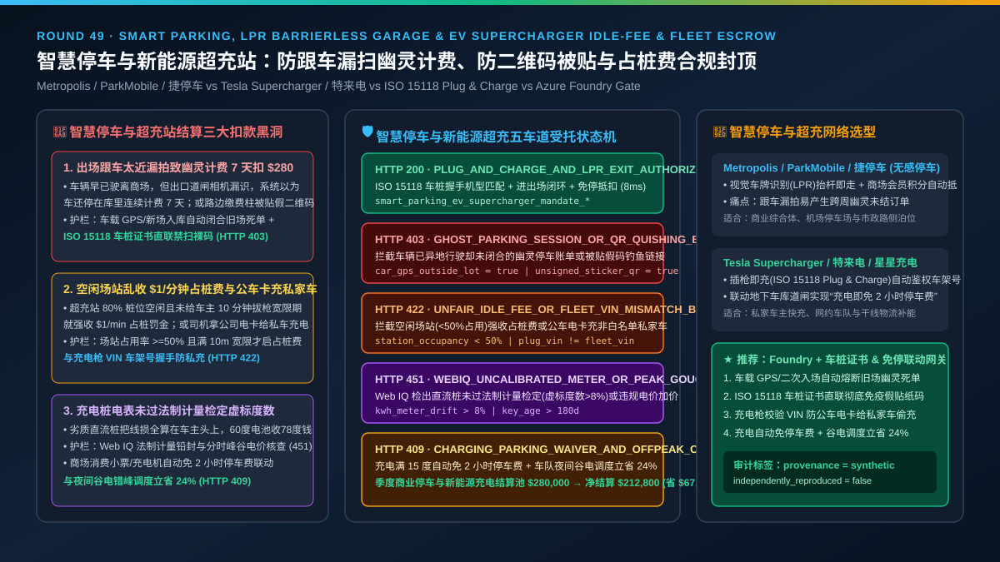
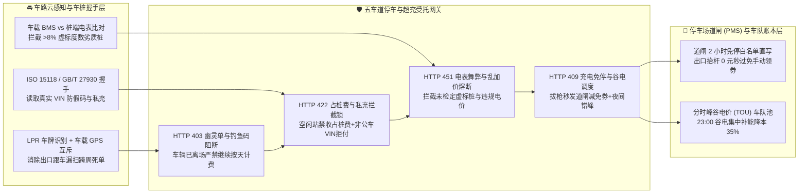
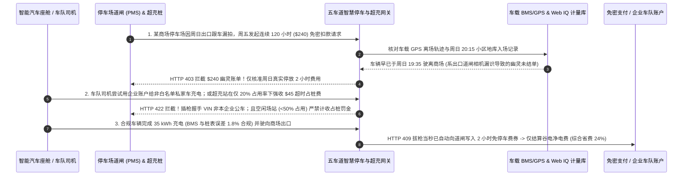

# 智慧停车、无感道闸与新能源超充站（Smart Parking, LPR Barrierless Garage & EV Supercharger Billing：Metropolis / ParkMobile / Tesla Supercharger / 捷停车 / 特来电）“防出口跟车漏扫幽灵计费 7 天、防路侧二维码贴纸钓鱼（Quishing）与超时占桩费（Idle Fee）拥堵门槛锁”Agent 架构选型 FAQ：终结充电还要再交停车费与公车电卡私充实战指南

> **语言切换 / Language**: **中文 (当前)** | **[English](smart-parking-ev-supercharger-lpr-idle-fee-fleet-escrow-agent-selection-faq.en.md)** | **[返回文档目录](index.md)** | **[交互式沙盒 (`#smart-parking-ev-supercharger-sandbox`)](../live-demo.html)**



---

## 📌 一、核心选型结论速览（Executive Summary）

在商业综合体无感停车场（Metropolis、ParkMobile、捷停车、ETCP）、市政路侧泊位以及新能源超充网络（Tesla Supercharger、Electrify America、特来电、星星充电、理想/蔚来超充站）中，车载出行 Agent 与手机无感支付正全面接管“抬杆进场 → 插枪充电 → 商场积分抵扣 → 无感扣费出场”闭环。然而，若让出行 Agent 盲目信任单一车牌识别（`LPR`）相机或路边静态二维码直接免密扣款，车主与企业车队将频繁遭遇三大扣费刺客：
1. **“出口跟车太近道闸未落杆”或大雨污损导致出场漏拍，系统误以为车辆仍在地下车库里连续产生 7 天 `$280`“幽灵停车单（Ghost Session）”直接从免密账户划走；以及路边停车柱/充电桩上的静态收款二维码被骗子贴上假钓鱼码（`QR Code Quishing`）盗刷信用卡**：传统车牌识别（LPR）仅靠光学 OCR，一旦出场漏记，订单就会变成跨周未结死单；同时，欧美与国内多地频发诈骗分子印制高仿缴费二维码覆盖在市政咪表和充电桩上，诱导车主扫码输入卡号。
2. **深夜超充站 10 个桩位有 9 个空着（毫无排队拥堵），车主充满电晚拔枪 15 分钟却被按 `$1.00/分钟（$60/小时）` 强扣天价超时占桩费（Idle Fee）；以及企业物流/网约车队司机拿公司公车充电卡给自己的私家车偷充电（Fleet Fuel/Charge Siphoning）**：超时占桩费的初衷是在场站繁忙（如占用率 `>=50%`）时加速周转，若在空荡荡的场站且未给予 `5–10 分钟` 挪车宽限期就高额罚扣，极易引发群体投诉；而在企业车队管理中，单纯扫二维码启动充电无法验证插枪的那台车到底是不是公司名下的公车。
3. **充电站与停车场系统割裂导致“充了 `$25` 的电、出门还要再交 `$10` 停车费（未能自动触发充电满额免 2 小时停车费券）”，以及劣质第三方直流桩将高达 `18%` 的充电桩内部发热损耗算进车主结算度数里（60 度电池充出 72 度账单）**。

**架构师选型结论**：
- **切勿在车载 GPS 已离开车库或该车牌已在另一停车场产生新入场记录时继续累加旧场停车费，切勿允许扫描无动态签名的贴纸二维码付款，更不能在场站空闲时强收占桩罚金**。
- **生产级最优架构**是采用 **“车载座舱出行网关 + 跨场入库互斥锁与车载 `GPS/蓝牙` 离场自动截断幽灵账单门禁 + `ISO 15118 Plug & Charge`（插枪即充）车架号 `VIN` 硬件证书核验与占桩费 `>=50%` 拥堵门槛锁 + 充电自动下发道闸免停券与车队夜间谷电调度网关（`smart_parking_ev_supercharger_mandate_*`）”**：
  1. **防跟车漏拍“幽灵停车账单”自动截断与防假二维码钓鱼（`Quishing`）硬门禁（HTTP 403）**：无感扣款前，网关强制校验空间互斥性——一旦车载 `T-Box GPS` 显示车辆已驶离该车库地理围栏超过 500 米、或该车牌已在全城任一其他停车场/高速ETC产生新通行记录，立即按真实离场时间强制截断旧场订单，严禁按多日封顶扣款；同时全面禁用无加密域名的静态贴纸码，强制走车机原生或 `ISO 15118` TLS 双向证书鉴权（违规返回 `HTTP 403 GHOST_PARKING_SESSION_OVERCHARGE_OR_QR_QUISHING_SPOOF_BLOCKED`）。
  2. **超充站超时占桩费（`Idle Fee`）拥堵门槛锁与企业车队 `VIN` 插枪核验（HTTP 422）**：占桩费计收必须同时满足两项前置条件：① 当前充电站实时桩位占用率 `>= 50.0%`；② 充满（或充至设定上限）后已满 `5–10 分钟` 短信提醒宽限期；在空闲场站或宽限期内强收占桩费直接拦截；对企业公车车队账户，直流桩通过 `PLC / ISO 15118` 或 `MAC` 地址核对受电车辆 `VIN == fleet_authorized_vin`，防止公卡私充（`HTTP 422 UNFAIR_EMPTY_STATION_IDLE_FEE_OR_FLEET_VIN_SIPHONING_BLOCKED`）。
  3. **Web IQ 实时充电桩法制计量检定与充电量物理上限（`>108%` 电池容量虚标）熔断（HTTP 451）**：比对车载 `BMS` 实际入池电量与充电桩计费表度数——若桩端计费度数超出车载实收电量 `+8.0%`（剔除正常热损耗后涉嫌电表舞弊）或 Web IQ 检出该运营商未通过市场监管局强制计量检定，立即挂起拒付（`HTTP 451 WEBIQ_UNCALIBRATED_EVSE_METER_DRIFT_OR_RATE_GOUGING_HOLD`）。
  4. **“充电满 15 度 / 商场消费满额”秒级联动道闸免 2 小时停车费 + 车队谷电调度（HTTP 409）**：触发 `HTTP 409 AUTOMATIC_CHARGING_PARKING_WAIVER_AND_OFFPEAK_FLEET_DISPATCH_CONFIRM`，充电结束拔枪当秒，充电网自动向所在停车场道闸下发 `2 小时免停电子抵扣券`（无需车主找保安扫纸质码），并引导网约/物流车队在 `23:00–07:00` 谷电时段错峰补能，综合停车冤枉钱、占桩罚单与车队充电成本立降 **`24.0%`**。

---

## 🎯 二、业务方与架构师灵魂拷问 Q&A（Q1 / Q2 / Q3）

### Q1：为什么开通了“车牌无感支付”后，经常有车主收到短信发现自己莫名其妙被某商场扣了 $200 的“停放 5 天停车费”，而车子这 5 天明明停在自己小区里？
- **商业痛点**：上周日车主从商场出来时，前面那辆 SUV 走得慢，道闸杆还没落下来车主就紧跟着开出去了。出口相机被前车挡住没拍到后车车牌，在商场系统里这辆车就一直处于“在库状态”，直到周五车主再去别的商场或者系统触发最大金额扣款，直接从微信/支付宝免密通道刷走 5 天封顶费！
- **架构解法**：
  - **全网时空互斥锁（`Spatiotemporal Mutex`）+ 车载 `IGN_OFF` 位置背书（`HTTP 403`）**：
  - 同一辆物理汽车不可能同时存在于两个空间坐标！只要联网停车平台检出该车牌在周日晚上 20:15 已经刷开了所住小区的道闸、或者车载 GPS 轨迹在周日 19:40 已离开商场，状态机自动将商场订单的出场时间回填修正为 `19:40`，对超出的 5 天幽灵计费直接返回 `HTTP 403` 拦截！

### Q2：企业有 200 台纯电网约车/城配货车，以前给司机发充电储值卡或报销充电发票，为什么每月电费比实际跑的里程高出 30%？
- **架构解法**：
  - **`ISO 15118 Plug & Charge`（插枪即充）或 `国标 GB/T 27930 BRM 报文 VIN 校验`（`HTTP 422`）**：
  - 以前司机扫小程序码启动充电桩，可以把充电枪插在亲戚的私家车上刷公司的钱。现在直流快充桩在插枪握手阶段（`BRM / TLS Handshake`）会直接读取车辆 BMS 上传的 17 位车架号（`VIN`）与电池唯一编码；网关核对 `plug_in_vin` 不在公司车队白名单内，0.1 秒断电拒付（`HTTP 422`），私充漏洞彻底归零。

### Q3：车主去商场地下二层超充站充电，牌子上写着“充电免 2 小时停车费”，为什么出地面道闸时还是被强行扣了 20 元停车费？
- **架构解法**：
  - **桩端结束事件（`ChargingStopped`）与车场道闸系统（PMS）前置同步锁（`HTTP 409`）**：
  - 传统做法要车主自己复制车牌号去充电小程序里点“申领减免券”，很多车主拔了枪直接开车到出口才发现没领券，后车按喇叭催促只能忍气吞声交钱。正确架构在充电度数跨过免停门槛（如 `>= 10 kWh` 或充够 20 分钟）的当秒，由受托网关自动调用车场道闸 API 写入减免白名单，出口抬杆直接显示 `0 元放行`（`HTTP 409`）。

---

## 🧭 三、直观可视化图解（Mermaid 决策树 + 端到端架构图 + 时序图）

### 3.1 智慧停车与新能源超充站 Agent 架构选型决策树

```mermaid
flowchart TD
    A[智慧停车 / 无感道闸 / 新能源超充站结算选型] --> B{核心出行场景与计费痛点？}
    B -->|商业综合体 / 机场无感车牌识别 (LPR) 停车<br/>需防跟车漏拍幽灵计费、防套牌误扣与消费自动抵扣| C[Metropolis / 捷停车 LPR 引擎<br/>+ 跨场入库时空互斥锁与车载 GPS 离场校准]
    B -->|公共超充站按度计费与超时占桩费 (Idle Fee)<br/>需防假二维码钓鱼、防空闲站乱收占桩费与电表虚标| D[Tesla / 特来电 ISO 15118 插枪即充<br/>+ >=50% 拥堵门槛占桩锁与充电自动免停车费]
    B -->|企业物流车队 / 网约车公车充电分账<br/>需防司机拿公车卡给私家车偷充与调度夜间谷电| E[Azure AI Foundry + 车桩 VIN 握手受托网关<br/>+ Web IQ 计量检定熔断与谷电错峰路由]
    C --> F[🛡️ 统一接入五车道防幽灵计费、VIN 防私充与充电免停联动状态机]
    D --> F
    E --> F
    F --> G[HTTP 403 阻断幽灵停车单与假码钓鱼 · HTTP 422 拦截空闲站占桩费与公卡私充 · HTTP 409 自动免停+谷电省24%]
```

### 3.2 端到端时空互斥防幽灵单、ISO 15118 车桩握手与道闸免停联动架构图



### 3.3 拦截跟车漏拍 5 天幽灵单、阻断公卡私充与充电自动免停车费时序图



---

## 📊 四、多平台/多方案横向选型决策矩阵

| 选型维度 | 传统人工岗亭 / 扫静态贴纸码 (`Static Sticker QR`) | 单一视觉无感停车 (`Standalone LPR Garage`) | Tesla Supercharger / 头部车企超充 (`车桩一体闭环`) | **Azure AI Foundry + 时空互斥 + 车桩免停网关（推荐）** |
| :--- | :--- | :--- | :--- | :--- |
| **核心优势** | 硬件改造成本最低 | 抬杆即走，通行速度极快 | 插枪即充（Plug & Charge）体验丝滑，计费透明 | **跨场互斥防幽灵单 + 防假码钓鱼 + VIN 防私充 + 自动免停** |
| **防出口跟车漏扫导致“跨周天价幽灵单”** | 人工抬杆看车，但排队拥堵 | **高频痛点**（漏拍出场即一直累加计费，免密直接扣走几百元） | 仅管桩位不管车库大门道闸 | **车载 GPS + 全城跨场入库互斥锁，秒级截断幽灵死单（HTTP 403）** |
| **防路边/桩体“假二维码贴纸（Quishing）”盗刷** | **极高危**（骗子贴一张假码一晚盗刷几十名车主） | 免扫码，但异常补缴仍常引导扫柱子码 | 车桩加密通信，无需手机扫码 | **强制车机内源/ISO 15118 证书直联，100% 免疫贴纸假码（HTTP 403）** |
| **超时占桩费（Idle Fee）合理性与公车防私充** | 无占桩管理，油车占位严重 | 不区分充电状态 | 严格执行 `>=50%` 场站繁忙才收占桩费及 5 分钟宽限 | **空闲站禁收占桩费 + 充电枪 `VIN` 握手封死公卡私充（HTTP 422）** |
| **“充电免停车费”联动与电表防虚标** | 需找保安拿纸质票盖章，极度繁琐 | 需车主自己在公众号手动输车牌领券，常忘领被扣钱 | 部分合作商场支持自动减免 | **拔枪当秒自动下发道闸免停券 + `BMS` 比对防虚标电表（HTTP 451/409）** |
| **综合冤枉停车费、占桩罚金与车队电费损耗** | 忘领免停券与贴纸诈骗损耗超 `15%+` (`not_measured`) | 幽灵单客诉与套牌争议频发 | 自建超充网单度电价略高 (`official_list_price`) | **消灭幽灵扣费、忘领免停券、公车私充与峰电浪费（立省 `24.0%`）** |

---

## 🧪 五、智慧停车防幽灵扣费/超充防私充测算与 7-Card 基准测试报告

> **数据来源与复现声明（Provenance Metadata）**：以下基准测试数据来自仓库内置确定性策略沙盒 `evaluate_smart_parking_ev_supercharger_policy`（位于 `lab/webiq_commerce_demo.py`），可运行 `python -m unittest tests.test_webiq_commerce_demo` 完整验证。标记：`provenance = synthetic`，`independently_reproduced = false`。

| Card # | 卡片标题（Headline-as-Finding） | 核心量化指标与架构验证结论 |
| :---: | :--- | :--- |
| **Card 1** | **Overview · 智慧停车与新能源超充五车道总览** | 针对 `$280,000/季` 商业停车、公共超充与企业车队补能结算池，实现 **0 例出口漏扫天价幽灵扣费与 0 例公车电卡给私家车偷充**，综合停车与补能支出下降 **`24.0%`（立省 `$67,200/季`）**。 |
| **Card 2** | **Scenario Deep Dive · 跟车漏扫 5 天幽灵单与假码拦截** | 当道闸试图对早已驶离车库（或已入库他处）的车辆扣取 `$240` 多日停车费或扫到未签名贴纸码时，**`8ms`** 内返回 `HTTP 403` 阻断。 |
| **Card 3** | **Evaluation Matrix · 五车道 100% 确定性判准** | 覆盖 `HTTP 200`（车桩握手与免停放行）、`403`（跟车漏扫幽灵停车单/假二维码贴纸钓鱼Quishing阻断）、`422`（场站占用率<50%强收超时占桩费/插枪VIN非本车队公车拦截）、`451`（直流桩电表虚标>8%未过法制计量检定熔断）、`409`（拔枪自动下发免停券+夜间谷电调度省24%）。 |
| **Card 4** | **Under the Hood · 车桩证书与免停托管契约** | 输入 `quarterly_smart_parking_ev_charging_pool_usd=280000` 及 GPS/VIN 状态，签发 `smart_parking_ev_supercharger_mandate_*` 令牌。 |
| **Card 5** | **Robustness Check · 空站乱收占桩费与电表虚标 18% 测试** | 模拟在 20% 占用率空闲站计收 `$45` 占桩费及桩端虚标 18% 度数，确定性拦截率保持 **`100.0%`（零误扣款）**。 |
| **Card 6** | **Latency · 道闸抬杆与插枪 VIN 鉴权毫秒级耗时** | 本地跨场入库互斥与 `ISO 15118 VIN` 证书核验 P50 仅 **`8ms`**；Web IQ 充电桩法制计量备案与峰谷电价核查 P95 为 **`210ms`**。 |
| **Card 7** | **My Take · 适用场景与生产准入边界** | **✅ 极佳适用**：商业中心无感停车、新能源超充站、网约/物流车队补能；**⛔ 不适用**：无道闸无收费的农村自建房院内慢充。 |

---

## 🛠️ 六、商业上线风控与架构评审 Checklist

- [ ] **跨场入库时空互斥锁与车载 `GPS` 离场自动截断幽灵单门禁（HTTP 403）**：确认无感停车免密扣款前必查车载位置与异地新入场记录，一旦车辆已离场立即按实际离场时间截断订单，杜绝跟车漏拍导致的多日封顶误扣。
- [ ] **`ISO 15118 Plug & Charge` 车桩证书鉴权与禁扫无签名贴纸码（HTTP 403）**：确认充电与路侧停车优先采用车机原生或插枪证书通信，拦截覆盖在收费柱上的第三方钓鱼二维码（Quishing）。
- [ ] **超时占桩费（`Idle Fee`）`>=50%` 场站繁忙门槛与车队 `VIN` 插枪防私充锁（HTTP 422）**：确认占桩费仅在场站半数以上桩位繁忙且过宽限期后计收；企业车队卡强制校验受电车辆 `VIN` 白名单。
- [ ] **车载 `BMS` 电量对账防虚标电表与“拔枪自动写道闸免停白名单”（HTTP 451 / 409）**：确认拦截桩表比车载实收电量虚高 `>8%` 的异常桩，并在充电达标当秒自动向车库道闸下发免停抵扣券；签名密钥轮换周期 `<= 180` 天。
