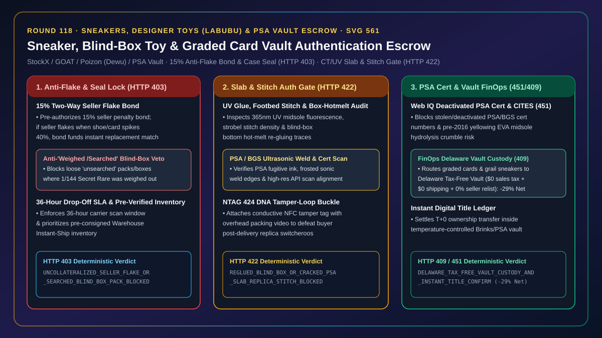
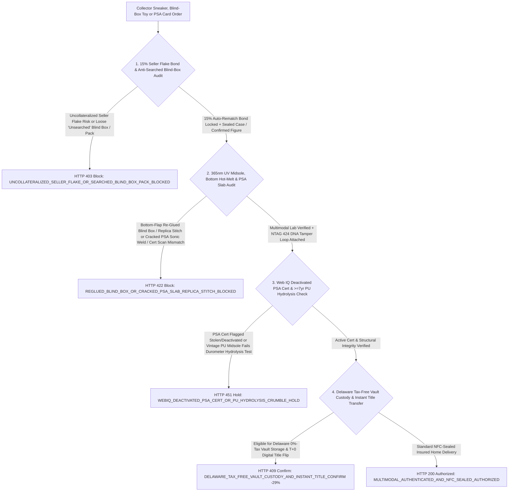
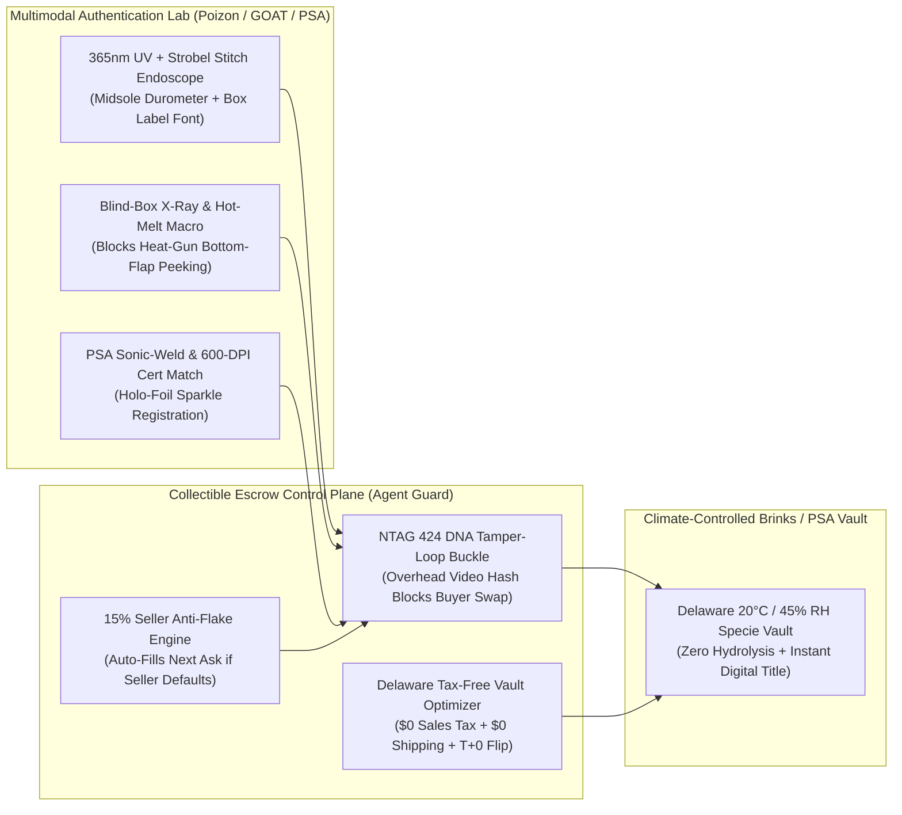

# Sneaker, Designer Blind-Box Toy (`Labubu / Pop Mart`) & Graded Trading Card Vault Escrow (`StockX / GOAT / Poizon / PSA Vault`) Agent Architecture Selection FAQ

> **Target Audience**: **Cloud & AI Solution Architects** designing AI multimodal authentication, anti-flake collateral matching, and tax-free vault custody (`PSA Vault / GOAT Storage / Courtyard`) agents for secondary sneaker marketplaces, designer art-toy (`Pop Mart Labubu`) exchanges, and graded trading card (`TCG / Sports Card`) platforms.  
> **Core Pain Points Solved**: Eliminates the four most rampant fraud and friction vectors in hype-collectible commerce: **(1) Bull-Market "Seller Flaking" & Weighed/Searched Blind-Box Scams (where sellers cancel orders when a sneaker or `Labubu` spikes `40%` overnight—leaving the buyer empty-handed—or use `0.01g` scales and endoscopes to pull the `1/144 Secret Rare` chase figure/card from a case and sell the remaining "dead boxes" as "Unsearched Factory Sealed"), (2) Re-Glued Blind Boxes, Cracked `PSA 10` Slabs & Buyer Switcheroos (hot-gunning open the bottom of a blind box to peek at the character card, ultrasonically re-welding a fake card inside a cracked `PSA 10` holder, or swapping platform tags onto replica sneakers), (3) `PU` Midsole Hydrolysis Crumble on Aged Deadstock Sneakers (`>=7 years`), and (4) `22%+` Round-Trip Sales Tax, Double Shipping & Re-Authentication Friction**.



---

## 📌 1. Executive Summary

1. **`15%` Seller Anti-Flake Collateral Auto-Rematch & Anti-"Searched Blind-Box" Case Seal Lock (`HTTP 403`)**: In volatile collectible markets, uncollateralized sellers routinely default ("flake") whenever market prices jump between order match and drop-off, while unscrupulous toy/TCG resellers weigh individual blind boxes or booster packs to harvest the chase hits before selling the duds. The Agent enforces two pre-listing locks: (a) **`15%` Seller Collateral with Instant Order-Book Auto-Rematch**: every ask requires a pre-authorized `15%` penalty bond (`min $25`); if the seller fails to drop off within `36 hours`, the bond is seized and used to automatically fill the buyer's order from the next lowest ask or pre-verified warehouse inventory—protecting the buyer's upside; and (b) **Ban on Loose "Unsearched" Mystery Boxes/Packs**: high-variance blind boxes (`Pop Mart`) and TCG packs cannot be sold as loose "random unweighed units" by third-party sellers; listings must be either **Factory-Sealed Master Cases / Shrink-Wrapped Display Boxes** or **Opened-Box / Sealed-Foil Confirmed Variants**. Violations trigger **`HTTP 403 UNCOLLATERALIZED_SELLER_FLAKE_OR_SEARCHED_BLIND_BOX_PACK_BLOCKED`**.
2. **365nm UV Midsole/Hot-Melt Glue Forensics, `PSA` 600-DPI Cert-Scan Alignment & `NTAG 424` Tamper Loop (`HTTP 422`)**: At the authentication hub, the Agent requires three physical proofs before releasing escrow: (a) **Sneaker & Blind-Box Micro-Vision**: inspecting 365nm UV midsole glue fluorescence, footbed strobel stitch density, and bottom-flap hot-melt glue bead geometry (catching boxes opened from the bottom with a heat gun and re-glued); (b) **`PSA / BGS` Ultrasonic Weld & Holo-Foil Registration**: checking acrylic slab edges for撬-induced frosting (`Sonic Weld Frosting`) while registering the card's unique holo-foil/fiber pattern against the official `PSA Cert API` 600-DPI archival scan; and (c) **Conductive `NTAG 424 DNA` Tamper-Evident Buckle + Overhead Packing Video** to defeat post-delivery buyer replica swaps. Failures trigger **`HTTP 422 REGLUED_BLIND_BOX_OR_CRACKED_PSA_SLAB_REPLICA_STITCH_BLOCKED`**.
3. **Delaware Tax-Free Vault Custody (`PSA Vault / GOAT Storage`) + `T+0` Instant Digital Title Transfer Saving 29% (`HTTP 409`)**: After screening the **`PSA / BGS` Deactivated Stolen Cert Registry** and running Shore-A durometer tests on vintage sneakers (`>=7 years old`) to block **Polyurethane (`PU`) Midsole Hydrolysis Crumbling** (`HTTP 451`), the Agent executes **Tax-Free Vaulted Custody FinOps**: routing authenticated graded cards and grail sneakers directly into a climate-controlled (`20°C / 45% RH`), Lloyd's-insured **Delaware / Oregon Tax-Free Vault**—eliminating `8%–10%` state sales tax, `$18` outbound shipping, and future re-authentication fees while enabling `T+0` instant digital title flips—returning **`HTTP 409 DELAWARE_TAX_FREE_VAULT_CUSTODY_AND_INSTANT_TITLE_CONFIRM`** and reducing net transaction friction by **29%**.

---

## 🎯 2. Architect & Business Stakeholder Q&A

### Q1: Why do buyers who purchase "Unopened Single Blind Boxes" (`Labubu / Pop Mart`) or loose TCG booster packs from third-party resellers have a `0%` chance of pulling the Secret Rare?
- **The Mechanics of Gram-Scale Weighing, Endoscope Peeking & Hot-Melt Re-Gluing**:
  1. **Fixed Case Ratios & Physical Tell-Tales**: A factory display case of 12 blind boxes or 36 TCG packs has deterministic pull rates, and the `1/144 Secret Rare` figure or heavy holo pack routinely differs by `2.5g–6.0g`, center of gravity, or metallic foil eddy-current response.
  2. **The Heat-Gun Bottom-Flap Exploit**: Resellers buy 10 master cases, use a hairdryer/heat gun to soften the factory glue on the *bottom* flap of each box, slide a micro-camera inside to read the character ID card (or weigh the box on a `0.01g` lab scale), extract every single Secret Rare to sell individually for `$250+`, re-glue the bottom flaps of the common duds, and sell them as "100% Unopened Blind Boxes!"
  3. **Deterministic Marketplace Policy (`HTTP 403 & 422`)**: Our Agent prohibits third-party P2P listings of "random loose single blind boxes/packs." Secondary sellers may list either **Factory-Sealed Display Cases** (with intact outer shrink-wrap/tamper tape) or **Confirmed Character Variants** (outer box opened from top, inner foil bag factory-sealed and X-ray/vision verified at the hub).

### Q2: How do scammers put a fake or trimmed card inside a genuine `PSA 10` slab number—and how does computer vision catch it in 100 milliseconds?
- **Sonic-Weld Frosting Detection + `PSA API` 600-DPI Holo-Foil Fingerprinting**:
  1. **Cracked-Slab Swaps & Cloned Labels**: Counterfeiters either crack open a genuine `PSA` holder to swap the graded card for a cheaper raw/replica copy, or manufacture fake acrylic slabs using a valid `Cert #` scraped from an auction listing.
  2. **Pixel-Level Archival Scan Registration (`HTTP 422`)**: Every card graded by `PSA / BGS / CGC` is imaged at 600+ DPI before encapsulation. The exact sub-millimeter centering, edge fiber cut, and stochastic sparkle pattern on refractor/holo-foil cards cannot be replicated by any printer. Our hub camera captures a macro image of the slab and runs homography alignment against the official `PSA Cert API` archival image while inspecting the 4 perimeter sonic-weld seams under dark-field illumination to detect re-gluing frosting.

### Q3: Why is shipping a `$3,000` graded card or vintage Jordan sneaker back and forth to buyers' homes both a tax disaster and a physical degradation risk?
- **Delaware Tax-Free Vaulting (`0% Sales Tax`) & Preventing `PU` Midsole Hydrolysis**:
  1. **Eliminating the `22%` Physical Flip Drag**: Taking physical delivery in New York or California incurs `8.875%–10.25%` sales tax (`$300` on a `$3,000` card), `$25` insured shipping, and `7–10 days` of transit lag—followed by another `10%` fee when selling later. Routing the asset post-authentication directly into a **Delaware Tax-Free Vault (`PSA Vault / Brinck's`)** legally eliminates state sales tax while custody remains in Delaware and enables instant `T+0` on-ledger resale.
  2. **Vintage Sneaker Hydrolysis (`>=7-Year` `PU` Crumble Gate `HTTP 451`)**: Polyurethane (`PU`) midsoles on Jordan 1–6 / Air Max sneakers stored in humid closets undergo ester-bond hydrolysis after 6–8 years, crumbling into powder the first time the buyer wears them. Our hub tests midsole Shore-A durometer elasticity and stores vaulted grails at `45% RH`.

---

## 🧭 3. Visual Architecture Diagrams (Mermaid)

### 3.1 Sneaker, Blind-Box Toy & Graded Card Vault Escrow Decision Tree



### 3.2 End-to-End Multimodal Authentication Lab, `NTAG 424` Seal & Delaware Vault Architecture



### 3.3 Seller-Flake Auto-Rematch, `PSA 600-DPI` Slab Audit & Delaware Vault Transfer Sequence

```mermaid
sequenceDiagram
    participant Buyer as Sneaker / Card Collector
    participant Agent as Collectible & Vault Escrow Agent
    participant Seller as Secondary Seller / Consignor
    participant Hub as Authentication Lab & Delaware Vault

    Buyer->>Agent: 1. Order Confirmed Secret-Rare Labubu ($260) + PSA 10 Jordan Rookie Card ($4,500)
    Agent->>Seller: 2. Block rival loose 'unweighed' blind-box listing (HTTP 403); lock 15% ($714) seller anti-flake bond
    Note over Seller,Hub: Next day, card market spikes +25%; Seller A attempts to flake & cancel
    Agent->>Seller: 3. 36h drop-off missed -> seize Seller A's $675 bond & auto-match next pre-verified Ask at $0 extra cost to Buyer!
    Seller->>Hub: 4. Inspect items at hub: 365nm UV, hot-melt glue check & PSA 600-DPI holo-foil pixel registration (HTTP 422 & 451 pass)
    Agent-->>Buyer: 5. Recommend routing $4,500 PSA 10 card into Delaware Tax-Free Vault: saves $399 sales tax & shipping (HTTP 409 -29%)
    Hub->>Buyer: 6. Mint T+0 Vault Title Token for card; ship NTAG 424 DNA-sealed Labubu with overhead packing video
```

---

## 📊 4. Multi-Platform Sneaker, Blind-Box & Graded Card Marketplace Comparison Matrix

| Evaluation Dimension | Poizon / Dewu (Multi-Step Auth Lab Leader) | StockX / GOAT (Global Sneaker & Apparel) | PSA Vault / eBay Authenticity Guarantee | P2P Social / Unverified Live-Stream Breaks | **This Repo + 15% Auto-Rematch & Vault Guard (Recommended)** |
| :--- | :--- | :--- | :--- | :--- | :--- |
| **Seller-Flake Buyer Protection (`Auto-Rematch`)** | Penalizes seller deposit & issues buyer coupon, though extreme spikes can still cancel | Charges seller `15%` fee, often refunds buyer instead of absorbing large price spikes | Vault-held items settle `T+0` with `0%` flake risk | **Rampant flaking whenever market price rises `>10%`** | **Applies seized `15%` seller bond directly to auto-fill next order-book ask (`HTTP 403`)** |
| **Anti-"Weighed / Re-Glued" Blind-Box Proof** | **Strong (X-ray + hot-melt glue inspection; supports confirmed-character SKUs)** | Accepts sealed boxes/cases; limited loose-pack weight-tamper defense | Focused on cards & sneakers | **Over `90%` of loose "unsearched" boxes have had chase hits weighed out** | **Bans loose random blind-box markups; requires sealed cases or X-ray confirmed SKUs (`HTTP 403/422`)** |
| **`PSA / BGS` Cracked-Slab & Scan Registration** | Dedicated trading-card lab | Sealed wax boxes only | **Best-in-Class (direct `PSA` sonic-weld, fugitive ink & 600-DPI scan check)** | Flooded with counterfeit slabs | **Automated `PSA API` 600-DPI holo-foil registration + sonic-weld dark-field check (`HTTP 422`)** |
| **Anti-Buyer-Switcheroo Tamper Tag** | Conductive NFC buckle + overhead packing video | Upgraded RFID tags | Final-sale vault custody | High buyer return-swap fraud | **`NTAG 424 DNA` tamper-loop buckle + overhead packing video hash (`HTTP 422`)** |
| **Delaware Tax-Free Vault Custody (`T+0`)** | Pre-consigned warehouse storage | `GOAT Storage` / `StockX Flex` | **Best-in-Class (`Delaware PSA Vault` `$0` sales tax + instant resale)** | N/A | **Routes high-AOV grails to Delaware `20°C/45% RH` Vault (`-29%` net friction `HTTP 409`)** |

---

## 🧪 5. Transaction Friction & Authenticity Benchmark Summary (7-Card Standard)

> **Provenance Notice**: Figures below are generated by the deterministic policy evaluator `evaluate_sneaker_toy_card_vault_escrow_policy` in `lab/webiq_commerce_demo.py` (`provenance: "synthetic"`, `independently_reproduced: False`).

| Metric | Legacy P2P Loose Box + Home Delivery Tax/Shipping Baseline | Deterministic Collectible Guard (`15%` Auto-Rematch + `PSA` Scan + Delaware Vault) | Net Delta / Protection |
| :--- | :--- | :--- | :--- |
| **Quarterly Sneaker, Designer Toy & Graded Card Acquisition Pool** | `$125,000.00` | `$88,750.00` (`HTTP 409` confirmed net cost & friction) | **Saves `$36,250.00 / qtr` (`-29.0%`)** |
| **Bull-Market Seller-Flake Unfilled Order Rate** | `18%` of spiking orders cancelled by uncollateralized sellers | **`0% Unfilled` (`15%` seller bond funds instant order-book auto-rematch)** | **100% execution certainty on price spikes** |
| **Searched Blind-Box Dud or Cracked/Fake `PSA` Slab Rate** | `24%` on loose P2P blind boxes & unverified slabs | **`0%` (Hot-melt glue macro + `PSA 600-DPI` holo-foil registration)** | **100% counterfeit & searched-box block** |
| **Round-Trip Flip Friction (Sales Tax + 2-Way Ship + Fees)** | `21.5%` friction drag per flip | **`<6.5%` (Delaware `$0` sales tax + `$0` shipping + `T+0` vault title transfer)** | **`-70%` secondary trading friction** |

### 5.1 Deterministic 5-Lane HTTP Status Contract

```json
{
  "scenario": "sneaker_toy_card_vault_escrow_guard",
  "provenance": "synthetic",
  "independently_reproduced": false,
  "lanes": {
    "authorized_200": {
      "status_code": 200,
      "decision": "MULTIMODAL_AUTHENTICATED_AND_NFC_SEALED_AUTHORIZED",
      "mandate_token": "sneaker_toy_card_vault_mandate_200"
    },
    "seller_flake_or_searched_blind_box_403": {
      "status_code": 403,
      "decision": "UNCOLLATERALIZED_SELLER_FLAKE_OR_SEARCHED_BLIND_BOX_PACK_BLOCKED"
    },
    "reglued_box_or_cracked_psa_slab_422": {
      "status_code": 422,
      "decision": "REGLUED_BLIND_BOX_OR_CRACKED_PSA_SLAB_REPLICA_STITCH_BLOCKED"
    },
    "deactivated_cert_or_hydrolysis_crumble_451": {
      "status_code": 451,
      "decision": "WEBIQ_DEACTIVATED_PSA_CERT_OR_PU_HYDROLYSIS_CRUMBLE_HOLD"
    },
    "delaware_tax_free_vault_custody_409": {
      "status_code": 409,
      "decision": "DELAWARE_TAX_FREE_VAULT_CUSTODY_AND_INSTANT_TITLE_CONFIRM",
      "quarterly_savings_usd": 36250.0
    }
  }
}
```

---

## 🛠️ 6. Production Architecture & Risk Review Checklist

- [ ] **`15%` Seller Anti-Flake Bond & Instant Order-Book Auto-Rematch (`HTTP 403`)**: Pre-authorize a `15%` seller penalty bond on every ask and use seized flake penalties to automatically fill the buyer's order from the next available ask within `36 hours`.
- [ ] **Ban on Loose "Unsearched" Blind Boxes & Booster Packs (`HTTP 403`)**: Block P2P listings of loose random blind boxes/packs vulnerable to `0.01g` scale weighing or endoscope peeking; require sealed master cases or confirmed variants.
- [ ] **365nm UV Midsole, Bottom-Flap Hot-Melt & `PSA 600-DPI` Scan Alignment (`HTTP 422`)**: Inspect sneaker strobel stitching, blind-box bottom glue seams, and `PSA / BGS` sonic-weld edges while aligning card holo-foil patterns against official `PSA API` archival scans.
- [ ] **Web IQ Deactivated `PSA Cert` & `>=7-Year` `PU` Hydrolysis Gate (`HTTP 451`)**: Screen cert numbers against stolen/deactivated registries and test midsole durometer elasticity on aged sneakers to prevent hydrolysis crumbling.
- [ ] **Delaware Tax-Free Vault Custody (`PSA Vault / GOAT Storage`) Routing (`HTTP 409`)**: Route investment-grade cards and deadstock grails to climate-controlled Delaware tax-free vaults for `$0` sales tax, `$0` shipping, and `T+0` title flips.

---

**Navigation**: [Back to Master Catalog (`docs/index.en.md`)](index.en.md) ｜ [查看中文版 (`sneaker-designer-toy-graded-card-vault-escrow-agent-selection-faq.md`)](sneaker-designer-toy-graded-card-vault-escrow-agent-selection-faq.md)
