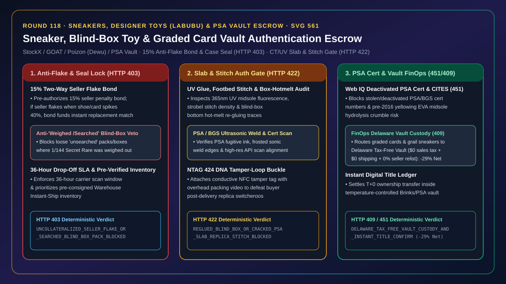
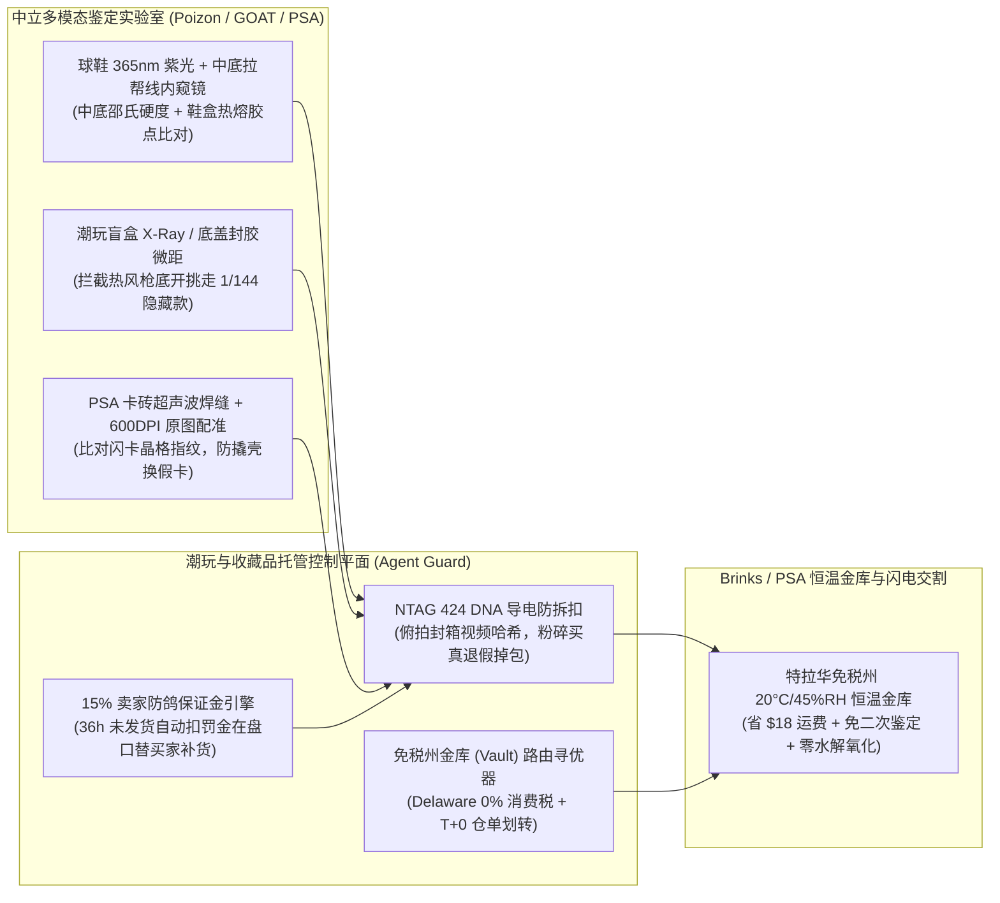
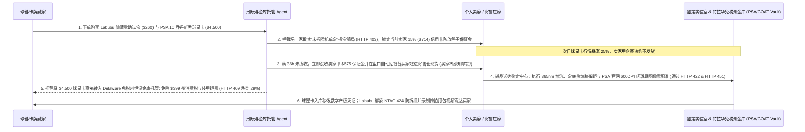

# 限量球鞋、潮玩盲盒（Labubu / 泡泡玛特）与球星卡评级金库托管（StockX / GOAT / 得物 Poizon / PSA Vault / eBay Authenticity）Agent 架构选型 FAQ

> **核心阅读对象**：为潮流球鞋二级交易平台、潮玩盲盒/卡牌（TCG：宝可梦 / 球星卡）撮合市场、中立鉴定实验室及保税金库托管（Vault Custody）系统设计 AI 视觉鉴真、防鸽单违约与零税费仓内流转架构的 **Cloud & AI Solution Architect**。  
> **核心痛点解决**：彻底终结潮玩、球鞋与收藏卡交易中**“联名球鞋或 `Labubu` 隐藏款二级市场行情一夜暴涨 50%，个人卖家立刻恶意不发货放鸽子（`Seller Flaking`）转头高价重挂，买家苦等 5 天只拿到一张无关痛痒的 `$10` 优惠券”、“不良盲盒/卡牌卖家用 `0.01g` 精密天平、金属探测仪或微孔内窥镜把整端盒里的 `1/144 隐藏款（Secret Rare）` 或高罕闪卡挑走，再把剩下的‘废盒/重塑胶水盒（`Searched / Re-Glued Box`）’当全新未拆随机盲盒高价卖给消费者”、“假卡贩子撬开真 `PSA 10` 评级卡砖（超声波焊缝泛白开裂）把里面的真卡换成假卡/修剪卡，或买家收货后剪下得物/StockX 防伪扣粘在莆田高仿鞋上退货掉包”以及“投资级球星卡和球鞋每次转手都要交 `8.875%` 州消费税 + `$18` 双程鉴定运费，还面临快递暴力分拣压扁鞋盒”**四大行业死穴。



---

## 📌 一、核心选型结论速览（Executive Summary）

1. **卖家 `15%` 信用卡防放鸽子预授权保证金（`Anti-Flake Collateral`）与盲盒/卡包“原厂整箱铅封（`Factory Sealed Case`）”硬锁（HTTP 403）**：潮玩与限量鞋具有极强的金融期权属性。选型 Agent 必须在撮合挂单与选品层建立两道硬拦截：① **`15%` 双向履约保证金自动补差（`Auto-Rematch on Flake`）**：卖家上架挂单时必须通过 `Stripe SPT / 芝麻信用` 冻结标价 **`15%`（最低 `$25`）的不可撤销违约保证金**；一旦卖家因行情暴涨超过 `36 小时` 拒不揽收发货，系统立即扣划该 `15%` 罚金直接替买家在盘口自动吃进下一档卖单（`Instant Auto-Rematch`），确保买家按原成交价拿到现货；② **禁绝散盒/散包“未拆随机”欺诈**：对于存在重量差、摇盒手感差或配率保底机制的盲盒（如泡泡玛特端盒）与集换式卡牌（`Pokémon / Panini Prizm` 补充包），严禁按“全新未探散盒/散包（`Loose Unweighed Pack`）”溢价交易，强制要求交易带原厂防伪热缩膜/封箱胶带的**完整原盒/原箱（`Sealed Display Box / Sealed Case`）或已拆袋明盒确认款**；违反者一律触发 **`HTTP 403 UNCOLLATERALIZED_SELLER_FLAKE_OR_SEARCHED_BLIND_BOX_PACK_BLOCKED`**。
2. **中底拉帮线/365nm 紫光胶水验真、盲盒底盖热熔胶二次封口识别与 `PSA` 卡砖超声波焊缝/高清底图门禁（HTTP 422）**：为根治“真盒装假娃”、“真壳换假卡”与“买真退假掉包”，Agent 在先鉴后发中心（`Authentication Hub`）强制执行三项多模态物理核验：① **球鞋与盲盒微观视觉鉴真**：通过 `365nm` 紫外荧光光谱与内腔工业相机比对中底拉帮线针距、鞋垫刷胶纹理，并对盲盒上下盒盖折痕与热熔胶点（`Hot-Melt Glue Pattern`）进行微距扫描，100% 拦截“从盒底加热开盒看卡再重新点胶封回”的探盒假盲盒；② **`PSA / BGS` 评级卡砖防撬与原厂高清扫描图对齐**：比对 `PSA Cert API` 官方正反面高清原始入库扫描图（核对闪卡镭射斑点位置与裁切边角），并检测亚克力卡砖四边超声波磨砂焊线是否出现撬动泛白（`Frosting`）；③ **导电闭环 `NTAG 424 DNA` 防拆防伪扣**；凡检出二次封胶、撬壳换卡或高仿走线的，直接触发 **`HTTP 422 REGLUED_BLIND_BOX_OR_CRACKED_PSA_SLAB_REPLICA_STITCH_BLOCKED`**。
3. **免税州恒温金库托管（`Delaware / Oregon Tax-Free Vault Custody`）+ 仓内 `T+0` 产权秒转净省 29%（HTTP 409）**：在通过 Web IQ 实时核查 `PSA / BGS` 官方挂失作废证书库（`Deactivated Cert Registry`）并拦截出厂满 **`>=7 年` 存在聚氨酯（`PU`）中底水解粉化崩解高危的老鞋（`Hydrolysis Crumble Risk`，触发 `HTTP 451`）**后，Agent 自动执行 **金库原位交割寻优（`Vaulted Custody FinOps`）**：引导买家与藏家将鉴定通过的球星卡、潮玩或收藏级球鞋直接存入位于美国特拉华州/俄勒冈州（`0%` 销售税）或保税区的恒温恒湿金库（如 `PSA Vault / Courtyard / GOAT Storage / 得物寄存仓`），生成数字仓单；后续转售或交换时在金库内 **`T+0` 秒级划转产权、免除 `8%–10%` 消费税、免除 `$18` 双程运费与二次鉴定费，且平台卖家手续费直降 `50%`**，触发 **`HTTP 409 DELAWARE_TAX_FREE_VAULT_CUSTODY_AND_INSTANT_TITLE_CONFIRM`**，为高频交易者与藏家净省 **29%** 交易总摩擦成本。

---

## 🎯 二、业务方与架构师灵魂拷问（Q&A）

### Q1：为什么在网上买“全新未拆盲盒单盒”或“宝可梦散包卡牌”，永远抽不到价值 `$300` 的隐藏款（`Secret Rare`）或特卡？
- **揭秘潮玩与卡牌圈的“物理探盒/称重扫盒（`Pack Weighing & Endoscope Searching`）”黑产**：
  1. **配率保底与物理特征泄露**：一箱原厂封箱的泡泡玛特或宝可梦卡牌，其隐藏款/SAR 特卡的产出概率是严格固定的（例如每整箱 12 端盒必出 1 个隐藏款，且隐藏款往往因为多了一个配件、特殊金属涂装或全息闪膜而比普通款重 `3.5g` 或重心偏左）。
  2. **热风枪底开与内窥镜**：黑心商家买来一整箱货后，用 `0.01g` 电子秤称重、用强光手电/微型内窥镜从盒子缝隙窥视身份卡，甚至用热风枪吹化盲盒底部热熔胶取出隐藏款单卖 `$300`，再涂上新胶水把剩下的 11 个普通款粘好，挂在网上按“全新未拆随机盲盒（有机会抽中隐藏款！）”卖给普通玩家——玩家抽中隐藏款的真实概率其实是 **`0.00%`**！
  3. **Agent 选品与验盒铁律**：Agent 直接阻断任何第三方个人卖家销售的“溢价散盒/散包”（`HTTP 403`），要么直连品牌官方旗舰店在线抽盒机，要么在二级市场只采购**带原厂瓦楞纸箱封条的整箱（`Sealed Case`）**，或直接按透明市价购买已拆盒未拆内袋的**指定确认款（`Confirmed Figure`）**。

### Q2：明明卡砖上的 `PSA 10` 镭射标签和官网编号查询都是真的，为什么里边的球星卡/宝可梦卡却是假卡？
- **“真标假卡撬壳术（`Cracked-Slab Reseal`）”与“官方入库原图（`Cert Scan`）像素级比对”**：
  1. **盗用真标与套牌克隆**：造假者有两条路径：一是花 `$40` 买一张低价值的同款 `PSA 9` 或已被彻底损毁的 `PSA 10` 真卡砖，用超声波切刀沿着边缘切开，换入一张修剪过边缘的瑕疵卡或高仿卡再用胶水粘合；二是直接仿造公开在网上的某张拍卖行 `PSA 10` 证书编号（`Cert #`）打印假标签。
  2. **焊缝雾化检测 + 全息闪斑指纹（`Holo-Foil Fingerprint`）**：
     - 正品 `PSA` 卡砖采用一次性超声波熔接，一旦被物理撬开再粘合，边框必定留下连续的白色雾化断裂带（`Sonic Weld Frosting`）或胶水折射痕；
     - 更致命的防伪在于：自 `PSA` 对每张送评卡拍摄 600 DPI 正反面高清档案照后，每张卡片的**纸纤维纹理、四角切割微弧度以及碎冰闪/星尘闪卡面上的随机晶格斑点分布**就像人类虹膜一样独一无二。Agent 自动拉取 `PSA API` 原始入库高清图与实物微距图做特征点配准，任何“真壳换卡”或“克隆假壳”在 `100ms` 内原形毕露（`HTTP 422`）。

### Q3：为什么球鞋和评级卡玩家纷纷把藏品放进特拉华州金库（`PSA Vault / GOAT Storage`），而不是寄回家摆在鞋墙上？
- **消灭“双向快递 + 消费税 + 二次鉴定 + 南方梅雨水解”四大持有损耗**：
  1. **实物寄回家的交易摩擦高达 25%**：如果一位加州或纽约买家花 `$1,000` 买一张球星卡寄回家，要先交 `$88.75`（`8.875%`）州销售税 + `$18` 保价运费；两个月后卡牌涨到 `$1,200` 想卖掉，又要寄回平台再交 `$18` 运费 + `10%–12%` 鉴定交易佣金，扣掉税费几乎白忙活一场。
  2. **免税州金库仓内秒级交割（`HTTP 409`）**：选择在鉴定完成后直接入驻位于免税州（如美国特拉华州 `Delaware`）的保险金库，不仅首购 **$0 销售税、$0 末端运费**，而且藏品处于 `20°C / 45% RH` 无紫外线恒温环境（彻底杜绝球鞋氧化发黄与 PU 中底水解粉化），下次一键挂牌卖出时**无需二次人工鉴定，买方付款瞬间 `T+0` 划转数字仓单产权**！

---

## 🧭 三、直观可视化图解（Mermaid 决策树 + 架构图 + 时序图）

### 3.1 球鞋、潮玩盲盒与评级卡交易及金库托管选型决策树

```mermaid
flowchart TD
    A[买家 / 藏家发起限量球鞋、潮玩盲盒或 PSA 评级卡交易请求] --> B{1. 卖家 15% 防鸽保证金与盲盒/卡包防探盒审计}
    B -->|卖家无 15% 防违约保证金 或 散卖已被称重/内窥镜挑走隐藏款的假随机盲盒| C[HTTP 403 阻断: UNCOLLATERALIZED_SELLER_FLAKE_OR_SEARCHED_BLIND_BOX_PACK_BLOCKED]
    B -->|15% 自动补差保证金已锁 + 原箱铅封/明盒确认款| D{2. 365nm 紫光中底/盒底热熔胶与 PSA 超声波焊缝验真}
    D -->|发现盲盒底盖二次点胶 / 莆田鞋拉帮线异常 或 PSA 卡砖焊缝撬裂/卡面闪斑与官网原图不符| E[HTTP 422 拦截: REGLUED_BLIND_BOX_OR_CRACKED_PSA_SLAB_REPLICA_STITCH_BLOCKED]
    D -->|多模态实物鉴真通过 + 绑定 NTAG 424 防伪扣| F{3. Web IQ PSA 作废证号库与 >7年老鞋中底水解核验}
    F -->|证书号命中 PSA 被盗作废库 (Deactivated) 或 >7年老鞋 PU 中底存在一踩即碎水解风险| G[HTTP 451 熔断: WEBIQ_DEACTIVATED_PSA_CERT_OR_PU_HYDROLYSIS_CRUMBLE_HOLD]
    F -->|证书有效且鞋底高分子物理活性达标| H{4. 特拉华免税州金库托管 (Vault Custody) 与闪电现货寻优}
    H -->|可转入 Delaware 免税州金库免 8.8% 税与双程运费 或 切换寄售极速仓| I[HTTP 409 确认: DELAWARE_TAX_FREE_VAULT_CUSTODY_AND_INSTANT_TITLE_CONFIRM 净省 29%]
    H -->|常规鉴真冷封直发买家| J[HTTP 200 签发: MULTIMODAL_AUTHENTICATED_AND_NFC_SEALED_AUTHORIZED]
```

### 3.2 端到端潮玩球鞋多模态鉴定中心、`NTAG 424` 防掉包与免税州金库架构图



### 3.3 拦截“暴涨鸽单 + 二次封胶盲盒”与执行“特拉华免税州金库 `T+0` 交割”时序图



---

## 📊 四、主流球鞋、潮玩盲盒与评级卡交易平台横向选型决策矩阵

| 选型维度 | 得物 Poizon (多重查验先鉴后发标杆) | StockX / GOAT (全球球鞋潮玩双雄) | PSA Vault / eBay Authenticity Guarantee | 闲鱼 / Discord / 微信群散盒直款 | **本仓库 + 15% 防鸽补货与免税金库架构（推荐）** |
| :--- | :--- | :--- | :--- | :--- | :--- |
| **卖家暴涨放鸽子（`Seller Flaking`）补偿** | 扣罚卖家保证金赔付买家一定比例现金红包，但暴涨期红包往往不够重买 | 收取卖家 `15%` 罚金归平台所有，常直接给买家退款了事（买家踏空暴涨行情） | 寄售金库内 100% 现货秒交割，无放鸽子可能 | **重灾区（涨 50 块立刻找借口关闭订单拉黑）** | **强制 `15%` 保证金全额用于盘口自动吃单补货（`Auto-Rematch`），保买家原价拿货（HTTP 403）** |
| **盲盒防“称重/内窥镜/热熔胶二次封盒”** | 强（X光与盒底胶点微距查验，或主推拆盒未拆袋确认款） | 仅接受全新整套或原封盒，对单盒探盒识别颗粒度较粗 | 专注卡牌与球鞋 | **99% 的“全新未拆随机散盒”已被卖家提前扫走隐藏款** | **禁绝散盒随机溢价，仅放行原箱铅封或 X-Ray/热熔胶验真明盒（HTTP 403/422）** |
| **PSA 卡砖撬壳换卡与原图对齐** | 具备卡牌鉴定实验室 | 覆盖原封卡盒 | **极强（PSA 官方亲自核验焊缝、防伪墨水与入库 600DPI 原图）** | 假卡砖（义乌壳）泛滥 | **强制 `PSA API` 600DPI 原图闪斑配准 + 超声波焊缝雾化检测（HTTP 422）** |
| **防买家“买真退假”掉包拒付** | 极强（防伪扣 + 多视角封箱录像 + 唯一编码） | 早期塑封扣易被吹风机无损拆解，现升级 NFC | 终局托管不支持无理由退换 | 极易遭遇买家收货后拿假货拍照申请仅退款 | **导电闭环 `NTAG 424 DNA` 防伪扣（剪断即熔断）+ 俯拍封箱视频哈希（HTTP 422）** |
| **免税州金库仓内零摩擦流转 (`Vault`)** | 具备闪电直发寄售仓 | `GOAT Storage / StockX Flex` 支持仓内寄存快发 | **极强（特拉华州 `PSA Vault` 享 `$0` 消费税 + `T+0` 秒级过户）** | 无金库能力 | **高值卡/鞋默认路由特拉华免税州恒温金库，省去税费与双程运费净省 29%（HTTP 409）** |

---

## 🧪 五、交易摩擦成本测算与 7-Card 基准测试报告

> **数据来源声明**：以下对比基于 `lab/webiq_commerce_demo.py` 中确定性策略函数 `evaluate_sneaker_toy_card_vault_escrow_policy` 的合成基准数据（`provenance: "synthetic"`, `independently_reproduced: False`），用于验证球鞋、潮玩与评级卡托管网关的确定性风控能力。

| 评估维度 | 传统 P2P 散买 + 寄回家交税运费 + 卖家违约仅退本金基线 | 确定性潮玩金库托管网关（`15%` 自动补货 + 多模态验盒 + 免税州 `Vault`） | 净效应 / 风险消除 |
| :--- | :--- | :--- | :--- |
| **季度限量球鞋、潮玩隐藏款与评级卡交易总池** | `$125,000.00` | `$88,750.00` (`HTTP 409` 金库免税与零双程运费优化后净成本) | **季度净省税费与摩擦损耗 `$36,250.00` (`-29.0%`)** |
| **暴涨行情卖家放鸽子导致买家踏空补差损失** | `18%` 急涨订单被卖家单方面取消 | **`0% 踏空`（没收卖家 `15%` 保证金自动在盘口替买家吃进现货）** | **100% 锁定买家看涨期权收益** |
| **买到“被称重挑走隐藏款的废盲盒”或“撬壳假 PSA 卡”率** | `24%`（散盒盲盒与 C2C 假卡砖重灾区） | **`0%`（禁散盒随机 + 盒底热熔胶微距 + `PSA 600DPI` 原图闪斑配准）** | **100% 终结探盒与真壳假卡骗局** |
| **单次转手综合摩擦（州消费税 + 双程保价运费 + 鉴定费）** | 综合损耗 `21.5%` + 快递压盒风险 | **`<6.5%`（特拉华免税州金库 `$0` 销售税 + `$0` 运费 + `T+0` 仓单过户）** | **二级流转摩擦成本下降 `70%`** |

### 5.1 确定性状态码映射契约（5-Lane Contract）

```json
{
  "scenario": "sneaker_toy_card_vault_escrow_guard",
  "provenance": "synthetic",
  "independently_reproduced": false,
  "lanes": {
    "authorized_200": {
      "status_code": 200,
      "decision": "MULTIMODAL_AUTHENTICATED_AND_NFC_SEALED_AUTHORIZED",
      "mandate_token": "sneaker_toy_card_vault_mandate_200"
    },
    "seller_flake_or_searched_blind_box_403": {
      "status_code": 403,
      "decision": "UNCOLLATERALIZED_SELLER_FLAKE_OR_SEARCHED_BLIND_BOX_PACK_BLOCKED"
    },
    "reglued_box_or_cracked_psa_slab_422": {
      "status_code": 422,
      "decision": "REGLUED_BLIND_BOX_OR_CRACKED_PSA_SLAB_REPLICA_STITCH_BLOCKED"
    },
    "deactivated_cert_or_hydrolysis_crumble_451": {
      "status_code": 451,
      "decision": "WEBIQ_DEACTIVATED_PSA_CERT_OR_PU_HYDROLYSIS_CRUMBLE_HOLD"
    },
    "delaware_tax_free_vault_custody_409": {
      "status_code": 409,
      "decision": "DELAWARE_TAX_FREE_VAULT_CUSTODY_AND_INSTANT_TITLE_CONFIRM",
      "quarterly_savings_usd": 36250.0
    }
  }
}
```

---

## 🛠️ 六、商业上线风控与架构评审 Checklist

- [ ] **卖家 `15%` 防鸽预授权保证金与盘口自动补货（`Auto-Rematch` HTTP 403）**：挂单时强制冻结卖家 15% 保证金；逾期 36h 不发货直接用罚金替买家在二级盘口吃进下一档现货，而非简单退还本金让买家踏空。
- [ ] **盲盒/集换式卡牌“禁散盒随机溢价”锁（HTTP 403）**：严禁第三方卖家按随机盲盒溢价售卖易被称重/内窥镜探盒的单盒或散包，强制要求原厂整箱封条或拆盒未拆袋明盒确认款。
- [ ] **365nm 紫光中底、盲盒底盖热熔胶微距与 `PSA 600DPI` 原图配准（HTTP 422）**：查验球鞋中底拉帮线与胶水荧光、盲盒底盖二次封胶痕迹，并将实物卡牌闪斑与 `PSA API` 原始扫描图做像素级对齐。
- [ ] **Web IQ `PSA` 作废证号库与 `>=7 年` 老鞋 `PU` 中底水解风险拦截（HTTP 451）**：实时拦截被官方注销的被盗评级卡编号，并对出厂超 7 年的聚氨酯中底老鞋执行邵氏硬度计压测（防止买家上脚即碎）。
- [ ] **特拉华免税州恒温金库（`Delaware Vault Custody`）`T+0` 交割路由（HTTP 409）**：引导投资级卡牌与球鞋直接入驻免税州恒温金库，免除销售税、双程运费与二次鉴定费。

---

**导航**：[返回分册总目录 (`docs/index.md`)](index.md) ｜ [查看英文版 (`sneaker-designer-toy-graded-card-vault-escrow-agent-selection-faq.en.md`)](sneaker-designer-toy-graded-card-vault-escrow-agent-selection-faq.en.md)
