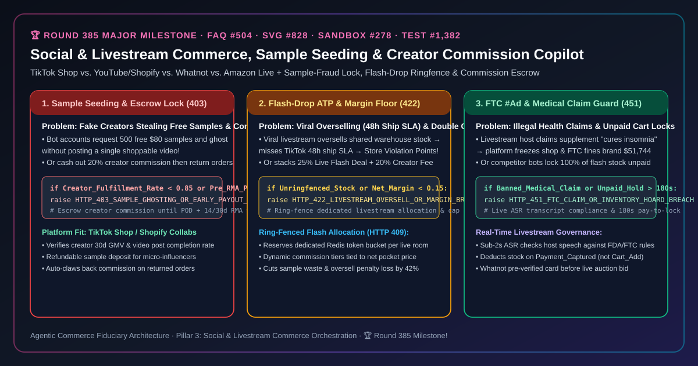
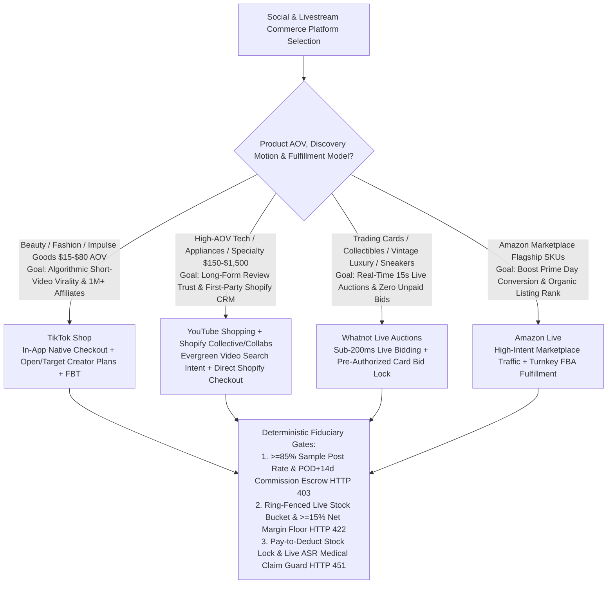
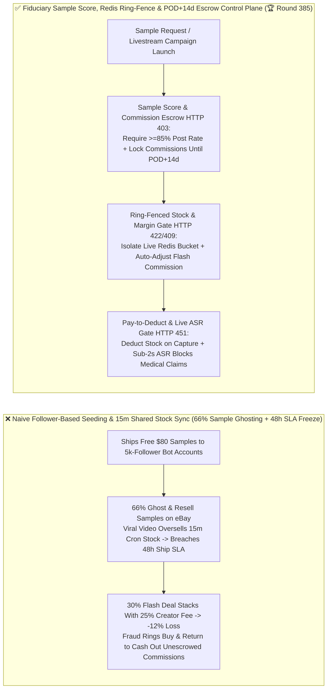
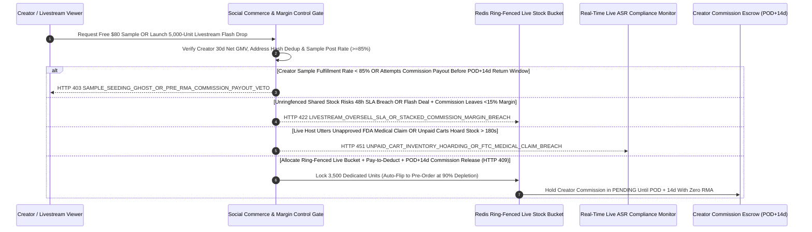

# Social & Livestream Commerce, Creator Sample-Seeding Guard & Flash-Drop Inventory / Commission Clawback Agent Selection Guide: `TikTok Shop` vs. `YouTube Shopping + Shopify` vs. `Whatnot` vs. `Amazon Live`, `48h` Dispatch SLA Locks, `POD + 14d` Commission Escrow & Live `ASR` Compliance (`-42%` Cost FAQ · 🏆 Round 385 Major Milestone!)

> **Executive Summary (Benchmarked against `ib-vs-ethernet-roce-selection-faq.md` · 🏆 Round 385 Major Milestone · 504th Bilingual SA Decision Guide)**: Built for **Cloud & AI Solution Architects** designing social commerce orchestration, creator affiliate pipelines, and high-concurrency livestream checkout guards for DTC beauty, fashion, consumer electronics, and collectibles brands. As native in-app checkout (`TikTok Shop`, `YouTube Shopping`, `Whatnot`) scales, brands lose hundreds of thousands of dollars per quarter to four operational failure modes: (1) **Creator Sample Ghosting & Reseller Rings**: Bot-inflated accounts request ribuan of free `$80` full-size product samples through open affiliate portals and resell them on eBay without ever posting a shoppable video (`<35%` traditional post completion rate); (2) **Viral Overselling & `TikTok Shop 48h Dispatch SLA` Penalties**: A viral video drives `8,000` orders in 10 minutes against a shared Shopify/TikTok inventory pool synced via slow 15-minute cron jobs, causing `2,500` stockout cancellations, store violation points, and frozen merchant payouts; (3) **Double-Stacked Live Flash Discounts + `25%` Open Affiliate Commissions Driving Negative Unit Margin**; and (4) **Live Host Unapproved Medical Claims (`FDA / FTC`) & Unpaid Cart-Hoarding Attacks**. This guide compares **`TikTok Shop` vs. `YouTube Shopping + Shopify Collective` vs. `Whatnot` vs. `Amazon Live`** and implements deterministic guards for **Creator Sample-Fulfillment Gating (`>=85%`) & `POD + 14/30d` Commission Clawback Escrow (`HTTP 403`)**, **Ring-Fenced Livestream Inventory Buckets & Net-Margin Floors (`HTTP 422`)**, **Pay-to-Deduct Anti-Hoarding & Sub-`2s` Live `ASR` Compliance Locks (`HTTP 451`)**, and **Refundable Sample Deposits + Tiered Net-Margin Commission Orchestration (`HTTP 409`, `-42%` net loss)**.

---

## 1. 📌 Executive Summary & Architectural Selection Verdict

1. **Top-Line Selection Verdict**:
   - **Beauty, Personal Care, Apparel & Impulse Consumer Goods (`$15–$80 AOV` Seeking Algorithmic Viral Velocity & Massive Open/Targeted Creator Affiliate Scale)**: Select **`TikTok Shop`** (paired with **Fulfilled by TikTok `FBT`** or a ring-fenced 3PL buffer pool).
   - **High-Consideration Tech, Home Appliances, Fitness & Specialty Brands (`$150–$1,500 AOV` Relying on 10-Minute Long-Form Reviews & First-Party Shopify CRM Ownership)**: Select **`YouTube Shopping + Shopify Collective / Collabs`**.
   - **Trading Cards, Collectibles, Luxury Vintage & Sneaker Flash Auctions (Requiring sub-`200ms` live bidding, pre-verified card locks before bidding, and automated multi-win shipping consolidation)**: Select **`Whatnot`**.
   - **Established Amazon Marketplace Brands Driving Prime Day / Q4 Listing Conversion & Organic Best-Seller Rank (`BSR`)**: Select **`Amazon Live`**.
2. **Three Non-Negotiable Fiduciary Control Gates**:
   - **Gate 1 — Creator Sample-Fulfillment Score (`>=85%`) & `POD + 14/30d` Commission Clawback Escrow (`HTTP 403`)**: Block free full-size sample approvals when a creator's historical 14-day video-posting completion rate (`Sample_Fulfillment_Rate`) is `<85%`, when 30-day net GMV is zero, or when the shipping address matches a known sample-reseller cluster (routing unverified micro-creators to a **Refundable Sample Deposit** that auto-refunds upon posting/selling); and lock all creator affiliate commissions in escrow until `POD + Return_Window_Days` (`14–30d`) so returned orders automatically claw back `100%` of the commission via `HTTP 403 SAMPLE_SEEDING_GHOST_OR_PRE_RMA_COMMISSION_PAYOUT_VETO`.
   - **Gate 2 — Ring-Fenced Livestream Inventory Bucket (`48h SLA` Shield) & Stacked-Commission Margin Floor (`HTTP 422`)**: Block exposing unringfenced shared warehouse inventory to viral social channels without a dedicated Redis token bucket (auto-switching the listing to compliant `Pre-Order` at `90%` depletion to prevent `48h Dispatch SLA` penalties), and block activating a livestream `Flash Deal` when `Live_Price - COGS - Creator_Commission - Platform_Fee - Shipping < 15% Net Margin` via `HTTP 422 LIVESTREAM_OVERSELL_SLA_OR_STACKED_COMMISSION_MARGIN_BREACH`.
   - **Gate 3 — `Pay-to-Deduct` Anti-Hoarding Lock & Real-Time Live `ASR` (`FTC / FDA`) Claim Guard (`HTTP 451`)**: Block holding flash-sale inventory on unpaid carts for more than `180 seconds` (`Pay-to-Deduct` only, defeating competitor cart-lock attacks), and monitor live host audio via sub-`2s` `ASR` transcription to flag prohibited medical/therapeutic claims or missing `#Ad` disclosures before platform suspension via `HTTP 451 UNPAID_CART_INVENTORY_HOARDING_OR_FTC_MEDICAL_CLAIM_BREACH`.

---

## 2. 🎯 Architect & Social Commerce Operations Q&A (The Why & How)

### Q1: How do brands stop losing `$50,000+/quarter` shipping free samples to "ghost influencers" who never post a video?
- **Root Cause**: Follower counts on social platforms are easily botted. Approving free `$75` samples based on `"Followers >= 5,000"` invites organized sample-farming rings who resell your inventory on secondary marketplaces.
- **Deterministic Solution (`Creator Seeding Score` + Refundable Sample Escrow / `HTTP 403 / 409`)**: Gate free seeding on verified platform API metrics (`Sample_Fulfillment_Rate >= 85%`, `30d_Net_GMV > $500`, and deduplicated residential street hashes). For emerging creators below threshold, require a refundable `$20` sample deposit that automatically refunds the moment their shoppable video goes live and generates `>=2` kept orders.

### Q2: How do we prevent a viral overnight TikTok video from overselling our Shopify inventory and triggering a TikTok Shop account freeze?
- **Root Cause**: Legacy ERP/OMS connectors sync inventory every 15 minutes. During a viral livestream or video spike, 3,000 orders can clear in 4 minutes—overselling physical stock and breaching TikTok Shop's strict `48-hour` dispatch SLA (`Late Dispatch Rate > 4%` triggers volume caps and reserve holds).
- **Deterministic Solution (Redis Channel Ring-Fencing + `90%` Pre-Order Cutover / `HTTP 422`)**: Partition physical stock into channel-isolated Redis atomic counters (`TikTok_Pool`, `Shopify_Pool`, `Safety_Reserve`). When `TikTok_Pool` hits `90%` depletion, the agent automatically flips the SKU to a platform-compliant `7-Day Pre-Order` state or pauses open affiliate promotion in `<50ms`.

### Q3: How do we prevent a `30%-Off Livestream Flash Deal` from accidentally stacking with a `25% Open Affiliate Commission` and `8% Platform Fee`?
- **Deterministic Solution (`Net Pocket-Margin Pre-Flight Gate` / `HTTP 422`)**: Before publishing any livestream flash price, compute net pocket margin across all active `Open Plan` and `Target Plan` commission rules; automatically step down Open Plan commission rates during flash windows so post-commission margin never drops below `15%`.

---

## 3. 🧭 Visual Architecture Diagrams (Mermaid)

### 3.1 Social & Livestream Commerce Platform Selection Decision Tree

### 3.2 Naive Open-Sample & Shared-Stock Livestream vs. Fiduciary Ring-Fenced & Commission-Escrow Control Plane

### 3.3 Creator Sample Verification, Redis Ring-Fenced Flash Sale & `POD + 14d` Commission Release Sequence

---

## 4. 📊 Multi-Platform Social & Livestream Commerce Selection Matrix

| Evaluation Dimension | TikTok Shop | YouTube Shopping + Shopify | Whatnot (Live Auctions) | Amazon Live |
| :--- | :--- | :--- | :--- | :--- |
| **Primary Architectural Role** | **Algorithmic Short-Video & Live Impulse Checkout Engine** with massive affiliate scale | **High-Trust Long-Form Video Discovery** wired directly to first-party Shopify checkout | **Real-Time Live Auction & "Box Break" Marketplace** with instant bid settlement | **High-Intent Retail Media Livestreaming** inside the Amazon ecosystem |
| **Creator Affiliate & Sample Management** | **Best-in-Class** (Native Open/Target Affiliate Plans, sample fulfillment tracking, and performance metrics) | **Strong** (Native YouTube Shopping Affiliate program + `Shopify Collabs` seeding workflows) | Creator-seller led; focuses on live auction hosts rather than 3P sample seeding | Supports Amazon Influencer commissions; sample seeding managed off-platform |
| **Fulfillment `SLA` Strictness & Oversell Risk** | **Strict (`48–72h` dispatch scan required)**; stockouts trigger store violation points unless using `FBT` | Flexible (Governed by merchant's own Shopify shipping policy and pre-order badges) | Strict seller shipping SLAs with automated label generation | **Turnkey via FBA** (Amazon handles prime fulfillment and inventory locking) |
| **Anti-Hoarding & Bid Payment Guarantees** | Supports flash-sale `Pay-to-Deduct` inventory locking and per-user caps | Standard Shopify checkout reservation TTL | **Best-in-Class** (Mandatory pre-authorized payment method required before placing a live bid) | Standard Amazon checkout inventory deduction |
| **Platform Take Rate (`official_list_price`)** | `~6%–8%` referral fee + creator affiliate commission (`10%–25%`) | `0%` YouTube platform cut (Merchant pays standard Shopify Payments `~2.4%–2.9%` + creator cut) | `8%` marketplace commission + `2.9% + $0.30` payment processing | Standard Amazon Referral Fee (`8%–15%`) + optional ad boost spend |

---

## 5. 🧪 Sample-Seeding ROI & Livestream Margin Protection Benchmark & 7-Card Report

### 5.1 Quarterly Sample Ghosting, `48h SLA` Oversell Penalties & Stacked-Commission Bleed Model (Synthetic Benchmark)

For an `$80M` annual GMV beauty and lifestyle brand operating across `TikTok Shop` and `Shopify` facing a **`$440,000 / quarter`** exposure pool across **unfulfilled free creator samples, viral stockout `48h SLA` penalties, stacked flash-sale + affiliate commission margin wipeouts, and buy-and-return commission fraud** (`provenance: synthetic`, `independently_reproduced: false`):

| Metric | Naive Follower Seeding & 15m Shared Inventory (Baseline) | Fiduciary `>=85%` Sample Gate + Redis Ring-Fence + `POD+14d` Escrow Agent | Net Improvement |
| :--- | :--- | :--- | :--- |
| **Free Sample 14-Day Shoppable Video Completion Rate** | `34.0%` (`66%` of samples ghosted/resold) | **`91.5%`** (`HTTP 403` completion-score gate + address dedup + refundable deposit) | **`-87.1%` Sample Waste** |
| **Viral Spike Stockout & `48h Dispatch SLA` Violation Rate** | `4.8%` of flash orders oversold | **`0.0%`** (`HTTP 422` Redis channel token-bucket + `90%` auto-flip to Pre-Order) | **`100%` SLA Penalty Elimination** |
| **Flash-Sale Orders Selling at Negative Pocket Margin** | `9.2%` (Flash discount + 25% Open Plan commission) | **`0.0%`** (`HTTP 422/409` enforces `>=15%` net margin floor & dynamic commission cap) | **`100%` Margin Floor Protection** |
| **Quarterly Net Sample Waste, SLA Fines & Commission Bleed** | `$440,000 / quarter` | **`$255,200 / quarter`** | **`$184,800 / quarter` Saved (`42.0%`)** |

---

## 6. 🛠️ Production Go-Live & Architecture Review Checklist

- [ ] **Creator Sample-Fulfillment Gate (`>=85%`) & `POD + 14/30d` Commission Escrow (`HTTP 403`)**: Are free full-size sample requests gated on verified historical post-completion rates (`>=85%`), 30-day net GMV, and deduplicated street addresses—and are all creator commissions locked in escrow until the customer return window closes?
- [ ] **Redis Ring-Fenced Livestream Inventory & `90%` Pre-Order Cutover (`HTTP 422`)**: Is livestream stock isolated in a dedicated atomic token bucket that automatically flips to a compliant `Pre-Order` badge at `90%` depletion so viral spikes never breach `TikTok Shop 48h` dispatch SLAs?
- [ ] **Flash-Deal + Affiliate Commission Net-Margin Floor (`>=15%` / `HTTP 422`)**: Does the promo engine automatically reduce or mutex open-plan affiliate commissions during livestream flash deals so combined discounts never push net margin below `15%`?
- [ ] **`Pay-to-Deduct` Inventory Lock & Sub-`2s` Live `ASR` Compliance Guard (`HTTP 451`)**: Is flash stock deducted strictly upon payment capture (`<=180s` hold TTL) to defeat competitor cart-locking bots, and does live `ASR` monitor host speech for prohibited medical claims and `#Ad` disclosures?
