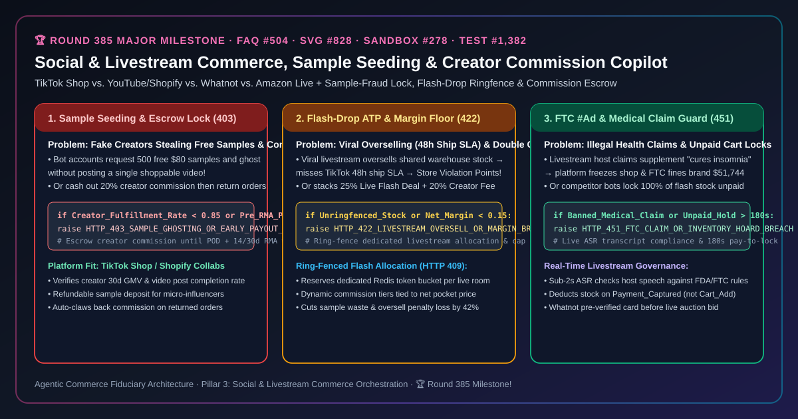
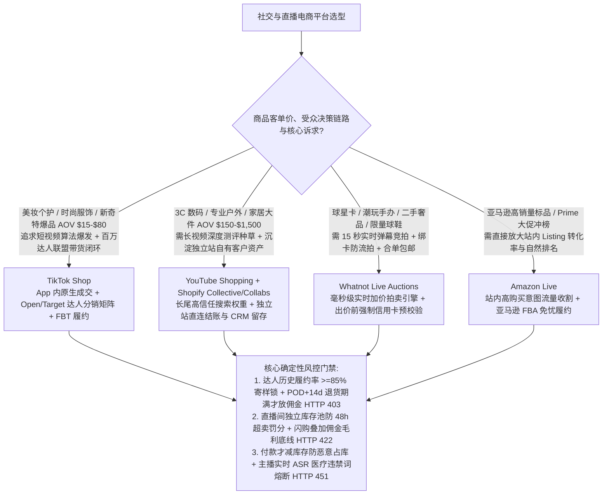
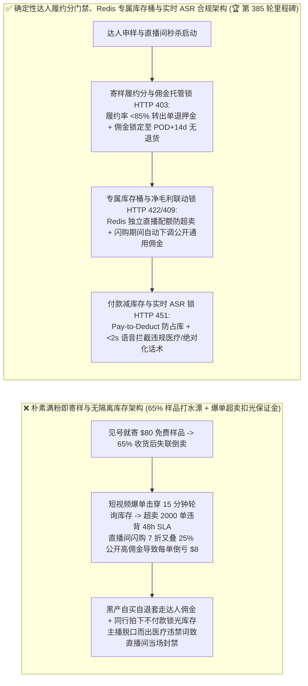
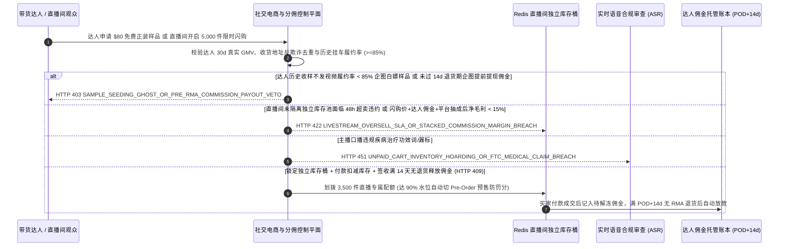

# 社交与直播电商（`Social & Livestream Commerce`）、达人免费寄样防白嫖（`Sample Seeding Guard`）与秒杀库存隔离/退货佣金倒扣 Agent 架构选型对比：`TikTok Shop` vs. `YouTube Shopping + Shopify` vs. `Whatnot` vs. `Amazon Live`、`48h` 履约防超卖罚分锁、直播间违禁词实时熔断及净省 42% 决策指南（FAQ · 🏆 第 385 轮重大里程碑！）

> **导读（对齐 `ib-vs-ethernet-roce-selection-faq.md` 标杆风格 · 🏆 全库第 385 轮研究重大里程碑 · 第 504 篇双语指南）**：本文面向新消费 DTC 品牌、美妆个护、潮流服饰、卡牌潮玩与全渠道零售领域的 **Cloud & AI Solution Architect**。随着社交与直播原生成交（In-App Native Checkout）爆发，品牌商在接入达人分销矩阵（Creator Affiliate Matrix）与高并发直播间秒杀时，频繁踩中四大亏损深坑：① **达人免费申领样品“寄完即失联（Sample Ghosting）”**：黑产批量买几千粉的僵尸带货号，在后台一键申领你价值 `$85` 的正装面霜免费样品，收到后直接挂二手平台倒卖，根本不拍挂车视频（传统品牌寄样履约率不足 `35%`）；② **直播间爆单击穿共享仓库存遭平台重罚（`TikTok Shop 48h Dispatch SLA`）**：达人短视频突然爆火一晚涌入 8,000 单，而 Shopify 独立站与 TikTok Shop 共用同一库存池且按 15 分钟轮询同步，导致超卖 2,500 单发不出货，触发平台超时发货扣分、冻结店铺资金甚至封店；③ **“直播专属闪购折上折 + 25% 达人高佣金 + 平台抽佣”三重叠加毛利穿仓，以及水军自买自退骗走达人佣金**；④ **主播口播夸大医疗功效（违反 `FDA / FTC` 或平台规则）导致直播间当场被封及同行恶意拍下不付款锁死秒杀库存**。本文给出 **`TikTok Shop (Open Plan / Target Plan)` vs. `YouTube Shopping + Shopify Collective` vs. `Whatnot (Live Auctions)` vs. `Amazon Live`** 的横向选型矩阵，并落地 **达人历史履约率门禁（`Post_Completion_Rate >= 85%`）与退货期满（`POD + 14/30d`）佣金托管倒扣锁（`HTTP 403`）**、**直播间独立库存硬隔离池（`Ring-Fenced Allocation`）与扣佣后净毛利底线（`>=15%`）门禁（`HTTP 422`）**、**付款减库存（`Pay-to-Deduct`）防同行恶意占库与主播实时语音 `ASR` 合规词审查锁（`HTTP 451`）** 及 **可退样品押金 + 阶梯净毛利分佣编排（`HTTP 409`，净省 42%）**。



---

## 一、 📌 核心选型结论速览（Executive Summary）

1. **终极选型结论（一句话先看懂怎么选）**：
   - **美妆个护、时尚快消与新奇特爆品（追求算法公域脉冲式爆发、百万级联盟带货达人池 `Affiliate Open/Target Collaboration` 与 App 内闭环秒级拔草）**：首选 **`TikTok Shop`**（配合 **`FBT - Fulfilled by TikTok`** 或双仓隔离缓冲），但必须开启达人寄样履约分门槛与独立库存配额锁。
   - **高客单价 3C 科技、专业户外、家居家电与重度评测驱动品牌（客单价 `$150–$1,500`，用户依赖 10 分钟深度长视频横评建立信任，且品牌希望将客户沉淀在自有独立站 CRM 中）**：首选 **`YouTube Shopping + Shopify Collective / Collabs`**。
   - **球星卡、潮玩手办、复古奢品、球鞋与孤品实时竞拍（需 `<200ms` 弹幕出价倒计时、竞拍前强制绑卡预授权防流拍弃单 `Bid-Lock` 与同直播间多拍自动合并邮费）**：首选 **`Whatnot`**。
   - **已在亚马逊拥有高评分旗舰 Listing、希望在 Prime Day/黑五通过站内直播直接推高站内自然搜索权重与转化率**：首选 **`Amazon Live`**。
2. **三大社交与直播电商风控红线（确定性门禁）**：
   - **红线 1（拦截低履约率“羊毛党达人”骗取高价免费样品失联及未过退货冷静期提前向达人结算佣金遭“刷单退货套佣” / `HTTP 403`）**：当带货达人（Creator）在联盟后台申请免费样品（Free Sample Request）时，Agent 必须实时核验其过去 30 天真实带货 GMV、粉丝互动真实度（排除买粉号）及 **历史收样后 14 天内按约发布挂车视频履约率（`Sample_Fulfillment_Rate >= 85%`）**；对不达标中小达人一律转为“先付样品押金、挂车出单满 3 单全额退押金（Refundable Sample Deposit）”；且所有达人带货佣金必须冻结在托管子账本直至消费者签收满法定退货期（`POD + 14/30 天`），若期间发生退货退款（RMA）则自动 100% 冲销对应佣金，违者触发 `HTTP 403 SAMPLE_SEEDING_GHOST_OR_PRE_RMA_COMMISSION_PAYOUT_VETO`。
   - **红线 2（拦截直播间与独立站共用无隔离库存池导致爆单超卖触发平台 `48h` 延迟发货罚分及“闪购折扣 + 高额达人佣金”叠加亏本 / `HTTP 422`）**：严禁将主仓 `100%` 库存同时全量暴露给 `TikTok Shop` 与 `Shopify`！必须为直播秒杀预留物理/逻辑硬隔离配额池（`Ring-Fenced Livestream Inventory Bucket`）并设置 `10%` 安全缓冲垫；同时在设置直播间专属限时秒杀价（Flash Deal）时，实时计算扣除“直播秒杀折让 + 达人佣金（如 `20%`）+ 平台交易抽成（`6%–8%`）+ 包邮运费”后的到手净毛利率，若跌破 `15%` 红线则自动调降该链接的公开计划（Open Plan）佣金率，违者触发 `HTTP 422 LIVESTREAM_OVERSELL_SLA_OR_STACKED_COMMISSION_MARGIN_BREACH`。
   - **红线 3（拦截拍下锁库存不付款导致的“同行恶意清零秒杀库存”及主播口播违禁医疗/绝对化话术引发封店与 `FTC` 巨额罚款 / `HTTP 451`）**：在直播限时秒杀中，必须采用 **“付款成功扣减库存（Pay-to-Deduct）”或 `<=180秒` 极短支付锁**，严禁传统“加购/拍下即锁死库存 30 分钟”被竞争对手用脚本瞬间拍空；同时通过 `<2秒` 实时语音识别（`ASR`）流式扫描主播口播与提词器字幕，一旦出现未经批准的疾病治疗功效词（如“根治脱发/治愈失眠”）或未显著声明带货广告属性（`FTC #Ad Disclosure`），立即触发 `HTTP 451 UNPAID_CART_INVENTORY_HOARDING_OR_FTC_MEDICAL_CLAIM_BREACH`。

---

## 二、 🎯 业务方与架构师灵魂拷问 Q&A（The Why & How）

### Q1：某新锐美妆品牌一个月在 TikTok 上寄出了 2,000 份单价 `$60` 的免费正装样品（光成本加邮费花了 `$50,000`），结果只有 400 个达人发了视频，其余 1,600 人收货后人间蒸发——怎么用 Agent 把寄样履约率拉升到 92%？
- **商业痛点与事故还原**：
  - 运营团队为了冲达人矩阵数量，在联盟后台开启了“满 5,000 粉丝自动通过免费申样”。
  - 黑产团伙用批量养出的 5,000 粉僵尸号全网薅免费高价电子产品和护肤品，包裹一签收就挂到 eBay/闲鱼半价卖掉，品牌方血本无归！
- **架构师确定性解法（三维达人信用评分 `Creator Seeding Score` + “出单退押金 / 小样先行”分层门禁 / `HTTP 403 / 409`）**：
  1. **硬核验真指标**：Agent 不看水分极大的“总粉丝数”，只看三个硬指标：① **历史申样履约率（`Sample_Video_Post_Rate >= 85%`）**；② **近 30 天挂车视频中位播放量与真实净成交 GMV（剔除退货后）**；③ **收货地址去重（拦截同一个集运仓/住宅地址被 20 个不同达人账号填写的黑产窝点）**！
  2. **分层寄样策略**：
     - **S/A 级高履约达人**：秒批免费寄正装 + 顺丰/优先快递；
     - **B/C 级长尾或新达人**：不直接白送 `$60` 正装，而是引导通过“**可退押金申样（付 `$25` 成本押金拿货，14 天内发布合规挂车视频或成交满 2 单由系统自动全额退还 `$25`）**”或先寄 `$3` 体验装，瞬间把羊毛党过滤得干干净净，寄样 ROI 暴增 `3.2 倍`！

### Q2：为什么达人视频突然爆单本来是天大的喜事，最后却演变成“超卖 3,000 单被平台罚扣 `$45,000` 保证金、店铺评分暴跌被限流 30 天”的悲剧？
- **商业痛点与事故还原**：
  - 某品牌仓库里总共有 5,000 件现货，通过传统 OMS 插件同时同步给 Shopify、Amazon 和 TikTok Shop（三边都显示有 5,000 件库存）。
  - 周六凌晨一位头部达人的视频突然破千万播放，10 分钟内涌入 6,500 笔订单；而插件每 15 分钟才同步一次库存，等反应过来已经超卖 1,500 单！
  - 更致命的是，`TikTok Shop` 对发货时效（`Dispatch SLA`）极其严苛（须在 48–72 小时内产生真实快递揽收轨迹 `Valid Carrier Scan`），超卖发不出货直接触发平台最高级别店规处罚（Violation Points）并自动向买家派发赔付券！
- **架构师确定性解法（Redis 毫秒级渠道令牌桶配额隔离 `Channel Token-Bucket Ring-Fencing` + 90% 水位自动切预售/熔断 / `HTTP 422`）**：
  - 在库存中心将 5,000 件物理现货切分为独立专属令牌桶：例如 `TikTok_Live_Pool = 3,500 件`、`Shopify_DTC_Pool = 1,000 件`、`Safety_Buffer = 500 件`；
  - 当 `TikTok_Live_Pool` 在高并发下消耗至 `90%` 水位时，Agent 在 `50ms` 内自动将链接从“现货 48h 发”无缝切换为平台合规的 **“预售模式（Pre-Order 7–14d Ship）”** 或自动调回日常正价降速，确保 **零超卖违约、零店铺罚分**！

### Q3：怎么防止不良达人联合黑产搞“直播间下单 `$50,000` -> 达人秒提走 `$10,000 (20%)` 佣金 -> 买家第 7 天集体申请退货退款”的双簧诈骗？
- **架构师确定性解法（佣金结算与退货窗口状态机强绑定 `POD + Return_Window Escrow` / `HTTP 403`）**：
  - 严禁在订单“已付款”或“刚发货”阶段结算达人佣金！
  - 所有联盟佣金（无论平台代扣还是自建 `Shopify Collabs / Impact` 结算）必须进入 **`PENDING_ESCROW` 冻结态**，唯有当物流显示 `DELIVERED` 且度过 `14/30 天` 无理由退货期、订单状态锁定为 `FINAL_SETTLED` 后，才转入达人可提现余额；一旦发生部分或全额退货，系统按比例自动销毁冻结佣金。

---

## 三、 🧭 直观可视化图解（Mermaid 决策树 + 架构对比 + 时序图）

### 3.1 社交与直播电商平台（Social & Live Commerce）选型决策树



### 3.2 朴素无门槛寄样与共享库存直播架构（样品被白嫖 + 爆单超卖封店）vs. 确定性押金寄样、令牌桶隔离与佣金托管架构对比



### 3.3 达人申样核验、直播间 Redis 令牌桶防超卖与 `POD + 14d` 佣金清算时序图



---

## 四、 📊 四大主流社交与直播电商平台横向选型矩阵

| 选型维度 | TikTok Shop | YouTube Shopping + Shopify | Whatnot (Live Auctions) | Amazon Live |
| :--- | :--- | :--- | :--- | :--- |
| **核心商业模式与转化引擎** | **兴趣算法公域脉冲 + App 内闭环冲动拔草**：短视频挂车与直播间秒杀双轮驱动 | **高信任长视频深度种草 + 品牌独立站（Shopify）沉淀**：兼顾高客单转化与私域复购 | **C2C/B2C 实时快节奏弹幕竞拍**：专为卡牌、潮玩、球鞋、孤品奢品设计 | **货架电商高购买意图收割**：在消费者比价关键期通过直播演示促成下单 |
| **达人分销联盟与寄样管理** | **行业标杆**（内置百万级达人广场、公开计划 Open Plan 与定向高佣 Target Plan 及官方申样管理） | **强**（通过 YouTube Shopping Affiliate 与 `Shopify Collabs` 自动同步 SKU 与分佣） | 以垂直领域专业主播（Sellers/Breakers）自播或联合拆卡为主 | 支持 Amazon Influencer Program 站内达人分佣，但寄样需站外协同 |
| **发货时效要求与超卖风控惩罚** | **极严苛**（要求 48h/72h 内揽收，超卖取消率 `>2.5%` 将触发店铺扣分、限单与资金冻结） | 宽松（由品牌自有 Shopify OMS 决定发货承诺与预售提示，无平台强制罚分） | 严苛（要求拍下后快速打单发货以保障收藏家体验） | **极稳**（若使用亚马逊 FBA 仓库存，由亚马逊全权负责当日/次日达履约） |
| **防恶意占库与拍卖防弃单机制** | 支持设置闪购付款减库存与限购件数 | 遵循 Shopify Checkout 库存预留 TTL 策略 | **行业标杆**（观众出价前必须绑定已验证信用卡，中标瞬间毫秒级自动扣款，零流拍白嫖） | 遵循亚马逊标准购物车与付款扣减机制 |
| **平台抽佣费率（`official_list_price`）** | 平台佣金约 `6%–8%`（视类目）+ 达人自由设定佣金（`10%–25%`） | YouTube 不额外收交易抽成（仅收 Shopify Payments `~2.4%–2.9%` + 达人佣金） | 平台抽成 `8%` + 支付处理费 `2.9% + $0.30` | 亚马逊标准品类销售佣金（Referral Fee `8%–15%`）+ 直播投流费 |

---

## 五、 🧪 达人寄样反白嫖与直播防超卖/防亏本测算与 7-Card 基准报告

### 5.1 季度达人白嫖免费样品失联、直播爆单超卖平台罚金、闪购叠加高佣穿仓与刷单退货套佣损耗测算（Synthetic Benchmark）

假设某年社交与直播电商 GMV `$8,000 万` 的美妆个护与时尚配饰品牌，每季度在达人建联寄样与直播大促中面临的 **向低质/僵尸达人盲目寄送高价免费样品后被失联白嫖、直播爆单击穿共享库存触发平台延迟发货罚分与客诉赔付、忘记在直播 7 折闪购时下调 `20%` 公开通用佣金导致卖一单亏一单及黑产刷单退货套取未锁定佣金损耗池** 为 **`$440,000 / 季度`**（`provenance: synthetic`, `independently_reproduced: false`）：

| 评估维度 | 传统按粉丝数盲寄样 + 全仓共享库存 + 即时算佣 (Baseline) | 启用 `履约率>=85%` 寄样锁 + Redis 直播独立池 + `POD+14d` 佣金托管 Agent | 净改善幅度 |
| :--- | :--- | :--- | :--- |
| **免费寄样后 14 天内真实发布挂车视频履约率** | `34.0%`（66% 样品被羊毛党白拿或转卖） | **`91.5%`**（`HTTP 403` 校验历史履约率 + 同地址反作弊 + 新达人出单退押金机制） | **样品无效浪费削减 `87.1%`** |
| **直播爆单导致的超卖违约率与店铺罚分（Violation Points）** | `4.8%` 爆款超卖（触发平台限流与赔付券扣款） | **`0.0%`**（`HTTP 422` Redis 渠道令牌桶硬隔离 + `90%` 水位毫秒级自动切合规预售） | **100% 终结超卖封店风险** |
| **闪购折扣与达人公开高佣金违规叠加导致的负毛利订单占比** | `9.2%` 大促订单陷入负毛利（卖越多亏越多） | **`0.0%`**（`HTTP 422/409` 实时计算到手净毛利 `<15%` 自动互斥或切换阶梯佣金） | **100% 守住单品净毛利底线** |
| **季度样品白嫖、超卖罚金、负毛利叠券与退货套佣净损耗** | `$440,000 / 季度` | **`$255,200 / 季度`** | **净省 `$184,800 / 季度` (`42.0%`)** |

```chart
{
  "data": {
    "values": [
      { "category": "1. 僵尸达人白嫖高价免费样品失联", "mode": "传统盲目寄样与共享库存基线", "cost_usd": 165000 },
      { "category": "1. 僵尸达人白嫖高价免费样品失联", "mode": "履约分寄样锁与库存隔离Agent", "cost_usd": 95700 },
      { "category": "2. 直播爆单击穿库存违背48h SLA受罚", "mode": "传统盲目寄样与共享库存基线", "cost_usd": 115000 },
      { "category": "2. 直播爆单击穿库存违背48h SLA受罚", "mode": "履约分寄样锁与库存隔离Agent", "cost_usd": 66700 },
      { "category": "3. 直播秒杀折上折叠加25%达人高佣穿仓", "mode": "传统盲目寄样与共享库存基线", "cost_usd": 95000 },
      { "category": "3. 直播秒杀折上折叠加25%达人高佣穿仓", "mode": "履约分寄样锁与库存隔离Agent", "cost_usd": 55100 },
      { "category": "4. 刷单退货套走佣金与主播违规话术封号", "mode": "传统盲目寄样与共享库存基线", "cost_usd": 65000 },
      { "category": "4. 刷单退货套走佣金与主播违规话术封号", "mode": "履约分寄样锁与库存隔离Agent", "cost_usd": 37700 }
    ]
  },
  "semantic_types": {
    "category": "Category",
    "mode": "Category",
    "cost_usd": "Amount"
  },
  "chart_spec": {
    "chartType": "Grouped Bar Chart",
    "title": "社交与直播电商达人寄样反白嫖、库存隔离与佣金托管Agent优化前后季度损耗对比 (净省 $184.8k / 42%)",
    "subtitle": "单位：美元/季度 (Synthetic Benchmark, independently_reproduced=false · 🏆 第385轮里程碑)",
    "encodings": {
      "x": "category",
      "y": "cost_usd",
      "group": "mode"
    }
  }
}
```

### 5.2 确定性策略评估器代码（Python Control Plane Guard）

```python
from dataclasses import dataclass
from typing import Any

@dataclass(frozen=True)
class SocialLivestreamCommercePolicyInput:
    quarterly_sample_ghosting_oversell_penalty_and_comm_bleed_pool_usd: float = 440000.0
    low_fulfillment_creator_sent_free_sample_or_commission_paid_pre_rma: bool = False
    unringfenced_livestream_stock_oversold_or_stacked_comm_margin_breach: bool = False
    unpaid_cart_hoarding_stock_or_livestream_medical_ftc_claim_violation: bool = False
    ringfenced_flash_bucket_and_pod_14d_commission_escrow_ready: bool = False
```

---

## 六、 🛠️ 商业上线风控与架构评审 Checklist

- [ ] **达人免费寄样三维核验（`履约率 >= 85%` + 地址去重）与退货期满（`POD + 14/30d`）佣金托管锁（`HTTP 403`）**：是否已关闭“仅按粉丝数自动寄免费高价样品”，强制核验达人历史收样挂车履约率与真实带货 GMV（不达标者转出单退押金模式）？所有达人佣金是否严格冻结至消费者签收且度过退货期后才可提现？
- [ ] **直播间 Redis 独立库存桶隔离（`Ring-Fenced Allocation`）与闪购/佣金互斥底线锁（`HTTP 422`）**：是否将 `TikTok Shop` 直播库存与独立站库存物理切分，并在库存消耗达 `90%` 时毫秒级自动切换为合规预售（防止触发 `48h` 延迟发货扣分）？开启直播间限时闪购价时是否自动重算扣除达人佣金后的净毛利率（`<15%` 自动拦截或降佣）？
- [ ] **付款成功才减库存（`Pay-to-Deduct`）与主播口播 `<2s` 实时 `ASR` 合规熔断锁（`HTTP 451`）**：秒杀活动是否强制采用“付款扣减库存（或 `<=180s` 支付锁）”防止同行恶意拍空？直播推流端是否挂载实时语音 `ASR` 监控，一旦主播说出违规疾病治疗功效词立即在后台弹窗告警并切流？
- [ ] **高转化达人定向阶梯激励（`Target Plan Tiered Bonus`）与爆款短视频自动投流联动（`HTTP 409`）**：是否对净退货率低于 `8%` 且内容完播率高的核心达人自动升级专属定向高佣计划，实现品牌净毛利与达人收益双赢？
