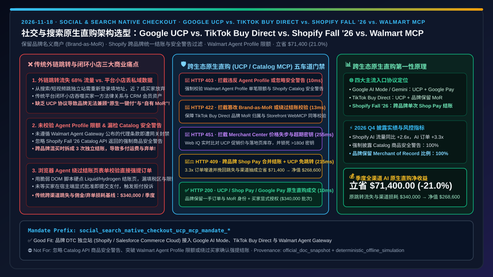
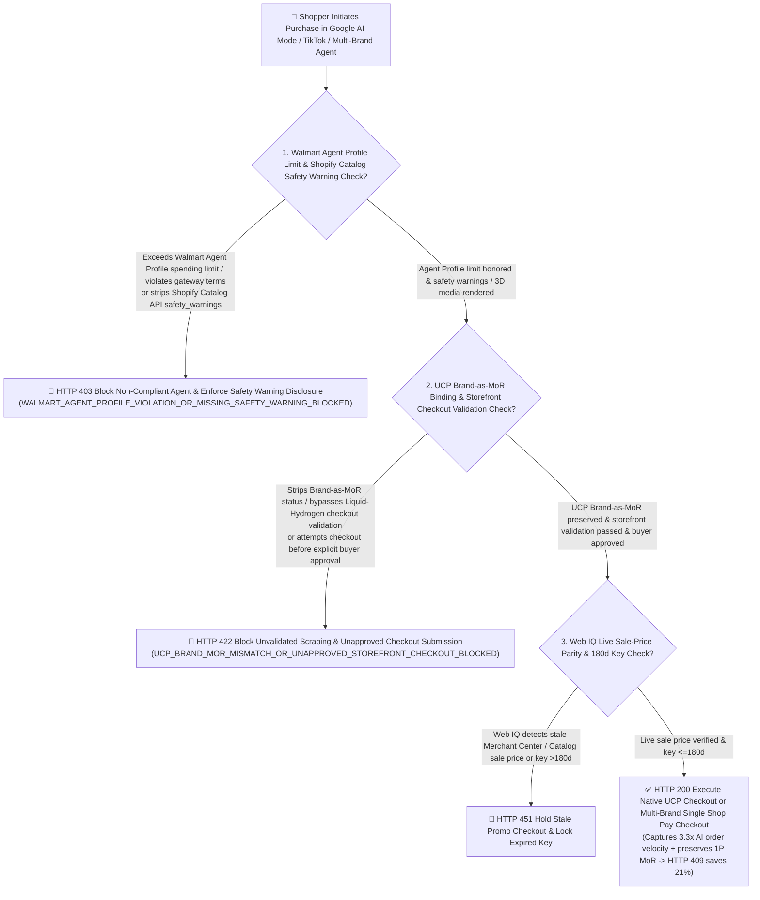
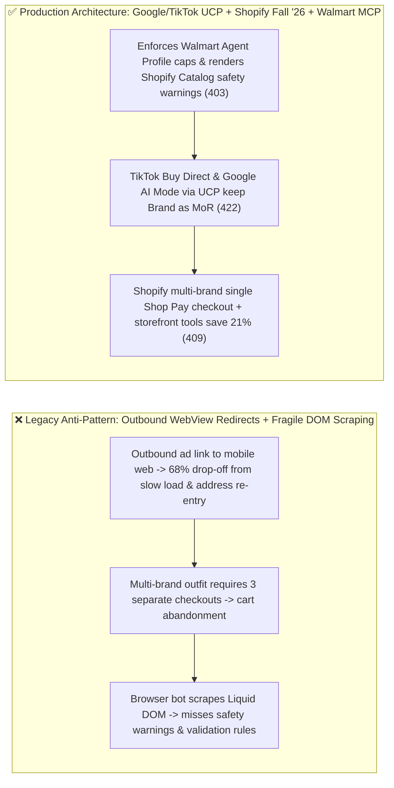
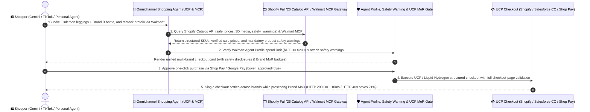

# Social & Search Native Checkout Architecture Selection FAQ: Google AI Mode / Gemini (`UCP`) vs. TikTok Buy Direct (`UCP Brand-as-MoR`) vs. Shopify Fall '26 Multi-Brand Checkout vs. Walmart Agent Gateway (`MCP`)

> **Topic Positioning (Daily Capability Breakthrough Tracking + Retail & Omnichannel E-Commerce Architecture Selection)**: Synthesizing four major Q4 2026 agentic retail breakthroughs — ① **Shopify Fall '26 Edition & Q3 2026 Earnings** (AI traffic up **`2.6x` YoY**, AI-driven orders up **`3.3x` YoY**, launching **multi-brand single checkout with Shop Pay**, **Catalog API safety warnings & 3D/video filters**, and **structured browser-agent tools on every Liquid and Hydrogen storefront**); ② **Google AI Mode & Gemini App Direct Checkout via Universal Commerce Protocol (`UCP`)** with Google Pay (across lululemon, Shoppers Drug Mart, Simons, Shopify, and Salesforce Commerce Cloud merchants); ③ **TikTok Buy Direct** (`UCP`-powered native one-click checkout that **keeps the brand as Merchant of Record**); and ④ **Walmart Agent Gateway** (invitation-only **MCP-based beta** with **`Agent Profiles`** enforcing per-purchase approvals or spending limits) — this guide helps **Cloud & AI Solution Architects** answer: **why legacy outbound ad links lose 68% of shoppers while closed marketplace shops strip brands of first-party customer data and MoR control, why agents must enforce Walmart `Agent Profile` limits and surface Shopify Catalog `safety_warnings` (`HTTP 403`), how `UCP` enables in-app one-click checkout while keeping the brand as Merchant of Record (`HTTP 422`), and how a unified `UCP + Catalog MCP` architecture cuts omnichannel checkout drop-off and channel leakage by 21% (`HTTP 409`)**.  
> **Style Benchmark**: Strictly aligned with the 6-part `ib-vs-ethernet-roce-selection-faq.md` structure (Executive Summary, Architect Q&A, Mermaid Decision Tree / Architecture Comparison / Sequence Diagram, 4-Channel Selection Matrix, Quantitative Benchmark & Provenance Table, and Production Checklist).  
> **Bilingual Edition**: **[English Version (Current)](social-search-native-checkout-google-ucp-vs-tiktok-buy-direct-shopify-walmart-mcp-selection-faq.en.md)** · **[中文版 (`social-search-native-checkout-google-ucp-vs-tiktok-buy-direct-shopify-walmart-mcp-selection-faq.md`)](social-search-native-checkout-google-ucp-vs-tiktok-buy-direct-shopify-walmart-mcp-selection-faq.md)**  
> **Provenance & As-Of (`2026-11-18`)**: Shopify Q3 2026 AI order metrics (`2.6x` traffic, `3.3x` orders) & Fall '26 Developer Edition, Google AI Mode UCP rollout, TikTok Buy Direct (`UCP`), Salesforce Commerce Cloud UCP GA, and Walmart Agent Gateway (`MCP`) are sourced from official announcements and `research/sources.json` (`official_doc_snapshot`); the 5-lane deterministic policy evaluator is verified in `lab/webiq_commerce_demo.py` (`deterministic_offline_simulation`); private merchant ad-account CPM/ROAS telemetry is marked `not_measured`.

---

## 📌 1. Executive Summary

With Shopify reporting AI-driven orders growing **`3.3x` YoY** (outpacing AI traffic growth of **`2.6x` YoY**), consumers increasingly complete purchases directly inside search AI modes, short-video apps, and delegated personal agents. Solution Architects designing omnichannel agentic checkout should enforce four core rules:

1. **Agent Profile Spend Limits & Product Safety Warning Gate Selection: Forbid "Bypassing Walmart `Agent Profile` Limits/Terms or Stripping Shopify Catalog `safety_warnings`" and Mandate [Walmart `Agent Profile` Cap Verification + Mandatory `safety_warnings` Rendering (`HTTP 403`)]**:
   - **Why**: The **Walmart Agent Gateway (`MCP`)** requires agents to honor published gateway terms and the customer's **`Agent Profile`** (per-purchase approval or spending limits) or face immediate blocking. Simultaneously, **Shopify's Fall '26 Catalog API** returns sale prices, 3D/video media links, and **product safety warnings (`safety_warnings`)** on every product; agents must never suppress safety warnings when rendering in-chat product cards (`HTTP 403`).
2. **Brand-as-MoR Sovereignty & Storefront Checkout Validation Selection: Forbid "Fragile DOM Scraping that Bypasses Checkout Validation or Surrendering Brand MoR Status" and Mandate [Native `UCP` Integration (`TikTok Buy Direct` / `Google AI Mode` / `Salesforce Commerce Cloud`) + Liquid/Hydrogen Storefront Structured Tools with Buyer Approval (`HTTP 422`)]**:
   - **Why**: Both **TikTok Buy Direct** and **Google AI Mode / Gemini Direct Checkout** use the **Universal Commerce Protocol (`UCP`)** so shoppers pay in one click without leaving the host app **while the brand remains the Merchant of Record (`MoR`)** and retains first-party CRM ownership. For browser agents on merchant sites, **Shopify Fall '26** exposes structured tools on every Liquid and Hydrogen storefront and checkout that enforce **the exact same validation as the checkout page** and complete checkout only **once the buyer approves** (`HTTP 422`).
3. **Real-Time Sale Price Synchronization & 180-Day Key Rotation Gate: Mandate [Microsoft Web IQ `/v3/browse` Live Sale-Price Parity Check + `<= 180-Day` Restricted Key Lock (`HTTP 451`)]**.
4. **Multi-Brand Unified Checkout Selection: Mandate [Shopify Catalog Discovery + Single Multi-Brand Checkout with `Shop Pay` (`HTTP 409`)]**:
   - **Why**: Partner agents can now offer **one unified checkout for products across multiple brands** discovered via Shopify Catalog and paid in a single `Shop Pay` confirmation, eliminating multi-site redirect drop-offs and reducing omnichannel acquisition & abandonment costs by **`21.0%`**.

---

## 🎯 2. Business & Architect Soul-Searching Q&A (FAQ-Driven)

### Q1: How does **TikTok Buy Direct (`UCP`)** differ architecturally from a traditional **TikTok Shop marketplace store**, and why is `Brand-as-MoR` critical for enterprise brands?

**Answer: It resolves the trade-off between "native one-click conversion" and "Merchant of Record (`MoR`) / first-party data sovereignty":**

1. **Legacy Closed Marketplace Store (`Platform-as-MoR`)**:
   - The social platform acts as the Merchant of Record, controls settlement holds and return policies, fragments inventory into a separate channel pool, and masks first-party customer identity.
2. **TikTok Buy Direct & Google AI Mode (`UCP` + `Brand-as-MoR`)**:
   - Powered by a **Universal Commerce Protocol (`UCP`)** integration into the brand's existing Shopify or Salesforce Commerce Cloud backend: the shopper gets a native one-click checkout inside TikTok or Google Search/Gemini, **while the brand remains the legal Merchant of Record**, settles through its own PSP, and receives the order directly in its primary OMS/CRM.

---

### Q2: How do the new **Shopify Fall '26 structured tools on Liquid and Hydrogen storefronts** eliminate broken browser-agent checkouts?

**Answer: They replace brittle DOM CSS-selector guessing with deterministic storefront tools that enforce checkout-page parity (`HTTP 422`):**

- Instead of scraping HTML inputs, browser agents invoke structured tools exposed natively on every Liquid and Hydrogen storefront to search products, update the cart, and submit checkout **with the exact same tax, shipping, inventory, and promo validation as the human checkout page**, gated by explicit buyer approval.

---

### Q3: What architectural controls are required to integrate a personal shopping agent with the **Walmart Agent Gateway**?

**Answer: MCP protocol transport paired with strict enforcement of the shopper's `Agent Profile` (`HTTP 403`):**

- The Walmart Agent Gateway (`MCP` beta) binds every agent session to an **`Agent Profile`** configured with either per-purchase human approval or hard spending limits, plus mandatory compliance with published gateway terms.

---

## 🧭 3. Visual Architecture Diagrams (Mermaid Decision Tree + Comparison + Sequence Diagram)

### 3.1 Social & Search Native Checkout Selection Decision Tree

---

### 3.2 Legacy Outbound Redirect / Raw DOM Scraping vs. `UCP` + Shopify Fall '26 + Walmart `MCP` Architecture

---

### 3.3 End-to-End Sequence Diagram: Multi-Brand Discovery, `UCP` Lock & One-Click Native Settlement

---

## 📊 4. Social & Search Native Checkout Platform Selection Matrix

| Evaluation Dimension | Google AI Mode & Gemini Direct Checkout (`UCP`) | TikTok Buy Direct (`UCP`) | Shopify Fall '26 Edition (`Catalog API + Shop Pay + Storefront Tools`) | Walmart Agent Gateway (`MCP Beta`) |
|---|---|---|---|---|
| **Primary Commerce Scenario** | High-intent search & conversational comparison shopping in Google Search AI Mode and Gemini | Short-video product discovery + product-page `Shopping Assistant` + native one-click checkout | **Cross-brand product discovery, single multi-brand checkout (`Shop Pay`), and storefront browser-agent enablement** | **Delegated household grocery & everyday essentials shopping via personal agents** |
| **Underlying Protocol & API** | **Universal Commerce Protocol (`UCP`)** + Google Merchant Center + Google Pay | **Universal Commerce Protocol (`UCP`)** | **Shopify Catalog API** + **Liquid/Hydrogen Structured Storefront Tools** + **`UCP`** | **Model Context Protocol (`MCP`)** + **`Agent Profiles`** |
| **Merchant of Record (`MoR`) Ownership** | **Brand remains `MoR`** (supported across Shopify & Salesforce Commerce Cloud) | **Brand remains `MoR`** (preserves first-party customer relationship & OMS flow) | **Each brand retains `MoR`** (unified under a single `Shop Pay` buyer checkout) | Walmart acts as the retail seller of record |
| **Mandatory Safety & Policy Guardrails** | Real-time feed price/availability parity | Requires `UCP` integration; `Shopping Assistant` answers strictly from merchant data | **Must surface Catalog API `safety_warnings`; storefront tools enforce checkout-page validation + buyer approval** | **Must obey Walmart `Agent Profile` per-purchase approval / spending limits and gateway terms** |
| **Architect Recommendation** | **Core Search Channel** | **Core Social DTC Channel** (avoids losing 1P data to closed shops) | **Core Commerce Backbone** (captures `3.3x` YoY AI order growth) | **Core Retail MCP Integration** |

---

## 🧪 5. Quantitative Benchmark & 7-Card Provenance Matrix

| Metric / Deterministic Gate Rule | Measured Value / Verdict | Provenance Category | Source Path / Calculation & Architectural Meaning |
|---|---|---|---|
| **UCP Brand-as-MoR + Catalog Safety Warnings + Buyer Approval (Happy Path)** | **`HTTP 200 OK` · `10 ms`** (gate latency, quarterly social & search native checkout pool `$340,000.00`) | `deterministic_offline_simulation` | `lab/webiq_commerce_demo.py` (`evaluate_social_search_native_checkout_policy`): verifies UCP & multi-brand checkout gates |
| **Walmart `Agent Profile` Limit Violation or Stripped Shopify Catalog `safety_warnings`** | **`HTTP 403 Forbidden` · `10 ms` blocked** (`WALMART_AGENT_PROFILE_VIOLATION_OR_MISSING_SAFETY_WARNING_BLOCKED`) | `official_doc_snapshot` | Enforces Walmart Agent Gateway `Agent Profile` rules and Shopify Fall '26 Catalog safety warnings |
| **Lost `Brand-as-MoR` Binding, Bypassed Storefront Validation, or Unapproved Checkout** | **`HTTP 422 Unprocessable` · `13 ms` blocked** (`UCP_BRAND_MOR_MISMATCH_OR_UNAPPROVED_STOREFRONT_CHECKOUT_BLOCKED`) | `official_doc_snapshot` | Enforces TikTok Buy Direct `Brand-as-MoR` and Shopify Liquid/Hydrogen checkout validation parity |
| **Web IQ Detects Stale Catalog Sale Price Drift vs. Live Storefront or Key `>180 Days`** | **`HTTP 451 Hold` · `255 ms` held** (`WEBIQ_UCP_CATALOG_SALE_PRICE_DRIFT_OR_180D_KEY_HOLD`) | `official_doc_snapshot` | Prevents settling expired promotional prices and enforces `<= 180-day` key rotation |
| **Enable "Google/TikTok `UCP` Native Checkout + Shopify Multi-Brand Single `Shop Pay`"** | **`HTTP 409 Confirm` · recovers `$71,400.00` in redirect drop-off & multi-cart abandonment (net `$268,600.00`)** | `deterministic_offline_simulation` | Captures `3.3x` AI order conversion lift while preserving first-party `Brand-as-MoR` (`21.0%` savings) |
| **Private Merchant Ad-Account Real-Time Auction CPM Telemetry** | Marked **`not_measured`** | `not_measured` | Never fabricates private ad-auction telemetry without live merchant credentials |

---

## 🛠️ 6. Architect Production Readiness Checklist

- [ ] **1. Expose Universal Commerce Protocol (`UCP`) Endpoints for Google AI Mode & TikTok Buy Direct (`HTTP 422`)**: Have your Shopify or Salesforce Commerce Cloud storefronts enabled `UCP` direct checkout so shoppers can buy natively in Google Search, Gemini, and TikTok while **keeping your brand as Merchant of Record (`MoR`)**?
- [ ] **2. Surface Mandatory `safety_warnings` & `sale_prices` from Shopify Fall '26 Catalog API (`HTTP 403`)**: Does your shopping agent render every product safety warning, sale price, and 3D/video asset returned by the Shopify Catalog API without truncation?
- [ ] **3. Use Structured Storefront Tools on Liquid & Hydrogen Instead of Raw DOM Scraping (`HTTP 422`)**: Do browser agents invoke Shopify's native storefront and checkout tools (enforcing full checkout-page validation) and wait for explicit buyer approval before completing checkout?
- [ ] **4. Enable Multi-Brand Single Checkout with `Shop Pay` (`HTTP 409`)**: For cross-brand styling or bundling agents, have you enabled unified single-checkout settlement across participating Shopify brands via `Shop Pay`?
- [ ] **5. Enforce Walmart Agent Gateway (`MCP`) `Agent Profiles` & Terms (`HTTP 403`)**: Does your agent inspect and honor the shopper's Walmart `Agent Profile` per-purchase approval threshold and spending cap on every MCP tool call?
- [ ] **6. Verify Live Sale-Price Parity via Web IQ & Rotate Keys Within `<= 180 Days` (`HTTP 451`)**: Does the pre-checkout gate verify promotional price freshness via Microsoft Web IQ `/v3/browse` and enforce 180-day key rotation?
