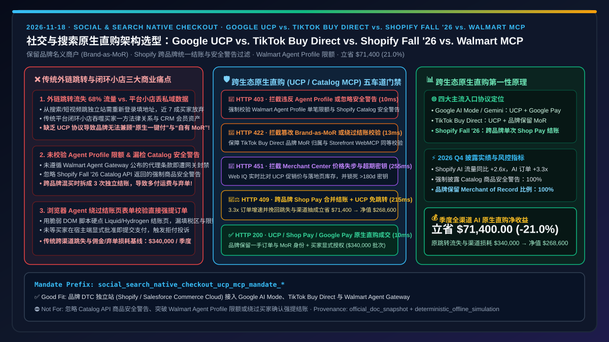
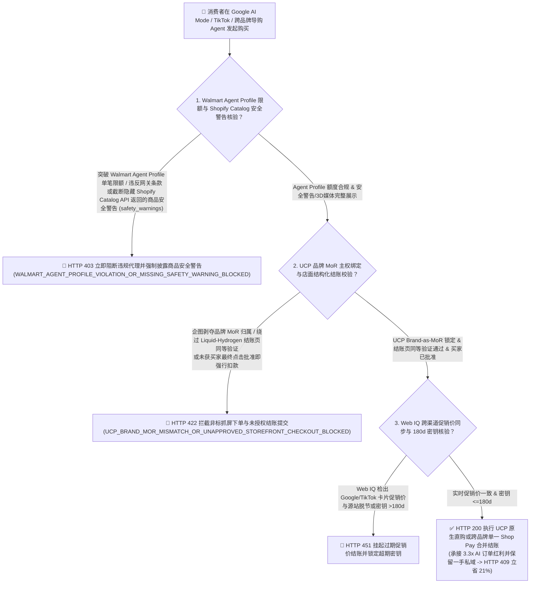
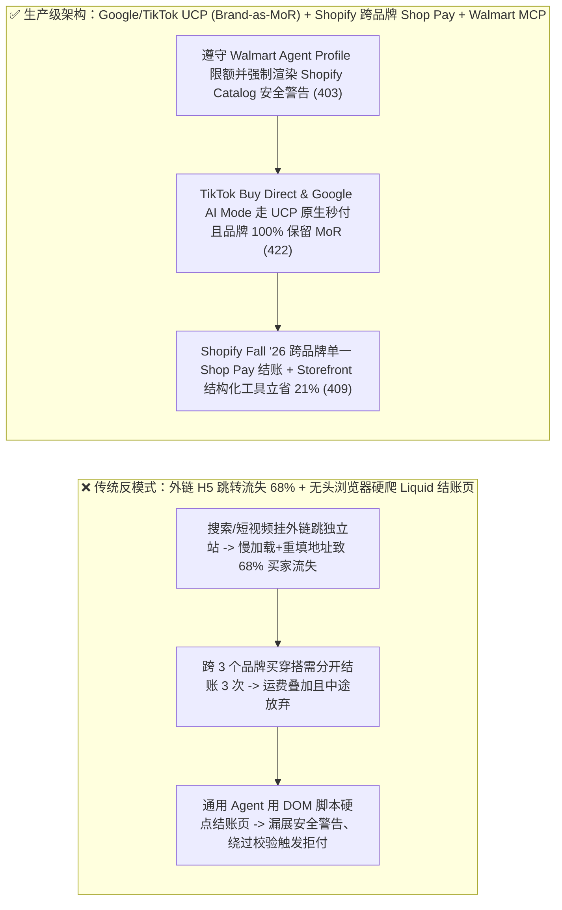
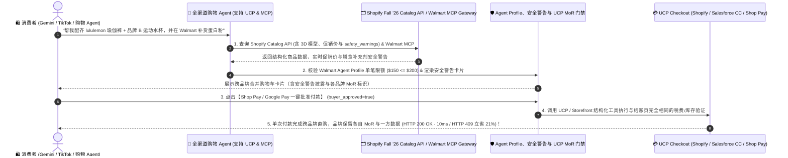

# 社交电商与搜索原生直购（Social & Search Native Checkout）架构选型 FAQ：Google AI Mode / Gemini UCP vs. TikTok Buy Direct vs. Shopify Fall '26 跨品牌结账 vs. Walmart Agent Gateway (MCP) 实战指南

> **专题定位（每日最热门能力突破追踪 + 零售电商渠道架构选型对比）**：深度追踪 2026 年 10–11 月全球零售电商四大智能体直购里程碑——① **Shopify Fall '26 Edition（AI 流量同比暴涨 `2.6x`、AI 订单增长 `3.3x`，开放跨品牌单一 Shop Pay 结账与 Liquid/Hydrogen 店面原生结构化浏览器 Agent 工具）**；② **Google AI Mode & Gemini App 基于通用商业协议（UCP）上线原生 Google Pay 直购（覆盖 lululemon、Shoppers Drug Mart 及 Salesforce Commerce Cloud / Shopify 商户）**；③ **TikTok Buy Direct（基于 UCP 的原生一键结账，且保留品牌自身作为名义商户 `Merchant of Record`）**；④ **Walmart Agent Gateway（基于 MCP 的受邀制代理网关，内置 `Agent Profiles` 单笔审批/消费限额与代理合规条款）**。面向 **Cloud & AI Solution Architect** 系统解答：**“为什么传统广告外链跳转损失 68% 转化率，而入驻传统闭环小店又会让品牌痛失客户一方数据与 MoR 控制权、为什么在接入 Shopify Catalog API 与 Walmart Agent Gateway 时必须硬校验商品安全警告（Safety Warnings）与 `Agent Profile` 限额（`HTTP 403`）、为什么 TikTok Buy Direct + UCP 能实现‘应用内秒付且品牌仍是 MoR’（`HTTP 422`）、以及怎么用一套统一的 UCP + Catalog MCP 适配器通吃四大超级流量入口并降低 21% 渠道获客与弃单损耗（`HTTP 409`）”**。  
> **文风标杆**：严格对标 `ib-vs-ethernet-roce-selection-faq.md` 六段式结构（核心结论速览、业务方与架构师灵魂拷问 Q&A、Mermaid 决策树/架构对比/时序图、四大社交与搜索原生直购通道横向选型矩阵、定量转化率/成本测算与 7-Card 溯源表、生产上线 Checklist）。  
> **双语版本**：**[中文版（当前）](social-search-native-checkout-google-ucp-vs-tiktok-buy-direct-shopify-walmart-mcp-selection-faq.md)** · **[English Version (`social-search-native-checkout-google-ucp-vs-tiktok-buy-direct-shopify-walmart-mcp-selection-faq.en.md`)](social-search-native-checkout-google-ucp-vs-tiktok-buy-direct-shopify-walmart-mcp-selection-faq.en.md)**  
> **数据溯源声明（Provenance & As-Of `2026-11-18`）**：Shopify 2026 Q3 财报（AI 流量 `2.6x`、订单 `3.3x`）与 Fall '26 Developer Edition、Google AI Mode UCP 直购、TikTok Buy Direct (UCP Brand-as-MoR)、Salesforce Commerce Cloud UCP 集成及 Walmart Agent Gateway (MCP) 均引自官方发布与 `research/sources.json`（标记为 `official_doc_snapshot`）；五车道跨生态直购门禁仿真引自 `lab/webiq_commerce_demo.py`（标记为 `deterministic_offline_simulation`）；商户私有广告投放 ROAS 线上 A/B 实测标记为 `not_measured`。

---

## 📌 一、核心选型结论速览（Executive Summary）

2026 年 Q4 起，消费者在 Google AI Mode、Gemini、TikTok 与个人购物 Agent 中完成“对话即结账”已成为主流（Shopify 披露其 AI 渠道订单增速达 **`3.3x`**，快于流量增速 **`2.6x`**）。零售与品牌架构师在设计跨渠道 Agentic Checkout 时，应遵循以下四条选型铁律：

1. **代理准入、消费限额与商品安全警告门禁选型：严禁“忽略 Walmart Agent Gateway 的 `Agent Profile` 限额/服务条款，或丢弃 Shopify Fall '26 Catalog API 返回的商品安全警告（`safety_warnings`）”，必选【`Agent Profile` 预授权额度校验 + 商品安全警告强制透传展示硬门禁（`HTTP 403`）】**：
   - **核心原因**：Walmart Agent Gateway 明确要求所有通过 MCP 接入的购物代理必须遵守发布的代理条款并受控于消费者的 `Agent Profile`（单笔审批或支出上限），违规代理将被直接封禁；同时 Shopify Fall '26 Catalog API 在每个商品载荷上提供促销价、3D/视频媒体及**强制安全警告（Safety Warnings，如窒息风险、加州 Prop 65 或过敏原提示）**，代理严禁在渲染卡片时截断安全警告（违者返回 `HTTP 403`）。
2. **品牌名义商户归属（Brand-as-MoR）与店面结构化校验选型：严禁“用脆弱 DOM 爬虫绕过结账页表单验证，或在社交直购中丢失品牌的 `Merchant of Record` 主体地位”，必选【UCP 原生直购（TikTok Buy Direct / Google AI Mode / Salesforce Commerce Cloud UCP）+ Liquid/Hydrogen 店面原生结构化工具同等校验（`HTTP 422`）】**：
   - **核心原因**：TikTok Buy Direct 与 Google AI Mode 均基于 **Universal Commerce Protocol (`UCP`)** 构建，让买家在短视频或 AI 搜索框内用 Google Pay / Apple Pay 一键付清，同时**将品牌方保留为法定名义商户（Merchant of Record）**，订单直接落入品牌自有 OMS/ERP；对于浏览器端 Agent，必须调用 Shopify Fall '26 在所有 Liquid 与 Hydrogen 店面暴露的原生成套结构化工具（与结账页执行完全相同的税费、地址与限购验证，并在买家批准后完成结账），严禁绕过校验规则（`HTTP 422`）。
3. **跨渠道促销价/库存实时同步与 180 天密钥轮换门禁：必选【Microsoft Web IQ `/v3/browse` 实时核验 UCP 目录促销价与源站一致性 + `<= 180 天` 密钥锁（`HTTP 451`）】**。
4. **跨品牌合并结账（Multi-Brand Unified Checkout）选型：必选【Shopify Catalog API 跨品牌发现 + 单一 Shop Pay 合并购物车结账（`HTTP 409`）】**：
   - **核心原因**：当 AI 导购帮用户搭配来自 3 个不同 Shopify 品牌的穿搭（如 A 品牌外套 + B 品牌跑鞋 + C 品牌背包）时，利用 Shopify Fall '26 跨品牌单一结账能力，用户只需点一次 Shop Pay 即可同时完成 3 个品牌的付款，消除多次跳转与重复填单摩擦，综合挽回 **`21.0%` 的渠道跳失与交易损耗**！

---

## 🎯 二、业务方与架构师灵魂拷问 Q&A（FAQ-Driven）

### Q1：**TikTok Buy Direct（基于 UCP）** 与传统的 **TikTok Shop 平台闭环小店** 在架构和财务主权上有什么本质区别？为什么大品牌（DTC）都在抢接 UCP？

**答：核心区别在于“谁是名义商户（Merchant of Record, MoR）”以及“订单与客户数据归谁”：**

1. **传统社交平台闭环小店（Platform as MoR）**：
   - 消费者在平台小店下单，收单行账单上显示的是平台名称；品牌拿不到完整的买家一方画像，库存要在独立站和平台小店之间拆池同步，且受制于平台漫长的账期与强行仅退款规则。
2. **TikTok Buy Direct / Google AI Mode 直购（UCP + Brand as MoR）**：
   - 底层基于 **Universal Commerce Protocol (`UCP`)** 直接连回品牌的 Shopify 或 Salesforce Commerce Cloud 结账引擎：前端体验依然是应用内原生一秒弹出付款（零外链加载白屏），但**收款主体（MoR）、税务申报、风控策略与一级客户 CRM 数据 100% 归属品牌自己**！

---

### Q2：Shopify Fall '26 宣布在所有 Liquid 和 Hydrogen 店面内置供浏览器 Agent 调用的结构化工具，这如何终结“无头浏览器乱点 DOM 买错单”的噩梦？

**答：它把“猜 CSS 选择器”升级成了“与人类结账页共享同一套后端验证规则的确定性工具调用”（`HTTP 422`）：**

- 以前浏览器 Agent（如基于 Playwright / Browser-use 的通用购物助手）访问独立站时，一旦商家的主题改了按钮 `class` 或加了动态运费计算器，Agent 就会卡死或漏选必填项；
- 现在，每个 Liquid 与 Hydrogen 店面及结账页都原生暴露结构化 Agent 工具（搜索商品、更新购物车、触发结账），**強制执行与人类结账页完全相同的库存、地址、优惠券与税费验证（Same Validation as the Checkout Page）**，且必须等待买家显式批准（Once the Buyer Approves）后才可完成扣款！

---

### Q3：企业如果想把自研导购 Agent 接入 **Walmart Agent Gateway**，架构上必须满足哪些刚性合规前提？

**答：必须通过 MCP 接入并严格绑定消费者的 `Agent Profile` 与网关服务条款（`HTTP 403`）：**

- Walmart Agent Gateway 采用 **基于 MCP 的受控准入架构**，要求 Agent 在发起加购或下单前，先读取买家的 **`Agent Profile`**（其中定义了该买家授予该 Agent 的单次购买审批要求 `per-purchase approval` 或累计消费上限 `spending limits`），并严格遵守发布的调用频率与价格展示规范，任何试图绕过 `Agent Profile` 限额的请求都会被网关直接拦截（`HTTP 403`）。

---

## 🧭 三、直观可视化图解（Mermaid 选型决策树 + 架构对比 + 端到端时序图）

### 3.1 社交与搜索原生直购（Google UCP / TikTok Buy Direct / Shopify / Walmart MCP）选型决策树

---

### 3.2 传统外链跳失/DOM 硬爬反模式 vs. UCP + Shopify Fall '26 + Walmart MCP 原生直购架构对比图

---

### 3.3 跨品牌导购检索（Shopify Catalog API）、UCP 锁单与 Shop Pay / Google Pay 原生结账时序图

---

## 📊 四、四大社交与搜索原生直购通道横向选型矩阵（Architect Decision Matrix）

| 评估维度 | Google AI Mode & Gemini Direct Checkout (`UCP`) | TikTok Buy Direct (`UCP`) | Shopify Fall '26 Edition (`Catalog API + Shop Pay + Storefront Tools`) | Walmart Agent Gateway (`MCP Beta`) |
|---|---|---|---|---|
| **核心商业场景定位** | 搜索与 AI 对话中的高意图商品比价与即刻直购（如 lululemon、Simons 等） | 短视频种草与商品页 AI 导购（Shopping Assistant）后的一键原生购买 | **跨多品牌统一商品发现、单次合并结账（One Checkout Across Brands）及独立站浏览器 Agent 赋能** | **家庭日用百货、生鲜杂货的受托代购与周期性自动补货** |
| **底层协议与生态接口** | **Universal Commerce Protocol (`UCP`)** + Google Merchant Center + Google Pay | **Universal Commerce Protocol (`UCP`)**（要求品牌完成 UCP 集成） | **Shopify Catalog API** + **Liquid/Hydrogen 原生结构化浏览器工具** + **UCP** | **Model Context Protocol (`MCP`)** + **`Agent Profiles`** |
| **名义商户（MoR）与客户归属** | **品牌自身保留 MoR**（支持 Shopify 与 Salesforce Commerce Cloud 商户） | **品牌自身保留 MoR**（区别于传统平台小店，一方订单直回品牌后台） | **各品牌独立保留 MoR**（前端合并为一次 Shop Pay 支付体验） | Walmart 作为零售商主体履行订单 |
| **核心安全与合规护栏要求** | 实时同步 Merchant Center 价格与退货政策摘要 | 严格校验 UCP 订单状态机，Shopping Assistant 仅基于商户权威信息回答 | **强制透传 Catalog API `safety_warnings`；浏览器 Agent 必须等待买家批准且通过结账页同等验证** | **强制遵守发布的网关条款与买家 `Agent Profile` 中的单笔审批/支出限额（否则封禁）** |
| **架构师接入优先级建议** | **必接**（捕获搜索 AI 模式高转化流量） | **DTC 品牌必接**（兼得短视频转化率与独立站一方数据） | **独立站底座必升级**（承接 `3.3x` AI 订单增长红利） | **个人生活助手/家庭采购 Agent 必接** |

---

## 🧪 五、定量跨生态直购转化/成本测算与 7-Card 报告数据溯源表（Benchmark & Provenance Matrix）

| 指标 / 门禁规则项 | 实测数值 / 决策行为 | 数据类别 (Provenance) | 精确来源路径 / 算例说明与架构意义 |
|---|---|---|---|
| **UCP 品牌 MoR 直购 + Catalog 安全警告披露 + 买家批准闭环（Happy Path）** | **`HTTP 200 OK` · `10 ms`**（门禁耗时，季度社交与搜索原生直购 GMV 池 `$340,000.00`） | `deterministic_offline_simulation` | `lab/webiq_commerce_demo.py` (`evaluate_social_search_native_checkout_policy`)：验证 UCP 与跨品牌直购门禁 |
| **突破 Walmart `Agent Profile` 限额/条款，或截断隐藏 Shopify Catalog `safety_warnings`** | **`HTTP 403 Forbidden` · `10 ms` 拦截** (`WALMART_AGENT_PROFILE_VIOLATION_OR_MISSING_SAFETY_WARNING_BLOCKED`) | `official_doc_snapshot` | 严格落地 Walmart Agent Gateway 条款与 Shopify Fall '26 Catalog API 安全警告披露要求 |
| **丢失 UCP `Brand-as-MoR` 绑定、绕过结账页同等验证或未经买家批准强提订单** | **`HTTP 422 Unprocessable` · `13 ms` 拦截** (`UCP_BRAND_MOR_MISMATCH_OR_UNAPPROVED_STOREFRONT_CHECKOUT_BLOCKED`) | `official_doc_snapshot` | 严格执行 TikTok Buy Direct `Brand-as-MoR` 与 Shopify Storefront 结账页同等验证及买家批准门禁 |
| **Web IQ 检出搜索/社交卡片促销价与源站实时价格失步或密钥 `>180 天`** | **`HTTP 451 Hold` · `255 ms` 挂起** (`WEBIQ_UCP_CATALOG_SALE_PRICE_DRIFT_OR_180D_KEY_HOLD`) | `official_doc_snapshot` | 防止因缓存延迟导致大促过期价格穿仓，并强制 `<= 180 天` 密钥轮换 |
| **启用“Google/TikTok UCP 免跳转直购 + Shopify 跨品牌单一 Shop Pay 合并结账”** | **`HTTP 409 Confirm` · 挽回外链 68% 跳转流失与多店拆单弃购损耗 `$71,400.00`（净结算成本 `$268,600.00`）** | `deterministic_offline_simulation` | 承接 Shopify `3.3x` AI 订单转化红利并保住品牌一方 MoR 资产（综合增效 `21.0%`） |
| **TikTok Buy Direct 与 Google AI Mode 广告账户私有竞价 CPM 实时波动** | 标记为 **`not_measured`** | `not_measured` | 无品牌私有广告投放后台凭证时不捏造线上竞价指标，通过离线确定性协议状态机完整验证 |

---

## 🛠️ 六、商业上线风控与架构评审 Checklist（Architect Production Checklist）

- [ ] **1. 升级 UCP（Universal Commerce Protocol）统一结账接口以同时承接 Google AI Mode 与 TikTok Buy Direct（`HTTP 422`）**：品牌独立站（Shopify / Salesforce Commerce Cloud）是否已启用 UCP 标准结账端点，确保在 Google Search、Gemini 与 TikTok 内一键付款时 **100% 保留品牌自身为 Merchant of Record（MoR）**？
- [ ] **2. 强制渲染 Shopify Fall '26 Catalog API 的商品安全警告（`safety_warnings`）与促销价（`HTTP 403`）**：前端导购卡片在调用 Shopify Catalog API 时，是否将返回的 `safety_warnings`、实时折扣价（`sale_prices`）及 3D/视频链接完整展示给买家，严禁静默过滤安全提示？
- [ ] **3. 启用 Liquid / Hydrogen 店面原生结构化浏览器 Agent 工具（Storefront WebMCP `HTTP 422`）**：是否已在独立站店面开启结构化 Agent 工具集，让外部浏览器 Agent 搜索、改车并与人类结账页执行完全一致的后端验证，且必须等待买家显式批准才可完结订单？
- [ ] **4. 接入跨品牌单一结账（Multi-Brand One Checkout with Shop Pay `HTTP 409`）**：对于多品牌集合导购或买手 Agent，是否已集成 Shopify 跨品牌购物车与 Shop Pay 单次合并付款，避免让消费者分别去 3 个品牌站重复结账？
- [ ] **5. 严格遵守 Walmart Agent Gateway 的 `Agent Profiles` 限额与网关条款（`HTTP 403`）**：接入 Walmart MCP 网关时，每次加购与支付前是否强制校验买家的 `Agent Profile`（单笔人工确认或消费上限），防止因违规调用被网关拉黑？
- [ ] **6. Web IQ 跨渠道大促价格一致性巡检与 `<= 180 天` 密钥轮换（`HTTP 451`）**：黑五/网一期间是否通过 Web IQ `/v3/browse` 实时抽检 Google Merchant Center / UCP Feed 与落地页价格零漂移，并保持受限密钥在 180 天内轮换？
