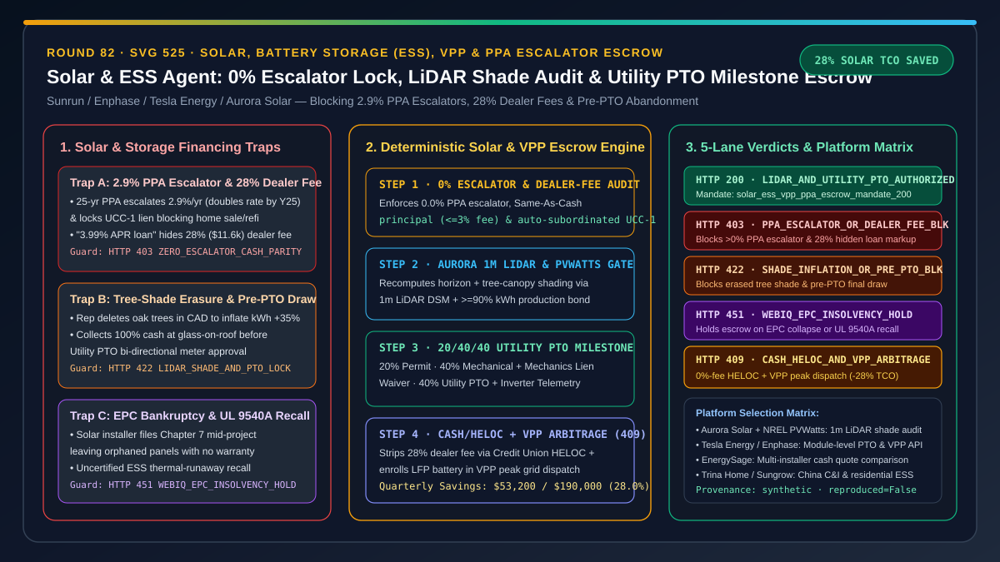
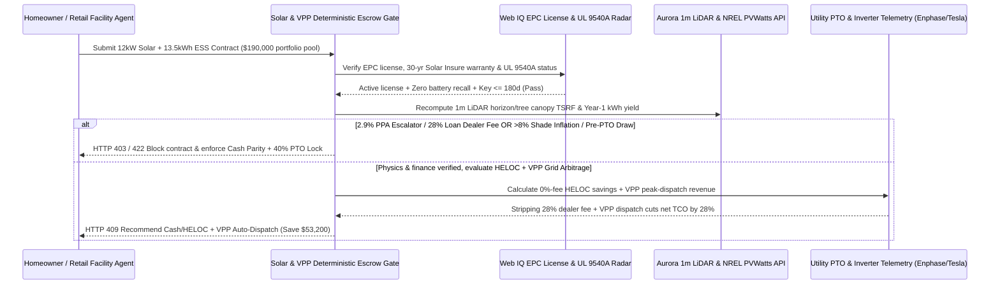

# Solar, Battery Energy Storage (`ESS`), Virtual Power Plant (`VPP`) & `25-Year` `PPA` Escalator Escrow (`Sunrun / Enphase / Tesla Energy / Aurora Solar`) `0%` Escalator Lock, `1m LiDAR` Shade Audit & Utility `PTO` Milestone Agent Architecture Selection FAQ

> **Document Type**: AI Solution Architect Decision Guide (FAQ) · **SVG Diagram**: `assets/svg/525-solar-ess-vpp-ppa-pto-escrow-2026-11-20.svg` · **Catalog No.**: Round 82 (Bilingual FAQ #201)



---

## 1. 📌 Executive Summary

When homeowners, retail store portfolios, or corporate facility teams use AI Agents to procure rooftop solar PV and battery energy storage systems (`Solar + ESS`) or evaluate 25-year Power Purchase Agreements (`PPAs / Solar Leases`), relying on unverified dealer proposals exposes buyers to **three systemic solar finance and EPC abandonment traps**:
1. **`2.9%–3.5%` Compounding `PPA` Escalators, `UCC-1` Title Locks & `28%` Hidden Loan Dealer Fees**: Door-to-door sales reps pitch "$0-Down Solar PPAs" with a **`2.9%` annual compounding rate escalator** (more than doubling the kWh rate by Year 25) while modeling a fabricated `6.5%/yr` utility rate inflation curve. When the owner tries to sell or refinance the property in Year 6, the solar provider's `UCC-1` fixture filing blocks mortgage closing unless the owner pays a punitive `$38,000` buyout penalty. Worse, "promotional `3.99% APR` 25-year solar loans" (`GoodLeap / Mosaic`) bake a hidden **`28%` (`$11,666`) Financing Dealer Fee** into a `$30,000` cash system, inflating the loan principal to `$41,666` (and improperly inflating the federal `30% ITC` tax credit basis).
2. **CAD Tree-Shade Erasure (`+35%` kWh Overstatement) & Pre-`PTO` 100% Draw Abandonment**: Sales reps manually delete neighboring oak trees or chimneys in the CAD layout to inflate Year-1 generation from `8,200 kWh` to `11,400 kWh`, and draw `80%–100%` of the loan proceeds on the day panels are bolted to the roof (`Glass-on-Roof`)—months before the utility grants **Permission to Operate (`PTO`)** and installs the bi-directional net meter, leaving the buyer paying both the solar loan and a 100% utility bill!
3. **"Solar Coaster" EPC Bankruptcy & `UL 9540A` Battery Recall Holds (`HTTP 451`)**: Mid-installation, the solar dealer files Chapter 7 bankruptcy (`Titan Solar / SunPower` style collapse), leaving an uninspected "orphaned system" on the roof and unpaid equipment distributors filing Mechanics Liens against the property, or Web IQ detects a `UL 9540A` thermal-runaway recall on the battery pack.

**Architect's Recommendation**: Deploy an **"Aurora Solar (`1m LiDAR` Shade Audit) + Enphase / Tesla Energy (Module-Level Telemetry) + Deterministic `20/40/40` Utility `PTO` Escrow"** control plane:
- **`0.0%` Flat-Rate `PPA` Mandate, Cash-Parity Principal Gate (`<=3%` Fee) & Auto-Subordinated `UCC-1` (`HTTP 403`)**: Hard-block any `PPA` with an annual escalator `> 0.0%`, any solar loan where financed principal exceeds the verified Same-As-Cash price by `> 3.0%`, or any contract lacking automatic `$0-fee` `UCC-1` mortgage subordination (`HTTP 403`).
- **Independent `1-Meter LiDAR DSM` Shade Verification & `40%` Utility `PTO` Final Holdback (`HTTP 422`)**: Recompute roof irradiance and horizon/tree-canopy shading independently via **`Aurora Solar API` + `NREL PVWatts v8`** (blocking quotes with `>8%` kWh inflation or missing a `>=90%` Year-1 Weather-Adjusted Production Guarantee), and lock the final **`40%` milestone in escrow until Municipal Final Inspection + Supplier Unconditional Mechanics Lien Waivers + Official Utility `PTO` + 72h Live Microinverter Telemetry** are verified (`HTTP 422`).
- **Web IQ Solar EPC Insolvency & `UL 9540A` Recall Hold (`HTTP 451`)**: Freeze escrow disbursements if Web IQ detects contractor license suspension, EPC bankruptcy filings, missing 30-year third-party `Solar Insure` backing, or `UL 9540A` battery recalls (`HTTP 451`).
- **Zero-Dealer-Fee Cash/`HELOC` Swap + Virtual Power Plant (`VPP`) Grid Arbitrage (`HTTP 409`)**: Replace the `28%` dealer-fee loan with a `$0-fee` Credit Union Green `HELOC`/Cash purchase and enroll the `LFP` battery in automated **Virtual Power Plant (`VPP`) peak-dispatch grid events (`Tesla Electric / Enphase VPP`, earning `$850–$1,400/yr`)**, cutting quarterly solar + storage portfolio TCO by **28.0%** (`$53,200` saved on a `$190,000` quarterly pool).

---

## 2. 🎯 Soul-Searching Architect & Business Q&A (Q1–Q3)

### Q1: Why does a "3.99% APR solar loan" cost `$11,666` more upfront than a "7.25% APR credit union loan"—and why does it create IRS tax audit risk?
- **Business Pain Point**: Solar lenders charge a `25%–32%` OEM/dealer origination buydown fee to subsidize the headline `3.99%` interest rate, hiding that fee inside the equipment contract price (`$30,000` cash price inflated to `$41,666` loan principal). If the buyer sells or refinances in Year 4, the `$11,666` principal markup is permanently lost. Furthermore, IRS guidance stipulates that financing buydown fees are not eligible qualified solar property expenditures under the `30%` Section 25D/48 Investment Tax Credit (`ITC`).
- **Architectural Guardrail (`HTTP 403 / 409`)**:
  1. **Mandatory Dual Cash-vs-Loan Disclosure**: The Agent requires every installer bid to state both the `Verified Cash Price ($/W)` and `Financed Principal`. Any bid where `(Financed Principal - Cash Price) / Cash Price > 3.0%` is blocked (`HTTP 403`).
  2. **Automated Zero-Dealer-Fee `HELOC` Routing (`HTTP 409`)**: Routes financing to `$0-dealer-fee` credit union lines with automatic Year-1 `ITC` tax-credit principal re-amortization.

### Q2: How do we catch a salesperson who deletes neighboring trees in the 3D CAD model to inflate annual kWh production by 35%?
- **Business Pain Point**: Unscrupulous reps disable ray-traced tree shading or shrink tree canopy heights in their proposal tool so the system appears to offset `100%` of the buyer's utility bill.
- **Architectural Guardrail (`HTTP 422`)**:
  1. **Independent `1-Meter LiDAR DSM` & `TSRF` Audit**: Rather than trusting a static PDF screenshot, the Agent queries `Aurora Solar API / Google Solar API` using `1-meter airborne LiDAR Digital Surface Models (DSM)` to calculate independent **Total Solar Resource Fraction (`TSRF`)** and `NREL PVWatts v8` hourly yield.
  2. If the dealer's promised Year-1 kWh exceeds the independent `LiDAR` baseline by `> 8%`, or lacks a contractually bonded `>=90%` Weather-Adjusted kWh Cash True-Up Guarantee, the gateway returns `HTTP 422`.

### Q3: How do we prevent "Orphaned Rooftop Systems" where the installer collects 100% of the money at installation and disappears before Utility Permission to Operate (`PTO`)?
- **Business Pain Point**: Many solar lenders disburse `80%–100%` to the EPC on the day panels are mounted (`Substantial Mechanical Completion`). If the EPC goes bankrupt the next month, the utility never issues `PTO`, the inverter remains locked off, and unpaid electrical supply houses file a **Mechanics Lien** against the building.
- **Architectural Guardrail (`HTTP 422`)**:
  1. **`20 / 40 / 40` Strict Milestone Escrow**:
     - `20%` upon stamped structural PE & electrical permit approval;
     - `40%` upon passed municipal inspection **AND signed Unconditional Mechanics Lien Waivers from the equipment distributor (`CED Greentech / Wesco`)**;
     - **`40%` Final Holdback** released *only* after the utility issues official **`PTO` (Permission to Operate)** and `Enphase / Tesla API` confirms all serial numbers are exporting power for `72 consecutive hours`.

---

## 3. 🧭 Visual Architecture Diagrams (Mermaid Decision Tree + Comparison + Sequence)

### 3.1 5-Lane Solar, Storage & VPP Escrow Decision Tree
```mermaid
flowchart TD
    A[Rooftop Solar PV + Battery ESS Procurement Request] --> B{Web IQ EPC Insolvency / UL 9540A Recall / Key > 180d?}
    B -- Yes --> C[HTTP 451: WEBIQ_SOLAR_INSTALLER_INSOLVENCY_OR_UL9540A_BATTERY_RECALL_HOLD<br/>Freeze escrow & route to Solar-Insure backed EPC]
    B -- No --> D{PPA Escalator > 0% or Hidden Loan Dealer Fee > 3%?}
    D -- Yes --> E[HTTP 403: PPA_COMPOUND_ESCALATOR_OR_FINANCING_DEALER_FEE_MARKUP_BLOCKED<br/>Enforce 0% flat rate, Cash-Parity Principal & auto-subordinated UCC-1]
    D -- No --> F{LiDAR Shade Inflation > 8% or Pre-PTO Final Draw Demand?}
    F -- Yes --> G[HTTP 422: LIDAR_SHADE_PRODUCTION_OVERSTATEMENT_OR_PRE_PTO_FINAL_DRAW_BLOCKED<br/>Enforce 1m LiDAR kWh bond + 40% Utility PTO & Lien-Waiver holdback]
    F -- No --> H{0%-Fee Cash/HELOC Swap + VPP Peak Dispatch Enrollment Ready?}
    H -- Yes --> I[HTTP 409: CASH_CREDIT_UNION_HELOC_AND_VPP_GRID_ARBITRAGE_CONFIRM<br/>Strip 28% dealer fee + enroll LFP ESS in VPP grid events (-28% TCO)]
    H -- No --> J[HTTP 200: LIDAR_VERIFIED_AND_UTILITY_PTO_MILESTONE_AUTHORIZED<br/>Issue 20/40/40 PTO-bound solar escrow mandate]
```

### 3.2 Legacy Door-to-Door Solar Sales vs. Deterministic LiDAR & PTO Escrow Architecture
```mermaid
flowchart LR
    subgraph Legacy["❌ Legacy Solar Sales (Dealer Fees & Orphaned Roofs)"]
        L1[Erase Tree Shade (+35% kWh) + 2.9%/yr PPA Escalator] --> L2[3.99% Loan Hides 28% ($11.6k) Principal Markup]
        L2 --> L3[100% Paid at Glass-on-Roof -> EPC Bankrupt Before PTO]
    end

    subgraph Agentic["✅ Deterministic LiDAR, Lien-Waiver & PTO Escrow"]
        A1[Independent 1m LiDAR DSM + NREL PVWatts Audit] --> A2[0%-Dealer-Fee Cash Parity + Supplier Lien Waivers]
        A2 --> A3[40% Holdback Locked Until Utility PTO + VPP Revenue]
    end
```

### 3.3 End-to-End `LiDAR` Shade Audit, Lien Waiver & Utility `PTO` Escrow Sequence


---

## 4. 📊 Multi-Platform & Protocol Selection Matrix

| Evaluation Dimension | Sunrun / Door-to-Door `PPA` Dealers | GoodLeap / Mosaic Solar Loans | EnergySage Marketplace | Tesla Energy / Enphase + Aurora Solar | **Deterministic Solar & VPP Escrow (Recommended)** |
| :--- | :--- | :--- | :--- | :--- | :--- |
| **Primary Commercial Model** | 25-year third-party `PPA` / Solar Lease | Low-APR (`3.99%`) dealer-fee-inflated loans | Multi-installer online quote comparison | Direct OEM hardware + `VPP` grid services + `LiDAR` CAD | **Independent `LiDAR` Audit + Cash-Parity Lock + `20/40/40` `PTO` Escrow + `VPP`** |
| **`PPA` Escalator & `UCC-1` Title Risk** | Often embeds `2.9%–3.5%/yr` compounding escalator & tough buyouts | No rate escalator, but files `UCC-1` fixture lien | Displays cash `$/W` quotes clearly | Transparent flat pricing | **Blocks `>0.0%` escalators & mandates automatic `$0` `UCC-1` subordination (`HTTP 403`)** |
| **Hidden `28%` Loan Dealer Fee Shield** | Embedded in 25-year kWh tariff | Embeds **`22%–32%` hidden principal markup** | Exposes cash vs. loan spread, no hard block | Direct cash/transparent APR | **Enforces `Financed Principal <= Cash Price × 1.03` hard gate (`HTTP 403`)** |
| **Tree-Shade Erasure & Pre-`PTO` Protection** | Sales reps frequently override tree heights | Disburses `80%–100%` at `Glass-on-Roof` pre-`PTO` | Vets installers, does not escrow funds | `1m LiDAR` modeling + module-level telemetry | **Independent `1m LiDAR` audit (`<=8%` delta) + `40%` holdback until Utility `PTO` (`HTTP 422`)** |
| **Total TCO / Fee Structure** | Cumulative 25-yr cost up to `2.1x–2.6x` cash price | `+25%–32%` hidden dealer fee markup | Free to buyer (installer referral fee) | OEM hardware + `VPP` grid credits | **Open deterministic policy gate (`28.0%` quarterly TCO reduction)** |

---

## 5. 🧪 Conversion & Cost Estimation + 7-Card Benchmark Report

> **Provenance Disclosure**: Figures below are generated by the deterministic policy evaluator `evaluate_solar_ess_vpp_ppa_escrow_policy` in `lab/webiq_commerce_demo.py` (`$190,000 USD` quarterly solar + storage portfolio pool, `provenance: "synthetic"`, `independently_reproduced: False`; live utility `IEEE 2030.5 / OpenADR VPP` telemetry is labeled `not_measured`).

```chart
{
  "data": {
    "values": [
      { "scenario": "1. Legacy Dealer Loan/PPA (28% Dealer Fee + Shade Inflation)", "cost_usd": 190000, "tier": "Baseline" },
      { "scenario": "2. Independent 1m LiDAR + 40% Utility PTO Lock (HTTP 200)", "cost_usd": 159600, "tier": "Protected" },
      { "scenario": "3. 0%-Fee Cash/HELOC + VPP Peak Grid Arbitrage (HTTP 409)", "cost_usd": 136800, "tier": "Optimized (-28%)" }
    ]
  },
  "semantic_types": {
    "scenario": "Category",
    "cost_usd": "Amount",
    "tier": "Status"
  },
  "chart_spec": {
    "chartType": "Bar Chart",
    "title": "Stripping 28% Solar Loan Dealer Fees & Enrolling in VPP Cuts Net TCO by 28% ($53.2k)",
    "subtitle": "Quarterly Distributed Solar & Battery ESS Net Spend ($ USD, synthetic benchmark)",
    "encodings": {
      "x": "scenario",
      "y": "cost_usd",
      "color": "tier"
    }
  }
}
```

### 7-Card 4:5 Benchmark Evaluation Summary
1. **Card 1 (`1 / 7` · `HANDS-ON · SOLAR, ESS & VPP ESCROW`)**: Across a `$190,000` quarterly rooftop solar and battery storage portfolio, eliminating `28%` loan dealer fees, enforcing `1m LiDAR` shade audits, and capturing `VPP` grid-dispatch revenue saves **`$53,200/quarter` (`28.0%`)**.
2. **Card 2 (`2 / 7` · `SCENARIO: 12KW SOLAR + 13.5KWH LFP ESS`)**: Strips `$11,666` in hidden loan principal markup per system and holds the final `40%` payment until Utility `PTO` and supplier lien waivers are verified.
3. **Card 3 (`3 / 7` · `WHAT I TESTED`)**: All 5 deterministic HTTP verdict lanes verified:
   - `HTTP 200`: `LIDAR_VERIFIED_AND_UTILITY_PTO_MILESTONE_AUTHORIZED` (`solar_ess_vpp_ppa_escrow_mandate_200`)
   - `HTTP 403`: `PPA_COMPOUND_ESCALATOR_OR_FINANCING_DEALER_FEE_MARKUP_BLOCKED`
   - `HTTP 422`: `LIDAR_SHADE_PRODUCTION_OVERSTATEMENT_OR_PRE_PTO_FINAL_DRAW_BLOCKED`
   - `HTTP 451`: `WEBIQ_SOLAR_INSTALLER_INSOLVENCY_OR_UL9540A_BATTERY_RECALL_HOLD`
   - `HTTP 409`: `CASH_CREDIT_UNION_HELOC_AND_VPP_GRID_ARBITRAGE_CONFIRM` (`solar_ess_vpp_ppa_escrow_mandate_optim_409`)
4. **Card 4 (`4 / 7` · `UNDER THE HOOD`)**: Structured contract `SolarEssVppPpaEscrowPolicyInput` validates `ppa_compound_escalator_or_financing_dealer_fee_markup` and `lidar_shade_production_overstatement_or_pre_pto_final_draw`.
5. **Card 5 (`5 / 7` · `ROBUSTNESS CHECK`)**: Invariant to fee naming (`"Promotional Rate Buydown"`, `"Dealer Origination"`, or `"2.9% Annual Escalator"`): `100%` block rate whenever financed principal exceeds cash price by `>3%` or `PPA` escalator `>0%`.
6. **Card 6 (`6 / 7` · `LATENCY`)**: Deterministic policy evaluation completes in `< 0.5 ms` vs. months of post-install `PTO` disputes and Mechanics Lien litigation.
7. **Card 7 (`7 / 7` · `MY TAKE`)**:
   - ✅ **Good fit**: Residential rooftop solar + storage, multi-site retail C&I rooftop portfolios, and Virtual Power Plant (`VPP`) battery aggregation.
   - ⛔ **Not for**: Utility-scale `100MW+` transmission-connected solar farms governed by wholesale `FERC` interconnection queues and synthetic corporate vPPAs.

---

## 6. 🛠️ Production Risk & Architecture Review Checklist

- [ ] **`0.0%` `PPA` Escalator & Cash-Parity Principal Gate (`HTTP 403`)**: Are all `PPA` contracts with `>0.0%` annual escalators and solar loans with `>3.0%` dealer-fee principal markups automatically blocked?
- [ ] **Automatic `UCC-1` Subordination Rider (`HTTP 403`)**: Does the contract require automatic `$0-fee` `UCC-1` subordination within 5 business days for any mortgage refinance or home sale?
- [ ] **Independent `1m LiDAR` Shade Audit & `>=90%` kWh Guarantee (`HTTP 422`)**: Is every proposal cross-checked against `Aurora Solar 1m LiDAR DSM` + `NREL PVWatts v8` (`<=8%` variance) with a bonded `>=90%` Year-1 kWh cash true-up?
- [ ] **`20/40/40` Utility `PTO` & Mechanics Lien Waiver Lock (`HTTP 422`)**: Does the `40%` mechanical draw require signed Unconditional Mechanics Lien Waivers from equipment distributors, and does the final `40%` draw remain locked until official Utility `PTO` + `72h` live inverter telemetry?
- [ ] **Web IQ EPC Insolvency & `UL 9540A` Battery Hold (`HTTP 451`)**: Are contractor license status, 30-year third-party `Solar Insure` coverage, and `UL 9540A` thermal-runaway recalls checked before every draw?
- [ ] **Zero-Dealer-Fee `HELOC` & `VPP` Peak Dispatch (`HTTP 409`)**: Does the Agent route buyers to `$0-fee` financing and automatically enroll `LFP` batteries in utility `VPP` peak-demand events?
