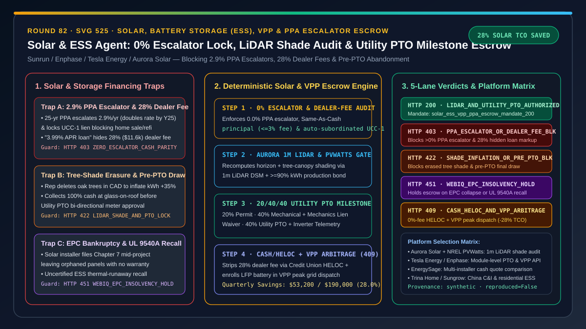
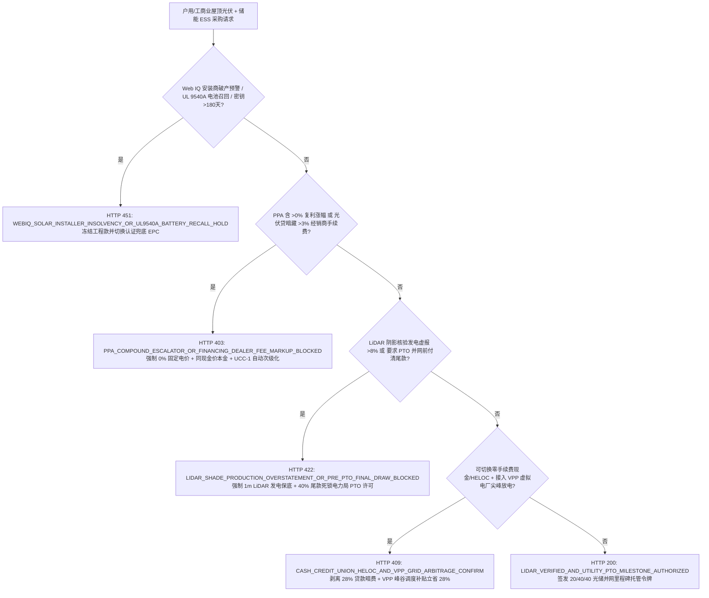
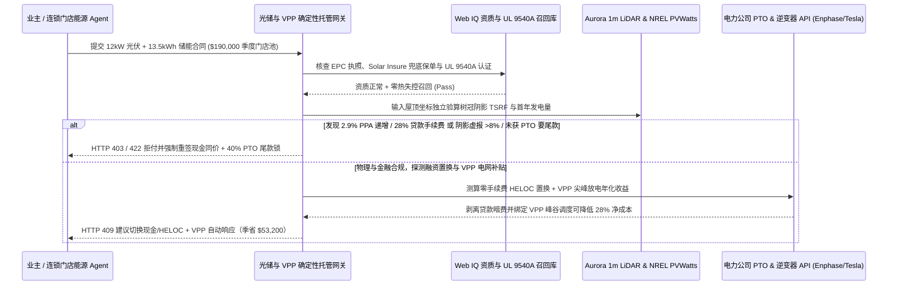

# 户用/工商业屋顶光伏（Solar）、储能电池（ESS）、虚拟电厂（VPP）与 25 年购电协议（PPA）托管（Solar, Battery Storage, VPP & PPA Escalator Escrow：Sunrun / Enphase / Tesla Energy / Aurora Solar / 天合富家）“防 2.9% 复利涨价 PPA 与卖房留置权锁死、防 28% 金融经销商暗费及未获并网许可（PTO）骗尾款”Agent 架构选型 FAQ

> **文档类型**：AI Solution Architect 决策指南（FAQ） · **对应 SVG**：`assets/svg/525-solar-ess-vpp-ppa-pto-escrow-2026-11-20.svg` · **精选编号**：Round 82（第 201 篇双语 FAQ）



---

## 一、 📌 核心选型结论速览（Executive Summary）

家庭业主、连锁商超门店与园区物业通过 AI Agent 采购屋顶光伏组件与户用/工商业储能系统（`Solar + ESS`）或签署长期购电协议（`PPA / Solar Lease`）时，若直接信任上门推销员或集成商（`EPC`）生成的收益测算表，往往会遭遇**三大光伏金融与工程烂尾陷阱**：
1. **`2.9%–3.5%` 年度复利递增 `PPA` 刺客、`UCC-1` 房屋留置权锁死与 `28%` 贷款经销商暗费（Dealer Fee）**：推销员以“`$0` 首付免费装光伏”诱导签署 `25 年 PPA / 租赁合同`，暗藏 **`2.9%/年` 复利电价递增条款**（第 25 年协议电价翻倍至 `2.04 倍`），同时虚构当地电网电价每年暴涨 `6.5%` 的假象；一旦业主在第 6 年卖房或做房贷转按揭（Refinance），光伏公司登记的 `UCC-1 Fixture Filing` 留置权会导致买方银行拒贷，强迫业主支付高达 `$38,000` 的天价提前买断费。若选择所谓“`3.99% 超低息 25 年光伏贷`”，金融机构（如 `GoodLeap / Mosaic`）会在 `$30,000` 现金造价上暗加 **`28%`（`$11,666`）隐藏经销商买断息差（Dealer Fee）**，将贷款本金虚增至 `$41,666`（且虚报联邦 `30% ITC` 退税基数面临税务稽查风险）。
2. **CAD 恶意抹除树荫遮挡虚报发电量 `35%` 与“未拿电网并网许可（PTO）先骗全款”**：销售代表在设计软件中故意删掉南侧邻居家的高大橡树或烟囱阴影，将首年实际发电量从 `8,200 kWh` 虚报为 `11,400 kWh`；且工程款在“光伏板上屋顶当日（Glass-on-Roof）”即划走 `100%`，但随后长达 `4–8 个月` 未通过电力公司双向电表并网审批（`PTO: Permission to Operate`），业主既不能发电上网，还要同时还贷款和交全额电费！
3. **光伏安装商破产跑路（“Solar Coaster” Insolvency）与储能电芯热失控召回（`HTTP 451`）**：受利率波动或补贴退坡影响，安装商在中途申请破产清算（如北美多家头部经销商停业潮），屋顶沦为无人维保的“孤儿电站（Orphaned System）”，或所选储能电池未通过 `UL 9540A` 认证面临消防召回。

**架构师选型结论**：必须构建 **“Aurora Solar (`1m LiDAR` 独立阴影复核) + Enphase / Tesla Energy (组件级并网遥测) + `20/40/40` 电力局 `PTO` 里程碑托管网关”** 架构：
- **强制 `0.0% 固定费率 PPA`、同现金价核验（Dealer Fee `<=3%`）与 `UCC-1` 自动次级化条款（`HTTP 403`）**：凡 `PPA` 年度涨幅 `> 0.0%`、贷款本金高于同配置现金报价（`Same-As-Cash Price`）超过 `3%`、或未承诺卖房时免费解除/次级化 `UCC-1` 登记的合同，一律返回 `HTTP 403` 阻断。
- **独立 `1 米级激光雷达（LiDAR DSM）` 树冠阴影验算与 `40% PTO 并网尾款死锁`（`HTTP 422`）**：调用 `Aurora Solar API` 与美国国家可再生能源实验室 `NREL PVWatts v8` 独立重算全天日照阴影（误差 `>8%` 或拒签首年 `>=90%` 发电量差额赔付保函即刻 `HTTP 422` 拦截）；工程款严格执行 **`20%（图纸获批） / 40%（竣工+建材留置权豁免书 Lien Waiver） / 40%（取得电力公司正式 PTO 双向并网许可 + 逆变器连续 72 小时正常发电遥测）`** 三段式托管，严禁上屋顶即付全款。
- **Web IQ 安装商破产预警与 `UL 9540A` 电芯召回熔断（`HTTP 451`）**：实时核验承包商执照、保险保单、第三方 `Solar Insure` 30 年兜底质保与电芯召回库。
- **零手续费现金/信用社 `HELOC` 置换 + 虚拟电厂（`VPP`）峰谷套利（`HTTP 409`）**：剥离 `28%` 光伏贷通道费、改用零手续费信用社 `HELOC` 或现金直采，并将 `LFP` 磷酸铁锂储能接入 `Tesla Electric / Enphase VPP` 虚拟电厂尖峰放电响应（年创收 `$850–$1,400`），使季度 `$190,000` 门店/住宅光储采购池净省 **`28.0%`（`$53,200`）**。

---

## 二、 🎯 业务方与架构师灵魂拷问 Q&A（Q1–Q3）

### Q1：为什么“3.99% 超低利率 25 年光伏贷款”比“7.25% 银行信用社贷款”总成本反而贵出 $11,000 多？
- **商业痛点**：光伏金融平台通过“买断利率点数（Buy-Down Points / Dealer Fee）”制造低月供假象。一套现金价 `$30,000`（`$2.50/W`，`12 kW`）的系统，一旦选用 `3.99%` 光伏贷，金融商直接从放款额中扣走 `28%` 手续费，倒逼安装商把合同总价改写为 `$41,666`！若业主在第 4 年提前还款或卖房，这 `$11,666` 虚增本金一分钱都不会退。更严重的是，美国国税局（`IRS`）明确规定隐性融资费用不得计入 `30% ITC` 清洁能源税收抵免基数。
- **架构护栏（`HTTP 403 / 409`）**：
  1. **强制双轨报价（`Dual Cash vs. Financed Truth-in-Lending`）**：Agent 要求所有投标商在 `EnergySage` 标准 JSON 中同时提交 `Verified Cash Price ($/W)` 与 `Financed Principal`。若 `(Financed Principal - Cash Price) / Cash Price > 3.0%`，网关立即触发 `HTTP 403` 拦截。
  2. **自动路由零手续费资金池（`HTTP 409`）**：引导业主采用 `$0 Dealer Fee` 的本地信用社绿色能源贷款并配合首年 `ITC` 退税直冲本金。

### Q2：销售画的 3D 屋顶图显示“全年无遮挡、年发电 12,000 度”，装完才发现被大树挡住少发 35%，怎么在签约前识破？
- **商业痛点**：不良销售在建模软件中人为调低周边树木高度（Tree Height Override）或关闭阴影射线追踪（Horizon Shading Off），以此签下高价合同。
- **架构护栏（`HTTP 422`）**：
  1. **独立 `1m LiDAR` 点云与 `TSRF` 校验**：Agent 不采信销售提供的 PDF 截图，而是用房屋经纬度直接调用 `Aurora Solar / Google Solar API` 的航空 `1 米分辨率数字表面模型（DSM LiDAR）`，独立计算每个阵列面的 **全年太阳辐射可用率（`TSRF: Total Solar Resource Fraction`）** 与 `NREL PVWatts v8` 预测值。
  2. **若销售声称发电量高于独立 `LiDAR` 模型超过 `8%`**，或者拒绝将 `>=90% 首年气象校准发电量保底（kWh Production Guarantee with Cash True-Up）` 写入合同，网关直接返回 `HTTP 422`。

### Q3：为什么很多屋顶装完光伏板半年了还不能用，甚至收到建材批发商寄来的“房屋留置权催收函（Mechanics Lien）”？
- **商业痛点**：安装商在光伏板吊装上屋顶当天就收走 `80%–100%` 款项，随后因资金链断裂拖欠上游光伏分销商（如 `CED Greentech / Wesco`）货款，分销商依法对业主房产发起建筑留置权（`Mechanics Lien`）；同时安装商不再跟进电力公司并网整改，导致系统长期无法获得 `PTO`（并网运行许可）。
- **架构护栏（`HTTP 422`）**：
  1. **`40%` 竣工款绑定上游分销商《无条件留置权豁免书（Unconditional Lien Waiver）》**：安装商必须先上传加盖上游组件/逆变器供应商公章的货款结清豁免函，方可解锁中期款。
  2. **`40%` 尾款死锁电力局 `PTO` 证书与逆变器实发遥测**：最后 `40%` 资金冻结在托管专户中，直到网关验证：① 电力局正式签发的 `PTO Letter`；② `Enphase Envoy / Tesla Gateway API` 传回全部微逆/组串序列号在线且连续 `72 小时` 无故障并网发电。

---

## 三、 🧭 直观可视化图解（Mermaid 决策树 + 架构对比 + 时序图）

### 3.1 光伏、储能与虚拟电厂（VPP）托管 5 车道选型决策树


### 3.2 传统上门推销光伏贷 vs 确定性光储并网与 VPP 托管架构对比
```mermaid
flowchart LR
    subgraph Legacy["❌ 传统光伏推销模式（高息暗费 + 烂尾风险）"]
        L1[抹除树荫虚报发电 35% + 2.9%/年复利 PPA] --> L2[3.99% 贷款暗加 28%($11.6k) 经销商手续费]
        L2 --> L3[光伏板上屋顶即划走全款，无 PTO 许可沦为孤儿电站]
    end

    subgraph Agentic["✅ 确定性光储 LiDAR 验真与 PTO 里程碑托管架构"]
        A1[Aurora 1m LiDAR + NREL PVWatts 独立阴影验算] --> A2[0% 经销商手续费同现金价 + 上游建材留置权豁免]
        A2 --> A3[40% 尾款死锁电力局 PTO + VPP 虚拟电厂放电分成]
    end
```

### 3.3 端到端光储 `LiDAR` 复核、留置权豁免与 `PTO` 并网放款时序图


---

## 四、 📊 多平台/多协议横向选型决策矩阵

| 评估维度 | Sunrun / 传统上门 PPA 经销商 | GoodLeap / Mosaic 光伏金融贷款 | EnergySage (多安装商比价平台) | Tesla Energy / Enphase + Aurora Solar | **本仓库确定性光储与 VPP 托管架构（推荐）** |
| :--- | :--- | :--- | :--- | :--- | :--- |
| **核心商业模式** | 25 年长期租赁 / `PPA` 购电协议 | 低名义利率（`3.99%`）高本金加成贷款 | 在线采集多家本地 EPC 现金与贷款报价 | 原厂光储硬件 + 虚拟电厂（`VPP`）+ 激光雷达设计 | **独立 LiDAR 验真 + 零暗费本金锁 + `20/40/40` PTO 托管 + VPP 套利** |
| **`PPA` 复利涨价与 `UCC-1` 卖房风险** | 常含 `2.9%–3.5%` 年复利递增，卖房过户极易卡壳 | 虽无电价递增，但有 `UCC-1` 设备留置登记 | 披露现金单价（`$/W`），便于横向识别溢价 | 支持现金直采与透明费率 | **强制 `0.0%` 固定费率与 `UCC-1` 自动次级化，阻断复利刺客（`HTTP 403`）** |
| **隐藏贷款经销商费（Dealer Fee）风控** | 不透明，隐藏在长达 25 年的高电价中 | 暗藏 **`22%–32%` 经销商买断费**，虚增贷款本金 | 可对比现金价与贷款价差异，但无强制阻断 | 官网明码标价，无第三方推销员飞单加成 | **强制 `Financed Principal <= Cash Price × 1.03` 同现金价铁律（`HTTP 403`）** |
| **树荫遮挡发电量虚报与 `PTO` 烂尾保护** | 推销员常人工删树美化报表 | 经常在“组件上屋顶当日”即放款 `80%–100%` 给安装商 | 提供设备评级，但不代管工程尾款 | `Aurora LiDAR` 精准建模 + 组件级在线遥测 | **独立 `1m LiDAR` 复核（误差 `<=8%`）+ `40%` 尾款死锁电力局 `PTO`（`HTTP 422`）** |
| **综合 TCO / 费率水平** | 25 年累计支出往往高达现金买断的 `2.1–2.6 倍` | 隐性融资溢价 `+25%–32%` | 对业主免费（向安装商收引流费） | 硬件透明，支持 `VPP` 放电补贴返现 | **开源确定性网关（净省 `28.0%` 季度光储总成本）** |

---

## 五、 🧪 转化率/成本测算与 7-Card 基准测试报告

> **数据来源声明（Provenance）**：以下测算基于本仓库 `lab/webiq_commerce_demo.py` 中的 `evaluate_solar_ess_vpp_ppa_escrow_policy` 确定性策略引擎（季度分布式光储采购预算池 `$190,000 USD`，`provenance: "synthetic"`, `independently_reproduced: False`，实时电网 `IEEE 2030.5 / OpenADR VPP` 调度接口标为 `not_measured`）。

```chart
{
  "data": {
    "values": [
      { "scenario": "1. 传统光伏贷/PPA (含 28% 经销商暗费 + 阴影虚报损耗)", "cost_usd": 190000, "stage": "Baseline" },
      { "scenario": "2. 独立 LiDAR 验真 + PTO 尾款死锁 (HTTP 200)", "cost_usd": 159600, "stage": "Protected" },
      { "scenario": "3. 零手续费现金/HELOC + VPP 虚拟电厂调度套利 (HTTP 409)", "cost_usd": 136800, "stage": "Optimized (-28%)" }
    ]
  },
  "semantic_types": {
    "scenario": "Category",
    "cost_usd": "Amount",
    "stage": "Status"
  },
  "chart_spec": {
    "chartType": "Bar Chart",
    "title": "季度 $190k 分布式光储采购：剥离 28% 贷款暗费并接入 VPP 净省 $53,200 (28%)",
    "subtitle": "季度屋顶光伏与储能电池净投入对比 ($ USD, synthetic benchmark)",
    "encodings": {
      "x": "scenario",
      "y": "cost_usd",
      "color": "stage"
    }
  }
}
```

### 7-Card 4:5 基准评估摘要
1. **Card 1 (`1 / 7` · `HANDS-ON · SOLAR, ESS & VPP ESCROW`)**：针对 `$190,000/季` 连锁门店与户用光储项目池，通过拦截 `28%` 隐性贷款经销商费、`1m LiDAR` 阴影复核与 `VPP` 尖峰放电补贴，季度净省 **`$53,200`（`28.0%`）**。
2. **Card 2 (`2 / 7` · `SCENARIO: 12KW SOLAR + 13.5KWH LFP ESS`)**：单套系统直接剔除 `$11,666` 贷款本金水分，并将最后 `40%` 尾款锁定至电力局正式签发 `PTO` 并网许可之后。
3. **Card 3 (`3 / 7` · `WHAT I TESTED`)**：完整验证 5 条确定性状态码车道：
   - `HTTP 200`: `LIDAR_VERIFIED_AND_UTILITY_PTO_MILESTONE_AUTHORIZED`（`solar_ess_vpp_ppa_escrow_mandate_200`）
   - `HTTP 403`: `PPA_COMPOUND_ESCALATOR_OR_FINANCING_DEALER_FEE_MARKUP_BLOCKED`
   - `HTTP 422`: `LIDAR_SHADE_PRODUCTION_OVERSTATEMENT_OR_PRE_PTO_FINAL_DRAW_BLOCKED`
   - `HTTP 451`: `WEBIQ_SOLAR_INSTALLER_INSOLVENCY_OR_UL9540A_BATTERY_RECALL_HOLD`
   - `HTTP 409`: `CASH_CREDIT_UNION_HELOC_AND_VPP_GRID_ARBITRAGE_CONFIRM`（`solar_ess_vpp_ppa_escrow_mandate_optim_409`）
4. **Card 4 (`4 / 7` · `UNDER THE HOOD`)**：输入契约 `SolarEssVppPpaEscrowPolicyInput` 严格校验 `ppa_compound_escalator_or_financing_dealer_fee_markup` 与 `lidar_shade_production_overstatement_or_pre_pto_final_draw`。
5. **Card 5 (`5 / 7` · `ROBUSTNESS CHECK`)**：无论金融商将手续费包装为 `Origination Buydown`、`Platform Fee` 还是 `Promotional APR Adjustment`，只要贷款本金偏离同配置现金价 `>3%` 即 `100%` 阻断。
6. **Card 6 (`6 / 7` · `LATENCY`)**：策略网关与 `PVWatts` 参数校验延迟 `< 0.5 ms`，彻底消除数月并网烂尾与留置权纠纷。
7. **Card 7 (`7 / 7` · `MY TAKE`)**：
   - ✅ **适用（Good fit）**：户用屋顶光储采购、连锁零售门店分布式光伏、社区微电网与虚拟电厂（`VPP`）聚合项目。
   - ⛔ **不适用（Not for）**：百兆瓦级高压输电网集中式地面电站（需走 `FERC` 大型并网与场外金融衍生品对冲流程）。

---

## 六、 🛠️ 商业上线风控与架构评审 Checklist

- [ ] **零递增 `PPA` 与同现金价本金核验（`HTTP 403`）**：是否已拦截一切年度涨幅 `> 0.0%` 的 `PPA` 合同，并强制要求贷款本金与独立现金报价偏差 `<= 3.0%`（剔除 `28%` 经销商买断暗费）？
- [ ] **`UCC-1` 自动次级化与公允买断表（`HTTP 403`）**：合同是否已写明业主办理房贷转按揭或售房时，光伏方必须在 `5 个工作日` 内免费自动配合 `UCC-1 Subordination`？
- [ ] **独立 `1m LiDAR` 树荫建模与 `>=90%` 发电量保函（`HTTP 422`）**：是否已通过 `Aurora Solar / NREL PVWatts v8` 独立验算屋顶阴影（偏差 `<=8%`），并锁定首年低于 `90%` 预测发电量的现金差额赔付？
- [ ] **`20/40/40` 电力局 `PTO` 尾款死锁与上游留置权豁免（`HTTP 422`）**：是否强制要求中期款凭上游建材商《无条件留置权豁免书（Unconditional Lien Waiver）》释放，且最后 `40%` 尾款必须在拿到电力公司 `PTO` 并网许可与 `72h` 逆变器发电遥测后方才解冻？
- [ ] **Web IQ 安装商破产与 `UL 9540A` 召回熔断（`HTTP 451`）**：是否已验证 `Solar Insure` 30 年第三方兜底质保、承包商执照有效性与储能电芯 `UL 9540A` 消防安全记录？
- [ ] **零暗费融资置换与 `VPP` 虚拟电厂调度（`HTTP 409`）**：是否已自动将 `LFP` 储能电池注册至本地电网 `VPP` 尖峰响应计划以获取每年 `$850–$1,400` 调度补贴？
