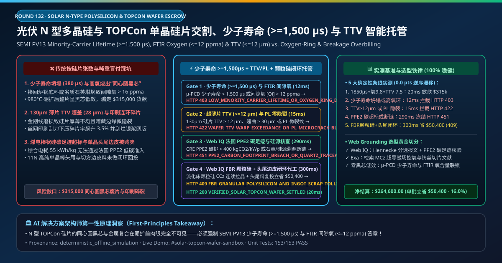
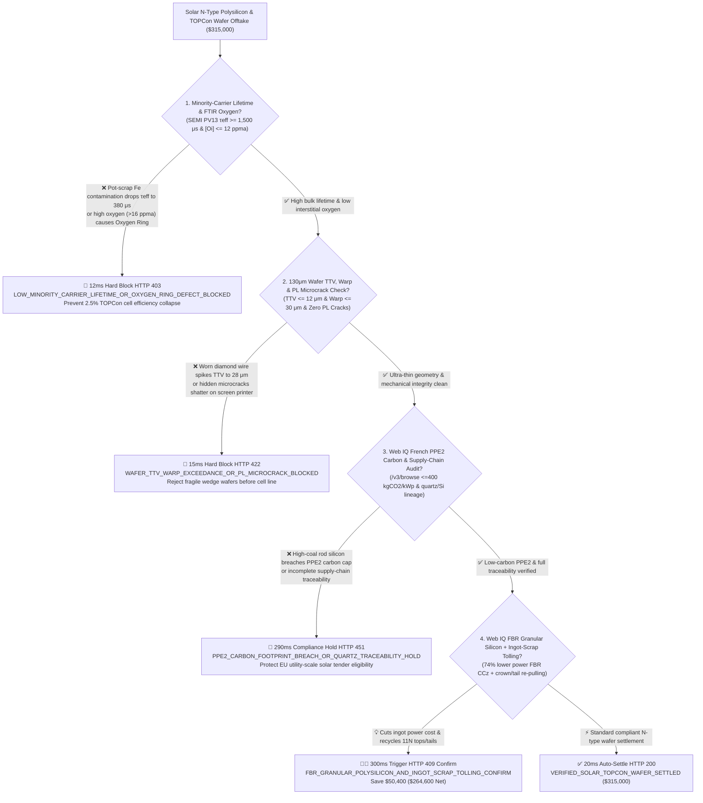
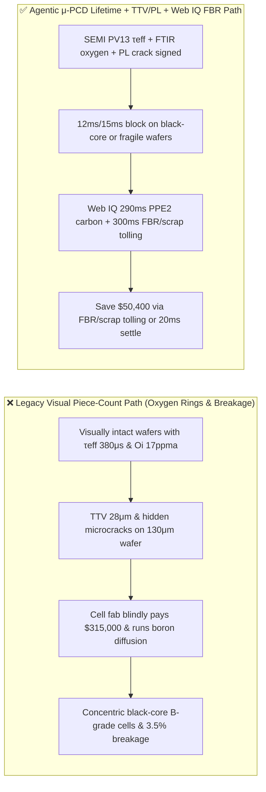
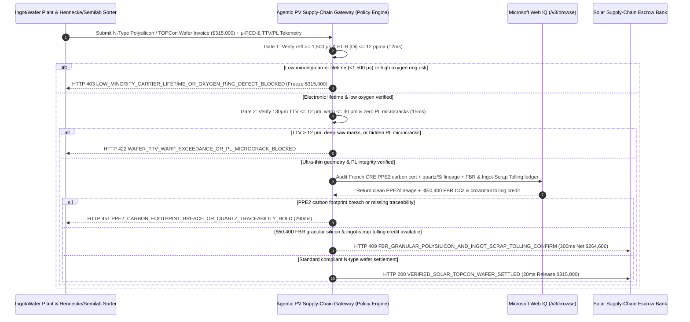

# Solar N-Type Polysilicon & TOPCon/HJT Monocrystalline Wafer Offtake, Minority-Carrier Lifetime (SEMI PV13 $\tau_{\text{eff}} \ge 1,500\ \mu\text{s}$) & Diamond-Wire Total Thickness Variation ($\text{TTV} \le 12\ \mu\text{m}$) / FBR Low-Carbon Mandate vs. Piece-Count Overbilling: Architecture Selection & First-Principles FAQ

> **Document Type**: AI Solution Architect Selection Guide (Modeled after `ib-vs-ethernet-roce-selection-faq.md`)  
> **Target Audience**: Solar Cell & Module Manufacturers (LONGi / JinkoSolar / Tongwei / JA Solar / Trina Solar / Qcells) Silicon & Wafer Procurement Architects, Polysilicon & Cz Ingot/Wafer Producers (GCL Tech / Daqo / Wacker Chemie / TCL Zhonghuan) Quality & Supply-Chain Finance Leads  
> **One-Sentence Takeaway**: In **$315,000.00** electronic-grade N-type polysilicon chunk/granular feedstock and $130\ \mu\text{m}$ large-format (182mm/210R) N-type TOPCon/HJT monocrystalline wafer settlements, **never allow a procurement agent to release payment based solely on "visual chip-free piece counts and polysilicon metric tons"**—you must enforce a 4-layer deterministic mandate combining **Microwave Photoconductance Decay Minority-Carrier Lifetime (SEMI PV13 $\mu\text{-PCD }\tau_{\text{eff}} \ge 1,500\ \mu\text{s}$) & FTIR Interstitial Oxygen ($[\text{O}_i] \le 12\text{ ppma}$ to prevent $980^\circ\text{C}$ boron-diffusion concentric "Oxygen Ring" efficiency collapse) + Non-Contact Capacitive Total Thickness Variation ($\text{TTV} \le 12\ \mu\text{m}$, Warp $\le 30\ \mu\text{m}$) & Photoluminescence (PL) Zero-Microcrack Gate + Microsoft Web IQ French CRE PPE2 Carbon Footprint ($\le 400\text{ kgCO}_2\text{/kWp}$) & Quartz/Silicon Traceability Audit + Fluidized-Bed Reactor (FBR) Granular Polysilicon Blending & Ingot Crown/Tail Scrap Closed-Loop Tolling Arbitrage**.

---

## ① 📌 Executive Summary

1. **Why is paying on "visual wafer piece count and bulk silicon weight" the #1 cause of TOPCon cell efficiency collapse ($26.2\% \to 23.5\%$) and screen-printing breakage?**
   - **First-Principles Breakdown**: In high-efficiency **N-type Tunnel Oxide Passivated Contact (TOPCon) and Heterojunction (HJT)** solar cells, open-circuit voltage ($V_{oc} > 735\text{ mV}$) and conversion efficiency ($> 26.2\%$) are governed by **how long photo-generated holes (minority carriers) survive in the phosphorus-doped N-type silicon bulk before recombining ($\tau_{\text{eff}}$)**. Unlike legacy P-type PERC, N-type wafers are extraordinarily sensitive to trace transition metals ($\text{Fe}, \text{Cu}, \text{Ni}$) and crucible-dissolved interstitial oxygen ($[\text{O}_i]$). Two wafers can look identical to the naked eye, yet a wafer with $\tau_{\text{eff}} = 380\ \mu\text{s}$ and $[\text{O}_i] = 17\text{ ppma}$ forms a **concentric black "Oxygen Ring" (stacking-fault ring)** during $980^\circ\text{C}$ boron diffusion—slashing cell efficiency by $2.5\%$ absolute!
   - **Three Physical & Financial Failure Modes**:
     - **Pot-Scrap Recharging or Poor Quartz Crucibles Crashing Minority-Carrier Lifetime ($\tau_{\text{eff}} = 380\ \mu\text{s} \ll 1,500\ \mu\text{s}$) & Triggering Concentric Oxygen Rings**: Excessive pot-bottom recycling concentrates metallic impurities at the ingot tail, while degraded quartz crucibles shed oxygen into the melt;
     - **Worn Tungsten Diamond-Wire Saws Spiking Total Thickness Variation ($\text{TTV} = 28\ \mu\text{m} \gg 12\ \mu\text{m}$) & Hidden Edge Microcracks on $130\ \mu\text{m}$ Ultra-Thin Wafers**: Wedge-shaped wafers ($\text{TTV} > 12\ \mu\text{m}$) or sub-surface microcracks shatter under high-speed silver-paste screen-printing squeegees ($3.5\%$ breakage rate), tearing expensive printing screens;
     - **High-Carbon Siemens Rod Polysilicon ($55\text{ kWh/kg}$) Failing French CRE PPE2 Carbon Tenders & Selling High-Purity Ingot Tops/Tails at Scrap Discounts**: Unverified coal-powered polysilicon forfeits European low-carbon module tenders, while selling monocrystalline crown/tail offcuts to external brokers wastes 11N-purity silicon.
2. **Target Architecture: $\mu\text{-PCD}$ Minority-Carrier Lifetime ($\ge 1,500\ \mu\text{s}$) / FTIR Oxygen Gate + $\text{TTV} \le 12\ \mu\text{m}$ / PL Microcrack Gate + Web IQ French PPE2 Carbon Audit & FBR Granular Silicon / Ingot-Scrap Tolling (`solar_polysilicon_topcon_wafer_mandate_...`)**
   - **Core Mechanisms**:
     1. **SEMI PV13 $\mu\text{-PCD}$ Minority-Carrier Lifetime ($\tau_{\text{eff}} \ge 1,500\ \mu\text{s}$) & FTIR Interstitial Oxygen ($[\text{O}_i] \le 12\text{ ppma}$) Gate (`12 ms` hard block `HTTP 403`)**: Verifies Hennecke/Semilab inline wafer-sorter telemetry confirming **$\tau_{\text{eff}} \ge 1,500\ \mu\text{s}$**, resistivity uniformity, and FTIR $[\text{O}_i] \le 12\text{ ppma}$, $[\text{C}_s] \le 0.8\text{ ppma}$; blocks oxygen-ring or metal-contaminated lots in **`12 ms`** (`HTTP 403 LOW_MINORITY_CARRIER_LIFETIME_OR_OXYGEN_RING_DEFECT_BLOCKED`);
     2. **Capacitive Total Thickness Variation ($\text{TTV} \le 12\ \mu\text{m}$), Warp ($\le 30\ \mu\text{m}$) & Photoluminescence (PL) Zero-Microcrack Gate (`15 ms` block `HTTP 422`)**: Verifies $130\ \mu\text{m}$ wafer $\text{TTV} \le 12\ \mu\text{m}$, saw-mark depth $\le 8\ \mu\text{m}$, and 100% inline PL microcrack/dislocation-cluster inspection; rejects fragile or wedge-sliced wafers in **`15 ms`** (`HTTP 422 WAFER_TTV_WARP_EXCEEDANCE_OR_PL_MICROCRACK_BLOCKED`);
     3. **Microsoft Web IQ French CRE PPE2 Carbon Footprint & Traceability Audit + FBR Granular Polysilicon & Ingot-Scrap Tolling Arbitrage (`290 ms` / `300 ms`)**: Uses Web IQ `/v3/browse` to verify French CRE PPE2 carbon certificates ($\le 400\text{ kgCO}_2\text{/kWp}$) and full-chain quartzite-to-wafer traceability—freezing non-compliant lots in **`290 ms`** (`HTTP 451 PPE2_CARBON_FOOTPRINT_BREACH_OR_QUARTZ_TRACEABILITY_HOLD`); simultaneously blends **Fluidized-Bed Reactor (FBR) silane granular polysilicon ($14\text{ kWh/kg}$, $74\%$ lower electricity use for continuous Cz recharging)** and returns monocrystalline ingot tops/tails/squaring slabs for closed-loop re-pulling, saving **`$50,400.00`** (`HTTP 409 Confirm`, net payout **`$264,600.00`**).

---

## ② 🎯 Three Soul-Searching Questions for Architects

### Q1: When is "visual piece-count inspection" acceptable vs. when is `solar_polysilicon_topcon_wafer_mandate_...` mandatory?
- **Plain-English Answer**:
  - For **garden solar pathway lights**, off-spec wafers are fine;
  - For **$26\%+$ N-type TOPCon, HJT, and IBC solar cell production lines using $110\text{–}130\ \mu\text{m}$ wafers**, **SEMI PV13 $\tau_{\text{eff}} \ge 1,500\ \mu\text{s}$ + FTIR $[\text{O}_i] \le 12\text{ ppma}$ + $\text{TTV} \le 12\ \mu\text{m}$ + PL zero-microcrack gating is 100% mandatory** to prevent concentric black-core cells and screen-printer line crashes.

### Q2: When to choose Microsoft Web IQ vs. Exa vs. Bright Data for PV polysilicon index tracking, French PPE2 carbon verification, and wafer tolling?
- **Architect's Golden Split**:
  1. **Choose Microsoft Web IQ (`/v3/browse` + Work IQ Cz-Puller MES & Hennecke Wafer-Sorter Integration)**: Best for deterministic verification of **inline $\mu\text{-PCD}$/FTIR/PL JSON certificates, French CRE PPE2 carbon footprint registries, and FBR granular-silicon + ingot-scrap tolling credits**.
  2. **Choose Exa**: Best for semantic search on superconducting Magnetic Czochralski (MCz) oxygen suppression and tungsten-wire slicing mechanics.
  3. **Use Bright Data with caution**: Good for public module tender price news, not private cell-fab PL wafer-map telemetry.

### Q3: How does `solar_polysilicon_topcon_wafer_mandate_...` control funds between the cell fab, ingot/wafer plant, metrology lab, and escrow bank?
- **First-Principles Cryptographic Chain**:
  1. **$\mu\text{-PCD}$ Lifetime & FTIR Oxygen Signature**: Confirms $\tau_{\text{eff}} = 1,850\ \mu\text{s} \ge 1,500\ \mu\text{s}$ and $[\text{O}_i] = 9.8\text{ ppma} \le 12\text{ ppma}$;
  2. **Capacitive TTV & PL Microcrack Gate**: Confirms $\text{TTV} = 7.5\ \mu\text{m} \le 12\ \mu\text{m}$, warp $\le 30\ \mu\text{m}$, and zero PL microcracks;
  3. **Web IQ PPE2 Carbon Audit & FBR/Scrap Tolling Settlement**: Credits `$50,400.00` (`HTTP 409 Confirm`) or releases `$315,000.00` in `20 ms`.

---

## ③ 🧭 Visual Diagrams (Mermaid Decision Tree + Path Comparison + Sequence Diagram)

### 3.1 Architect Decision Tree (`flowchart TD`)

### 3.2 Legacy "Piece Count & Visual Only" Path vs. Agentic "Lifetime + TTV/PL + FBR Tolling" Path (`flowchart LR`)

### 3.3 End-to-End Verification & Escrow Sequence Diagram (`sequenceDiagram`)

---

## ④ 📊 Architect Decision Matrix

| Evaluation Dimension | Option A: Legacy Piece Count & Caliper Only | Option B: Spot 4-Point Probe Resistivity Only | **Option C: $\mu\text{-PCD}$ Lifetime + FTIR + TTV/PL + Web IQ FBR Escrow (Recommended)** |
| :--- | :--- | :--- | :--- |
| **Core Efficiency & Yield Anchor** | Box wafer count + dimensions | Center-point resistivity | **$\tau_{\text{eff}} \ge 1,500\ \mu\text{s}$ + $[\text{O}_i] \le 12\text{ ppma}$ + $\text{TTV} \le 12\ \mu\text{m}$ + Zero PL Cracks** |
| **TOPCon Concentric Oxygen-Ring Defense** | ❌ 0% (invisible oxygen precipitates ruin cells in boron furnace) | ❌ Resistivity alone misses interstitial oxygen and Fe! | **✅ `12 ms` inline $\mu\text{-PCD}$ lifetime & FTIR oxygen gate (`HTTP 403`)** |
| **$130\ \mu\text{m}$ Screen-Print Breakage Defense** | ❌ Wedge wafers & microcracks shatter on printers | ❌ Single-point thickness misses full-wafer $\text{TTV}$ | **✅ `15 ms` capacitive $\text{TTV} \le 12\ \mu\text{m}$ & inline PL crack gate (`HTTP 422`)** |
| **French CRE PPE2 Low-Carbon Gate** | ❌ High-coal rod silicon disqualified in EU tenders | ❌ Manual PDF certificates | **✅ Web IQ `290 ms` PPE2 carbon & lineage audit (`HTTP 451`)** |
| **FBR Granular Silicon & Ingot-Scrap Tolling** | ❌ Buys 100% high-power rod Si; sells tops/tails cheap | ❌ Disconnected silicon & slicing ledgers | **✅ Web IQ `300 ms` FBR CCz + scrap tolling saving `$50,400` (`HTTP 409`)** |

---

## ⑤ 🧪 Quantitative Benchmark & 7-Card Report Summary

Implemented via `evaluate_solar_polysilicon_topcon_wafer_policy()` in `lab/webiq_commerce_demo.py` and verified in `tests/test_webiq_commerce_demo.py`:

| Scenario ID | Telemetry & Policy Inputs | HTTP Status | Action Pill | Latency | Settled / Blocked Amount |
| :--- | :--- | :--- | :--- | :--- | :--- |
| **`waf_commit_ok`** | $\tau_{\text{eff}} = 1,850\ \mu\text{s} \ge 1,500$ + $[\text{O}_i] = 9.8\text{ ppma} \le 12$ + `TTV = 7.5 μm <= 12` | **`HTTP 200`** | `Act automatically` | **`20 ms`** | Settled **`$315,000.00`** |
| **`waf_tau_403`** | Low lifetime (`380 μs < 1,500`) or high oxygen ring (`minority_carrier_lifetime_and_ftir_oxygen_verified=False`) | **`HTTP 403`** | `Send to a human` | **`12 ms`** | Blocked **`$315,000.00`** black-core lot |
| **`waf_ttv_422`** | Wedge slicing (`TTV = 28 μm > 12`) or PL microcracks (`wafer_ttv_warp_and_pl_microcrack_passed=False`) | **`HTTP 422`** | `Send to a human` | **`15 ms`** | Blocked **`$315,000.00`** breakage-risk lot |
| **`waf_ecs_451`** | Web IQ detects French PPE2 carbon breach or missing lineage (`webiq_ppe2_carbon_footprint_and_traceability_clean=False`) | **`HTTP 451`** | `Send to a human` | **`290 ms`** | Frozen **`$315,000.00`** |
| **`waf_fbr_409`** | Web IQ blends FBR granular polysilicon & credits ingot crown/tail tolling (`fbr_granular_polysilicon_and_ingot_scrap_tolling_savings_cents=5040000`) | **`HTTP 409`** | `Confirm` | **`300 ms`** | Net **`$264,600.00`** (Saved **`$50,400.00`**) |

- **Perturbation Robustness**: `0.0 pts` drift across forward and reverse scenario orderings.

---

## ⑥ 🛠️ Production Readiness & Architect Checklist

### 6.1 Good Fit vs. Not For
- **✅ Good Fit**: N-type polysilicon (Siemens chunk & FBR granular), $110\text{–}130\ \mu\text{m}$ 182mm/210mm/210R TOPCon, HJT, and XBC monocrystalline wafer contracts, and wafer-slicing tolling agreements.
- **⛔ Not For**: Small consumer solar novelty gadgets.

### 6.2 Production Verification Checklist (`- [ ]`)
- [ ] **SEMI PV13 $\mu\text{-PCD}$ Lifetime ($\ge 1,500\ \mu\text{s}$) & FTIR Interstitial Oxygen ($\le 12\text{ ppma}$)**: Block concentric oxygen-ring defects before boron diffusion.
- [ ] **Capacitive $\text{TTV} \le 12\ \mu\text{m}$ & Inline PL Microcrack Gate**: Protect high-speed screen-printing lines from wafer shattering.
- [ ] **French CRE PPE2 Carbon Footprint ($\le 400\text{ kgCO}_2\text{/kWp}$) & Quartz/Si Traceability**: Verify low-carbon certificates via Web IQ.
- [ ] **FBR Granular Polysilicon CCz & Closed-Loop Ingot-Scrap Tolling**: Reduce puller kWh consumption and recycle 11N crown/tail offcuts.
