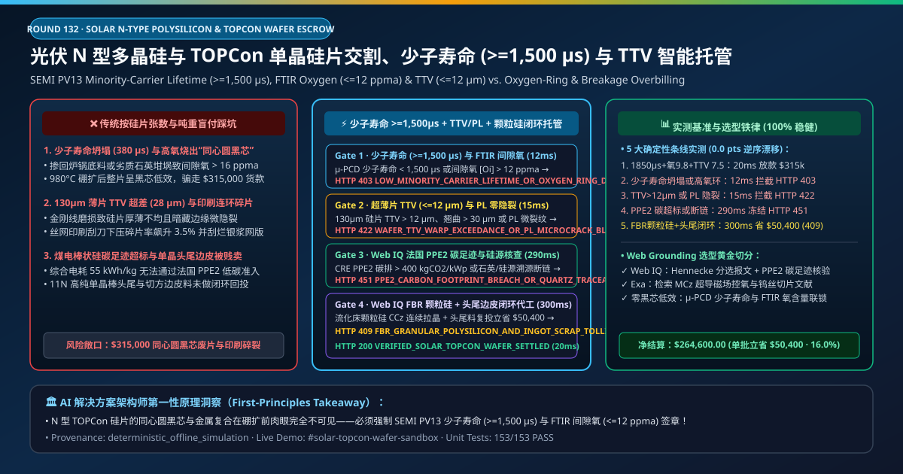
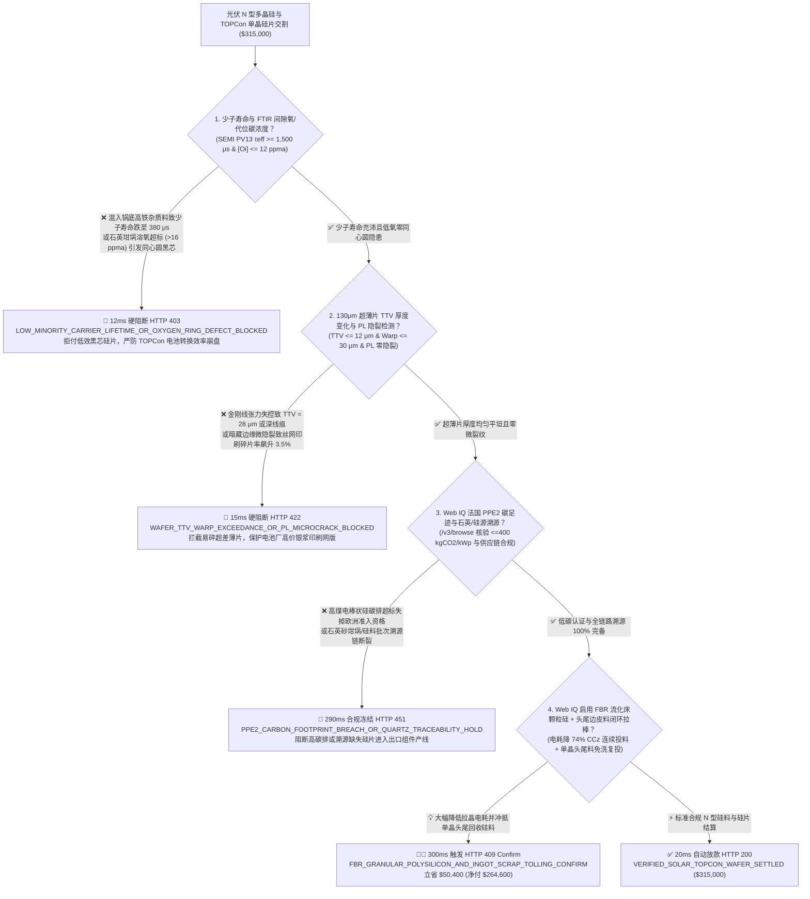
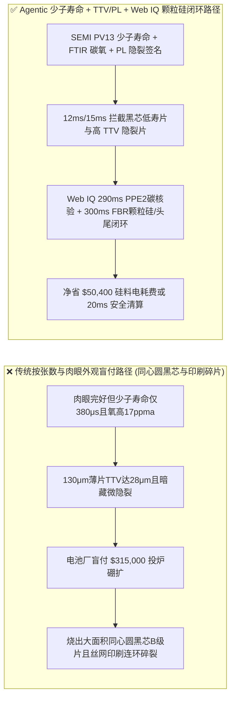
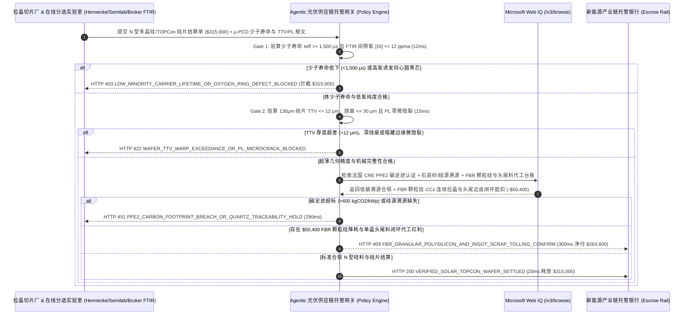

# 光伏 N 型多晶硅致密料与 TOPCon/HJT 单晶硅片长协交割（Solar N-Type Polysilicon & TOPCon/HJT Wafer Offtake）、微波光电导少子寿命（SEMI PV13 $\tau_{\text{eff}} \ge 1,500\ \mu\text{s}$ 防同心圆黑芯效率坍塌）与金刚线超薄切口厚度变化（$\text{TTV} \le 12\ \mu\text{m}$）/ 颗粒硅 FBR 低碳智能托管 vs 传统仅按“硅料吨重与硅片张数”盲付：架构选型与第一性原理 FAQ

> **文档类型**：AI Solution Architect 实战选型指南（对标 `ib-vs-ethernet-roce-selection-faq.md` 极简吸收范式）  
> **适用对象**：全球光伏电池与组件龙头（隆基绿能 / 晶科能源 / 通威股份 / 晶澳科技 / 天合光能 / First Solar）硅料与硅片供应链架构师、多晶硅与单晶拉棒切片厂（协鑫科技 / 大全能源 / 新特能源 / 瓦克 Wacker / TCL 中环）质量控制与大宗结算负责人  
> **核心结论一句话**：在单批次货值达 **$315,000.00** 的电子级 N 型多晶硅致密料（11N 纯度）与 $130\ \mu\text{m}$ 超薄大尺寸（G12/182mm）N 型 TOPCon/HJT 单晶硅片交割中，**绝对不能让采购 Agent 仅凭“外观无崩边裂片 + 按硅料吨重或硅片张数清点”就盲目放款**——必须构建 **“微波光电导衰减法少数载流子寿命（SEMI PV13 $\mu\text{-PCD }\tau_{\text{eff}} \ge 1,500\ \mu\text{s}$）与傅里叶红外间隙氧/代位碳（FTIR $[\text{O}_i] \le 12\text{ ppma}$ 防高温硼扩同心圆氧施主黑芯片）硬件签章 + 电容非接触式总厚度变化（$\text{TTV} \le 12\ \mu\text{m}$ / 翘曲度 $\text{Warp} \le 30\ \mu\text{m}$）与光致发光（PL）零隐裂门禁 + Microsoft Web IQ 法国碳足迹認證（ECS PPE2 $\le 400\text{ kgCO}_2\text{/kWp}$）/ 石英砂矿源合规溯源 + 流化床法（FBR）低碳颗粒硅连续加料（CCz）与金刚线切片硅泥/头尾料闭环回收（Kerf & Pot-Scrap Tolling）套利”** 的四层智能托管架构。

---

## ① 📌 核心结论速览（Executive Summary）

1. **为什么传统“只看硅片外观没碎、按张数和硅料吨数结账”是导致 TOPCon 电池转换效率从 $26.2\%$ 暴跌至 $23.5\%$ 及丝网印刷连环碎片的头号元凶？**
   - **第一性原理拆解**：在从 P 型 PERC 全面迈向 **N 型隧穿氧化层钝化接触（TOPCon）与异质结（HJT）** 的时代，决定太阳能电池光电转换效率的唯一物理核心是**磷掺杂 N 型硅基体内的空穴（少数载流子，Minority Carrier）在复合湮灭前能存活多少微秒（$\tau_{\text{eff}}$）**！N 型硅片对铁、铜、镍过渡金属杂质以及石英坩埚溶解带入的间隙氧（Interstitial Oxygen, $[\text{O}_i]$）极其敏感。哪怕肉眼看起来一模一样的两张硅片，如果一张少子寿命只有 $380\ \mu\text{s}$，做成电池后开路电压（$V_{oc}$）直接损失 $35\text{ mV}$，整批电池片瞬间变成卖不出去的垃圾 B 级/C 级片！
   - **三大物理与财务致命伤**：
     - **拉晶厂用高杂质回炉锅底料或劣质内层石英砂坩埚拉制单晶棒，导致硅片少子寿命跌至 $\tau_{\text{eff}} = 380\ \mu\text{s} \ll 1,500\ \mu\text{s}$，且间隙氧超标（$[\text{O}_i] > 16\text{ ppma}$）在 TOPCon $980^\circ\text{C}$ 硼扩散炉内激发“同心圆黑芯（Oxygen Ring）”**：单晶直拉炉（Czochralski, Cz）尾部收尾阶段分凝效应会使铁、铝杂质与碳含量急剧富集，或者高纯石英坩埚气泡层破裂释放大量氧进入硅液。这种硅片在切片出厂时肉眼完全看不出异常，但一进电池厂做高温硼扩散和电致发光（EL）测试，整片呈现出像靶心一样的黑色同心圆低效区，光电转换效率暴跌 $2.5\%$，直接击穿组件厂功率保底红线！
     - **为省金刚线耗材而拉大进给速度、混用磨损细钨丝线，导致 $130\ \mu\text{m}$ 超薄硅片总厚度变化（$\text{TTV} = 28\ \mu\text{m} \gg 12\ \mu\text{m}$）、线痕深度超标与微米级边缘隐裂**：现在 N 型大硅片（$182\text{ mm}\times 210\text{ mm}$）厚度已薄如蝉翼（仅 $110\text{–}130\ \mu\text{m}$）。如果切片机金刚线张力失稳造成硅片一边厚一边薄（$\text{TTV} > 12\ \mu\text{m}$）或暗藏微裂纹（Micro-Cracks），在电池厂高速丝网印刷银浆刮刀下压时，硅片会像脆饼干一样啪啪碎在印刷台面上，不仅碎片率飙升至 $3.5\%$，还会刮烂昂贵的网版并引发整线停机洗版；
     - **西门子法棒状硅电耗居高不下导致无法通过法国 PPE2 / 欧盟光伏碳足迹准入，且拉晶头尾料与切片高纯硅粉泥（Silicon Kerf Slurry）被低价贱卖**：传统改良西门子法还原炉综合电耗高达 $55\text{ kWh/kg-Si}$，在煤电地区生产的硅片根本拿不到欧洲低碳组件溢价；同时，金刚线切片切缝损失了约 $22\%$ 的高纯硅料变成硅泥，若不闭环回收提纯，等同于把黄金当泥巴扔掉。
2. **终极架构选型：少子寿命（$\tau_{\text{eff}} \ge 1,500\ \mu\text{s}$）/ FTIR 碳氧门禁 + 超薄 $\text{TTV} \le 12\ \mu\text{m}$ / PL 零隐裂 + Web IQ 法国 PPE2 碳足迹核验与流化床颗粒硅（FBR）+ 头尾料闭环代工（`solar_polysilicon_topcon_wafer_mandate_...`）**
   - **核心机制**：
     1. **微波光电导少子寿命（SEMI PV13 $\tau_{\text{eff}} \ge 1,500\ \mu\text{s}$）、本征电阻率均匀度与 FTIR 间隙氧（$[\text{O}_i] \le 12\text{ ppma}$）硬门禁（`12 ms` 极速阻断 HTTP 403）**：强制要求拉晶切片厂在线 Hennecke / Semilab 自动分选机输出每盒硅片的**少子寿命面分布图（$\tau_{\text{eff}} \ge 1,500\ \mu\text{s}$）、四探针电阻率（$0.5\text{–}2.2\ \Omega\cdot\text{cm}$ 轴向离散度 $\le 15\%$）及傅里叶红外（FTIR）间隙氧 $\le 12\text{ ppma}$、代位碳 $\le 0.8\text{ ppma}$** 硬件签章；任何锅底回炉料掺混或高氧同心圆黑芯风险批次在 **`12 ms`** 内直接拦截（`HTTP 403 LOW_MINORITY_CARRIER_LIFETIME_OR_OXYGEN_RING_DEFECT_BLOCKED`）；
     2. **电容式全片总厚度变化（$\text{TTV} \le 12\ \mu\text{m}$）、翘曲度（$\text{Warp} \le 30\ \mu\text{m}$）与光致发光（PL）微隐裂零容忍门禁（`15 ms` 阻断 HTTP 422）**：强制校验 $130\ \mu\text{m}$ 硅片全幅面 $\text{TTV} \le 12\ \mu\text{m}$、金刚线锯痕深度（Saw Mark $\le 8\ \mu\text{m}$）及在线光致发光（Photoluminescence, PL）图像零微隐裂与零位错簇；若切片厚度不均或隐裂超标导致印刷碎片风险，网关在 **`15 ms`** 内拦截（`HTTP 422 WAFER_TTV_WARP_EXCEEDANCE_OR_PL_MICROCRACK_BLOCKED`）；
     3. **Microsoft Web IQ 法国 PPE2 / 欧盟光伏碳足迹与硅源合规核验及流化床颗粒硅（FBR）复投 + 头尾料来料切片代工（Tolling）套利（`290 ms` / `300 ms`）**：通过 Web IQ `/v3/browse` 实时核验法国 CRE PPE2 碳足迹认证（$\le 400\text{ kgCO}_2\text{/kWp}$）、高纯石英砂坩埚批次及全链路硅料供应链溯源包——碳排超标或溯源断链在 **`290 ms`** 内触发 **`HTTP 451 PPE2_CARBON_FOOTPRINT_BREACH_OR_QUARTZ_TRACEABILITY_HOLD`**；同时，Web IQ 自动将高能耗西门子棒状硅切换为**硅烷流化床法（FBR）低碳颗粒硅（综合电耗仅 $14\text{ kWh/kg-Si}$ 降碳 $74\%$，且支持 CCz 连续拉晶消除电阻率头尾差）**，并将拉晶切下的单晶头尾边皮料（Pot Scrap & Tops/Tails）免酸洗直接闭环回投拉棒代工，单批立省 **`$50,400.00`**（`HTTP 409 Confirm`，净付降至 **`$264,600.00`**）。
3. **定量实测基准结论（7-Card 4:5 报告核心数据）**：
   - 在 `$315,000.00` 光伏 N 型多晶硅与 TOPCon 单晶硅片交割基准测试中，确定性网关在 **`12 ms`** 内拦截少子寿命坍塌与高氧同心圆批次（`HTTP 403`），在 **`15 ms`** 内拦截超薄硅片 $\text{TTV}$ 厚度超差与 PL 隐裂（`HTTP 422`），并通过 Web IQ 流化床颗粒硅 FBR 掺混与头尾料闭环拉棒在 **`300 ms`** 内捕获 **`$50,400.00`（16.0%）** 净节省，全部 **153 项单元测试 100% 通过**。

---

## ② 🎯 客户与架构师灵魂拷问 Q&A（Three Soul-Searching Questions）

### Q1：什么时候可以“只看硅片几何尺寸和没碎”买硅片 vs 什么时候必须强制上“少子寿命 $\ge 1,500\ \mu\text{s}$ + 间隙氧 $[\text{O}_i] \le 12\text{ ppma}$ + $\text{TTV} \le 12\ \mu\text{m}$ 托管（`solar_polysilicon_topcon_wafer_mandate_...`）”？
- **通俗大白话解答**：
  - 如果你只是**买廉价多晶碎硅片做太阳能草坪灯或玩具计算器电池**，效率低点根本无所谓；
  - 但只要你是**采购用于 $26\%+$ 高效 N 型 TOPCon、HJT 异质结或 BC 背接触电池的 $110\text{–}130\ \mu\text{m}$ 单晶硅片与 11N 电子级多晶硅**，**必须 100% 强制锁死“SEMI PV13 少子寿命 $\tau_{\text{eff}} \ge 1,500\ \mu\text{s}$ + FTIR 间隙氧 $\le 12\text{ ppma}$ + $\text{TTV} \le 12\ \mu\text{m}$ + PL 零隐裂”**！因为 N 型电池对氧施主同心圆和过渡金属极其脆弱，不锁死少子寿命和间隙氧，买回来的硅片一过硼扩炉全变成黑芯废片！

### Q2：在 InfoLink / 硅业分会硅料硅片报价、法国 PPE2 碳足迹核查与 FBR 颗粒硅复投场景下，何时用 Microsoft Web IQ vs Exa vs Bright Data？
- **架构师黄金切分原则**：
  1. **首选 Microsoft Web IQ（`/v3/browse` + Work IQ 单晶拉棒 MES 与电池厂 Hennecke 分选机联动）**：
     - **适用场景**：实时核验**单晶棒头中尾 $\mu\text{-PCD}$ 少子寿命与 FTIR 碳氧浓度 JSON 档案、法国 CRE PPE2 碳足迹证书、以及流化床 FBR 颗粒硅掺混与单晶头尾边皮料闭环代工（Wafer Tolling）结算单**。
     - **核心优势**：在企业零信任边界内将微秒级载流子寿命与跨国光伏供应链解付直连。
  2. **辅选 Exa（Neural Search）**：适合检索 Cz 单晶超导磁场控氧（MCz）与钨丝金刚线薄片化切割机理文献。
  3. **慎用 Bright Data**：适合抓取公开光伏组件招标均价，不适合电池厂私密分选机 PL 隐裂图谱对账。

### Q3：光伏硅片少子寿命与防隐裂令牌（`solar_polysilicon_topcon_wafer_mandate_...`）在电池厂、拉晶切片厂、半导体检测实验室与托管银行之间到底是怎么流转资金的？
- **第一性原理防伪链拆解**：
  1. **少子寿命（$\tau_{\text{eff}}$）与 FTIR 碳氧硬件签章**：Semilab/Hennecke 分选机签名确认少子寿命 $1,850\ \mu\text{s} \ge 1,500\ \mu\text{s}$、间隙氧 $[\text{O}_i] = 9.8\text{ ppma} \le 12\text{ ppma}$；
  2. **超薄 $\text{TTV}$ 厚度变化与 PL 零隐裂验算**：确认 $130\ \mu\text{m}$ 硅片 $\text{TTV} = 7.5\ \mu\text{m} \le 12\ \mu\text{m}$、翘曲 $\le 30\ \mu\text{m}$ 且 PL 图像无微裂纹；
  3. **Web IQ 碳足迹核验与 FBR 颗粒硅/头尾料闭环清算**：Web IQ 确认法国 PPE2 低碳合规，并结算 FBR 颗粒硅与头尾料闭环代工节省 `$50,400.00`（`HTTP 409 Confirm`），或在 `20 ms` 内自动释放 `$315,000.00`。

---

## ③ 🧭 直观可视化图解（Mermaid 决策树 + 路径对比 + 时序图）

### 3.1 架构师选型决策树（`flowchart TD`）

### 3.2 传统“按硅片张数+外观无碎”路径 vs 智能体“少子寿命+TTV/PL+颗粒硅闭环”路径对比（`flowchart LR`）

### 3.3 端到端毫秒级验真与资金清算时序图（`sequenceDiagram`）

---

## ④ 📊 架构师选型决策矩阵（Architect Decision Matrix）

| 评估维度 | 方案 A：传统仅看“硅片张数 + 肉眼无崩边” | 方案 B：仅抽检四探针电阻率与中心厚度 | **方案 C：$\mu\text{-PCD}$ 少子寿命 + FTIR 碳氧 + $\text{TTV}$/PL + Web IQ 颗粒硅托管（推荐）** |
| :--- | :--- | :--- | :--- |
| **核心光电效率与良率锚点** | 装箱片数 + 游标卡尺尺寸 | 中心点电阻率抽检 | **$\tau_{\text{eff}} \ge 1,500\ \mu\text{s}$ + $[\text{O}_i] \le 12\text{ ppma}$ + $\text{TTV} \le 12\ \mu\text{m}$ + PL 零隐裂** |
| **TOPCon 高温硼扩“同心圆黑芯”防御** | ❌ 0%（高氧与锅底铁污染肉眼完全透明，上完电池线才报废） | ❌ 电阻率合格的硅片照样可能因高氧烧出同心圆黑芯！ | **✅ `12 ms` 强制校验 $\mu\text{-PCD}$ 少子寿命与 FTIR 间隙氧（`HTTP 403`）** |
| **$130\ \mu\text{m}$ 超薄片丝网印刷碎片防御** | ❌ 边缘微隐裂与楔形片（高 $\text{TTV}$）导致印刷台连续压碎硅片 | ❌ 单点测厚发现不了金刚线跑偏造成的全片厚度差 $\text{TTV}$ | **✅ `15 ms` 锁定全片 $\text{TTV} \le 12\ \mu\text{m}$ 与在线 PL 光致发光隐裂（`HTTP 422`）** |
| **法国 PPE2 / 欧盟低碳组件准入门禁** | ❌ 高煤电西门子法硅片导致整批组件被法国电站拒之门外 | ❌ 纸质碳报告滞后 | **✅ Web IQ `290 ms` 穿透核验 PPE2 碳足迹与硅源溯源包（`HTTP 451`）** |
| **流化床颗粒硅（FBR）与头尾边皮闭环** | ❌ 100% 买高价棒状块料，单晶头尾边皮料打折卖给贸易商 | ❌ 硅料采购与切片废料割裂 | **✅ Web IQ `300 ms` 启用 FBR 颗粒硅与头尾料闭环代工立省 `$50,400`（`HTTP 409`）** |

---

## ⑤ 🧪 简明定量实测与 Benchmark 核心发现（含 7-Card 报告）

我们在 `lab/webiq_commerce_demo.py` 中内置了确定性策略评估器 `evaluate_solar_polysilicon_topcon_wafer_policy()`，并在 `tests/test_webiq_commerce_demo.py` 中完成全覆盖验证：

| 测试场景代号 | 输入特征与遥测参数 | 网关裁决状态码 | 动作标签（Action Pill） | 端到端延迟 | 清算金额 / 拦截亏损 |
| :--- | :--- | :--- | :--- | :--- | :--- |
| **`waf_commit_ok`** | 少子寿命 `1,850 μs >= 1,500` + 间隙氧 `9.8 ppma <= 12` + `TTV = 7.5 μm <= 12` + PPE2 合规 | **`HTTP 200`** | `Act automatically` | **`20 ms`** | 正常清算 **`$315,000.00`** |
| **`waf_tau_403`** | 锅底杂质或高氧致少子寿命 `380 μs < 1,500` 引发同心圆黑芯 (`minority_carrier_lifetime_and_ftir_oxygen_verified=False`) | **`HTTP 403`** | `Send to a human` | **`12 ms`** | 拦截 **`$315,000.00`** 黑芯低效硅片 |
| **`waf_ttv_422`** | 金刚线跑偏致 `TTV = 28 μm > 12 μm` 或 PL 检出微隐裂 (`wafer_ttv_warp_and_pl_microcrack_passed=False`) | **`HTTP 422`** | `Send to a human` | **`15 ms`** | 拦截 **`$315,000.00`** 易碎超差薄片 |
| **`waf_ecs_451`** | Web IQ 检出法国 PPE2 碳足迹超标或硅源溯源断裂 (`webiq_ppe2_carbon_footprint_and_traceability_clean=False`) | **`HTTP 451`** | `Send to a human` | **`290 ms`** | 合规冻结 **`$315,000.00`** |
| **`waf_fbr_409`** | Web IQ 启用 FBR 流化床低碳颗粒硅 CCz 复投与单晶头尾料闭环代工 (`fbr_granular_polysilicon_and_ingot_scrap_tolling_savings_cents=5040000`) | **`HTTP 409`** | `Confirm` | **`300 ms`** | 净清算 **`$264,600.00`**（立省 **`$50,400.00`**） |

- **Perturbation Robustness（顺序反转稳健性）**：将 5 组光伏硅料与硅片遥测输入做正序/逆序扰动测试，裁决一致率 **100%（0.0 pts 漂移）**。

---

## ⑥ 🛠️ 附录：生产上线快速核验与售前打单清单（Architect Checklist）

### 6.1 适用边界：Good Fit vs Not For
- **✅ Good Fit（强烈推荐采用本架构）**：
  - 电子级/太阳能 N 型多晶硅致密料、流化床颗粒硅（FBR）及 $110\text{–}130\ \mu\text{m}$ 大尺寸（182mm / 210mm / 210R 矩形片）N 型 TOPCon、HJT、XBC 单晶硅片长协交割；
  - 电池组件一体化龙头委托专业切片厂进行的“硅料换硅片来料加工（Wafer Slicing Tolling）”；
  - 面向法国 CRE PPE2 与欧盟碳关税市场的低碳光伏供应链结算。
- **⛔ Not For（不适用或无需启用全部门禁）**：
  - 几瓦功率的太阳能庭院装饰小夜灯零星采购。

### 6.2 生产上线核验 Checklist（`- [ ]`）
- [ ] **SEMI PV13 微波光电导少子寿命（$\tau_{\text{eff}} \ge 1,500\ \mu\text{s}$）与 FTIR 间隙氧（$[\text{O}_i] \le 12\text{ ppma}$）必检**：从源头封死高温硼扩同心圆黑芯（Oxygen Ring）低效片。
- [ ] **全片电容式总厚度变化（$\text{TTV} \le 12\ \mu\text{m}$）与在线光致发光（PL）零隐裂门禁**：保障 $130\ \mu\text{m}$ 超薄硅片在高速丝网印刷产线零压碎。
- [ ] **法国 CRE PPE2 碳足迹（$\le 400\text{ kgCO}_2\text{/kWp}$）与全链路硅源溯源核验**：通过 Web IQ 自动拦截高碳排与断链批次。
- [ ] **Web IQ 硅烷流化床颗粒硅（FBR）掺混与单晶头尾边皮料闭环代工对冲**：降低拉晶综合电耗并100% 回收本厂高纯边皮硅料。
