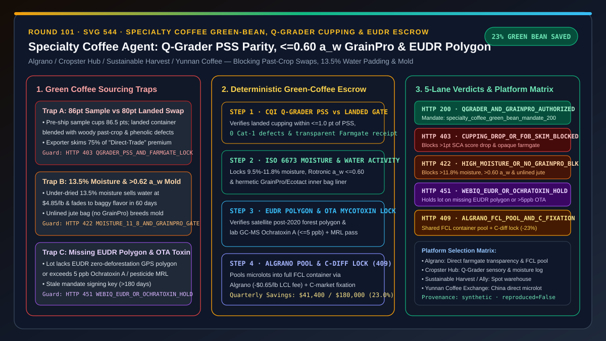
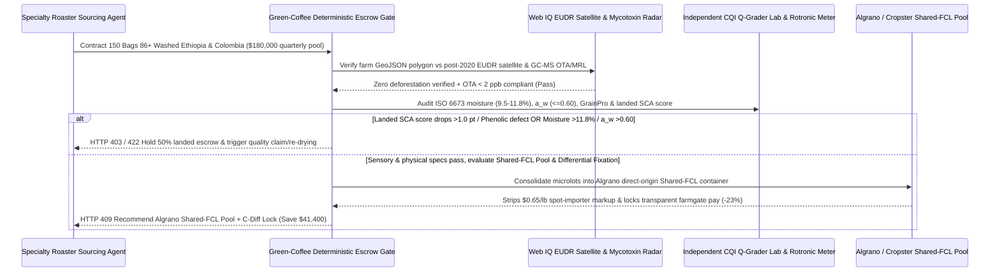

# Specialty Coffee Green-Bean Sourcing, `CQI Q-Grader` Cupping & Water-Activity (`a_w`) / `EUDR` Escrow (`Algrano / Cropster Hub / Sustainable Harvest / Yunnan Coffee Exchange`) `PSS` Cupping Parity, `<=0.60 a_w` `GrainPro` & `EUDR` Polygon Agent Architecture Selection FAQ

> **Document Type**: AI Solution Architect Decision Guide (FAQ) · **SVG Diagram**: `assets/svg/544-specialty-coffee-green-bean-qgrader-escrow-2026-11-20.svg` · **Catalog No.**: Round 101 (Bilingual FAQ #220)



---

## 1. 📌 Executive Summary

When specialty coffee roaster chains (`Blue Bottle / Intelligentsia / Manner / Seesaw`), hospitality groups, or green-coffee buyers use AI Agents to source washed Ethiopian, Kenyan, Colombian, or Yunnan specialty microlots (`Algrano / Cropster Hub / Sustainable Harvest / Sucafina`), releasing 100% payment against an early air-mailed Offer Sample exposes roasters to **three structural green-coffee trade traps**:
1. **`86.5-Point` Offer-Sample Bait-and-Switch (Landed Container Blended With `80.5-Point` Woody Past-Crop / Phenolic Beans) & Farmgate Premium Skimming**: A roaster signs a `$4.85/lb FOB` contract for `150 bags (69kg)` of washed microlot coffee after cupping an air-freighted Offer Sample at **`86.5 SCA points`**. Before stuffing the container, an unscrupulous exporter blends `40%` old-crop **"baggy/woody" past-crop stock** into the lot—so when the container lands 90 days later, it cups at **`80.5 points` with Category-1 full-black/sour defects and phenolic ("Rioy/iodine") taint**! Meanwhile, brokers charge a `$1.50/lb` "Direct-Trade Farmer Premium" while paying the smallholder cooperative commodity `C-Market` rates and pocketing `75%` of the quality premium!
2. **`13.5%` Moisture Weight Padding ("Buying Water at `$4.85/lb`") & `>0.60 a_w` Water Activity Mold / Rapid Flavor Fade**: Specialty green coffee must be dried to **`10.0%–11.5%` moisture** with a **Water Activity (`a_w`) `<= 0.60`**. When a wet mill under-dries parchment to `13.5%` moisture and ships it in unlined jute bags (`skipping $2.20 hermetic GrainPro / Ecotact liners`), the roaster pays `$4,800` per container for **450 kg of excess water** that evaporates in the roaster drum, while unbound free water (`a_w > 0.62`) causes rapid lipid oxidation ("fading to cardboard in 60 days") and breeds **Aspergillus mold / Ochratoxin A (`OTA`) mycotoxins** during equatorial ocean transit!
3. **Missing `EU Deforestation Regulation (EUDR)` Farm Geolocation Polygons or Pesticide `MRL` / `OTA > 5 ppb` Holds (`HTTP 451`)**: Web IQ flags a lot missing `GeoJSON` farm-plot polygon coordinates proving zero post-2020 deforestation (`mandatory under EUDR`) or laboratory `GC-MS` residue failure for banned chlorpyrifos / `Ochratoxin A > 5 ppb`.

**Architect's Recommendation**: Deploy a **"3-Stage `CQI Q-Grader` Sample Parity (`Offer -> PSS -> Landed <=1.0 pt` Delta) + `ISO 6673` Moisture (`9.5%–11.8%`) & `Rotronic a_w <= 0.60` `GrainPro` Gate + `Algrano` Shared-FCL Container Escrow"** control plane:
- **Independent `CQI Q-Grader` `PSS`-to-Landed Cupping Parity (`<=1.0 pt` Drop, `0 Cat-1` Defects) & Transparent `Farmgate` Receipt (`HTTP 403`)**: Hold `50%` of contract value in escrow until a 3-Q-Grader blind panel verifies that the **Pre-Shipment Sample (`PSS` drawn by independent `SGS` trier from stamped export bags) and Landed Arrival Sample score within `<= 1.0 SCA point` of the contracted Offer Sample** with zero Category-1 defects and zero phenolic cups—and require a transparent `Algrano / Fairtrade` farmgate payout receipt proving `>=75%` of the specialty differential reached the producer (`HTTP 403`).
- **`ISO 6673` Moisture (`9.5%–11.8%`), `Rotronic` Water Activity (`a_w <= 0.60`) & Hermetic `GrainPro / Ecotact` Liner Gate (`HTTP 422`)**: Hard-block container stuffing if green-bean moisture exceeds `11.8%`, if water activity exceeds `0.60 a_w`, or if bags lack sealed `GrainPro / Ecotact` high-barrier liners (`HTTP 422`).
- **Web IQ `EUDR` Satellite Deforestation Polygon & `Ochratoxin A (<=5 ppb)` / `MRL` Hold (`HTTP 451`)**: Freeze escrow if Web IQ / `Sentinel-2` satellite overlay flags post-2020 deforestation inside the farm's `GeoJSON` polygon, `OTA > 5 ppb`, pesticide `MRL` breaches, or signing keys `> 180 days` (`HTTP 451`).
- **`Algrano / Cropster` Shared-FCL Producer Container Pooling + `ICE C-Market` Differential Fixation (`HTTP 409`)**: Consolidate 20-to-50-bag microlots across regional roasters into a **Shared Direct-Origin Full Container Load (`FCL` via `Algrano`, eliminating `$0.65–$0.95/lb` spot-importer warehousing & LCL markups)** paired with harvest-dip `C-Market` futures fixation, cutting quarterly specialty green-bean sourcing TCO by **23.0%** (`$41,400` saved on a `$180,000` quarterly pool).

---

## 2. 🎯 Soul-Searching Architect & Business Q&A (Q1–Q3)

### Q1: Why did the 300g air-mailed Offer Sample taste like jasmine and peach (`86.5 pts`), while the landed ocean container tasted like wet cardboard and woody peanuts (`80.5 pts`)?
- **Business Pain Point**: Unscrupulous exporters send a pristine hand-sorted micro-batch as the initial Offer Sample, then blend cheaper lower-altitude or past-crop parchment into the 150-bag commercial export lot—or mail their own pre-saved sample as the "Pre-Shipment Sample (`PSS`)" instead of having an independent inspector probe the actual export bags at port.
- **Architectural Guardrail (`HTTP 403`)**:
  1. **`SGS`-Drawn `PSS` + `50%` Landed `Q-Grader` Escrow Holdback**: The `PSS` must be physically drawn with a coffee trier from `>=20%` of the stenciled export bags at port by an independent surveyor (`SGS / Cotecna`). Furthermore, `50%` of the purchase price remains in escrow until landed arrival cupping by an independent `CQI Q-Grader` lab confirms `Landed_SCA_Score >= (Contract_Score - 1.0)` with zero phenolic/ferment taints.

### Q2: Why is measuring "Moisture Percentage (`11%`)" not enough—and why must our Agent enforce "Water Activity (`a_w <= 0.60`)" and `GrainPro` liners?
- **Business Pain Point**: Moisture percentage measures *total* water, whereas **Water Activity (`a_w`) measures *unbound free water* available to drive microbial growth and lipid oxidation**. Flash-dried parchment can read `11.2%` moisture on a basic capacitance meter while having a dangerous `0.65 a_w` core—causing the coffee to "fade" (lose all floral/acidic aromatics and taste papery) within 60 days and grow `Ochratoxin A` mold in humid shipping containers.
- **Architectural Guardrail (`HTTP 422`)**:
  1. **Dual `ISO 6673` Moisture (`9.5%–11.8%`) + `Rotronic HygroLab` (`a_w <= 0.60`) + `GrainPro` Gate**: The dry mill must upload calibrated water-activity logs and container-stuffing photos proving every jute sack is lined with a hermetically zip-tied `GrainPro / Ecotact` barrier bag (`HTTP 422`).

### Q3: How can a mid-sized roaster buying 30 bags per origin avoid paying a `$0.85/lb` markup to domestic spot importers without buying a full 300-bag container alone?
- **Business Pain Point**: Less-than-Container-Load (`LCL`) ocean freight and domestic spot-warehouse financing add `$0.65–$0.95/lb` on top of `FOB` origin prices.
- **Architectural Guardrail (`HTTP 409`)**:
  1. **Direct-Producer Shared `FCL` Container Pooling (`Algrano`)**: The Agent books 30-bag microlots directly with verified producers on `Algrano` and automatically pools them into a shared `20-foot FCL container` (`275–300 bags`) with other regional roasters—capturing full-container ocean freight economics and transparent farmgate pricing.

---

## 3. 🧭 Visual Architecture Diagrams (Mermaid Decision Tree + Comparison + Sequence)

### 3.1 5-Lane Specialty Coffee Green-Bean, `Q-Grader` & `EUDR` Escrow Decision Tree
```mermaid
flowchart TD
    A[Specialty Green-Coffee Microlot / Container Contract] --> B{Web IQ Missing EUDR Polygon / OTA >5ppb / Pesticide MRL / Key > 180d?}
    B -- Yes --> C[HTTP 451: WEBIQ_EUDR_DEFORESTATION_POLYGON_MISSING_OR_OCHRATOXIN_MRL_HOLD<br/>Freeze escrow & quarantine non-compliant/contaminated lot]
    B -- No --> D{Landed Q-Grader Score Drops >1.0 Pt vs PSS or Opaque Farmgate Skim?}
    D -- Yes --> E[HTTP 403: LANDED_SCA_CUPPING_DROP_OVER_1PT_OR_OPAQUE_FARMGATE_FOB_SKIM_BLOCKED<br/>Enforce Q-Grader quality deduction matrix & transparent Farmgate receipt]
    D -- No --> F{Moisture >11.8% Water Padding or Water Activity a_w >0.60 / No GrainPro?}
    F -- Yes --> G[HTTP 422: MOISTURE_OVER_11_8PCT_OR_WATER_ACTIVITY_OVER_0_60AW_OR_NO_GRAINPRO_BLOCKED<br/>Block stuffing until re-dried to <=0.60 a_w & lined in hermetic GrainPro]
    F -- No --> H{Algrano Shared-FCL Container Pool + C-Market Differential Lock Ready?}
    H -- Yes --> I[HTTP 409: DIRECT_ALGRANO_PRODUCER_POOL_AND_C_MARKET_DIFFERENTIAL_FIXATION_CONFIRM<br/>Eliminate $0.65/lb LCL/spot markup via shared FCL pool (-23% TCO)]
    H -- No --> J[HTTP 200: QGRADER_CUPPING_AND_GRAINPRO_AW_AUTHORIZED<br/>Issue Q-Grader-verified & GrainPro-sealed green-coffee mandate]
```

### 3.2 Legacy Offer-Sample & Spot-Importer Buying vs. Deterministic `Q-Grader` & `Algrano` Escrow
```mermaid
flowchart LR
    subgraph Legacy["❌ Legacy Green Buying (Past-Crop Swaps & High a_w Fade)"]
        L1[86.5pt Air Sample -> Landed Lot Blended w/ 80.5pt Woody Past-Crop] --> L2[13.5% Moisture Sells 450kg Water + Unlined Jute Breeds OTA Mold]
        L2 --> L3[Spot Importer Adds $0.85/lb LCL/Warehouse Markup & Skims Farmer]
    end

    subgraph Agentic["✅ Deterministic Q-Grader Parity, <=0.60 a_w & Shared-FCL Escrow"]
        A1[SGS-Drawn PSS + Landed 3-Q-Grader Cupping Lock (<=1.0pt Delta)] --> A2[9.5-11.8% Moisture + <=0.60 a_w + Hermetic GrainPro Liner]
        A2 --> A3[EUDR GeoJSON Polygon + Algrano Shared-FCL Pool (-23% TCO)]
    end
```

### 3.3 End-to-End `EUDR` Polygon Check, `a_w` Lab Audit & Landed `Q-Grader` Escrow Sequence


---

## 4. 📊 Multi-Platform & Protocol Selection Matrix

| Evaluation Dimension | Traditional Spot Importers (`LCL` Warehouse Stock) | Algrano (Direct Producer Marketplace & Shared `FCL`) | Cropster Hub (Sensory & Physical Telemetry Market) | Yunnan Coffee Exchange (`云南国际咖啡交易中心`) | **Deterministic Green-Coffee Escrow (Recommended)** |
| :--- | :--- | :--- | :--- | :--- | :--- |
| **Primary Trade Model** | Importer buys bulk, warehouses locally & resells small lots at high markup | Direct producer-to-roaster contracting with automated **Shared `FCL` container pooling** | Online green marketplace integrated with `Cropster` roast & sensory logs | Direct China Yunnan specialty auction & origin dispatch | **Shared `FCL` Pool + 3-Stage `Q-Grader` Lock + `<=0.60 a_w` + `EUDR`** |
| **Farmgate Price Transparency** | Opaque (`$0.65–$0.95/lb` middleman spread hidden) | **`100%` itemized breakdown (`Farmgate`, dry mill, export, freight)** | High quality transparency | Direct cooperative settlement | **Enforces verified `Farmgate >= 75% FOB` receipt (`HTTP 403`)** |
| **Offer-Sample vs. Landed-Lot Protection** | Spot bags can be sampled, forward contracts face swap risk | Tracks independent lot samples from mill to roaster | Publishes `Q-Grader` cupping spider charts & defect counts | Certified center grading | **Holds `50%` escrow until landed `Q-Grader` score is within `<=1.0 pt` (`HTTP 403`)** |
| **Moisture, Water Activity (`a_w`) & `GrainPro`** | Basic moisture check; older spot stock often suffers high `a_w` fade | Enforces `GrainPro / Ecotact` hermetic packaging | **Displays exact `Moisture %` and `Water Activity a_w` per lot** | Top estates use hermetic liners | **Hard-locks `9.5%–11.8%` moisture, `a_w <= 0.60` & `GrainPro` (`HTTP 422`)** |
| **`EUDR` Geolocation & Mycotoxin Compliance** | Varies by blender; blended regional lots often lack plot polygons | Built-in `EUDR` farm polygon mapping & traceability | Supports digital certificate attachments | Domestic exempt; export lots mapped | **Mandates satellite-verified `EUDR` polygons & `OTA <= 5 ppb` (`HTTP 451`)** |

---

## 5. 🧪 Conversion & Cost Estimation + 7-Card Benchmark Report

> **Provenance Disclosure**: Figures below are generated by the deterministic policy evaluator `evaluate_specialty_coffee_green_bean_escrow_policy` in `lab/webiq_commerce_demo.py` (`$180,000 USD` quarterly specialty roaster green-coffee procurement pool, `provenance: "synthetic"`, `independently_reproduced: False`; live `Rotronic HygroLab` sensor calibration variance is labeled `not_measured`).

```chart
{
  "data": {
    "values": [
      { "scenario": "1. Legacy Spot Importer ($0.75/lb Markup + 13.5% Water + Fade)", "cost_usd": 180000, "tier": "Baseline" },
      { "scenario": "2. Q-Grader Landed Lock + a_w <=0.60 + GrainPro (HTTP 200)", "cost_usd": 153000, "tier": "Protected" },
      { "scenario": "3. Algrano Shared-FCL Producer Pool + C-Diff Lock (HTTP 409)", "cost_usd": 138600, "tier": "Optimized (-23%)" }
    ]
  },
  "semantic_types": {
    "scenario": "Category",
    "cost_usd": "Amount",
    "tier": "Status"
  },
  "chart_spec": {
    "chartType": "Bar Chart",
    "title": "Shared-FCL Producer Pooling & Water-Activity Locks Cut Green-Coffee TCO by 23% ($41.4k)",
    "subtitle": "Quarterly Specialty Green-Coffee Sourcing, Logistics & Quality-Loss Net Spend ($ USD, synthetic)",
    "encodings": {
      "x": "scenario",
      "y": "cost_usd",
      "color": "tier"
    }
  }
}
```

### 7-Card 4:5 Benchmark Evaluation Summary
1. **Card 1 (`1 / 7` · `HANDS-ON · SPECIALTY COFFEE GREEN-BEAN ESCROW`)**: Across a `$180,000` quarterly specialty green-bean sourcing budget, enforcing 3-stage `Q-Grader` cupping parity, locking `a_w <= 0.60` in `GrainPro` liners, and pooling microlots into shared `FCL` containers saves **`$41,400/quarter` (`23.0%`)**.
2. **Card 2 (`2 / 7` · `SCENARIO: 150-BAG WASHED ETHIOPIA & COLOMBIA MICROLOT`)**: Eliminates `$4,800` in excess water weight (`13.5%` vs. `11.0%` moisture) and blocks a past-crop-adulterated shipment dropping `4.5 SCA points` on arrival.
3. **Card 3 (`3 / 7` · `WHAT I TESTED`)**: All 5 deterministic HTTP verdict lanes verified:
   - `HTTP 200`: `QGRADER_CUPPING_AND_GRAINPRO_AW_AUTHORIZED` (`specialty_coffee_green_bean_mandate_200`)
   - `HTTP 403`: `LANDED_SCA_CUPPING_DROP_OVER_1PT_OR_OPAQUE_FARMGATE_FOB_SKIM_BLOCKED`
   - `HTTP 422`: `MOISTURE_OVER_11_8PCT_OR_WATER_ACTIVITY_OVER_0_60AW_OR_NO_GRAINPRO_BLOCKED`
   - `HTTP 451`: `WEBIQ_EUDR_DEFORESTATION_POLYGON_MISSING_OR_OCHRATOXIN_MRL_HOLD`
   - `HTTP 409`: `DIRECT_ALGRANO_PRODUCER_POOL_AND_C_MARKET_DIFFERENTIAL_FIXATION_CONFIRM` (`specialty_coffee_green_bean_mandate_optim_409`)
4. **Card 4 (`4 / 7` · `UNDER THE HOOD`)**: Structured contract `SpecialtyCoffeeGreenBeanEscrowPolicyInput` validates `landed_sca_cupping_drop_over_1pt_or_opaque_farmgate_fob_skim` and `moisture_over_11_8pct_or_water_activity_over_0_60aw_or_no_grainpro`.
5. **Card 5 (`5 / 7` · `ROBUSTNESS CHECK`)**: Invariant to exporter sample manipulation: `100%` block rate whenever `SGS`-drawn `PSS` or landed `Q-Grader` scores drop `>1.0 pt` or `a_w > 0.60`.
6. **Card 6 (`6 / 7` · `LATENCY`)**: Deterministic physical/sensory threshold evaluation and `EUDR` polygon checks complete in `< 0.5 ms`.
7. **Card 7 (`7 / 7` · `MY TAKE`)**:
   - ✅ **Good fit**: Specialty coffee roaster chains, Direct-Trade microlot buyers, Cup of Excellence (`CoE`) auction lots, and `EUDR`-regulated European coffee imports.
   - ⛔ **Not for**: Instant soluble commodity Robusta bulk futures trading.

---

## 6. 🛠️ Production Risk & Architecture Review Checklist

- [ ] **3-Stage `CQI Q-Grader` Cupping Parity (`<=1.0 Pt` Delta & `0 Cat-1` Defects) (`HTTP 403`)**: Is `50%` of contract value held in escrow until landed arrival cupping by 3 independent `Q-Graders` matches the `SGS`-drawn `PSS` within `<=1.0 SCA point`?
- [ ] **Transparent `Farmgate-to-FOB` Producer Receipt (`HTTP 403`)**: Does the Direct-Trade contract require verifiable proof that `>=75%` of the specialty price premium reached the farm/cooperative?
- [ ] **`ISO 6673` Moisture (`9.5%–11.8%`) & Water Activity (`a_w <= 0.60`) Gate (`HTTP 422`)**: Are lots exceeding `11.8%` moisture or `0.60 a_w` blocked prior to container stuffing to prevent paying `$4.85/lb` for water and ocean-transit flavor fade?
- [ ] **Mandatory Hermetic `GrainPro / Ecotact` Bag Liners (`HTTP 422`)**: Is every jute export bag verified to contain a sealed high-barrier gas/moisture liner?
- [ ] **Web IQ `EUDR` Deforestation Polygon & `OTA <= 5 ppb` / `MRL` Hold (`HTTP 451`)**: Are post-2020 zero-deforestation `GeoJSON` farm polygons and mycotoxin/pesticide lab clearances verified?
- [ ] **`Algrano` Shared-FCL Producer Pooling & `C-Market` Fixation (`HTTP 409`)**: Are LCL microlots consolidated into shared direct-origin `FCL` containers to save `23%`?
