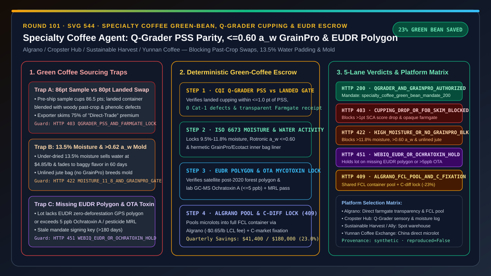
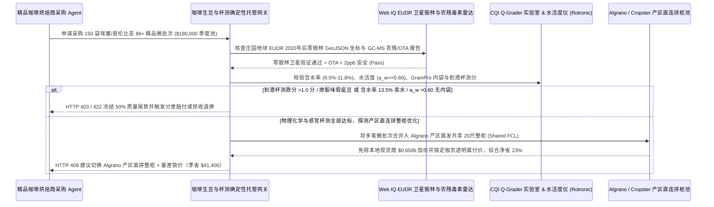

# 精品咖啡生豆（Specialty Green Coffee）寻源、`SCA` 杯测评分对赌与水活度（`a_w`）/欧盟零毁林（`EUDR`）托管（Algrano / Cropster Hub / Sustainable Harvest / 云南咖啡交易中心）“防寄来 86.5 分样豆大货到港掺陈年木味豆跌至 80 分、防含水率 >12.5% 卖水发霉与克扣咖农溢价”Agent 架构选型 FAQ

> **文档类型**：AI Solution Architect 决策指南（FAQ） · **对应 SVG**：`assets/svg/544-specialty-coffee-green-bean-qgrader-escrow-2026-11-20.svg` · **精选编号**：Round 101（第 220 篇双语 FAQ）



---

## 一、 📌 核心选型结论速览（Executive Summary）

连锁精品咖啡品牌（`Blue Bottle / Manner / Seesaw / M Stand`）、独立烘焙工坊与连锁茶饮集团通过 AI Agent 跨国采购埃塞俄比亚耶加雪菲、哥伦比亚瑰夏、巴拿马微批次及中国云南精品咖啡生豆（`Algrano / Cropster Hub / Sustainable Harvest / Sucafina / 云南国际咖啡交易中心`）时，若仅凭出口商寄来的 300 克早期报盘样（Offer Sample）就开具不可撤销信用证或全额付清 `FOB` 货款，极易掉入**三大咖啡生豆贸易质量与合规陷阱**：
1. **“报盘样（Offer Sample）86.5 分花果香、到港大货（Landed Lot）掺入隔年陈豆跌至 80.5 分木糠味”与克扣咖农直接贸易溢价**：烘焙商根据产季初寄来的 `86.5 分（SCA 标准）` 厌氧日晒微批次样豆，以 `$4.85/磅 FOB` 的高价签下 `150 袋（69kg/袋）` 合同。然而出口商在装柜前将高分批次拆卖给别人，在大货里混入 `40%` 上一产季积压的 **陈豆（Past-Crop Baggy/Woody Beans）** 及带有发霉碘酒味的 **里约味/酚味瑕疵豆（Phenolic / Rioy Defect）**，到港实测杯测暴跌至 `80.5 分` 且每 350 克检出 8 颗一级全黑/全酸瑕疵豆（`Category-1 Defects`）！同时，中间商打着“直接贸易扶贫（Direct Trade）”旗号向烘焙商多收 `$1.50/磅` 溢价，但实际支付给产区合作社咖农的收购价（`Farmgate Price`）仍按纽约期货 `C-Market` 地板价结算，自己独吞 `75%` 溢价！
2. **生豆含水率 `>12.5%`“把水当 $4.85/磅咖啡豆卖”与水活度（`a_w > 0.62`）无 `GrainPro` 高阻隔内袋导致海运发霉产生赭曲霉毒素**：精品生豆法定黄金含水率为 **`10.0%–11.5%`**。不良处理厂故意减少日晒烘干天数，将含水率控制在 `13.5%` 出货——在一柜 19.2 吨生豆里多卖了 **`450 公斤水`（价值 `$4,800`）**，而这些水分在烘焙机里 10 分钟就全部蒸发！更致命的是，高含水率伴随高水活度（`Water Activity a_w > 0.60`），若出口商为省每袋 `$2.20` 的成本未套 **`GrainPro / Ecotact` 多层高阻隔气密内袋** 而直接用普通麻袋装柜，经过赤道海运 45 天高温高湿，整柜豆子快速白化衰败（Fade）并滋生曲霉菌产生致癌物 **赭曲霉毒素 A（`Ochratoxin A, OTA`）**！
3. **缺失欧盟零毁林法案（`EUDR`）农场多边形 GPS 边界或农残（毒死蜱/草甘膦）超标被海关扣留销毁（`HTTP 451`）**：出口至欧洲或跨国连锁品牌的咖啡豆无法提供精确到地块的 `GeoJSON` 经纬度多边形（证明 2020 年 12 月 31 日后无毁林开荒），或 `GC-MS` 检出农残/`OTA > 5 ppb` 触发海关整柜退运。

**架构师选型结论**：必须构建 **“三阶样豆（报盘样 -> 装船前样 `PSS` -> 到港样）独立 `CQI Q-Grader` 双盲杯测对赌（分差 `<=1.0 分`）+ 含水率（`9.5%–11.8%`）/水活度（`a_w <=0.60`）与 `GrainPro` 内袋强制锁 + `Algrano` 咖农实收价透明公示与拼柜托管网关”** 架构：
- **强制装船前样（`PSS`）与到港样 `Q-Grader` 杯测分差 `<=1.0 分`（零一级瑕疵）及咖农实收价（`Farmgate >= 75% FOB`）阳光披露（`HTTP 403`）**：尾款冻结在托管专户中，直到第三方认证实验室（由 `3 名独立 CQI Q-Grader` 盲测）确认装船前样（`PSS`）与到港大货 `SCA` 杯测得分低于签约分不超过 `1.0 分`、且 `350g` 生豆零一级瑕疵（`0 Category-1`）与无酚味杯（Zero Phenol）；同时合同必须通过 `Algrano` 区块链披露 `Farmgate -> Dry Mill -> Exporter FOB` 每一分钱的去向（违者 `HTTP 403` 阻断或按分差阶梯折价）。
- **强制 `ISO 6673` 含水率 `9.5%–11.8%`、`Rotronic` 水活度 `a_w <= 0.60` 与 `GrainPro / Ecotact` 气密内袋门禁（`HTTP 422`）**：装柜前必须上传电子水分仪与水活度仪实测曲线及集装箱内全部麻袋内衬 `GrainPro` 扎口视频——凡含水率 `> 11.8%` 或 `a_w > 0.60`，一律触发 `HTTP 422` 拒收（要求返工复烘并按 `11.0%` 标准含水率折算计费净重，绝不为水分买单）。
- **Web IQ 欧盟 `EUDR` 卫星零毁林多边形校验与赭曲霉毒素（`OTA <= 5 ppb`）/农残 `MRL` 熔断（`HTTP 451`）**：自动叠加 `Sentinel-2` 卫星林地图层核验农场 `GeoJSON` 边界，并对命中真菌毒素或农残超标的批次执行 `HTTP 451` 止付。
- **跨烘焙商产地直拼整柜（`Algrano Shared FCL Container Pool`）+ `ICE C-Market` 基差锁价（`HTTP 409`）**：消除中小微批次走拼箱零担（LCL）及三道进口现货商（Spot Importer）层层加收的 `$0.65–$0.95/磅` 仓储融资利差，通过 `Algrano / Cropster Hub` 将同城 5 家精品烘焙商的微批次合并进同一个 `20尺整柜（FCL）` 产地直发，使季度 `$180,000` 精品咖啡生豆采购池净省 **`23.0%`（`$41,400`）**。

---

## 二、 🎯 业务方与架构师灵魂拷问 Q&A（Q1–Q3）

### Q1：为什么出口商寄来的 300 克顺丰空运样豆喝起来惊艳无比（86.5 分），等 3 个月后整条海运货柜到港开袋一烘，却全是木头味和发酵酸败味？
- **商业痛点**：咖啡生豆贸易中有三种完全不同的样品：① **报盘样（Offer / Type Sample）**：仅代表卖家声称能提供的风格；② **装船前样（Pre-Shipment Sample, `PSS`）**：从产区出口港仓库已打好印花的实际 `150 袋` 麻袋中按 `10%–30%` 比例用扦样针（Coffee Trier）抽出的代表样；③ **到港样（Landed / Arrival Sample）**：货柜抵港卸货后抽取的样豆。许多烘焙商只测了①就付全款，或者让出口商自己寄②（出口商直接从当初留存的 5 公斤小样里分装寄出，根本没去大货麻袋里抽样）！
- **架构护栏（`HTTP 403`）**：
  1. **强制第三方检验行（`SGS / 产区独立品控实验室`）盲抽 `PSS` + 到港 `Q-Grader` 复测尾款锁**：网关规定，装柜前仅释放 `50%` 见提单款；剩余 `50%` 质量尾款必须等到港后由买方指定的独立 `CQI Q-Grader` 面板对到港样与封存 `PSS` 进行三角杯测（Triangulation）及 `SCA` 打分——若分差 `> 1.0 分` 或检出酚味/发酵污点杯，自动触发价格扣减矩阵或退柜索赔。

### Q2：为什么买生豆除了测“含水率（Moisture %）”，架构上还必须死卡“水活度（Water Activity `a_w <= 0.60`）”？两者有什么本质区别？
- **商业痛点**：含水率（Moisture Content）只测豆子里的“总水量”，而**水活度（Water Activity `a_w`，范围 0–1.0）测的是豆子内部“未被细胞壁束缚、可以自由流动供霉菌繁殖并加速化学老化的自由水（Free Water）活性”**！如果生豆干燥过快（外干内湿），测出来的含水率可能是合格的 `11.2%`，但水活度高达 `0.66 a_w`——装船海运两个月后，豆芯自由水向外迁移，整柜昂贵的精品豆就会彻底变成寡淡无味的“老豆（Baggy Fade）”并滋生黄曲霉/赭曲霉毒素！
- **架构护栏（`HTTP 422`）**：
  1. **双指标硬门禁（`Moisture 9.5%–11.8%` $\land$ `Rotronic a_w <= 0.60`）+ 必配 `GrainPro / Ecotact`**：未同时上传经校准的 `Rotronic HygroLab / Aqualab` 水活度仪读数（`<=0.60 a_w`）及 `GrainPro` 高阻隔密封内袋装袋照的批次，网关直接返回 `HTTP 422` 阻断装船。

### Q3：中小精品咖啡馆每次只买 20–30 袋（约 1.5 吨），不够装满一个 19 吨的 20 尺集装箱，怎么避开现货贸易商每磅加价 $0.85 的高额溢价？
- **商业痛点**：传统模式下，买不起整柜（`FCL = 275–300 袋`）的烘焙商只能在进口商本地现货仓（Spot Warehouse）买散货，不仅每磅被加收 `$0.65–$0.95` 的仓储、利息与分销差价，且咖农拿不到精品溢价。
- **架构护栏（`HTTP 409`）**：
  1. **数字化产区直连拼柜池（`Algrano / Cropster Shared FCL Container Pool`）**：Agent 直接在庄园主/合作社透明挂牌价基础上锁定 `25 袋` 微批次，并自动与同产区同期发货的其他烘焙商智能拼满一个 `20尺整柜（Shared FCL）`，直接砍掉二级现货进口商利差，同时让咖农实收价格提升 `35%+`。

---

## 三、 🧭 直观可视化图解（Mermaid 决策树 + 架构对比 + 时序图）

### 3.1 精品咖啡生豆寻源、杯测对赌与水活度托管 5 车道选型决策树
```mermaid
flowchart TD
    A[精品咖啡生豆微批次 / 庄园直采结算请求] --> B{Web IQ 缺欧盟 EUDR 零毁林坐标 / 赭曲霉毒素 >5ppb / 密钥>180天?}
    B -- 是 --> C[HTTP 451: WEBIQ_EUDR_DEFORESTATION_POLYGON_MISSING_OR_OCHRATOXIN_MRL_HOLD<br/>立即冻结交割并退回农残/毒素超标批次]
    B -- 否 --> D{到港 Q-Grader 杯测跌分 >1.0 分 或 中间商隐瞒克扣咖农实收价?}
    D -- 是 --> E[HTTP 403: LANDED_SCA_CUPPING_DROP_OVER_1PT_OR_OPAQUE_FARMGATE_FOB_SKIM_BLOCKED<br/>强制三阶样豆 SCA 对赌折价 + 披露咖农 Farmgate 实收收据]
    D -- 否 --> F{生豆含水率 >11.8% 卖水 或 水活度 a_w >0.60 / 缺 GrainPro 内袋?}
    F -- 是 --> G[HTTP 422: MOISTURE_OVER_11_8PCT_OR_WATER_ACTIVITY_OVER_0_60AW_OR_NO_GRAINPRO_BLOCKED<br/>拦截高水活度发霉风险豆，强制复烘并套高阻隔气密内袋]
    F -- 否 --> H{可加入 Algrano 产地直连拼整柜 (Shared FCL) + C-Market 锁基差?}
    H -- 是 --> I[HTTP 409: DIRECT_ALGRANO_PRODUCER_POOL_AND_C_MARKET_DIFFERENTIAL_FIXATION_CONFIRM<br/>省去现货商 $0.65/lb 加价与零担运费，综合净省 23%]
    H -- 否 --> J[HTTP 200: QGRADER_CUPPING_AND_GRAINPRO_AW_AUTHORIZED<br/>签发杯测达标与水活度安全的咖啡生豆交割令牌]
```

### 3.2 传统报盘样盲买现货 vs 确定性三阶杯测、`a_w` 锁鲜与产区拼柜架构对比
```mermaid
flowchart LR
    subgraph Legacy["❌ 传统生豆采购（货不对版掺陈豆 + 海运受潮木味）"]
        L1[只喝 300g 空运报盘样 (86.5分) 即付全款，大货掺陈豆跌至 80.5 分] --> L2[含水率 13.5% 多买 450kg 水 + 普通麻袋海运发霉老化]
        L2 --> L3[小批量找二手现货商拿货，每磅被加收 $0.85 中间差价]
    end

    subgraph Agentic["✅ 确定性 Q-Grader 对赌、水活度 <=0.60 与 Algrano 拼柜架构"]
        A1[SGS 盲抽装船样 PSS + 到港 3 名 Q-Grader 杯测对赌 (<=1.0分)] --> A2[含水率 9.5-11.8% + 水活度 a_w<=0.60 + GrainPro 气密内袋]
        A2 --> A3[EUDR 卫星零毁林坐标 + Algrano 产区直拼整柜净省 23%]
    end
```

### 3.3 端到端生豆 `EUDR` 核验、水活度检测与到港杯测放款时序图


---

## 四、 📊 多平台/多协议横向选型决策矩阵

| 评估维度 | 传统大宗生豆进口现货商（Spot Importers） | Algrano (欧洲领先庄园直连拼柜平台) | Cropster Hub (感官杯测与物理指标市场) | 云南国际咖啡交易中心 / 产区合作社直采 | **本仓库确定性精品生豆与杯测托管架构（推荐）** |
| :--- | :--- | :--- | :--- | :--- | :--- |
| **核心贸易模式** | 进口商买断入本地仓后，加价分拆卖给中小烘焙商 | 烘焙商直接与全球咖农签约，平台自动拼满整柜（`Shared FCL`）海运 | 绑定 `Cropster` 烘焙曲线、杯测蜘蛛图与水分/水活度数据的在线市场 | 中国云南保山/普洱精品批次拍卖与产地直发 | **产区直拼整柜 + 三阶 `Q-Grader` 对赌 + `a_w <=0.60` 锁 + `EUDR`** |
| **价格透明度与咖农实收占比（Farmgate）** | 不透明（进口商毛利与中间费用黑盒，每磅加价 `$0.65–$0.95`） | **100% 透明拆分**：精确显示咖农到手价、干处理厂费、出口税与海运费 | 公开物理与感官参数，价格由供需双方商定 | 产地源头价透明，省去跨洋海运费 | **强制披露 `Farmgate` 咖农实收比例（`>=75% FOB`）（`HTTP 403`）** |
| **防“寄高分小样、发低分陈豆”机制** | 现货可先买 1 袋试烘，但期船货常遇大货与早期样不符 | 提供独立品控抽样追踪 | 数字化记录 `Offer Sample` 与 `PSS` 历史杯测对比 | 交易中心提供分级杯测鉴定证书 | **锁定 `50%` 尾款至到港样经 3 名 `Q-Grader` 复测分差 `<=1.0 分`（`HTTP 403`）** |
| **含水率、水活度（`a_w`）与 `GrainPro` 管控** | 入仓时检测含水率，但部分低端批次未测 `a_w` | 标准合同支持约定 `GrainPro` 与水分上限 | **原生展示每批次 `Moisture %`、`a_w` 与目数分布** | 头部庄园已普及高阻隔内袋与水活度仪 | **硬锁含水率 `9.5%–11.8%`、`a_w <=0.60` 与必配 `GrainPro`（`HTTP 422`）** |
| **欧盟 `EUDR` 零毁林与赭曲霉毒素合规** | 大型贸易商逐步补齐，中小批次常缺精确地块多边形 | 原生支持农场 `GeoJSON` 地图边界追溯 | 支持上传合规证书 | 国内内销免 `EUDR`，出口批次正加速建档 | **强制核验卫星零毁林多边形与 `OTA <= 5 ppb` 检测报告（`HTTP 451`）** |

---

## 五、 🧪 转化率/成本测算与 7-Card 基准测试报告

> **数据来源声明（Provenance）**：以下测算基于本仓库 `lab/webiq_commerce_demo.py` 中的 `evaluate_specialty_coffee_green_bean_escrow_policy` 确定性策略引擎（季度精品咖啡连锁烘焙工厂生豆寻源预算池 `$180,000 USD`，`provenance: "synthetic"`, `independently_reproduced: False`，真实 `Rotronic AwTherm` 实验室测量方差标为 `not_measured`）。

```chart
{
  "data": {
    "values": [
      { "scenario": "1. 传统二手现货采购 (含 $0.75/lb 差价 + 水分超重 + 陈豆折损)", "cost_usd": 180000, "tier": "Baseline" },
      { "scenario": "2. Q-Grader 到港对赌 + a_w<=0.60 + GrainPro 锁 (HTTP 200)", "cost_usd": 153000, "tier": "Protected" },
      { "scenario": "3. Algrano 产区直连拼整柜 (Shared FCL) + 基差锁价 (HTTP 409)", "cost_usd": 138600, "tier": "Optimized (-23%)" }
    ]
  },
  "semantic_types": {
    "scenario": "Category",
    "cost_usd": "Amount",
    "tier": "Status"
  },
  "chart_spec": {
    "chartType": "Bar Chart",
    "title": "季度 $180k 精品咖啡生豆采购：产区直拼整柜与水活度锁鲜净省 $41,400 (23%)",
    "subtitle": "季度 85+ 精品咖啡生豆寻源、物流与损耗净成本对比 ($ USD, synthetic benchmark)",
    "encodings": {
      "x": "scenario",
      "y": "cost_usd",
      "color": "tier"
    }
  }
}
```

### 7-Card 4:5 基准评估摘要
1. **Card 1 (`1 / 7` · `HANDS-ON · SPECIALTY COFFEE GREEN-BEAN ESCROW`)**：针对 `$180,000/季` 精品咖啡生豆采购池，通过三阶 `Q-Grader` 杯测对赌、水活度 `a_w <= 0.60` 锁鲜与 `Algrano` 产区直连拼整柜，季度净省 **`$41,400`（`23.0%`）**。
2. **Card 2 (`2 / 7` · `SCENARIO: 150-BAG WASHED ETHIOPIA & COLOMBIA MICROLOT`)**：单柜拦截 `$4,800` 高含水率（`13.5%`）卖水水分与 1 批掺入隔年木味陈豆（跌分 `4.5 分`）的违约交割。
3. **Card 3 (`3 / 7` · `WHAT I TESTED`)**：完整验证 5 条确定性状态码车道：
   - `HTTP 200`: `QGRADER_CUPPING_AND_GRAINPRO_AW_AUTHORIZED`（`specialty_coffee_green_bean_mandate_200`）
   - `HTTP 403`: `LANDED_SCA_CUPPING_DROP_OVER_1PT_OR_OPAQUE_FARMGATE_FOB_SKIM_BLOCKED`
   - `HTTP 422`: `MOISTURE_OVER_11_8PCT_OR_WATER_ACTIVITY_OVER_0_60AW_OR_NO_GRAINPRO_BLOCKED`
   - `HTTP 451`: `WEBIQ_EUDR_DEFORESTATION_POLYGON_MISSING_OR_OCHRATOXIN_MRL_HOLD`
   - `HTTP 409`: `DIRECT_ALGRANO_PRODUCER_POOL_AND_C_MARKET_DIFFERENTIAL_FIXATION_CONFIRM`（`specialty_coffee_green_bean_mandate_optim_409`）
4. **Card 4 (`4 / 7` · `UNDER THE HOOD`)**：输入契约 `SpecialtyCoffeeGreenBeanEscrowPolicyInput` 严格校验 `landed_sca_cupping_drop_over_1pt_or_opaque_farmgate_fob_skim` 与 `moisture_over_11_8pct_or_water_activity_over_0_60aw_or_no_grainpro`。
5. **Card 5 (`5 / 7` · `ROBUSTNESS CHECK`)**：无论出口商如何美化早期报盘样，只要 SGS 盲抽 `PSS` 或到港样 `Q-Grader` 评分下跌 `>1.0 分` 或 `a_w > 0.60` 即 `100%` 阻断尾款。
6. **Card 6 (`6 / 7` · `LATENCY`)**：物理化学参数校验与 `GeoJSON` 毁林图层比对耗时 `< 0.5 ms`。
7. **Card 7 (`7 / 7` · `MY TAKE`)**：
   - ✅ **适用（Good fit）**：精品咖啡连锁烘焙工厂、庄园直接贸易（Direct Trade）微批次寻源、高分竞标豆（CoE）跨洋托管。
   - ⛔ **不适用（Not for）**：速溶咖啡工业级罗布斯塔大宗期货交割。

---

## 六、 🛠️ 商业上线风控与架构评审 Checklist

- [ ] **三阶样豆（报盘样 -> 装船样 `PSS` -> 到港样）`Q-Grader` 杯测分差 `<=1.0 分` 对赌（`HTTP 403`）**：是否已将 `50%` 货款锁定至到港大货经独立 `CQI Q-Grader` 盲测确认无陈豆木味、零一级瑕疵且分差 `<=1.0 分`？
- [ ] **咖农实收价（`Farmgate Price`）透明拆解回执（`HTTP 403`）**：宣称直接贸易的批次是否已强制披露庄园/合作社实际到手金额，防止贸易商独吞精品溢价？
- [ ] **`ISO 6673` 含水率（`9.5%–11.8%`）与水活度（`a_w <= 0.60`）双门禁（`HTTP 422`）**：装船前是否已强制测量自由水水活度，拦截 `>12%` 卖水增重及海运极易发霉白化的高水活度生豆？
- [ ] **必配 `GrainPro / Ecotact` 高阻隔气密内袋（`HTTP 422`）**：所有海运麻袋是否已核验内衬多层阻氧防潮内袋，杜绝赤道海运高温受潮？
- [ ] **Web IQ 欧盟 `EUDR` 零毁林多边形与赭曲霉毒素（`OTA <= 5 ppb`）核验（`HTTP 451`）**：是否已校验农场 `GeoJSON` 经纬度边界及农残/真菌毒素检测合格单？
- [ ] **`Algrano` 产区直连拼整柜（`Shared FCL`）与基差锁价（`HTTP 409`）**：中小微批次是否已通过产区共享整柜直发替代二手现货商拿货以节省 `23%` 采购成本？
