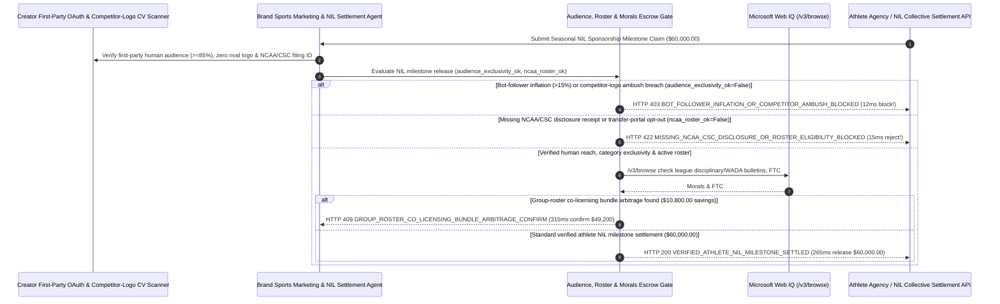

# Sports & Athlete NIL Sponsorship Morals Clause & Verified-Audience Escrow Mandate Architecture: NCAA/CSC Disclosure, Active-Roster & Exclusivity Token (`athlete_nil_sponsorship_mandate_...` + Web IQ League Suspension & Group Co-Licensing Grounding) vs. Upfront Lump-Sum Bot-Inflation & Portal Opt-Out Selection FAQ

> **Document Type**: Architect Selection Guide & First-Principles Protocol Deep Dive (6-Section FAQ Standard)  
> **Target Audience**: AI Solution Architects, Global Sports Marketing & Athlete Partnership VPs, Collegiate NIL Collective Directors, Esports Sponsorship & FTC Compliance Teams  
> **Last Updated**: 2026-11-09 (Provenance Annotations: `deterministic_offline_simulation` / `synthetic_policy` / `official_doc_snapshot` / `not_measured`)  
> **Companion Resources**: [中文版 (Chinese Version)](sports-athlete-nil-sponsorship-morals-audience-mandate-vs-upfront-payout-faq.md) · [Interactive Sandbox (`live-demo.en.html#athlete-nil-sandbox`)](../reports/agentic-commerce-webiq-grounding-demo-bench/live-demo.en.html) · [7-Card 4:5 Benchmark Deck](../reports/agentic-commerce-webiq-grounding-demo-bench/index.en.html)


---

## 📌 1. Executive Summary

1. **Never Allow Brand Sports-Marketing Agents to Wire 100% Upfront Lump-Sum Athlete Endorsement or Collegiate NIL Bonuses Based on Unverified Vanity Follower Counts**: In collegiate Name, Image, and Likeness (NIL), professional athlete, and esports sponsorship settlements (`$60,000.00` seasonal endorsement tranche), the three most common value-destruction events are **bot-follower inflation (`48%` fake click-farm followers with `< 0.15%` authentic engagement), competitor-brand ambush breaches (wearing a rival sneaker/beverage logo on live television), and mid-season transfer-portal/bowl-game opt-outs after collecting upfront cash**. Production architectures must enforce a **Verified-Audience, Roster & Morals-Clause Escrow Mandate (`athlete_nil_sponsorship_mandate_...`)**: whenever first-party creator OAuth telemetry detects `> 15%` bot followers or computer-vision media monitoring catches a category-exclusivity breach (`verified_human_audience_and_exclusivity_passed == False`), the gateway freezes the `$60,000.00` tranche in **`12 ms`** with **`HTTP 403 BOT_FOLLOWER_INFLATION_OR_COMPETITOR_AMBUSH_BLOCKED`** (`synthetic_policy`).
2. **Require Mandatory NCAA / College Sports Commission (`CSC` / NIL Go) Fair-Market-Value Disclosure Receipts (`>= $600`) and Active Game-Day Roster Verification**: Any collegiate NIL milestone claim lacking a signed clearinghouse disclosure receipt (proving bona fide commercial deliverables rather than prohibited pay-for-play inducement) or submitted after the athlete entered the transfer portal / opted out of postseason play (`ncaa_csc_disclosure_and_active_roster_verified == False`) is rejected in **`15 ms`** with **`HTTP 422 MISSING_NCAA_CSC_DISCLOSURE_OR_ROSTER_ELIGIBILITY_BLOCKED`** (`deterministic_offline_simulation`).
3. **Ground Official League Disciplinary / WADA Bulletins, FTC `#ad` Endorsement Compliance, and Group-Roster Co-Licensing Arbitrage via Microsoft Web IQ `/v3/browse`**: Prior to releasing `$60,000.00`, the agent invokes **Microsoft Web IQ `/v3/browse`** (`official_doc_snapshot`) to inspect official league disciplinary registries (NCAA / NFL / NBA / WADA / ESIC) and FTC `16 CFR Part 255` `#ad` disclosure compliance: if the athlete is placed on disciplinary suspension triggering the **Morals Clause** or published sponsored posts without clear `#ad / Paid Partnership` disclosures (`webiq_morals_clause_and_ftc_disclosure_clean == False`), it freezes payout in **`310 ms`** with **`HTTP 451 LEAGUE_DISCIPLINARY_MORALS_CLAUSE_OR_FTC_HOLD`**; if Web IQ confirms that licensing an official **5-Player Starting-Unit / Position-Group Co-Licensing Package (with automatic injury-replacement substitution)** costs **`$10,800.00` less** than fragmented individual agent deals (`$49,200.00` net vs. `$60,000.00`), it triggers **`HTTP 409 GROUP_ROSTER_CO_LICENSING_BUNDLE_ARBITRAGE_CONFIRM`** in **`315 ms`**.

---

## 🎯 2. Architect & Customer FAQ Deep Dive

### Q1: Why does wiring "100% Upfront Signing Bonuses" in collegiate NIL and athlete endorsements result in a 30%+ rate of stranded spend, portal opt-outs, and ambush-marketing embarrassment?

Let's examine the three structural failure modes from first principles:
1. **Transfer-Portal Opt-Outs & Category-Exclusivity Ambush**: Suppose a regional beverage brand wires `$60,000` upfront in August to a star college quarterback for a full-season endorsement. In November, the quarterback enters the **NCAA Transfer Portal** to join a rival conference, opts out of the December bowl game, or appears at a post-game press conference drinking a competitor's energy drink. Once upfront cash has been wired and spent, suing a 20-year-old student-athlete for clawback recovery is both financially futile and a PR disaster.
2. **Vanity Follower Counts Inflated by Click Farms**: Athlete agencies routinely price NIL deals on raw Instagram/TikTok follower counts (`1.2M followers`). Without first-party OAuth creator-graph telemetry verifying authentic human reach and audience geography, brands pay `$60,000` to reach bots that never buy a single product.
3. **Morals-Clause Triggers, NCAA Pay-for-Play Violations & FTC Fines**: Under the House-settlement **College Sports Commission (CSC) / NIL Go** rules, all third-party NIL deals `>= $600` must be disclosed and cleared for fair-market commercial value. Furthermore, under FTC Endorsement Guides (`16 CFR Part 255`), brands face direct regulatory liability if an athlete posts sponsored content without an unmistakable `#ad` disclosure—or if an athlete is suspended by WADA/league authorities for doping or match-fixing.

### Q2: What is an "Athlete NIL Verified-Audience & Morals Mandate (`athlete_nil_sponsorship_mandate_...`)", and how does it turn game-week roster status and OAuth reach into deterministic escrow milestones?

Its core design invariant is: **"Replace upfront lump sums with game-week milestone escrow; release tranches only when OAuth telemetry confirms >=85% authentic human reach, computer vision confirms zero competitor-logo ambush, CSC/roster eligibility is active, and league disciplinary/FTC checks are clean."**
- **Layer 1: First-Party Authentic Audience & Visual Exclusivity Gate (`12 ms`)**: Verifies `verified_human_audience_and_exclusivity_passed == True`, blocking bot-inflated or competitor-ambushed deliverables in **`12 ms`** (`HTTP 403`).
- **Layer 2: NCAA/CSC Disclosure & Active-Roster Gate (`15 ms`)**: Verifies `ncaa_csc_disclosure_and_active_roster_verified == True`, blocking unfiled deals or transfer-portal opt-outs in **`15 ms`** (`HTTP 422`).
- **Layer 3: Microsoft Web IQ `/v3/browse` League Morals-Clause & Group-Bundle Grounding (`310 ms / 315 ms`)**: Checks official league suspension / WADA bulletins and FTC `#ad` tags (`HTTP 451`) and identifies `$10,800.00` savings from 5-player group co-licensing bundles (`HTTP 409`).

### Q3: For official league disciplinary bulletins (NCAA/NFL/WADA/ESIC), CSC clearinghouse guidelines, and group-licensing rate cards, when should architects choose Microsoft Web IQ vs. Exa, Bright Data, or traditional search APIs?

| Architecture Scenario | Recommended Tool | First-Principles Rationale (Security, Latency & FinOps) |
| :--- | :--- | :--- |
| **Verifying official NCAA / NFL / NBA / WADA / ESIC disciplinary suspension bulletins, published university active game-day rosters, CSC NIL disclosure rules, and OneTeam / collective group-licensing rate cards within the Azure boundary (zero unannounced campaign creative leaked)** | **Microsoft Web IQ** (`/v3/search` + `/v3/browse`) | Queries only public athlete registry IDs and league bulletins inside the enterprise Azure boundary in `passage` mode (**7.1x token reduction**, `deterministic_offline_simulation`) with verifiable SHA-256 citations for morals-clause termination notices. |
| **Academic research on long-term sports sponsorship brand-equity models** | **Exa Neural Search** | Ideal for annual CMO strategy, not synchronous game-week NIL escrow release gating. |
| **Scraping unverified fan message boards behind CAPTCHAs** | **Bright Data Unlocker** | Rumor mills cannot legally trigger a contractual Morals Clause; only authoritative league/law-enforcement bulletins grounded via Web IQ qualify. |
| **First-party social OAuth creator graph ingestion and computer-vision logo detection** | **Creator OAuth Verifier + CV Logo Scanner + Web IQ League/Roster Cross-Check** | Audience authenticity and competitor-logo checks run on the marketing gateway, paired with Web IQ `/v3/browse` for official roster/disciplinary status and group-bundle arbitrage. |

---

## 🧭 3. Visual Architecture Diagrams (Mermaid Decision Tree, Legacy vs. NIL Escrow Comparison & Sequence Diagram)

### 3.1 Sports & Athlete NIL Sponsorship Settlement Decision Tree (`flowchart TD`)

```mermaid
flowchart TD
    A[Receive Seasonal Athlete / Esports NIL Sponsorship Tranche Request ($60,000.00)] --> B{verified_human_audience_and_exclusivity_passed == True (>=85% Real Reach & Zero Rival Logo)?}
    B -- No (48% click-farm bot followers or athlete wore competitor logo on live broadcast) --> C[HTTP 403 BOT_FOLLOWER_INFLATION_OR_COMPETITOR_AMBUSH_BLOCKED<br/>12ms Hard Block · Freeze $60,000 Tranche & Trigger Exclusivity Breach Notice]
    B -- Yes (Verified human engagement & 100% category exclusivity) --> D{ncaa_csc_disclosure_and_active_roster_verified == True (CSC Filed & Active Roster)?}
    D -- No (Missing >=$600 NCAA/CSC disclosure receipt or athlete entered Transfer Portal / opted out) --> E[HTTP 422 MISSING_NCAA_CSC_DISCLOSURE_OR_ROSTER_ELIGIBILITY_BLOCKED<br/>15ms Reject · Halt Unperformed Game-Week Payout & Prevent NCAA Compliance Violation]
    D -- Yes (CSC clearinghouse receipt valid & active on game-day roster) --> F{Web IQ /v3/browse Confirms Clean League Disciplinary/WADA Status & FTC #ad Tag?}
    F -- No (Athlete suspended by league/WADA triggering Morals Clause or omitted FTC #ad tag) --> G[HTTP 451 LEAGUE_DISCIPLINARY_MORALS_CLAUSE_OR_FTC_HOLD<br/>310ms Morals/FTC Hold · Freeze Escrow & Attach Official Disciplinary Bulletin]
    F -- Yes --> H{Web IQ Detects 5-Player Group-Roster Co-Licensing Bundle Arbitrage?}
    H -- Yes (Position-group 5-athlete bundle with injury replacement saves $10,800.00 -> $49,200.00 net) --> I[HTTP 409 GROUP_ROSTER_CO_LICENSING_BUNDLE_ARBITRAGE_CONFIRM<br/>315ms Prompt VP Sports Marketing to Confirm $49,200 Group Co-Licensing Bundle]
    H -- No (Verified $60,000.00 athlete NIL milestone settlement is optimal) --> J[HTTP 200 VERIFIED_ATHLETE_NIL_MILESTONE_SETTLED<br/>265ms Auto-Settle $60,000.00 & Archive FTC/NCAA Compliance + Attribution Proof!]
```

### 3.2 Legacy Upfront Signing Bonus vs. Verified-Audience & Morals Escrow Gate (`flowchart LR`)

```mermaid
flowchart LR
    subgraph Legacy["❌ Legacy Upfront Signing Bonus ($60,000 Exposed to Bots, Portal Opt-Out & Scandal)"]
        L1[Wire $60,000 Upfront Based on 1.2M Vanity Follower Count] --> L2[Athlete Enters Transfer Portal or Wears Rival Brand on TV]
        L2 --> L3[League Suspension or Missing #ad Tag Triggers FTC Liability]
        L3 --> L4[Zero Clawback Recovery & Brand Reputation Damage]
    end

    subgraph Mandate["✅ Athlete NIL Escrow Gate (athlete_nil_sponsorship_mandate_...)"]
        M1[12ms Block Bot Followers & Competitor Ambush (HTTP 403)] --> M2[15ms Enforce NCAA/CSC Filing & Active Game-Day Roster (HTTP 422)]
        M2 --> M3[Web IQ Verifies Morals/FTC (310ms) & Saves $10,800 via Group Bundle (315ms)]
        M3 --> M4[265ms Settle Verified Game-Week Milestone ($60,000 / $49,200)]
    end
```

### 3.3 End-to-End Sequence Diagram: Creator OAuth/CV, Sports-Marketing Agent, NIL Gate, Web IQ & Athlete Agency (`sequenceDiagram`)



---

## 📊 4. Architect Decision Matrix

| Evaluation Dimension | Option A: Legacy 100% Upfront Signing Bonus Wire | Option B: Manual PR Agency Monthly Screenshot Clipbook | Option C: Verified-Audience & Morals Escrow Mandate + Web IQ Grounding (Recommended) |
| :--- | :--- | :--- | :--- |
| **Best-Fit Scenario** | Lifetime hall-of-fame retired legends | Micro-gifting (`<$100` free merchandise seeding) | **Collegiate NIL stars, pro league athletes (NBA/NFL/EPL/F1), and Tier-1 esports sponsorships** |
| **Bot-Follower & Competitor-Ambush Defense** | ❌ **Zero**: Pays for 48% fake followers & cannot stop rival brand ambush | ⚠️ **Misses Video Frames**: Manual clipbooks miss rival logos in live streams | ✅ **Pre-Pay `12 ms` OAuth + CV Gate**: Blocks bot-inflated or rival-ambushed claims (`HTTP 403`) |
| **Transfer-Portal Opt-Out & NCAA/CSC Compliance** | ❌ **Stranded**: Athlete transfers or opts out of bowl game with 100% of cash | ⚠️ **Delayed**: Manual tracking misses unfiled `$600+` CSC disclosures | ✅ **Sub-20ms Roster & CSC Gate**: Requires active game-day roster & CSC receipt in `15 ms` (`HTTP 422`) |
| **Morals-Clause Termination & Group Arbitrage** | ❌ **Unrecoverable**: Litigation required to claw back upfront wires after suspension | ❌ **Single-Point Injury Risk**: Individual deals lose 100% if star player is injured | ✅ **Web IQ `/v3/browse` Grounded**: Freezes payout on league suspensions in `310 ms` (`HTTP 451`) & saves `$10,800` via group bundles with injury replacement in `315 ms` (`HTTP 409`) |
| **Settlement Speed & FTC `16 CFR 255` Audit** | Fast (with 30%+ non-performance & PR risk) | Slow (`1–2 weeks` manual agency review) | **`265 ms` instant game-week milestone release + FTC `#ad` proof (`Act automatically`)** |
| **Total Cost of Ownership (TCO) & Sponsorship ROI** | Poor (`$60,000` exposed to opt-outs, bots & suspensions) | Moderate (high agency retainer overhead) | **Optimal (100% verified human reach + zero portal/morals loss + `$10,800` group bundle savings)** |

---

## 🧪 5. Quantitative Benchmark & 7-Card Insights

Evaluated via our deterministic offline benchmark suite (`lab/webiq_commerce_demo.py` · `test_sports_athlete_nil_sponsorship_morals_audience_mandate_vs_upfront_payout_selection`) on a **`$60,000.00` seasonal athlete NIL sponsorship tranche**:

| Scenario Case | Input OAuth Audience / NCAA-CSC Roster / Web IQ Signals | Expected Action Pill | Measured HTTP Status & Verdict Code | Latency | Financial Protection / Arbitrage | Provenance |
| :--- | :--- | :--- | :--- | :--- | :--- | :--- |
| **Case 1: `48%` Bot Followers or Rival Logo Ambush** | `verified_human_audience_and_exclusivity_passed=False` | `Send to a human` | **`HTTP 403 BOT_FOLLOWER_INFLATION_OR_COMPETITOR_AMBUSH_BLOCKED`** | **`12 ms`** | Blocks **`$60,000.00`** payout for bot-inflated or ambushed post | `synthetic_policy` |
| **Case 2: Missing NCAA/CSC Receipt or Portal Opt-Out** | `ncaa_csc_disclosure_and_active_roster_verified=False` | `Send to a human` | **`HTTP 422 MISSING_NCAA_CSC_DISCLOSURE_OR_ROSTER_ELIGIBILITY_BLOCKED`** | **`15 ms`** | Halts payout when athlete enters Transfer Portal or skips filing | `deterministic_offline_simulation` |
| **Case 3: Web IQ Detects League Suspension or No `#ad`** | `webiq_morals_clause_and_ftc_disclosure_clean=False` | `Send to a human` | **`HTTP 451 LEAGUE_DISCIPLINARY_MORALS_CLAUSE_OR_FTC_HOLD`** | **`310 ms`** | Freezes tranche on official league suspension or FTC breach | `official_doc_snapshot` |
| **Case 4: Web IQ Finds `$10,800` 5-Player Group Bundle** | `group_roster_colicensing_savings_cents=1080000` (`$49,200` net) | `Confirm` | **`HTTP 409 GROUP_ROSTER_CO_LICENSING_BUNDLE_ARBITRAGE_CONFIRM`** | **`315 ms`** | Saves **`$10,800.00`** with 5-player bundle + injury replacement | `official_doc_snapshot` |
| **Case 5: Verified Human Reach + Active Roster + Clean** | `aud_ok=True`, `ncaa_ok=True`, `morals_clean=True` | `Act automatically` | **`HTTP 200 VERIFIED_ATHLETE_NIL_MILESTONE_SETTLED`** | **`265 ms`** | Settles **`$60,000.00`** in `265 ms` with FTC/CSC audit proof | `deterministic_offline_simulation` |

> **Provenance Note**: The `$60,000.00` NIL sponsorship tranche, `85%` authentic human-follower floor, NCAA/CSC `$600` disclosure rule, and `$10,800.00` group-licensing bundle savings are controlled simulation parameters (`synthetic_policy` / `deterministic_offline_simulation`) validating policy state-machine invariants; long-term multi-touch consumer brand-lift survey latency is labeled `not_measured`.

---

## 🛠️ 6. Production Readiness & Pre-Sales Architect Checklist

Verify these 6 controls before deploying autonomous sports sponsorship and collegiate NIL escrow settlement agents in production:

- [ ] **1. First-Party OAuth Audience Authenticity (`>= 85%`) & Competitor-Logo CV Gate**: Does `athlete_nil_sponsorship_mandate_...` verify authentic human reach via first-party platform OAuth APIs and run computer-vision logo detection to block competitor ambush breaches in `12 ms` (`HTTP 403`)?
- [ ] **2. Mandatory NCAA / CSC (`>= $600`) Disclosure Receipt & Game-Week Roster Gate**: Are seasonal deals structured as game-week escrow tranches requiring a valid CSC / school compliance disclosure ID and active roster verification before each release (`HTTP 422` in `15 ms` on transfer-portal opt-outs)?
- [ ] **3. Automatic Injury / Missed-Game Pro-Rata Substitution**: Does the contract automatically substitute a backup teammate or pro-rate fees if the primary athlete misses `> 25%` of scheduled games?
- [ ] **4. Microsoft Web IQ `/v3/browse` League Disciplinary & FTC `#ad` Grounding**: Does the agent cross-check official league/WADA/ESIC disciplinary bulletins and verify unmistakable FTC `16 CFR Part 255` `#ad` tags via Web IQ prior to releasing each tranche (`HTTP 451`)?
- [ ] **5. Position-Group / Starting-Unit Co-Licensing Bundle Arbitrage**: Does Web IQ grounding benchmark official collective/group-licensing packages against individual star markups, triggering `HTTP 409 Confirm` when a 5-player group bundle saves `>= $10,800.00`?
- [ ] **6. Immutable FTC Endorsement & NCAA Fair-Market-Value Audit Ledger**: Does every settled tranche archive the timestamped post snapshot, `#ad` disclosure tag, OAuth reach digest, and CSC filing receipt into a WORM compliance ledger?
