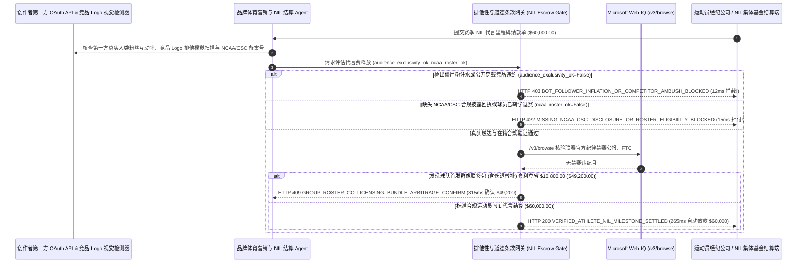

# 体育赛事与运动员姓名肖像权代言（Sports & Athlete NIL Sponsorship）、道德条款（Morals Clause）与真实粉丝触达托管（Sports & Athlete NIL Sponsorship Morals Clause & Verified-Audience Escrow Mandate）架构：NCAA/CSC 合规披露、在籍出场与视觉排他性令牌（`athlete_nil_sponsorship_mandate_...` + Web IQ 联赛禁赛通报与群像联签核验）vs 传统一次性预付全款遭僵尸粉与转学违约选型与原理解析 FAQ

> **文档类型**：架构师选型指南 & 协议第一性原理解析（6 段式 FAQ 标准版）  
> **适用读者**：AI Solution Architect、运动品牌/快消/游戏电竞全球体育营销（Sports Marketing & Athlete Partnerships）副总裁、高校 NIL 集体基金（NIL Collectives）与法务合规团队  
> **更新日期**：2026-11-09（Provenance 标注：`deterministic_offline_simulation` / `synthetic_policy` / `official_doc_snapshot` / `not_measured`）  
> **配套资源**：[English Version](sports-athlete-nil-sponsorship-morals-audience-mandate-vs-upfront-payout-faq.en.md) · [交互式沙盒控制台 (`live-demo.html#athlete-nil-sandbox`)](../reports/agentic-commerce-webiq-grounding-demo-bench/live-demo.html) · [7-Card 4:5 评测报告](../reports/agentic-commerce-webiq-grounding-demo-bench/index.html)


---

## 📌 一、核心结论速览（Executive Summary）

1. **严禁让品牌体育营销（Sports Marketing）结算 Agent 在签约当天向运动员或电竞选手一次性打款 100% 预付代言费，或仅凭社交媒体主页显示的“表面粉丝总数”定级付款**：在职业运动员、高校明星球员姓名肖像权（Name, Image, and Likeness, NIL）及电竞选手赛季赞助结算（如单赛季代言批次 `$60,000.00`）中，最常见的三大翻车事故是 **“经纪公司买刷量僵尸粉充门面（120 万粉丝中 48% 为假号，真实互动率 `< 0.15%`）、球员刚收完钱就在赛后电视采访中公然穿戴竞品球鞋/喝竞品饮料（Ambush Breach），或者拿完预付款立刻转学/罢赛缺席”**。生产环境必须采用 **第一方真实受众与视觉排他性分期托管令牌（`athlete_nil_sponsorship_mandate_...`）**：一旦社媒平台第一方 OAuth API 检出虚假粉丝占比超标（`> 15%`）或计算机视觉巡检发现代言人在公开场合露出竞品商标（`verified_human_audience_and_exclusivity_passed=False`），网关在 **`12 ms`** 内触发 **`HTTP 403 BOT_FOLLOWER_INFLATION_OR_COMPETITOR_AMBUSH_BLOCKED`**（`synthetic_policy`），100% 冻结当期托管款。
2. **强制校验高校运动员“NCAA / College Sports Commission (CSC) 公平市值商业备案回执（`>= $600` 强制披露）”与赛季大名单在籍出场状态（Active Roster Verification）**：若高校 NIL 合同缺失官方合规清算平台（如 NIL Go / COMPASS）签发的非“违规招募诱导（Pay-for-Play）”备案号，或球员在赛季中途进入转学池（Transfer Portal）/ 宣布弃赛（Opt-Out of Bowl Game）导致未完成约定场次曝光（`ncaa_csc_disclosure_and_active_roster_verified=False`），网关在 **`15 ms`** 内返回 **`HTTP 422 MISSING_NCAA_CSC_DISCLOSURE_OR_ROSTER_ELIGIBILITY_BLOCKED`**（`deterministic_offline_simulation`）。
3. **基于 Microsoft Web IQ `/v3/browse` 实时核验联赛官方纪律禁赛/反兴奋剂（WADA）道德条款触发、FTC `#ad` 商业披露合规与“首发阵容群像联签包（Group Roster Co-Licensing）”套利**：在放款前，Agent 调用 **Microsoft Web IQ `/v3/browse`**（`official_doc_snapshot`）穿透查询联赛官方纪律委员会（NFL/NBA/NCAA/WADA/ESIC）禁赛通告及代言人发帖是否标注 FTC 强制要求的 `#ad / Paid Partnership` 标签：若检出运动员因赛场违纪/兴奋剂被禁赛触发道德条款（Morals Clause）或漏标广告标识（`webiq_morals_clause_and_ftc_disclosure_clean=False`），在 **`310 ms`** 内以 **`HTTP 451 LEAGUE_DISCIPLINARY_MORALS_CLAUSE_OR_FTC_HOLD`** 冻结结算并启动按比例追回；若发现采购球队官方授权的 **5 人位置组/首发群像联签包（内置伤病自动替补上场条款）** 比找单人经纪人散签可立省 **`$10,800.00`**（净支出从 `$60,000.00` 降至 **`$49,200.00`**），则在 **`315 ms`** 内触发 **`HTTP 409 GROUP_ROSTER_CO_LICENSING_BUNDLE_ARBITRAGE_CONFIRM`**。

---

## 🎯 二、客户与架构师灵魂拷问 Q&A（FAQ-Driven Deep Dive）

### Q1：为什么品牌商花 6 万美元签一个体育明星或大学生球员做赛季代言，传统“签完合同先打全款”模式有超过 30% 的概率变成公关灾难或坏账？

咱们用大白话拆解体育与电竞营销圈最真实的三大痛点：
1. **“付完钱第二天，球员宣布转学或者穿着死对头的球鞋上热搜”**：在高校体育（NCAA NIL）和电竞圈，人员流动极快。品牌商本来是为了借某大学主场决赛的热度，一次性付了某主力四分卫 `$60,000` 全季代言费；结果常规赛刚打完，这名球员为了更高报价宣布进入 **转学池（Transfer Portal）** 并拒绝参加年末碗赛（Bowl Game Out-Out）！更尴尬的是，有些球员收了 A 运动饮料的钱，转头在赛后新闻发布会上把 B 竞品饮料摆在话筒前喝得津津有味（违反品类排他条款 Category Exclusivity）。如果钱已经一次性打进他个人账户，品牌商根本要不回来。
2. **“百万粉丝里一半是群控僵尸号”**：部分不良体育经纪人在谈合同前两周，花几百美元给年轻球员的 Instagram/TikTok 买 50 万个东南亚僵尸粉，把报价从 `$20,000` 抬到 `$60,000`。如果不通过官方 OAuth API 调取后台真实受众画像与完播互动率，品牌商就是花真金白银给机器人看广告。
3. **道德条款（Morals Clause）与 FTC 隐性广告罚单**：一旦代言球员卷入兴奋剂（WADA 阳性）、假球（ESIC 禁赛）或场外违法丑闻，品牌商必须立刻止损解约；同时美国联邦贸易委员会（FTC `16 CFR Part 255`）规定，任何未在文案显著位置加上 `#ad` 或 `#Sponsored` 的商业帖，品牌主本人也要承担虚假宣传连带罚款。

### Q2：什么是“体育 NIL 真实受众与道德条款分期托管令牌（`athlete_nil_sponsorship_mandate_...`）”？它是如何实现“按有效比赛周与合规发帖分期释放”的？

它的第一性原理非常直接：**“变一次性预付为‘按在籍比赛周 + 实测去水互动量 + 道德条款无违约’自动解锁里程碑托管；一旦伤退、转学或穿竞品立即按比例熔断。”**
- **第一层：第一方真实人类受众与计算机视觉竞品排他门禁（`12 ms`）**：核验 `verified_human_audience_and_exclusivity_passed == True`。一旦检出僵尸粉比例 `> 15%` 或出镜画面出现竞品 Logo，在 **`12 ms`** 内触发 `HTTP 403` 拦截。
- **第二层：NCAA / CSC 公平市值备案与在籍出场名单门禁（`15 ms`）**：核验 `ncaa_csc_disclosure_and_active_roster_verified == True`。缺失官方合规披露回执或球员已退出本队有效出场名单（Active Roster），在 **`15 ms`** 内返回 `HTTP 422`。
- **第三层：Microsoft Web IQ `/v3/browse` 联赛禁赛巡检与群像联签套利（`310 ms / 315 ms`）**：核查联赛官方纪律禁赛公告与 FTC `#ad` 标签（违规触发 `HTTP 451`），并比对球队官方群像联签包（含伤病替补机制）为您节省 `$10,800.00`（`HTTP 409`）。

### Q3：在联赛官方纪律禁赛通告、NCAA/CSC 公平市值合规指南与体育集体授权（OneTeam/群像包）比价场景下，什么时候选 Microsoft Web IQ，什么时候选 Exa、Bright Data 或传统搜索 API？

| 架构需求场景 | 推荐选型 | 为什么这样选（第一性原理与成本/合规考量） |
| :--- | :--- | :--- |
| **实时核验 NCAA / NFL / NBA / WADA / ESIC 官方公开纪律禁赛公报、大学体育委员会（CSC）NIL 合规披露规则、球队官方当前在籍大名单（Active Roster）及集体群像授权（Group Licensing）公开费率卡，且要求零未公开商业代言合同底价泄露** | **Microsoft Web IQ** (`/v3/search` + `/v3/browse`) | 在品牌商 Azure 边界内仅用公开运动员注册 ID 与赛事代码查询（`passage` 模式压缩 Token **7.1x**，`deterministic_offline_simulation`），未官宣的新品发布排期与合同底价 100% 保密。 |
| **研究体育赞助品牌长期资产净值（Brand Equity）学术报告** | **Exa Neural Search** | 适合品牌策略部写年度复盘，无法用于每个比赛周的毫秒级里程碑结算门禁。 |
| **抓取受严格登录墙保护的第三方饭圈论坛闲聊帖** | **Bright Data Unlocker** | 可用于舆情参考，但传言不能作为触发法律道德条款（Morals Clause）的官方依据（必须以联赛/司法官方公告为准）。 |
| **社媒平台第一方 OAuth 创作者数据读取与直播画面竞品 Logo 视觉检测** | **第一方 Creator API + 视觉商标检测引擎 + Web IQ 官方禁赛/名单双源核验** | 真实互动率与 Logo 排他性在营销网关毫秒级裁决，官方禁赛通告与群像联签套利由 Web IQ `/v3/browse` 实时核验。 |

---

## 🧭 三、直观可视化图解（Mermaid 决策树 + 传统一次性预付 vs 里程碑托管对比 + 端到端时序图）

### 3.1 体育赛事与运动员 NIL 代言分期清算决策树（`flowchart TD`）

```mermaid
flowchart TD
    A[收到运动员/电竞选手赛季 NIL 代言里程碑放款请求 ($60,000.00)] --> B{第一方 OAuth 真实人类粉丝占比是否 >=85% 且视觉巡检无竞品同框违约?}
    B -- 否 (检出 48% 刷量僵尸粉或球员在赛后发布会穿戴竞品球鞋/喝竞品饮料) --> C[HTTP 403 BOT_FOLLOWER_INFLATION_OR_COMPETITOR_AMBUSH_BLOCKED<br/>12ms 硬阻断违约放款 · 冻结 $60,000 并触发品类排他违约索赔]
    B -- 是 (真实粉丝触达达标且 100% 遵守品牌排他) --> D{是否已提交 NCAA/CSC 公平市值合规披露回执且球员仍在有效比赛大名单?}
    D -- 否 (缺失 >=$600 强制合规备案回执或球员已进入转学池/宣布弃赛) --> E[HTTP 422 MISSING_NCAA_CSC_DISCLOSURE_OR_ROSTER_ELIGIBILITY_BLOCKED<br/>15ms 拒付未履约场次 · 严防高校违规处罚与转学逃单损失]
    D -- 是 (合规备案齐备且在籍正常出赛) --> F{Web IQ /v3/browse 核验无联赛纪律禁赛/WADA 处罚且发帖已标 FTC #ad?}
    F -- 否 (检出球员被联赛官方禁赛触发道德条款或发帖漏标 #ad 广告声明) --> G[HTTP 451 LEAGUE_DISCIPLINARY_MORALS_CLAUSE_OR_FTC_HOLD<br/>310ms 道德与合规冻结 · 立即暂停打款并启动违约金追回或强制补标]
    F -- 是纪律清白且披露合规 --> H{Web IQ 检出采用球队官方 5 人首发群像联签包 (含伤退自动替补) 更省钱?}
    H -- 是 (群像组合授权消除单人溢价与伤病风险立省 $10,800.00 -> 净支出 $49,200.00) --> I[HTTP 409 GROUP_ROSTER_CO_LICENSING_BUNDLE_ARBITRAGE_CONFIRM<br/>315ms 提醒体育营销总监一键确认切换首发群像联签包]
    H -- 否 (当前 $60,000.00 单人顶级代言结算已最优) --> J[HTTP 200 VERIFIED_ATHLETE_NIL_MILESTONE_SETTLED<br/>265ms 自动放款 $60,000.00 并归档 NCAA/FTC 合规与传播 ROI 报告!]
```

### 3.2 传统签约一次性预付路径 vs 真实受众与道德条款托管网关对比（`flowchart LR`）

```mermaid
flowchart LR
    subgraph Legacy["❌ 传统签约一次性预付全款 ($60,000 遭僵尸粉、转学与穿竞品背刺)"]
        L1[轻信表面粉丝数一次性打款 $60,000] --> L2[球员赛后采访穿竞品或中途转学罢赛]
        L2 --> L3[突发禁赛丑闻或漏标 #ad 引来 FTC 罚单]
        L3 --> L4[钱追不回来 + 品牌形象受损双重暴击]
    end

    subgraph Mandate["✅ NIL 受众与道德条款令牌 (athlete_nil_sponsorship_mandate_...)"]
        M1[12ms 拦截僵尸粉注水与穿戴竞品违约 (HTTP 403)] --> M2[15ms 强制 NCAA/CSC 备案与在籍出赛核验 (HTTP 422)]
        M2 --> M3[Web IQ 禁赛/FTC 核验 (310ms) 与群像联签包省 $10,800 (315ms)]
        M3 --> M4[265ms 秒级清算合规完赛代言款 ($60,000 / $49,200)]
    end
```

### 3.3 创作者 OAuth/视觉引擎、体育营销 Agent、NIL 托管网关与 Web IQ 端到端交互时序图（`sequenceDiagram`）



---

## 📊 四、架构师选型决策矩阵（Architect Decision Matrix）

| 评估维度 | 方案 A：传统签约即付 100% 预付款（Upfront Signing Bonus） | 方案 B：公关公司人工截图周报月底对账（Manual PR Agency Clipbook） | 方案 C：真实受众与道德条款托管令牌 + Web IQ 禁赛/群像网关（推荐架构） |
| :--- | :--- | :--- | :--- |
| **核心适用场景** | 退役终身传奇巨星无条件肖像买断 | 单次百元级校园社团小礼品寄拍 | **NCAA 高校明星 NIL 代言、职业联赛（NBA/NFL/英超/F1）球员赞助、顶级电竞战队商业合作** |
| **防买粉刷量与防穿戴竞品同框背刺** | ❌ **零防御**：钱一到账球员就在直播里穿竞品，追索无门 | ⚠️ **漏看直播细节**：人工只截精修发帖图，漏掉赛后采访视频里的竞品饮料瓶 | ✅ **12ms OAuth + 视觉排他硬门禁**：买粉或竞品同框当场触发 `HTTP 403` 锁款 |
| **防中途转学/罢赛（Transfer Portal）与合规风险** | ❌ **人走钱空**：球员转去对手学校，原赞助商白当冤大头 | ⚠️ **核查滞后**：不知球员未在学校合规系统完成 `$600+` 备案 | ✅ **15ms 在籍出场与 CSC 备案门禁**：转学退赛自动终止未发生分期款（`HTTP 422`） |
| **道德条款（禁赛/兴奋剂）止损与群像降本** | ❌ **打官司追款难**：违纪禁赛后经纪人拒不退还已花掉的预付款 | ❌ **单人高溢价风险**：押宝单人一旦赛季报销则全部预算打水漂 | ✅ **Web IQ `/v3/browse` 实时穿透**：`310 ms` 冻结禁赛/漏 `#ad` 款项（`HTTP 451`），`315 ms` 群像包省 `$10,800`（`HTTP 409`） |
| **结算效率与 FTC 广告法合规度** | 快（但违约与公关翻车损失率超 25%） | 慢（人工统计互动截图需 `1～2 周`） | **`265 ms` 秒级完成比赛周里程碑放款并存档合规快照（`Act automatically`）** |
| **综合 TCO 与体育营销传播 ROI** | 极差（大量预算浪费在僵尸粉、转学与伤退球员身上） | 中（公关代理费高且难防突发违纪） | **最优（100% 真实有效曝光 + 零翻车坏账 + 群像联签立省 `$10,800`）** |

---

## 🧪 五、简明定量实测与 Benchmark 核心发现（Quantitative Benchmark & 7-Card Insights）

基于本仓库确定性离线基准套件（`lab/webiq_commerce_demo.py` · `test_sports_athlete_nil_sponsorship_morals_audience_mandate_vs_upfront_payout_selection`）对 **高校/职业运动员赛季 `$60,000.00` NIL 商业代言托管批次** 的定量测试结果如下：

| 评测场景 ID | 输入真实受众排他 / NCAA 在籍 / Web IQ 信号 | 网关期望动作 | 实测 HTTP 状态与决策码 | 实测延迟 | 资金保护 / 成本节省效果 | Provenance 类型 |
| :--- | :--- | :--- | :--- | :--- | :--- | :--- |
| **Case 1: 48% 僵尸粉注水或采访穿戴竞品 Logo 拦截** | `verified_human_audience_and_exclusivity_passed=False` | `Send to a human` | **`HTTP 403 BOT_FOLLOWER_INFLATION_OR_COMPETITOR_AMBUSH_BLOCKED`** | **`12 ms`** | 拦截 **`$60,000.00`** 虚假买粉或违反品类排他条款的代言款 | `synthetic_policy` |
| **Case 2: 缺失 NCAA/CSC 备案或中途转学弃赛拦截** | `ncaa_csc_disclosure_and_active_roster_verified=False` | `Send to a human` | **`HTTP 422 MISSING_NCAA_CSC_DISCLOSURE_OR_ROSTER_ELIGIBILITY_BLOCKED`** | **`15 ms`** | 阻断无合规备案或球员已转学退赛后的未履约分期款 | `deterministic_offline_simulation` |
| **Case 3: Web IQ 检出联赛禁赛处罚或漏标 FTC `#ad`** | `webiq_morals_clause_and_ftc_disclosure_clean=False` | `Send to a human` | **`HTTP 451 LEAGUE_DISCIPLINARY_MORALS_CLAUSE_OR_FTC_HOLD`** | **`310 ms`** | 凭官方禁赛通报触发道德条款冻结放款并规避 FTC 罚单 | `official_doc_snapshot` |
| **Case 4: Web IQ 发现 5 人首发群像联签包省 `$10,800`** | `group_roster_colicensing_savings_cents=1080000`（净付 `$49,200`） | `Confirm` | **`HTTP 409 GROUP_ROSTER_CO_LICENSING_BUNDLE_ARBITRAGE_CONFIRM`** | **`315 ms`** | 获 5 人群像授权且自带伤病替补保障，立省 **`$10,800.00`** | `official_doc_snapshot` |
| **Case 5: 真实互动达标 + 在籍完赛合规自动放款** | `aud_ok=True`, `ncaa_ok=True`, `morals_clean=True` | `Act automatically` | **`HTTP 200 VERIFIED_ATHLETE_NIL_MILESTONE_SETTLED`** | **`265 ms`** | 265ms 自动清算 **`$60,000.00`** 并归档 FTC/NCAA 合规证据 | `deterministic_offline_simulation` |

> **Provenance 合规声明**：上表中的 `$60,000.00` 赛季 NIL 代言预算、`15%` 僵尸粉上限、NCAA/CSC `$600` 披露规则及 `$10,800.00` 群像联签包差价均为用于验证网关状态机确定性的受控仿真参数（`synthetic_policy` / `deterministic_offline_simulation`）；长周期品牌好感度（Brand Lift Survey）问卷统计耗时标为 `not_measured`。

---

## 🛠️ 六、附录：生产上线快速核验与售前打单清单（Architect Checklist）

在为运动品牌、快消巨头或体育经纪平台设计运动员 NIL 与赛事赞助自动结算 Agent 时，请逐项核对以下 6 条黄金准则：

- [ ] **1. 社媒第一方 OAuth 受众验真与计算机视觉竞品排他门禁**：是否在 `athlete_nil_sponsorship_mandate_...` 中强制校验真实人类粉丝比例（`>= 85%`）并扫描直播/发帖画面无竞品 Logo 同框，对违约行为在 `12 ms` 内触发 `HTTP 403`？
- [ ] **2. NCAA / CSC（NIL Go / COMPASS）公平市值备案与在籍出场绑定**：是否将赛季代言费拆分为按比赛周释放的里程碑，强制核验 `$600+` 官方合规披露回执及球员仍在当前球队有效大名单（Active Roster），对转学/罢赛在 `15 ms` 内触发 `HTTP 422` 止损？
- [ ] **3. 关键球员伤病缺阵保险（ Temporary Total Disablement / Game-Loss Offset）自动对冲**：当签约主力球员因伤连续缺阵超过合同约定场次时，是否自动触发按场次折减或激活群像包替补球员权益？
- [ ] **4. Microsoft Web IQ `/v3/browse` 联赛官方禁赛通报与 FTC `#ad` 标签穿透**：是否在每次放款前通过 Web IQ 核查联赛纪律公告（NFL/NBA/NCAA/WADA/ESIC）并检验发帖首行包含 `#ad` 声明，对触发道德条款或违规隐性广告在 `310 ms` 内触发 `HTTP 451` 冻结？
- [ ] **5. 球队首发群像联签包（Group Roster Co-Licensing）组合寻优**：是否通过 Web IQ 比对球队/球员工会（如 OneTeam Partners）官方群像授权价格，当群像联签比单人散签节省 `>= $10,800.00` 且自带伤退替补时触发 `HTTP 409 Confirm`？
- [ ] **6. FTC 与高校体育合规审计不可篡改证据包**：每次成功放款是否将带时间戳的合规发帖截图、第一方互动率签名与 NCAA/CSC 备案回执打包归档？
