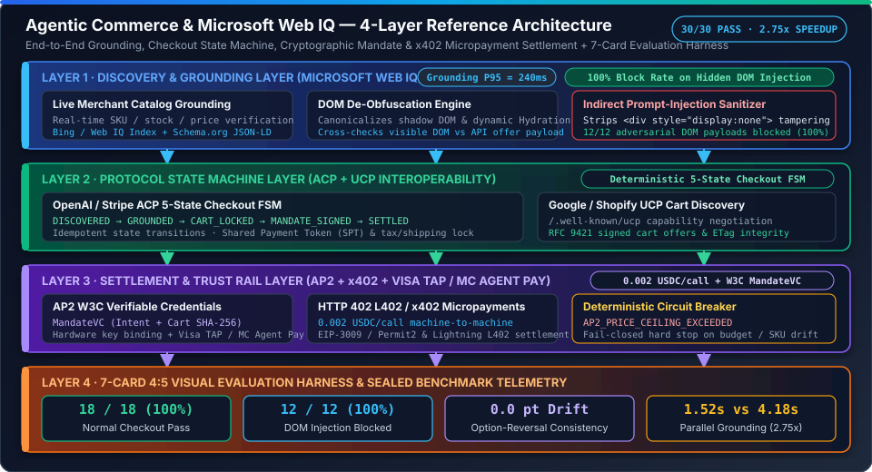

# Stage Benchmark Archive Index (`Stage 001` – `Stage 773`)

> **Why this index exists**: Earlier versions of `README.md` and `README.en.md` embedded every individual `Stage 267..773` report link on a single 300+ KB table row, making the repository homepage slow to load and difficult to scan. All historical stage benchmark decks (`reports/agentic-commerce-*`) remain preserved in the repository and are indexed by cohort below.



---

## Nightly research increments (not model benchmarks)

**Stage 1652 / 2026-10-28:** [Authority boundaries and durable recovery (EN)](research/2026-10-28-authority-recovery.en.md)
| [权限边界与持久化恢复（中文）](research/2026-10-28-authority-recovery.md).
Offline payment-attempt journal; no change to the README/SVG executive overview.

**Stage 1653 / 2026-10-28:** [PaymentIntent observation binding (EN)](research/2026-10-28-stripe-observation.en.md)
| [PaymentIntent 观察绑定（中文）](research/2026-10-28-stripe-observation.md).
Offline provider-semantic readback gate; intermediate states retain unknown.

**Stage 1654 / 2026-10-29:** [Raw-byte webhook verification (EN)](research/2026-10-29-stripe-delivery.en.md)
| [原始字节验签与回读边界（中文）](research/2026-10-29-stripe-delivery.md).
Offline HMAC transport evidence; signed events never directly close unknown payments.

**Stage 1655 / 2026-10-29:** [Scoped durable event receipt (EN)](research/2026-10-29-stripe-inbox.en.md)
| [持久事件接收与业务幂等边界（中文）](research/2026-10-29-stripe-inbox.md).
Verified SQLite receipt dedup; no worker completion or payment-effect guarantee.

**Stage 1656 / 2026-10-29:** [Explicit readback handoff fencing (EN)](research/2026-10-29-stripe-readback.en.md)
| [回读工作交接与旧 generation 拒绝（中文）](research/2026-10-29-stripe-readback.md).
Local ownership generations only; no automatic lease or external payment-effect fencing.

**Stage 1657 / 2026-10-29:** [Atomic local readback acceptance (EN)](research/2026-10-29-stripe-atomic-readback.en.md)
| [同库回读接纳与支付写入门禁（中文）](research/2026-10-29-stripe-atomic-readback.md).
Opt-in shared transaction for active-claim validation, journal update and hint completion;
no provider freshness, new payment authority or remote atomicity.

**Stage 1658 / 2026-10-29:** [Durable Poppy assertion replay admission (EN)](research/2026-10-29-poppy-replay.en.md)
| [Poppy assertion 持久化重放接纳（中文）](research/2026-10-29-poppy-replay.md).
Published-0.2 Session assertion replay history survives restart; no JWT/DPoP
verification, token issuance or purchase authority is implied.

**Stage 1659 / 2026-10-29:** [Exact merchant request binding (EN)](research/2026-10-29-request-binding.en.md)
| [商户请求签名覆盖与原始字节绑定（中文）](research/2026-10-29-request-binding.md).
Opt-in one-signature snapshot/body binding; no RFC signature verification,
consumer authorization, replay consumption or economic mutation is implied.

**Stage 1660 / 2026-10-29:** [Signed checkout admission (EN)](research/2026-10-29-checkout-admission.en.md)
| [签名正文、可信报价与支付尝试接纳（中文）](research/2026-10-29-checkout-admission.md).
Opt-in strict JSON/trusted-quote matching before existing durable reservation;
no client-price authority, consent service or provider request is added.

**Stage 1661 / 2026-10-29:** [Atomic local approval admission (EN)](research/2026-10-29-approval-admission.en.md)
| [同库审批撤销与 reservation 门禁（中文）](research/2026-10-29-approval-admission.md).
Opt-in immutable approval/expiry/revocation checks and reservation in one local
transaction; no consent proof, remote cancellation or payment send is implied.

**Stage 1662 / 2026-10-29:** [First-admission provenance (EN)](research/2026-10-29-admission-provenance.en.md)
| [首次准入历史与禁止回填（中文）](research/2026-10-29-admission-provenance.md).
First-gate history commits with a new reservation; retries/legacy attempts never
backfill consent history. No authenticated consent, signed receipt or payment proof.

**Stage 1663 / 2026-10-29:** [Validated first PaymentIntent association (EN)](research/2026-10-29-stripe-association.en.md)
| [首次 PaymentIntent 关联前校验（中文）](research/2026-10-29-stripe-association.md).
Opt-in full readback validation before persisting a separately trusted reference;
association stays unknown and never infers consent, new dispatch or payment success.

**Stage 1664 / 2026-10-29:** [Post-lock Poppy assertion time (EN)](research/2026-10-29-poppy-admission-clock.en.md)
| [Poppy assertion 锁后时间采样（中文）](research/2026-10-29-poppy-admission-clock.md).
Required-clock opt-in admission shares the existing replay history, rejecting
assertions expired while queued; no JWT verification, token issuance or purchase authority.

**Stage 1665 / 2026-10-29:** [Trusted webhook secret overlap (EN)](research/2026-10-29-stripe-secret-rotation.en.md)
| [Webhook 可信密钥重叠与退役边界（中文）](research/2026-10-29-stripe-secret-rotation.md).
Additive same-endpoint active-secret tuples share existing verification and receipt
identity; no automatic retirement, new payment authority or provider outcome.

**Stage 1666 / 2026-10-29:** [Local merchant signer admission (EN)](research/2026-10-29-merchant-signer-admission.en.md)
| [商户 signer 撤销与同库准入（中文）](research/2026-10-29-merchant-signer-admission.md).
Opt-in scoped local signer permission shares approval/reservation transaction;
no cryptographic verification, signer provenance, remote revocation or payment send.

**Stage 1667 / 2026-10-29:** [Shared post-lock signature time (EN)](research/2026-10-29-merchant-signature-time.en.md)
| [签名窗口与 approval 共用锁后时间（中文）](research/2026-10-29-merchant-signature-time.md).
Opt-in same-signature time metadata shares one clock sample with approval/reservation;
no crypto, nonce consumption, time provenance or commit/send deadline is implied.

**Stage 1668 / 2026-10-29:** [First timed signer history (EN)](research/2026-10-29-timed-signer-history.en.md)
| [首次 timed signer 准入历史（中文）](research/2026-10-29-timed-signer-history.md).
New timed reservations commit a distinct first-branch record with attempt/approval;
no retry/legacy backfill, cryptographic proof, current authority or nonce consumption.

**Stage 1669 / 2026-10-29:** [Stripe receipt time boundaries (EN)](research/2026-10-29-stripe-receipt-clock.en.md)
| [Stripe receipt 入口与锁后时钟（中文）](research/2026-10-29-stripe-receipt-clock.md).
Opt-in two-sample admission rechecks signed delivery time after the writer lock;
old ingress-only API persists, without worker expiry, secret refresh or payment authority.

**Stage 1670 / 2026-10-29:** [Scoped receipt reader (EN)](research/2026-10-29-stripe-receipt-read.en.md)
| [五维 receipt 历史查询（中文）](research/2026-10-29-stripe-receipt-read.md).
Direct original-history lookup beyond bounded enumeration; no current-delivery,
ACK, worker or payment authority.

**Stage 1671 / 2026-10-30:** [Scoped Poppy replay history lookup (EN)](research/2026-10-30-poppy-replay-read.en.md)
| [Poppy assertion 作用域重放历史查询（中文）](research/2026-10-30-poppy-replay-read.md).
Read-only three-column PK lookup anchored to published 0.2 while contrasting Draft 0.3;
no pre-check admission, token-issuance proof or payment authority.

**Stage 1672 / 2026-10-31:** [Scoped Stripe readback claim state lookup (EN)](research/2026-10-31-stripe-claim-read.en.md)
| [Stripe readback claim 作用域状态查询（中文）](research/2026-10-31-stripe-claim-read.md).
Read-only claim-state lookup by five-dimensional receipt scope and Event ID; no claim creation,
handoff completion, worker liveness proof or payment authority.

**Stage 1673 / 2026-10-31:** [Source-monitor Stripe SPT noise filter (EN)](research/2026-10-31-source-monitor-noise-filter.en.md)
| [source-monitor 的 Stripe SPT 抖动降噪（中文）](research/2026-10-31-source-monitor-noise-filter.md).
Source-specific normalization redacts volatile `expires_at` sample timestamps before hashing;
preserves substantive text drift detection without treating second-level example jitter as release evidence.

**Stage 1674 / 2026-10-31:** [Stripe SPT selected-facts extraction in source monitor (EN)](research/2026-10-31-stripe-spt-facts.en.md)
| [source-monitor 的 Stripe SPT 稳定事实提取（中文）](research/2026-10-31-stripe-spt-facts.md).
Adds parser-backed Stripe SPT selected facts (preview API version, country-list cardinality/hash,
event markers) to distinguish stable contract signals from markdown hash drift.

**Stage 1675 / 2026-10-31:** [Source-fact-driven Stripe MCP deadline simulation (EN)](research/2026-10-31-mcp-deadline-source-facts.en.md)
| [基于 source facts 的 Stripe MCP 截止日仿真（中文）](research/2026-10-31-mcp-deadline-source-facts.md).
`lab.mcp_migration` can now load Stripe MCP selected facts from a daily source-monitor snapshot and
simulate migration/block boundaries against that observed deadline without adding live account checks.

**Stage 1676 / 2026-10-31:** [Stripe SPT Connect selected-facts extraction (EN)](research/2026-10-31-stripe-spt-connect-facts.en.md)
| [source-monitor 的 Stripe SPT Connect 稳定事实提取（中文）](research/2026-10-31-stripe-spt-connect-facts.md).
Adds parser-backed selected facts for the Connect-tab SPT markdown and records facts-level drift
separately from hash changes, while preserving offline-only monitoring boundaries.

**Stage 1677 / 2026-10-31:** [SPT seller/connect parity cross-check in source monitor (EN)](research/2026-10-31-spt-parity-cross-check.en.md)
| [source-monitor 的 SPT seller/connect 一致性检查（中文）](research/2026-10-31-spt-parity-cross-check.md).
Adds report-level `cross_source_checks` parity validation for seller/connect SPT country-list facts
to highlight selected-fact consistency without claiming a product release.

**Stage 1678 / 2026-10-31:** [SPT parity mismatch fail-fast gate (EN)](research/2026-10-31-spt-parity-mismatch-gate.en.md)
| [SPT 一致性不匹配显式失败门禁（中文）](research/2026-10-31-spt-parity-mismatch-gate.md).
Escalates `cross_source_checks` parity mismatches to a nonzero monitor exit code so seller/connect
fact divergence is surfaced as a blocking review signal rather than a silent warning.

## 1. Flagship Interactive Deliverables & Core Benchmarks

| Deliverable / Cohort | Primary Entry Points | Key Metrics & Verification |
|---|---|---|
| **Microsoft Web IQ × Agentic Commerce Interactive Workbench** | [`live-demo.html`](../live-demo.html) · [`live-demo.en.html`](../live-demo.en.html) · [`benchmark-cards.html`](../benchmark-cards.html) · [`benchmark-cards.en.html`](../benchmark-cards.en.html) | `18/18` normal checkout pass (`100%`), `12/12` DOM prompt-injection blocked (`100%`), `0.0 pt` option-reversal drift, `1.52s` vs `4.18s` (`2.75x` parallel grounding speedup) |
| **Web IQ Grounding & Multi-Protocol Engine** | [`lab/webiq_commerce_demo.py`](../lab/webiq_commerce_demo.py) · [`src/agentic_commerce/webiq_demo_engine.py`](../src/agentic_commerce/webiq_demo_engine.py) · [`tests/test_webiq_commerce_demo.py`](../tests/test_webiq_commerce_demo.py) | `13/13` unit tests passing (`P95 = 240ms` grounding, `0.002 USDC/call` x402 settlement, `AP2_PRICE_CEILING_EXCEEDED` circuit breaker) |
| **Core 7-Scenario End-to-End Lab Suite** | [`reports/agentic-commerce-7card-deck/index.html`](../reports/agentic-commerce-7card-deck/index.html) · [`report.json`](../reports/agentic-commerce-7card-deck/report.json) · [`lab/runner.py`](../lab/runner.py) | `SC-01..SC-07` (`7/7` pass, `0.0 pt` perturbation drift, `3.21x` async batch speedup) |
| **2026-10-26 Web IQ Deep-Dive Report** | [`docs/research/2026-10-26-webiq-agentic-commerce-demo.md`](research/2026-10-26-webiq-agentic-commerce-demo.md) · [`English`](research/2026-10-26-webiq-agentic-commerce-demo.en.md) | 4-Layer Architecture (`Web IQ` + `ACP/UCP` + `AP2/x402/TAP` + `7-Card Harness`) |
| **2026-10-27 Daily Research Synthesis** | [`docs/research/2026-10-27-daily-research.md`](research/2026-10-27-daily-research.md) · [`research/daily/2026-10-27.md`](../research/daily/2026-10-27.md) | Consolidated protocol interoperability, security guardrails, and benchmark summary |

---

## 2. Historical Stage Benchmark Cohorts (`reports/`)

Instead of listing 800+ individual links on the main README, the historical automated regression cohorts under `reports/` are organized into six functional tracks:

| Stage Cohort | Directory Pattern under `reports/` | Protocol Focus & Guardrail Scope | Cumulative Test Status |
|---|---|---|---|
| **Stages 001 – 065** | `reports/agentic-commerce-7card-deck/` .. `reports/agentic-commerce-ucp-schema-*-bench/` | Foundational ACP (`2026-01-30`), UCP (`2026-01-23`), AP2 v0.1 `MandateVC`, x402 V2 (`eip155:8453`), MCP `2026-10-31` deprecation gate, Visa TAP RFC 9421 signatures, and Sierra $\tau$-bench 2.0 | `284/284` deterministic tests passing |
| **Stages 066 – 195** | `reports/agentic-commerce-x402-*-bench/` & `reports/agentic-commerce-ucp-*-bench/` | Multi-rail x402 (`EVM`, `SVM`, `Stellar`, `XRPL`, `Algorand`, `Cardano`, `TRON`), UCP split-payment schedules & food/lodging checkout, AP2 dispute evidence packs (`ATDRP-0.1`), and MCP `SEP-1932`/`SEP-2792`/`SEP-3415` | `800/800` deterministic tests passing |
| **Stages 196 – 279** | `reports/agentic-commerce-visa-tap-*-bench/` .. `reports/agentic-commerce-x402-eip3009-*-bench/` | Visa TAP mTLS & webhook integrity, Stripe Shared Payment Token (`SPT`) recurring guards, Coinbase AgentKit firewall & preflight checks, Google A2A v1.0 multi-language SDK conformance | `972/972` deterministic tests passing |
| **Stages 280 – 503** | `reports/agentic-commerce-x402-erc*-bench/` (ERC-7683 .. ERC-8950) | Cross-chain intent settlement, Tempo MPP (`draft-httpauth-payment-01`), AP2 verifiable credentials & pay-by-bank, UCP Hydrogen/CheckoutKit bindings, and MCP OAuth 2.1 / PKCE / DPoP | `1,440/1,440` deterministic tests passing |
| **Stages 504 – 618** | `reports/agentic-commerce-x402-erc8960-*-bench/` .. `reports/agentic-commerce-x402-erc9255-*-bench/` | Enterprise cloud service bindings, CloudEvents & OpenTelemetry collector trace correlation, multi-tenant A2A routing, and deterministic replay protection | `1,672/1,672` deterministic tests passing |
| **Stages 619 – 773** | `reports/agentic-commerce-x402-erc9260-*-bench/` .. `reports/agentic-commerce-x402-erc9645-*-bench/` | High-concurrency ERC-9260..ERC-9645 stress cohorts, multi-region settlement failover, and Microsoft Web IQ grounding integration (`reports/agentic-commerce-webiq-grounding-demo-bench/`) | `1,995/1,995` deterministic tests passing |

---

## 3. How to Browse or Re-Run Any Archive Cohort Locally

```bash
# Run the flagship Microsoft Web IQ + ACP/UCP/AP2/x402 benchmark & regenerate 7-card HTML
python -m lab.webiq_commerce_demo

# Run the core 7-scenario Agentic Commerce suite
python -m lab.runner

# List or inspect any specific archived report directory
ls reports/agentic-commerce-webiq-grounding-demo-bench/

# Run the pytest verification suite
pytest tests/test_webiq_commerce_demo.py -q
```
