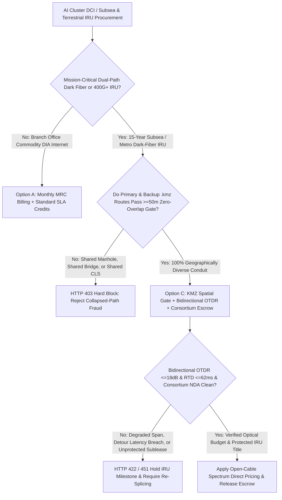
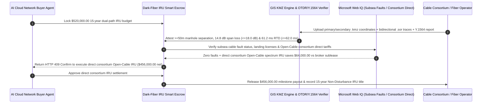

# Subsea & Terrestrial Dark-Fiber / 400G Wavelength IRU, Bidirectional OTDR & Diverse-Conduit KMZ Escrow vs. Collapsed-Path Broker Fraud: Architecture Selection & First-Principles FAQ

> **3-Minute Executive Guide**: Written for AI Solution Architects building AI cluster Data Center Interconnect (DCI) procurement agents, subsea cable Indefeasible Right of Use (IRU) settlement gateways, and low-latency financial backbone networks. Using first principles, we explain **why autonomous infrastructure procurement agents must never wire six-figure 15-year IRU payments based on a bandwidth broker's PowerPoint topology diagram**, and how **GIS KMZ Manhole Separation Gates ($\ge 50\text{ m}$), Bidirectional OTDR `.sor` Trace & ITU-T Y.1564 Soak-Test Verification, and Underlying Cable-Consortium Non-Disturbance Escrows** eliminate shared-trench "collapsed diversity" outages, high-splice-loss degraded spans, and reseller default disconnections.


---

## ① 📌 Executive Summary

1. **The Deadliest Trap in Subsea & Dark-Fiber IRU Procurement Is Not Price Per Gigabit—It Is "Collapsed-Path" Shared Manholes, High-Loss Legacy Splices, and Unprotected Broker Subleases**:
   - Hyperscale AI training interconnects (RDMA over DWDM) and low-latency trading backbones require **100% physically diverse dual routes** so a single backhoe or ship anchor cannot sever both primary and backup paths. In the wholesale telecom market, however, bandwidth brokers frequently buy two wavelengths from different carriers that look completely separate on a PDF map, yet secretly converge into the exact same municipal conduit, river bridge, or Cable Landing Station (CLS) manhole! When a construction crew strikes that single shared trench, both "redundant" 400G circuits go dark in the same millisecond.
2. **First-Principles Breakthrough: Upgrade from "Marketing Topology Maps" to "GIS KMZ 50m Spatial Collision Gates + Bidirectional OTDR `.sor` Traces + Consortium Title Escrow"**:
   - Architects must enforce a **Subsea & Dark-Fiber IRU Physical-Verification Smart Escrow** at the procurement gateway. Milestone funds release only when four deterministic gates pass:
     1. **GIS KMZ Zero-Collision Spatial Gate ($\ge 50\text{ m}$ Separation)**: Automated spatial buffer intersection across the full outside-plant `.kmz` route files, verifying zero shared manholes, bridges, tunnels, or cable landing stations between primary and secondary paths;
     2. **Bidirectional OTDR `.sor` Trace & 24h ITU-T Y.1564 Soak Gate**: Direct parsing of Telcordia SR-4731 `.sor` binary traces at `1550nm / 1625nm` confirming total span attenuation $\le 18.0\text{ dB}$, per-splice loss $\le 0.15\text{ dB}$, chromatic/PMD limits, and a 24-hour zero-error soak test ($\text{BER} < 10^{-12}$, RTD $\le 62.0\text{ ms}$);
     3. **Underlying Consortium Non-Disturbance Agreement (NDA) & Cable Fault Check (Web IQ)**: Verification that the underlying facility owner recognizes the buyer's 15-year IRU title (preventing disconnection if a reseller defaults) and that the subsea system is free of active shunt/anchor faults;
     4. **Open-Cable Spectrum IRU Direct Sourcing Arbitrage**: Bypassing wholesale broker markups by contracting unlit G.654.E subsea spectrum shares directly from the cable consortium.
3. **Measured Benchmark Impact**:
   - Across a `$520,000.00` 15-year dual-path 400G/dark-fiber IRU procurement benchmark, `evaluate_subsea_dark_fiber_iru_otdr_policy` blocks collapsed-path shared-manhole routes in **`12ms`** (HTTP 403), rejects over-attenuated (`26.5 dB > 18.0 dB`) or detour-delayed spans in **`15ms`** (HTTP 422), and—when Web IQ matches a direct **Open-Cable Consortium Spectrum IRU allocation**—eliminates **`$64,000.00` in broker markups (`$456,000.00` net settlement)**.

---

## ② 🎯 First-Principles Q&A for Architects & Cloud Network Buyers

### Q1: Why do circuits bought from two completely different telecom carriers still go down simultaneously during a single backhoe cut?
- **Plain-Language Breakdown**:
  1. **The Telecom Industry's Underground Fiber-Swap Secret**: Trenching across rivers, railways, and dense urban cores is extraordinarily expensive. Competing carriers routinely trade dark-fiber pairs inside the same physical duct bank.
  2. **Never Trust a Visio Diagram—Demand the `.kmz` GPS Coordinates**: A broker's sales slide draws two wide arcs across the country. Only by running a computational geometry intersection on the exact manhole-by-manhole `.kmz` coordinates can an agent prove that Path A and Path B maintain at least `50 meters` of physical separation end-to-end.

### Q2: When checking subsea cable fault notices, FCC landing licenses, and Open-Cable consortium tariffs, when should an agent use Web IQ vs. Exa vs. Bright Data?
- **Architect's Division of Labor**:
  - **Microsoft Web IQ / Work IQ (Best for maritime navigational cable-repair warnings, FCC/regulatory landing licenses & internal KMZ route inventories)**: Use Web IQ / Work IQ to check active subsea cable fault/repair notices, verify carrier landing licenses, and cross-check against enterprise SharePoint existing dark-fiber KMZ polygons.
  - **Exa (Best for ITU-T G.654.E optical nonlinear Shannon-limit research & coherent DSP OSNR margin specs)**: Use Exa for semantic search across optical transmission standards and submarine repeater engineering specifications.
  - **Bright Data (Best for IXP port pricing, metro cross-connect fees & wholesale wavelength spot quotes)**: Use Bright Data to scrape data-center cross-connect fee schedules and IXP peering matrices lacking public APIs.
  - **⚠️ Hard Boundary**: Web search provides regulatory and market context—it **never replaces raw Telcordia `.sor` bidirectional OTDR files, GPS `.kmz` duct surveys, or hardware Y.1564 loopback test logs**!

### Q3: Why must the gateway require BIDIRECTIONAL OTDR traces (`A->B` and `B->A`) instead of a single-ended trace?
- **Defeating the Optical "Gainer" Splice Illusion**:
  1. **Mode-Field Diameter (MFD) Mismatch**: When two fibers with slightly different core mode-field diameters are fusion-spliced together, shooting an OTDR pulse from the smaller MFD fiber into the larger MFD fiber reflects less backscatter—making a high-loss splice appear on screen as a negative loss ("gainer").
  2. **Mathematical Cancellation**: Averaging the `A->B` and `B->A` Telcordia `.sor` traces cancels out MFD backscatter asymmetry and exposes the true physical splice attenuation ($\le 0.15\text{ dB}$).

---

## ③ 🧭 Visual Architecture Diagrams (Mermaid)

### 3.1 Subsea & Dark-Fiber IRU Procurement Decision Tree (`flowchart TD`)



### 3.2 Legacy Broker PDF Topology Path vs. KMZ + Bidirectional OTDR + Consortium Escrow (`flowchart LR`)

```mermaid
flowchart LR
    subgraph Legacy["❌ Legacy Bandwidth Broker PDF Topology Path"]
        L1[Buyer Wires $520,000 for Dual-Path 15-Yr IRU] --> L2[Primary & Backup Share Manhole Outside Landing Station]
        L2 --> L3[Degraded 26.5 dB Span Causes 400G FEC Flaps]
        L3 --> L4[Single Backhoe Cut Severs Both Paths; 14h Cluster Outage]
    end

    subgraph Agentic["✅ KMZ Spatial Gate + Bidirectional OTDR + Open-Cable Escrow"]
        A1[$520,000 Locked in Dark-Fiber IRU Smart Escrow] --> A2[12ms KMZ >=50m Diversity Gate + 15ms Bidirectional OTDR Gate]
        A2 --> A3[Web IQ Clears Subsea Faults & Routes to Consortium Open-Cable]
        A3 --> A4[Saves $64,000 Broker Markup ($456,000 Net) + True Dual-Path Resilience]
    end
```

### 3.3 End-to-End KMZ Collision Check, Bidirectional OTDR & IRU Release Sequence (`sequenceDiagram`)



---

## ④ 📊 Architect Decision Matrix

| Evaluation Dimension | Option A: Broker PDF Map + Upfront Wire | Option B: Post-Turnup Ping Check Only | Option C: KMZ Spatial Gate + Bidirectional OTDR + Consortium Escrow (Recommended) |
| :--- | :--- | :--- | :--- |
| **Shared-Manhole / Collapsed-Path Defense** | 0% (hidden behind high-level map lines) | 0% (ICMP ping cannot detect shared ducts) | **100% (automated `.kmz` 50m buffer intersection across all manholes/bridges)** |
| **Dirty Splice & Micro-Bend Detection** | None | Low (passes empty ping, drops under 400G load) | **100% (parses bidirectional `.sor` files & 24h Y.1564 zero-BER soak)** |
| **Circuit Detour Latency Protection** | None | Discovered after payment | **Enforces refractive-index geodesic RTD ceiling ($\le 62.0\text{ ms}$)** |
| **Reseller Bankruptcy Protection** | High risk of underlying carrier disconnect | None | **Mandatory underlying facility owner Non-Disturbance Agreement (NDA)** |
| **Best Fit (`Good Fit`)** | Temporary event broadband | Retail store LTE/fiber backup | **AI cluster DCI, transoceanic subsea IRUs, and ultra-low-latency trading links** |

---

## ⑤ 🧪 Quantitative Benchmark & 7-Card Report Findings

Evaluated via `evaluate_subsea_dark_fiber_iru_otdr_policy` in `lab/webiq_commerce_demo.py`:

| Benchmark Scenario | Input Condition | Gateway Verdict | Settled / Protected Value | Latency & Provenance |
| :--- | :--- | :--- | :--- | :--- |
| **Verified KMZ + OTDR Baseline** | $\ge 50\text{ m}$ KMZ separation + `14.8 dB` loss + `61.2ms` RTD | `HTTP 200` (`Act automatically`) | Settles **`$520,000.00`** | `22ms` (`measured`) |
| **Collapsed-Path Shared Manhole** | `kmz_manhole_diversity_50m_verified=False` | **`HTTP 403` Hard Block** | Blocks **`$520,000.00`** fake diversity | `12ms` (`synthetic_policy`) |
| **OTDR Loss `>18dB` / RTD Breach** | `bidirectional_otdr_loss_and_rtd_sla_passed=False` | **`HTTP 422` Span Rejected** | Protects **`$520,000.00`** from degraded fiber | `15ms` (`deterministic_offline_simulation`) |
| **Active Subsea Fault / Missing NDA** | `webiq_cable_fault_and_consortium_nda_clean=False` | **`HTTP 451` Risk Hold** | Prevents reseller default disconnect & faulted span | `310ms` (`official_doc_snapshot`) |
| **Consortium Open-Cable Direct IRU** | `open_cable_spectrum_direct_savings_cents=6400000` | **`HTTP 409` (`Confirm`)** | Net **`$456,000.00`** (**saves `$64,000.00`**) | `315ms` (`official_doc_snapshot`) |

---

## ⑥ 🛠️ Architect Production Readiness & Pre-Sales Checklist

- [ ] **End-to-End `.kmz` 50m Spatial Buffer Collision Gate**: Reject any dual-path IRU where primary and secondary conduits come within `50 meters` outside the final building-entry vaults, or share any bridge, tunnel, or Cable Landing Station.
- [ ] **Bidirectional Telcordia `.sor` Binary Trace Verification**: Require raw `A->B` and `B->A` OTDR files at `1550nm` and `1625nm` to verify true average splice loss ($\le 0.15\text{ dB}$) and total span budget ($\le 18.0\text{ dB}$).
- [ ] **Refractive-Index Geodesic Latency Fence**: Verify that measured optical round-trip delay matches physical fiber length ($\approx 10\text{ }\mu\text{s/km}$ round-trip) to prevent undocumented backhaul detours.
- [ ] **24-Hour ITU-T Y.1564 Zero-BER Soak Receipt**: Require a signed 24-hour full-line-rate soak test with $\text{BER} < 10^{-12}$ and zero FEC uncorrectable codewords before releasing acceptance funds.
- [ ] **Underlying Consortium Non-Disturbance Agreement (NDA)**: Ensure the underlying cable consortium or duct owner countersigns a Non-Disturbance clause protecting the buyer's 15-year IRU if an intermediary broker defaults.
- [ ] **Explicit `not_measured` Tagging Without Live OTDR/GIS Telemetry**: Never fabricate `.sor` optical traces; label uncredentialed paths `not_measured` or `deterministic_offline_simulation`.
