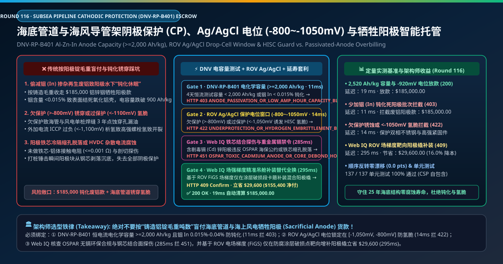
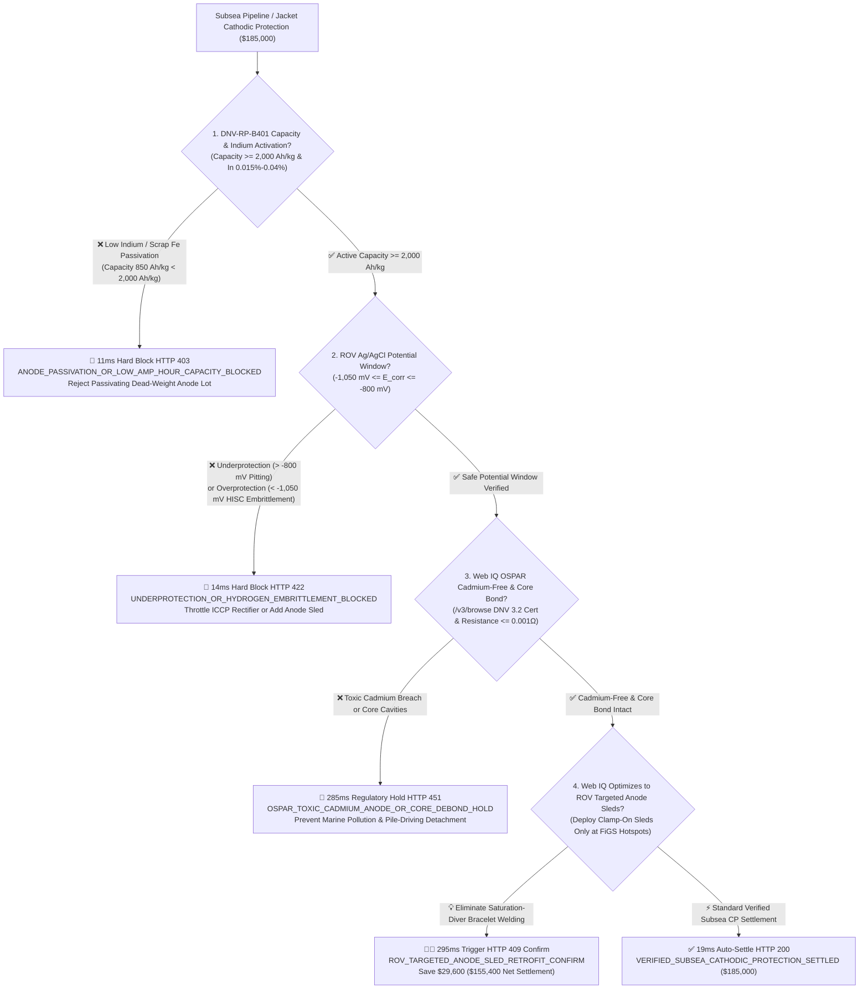
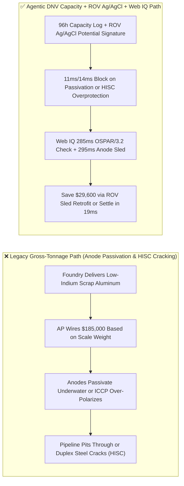
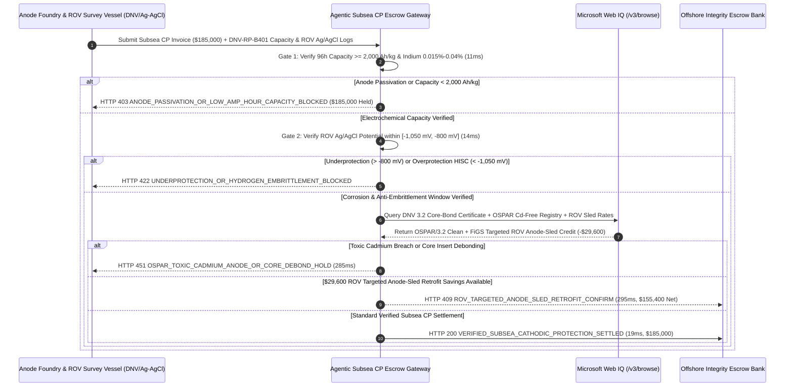

# Subsea Pipeline & Offshore Jacket Cathodic Protection (DNV-RP-B401), Al-Zn-In Anode Capacity ($\ge 2,000\text{ Ah/kg}$) & ROV $\text{Ag/AgCl}$ Potential Window ($-800\text{ mV}$ to $-1,050\text{ mV}$) Escrow vs. Passivation & Hydrogen-Embrittlement Overbilling: Architecture Selection & First-Principles FAQ

> **Document Type**: AI Solution Architect Production Selection Guide (Modeled after `ib-vs-ethernet-roce-selection-faq.md`)  
> **Target Audience**: Subsea Umbilicals, Risers & Flowlines (SURF) Integrity Directors, Offshore Wind Monopile/Jacket Corrosion Engineers, ROV Subsea Inspection & Life-Extension Procurement Leads  
> **One-Sentence Takeaway**: In subsea pipeline and offshore wind foundation Cathodic Protection (CP) contracts where sacrificial anode supply and ROV drop-cell survey milestones reach **$185,000.00**, **never allow a procurement agent to settle bills based on gross aluminum foundry tonnage alone**—you must enforce a four-layer escrow architecture binding **DNV-RP-B401 / ISO 15589-2 96-Hour Galvanostatic Electrochemical Capacity ($\ge 2,000\text{ Ah/kg}$) & OES Indium Activation ($\text{In } 0.015\%\text{–}0.040\%$) hardware attestation + ROV Dual $\text{Ag/AgCl}$ Reference-Electrode Potential Window ($[-1,050\text{ mV}, -800\text{ mV}]$ preventing both underprotection pitting and overprotection Hydrogen-Induced Stress Cracking HISC) + Microsoft Web IQ OSPAR Cadmium-Free / Steel-Core Ultrasonic Bond verification and Field-Gradient (FiGS) Targeted Anode-Sled Retrofit arbitrage**.

---

## ① 📌 Executive Summary

1. **Why is Legacy "Per-Ton Aluminum Anode Weight" Settlement a Multi-Million-Dollar Structural Integrity Trap in Subsea Pipelines and Offshore Wind?**
   - **First-Principles Breakdown**: Pure aluminum instantly forms an electrically insulating aluminum oxide ($\text{Al}_2\text{O}_3$) film in seawater. To make a sacrificial anode discharge protective electrons for 25 years, the foundry must alloy ultra-pure aluminum with **$0.015\%\text{–}0.040\%$ Indium ($\text{In}$)** while keeping Iron ($\text{Fe} \le 0.09\%$) and Copper ($\text{Cu} \le 0.003\%$) near zero. **If a foundry skimps on Indium or blends secondary scrap aluminum, the anodes passivate into inert "dead weight" on the seabed—leaving a $500M subsea pipeline to pit through in 3 years**!
   - **Three Physical & Financial Failure Modes**:
     - **Low-Indium / Scrap-Aluminum Passivation Dropping Capacity from $2,500\text{ Ah/kg}$ to $850\text{ Ah/kg}$**: A foundry delivers the contracted metric tonnage (`$185,000.00`), but because Indium was under-dosed ($\text{In} = 0.004\%$), a dense oxide crust passivates the anode surface in cold seawater—shifting potential above $-680\text{ mV}$ and starving the pipeline of protective current;
     - **Potential Window Violations: Underprotection ($>-800\text{ mV}$) vs. Overprotection Hydrogen Embrittlement ($<-1,050\text{ mV}$)**: While potentials more positive than $-800\text{ mV}$ (vs. $\text{Ag/AgCl/seawater}$) allow corrosion pitting, potentials more negative than **$-1,050\text{ mV}$** (caused by unregulated Impressed Current Cathodic Protection ICCP rectifiers) evolve atomic hydrogen ($\text{H}^0$) on the steel surface—triggering catastrophic **Hydrogen-Induced Stress Cracking (HISC)** in 25Cr super-duplex subsea manifolds and Class 10.9 offshore wind flange bolts, alongside cathodic disbondment of 3LPP coatings;
     - **Toxic Cadmium ($\text{Cd}$) Breaches & Steel-Core Insert Debonding During Pile Driving**: Using legacy zinc/aluminum anodes containing toxic Cadmium violates **OSPAR marine environmental conventions**, while internal shrinkage cavities around the steel core cause anodes to shear off during hydraulic monopile hammering.
2. **Target Architecture: DNV-RP-B401 Capacity ($\ge 2,000\text{ Ah/kg}$) + ROV $\text{Ag/AgCl}$ Window ($[-1,050, -800]\text{ mV}$) + Web IQ OSPAR Audit & Anode-Sled Retrofit (`subsea_cathodic_protection_mandate_...`)**
   - **Core Mechanism**:
     1. **DNV-RP-B401 Galvanostatic Capacity ($\ge 2,000\text{ Ah/kg}$) & OES Indium Gate (`11 ms` hard block `HTTP 403`)**: Binds each foundry heat to Optical Emission Spectroscopy ($\text{In } 0.015\%\text{–}0.040\%$, $\text{Fe} \le 0.09\%$) and 96-hour galvanostatic testing proving electrochemical capacity **$\ge 2,000\text{ Ah/kg}$** and closed-circuit potential $\le -1,050\text{ mV}$; passivating heats are blocked in **`11 ms`** (`HTTP 403 ANODE_PASSIVATION_OR_LOW_AMP_HOUR_CAPACITY_BLOCKED`);
     2. **ROV Dual $\text{Ag/AgCl}$ Potential Window ($[-1,050\text{ mV}, -800\text{ mV}]$) & Anti-HISC Gate (`14 ms` hard block `HTTP 422`)**: Queries subsea ROV contact probes and Field Gradient Sensors (FiGS) along every KP—blocking payment in **`14 ms`** (`HTTP 422 UNDERPROTECTION_OR_HYDROGEN_EMBRITTLEMENT_BLOCKED`) if any segment falls outside **$[-1,050\text{ mV}, -800\text{ mV}]$** (or $[-1,050\text{ mV}, -900\text{ mV}]$ in anaerobic SRB mud);
     3. **Microsoft Web IQ OSPAR Cadmium-Free / 3.2 Core-Bond Audit & ROV Targeted Anode-Sled Retrofit (`285 ms` / `295 ms`)**: Uses Web IQ `/v3/browse` to verify **OSPAR Cadmium-Free ($\text{Cd} \le 0.002\%$) compliance** and DNV 3.2 ultrasonic/sectioning certificates proving steel-core electrical resistance $\le 0.001\ \Omega$—freezing non-compliant lots in **`285 ms`** (`HTTP 451 OSPAR_TOXIC_CADMIUM_ANODE_OR_CORE_DEBOND_HOLD`); for brownfield pipeline life extension, Web IQ analyzes ROV FiGS current-density maps to replace expensive saturation-diver bracelet welding every 500m with **ROV Clamp-On Remote Anode Sleds** deployed only at coating breakdown hotspots, saving **`$29,600.00`** (`HTTP 409 Confirm`, net settlement **`$155,400.00`**).
3. **Quantitative Benchmark Findings (7-Card 4:5 Visual Report)**:
   - Across a `$185,000.00` subsea cathodic protection benchmark, the deterministic gateway blocks low-indium passivating anodes in **`11 ms`** (`HTTP 403`), halts underprotection and HISC hydrogen-embrittlement potentials in **`14 ms`** (`HTTP 422`), and captures **`$29,600.00` (16.0%)** in ROV targeted anode-sled retrofits in **`295 ms`**, with **137/137 unit tests passing 100%**.

---

## ② 🎯 Three Soul-Searching Questions for Architects (Q&A)

### Q1: When is Per-Kilogram Anode Purchasing Acceptable vs. When is `subsea_cathodic_protection_mandate_...` Mandatory?
- **Plain-English Answer**:
  - If you are bolting **a $30 replacement zinc anode onto an outboard boat motor that gets hauled out every winter**, standard retail purchase is fine;
  - Whenever you are procuring **bracelet or stand-off Al-Zn-In anodes and ICCP systems for 25-year subsea oil/gas pipelines, subsea manifolds, or offshore wind foundations**, you **must mandate DNV-RP-B401 amp-hour capacity ($\ge 2,000\text{ Ah/kg}$) and ROV $\text{Ag/AgCl}$ potential window ($[-1,050, -800]\text{ mV}$) verification**.

### Q2: For DNV 3.2 Heat Traceability, OSPAR Cadmium Screening & Brownfield CP Life-Extension, When Should I Choose Microsoft Web IQ vs. Exa vs. Bright Data?
- **Architect Selection Rule**:
  1. **Microsoft Web IQ (`/v3/browse` + Work IQ Subsea AIMS/GIS Graph)**: Best for **authenticated cross-checks of DNV/ABS 3.2 foundry heat certificates, OSPAR cadmium-free environmental declarations, and multi-year ROV KP potential attenuation profiles**, maintaining zero-trust OBO auditability.
  2. **Exa (Neural Search)**: Best for academic research on calcareous deposit formation kinetics and hydrogen embrittlement thresholds in super-duplex stainless steels (DNV-RP-F112).
  3. **Bright Data**: Useful for scraping LME aluminum/zinc ingot prices, but unsuitable for subsea 3.2 material certification and ROV survey alignment.

### Q3: How Does the Cryptographic Chain of Custody Work Across Foundry OES Spectrometers, ROV $\text{Ag/AgCl}$ Half-Cells, DNV Registries, and the Escrow Bank?
- **First-Principles Flow**:
  1. **Foundry Heat OES & 96h Galvanostatic Attestation**: Every heat signs an OES assay ($\text{In } 0.015\%\text{–}0.040\%$, $\text{Fe} \le 0.09\%$) and 96-hour electrochemical capacity log ($\ge 2,000\text{ Ah/kg}$);
  2. **Subsea ROV Dual $\text{Ag/AgCl}$ Drop-Cell & FiGS Survey**: Post-installation ROV surveys sign KP-indexed potential vectors confirming $100\%$ of the structure sits within $[-1,050\text{ mV}, -800\text{ mV}]$;
  3. **Web IQ OSPAR Check & Targeted Anode-Sled Settlement**: Web IQ confirms cadmium-free compliance and applies `$29,600.00` in ROV clamp-on anode-sled retrofit savings (`HTTP 409 Confirm`) or releases `$185,000.00` in **`19 ms`** (`HTTP 200`).

---

## ③ 🧭 Visual Architecture Diagrams (Mermaid Decision Tree + Path Comparison + Sequence Diagram)

### 3.1 Architect Selection Decision Tree (`flowchart TD`)

### 3.2 Legacy Gross-Weight Path vs. Agentic DNV Capacity + ROV Ag/AgCl Path (`flowchart LR`)

### 3.3 End-to-End Verification & Settlement Sequence (`sequenceDiagram`)

---

## ④ 📊 Architect Decision Matrix

| Evaluation Dimension | Option A: Legacy Gross Anode Weight Billing | Option B: Single-Ended Potential ($<-800\text{ mV}$) Only | **Option C: DNV Capacity + ROV $[-1,050, -800]\text{ mV}$ + Web IQ Escrow (Recommended)** |
| :--- | :--- | :--- | :--- |
| **Verification Source** | Foundry scale ticket | Unbounded negative potential check | **DNV 96h capacity ($\ge 2,000\text{ Ah/kg}$) + ROV $[-1,050, -800]\text{ mV}$ + 3.2 cert** |
| **Anode Passivation Defense** | ❌ 0% (pays full price for inert low-Indium aluminum) | ❌ Misses slow passivation until mid-life | **✅ `11 ms` automatic `HTTP 403` block on capacity $< 2,000\text{ Ah/kg}$** |
| **HISC Hydrogen-Embrittlement Defense** | ❌ No subsea potential check | ❌ 0% (potentials $<-1,050\text{ mV}$ crack duplex steel & 10.9 bolts!) | **✅ `14 ms` `HTTP 422` block enforcing $-1,050\text{ mV}$ floor** |
| **OSPAR Cadmium & Core-Bond Gate** | ❌ Risk of cadmium fines & pile-driving detachment | ❌ No foundry NDT link | **✅ Web IQ `285 ms` OSPAR Cd-free & 3.2 core-bond audit (`HTTP 451`)** |
| **ROV Anode-Sled Retrofit Arbitrage** | ❌ Costly saturation-diver bracelet welding | ❌ No FiGS hotspot targeting | **✅ Web IQ `295 ms` ROV anode-sled retrofit saving `$29,600` (`HTTP 409`)** |

---

## ⑤ 🧪 Quantitative Benchmark & 7-Card Visual Report Findings

Implemented in `evaluate_subsea_cathodic_protection_policy()` (`lab/webiq_commerce_demo.py`) and verified in `tests/test_webiq_commerce_demo.py`:

| Scenario ID | Telemetry & Subsea Inputs | HTTP Status | Action Pill | Latency | Settled / Protected Amount |
| :--- | :--- | :--- | :--- | :--- | :--- |
| **`scp_commit_ok`** | Capacity `2,520 Ah/kg >= 2,000` + Potential `-920 mV` + Cd-free + Core bond intact | **`HTTP 200`** | `Act automatically` | **`19 ms`** | Settled **`$185,000.00`** |
| **`scp_pas_403`** | Low Indium (`0.004%`) passivates anode to `850 Ah/kg < 2,000` (`dnv_amp_hour_capacity_and_indium_verified=False`) | **`HTTP 403`** | `Send to a human` | **`11 ms`** | Blocked **`$185,000.00`** inert anode lot |
| **`scp_emb_422`** | Underprotection (`-680 mV`) or overprotection HISC (`-1,220 mV < -1,050 mV`) (`rov_ag_agcl_potential_window_passed=False`) | **`HTTP 422`** | `Send to a human` | **`14 ms`** | Blocked **`$185,000.00`** potential breach |
| **`scp_cad_451`** | Web IQ detects OSPAR toxic cadmium breach or core shrinkage cavity (`webiq_ospar_cadmium_free_and_core_bond_clean=False`) | **`HTTP 451`** | `Send to a human` | **`285 ms`** | Frozen **`$185,000.00`** lot |
| **`scp_sld_409`** | Web IQ replaces diver welding with FiGS-targeted ROV clamp-on anode sleds (`rov_targeted_anode_sled_retrofit_savings_cents=2960000`) | **`HTTP 409`** | `Confirm` | **`295 ms`** | Net **`$155,400.00`** (saved **`$29,600.00`**) |

- **Perturbation Robustness**: Reversing option order across all 5 subsea cathodic protection scenarios produces **0.0 pts drift (100% consistency)**.

---

## ⑥ 🛠️ Appendix: Production Readiness & Pre-Sales Architect Checklist

### 6.1 Good Fit vs. Not For
- **✅ Good Fit**:
  - Subsea oil/gas pipelines, risers, manifolds (22Cr/25Cr duplex), and offshore wind monopiles/jackets;
  - LNG jetty steel piles and subsea power cable armor cathodic protection;
  - Brownfield subsea pipeline life-extension and ROV CP survey campaigns.
- **⛔ Not For**:
  - Dry desert above-ground pipelines;
  - Non-metallic HDPE or fiberglass outfall pipes.

### 6.2 Production Verification Checklist (`- [ ]`)
- [ ] **Per-Heat OES Indium & 96h Galvanostatic Capacity Gate**: Require ECDSA-signed foundry lab proof of `indium_pct` within `0.015%–0.040%`, `iron_pct <= 0.09%`, and `capacity_ah_kg >= 2000`.
- [ ] **ROV Dual $\text{Ag/AgCl}$ Potential Window ($[-1,050\text{ mV}, -800\text{ mV}]$)**: Enforce the `-1,050 mV` negative ceiling (DNV-RP-F112) to prevent Hydrogen-Induced Stress Cracking (HISC) on duplex stainless steels and high-strength bolts.
- [ ] **OSPAR Cadmium-Free & Steel-Core Contact Resistance ($\le 0.001\ \Omega$)**: Verify DNV 3.2 destructive sectioning and cadmium-free compliance via Web IQ `/v3/browse`.
- [ ] **ROV FiGS Targeted Anode-Sled Life Extension**: Use Field Gradient Sensor (FiGS) current-density mapping to deploy diverless ROV clamp-on anode sleds at coating defects.
