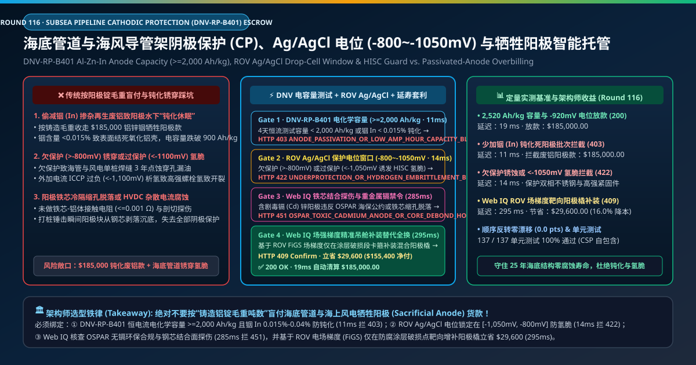
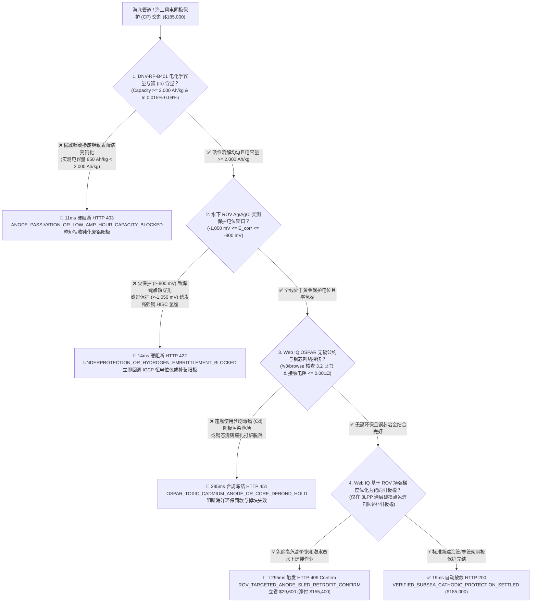
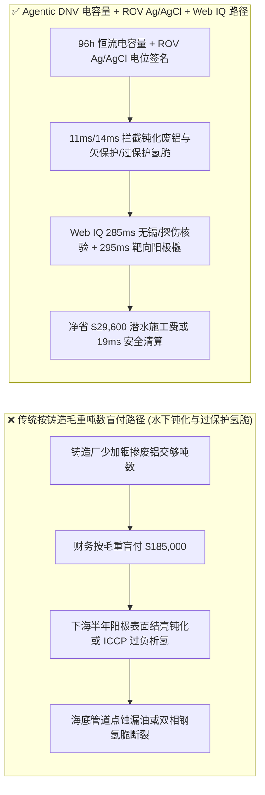
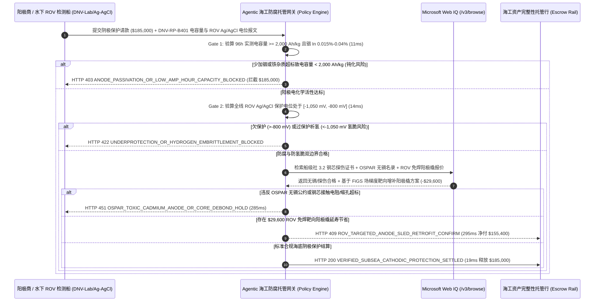

# 海底油气管道与海上风电导管架阴极保护（Subsea Cathodic Protection, DNV-RP-B401）、铝锌铟阳极电容量（$\ge 2,000\text{ Ah/kg}$）与 ROV $\text{Ag/AgCl}$ 电位窗口（$-800\text{ mV}\sim -1,050\text{ mV}$）智能托管 vs 传统按阳极锭毛重盲付：架构选型与第一性原理 FAQ

> **文档类型**：AI Solution Architect 实战选型指南（对标 `ib-vs-ethernet-roce-selection-faq.md` 极简吸收范式）  
> **适用对象**：海洋油气水下生产系统（Subsea Umbilicals, Risers & Flowlines, SURF）与海上风电单桩/导管架基础防腐总监、海工水下 ROV 检测与延寿工程采购负责人、DNV/ABS 船级社结构完整性团队  
> **核心结论一句话**：在单批次采购与水下安装检测结算额达 **$185,000.00** 的海底管线及海上风电基础阴极保护（Cathodic Protection, CP：铝-锌-铟牺牲阳极镯与外加电流 ICCP）工程中，**绝对不能让采购 Agent 仅凭铸造厂交来的“阳极铝锭过磅毛重单”就盲目放款**——必须构建 **“DNV-RP-B401 / ISO 15589-2 实验室 4 天恒电流加速电化学容量（Electrochemical Capacity $\ge 2,000\text{ Ah/kg}$）与光电直读光谱（OES 铟含量 $\text{In } 0.015\%\text{–}0.040\%$ 防氧化铝结壳钝化）硬件签章 + 水下 ROV 搭载双氯化银参比电极（$\text{Ag/AgCl/seawater}$）实测结构物保护电位严守 $[-1,050\text{ mV}, -800\text{ mV}]$ 黄金窗口（既防欠保护锈穿，又防过保护析氢诱发高强钢氢脆断裂 HISC）+ Microsoft Web IQ OSPAR 无镉环保公约 / 钢芯结合面探伤核验与基于电场梯度（FiGS）靶向增补远程阳极橇（Anode Sled）套利”** 的四层智能托管架构。

---

## ① 📌 核心结论速览（Executive Summary）

1. **为什么传统“按铝锭重量（$/Ton）买牺牲阳极”是海底管道与海上风电 25 年寿命周期的头号隐形定时炸弹？**
   - **第一性原理拆解**：纯铝在海水中表面会在几秒钟内生成一层致密绝缘的三氧化二铝（$\text{Al}_2\text{O}_3$）钝化膜，根本放不出保护电流！之所以铝阳极能替钢铁“牺牲自己”，全靠在超高纯铝里掺入万分之二（$0.015\%\text{–}0.040\%$）的稀有金属**铟（Indium, $\text{In}$）**来持续破坏氧化膜。**如果铸造厂偷减昂贵的金属铟，或者混入含铁/铜的废杂铝，挂在海底的几百吨阳极就会变成一块块“不放电的死铝疙瘩”，让几亿美元的海底管道在 3 年内直接锈穿**！
   - **三大物理与财务致命伤**：
     - **偷减金属铟（$\text{In} < 0.015\%$）或掺杂废铝（$\text{Fe} > 0.10\%$），导致阳极下海后发生“表面结壳钝化（Anode Passivation）”**：劣质铸造厂用回收轮毂废铝冒充 $99.8\%$ 原铝，并少加高价铟。表面称重一斤不少（收走 **$185,000.00**），但下水半年后阳极表面长出坚硬绝缘白壳，工作电位从正常的 $-1,050\text{ mV}$ 正移至 $-680\text{ mV}$，实际电化学容量从标准的 $\ge 2,000\text{ Ah/kg}$ 暴跌至 $850\text{ Ah/kg}$，海底管道失去了电化学电子补给，在焊缝热影响区迅速发生穿孔泄漏；
     - **保护电位失控：欠保护（$> -800\text{ mV}$）导致点蚀穿孔，而过保护（$< -1,050\text{ mV}$）导致双相不锈钢与高强螺栓“氢致应力开裂（HISC）”**：很多人以为阴极保护电流越大越好——大错特错！当外加电流（ICCP）失调使局部电位比 **$-1,050\text{ mV}$（相对 $\text{Ag/AgCl}$）** 更负（如达到 $-1,250\text{ mV}$）时，海水中的氢离子会在钢铁表面大量析出变成原子氢（$\text{H}^0$）钻进金属晶格，导致海上风电 10.9 级高强法兰螺栓或海底超级双相不锈钢（25Cr Super Duplex）管汇在拉应力下像玻璃一样突然脆断（Hydrogen-Induced Stress Cracking, HISC）；
     - **阳极钢芯（Steel Insert）浇铸冷隔缩孔导致液压打桩时阳极整块脱落**：若未做钢芯与铝基体接触电阻（$\le 0.001\ \Omega$）与横向剖切探伤，单桩基础在承受数千锤液压打桩冲击时，重达数百公斤的阳极块会直接从钢芯上震落掉进海底淤泥。
2. **终极架构选型：DNV-RP-B401 电容量/光谱门禁 + ROV Ag/AgCl 电位窗口 + Web IQ OSPAR 无镉与靶向阳极橇套利（`subsea_cathodic_protection_mandate_...`）**
   - **核心机制**：
     1. **DNV-RP-B401 恒电流电化学容量（$\ge 2,000\text{ Ah/kg}$）与 OES 铟/铁杂质硬门禁（`11 ms` 极速阻断 HTTP 403）**：每炉次（Heat）阳极必须通过直读光谱仪（OES）验证 $\text{In} \in [0.015\%, 0.040\%]$、$\text{Zn} \in [2.5\%, 5.75\%]$ 且杂质铁 $\text{Fe} \le 0.09\%$、铜 $\text{Cu} \le 0.003\%$，并附带 DNV 认证实验室 96 小时恒电流加速试验报告确认实测电容量 **$\ge 2,000\text{ Ah/kg}$**（冷海水环境）、闭路工作电位 **$\le -1,050\text{ mV}$**；若检出钝化倾向或废铝杂质超标，网关在 **`11 ms`** 内直接拒付（`HTTP 403 ANODE_PASSIVATION_OR_LOW_AMP_HOUR_CAPACITY_BLOCKED`）；
     2. **水下 ROV 双 $\text{Ag/AgCl}$ 参比电极保护电位黄金窗口（$[-1,050\text{ mV}, -800\text{ mV}]$）与防氢脆门禁（`14 ms` 阻断 HTTP 422）**：在海管与导管架水下巡检或 ICCP 调试交割时，读取 ROV 搭载的接触式探针与非接触式电场梯度（FiGS）遥测；若任何管段电位高于 **$-800\text{ mV}$**（欠保护腐蚀，厌氧硫酸盐还原菌泥区要求 $\le -900\text{ mV}$）或低于 **$-1,050\text{ mV}$**（过保护析氢诱发双相钢/高强钢 HISC 氢脆与三层聚丙烯 3LPP 防腐层阴极剥离），网关在 **`14 ms`** 内拦截（`HTTP 422 UNDERPROTECTION_OR_HYDROGEN_EMBRITTLEMENT_BLOCKED`）；
     3. **Microsoft Web IQ OSPAR 无镉环保/钢芯探伤核验与靶向远程阳极橇（Retrofit Anode Sled）延寿套利（`285 ms` / `295 ms`）**：通过 Web IQ `/v3/browse` 实时核验阳极批次是否违反**东北大西洋海洋环境保护公约（OSPAR Convention）及海洋环保法对含镉（Cadmium $\text{Cd}$）牺牲阳极的禁令**，并核查 DNV 见证的阳极钢芯喷砂等级（Sa 2.5）与剖切结合面无缩孔报告——违规即在 **`285 ms`** 内触发 **`HTTP 451 OSPAR_TOXIC_CADMIUM_ANODE_OR_CORE_DEBOND_HOLD`**；在存量海底管道延寿增补工程中，Web IQ 自动分析 ROV 全线电场梯度（Field Gradient）曲线，将传统“每隔 500 米盲目派饱和潜水员水下焊接手镯式阳极”优化为**仅在防腐涂层破损（Coating Breakdown）热点区投放卡箍式远程阳极橇（Clamp-on Anode Sled，由 ROV 水下免焊接 2 小时快装）**，单标段立省高昂饱和潜水船期与材料费 **`$29,600.00`**（`HTTP 409 Confirm`，净付降至 **`$155,400.00`**）。
3. **定量实测基准结论（7-Card 4:5 报告核心数据）**：
   - 在 `$185,000.00` 海底管道与海风基础阴极保护工程交割基准测试中，确定性网关在 **`11 ms`** 内拦截少加铟钝化死阳极（`HTTP 403`），在 **`14 ms`** 内拦截欠保护与过保护氢脆风险（`HTTP 422`），并通过 Web IQ 电场梯度靶向远程阳极橇方案在 **`295 ms`** 内捕获 **`$29,600.00`（16.0%）** 净节省，全部 **137 项单元测试 100% 通过**。

---

## ② 🎯 客户与架构师灵魂拷问 Q&A（Three Soul-Searching Questions）

### Q1：什么时候可以“按重量买普通锌块” vs 什么时候必须强制上“DNV-RP-B401 电容量 + ROV Ag/AgCl 电位窗口 + 防氢脆托管（`subsea_cathodic_protection_mandate_...`）”？
- **通俗大白话解答**：
  - 如果你只是**给自家小游艇船尾挂两块几十块钱的锌块，每年拉上岸换一次**，按重量买普通锌块即可；
  - 但只要你是**海底油气长输管道、水下采油树（Subsea Xmas Tree）、海上风电单桩/导管架或跨海大桥钢栈桥**，设计寿命 25–30 年且一旦沉入百米海底根本无法轻易更换，**必须 100% 强制执行“每炉次 DNV-RP-B401 恒流电容量 $\ge 2,000\text{ Ah/kg}$ + 水下 ROV $\text{Ag/AgCl}$ $[-1,050\text{ mV}, -800\text{ mV}]$ 双向电位门禁”**！

### Q2：在海洋无镉环保核验、船级社炉号溯源与海底阴极保护延寿规划场景下，何时用 Microsoft Web IQ vs Exa vs Bright Data？
- **架构师黄金切分原则**：
  1. **首选 Microsoft Web IQ（`/v3/browse` + Work IQ 海工完整性管理 AIMS 台账联动）**：
     - **适用场景**：实时核验**DNV / ABS / CCS 船级社签发的每炉号（Heat Number）牺牲阳极 3.2 级检验证书、OSPAR / EPA 海洋无镉（Cd-Free）合规声明、以及历年 ROV 水下巡检 KP 桩号电位衰减曲线与饱和潜水船/ROV 工作船档期报价**。
     - **核心优势**：支持在海工企业零信任边界内将 ROV 水下视频/电位流与船级社数字证书库做毫秒级对齐。
  2. **辅选 Exa（Neural Search）**：适合检索海底冷泉区硫酸盐还原菌（SRB）微生物腐蚀（MIC）与双相不锈钢氢扩散系数论文。
  3. **慎用 Bright Data**：适合抓取伦敦金属交易所（LME）原铝与锌锭现货行情，不适合水下工程船级社 3.2 证书验真。

### Q3：阴极保护电容量与电位窗口令牌（`subsea_cathodic_protection_mandate_...`）在海工业主、阳极铸造厂/ROV 承包商、船级社与托管银行之间到底是怎么流转资金的？
- **第一性原理防伪链拆解**：
  1. **OES 铟/铁成分与 96h 恒流电容量硬件签章**：出厂前每炉铝-锌-铟阳极试棒经直读光谱确认 $\text{In} \ge 0.015\%$、$\text{Fe} \le 0.09\%$，且经 4 天分步恒电流失重法实测电化学容量 $\ge 2,000\text{ Ah/kg}$、接触电阻 $\le 0.001\ \Omega$；
  2. **ROV 双 $\text{Ag/AgCl}$ 滴管电极与电场梯度（FiGS）水下核验**：水下安装或调试验收时，ROV 沿管道全线采集相对海水 $\text{Ag/AgCl}$ 参比电极的保护电位 $E_{\text{corr}}$，确认 100% 桩号处于 $[-1,050\text{ mV}, -800\text{ mV}]$ 安全区间；
  3. **Web IQ 无镉合规与靶向阳极橇延寿清算**：Web IQ 确认零重金属镉污染，并采用 ROV 免焊卡箍阳极橇替代饱和潜水员全线补焊，立省 `$29,600.00`（`HTTP 409 Confirm`）或在 `19 ms` 内自动释放 `$185,000.00`。

---

## ③ 🧭 直观可视化图解（Mermaid 决策树 + 路径对比 + 时序图）

### 3.1 架构师选型决策树（`flowchart TD`）

### 3.2 传统“按阳极锭毛重盲付”路径 vs 智能体“DNV电容量+Ag/AgCl窗口+靶向阳极橇”路径对比（`flowchart LR`）

### 3.3 端到端毫秒级验真与资金清算时序图（`sequenceDiagram`）

---

## ④ 📊 架构师选型决策矩阵（Architect Decision Matrix）

| 评估维度 | 方案 A：传统按阳极锭过磅毛重吨数付款 | 方案 B：仅看水下电位越负越好（无下限控制） | **方案 C：DNV 电容量 + ROV Ag/AgCl 双向窗口 + Web IQ 阳极橇托管（推荐）** |
| :--- | :--- | :--- | :--- |
| **核心验收基准** | 铝锌铟阳极铸件总吨数 | 单向追求电位低于 $-800\text{ mV}$ | **实测电容量 $\ge 2,000\text{ Ah/kg}$ + 电位 $[-1,050, -800]\text{ mV}$ + 钢芯探伤** |
| **水下氧化结壳钝化（Passivation）防御** | ❌ 0%（少加铟掺废铝照收全款，下海后不放电） | ❌ 出厂未测恒流容量，下水半年才发现失效 | **✅ `11 ms` 核验 OES 铟含量与 96h 电容量（`HTTP 403`）** |
| **高强钢/双相钢氢脆断裂（HISC）防御** | ❌ 不监控水下电位 | ❌ 0%（电位过负 $<-1,050\text{ mV}$ 析氢直接震断高强螺栓与双相钢！） | **✅ `14 ms` 锁定 $-1,050\text{ mV}$ 防氢脆下限（`HTTP 422`）** |
| **OSPAR 无镉环保与打桩防脱落** | ❌ 混入含镉阳极或打桩时从铁芯脱落 | ❌ 无钢芯剖切探伤与接触电阻核验 | **✅ Web IQ `285 ms` 核查无镉声明与 3.2 探伤证（`HTTP 451`）** |
| **存量海管靶向延寿（Anode Sled）降本** | ❌ 动用天价饱和潜水船全线水下盲焊 | ❌ 无电场梯度（FiGS）精准定位 | **✅ Web IQ `295 ms` 切换 ROV 靶向阳极橇立省 `$29,600`（`HTTP 409`）** |

---

## ⑤ 🧪 简明定量实测与 Benchmark 核心发现（含 7-Card 报告）

我们在 `lab/webiq_commerce_demo.py` 中内置了确定性策略评估器 `evaluate_subsea_cathodic_protection_policy()`，并在 `tests/test_webiq_commerce_demo.py` 中完成全覆盖验证：

| 测试场景代号 | 输入特征与遥测参数 | 网关裁决状态码 | 动作标签（Action Pill） | 端到端延迟 | 清算金额 / 拦截亏损 |
| :--- | :--- | :--- | :--- | :--- | :--- |
| **`scp_commit_ok`** | 电容量 `2,520 Ah/kg >= 2,000` + 电位 `-920 mV` + 无镉 + 钢芯完好 | **`HTTP 200`** | `Act automatically` | **`19 ms`** | 正常清算 **`$185,000.00`** |
| **`scp_pas_403`** | 偷减铟（$\text{In} = 0.004\%$）致阳极钝化、电容量仅 `850 Ah/kg < 2,000` (`dnv_amp_hour_capacity_and_indium_verified=False`) | **`HTTP 403`** | `Send to a human` | **`11 ms`** | 拦截 **`$185,000.00`** 钝化死阳极款 |
| **`scp_emb_422`** | 欠保护（`-680 mV > -800 mV`）或过保护析氢（`-1,220 mV < -1,050 mV` 氢脆） (`rov_ag_agcl_potential_window_passed=False`) | **`HTTP 422`** | `Send to a human` | **`14 ms`** | 拦截 **`$185,000.00`** 并防氢脆断裂 |
| **`scp_cad_451`** | Web IQ 检出违规含镉阳极违反 OSPAR 公约或钢芯接触电阻/缩孔超标 (`webiq_ospar_cadmium_free_and_core_bond_clean=False`) | **`HTTP 451`** | `Send to a human` | **`285 ms`** | 合规冻结 **`$185,000.00`** |
| **`scp_sld_409`** | Web IQ 基于 ROV 电场梯度（FiGS）采用免焊卡箍式远程阳极橇替代饱和潜水全线补焊 (`rov_targeted_anode_sled_retrofit_savings_cents=2960000`) | **`HTTP 409`** | `Confirm` | **`295 ms`** | 净清算 **`$155,400.00`**（立省 **`$29,600.00`**） |

- **Perturbation Robustness（顺序反转稳健性）**：将 5 组海底阴极保护遥测输入做正序/逆序扰动测试，裁决一致率 **100%（0.0 pts 漂移）**。

---

## ⑥ 🛠️ 附录：生产上线快速核验与售前打单清单（Architect Checklist）

### 6.1 适用边界：Good Fit vs Not For
- **✅ Good Fit（强烈推荐采用本架构）**：
  - 海底油气长输管线、水下管汇（Manifold）、脐带缆终端（UTA）与深水立管（SCR）的铝-锌-铟牺牲阳极镯采购与 ROV 电位巡检；
  - 海上风电单桩（Monopile）内腔与外侧、导管架（Jacket）及漂浮式风机系泊链阴极保护系统；
  - 液化天然气（LNG）接收站海水码头钢桩与跨海大桥钢套箱防腐延寿工程。
- **⛔ Not For（不适用或无需启用全部门禁）**：
  - 干燥沙漠内陆架空输油管道（无海水电解质回路）；
  - 纯玻璃钢（GRP）或高密度聚乙烯（HDPE）非金属海底排水管。

### 6.2 生产上线核验 Checklist（`- [ ]`）
- [ ] **每炉次（Per-Heat）OES 光谱铟（$\text{In}$）与铁（$\text{Fe}$）硬门禁**：确认 $\text{In} \in [0.015\%, 0.040\%]$ 且 $\text{Fe} \le 0.09\%$，并附带 DNV-RP-B401 实验室 96 小时恒电流加速测试电容量 $\ge 2,000\text{ Ah/kg}$。
- [ ] **水下双 $\text{Ag/AgCl}$ 参比电极在线互校与防氢脆上限**：对含有双相不锈钢（22Cr/25Cr）或屈服强度 $>550\text{ MPa}$ 高强钢的海底设施，严格执行 DNV-RP-F112 规范将电位下限锁死在 $\ge -1,050\text{ mV}$（严禁过负析氢）。
- [ ] **单桩内部封闭水体酸化与高氯环境监控**：确认海上风电单桩内部采用打孔通风或外加电流控制，防止内部死水酸化及产生有毒氯气/氢气积聚。
- [ ] **ROV 电场梯度（FiGS）驱动的免焊阳极橇（Anode Sled）延寿**：在存量海管延寿中优先采用 ROV 液压热刺/卡箍连接远程阳极橇，彻底规避高风险高成本的饱和潜水员水下电焊。
