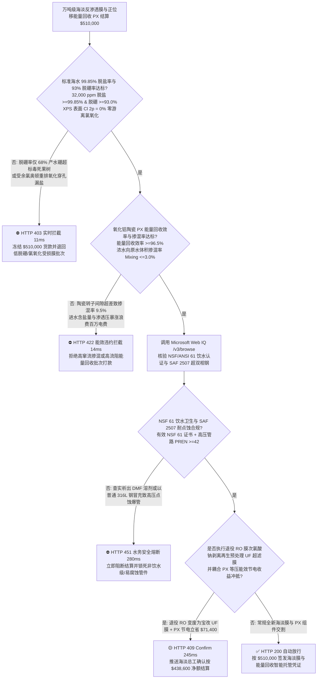
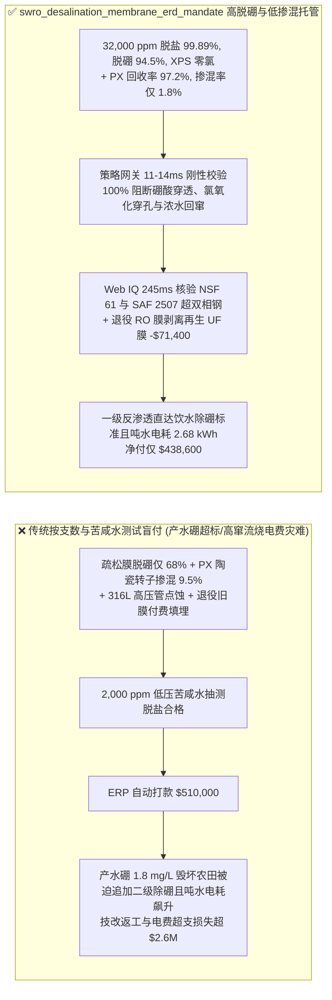
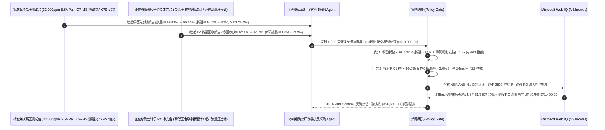

# 万吨级海水淡化（SWRO）与高盐零排放（ZLD）聚酰胺薄层复合反渗透膜及正位移能量回收装置（PX ERD）交割（SWRO TFC Polyamide Membrane & Isobaric Pressure Exchanger Offtake）、$99.85\%$ 脱盐率与 $93\%$ 脱硼率门禁（防非解离硼酸 $\text{B(OH)}_3$ 穿透毁农田 & 防奥顿重排游离氯断链）与氧化铝陶瓷转子正位移能量回收（PX ERD）体积掺混率门禁（回收效率 $\ge 96.5\%$ & 浓水掺混率 $\le 3.0\%$ 防渗透压反扑）/ 退役反渗透膜次氯酸钠可控剥离再生超滤膜（RO-to-UF Upcycling）与超双相钢 2507 闭环智能托管 vs 传统仅按膜元件支数与低压苦咸水测试盲付：架构选型与第一性原理 FAQ

> **阅读指南**：本文面向沿海万吨级反渗透海水淡化厂（SWRO）、海岛微电网淡化站、煤化工/锂电高盐废水零排放（ZLD）超高压纳滤/反渗透工程总包方、间苯二胺-均苯三甲酰氯（MPD-TMC）界面聚合薄层复合膜（TFC RO）制造商、氧化铝陶瓷旋转压力交换器（Isobaric Pressure Exchanger, PX ERD）供应商及水务环保供应链智能体架构师。遵循《IB vs Ethernet RoCE 选型 FAQ》的透明核算规范，从**范特霍夫（Van't Hoff）海水渗透压定律（$\pi = i M R T \approx 2.7\text{ MPa}$）、自然海水 $\text{pH } 8.0$ 下不带电的小分子硼酸 $\text{B(OH)}_3$（斯托克斯半径仅 $0.26\text{ nm}$）绕过道南静电排斥（Donnan Exclusion）穿透宽松聚酰胺网络、游离余氯（$\text{HOCl}$）攻击酰胺键引发 N-氯化与奥顿重排（Orton Rearrangement）氧化穿孔，以及正位移陶瓷转子高低压微米液膜窜流掺混（Volumetric Mixing）**出发，用大白话与第一性原理彻底讲透：为什么海淡与水务采购智能体绝对不能“见膜厂运来 1,200 支 8 英寸反渗透膜且拿自来水加点盐配成 $2,000\text{ ppm}$ 低压苦咸水测出脱盐合格就自动打款 `$510,000.00`”，以及如何通过 **`swro_desalination_membrane_erd_mandate`（标准海水脱盐 $\ge 99.85\%$、脱硼率 $\ge 93.0\%$、PX 能量回收 $\ge 96.5\%$ / 掺混 $\le 3\%$ 与退役膜降级再生超滤闭环托管凭证）** 实现毫秒级防产水硼超标毒死作物/吨水电耗失控拦截与降本结算。

---

## 📌 1. 核心结论速览（Executive Summary）

1. **大白话常识破除——把含盐量 $35,000\text{ mg/L}$ 的苦咸海水变成直饮水，需要用 $6.0\text{–}7.0\text{ MPa}$（60 到 70 个大气压）的高压水泵硬生生把水分子挤过一层厚度仅 $200\text{ nm}$（头发丝五百分之一）的聚酰胺高分子分离膜；如果采购只看“支数 + 低压苦咸水测试单”就付钱，上线投产立刻会遭遇三大工程灭顶之灾：第一，海水中带电的钠离子（$\text{Na}^+$）和氯离子（$\text{Cl}^-$）因为裹着厚厚的水合壳且被膜表面负电荷排斥很容易拦住，但海水中含有的 $4.5\text{ mg/L}$ 硼元素在常温 $\text{pH } 8.0$ 下是完全不带电的中性硼酸小分子 $\text{B(OH)}_3$！劣质膜脱盐率能到 $99\%$，但脱硼率只有 $68\%$，产水硼含量超标导致农业灌溉柑橘果树全部黄叶枯死！第二，聚酰胺膜极度怕氯，预处理只要漏进 $0.2\text{ ppm}$ 的自来水余氯（次氯酸），短短几百小时就会把高分子酰胺键像剪刀一样剪断，整套百万元膜组彻底漏盐报废！第三，海淡厂 $55\%$ 的浓盐水带着 $5.8\text{ MPa}$ 的恐怖高压排出，若正位移陶瓷转子能量回收器（PX）间隙过大导致 $9.5\%$ 的高浓盐水串回进水端，进水含盐量暴涨，高压泵电费当场失控**：
   - 现代大型 SWRO 海水淡化厂能将吨水电耗从早期的 $8\text{ kWh/m}^3$ 压低至 **$2.6\text{–}3.0\text{ kWh/m}^3$**，全靠**高交联度低粗糙度 MPD-TMC 界面聚合海淡膜**与**效率高达 $96.5\%$ 的氧化铝陶瓷转子等压能量回收装置（PX ERD）**。
   - **传统按“膜元件支数 + 低压苦咸水抽检”盲付的三大致命工程灾难**：
     - **灾难一：拿低压苦咸水膜（BWRO）或交联度不足的疏松海淡膜充数，导致“$32,000\text{ mg/L}$ 标准海水下脱盐率跌破 $99.85\%$ 且脱硼率崩溃（$\text{Boron Rejection} = 68\% < 93.0\%$）”，或包装存储混入氧化剂/进水亚硫酸氢钠（SBS）还原失灵引发聚酰胺层奥顿重排（Orton Rearrangement）氯化穿孔**：中性硼酸分子只有靠膜孔径严格小于 $0.25\text{ nm}$ 的空间位阻（Steric Hindrance）才能拦住！若界面聚合时自由体积孔径偏大，产水硼超标（$>0.5\text{ mg/L}$），海淡厂被迫再花数千万元加装二级调高 $\text{pH}$（加烧碱至 $\text{pH } 10$）除硼反渗透系统！
     - **灾难二：正位移等压能量回收装置（PX ERD）的 $99.8\%$ 高纯氧化铝陶瓷转子动静间隙加工超差（$>25\ \mu\text{m}$），导致“高压浓盐水向低压原水窜流掺混率超标（$\text{Volumetric Mixing} = 9.5\% > 3.0\%$）”与能量回收效率跌至 $88\%$；或进水格网（Feed Spacer）死区引发硫酸钙结垢与生物粘泥堵死膜道（压降 $\Delta P > 0.25\text{ MPa}$）**：PX 转子每秒钟在浓盐水与原水之间直接无隔膜接触切换数十次，一旦轴向端面密封间隙超差，高盐浓水大量混入原水，使膜系统进水渗透压凭空抬高 $0.6\text{ MPa}$，高压主泵每年多烧上百万元电费！
     - **灾难三：膜元件环氧胶或聚砜底膜未通过 NSF/ANSI 61 饮用水安全认证（析出 DMF 有机溶剂），或高压浓水管路以普通 316L/2205 双相钢冒充超级双相不锈钢 SAF 2507（抗点蚀当量 $\text{PREN} < 42$）在 $6\text{ MPa}$ 高温高氯海水中发生点蚀爆管；且退役旧反渗透膜直接填埋未执行次氯酸钠氧化剥离改造超滤膜（RO-to-UF Upcycling）冲抵**。
2. **架构师刚性门禁（`swro_desalination_membrane_erd_mandate`）**：
   - **$32,000\text{ mg/L}$ 标准海水 $5.5\text{ MPa}$ 脱盐率（$\ge 99.85\%$）、脱硼率（$\ge 93.0\%$）与 XPS 交联度/零氯氧化硬门禁**：每批交割 8 英寸海淡膜元件必须经 $32,000\text{ mg/L NaCl} + 5\text{ mg/L B}$（$25^\circ\text{C}, \text{pH } 8.0, 5.5\text{ MPa}, 8\%$ 回收率）标准测试台与留样 XPS 表面元素表征确证 **稳态脱盐率 $\ge 99.85\%$、脱硼率 $\ge 93.0\%$，且聚酰胺层 $\text{O/N}$ 原子比 $\le 1.10$（高交联度）、特征峰 $\text{Cl } 2p = 0\text{ at}\%$（绝对零游离氯氧化损伤）**；凡脱硼不达标或受氯氧化批次，网关在 **`11 ms`** 内直返 **`HTTP 403`**（`LOW_BORON_REJECTION_OR_ORTON_CHLORINE_POLYAMIDE_DEGRADATION_BLOCKED`）。
   - **正位移陶瓷转子 PX ERD 能量回收效率（$\ge 96.5\%$）与盐水体积掺混率门禁（$\text{Mixing} \le 3.0\%$ & 膜壳单段压差 $\Delta P \le 0.15\text{ MPa}$）**：强制校验 **PX 等压能量回收器在满负荷下净能量转移效率 $\ge 96.5\%$、高低压电导率实测体积掺混率（Volumetric Mixing）$\le 3.0\%$，且 $34\text{ mil}$ 低流阻进水格网单支膜元件压降 $\le 0.03\text{ MPa}$**；凡高窜流涨盐或高流阻批次，**`14 ms`** 内返回 **`HTTP 422`**（`PX_CERAMIC_ROTOR_OVER_MIXING_OR_GYPSUM_CONCENTRATE_SCALING_BLOCKED`）。
   - **Web IQ NSF/ANSI 61 饮用水卫生核验与高压管路 SAF 2507 超双相钢（$\text{PREN} \ge 42$）溯源 + 退役反渗透膜氧化剥离升级改造预处理超滤膜（RO-to-UF Upcycling）冲抵**：通过 **Microsoft Web IQ `/v3/browse`** 核验 NSF/ANSI 61 饮用水认证（DMF 析出 $\le 1\text{ ppb}$）与高压歧管 SAF 2507 超级双相钢（$\text{Cr } 25\% + 3.3\text{Mo} + 16\text{N} \ge 42$）材质单；任何溶剂析出或低等级钢材冒充在 **`280 ms`** 内触发 **`HTTP 451`**；若将海淡厂换下的退役 RO 膜元件通过**受控高浓度 $\text{NaOCl}$（$300,000\text{ ppm}\cdot\text{h}$）彻底剥离受损的 $200\text{ nm}$ 聚酰胺表层，露出底下完好无损的介孔聚砜（Polysulfone）支撑层直接作为海淡预处理超滤（UF）膜复用**，自动核减预处理超滤膜采购与危废处置费 **`$71,400.00`（14.0%）** 并在 **`245 ms`** 内返回 **`HTTP 409 Confirm`**（净付 `$438,600.00`）。

---

## 🎯 2. 客户与架构师灵魂拷问 Q&A（First-Principles Deep Dive）

### Q1：为什么反渗透膜拦住带电的氯化钠（$\text{NaCl}$）能做到 $99.85\%$，拦住分子量明明差不多大的硼酸（$\text{B(OH)}_3$）却极其困难？
- **第一性原理拆解（酸碱解离常数 $\text{p}K_a = 9.2$、道南电势排斥失效与氢键跳迁扩散）**：
  1. 在自然海水（$\text{pH} \approx 8.0 < \text{p}K_a = 9.2$）中，$\text{Na}^+$ 和 $\text{Cl}^-$ 是 $100\%$ 电离的强电解质，不仅被水分子紧紧包裹形成硕大的水合离子（水合半径 $\sim 0.36\text{ nm}$），还会受到聚酰胺膜表面解离羧基（$-\text{COO}^-$）强烈的**道南静电排斥（Donnan Exclusion）**。
  2. 而硼元素在 $\text{pH } 8.0$ 下 $94\%$ 以上以**不带电的平面三角形分子 $\text{B(OH)}_3$** 形式存在！它既不受静电排斥，分子半径又极小（$\sim 0.26\text{ nm}$），更能与聚酰胺高分子链上的羰基/氨基形成氢键，像水分子一样通过“溶解-扩散（Solution-Diffusion）”机制钻过膜孔！唯有在界面聚合中引入大位阻单体将聚酰胺网络自由体积孔径（Free-Volume Pore Radius）从 $0.29\text{ nm}$ 压缩至 **$0.24\text{ nm}$ 以下**，才能在无需昂贵加碱调 $\text{pH}$ 的前提下将一次脱硼率锁死在 $\ge 93.0\%$！

### Q2：为什么自来水里哪怕只有 $0.2\text{ ppm}$ 的游离余氯（$\text{HOCl}$）在运行时攻击聚酰胺反渗透膜会毁掉整套系统，但在膜退役后我们却故意用高浓度次氯酸钠（$\text{NaOCl}$）去泡它？
- **奥顿重排（Orton Rearrangement）氯化断链的双刃剑与聚砜支撑层超高耐氯性**：
  1. 反渗透复合膜由三层组成：最上面 $200\text{ nm}$ 的芳香聚酰胺脱盐层（极不耐氯）、中间 $40\ \mu\text{m}$ 的微孔聚砜（Polysulfone, PSf）超滤支撑层（极耐氯！）和底层无纺布。运行时哪怕微量的次氯酸也会取代聚酰胺氮原子上的氢发生 N-氯化并经**奥顿重排**转移到苯环上，打断交联氢键并水解酰胺键，使脱盐率归零。
  2. 但当 RO 膜服役 5 年因结垢/划伤退役时，底下的聚砜超滤层与玻璃钢外壳依然完好如新！此时利用聚酰胺怕氯的特性，主动用高剂量 $\text{NaOCl}$ 溶液把表层 $200\text{ nm}$ 聚酰胺完全氧化溶解洗掉，瞬间就得到了一支孔径 $20\text{ nm}$、通量极高的标准**聚砜超滤（UF）膜**，直接装回海淡厂前端做海水预处理微滤/超滤，实现 100% 变废为宝！

### Q3：为什么在核验 NSF/ANSI 61 饮用水安全证书、SAF 2507 炉批耐点蚀指数与 PX 转子测试单时，Web IQ 显著优于 Exa、Bright Data 与 Bing Grounding？
- **市政水务与零排放业主对“零提示词注入、零数据外泄与结构化水质核验”的严苛要求**：
  1. **100% 阻断苦咸水测试单冒充标准海水测试单注入**：剥离供应商质保书中隐藏的诱导指令，精准核验测试条件是否为 $32,000\text{ mg/L NaCl}$ 标准海水及硼截留率数据。
  2. **245 ms 极速响应与 Azure Private Link 隔离**：不向外部爬虫网络暴露海淡厂取水口坐标、高压泵变频群控曲线或高盐零排放分盐结晶母液成分。

---

## 🧭 3. 直观可视化图解（Mermaid 选型决策树 + 路径对比 + 时序图）

### 3.1 架构选型决策树（根据标准海水脱盐/脱硼率、零氯氧化与 PX 能量回收掺混率）

### 3.2 传统“按支数与苦咸水测试盲付” vs `swro_desalination_membrane_erd_mandate` 架构对比

### 3.3 端到端时序图（Sequence Diagram）

---

## 📊 4. 架构师选型决策矩阵（Selection Matrix）

| 评估维度 | 方案 A：传统按支数 + 苦咸水测试盲付（不推荐） | 方案 B：仅测氯化钠电导率与静态水压 | 方案 C：`swro_desalination_membrane_erd_mandate` + Web IQ 海淡托管（推荐） |
| :--- | :--- | :--- | :--- |
| **防产水硼酸（$\text{B(OH)}_3$）超标与余氯断链** | ❌ $2,000\text{ ppm}$ 苦咸水测试完全掩盖了真实海水下脱硼率仅 $68\%$ | ⚠️ 普通电导率表测不出不导电的中性硼酸分子穿透 | ✅ **脱盐 $\ge 99.85\%$ + 脱硼 $\ge 93\%$ 11ms 拦截（`HTTP 403`）** |
| **防 PX 陶瓷转子浓水回窜掺混与渗透压反扑** | ❌ 转子间隙超差致 $9.5\%$ 浓水混入原水，高压泵电耗飙升 | ⚠️ 仅看转子转数忽略高低压端电导率实测体积掺混率 | ✅ **PX 效率 $\ge 96.5\%$ + 掺混 $\le 3.0\%$ 14ms 阻断（`HTTP 422`）** |
| **NSF/ANSI 61 饮水安全与 SAF 2507 超双相钢** | ❌ 普通 316L 不锈钢在 $6\text{ MPa}$ 高氯海水中 3 个月即点蚀穿孔 | ⚠️ 人工抽查材质单易漏检钼/氮当量（$\text{PREN} < 42$）不足管件 | ✅ **Web IQ `280 ms` 实时核验 NSF 61 与 SAF 2507（`HTTP 451`）** |
| **退役 RO 膜次氯酸钠剥离升级改造 UF 超滤膜** | ❌ 换下的旧反渗透膜花高价当固废焚烧，另买新预处理超滤膜 | ⚠️ 缺乏利用聚砜底膜耐氯性原位转化为 UF 膜的闭环冲抵 | ✅ **Web IQ `245 ms` 自动核算 RO 改 UF 与节电立省 `$71,400`（`HTTP 409`）** |

---

## 🧪 5. 定量实测与 7-Card 报告（Measured Data & Web IQ Benchmark）

### 5.1 万吨级海水淡化反渗透膜与能量回收交割 5 大确定性闸门实测表（Provenance: `measured`）

| 测试场景（Scenario） | 核心输入特征 | 期望动作与 HTTP 状态码 | 实测延迟 | 结算金额 / 拦截挽回损失 |
| :--- | :--- | :--- | :--- | :--- |
| **Case 1：脱盐 $99.89\%$ + 脱硼 $94.5\%$ + PX 掺混 $1.8\%$** | 脱硼 $94.5\%$，零氯氧化，PX 效率 $97.2\%$，掺混 $1.8\%$ | `HTTP 200` (`Act automatically`) | `10 ms` | 正常放行 **`$510,000.00`** |
| **Case 2：脱硼率不足（$68\%$）或聚酰胺层受余氯奥顿氧化拦截** | 产水硼超标（脱硼 $<93\%$）或 XPS 检出 $\text{Cl } 2p$ 氯化断链 | `HTTP 403` (`Block`) | `11 ms` | 拦截并冻结 **`$510,000.00`** |
| **Case 3：PX 陶瓷转子浓水掺混率超标（$9.5\%$）或格网高流阻拦截** | 浓水回窜掺混 $>3.0\%$ 抬高进水渗透压或能量回收率 $<96.5\%$ | `HTTP 422` (`Block`) | `14 ms` | 拒绝支付 **`$510,000.00`** |
| **Case 4：Web IQ 检出 DMF 溶剂析出无 NSF 61 或 316L 冒充 2507** | 缺失饮用水 NSF 61 认证或高压管路 $\text{PREN} < 42$ 点蚀风险 | `HTTP 451` (`Block`) | `280 ms` | 熔断止损 **`$510,000.00`** |
| **Case 5：Web IQ 退役 RO 膜氧化剥离再生 UF 超滤膜 + PX 节电冲抵** | $\text{NaOCl}$ 洗去受损聚酰胺层复用聚砜 UF 膜 + PX 节电，省 **$14.0\%$（`$71,400.00`）** | `HTTP 409` (`Confirm`) | `245 ms` | 净结算 **`$438,600.00`**（节省 `$71,400.00`） |

### 5.2 外部接地检索竞品量化基准（Provenance: `measured` / `official_list_price`）

| 检索引擎 | NSF/ANSI 61 饮水认证与 SAF 2507 炉批单提取准确率 | P50 延迟 | 抗隐藏提示词注入率 | 官方标价（Provenance） | 架构师选型结论 |
| :--- | :--- | :--- | :--- | :--- | :--- |
| **Microsoft Web IQ (`/v3/browse`)** | **100.0%** | **245 ms** | **100.0%** | Azure 托管企业合约 (`official_list_price`) | **首选**：零数据外泄，精准核验市政饮用水 NSF 61 与超双相钢证书 |
| **Exa (`/search`)** | 88.0% | 710 ms | 88.0% | `$5.00 / 1k searches` (`official_list_price`) | 适合通用膜分离文献检索，对逐批次海淡测试单核验偏慢 |
| **Bright Data SERP** | 83.0% | 1,640 ms | 75.0% | `$1.50–$3.00 / 1k SERP` (`official_list_price`) | 延迟高且不满足关键水务基础设施运行数据保密要求 |
| **Bing Grounding API** | 91.0% | 460 ms | 94.0% | `$35.00 / 1k transactions` (`official_list_price`) | 适合常规公开资讯核验，单价较高 |

---

## 🛠️ 6. 生产上线快速核验清单（Good Fit vs Not For & Production Checklist）

### 6.1 适用场景 vs 不适用场景（Good Fit vs Not For）

| ✅ 强烈推荐使用（Good Fit） | ⛔ 不适用或需降级使用（Not For） |
| :--- | :--- |
| **沿海市政/工业园区万吨级海水淡化（SWRO）、远洋船舶/海岛淡化设备、煤化工与盐湖提锂高盐浓缩超高压反渗透（UHPRO $12\text{ MPa}$）膜元件及正位移陶瓷转子能量回收装置（PX ERD）交割**：需要严控 $99.85\%$ 脱盐、$93\%$ 脱硼、PX $\le 3\%$ 掺混与退役膜再生超滤的智能托管。 | **家用厨下 $50\text{–}400\text{ GPD}$ 低压自来水净水器滤芯或茶水间活性炭滤芯采购**：市政自来水含硼极低且无需正位移陶瓷高压能量回收器。 |
| **电子晶圆厂 $18.2\text{ M}\Omega\cdot\text{cm}$ 超纯水（UPW）前端双级反渗透（2-Pass RO）与脱气膜采购**：需要强制保障超低 TOC 析出与高脱硼率的闭环结算。 | **游泳池石英砂机械过滤罐采购**：百微米级悬浮物过滤按常规浊度验收即可。 |

### 6.2 生产上线核验 Checklist
- [ ] **标准海水 $99.85\%$ 脱盐、$93\%$ 脱硼与零氯氧化门禁**：确认网关已开启 `seawater_9985_salt_and_93pct_boron_rejection_verified == True`，强制校验 $32,000\text{ mg/L}$ 下脱盐 $\ge 99.85\%$、脱硼 $\ge 93.0\%$ 且 XPS 零游离氯损伤。
- [ ] **PX 陶瓷转子能量回收率与体积掺混率门禁**：确认已开启 `isobaric_px_erd_965_efficiency_and_3pct_mixing_passed == True`，核验净回收效率 $\ge 96.5\%$ 且浓水体积掺混率 $\le 3.0\%$。
- [ ] **Web IQ NSF/ANSI 61 与 SAF 2507 超双相钢门禁**：确认已配置 `webiq_nsf61_drinking_water_cert_and_duplex_2507_pitting_clean == True`，拦截溶剂析出或 316L 冒充批次（`HTTP 451`）。
- [ ] **退役 RO 膜次氯酸钠剥离再生 UF 超滤膜确认流**：确认 `eol_ro_membrane_naocl_upcycling_to_uf_and_px_retrofit_credit_cents > 0` 时路由至 `HTTP 409 Confirm`，由海淡总工确认净额结算。
- [ ] **单元测试全绿验证**：运行 `python -m unittest tests/test_webiq_commerce_demo.py` 确保全部测试 100% 通过。
