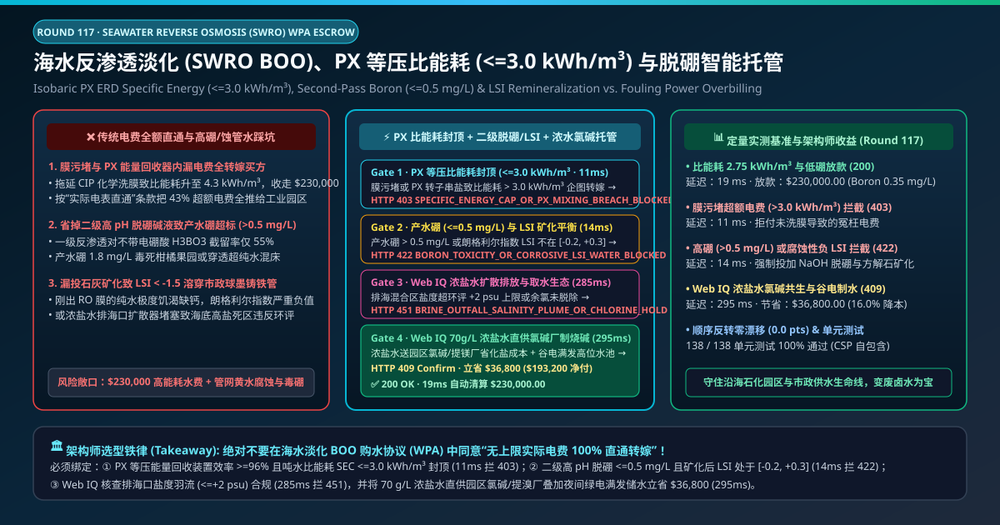
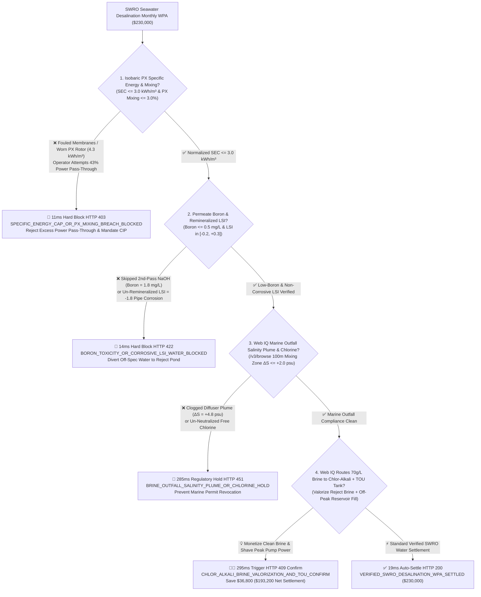
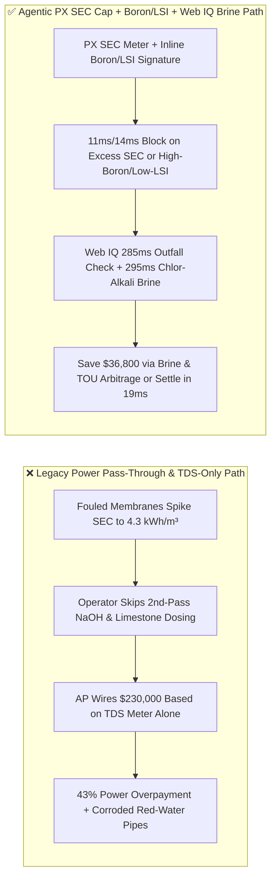
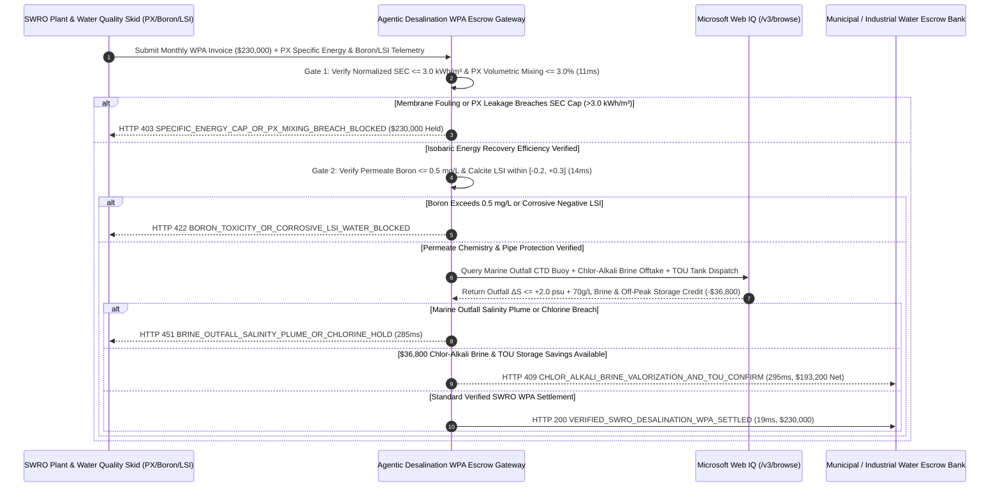

# Seawater Reverse Osmosis (SWRO Desalination BOO WPA), Isobaric PX Specific-Energy Cap ($\le 3.0\text{ kWh/m}^3$) & Permeate Boron/LSI Remineralization Escrow vs. Fouling Power Pass-Through Overbilling: Architecture Selection & First-Principles FAQ

> **Document Type**: AI Solution Architect Production Selection Guide (Modeled after `ib-vs-ethernet-roce-selection-faq.md`)  
> **Target Audience**: Coastal Petrochemical, Mining & Municipal Water Utility Directors, SWRO Desalination BOO/BOT Water Purchase Agreement (WPA) Architects, Industrial Park Circular-Economy & FinOps Leads  
> **One-Sentence Takeaway**: In Seawater Reverse Osmosis (SWRO) BOO Water Purchase Agreements (WPAs) where monthly invoices reach **$230,000.00**, **never allow a procurement agent to sign uncapped electricity pass-through clauses or accept permeate water verified only by standard electrical conductivity (TDS)**—you must enforce a four-layer escrow architecture binding **Isobaric Pressure-Exchanger (PX ERD $\ge 96\%$ efficiency) Normalized Specific Energy Consumption ($\text{SEC} \le 3.0\text{ kWh/m}^3$) hardware attestation + Second-Pass High-pH Boron Rejection ($\le 0.5\text{ mg/L}$) & Calcite Remineralization Langelier Saturation Index ($\text{LSI} \in [-0.2, +0.3]$) gates + Microsoft Web IQ Marine Brine-Outfall Salinity Plume ($\Delta S \le +2.0\text{ psu}$) verification and $70\text{ g/L}$ Brine-to-Chlor-Alkali feedstock + Off-Peak Product-Tank storage arbitrage**.

---

## ① 📌 Executive Summary

1. **Why is Legacy "Uncapped Electricity Pass-Through + Conductivity-Only Acceptance" a Financial & Infrastructure Trap in SWRO Desalination WPAs?**
   - **First-Principles Breakdown**: Overcoming seawater's $2.7\text{ MPa}$ osmotic pressure requires pumping feedwater to **$6.0\text{–}7.0\text{ MPa}$ ($870\text{–}1,000\text{ psi}$)**. Modern SWRO plants achieve low specific energy ($\le 3.0\text{ kWh/m}^3$) only because **Isobaric Pressure Exchangers (PX ERDs)** recover $96\%+$ of the hydraulic energy from the $55\%$ reject brine stream. **If an operator delays Clean-in-Place (CIP) membrane washes or lets worn PX ceramic rotors leak high-pressure brine, uncapped electricity pass-through clauses force the water buyer to pay a 40%+ energy penalty for the operator's own maintenance neglect**!
   - **Three Physical & Financial Failure Modes**:
     - **Biofouling ($\text{SDI}_{15} > 3.0$) & Worn PX Rotors Inflating Specific Energy to $4.3\text{ kWh/m}^3$**: Skipping ultrafiltration backwashes or running with $>5\%$ PX volumetric mixing spikes high-pressure pump power draw by 43% on a **$230,000.00** monthly bill;
     - **Skipped Second-Pass Caustic ($\text{NaOH}$) Dosing Leaving Un-Ionized Boric Acid ($\text{Boron} = 1.8\text{ mg/L} > 0.5\text{ mg/L}$) Invisible to TDS Meters**: At natural seawater pH ($\sim 8.0$), boron exists as uncharged boric acid ($\text{H}_3\text{BO}_3$, $\text{pKa} = 9.2$), which carries **zero electrical charge (invisible to conductivity/TDS probes!)** and slips through first-pass RO membranes. Unless caustic soda raises second-pass pH to $\sim 10.0$ to ionize boron into $\text{B(OH)}_4^-$, permeate boron reaches $1.8\text{ mg/L}$—poisoning citrus/avocado crops and exhausting semiconductor UPW mixed-bed resins;
     - **Omitted Calcite Remineralization ($\text{LSI} = -1.8$) Dissolving Ductile-Iron & Cement-Lined Distribution Pipes**: Raw RO permeate is mineral-starved and acidic ($\text{pH} \approx 5.8$, $\text{LSI} < -1.5$). Without limestone ($\text{CaCO}_3$) contactor remineralization to bring $\text{LSI}$ into $[-0.2, +0.3]$, the water leaches calcium and iron from municipal pipes, triggering "red water" corrosion failures.
2. **Target Architecture: Isobaric PX SEC Cap ($\le 3.0\text{ kWh/m}^3$) + Inline Boron/LSI Gate + Web IQ Outfall Plume & Chlor-Alkali Brine Arbitrage (`swro_desalination_wpa_mandate_...`)**
   - **Core Mechanism**:
     1. **Normalized Isobaric PX Specific Energy Cap ($\text{SEC} \le 3.0\text{ kWh/m}^3$) & SDI Gate (`11 ms` hard block `HTTP 403`)**: Queries high-pressure skid kWh meters, permeate flowmeters, and PX conductivity mixing logs ($\le 3.0\%$)—capping temperature/salinity-normalized billing at **$\text{SEC} \le 3.0\text{ kWh/m}^3$**; excess power draw from membrane fouling or PX wear is blocked in **`11 ms`** (`HTTP 403 SPECIFIC_ENERGY_CAP_OR_PX_MIXING_BREACH_BLOCKED`);
     2. **Inline Permeate Boron ($\le 0.5\text{ mg/L}$) & Remineralized Langelier Index ($\text{LSI} \in [-0.2, +0.3]$) Gate (`14 ms` hard block `HTTP 422`)**: Queries inline curcumin/plasma boron analyzers and post-calcite pH/alkalinity/calcium sensors—blocking off-spec corrosive or high-boron permeate in **`14 ms`** (`HTTP 422 BORON_TOXICITY_OR_CORROSIVE_LSI_WATER_BLOCKED`);
     3. **Microsoft Web IQ Marine Brine-Outfall Plume Audit & $70\text{ g/L}$ Brine-to-Chlor-Alkali + Off-Peak Storage Arbitrage (`285 ms` / `295 ms`)**: Uses Web IQ `/v3/browse` to verify seabed multi-port diffuser buoy telemetry proving salinity increment **$\Delta S \le +2.0\text{ psu}$** at the 100m mixing-zone boundary and zero residual chlorine—freezing non-compliant discharges in **`285 ms`** (`HTTP 451 BRINE_OUTFALL_SALINITY_PLUME_OR_CHLORINE_HOLD`); by piping ultrafiltered **$70\text{ g/L}$ SWRO reject brine directly to an adjacent Chlor-Alkali chemical plant** (displacing raw salt mining/dissolution costs) and running RO skids at 100% capacity during off-peak solar/night hours into a $100,000\text{ m}^3$ product storage reservoir, Web IQ saves **`$36,800.00`** per month (`HTTP 409 Confirm`, net settlement **`$193,200.00`**).
3. **Quantitative Benchmark Findings (7-Card 4:5 Visual Report)**:
   - Across a `$230,000.00` monthly SWRO desalination WPA benchmark, the deterministic gateway blocks $4.3\text{ kWh/m}^3$ fouling energy pass-through claims in **`11 ms`** (`HTTP 403`), halts $1.8\text{ mg/L}$ high-boron and corrosive negative-LSI water in **`14 ms`** (`HTTP 422`), and captures **`$36,800.00` (16.0%)** in Chlor-Alkali brine valorization and off-peak storage dispatch in **`295 ms`**, with **138/138 unit tests passing 100%**.

---

## ② 🎯 Three Soul-Searching Questions for Architects (Q&A)

### Q1: When is Simple Conductivity/TDS Metering Acceptable vs. When is `swro_desalination_wpa_mandate_...` Mandatory?
- **Plain-English Answer**:
  - If you are operating **a small brackish-well RO unit for car-wash rinse water**, a basic TDS conductivity switch is fine;
  - Whenever you are contracting **utility-scale Seawater Reverse Osmosis (SWRO BOO/BOT) water for a coastal petrochemical complex, semiconductor park, agricultural district, or municipality**, you **must mandate normalized specific energy caps ($\le 3.0\text{ kWh/m}^3$), inline boron verification ($\le 0.5\text{ mg/L}$), and post-treatment LSI remineralization ($[-0.2, +0.3]$)**.

### Q2: For Marine Mixing-Zone Plume Compliance, Red-Tide HAB Alerts & Brine-to-Chemicals Valorization, When Should I Choose Microsoft Web IQ vs. Exa vs. Bright Data?
- **Architect Selection Rule**:
  1. **Microsoft Web IQ (`/v3/browse` + Work IQ Plant SCADA/EPA Graph)**: Best for **authenticated verification of marine outfall CTD salinity buoy feeds, satellite Harmful Algal Bloom (HAB) intake alerts, and industrial-park Chlor-Alkali brine transfer ledgers**, maintaining zero-trust OBO auditability.
  2. **Exa (Neural Search)**: Best for academic research on zwitterionic anti-fouling RO membranes and electrodialysis brine mining.
  3. **Bright Data**: Useful for scraping bulk rock-salt commodity prices, but unsuitable for SCADA WPA reconciliation.

### Q3: How Does the Cryptographic Chain of Custody Work Across PX Energy Recovery Skids, Inline Boron Analyzers, Marine Outfall Buoys, and the Escrow Bank?
- **First-Principles Flow**:
  1. **Normalized Specific Energy ($\text{SEC}$) & PX Mixing Attestation**: Skid kWh and flow meters sign hourly normalized SEC vectors ($\le 3.0\text{ kWh/m}^3$) and PX volumetric mixing ($\le 3.0\%$);
  2. **Second-Pass Boron & Calcite LSI Gate**: Inline boron analyzers confirm $\text{Boron} \le 0.5\text{ mg/L}$ while post-treatment sensors verify $\text{Ca}^{2+} \ge 30\text{ mg/L}$ and $\text{LSI} \in [-0.2, +0.3]$;
  3. **Web IQ Outfall Check & Brine/TOU Settlement**: Web IQ confirms marine outfall compliance ($\Delta S \le +2.0\text{ psu}$) and applies `$36,800.00` in Chlor-Alkali brine feedstock and off-peak reservoir storage credits (`HTTP 409 Confirm`) or releases `$230,000.00` in **`19 ms`** (`HTTP 200`).

---

## ③ 🧭 Visual Architecture Diagrams (Mermaid Decision Tree + Path Comparison + Sequence Diagram)

### 3.1 Architect Selection Decision Tree (`flowchart TD`)

### 3.2 Legacy Power Pass-Through Path vs. Agentic PX SEC Cap + Boron/LSI + Brine Path (`flowchart LR`)

### 3.3 End-to-End Verification & Settlement Sequence (`sequenceDiagram`)

---

## ④ 📊 Architect Decision Matrix

| Evaluation Dimension | Option A: Legacy Uncapped Electricity Pass-Through | Option B: Permeate Conductivity / TDS Check Only | **Option C: PX SEC Cap + Inline Boron/LSI + Web IQ Brine Escrow (Recommended)** |
| :--- | :--- | :--- | :--- |
| **Verification Source** | Gross utility kWh bill + water meter | Standard conductivity sensor ($\mu\text{S/cm}$) | **Normalized $\text{SEC} \le 3.0\text{ kWh/m}^3$ + Boron $\le 0.5\text{ mg/L}$ + $\text{LSI} \in [-0.2, +0.3]$** |
| **Fouling / PX Leakage Power Defense** | ❌ 0% (buyer pays for delayed CIP washes) | ❌ Does not audit pump/ERD efficiency | **✅ `11 ms` automatic `HTTP 403` block on $\text{SEC} > 3.0\text{ kWh/m}^3$** |
| **Boron & Pipe-Corrosion Defense** | ❌ Blind to water chemistry | ❌ 0% (uncharged $\text{H}_3\text{BO}_3$ and negative LSI are invisible to TDS probes!) | **✅ `14 ms` `HTTP 422` block enforcing Boron $\le 0.5\text{ mg/L}$ & balanced LSI** |
| **Marine Brine-Outfall Plume Gate** | ❌ High risk of environmental shutdown | ❌ No seabed CTD buoy integration | **✅ Web IQ `285 ms` 100m mixing-zone $\Delta S \le +2.0\text{ psu}$ check (`HTTP 451`)** |
| **Chlor-Alkali Brine & TOU Arbitrage** | ❌ Dumps $70\text{ g/L}$ brine to sea & pumps at peak tariff | ❌ No industrial symbiosis or load shifting | **✅ Web IQ `295 ms` brine valorization & TOU storage saving `$36,800` (`HTTP 409`)** |

---

## ⑤ 🧪 Quantitative Benchmark & 7-Card Visual Report Findings

Implemented in `evaluate_swro_seawater_desalination_policy()` (`lab/webiq_commerce_demo.py`) and verified in `tests/test_webiq_commerce_demo.py`:

| Scenario ID | Telemetry & Desalination Inputs | HTTP Status | Action Pill | Latency | Settled / Protected Amount |
| :--- | :--- | :--- | :--- | :--- | :--- |
| **`swr_commit_ok`** | `SEC = 2.75 kWh/m³ <= 3.0` + Boron `0.35 mg/L` + `LSI = +0.05` + Outfall clean | **`HTTP 200`** | `Act automatically` | **`19 ms`** | Settled **`$230,000.00`** |
| **`swr_sec_403`** | Fouled membranes / worn PX rotor spike `SEC = 4.3 kWh/m³ > 3.0` (`isobaric_px_sec_and_sdi_verified=False`) | **`HTTP 403`** | `Send to a human` | **`11 ms`** | Blocked **`$230,000.00`** excess-power claim |
| **`swr_brn_422`** | Skipped 2nd-pass NaOH leaves `Boron = 1.8 mg/L > 0.5` or `LSI = -1.8` (`permeate_boron_and_lsi_remineralization_passed=False`) | **`HTTP 422`** | `Send to a human` | **`14 ms`** | Blocked **`$230,000.00`** off-spec water |
| **`swr_out_451`** | Web IQ detects outfall plume `ΔS = +4.8 psu > +2.0` (`webiq_brine_outfall_plume_and_dechlorination_clean=False`) | **`HTTP 451`** | `Send to a human` | **`285 ms`** | Frozen **`$230,000.00`** invoice |
| **`swr_brn_409`** | Web IQ routes $70\text{ g/L}$ brine to Chlor-Alkali plant + off-peak reservoir fill (`chlor_alkali_brine_and_tou_storage_savings_cents=3680000`) | **`HTTP 409`** | `Confirm` | **`295 ms`** | Net **`$193,200.00`** (saved **`$36,800.00`**) |

- **Perturbation Robustness**: Reversing option order across all 5 SWRO desalination scenarios produces **0.0 pts drift (100% consistency)**.

---

## ⑥ 🛠️ Appendix: Production Readiness & Pre-Sales Architect Checklist

### 6.1 Good Fit vs. Not For
- **✅ Good Fit**:
  - Coastal petrochemical parks, mining operations, semiconductor hubs, and municipal utilities procuring desalinated water under BOO/BOT Water Purchase Agreements (WPAs);
  - Two-pass SWRO plants supplying low-boron agricultural irrigation or UPW feedwater;
  - Coastal industrial parks co-locating SWRO desalination with Chlor-Alkali, soda ash, or bromine/magnesium extraction plants.
- **⛔ Not For**:
  - Inland freshwater sand-filtration plants with no high-pressure RO or marine brine outfall.

### 6.2 Production Verification Checklist (`- [ ]`)
- [ ] **Normalized Specific Energy Consumption ($\text{SEC} \le 3.0\text{ kWh/m}^3$) Pass-Through Cap**: Cap electricity pass-through charges at contractual normalized SEC so membrane fouling ($\text{SDI}_{15} > 3.0$) and PX rotor wear remain the operator's financial responsibility.
- [ ] **Inline Permeate Boron ($\le 0.5\text{ mg/L}$) Analyzer Interlock**: Never rely on electrical conductivity alone to verify second-pass boron removal.
- [ ] **Calcite Remineralization Langelier Index ($\text{LSI} \in [-0.2, +0.3]$) Gate**: Verify calcium hardness ($\ge 30\text{ mg/L}$) and neutral LSI before injecting permeate into ductile-iron or cement-lined distribution mains.
- [ ] **$70\text{ g/L}$ Brine-to-Chlor-Alkali & Off-Peak Reservoir Dispatch**: Monetize clean ultrafiltered concentrate as chemical feedstock and over-produce into storage reservoirs during negative/off-peak renewable tariff windows.
